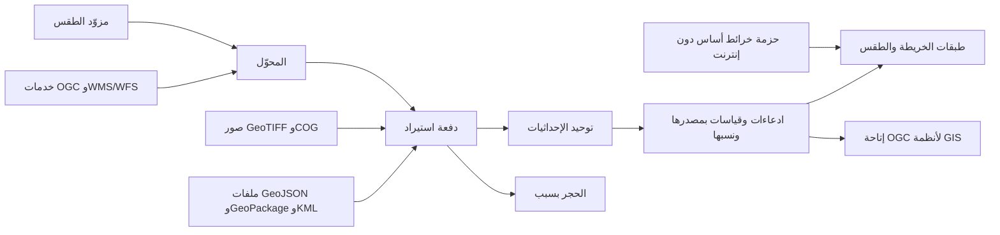
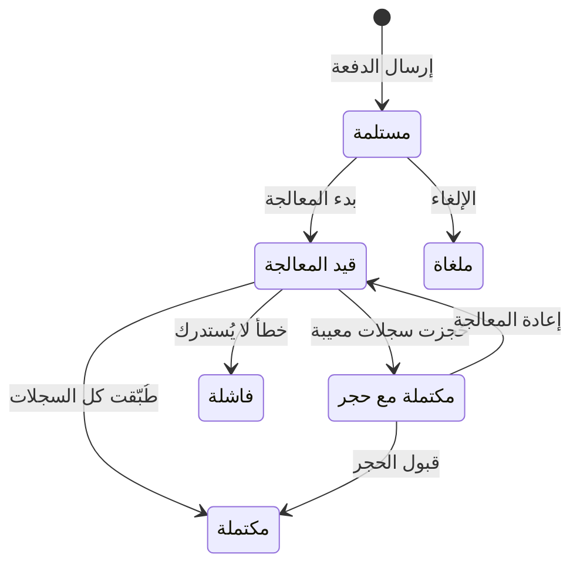

# استيراد الخرائط والطقس

<!-- BEGIN GENERATED: doc -->
| البند | القيمة |
|---|---|
| المعرّف | FEAT-COL-GEO-WEATHER |
| الإصدار | 0.2 |
| الحالة | مسودة |
| القدرة | CAP-02 جمع المعلومات |
| القدرة الفرعية | CAP-02.04 الاستيعاب والتكامل (R1) |
| الأدوار | مسؤول الإدارة؛ مهندس التكامل |
| الشاشات | SCR-64 الاستيراد والحجر، SCR-65 المحوّلات والاتصالات والحساسات، SCR-11 الصورة العملياتية المشتركة (COP) |
| حالات الاستخدام | UC-094 |
| القصص | 8: 0 من المواصفة، و8 جديدة |
<!-- END GENERATED: doc -->

## 1. نظرة عامة

### 1.1 القيمة

يتيح جلب الطبقات الجغرافية وبيانات الطقس من مزوديها المعتمدين لتظهر في الصورة العملياتية.

### 1.2 النطاق

| البند | القيمة |
|---|---|
| المستخدمون | مسؤول الإدارة، ومهندس التكامل، ومستخدمو الصورة العملياتية المشتركة، وفريق المنصة، وفريق التشغيل |
| الشاشات | SCR-64 الاستيراد والحجر، وSCR-65 المحوّلات والاتصالات والحساسات، وSCR-11 الصورة العملياتية المشتركة |
| حالات الاستخدام | استيعاب البيانات الخارجية (UC-094) |
| المتطلبات | استيراد البيانات الجغرافية بصيغ OGC وWMS/WFS وGeoJSON وGeoPackage وGeoTIFF/COG وKML (REQ-INF-008)، واستيعاب الطقس بمحوّل يسجّل مزوّده مصدرًا (REQ-INF-009)، وحجر السجل المعيب (REQ-INF-006)، والنظام المرجعي الموحد (REQ-INF-029)، والعمليات الثقيلة مهامًا في الخلفية (REQ-PLT-005)، والعمل دون إنترنت (REQ-PLT-001) |
| داخل النطاق | استيراد الملفات الجغرافية والصور النقطية، وجلب الطبقات من خدمات OGC وWMS/WFS، وجلب الطقس، وتوحيد الإحداثيات، وعرض الطبقات المستوردة والطقس على الخريطة، وإتاحة البيانات الجغرافية لأنظمة GIS المؤسسية، وتحديث الخرائط الأساس دون إنترنت |
| خارج النطاق | تسجيل المحوّل وتفعيله (إدارة محوّلات البيانات)، وإعداد الاتصال واختباره (اتصالات الأنظمة الخارجية)، وإعادة معالجة الحجر وقبوله (استيراد البيانات والحجر)، وتسجيل المصدر وموثوقيته (سجل المصادر وموثوقيتها)، وطبقات الموقف لأنظمة الخرائط الخارجية (الصورة العملياتية المشتركة)، وحزم المنطقة للأجهزة (تحميل بيانات المنطقة مسبقًا) |

### 1.3 خريطة الميزة

**الشكل 1: خريطة استيراد الخرائط والطقس**



**الشكل 2: رحلة دفعة الاستيراد**



كل قصص الاستيراد في الميزة تمر بهذه الرحلة (§2.5). وإعادة المعالجة وقبول الحجر والإلغاء من ميزة استيراد البيانات والحجر.

## 2. القواعد المشتركة

تنطبق على كل قصص الميزة، فلا تتكرر داخل القصص. وكل قصة تذكر ما يخصها فقط.

### 2.1 السياق المشترك

كل قصة تبدأ من ثلاثة شروط: مستأجر نشط، وحزمة السياسات الأساسية مفعّلة، ومستخدم مسجّل الدخول ومخوَّل. وتشير إليها القصص بخطوة واحدة: «بفرض السياق المشترك للميزة».

### 2.2 الصلاحية وعدم الإفصاح

- من لا يحق له رؤية العنصر يتلقى ردًا بشكل «غير متاح» تمامًا، فلا يعرف أنه موجود.
- من يرى العنصر ولا يحق له الإجراء يتلقى «لا تملك صلاحية هذا الإجراء».

### 2.3 أوامر تغيير الحالة

- **منع التكرار:** يُرسل كل أمر بمفتاح فريد، فإعادة الطلب نفسه لا تُنفَّذ مرتين.
- **حماية التعديل المتزامن:** يُرسل كل أمر بإصدار البيانات الذي يراه المستخدم. فإن عدّلها غيره في الأثناء، يُرفض الأمر.
- **السجل:** إن نجح الأمر، يُكتب حدثه وسجل التدقيق في المعاملة نفسها.

### 2.4 الرفض المشترك

```gherkin
# language: ar
خاصية: الرفض المشترك لأوامر الميزة

  سيناريو مخطط: رفض مشترك لكل أمر في الميزة
    بفرض السياق المشترك للميزة
    و <الحالة>
    عندما يُرسل المستخدم أي أمر من أوامر الميزة
    اذاً يُرفض برمز <الرمز> ويرى "<الرسالة>"
    و لا يتغير شيء

    امثلة:
      | الحالة                                  | الرمز                  | الرسالة                                                 |
      | العنصر خارج صلاحياته                    | NOT_FOUND              | غير متاح                                                |
      | العنصر مرئي له ولا يحق له الإجراء       | AUTHZ_DENIED           | لا تملك صلاحية هذا الإجراء                              |
      | غيره عدّل العنصر بعد أن فتحه            | VERSION_CONFLICT       | تغيّرت البيانات منذ فتحتها. راجع التغييرات ثم أعد المحاولة |
      | أعاد مفتاح منع التكرار بمحتوى مختلف     | IDEMPOTENCY_KEY_REUSED | طلب مكرر بمحتوى مختلف                                   |
      | البيانات ناقصة أو غير صحيحة             | VALIDATION_FAILED      | بعض البيانات ناقصة أو غير صحيحة. راجع الحقول المعلَّمة      |

  سيناريو: إعادة الطلب نفسه لا تُنفَّذ مرتين
    بفرض السياق المشترك للميزة
    و أمر نجح بمفتاح منع تكرار
    عندما يُعاد الطلب نفسه بالمفتاح نفسه
    اذاً تُعاد النتيجة الأولى ولا يُكتب حدث ثانٍ
```

### 2.5 كل ما يدخل يمر بدفعة استيراد

- كل ملف أو طبقة أو قياس يدخل في دفعة استيراد بمعرّف فريد لكل محوّل. والمعرّف نفسه بالمحتوى نفسه يعيد الدفعة القائمة، وبمحتوى مختلف يُرفض.
- يُفحص كل سجل في الدفعة. والهندسة غير الصالحة، أو الإحداثيات خارج النطاق، أو غياب نظام الإحداثيات أو الدقة، يحجز السجل بسببه، فلا يظهر في أي استعلام ولا طبقة (REQ-INF-006، QAS-DQ-001).
- كل سجل يُطبَّق يصبح ادعاءات تستشهد بمصدر المحوّل، ومعه نسبه: الدفعة وإصدار الربط.
- المعالجة الثقيلة، كالاستيراد بالجملة ومعالجة الصور النقطية، تجري مهمة في الخلفية بحالة وإعادة محاولة وإلغاء، لا في طلب متزامن (REQ-PLT-005).
- لا اعتماد على الإنترنت: كل نظام خارجي داخل حدود المؤسسة، ولكل اتصال قاعدة سماح واحدة في بوابة الشبكة (FIT-12).

```gherkin
# language: ar
خاصية: قواعد الاستيراد المشتركة

  سيناريو: سجل بلا نظام إحداثيات يُحجز
    بفرض السياق المشترك للميزة
    و دفعة استيراد فيها سجلات صالحة وسجل بلا نظام إحداثيات
    عندما تُعالج الدفعة
    اذاً تُطبَّق السجلات الصالحة بنسبها ويُحجز السجل المعيب بسببه
    و تصبح الدفعة "مكتملة مع حجر" ولا يظهر السجل المحجوز في أي استعلام أو طبقة

  سيناريو: إعادة الدفعة نفسها
    بفرض السياق المشترك للميزة
    و دفعة أُرسلت بمعرّف ومحتوى
    عندما تُرسل مرة ثانية بالمعرّف والمحتوى نفسيهما
    اذاً تُعاد الدفعة القائمة ولا يتكرر أي سجل

  سيناريو مخطط: رفض مشترك لكل دفعة استيراد
    بفرض السياق المشترك للميزة
    و <الحالة>
    عندما تُرسل الدفعة
    اذاً يُرفض برمز <الرمز> ويرى "<الرسالة>"
    و لا يتغير شيء

    امثلة:
      | الحالة                                                 | الرمز            | الرسالة                                     |
      | معرّف الدفعة استُخدم من قبل لهذا المحوّل بمحتوى مختلف | BATCH_KEY_REUSED | استُخدم معرّف هذه الدفعة من قبل بمحتوى مختلف |
```

## 3. الجودة وتعريف الاكتمال

### 3.1 متطلبات الجودة

<!-- BEGIN GENERATED: quality -->
| المرجع | الموقف | المطلوب |
|---|---|---|
| QAS-DQ-001 | submits records with invalid geometry or missing CRS | 100 % of invalid records quarantined; 0 published |
<!-- END GENERATED: quality -->

### 3.2 تعريف الاكتمال

القصة مكتملة حين تتحقق الشروط الخمسة:

1. سيناريوهاتها والقواعد المشتركة تمر في الاختبار الآلي.
2. فحوص البنية المعمارية تمر.
3. نصوص الواجهة والرسائل موجودة بالعربية والإنجليزية.
4. مراجعة الكود مكتملة.
5. ما تضيفه القصة نفسها في قسم «القواعد» تحقق.

## 4. فهرس القصص

<!-- BEGIN GENERATED: story-index -->
| المعرّف | القصة | النوع | الحالة |
|---|---|---|---|
| `US-UI-SCR11-WEATHER-LAYER` | عرض طبقات الطقس والخرائط المستوردة | واجهة | مسودة |
| `US-PLT-GEO-REPROJECT` | توحيد إحداثيات الطبقات المستوردة | منصة | مسودة |
| `US-INT-GEO-FILE-IMPORT` | استيراد ملفات GeoJSON وGeoPackage وKML | تكامل | مسودة |
| `US-INT-GEO-OGC-EXCHANGE` | إتاحة البيانات الجغرافية لأنظمة GIS المؤسسية | تكامل | مسودة |
| `US-INT-GEO-OGC-IMPORT` | جلب الطبقات من خدمات OGC وWMS/WFS | تكامل | مسودة |
| `US-INT-GEO-RASTER-IMPORT` | استيراد الصور النقطية GeoTIFF وCOG | تكامل | مسودة |
| `US-INT-WEATHER-FEED` | جلب بيانات الطقس من مزوّدها المعتمد | تكامل | مسودة |
| `US-OPS-GEO-BASEMAP-UPDATE` | تحديث الخرائط الأساس دون إنترنت | تشغيل | مسودة |
<!-- END GENERATED: story-index -->

## 5. القصص

### 5.1 US-UI-SCR11-WEATHER-LAYER — عرض طبقات الطقس والخرائط المستوردة

| النوع | الإصدار | الأولوية | دون اتصال | الحالة |
|---|---|---|---|---|
| واجهة | R1 | Must | لا | مسودة |

> **كـ** المستخدم، **أريد** أن أشغّل طبقة الطقس والطبقات المستوردة على الصورة العملياتية المشتركة، **حتى** أقرأ الموقف مع الظروف الجوية والبيانات الجغرافية للمؤسسة.

**باختصار:** تظهر الطبقات المستوردة وقياسات الطقس على خريطة الصورة العملياتية. ولكل قياس طقس مصدره ووقت رصده في بطاقته.

#### القواعد

- الطبقات المتجهية تصل بلاطات متجهية من الخادم، والنقطية بلاطات من صور COG، والخرائط الأساس بمسار منفصل (TD-10).
- كل قياس طقس يُعرض بمصدره ووقت رصده (REQ-INF-009).
- تظهر من الطبقات العناصر المرئية للمستخدم فقط، ولا تُشارك بلاطاتها بين نطاقات صلاحية مختلفة. وحدها الخرائط الأساس الموسومة غير مصنفة تُشارك (ADR-P06).
- العناصر تتجمع عند التصغير، فلا تزيد البلاطة على 5,000 عنصر.
- **[Derived]** طبقة الطقس في قائمة الطبقات وطريقة عرضها، لأن المصادر لا تذكرها بين طبقات الخريطة.

#### معايير القبول

```gherkin
# language: ar
خاصية: عرض طبقات الطقس والخرائط المستوردة

  سيناريو: المستخدم يشغّل طبقة الطقس
    بفرض السياق المشترك للميزة
    و قياسات طقس مستوردة داخل المنطقة المعروضة
    عندما يشغّل المستخدم طبقة الطقس وينقر على قياس
    اذاً تظهر القياسات على الخريطة
    و تُظهر بطاقة القياس مصدره ووقت رصده

  سيناريو: طبقة نقطية مستوردة
    بفرض السياق المشترك للميزة
    و صورة نقطية اكتمل استيرادها
    عندما يشغّل المستخدم طبقتها
    اذاً تظهر الصورة في موضعها على الخريطة

  سيناريو: السجل المحجوز لا يظهر
    بفرض السياق المشترك للميزة
    و سجل من دفعة استيراد محجوز لهندسة غير صالحة
    عندما يشغّل المستخدم طبقة الدفعة
    اذاً لا يظهر السجل المحجوز ولا ما يدل عليه
```

<details><summary>المراجع التقنية والتتبع</summary>

<!-- BEGIN GENERATED: refs US-UI-SCR11-WEATHER-LAYER -->
| البند | المعرّف | المعنى |
|---|---|---|
| الشاشة | SCR-11 | شاشة الصورة العملياتية المشتركة (COP) |
| المصدر | `21-ui-design.md §7` | — |
| المصدر | `[Derived]` | — |
| المتطلب | REQ-INF-009 | The system shall ingest weather data through an adapter and register the provider as a source. |
| حالة الاستخدام | UC-094 | Ingest External Data |
<!-- END GENERATED: refs US-UI-SCR11-WEATHER-LAYER -->

</details>

### 5.2 US-PLT-GEO-REPROJECT — توحيد إحداثيات الطبقات المستوردة

| النوع | الإصدار | الأولوية | دون اتصال | الحالة |
|---|---|---|---|---|
| منصة | R1 | Must | لا ينطبق | مسودة |

> **كـ** فريق المنصة، **أريد** أن تُخزَّن كل هندسة مستوردة بنظام مرجعي واحد مع أصلها كما وصل، **حتى** تعمل الاستعلامات المكانية عبر المصادر دون فقد للأصل.

#### القواعد

- كل هندسة تُخزَّن بالنظام المرجعي الموحد WGS 84 بترتيب خط الطول ثم خط العرض، ومعها نظامها الأصلي وإحداثياتها كما وصلت (ADR-P16، REQ-INF-029).
- الهندسة بلا نظام إحداثيات أو بلا دقة تُحجز بسبب (§2.5).
- المسافة والمساحة تُحسبان جيوديسيًا، أو بإسقاط محلي مناسب يُسجَّل في النسب.
- الهندسة التي حُوّلت تحمل علامة الجودة «محوَّلة».
- فحص البنية يرفض أي حقل هندسة بلا نظام إحداثيات ودقة (FIT-08).

#### معايير القبول

```gherkin
# language: ar
خاصية: توحيد إحداثيات الطبقات المستوردة

  سيناريو: ملف بنظام إسقاط محلي
    بفرض ملف معالمه بنظام إسقاط محلي ودقة معلنة
    عندما يُستورد
    اذاً تُخزَّن كل هندسة بالنظام الموحد ومعها نظامها وإحداثياتها الأصلية
    و تحمل الهندسة علامة الجودة "محوَّلة"

  سيناريو: الذهاب والإياب
    بفرض مجموعة البيانات المرجعية بعد استيرادها
    عندما تُحوَّل هندستها الموحدة إلى نظامها الأصلي
    اذاً تعود الإحداثيات الأصلية في حدود الدقة المعلنة
```

<details><summary>المراجع التقنية والتتبع</summary>

<!-- BEGIN GENERATED: refs US-PLT-GEO-REPROJECT -->
| البند | المعرّف | المعنى |
|---|---|---|
| فحص البنية | FIT-08 | Every geometry has CRS and accuracy; canonical EPSG:4326 |
| القرار المعماري | ADR-P16 | Canonical CRS |
| المتطلب | REQ-INF-008 | The system shall import geospatial data via OGC API Features/Maps/Tiles, WMS/WFS, GeoJSON, GeoPackage, GeoTIF… |
| حالة الاستخدام | UC-094 | Ingest External Data |
<!-- END GENERATED: refs US-PLT-GEO-REPROJECT -->

</details>

### 5.3 US-INT-GEO-FILE-IMPORT — استيراد ملفات GeoJSON وGeoPackage وKML

| النوع | الإصدار | الأولوية | دون اتصال | الحالة |
|---|---|---|---|---|
| تكامل | R1 | Must | لا ينطبق | مسودة |

> **كـ** مسؤول الإدارة، **أريد** أن أستورد ملفًا جغرافيًا بصيغة GeoJSON أو GeoPackage أو KML، **حتى** تصبح معالمه بيانات في المنصة بمصدرها.

**باختصار:** يرفع المسؤول الملف ويرسله دفعة استيراد. وتُعالج الدفعة في الخلفية، فتصبح المعالم الصالحة ادعاءات بهندستها وسماتها، ويُحجز المعيب.

#### القواعد

- **متى يحدث:** يرسل مسؤول الإدارة الملف عبر محوّل مصدره، أو يرسله محوّل «نشط» بهوية حساب خدمته.
- **البيانات:** الملف مرفقًا، وصيغته، ومعرّف الدفعة، وبصمة محتواه، والمحوّل.
- **الأثر:** دفعة «مستلمة» تُعالج في الخلفية (§2.5). وكل معلم صالح يحتفظ بهندسته وسماته، ويصبح ادعاءات تستشهد بمصدر المحوّل بنسبها (REQ-INF-008).
- **[Derived]** رفض الصيغة غير المدعومة عند الإرسال، لأن المصادر تحدد الصيغ ولا تحدد رد الخادم على غيرها.

#### معايير القبول

```gherkin
# language: ar
خاصية: استيراد ملفات GeoJSON وGeoPackage وKML

  سيناريو: استيراد ملف GeoPackage مرجعي
    بفرض السياق المشترك للميزة
    و ملف GeoPackage مرجعي فيه معالم بهندستها وسماتها
    عندما يرسله مسؤول الإدارة دفعة استيراد
    اذاً تصبح الدفعة "مستلمة" ثم "مكتملة"
    و تُحفظ هندسة كل معلم وسماته كما في الملف، بمصدر المحوّل ونسب الدفعة

  سيناريو مخطط: رفض خاص باستيراد الملف
    بفرض السياق المشترك للميزة
    و <الحالة>
    عندما يرسل مسؤول الإدارة الدفعة
    اذاً يُرفض برمز <الرمز> ويرى "<الرسالة>"
    و لا يتغير شيء

    امثلة:
      | الحالة                      | الرمز             | الرسالة              |
      | صيغة الملف ليست مدعومة      | VALIDATION_FAILED | صيغة الملف غير صحيحة |
      | الدفعة بلا معرّف            | VALIDATION_FAILED | معرّف الدفعة مطلوب   |
```

<details><summary>المراجع التقنية والتتبع</summary>

<!-- BEGIN GENERATED: refs US-INT-GEO-FILE-IMPORT -->
| البند | المعرّف | المعنى |
|---|---|---|
| الجودة | QAS-DQ-001 | submits records with invalid geometry or missing CRS → 100 % of invalid records quarantined; 0 published |
| المتطلب | REQ-INF-008 | The system shall import geospatial data via OGC API Features/Maps/Tiles, WMS/WFS, GeoJSON, GeoPackage, GeoTIF… |
| حالة الاستخدام | UC-094 | Ingest External Data |
<!-- END GENERATED: refs US-INT-GEO-FILE-IMPORT -->

</details>

### 5.4 US-INT-GEO-OGC-EXCHANGE — إتاحة البيانات الجغرافية لأنظمة GIS المؤسسية

| النوع | الإصدار | الأولوية | دون اتصال | الحالة |
|---|---|---|---|---|
| تكامل | R1 | Should | لا ينطبق | مسودة |

> **كـ** مهندس التكامل، **أريد** أن تقرأ أنظمة GIS المؤسسية البيانات الجغرافية للمنصة بمعيار OGC API، **حتى** لا تحتاج المؤسسة إلى نسخها يدويًا.

**باختصار:** تتيح المنصة معالمها وبلاطاتها عبر OGC API Features وTiles. ويتلقى النظام الطالب ما تسمح به صلاحية هويته فقط.

#### القواعد

- **متى يحدث:** يطلب نظام GIS مؤسسي معالم طبقة أو بلاطاتها.
- **البيانات:** معالم بالنظام المرجعي الموحد، أو بلاطات. والنشر بـWMS/WFS ليس من R1، ويُعاد النظر فيه إن صار متطلبًا في R2 (TD-10).
- **الأثر:** لا يتغير شيء في بيانات المنصة. والتصفية بصلاحية الطالب تسبق العد، ولا يدل الرد على معلم محجوب (ADR-P06).
- **[Derived]** القصة كلها مستنتجة من القرار التقني. وهوية النظام الطالب وصلاحيته **[Needs Review]**، لأن المصادر لا تعرّفهما.
- **[Needs Review]** تصميم التكامل يجعل رسالة CAP المخرج الوحيد حتى R2، ويذكر في الوقت نفسه تبادل OGC صادرًا في R1.

#### معايير القبول

```gherkin
# language: ar
خاصية: إتاحة البيانات الجغرافية لأنظمة GIS المؤسسية

  سيناريو: نظام GIS يطلب معالم طبقة
    بفرض نظام GIS مؤسسي مخوَّل على طبقة فيها معالم داخل صلاحيته وأخرى خارجها
    عندما يطلب معالم الطبقة عبر OGC API Features
    اذاً تُعاد المعالم داخل صلاحيته فقط بالنظام المرجعي الموحد
    و لا يكشف أي عدد وجود المعالم خارج صلاحيته

  سيناريو: الطلب لا يغيّر شيئًا
    بفرض طبقة أُتيحت معالمها لنظام GIS
    عندما ينتهي الطلب
    اذاً لا يتغير شيء في بيانات المنصة
```

<details><summary>المراجع التقنية والتتبع</summary>

<!-- BEGIN GENERATED: refs US-INT-GEO-OGC-EXCHANGE -->
| البند | المعرّف | المعنى |
|---|---|---|
| القرار التقني | TD-10 | Dynamic operational vector tiles from PostGIS (ST_AsMVT) via Martin tile server with scope-keyed cache; base… |
| المصدر | `20-integration-design.md §2` | — |
| المصدر | `[Derived]` | — |
<!-- END GENERATED: refs US-INT-GEO-OGC-EXCHANGE -->

</details>

### 5.5 US-INT-GEO-OGC-IMPORT — جلب الطبقات من خدمات OGC وWMS/WFS

| النوع | الإصدار | الأولوية | دون اتصال | الحالة |
|---|---|---|---|---|
| تكامل | R1 | Must | لا ينطبق | مسودة |

> **كـ** مهندس التكامل، **أريد** أن يجلب المحوّل الطبقات من خدمات OGC وWMS/WFS المؤسسية، **حتى** تبقى البيانات الجغرافية محدثة دون استيراد يدوي.

**باختصار:** يسحب المحوّل من الخدمة ما تغيّر منذ آخر نقطة مؤكدة، ويرسله دفعة استيراد. ولا تتقدم نقطة التقدم إلا بعد تأكيد الدفعة.

#### القواعد

- **متى يحدث:** المحوّل «نشط» واتصاله «نشط»، فيسحب من الخدمة ما بعد آخر نقطة مؤكدة.
- **البيانات:** معالم من OGC API Features أو WFS، وخرائط وبلاطات من OGC API Maps وTiles أو WMS.
- **الأثر:** دفعة بمعرّف فريد تُعالج كما في §2.5، ثم تتقدم نقطة التقدم.
- إن انقطعت الخدمة يصبح الاتصال «متدهور» ويتوقف السحب دون فقد، ثم يُستأنف من آخر نقطة مؤكدة. وانقطاع 4 ساعات لا يفقد شيئًا، ويُعالج تراكمه خلال ساعة (QAS-INT-001).
- **[Needs Review]** كيف تُحفظ صور الخرائط من WMS وOGC API Maps وTiles: طبقة نقطية أم مرجعًا إلى الخدمة.

#### معايير القبول

```gherkin
# language: ar
خاصية: جلب الطبقات من خدمات OGC وWMS/WFS

  سيناريو: سحب معالم جديدة من خدمة WFS
    بفرض محوّل "نشط" لخدمة WFS واتصاله "نشط"
    و في الخدمة معالم تغيّرت بعد آخر نقطة مؤكدة
    عندما يسحب المحوّل
    اذاً تُرسل المعالم دفعة استيراد وتُطبَّق بمصدر المحوّل ونسبها
    و تتقدم نقطة التقدم بعد تأكيد الدفعة

  سيناريو: انقطاع الخدمة
    بفرض محوّل يسحب من خدمة OGC انقطعت 4 ساعات
    عندما تعود الخدمة
    اذاً يُستأنف السحب من آخر نقطة مؤكدة دون فقد
    و يُعالج التراكم خلال ساعة

  سيناريو: اتصال معلّق
    بفرض اتصال الخدمة "معلّق"
    عندما يحين موعد السحب
    اذاً لا يُسحب شيء ولا تتقدم نقطة التقدم
```

<details><summary>المراجع التقنية والتتبع</summary>

<!-- BEGIN GENERATED: refs US-INT-GEO-OGC-IMPORT -->
| البند | المعرّف | المعنى |
|---|---|---|
| القرار التقني | TD-10 | Dynamic operational vector tiles from PostGIS (ST_AsMVT) via Martin tile server with scope-keyed cache; base… |
| المصدر | `20-integration-design.md §2` | — |
| المتطلب | REQ-INF-008 | The system shall import geospatial data via OGC API Features/Maps/Tiles, WMS/WFS, GeoJSON, GeoPackage, GeoTIF… |
| حالة الاستخدام | UC-094 | Ingest External Data |
<!-- END GENERATED: refs US-INT-GEO-OGC-IMPORT -->

</details>

### 5.6 US-INT-GEO-RASTER-IMPORT — استيراد الصور النقطية GeoTIFF وCOG

| النوع | الإصدار | الأولوية | دون اتصال | الحالة |
|---|---|---|---|---|
| تكامل | R1 | Must | لا ينطبق | مسودة |

> **كـ** مسؤول الإدارة، **أريد** أن أستورد صورة نقطية بصيغة GeoTIFF أو COG، **حتى** تظهر طبقةً على الخريطة.

**باختصار:** تُعالج الصورة مهمة في الخلفية يتابع المسؤول حالتها ويلغيها إن شاء، ثم تُقدَّم بلاطات نقطية من صورة COG.

#### القواعد

- **متى يحدث:** يرسل مسؤول الإدارة الصورة دفعة استيراد عبر محوّل مصدرها.
- **البيانات:** الصورة مرفقًا، وصيغتها، ومعرّف الدفعة، وبصمة محتواها.
- **الأثر:** مهمة في الخلفية بحالة وإعادة محاولة وإلغاء، ولا يعالج أي طلب متزامن الصورة (REQ-PLT-005). وعند اكتمالها تُقدَّم الطبقة بلاطات نقطية من COG (TD-10).
- **[Derived]** تحويل GeoTIFF إلى COG قبل التقديم، وحجر الصورة بلا نظام إحداثيات كما تُحجز الهندسة (§2.5).

#### معايير القبول

```gherkin
# language: ar
خاصية: استيراد الصور النقطية GeoTIFF وCOG

  سيناريو: استيراد صورة GeoTIFF كبيرة
    بفرض السياق المشترك للميزة
    و صورة GeoTIFF بنظام إحداثيات معلن
    عندما يرسلها مسؤول الإدارة دفعة استيراد
    اذاً يُرد عليه فورًا بالدفعة وتبدأ معالجتها في الخلفية
    و يتابع حالتها حتى تصبح "مكتملة" وتظهر طبقتها على الخريطة

  سيناريو: صورة بلا نظام إحداثيات
    بفرض السياق المشترك للميزة
    و صورة GeoTIFF بلا نظام إحداثيات
    عندما تُعالج دفعتها
    اذاً تُحجز الصورة بسببها ولا تظهر طبقة على الخريطة
```

<details><summary>المراجع التقنية والتتبع</summary>

<!-- BEGIN GENERATED: refs US-INT-GEO-RASTER-IMPORT -->
| البند | المعرّف | المعنى |
|---|---|---|
| القرار التقني | TD-10 | Dynamic operational vector tiles from PostGIS (ST_AsMVT) via Martin tile server with scope-keyed cache; base… |
| المتطلبات | REQ-INF-008، REQ-PLT-005 | معانيها في القسم 6. التتبع |
| حالة الاستخدام | UC-094 | Ingest External Data |
<!-- END GENERATED: refs US-INT-GEO-RASTER-IMPORT -->

</details>

### 5.7 US-INT-WEATHER-FEED — جلب بيانات الطقس من مزوّدها المعتمد

| النوع | الإصدار | الأولوية | دون اتصال | الحالة |
|---|---|---|---|---|
| تكامل | R1 | Must | لا ينطبق | مسودة |

> **كـ** مهندس التكامل، **أريد** أن يجلب محوّل الطقس القياسات من المزوّد المعتمد، **حتى** يرى المستخدمون الطقس على الخريطة بمصدره ووقته.

**باختصار:** المزوّد مسجّل مصدرًا، ومحوّله يسحب القياسات منذ آخر نقطة مؤكدة. وكل قياس يُسجَّل بمصدره ووقت رصده ويظهر في طبقة الطقس.

#### القواعد

- **متى يحدث:** محوّل الطقس «نشط»، ومصدره «نشط»، فيسحب ما بعد آخر نقطة مؤكدة.
- **البيانات:** قياسات الطقس، ولكل قياس موقعه ووقت رصده.
- **الأثر:** دفعة استيراد (§2.5). وكل قياس يحمل المصدر ووقت الرصد، ويظهر في طبقة الطقس (القصة 5.1، REQ-INF-009). والمحوّل مربوط بمصدر واحد.
- المصدر «معلّق» أو «متقاعد» لا تُستشهد به بيانات جديدة.
- **[Derived]** حجر القياس بلا وقت رصد. ونوع ما يُسجَّل، ملاحظة أم ادعاء، **[Needs Review]**.

#### معايير القبول

```gherkin
# language: ar
خاصية: جلب بيانات الطقس من مزوّدها المعتمد

  سيناريو: سحب قياسات جديدة
    بفرض محوّل طقس "نشط" مربوط بمصدر "نشط"
    و لدى المزوّد قياسات بعد آخر نقطة مؤكدة
    عندما يسحب المحوّل
    اذاً يُسجَّل كل قياس بمصدره ووقت رصده ونسب الدفعة
    و يظهر في طبقة الطقس

  سيناريو مخطط: قياس لا يُسجَّل
    بفرض <الحالة>
    عندما تُعالج دفعة الطقس
    اذاً لا يُسجَّل القياس ولا يظهر في الطبقة

    امثلة:
      | الحالة |
      | قياس بلا وقت رصد، فيُحجز بسببه |
      | مصدر المزوّد "معلّق" |
```

<details><summary>المراجع التقنية والتتبع</summary>

<!-- BEGIN GENERATED: refs US-INT-WEATHER-FEED -->
| البند | المعرّف | المعنى |
|---|---|---|
| المصدر | `20-integration-design.md §2` | — |
| المتطلب | REQ-INF-009 | The system shall ingest weather data through an adapter and register the provider as a source. |
| حالة الاستخدام | UC-094 | Ingest External Data |
<!-- END GENERATED: refs US-INT-WEATHER-FEED -->

</details>

### 5.8 US-OPS-GEO-BASEMAP-UPDATE — تحديث الخرائط الأساس دون إنترنت

| النوع | الإصدار | الأولوية | دون اتصال | الحالة |
|---|---|---|---|---|
| تشغيل | R1 | Should | لا ينطبق | مسودة |

> **كـ** فريق التشغيل، **أريد** أن أحدّث الخرائط الأساس من حزمة تُنقل إلى البيئة المعزولة، **حتى** تبقى الخرائط حديثة دون أي اتصال بالإنترنت.

#### القواعد

- الخرائط الأساس ملفات PMTiles في مخزن الكائنات، وتُقدَّم بمسار منفصل عن الطبقات التشغيلية (TD-10).
- لا اعتماد على الإنترنت في التشغيل ولا البناء (FIT-12)، فالتحديث من حزمة دون اتصال، كالتثبيت والترقية (REQ-PLT-001).
- وحدها الخريطة الأساس الموسومة غير مصنفة تُشارك في الذاكرة المؤقتة بين المستخدمين (ADR-P06).
- **[Derived]** طريقة نقل الحزمة واستبدال الملف، ووصول الخريطة الجديدة إلى الأجهزة مع حزم التحميل المسبق التالية. ومن يعتمد التحديث وكيف يُتراجع عنه **[Needs Review]**.

#### معايير القبول

```gherkin
# language: ar
خاصية: تحديث الخرائط الأساس دون إنترنت

  سيناريو: استبدال خريطة أساس في بيئة معزولة
    بفرض بيئة معزولة عن الإنترنت وحزمة خريطة أساس جديدة موسومة غير مصنفة
    عندما يحمّلها فريق التشغيل إلى مخزن الكائنات
    اذاً تُقدَّم الخريطة الجديدة للمستخدمين
    و لا يصدر أي طلب إلى شبكة خارجية

  سيناريو: فحص العزل في البناء
    بفرض مرحلة البناء في شبكة معزولة
    عندما تُبنى المنصة بخرائطها الأساس
    اذاً ينجح البناء دون أي اعتماد على شبكة خارجية
```

<details><summary>المراجع التقنية والتتبع</summary>

<!-- BEGIN GENERATED: refs US-OPS-GEO-BASEMAP-UPDATE -->
| البند | المعرّف | المعنى |
|---|---|---|
| القرار التقني | TD-10 | Dynamic operational vector tiles from PostGIS (ST_AsMVT) via Martin tile server with scope-keyed cache; base… |
| فحص البنية | FIT-12 | No external network dependency at runtime or build (air-gapped) |
| المصدر | `21-ui-design.md §8.1` | — |
| المصدر | `[Derived]` | — |
<!-- END GENERATED: refs US-OPS-GEO-BASEMAP-UPDATE -->

</details>

## 6. التتبع

<!-- BEGIN GENERATED: trace -->
| المتطلب | المعنى | القصص | الاختبار |
|---|---|---|---|
| REQ-INF-008 | The system shall import geospatial data via OGC API Features/Maps/Tiles, WMS/WFS, GeoJSON, GeoPackage, GeoTIF… | `US-INT-GEO-FILE-IMPORT`، `US-INT-GEO-OGC-IMPORT`، `US-INT-GEO-RASTER-IMPORT`، `US-PLT-GEO-REPROJECT` | TST-ADAPTER-SM، TST-IMPORT-BATCH-SM، TST-SLC02-INVARIANTS |
| REQ-INF-009 | The system shall ingest weather data through an adapter and register the provider as a source. | `US-INT-WEATHER-FEED`، `US-UI-SCR11-WEATHER-LAYER` | TST-ADAPTER-SM، TST-IMPORT-BATCH-SM، TST-SLC02-INVARIANTS |
| REQ-PLT-005 | The system shall run heavy operations (raster processing, bulk import, analysis runs, reconstruction, report… | `US-INT-GEO-RASTER-IMPORT` | — |
<!-- END GENERATED: trace -->

## 7. سجل التغييرات

| الإصدار | التاريخ | التغيير |
|---|---|---|
| 0.1 | — | هيكل مولَّد من خريطة الميزات |
| 0.2 | 2026-10-03 | كتابة القصص كاملة بمعيار القصص |
