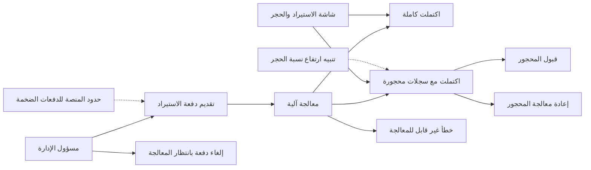
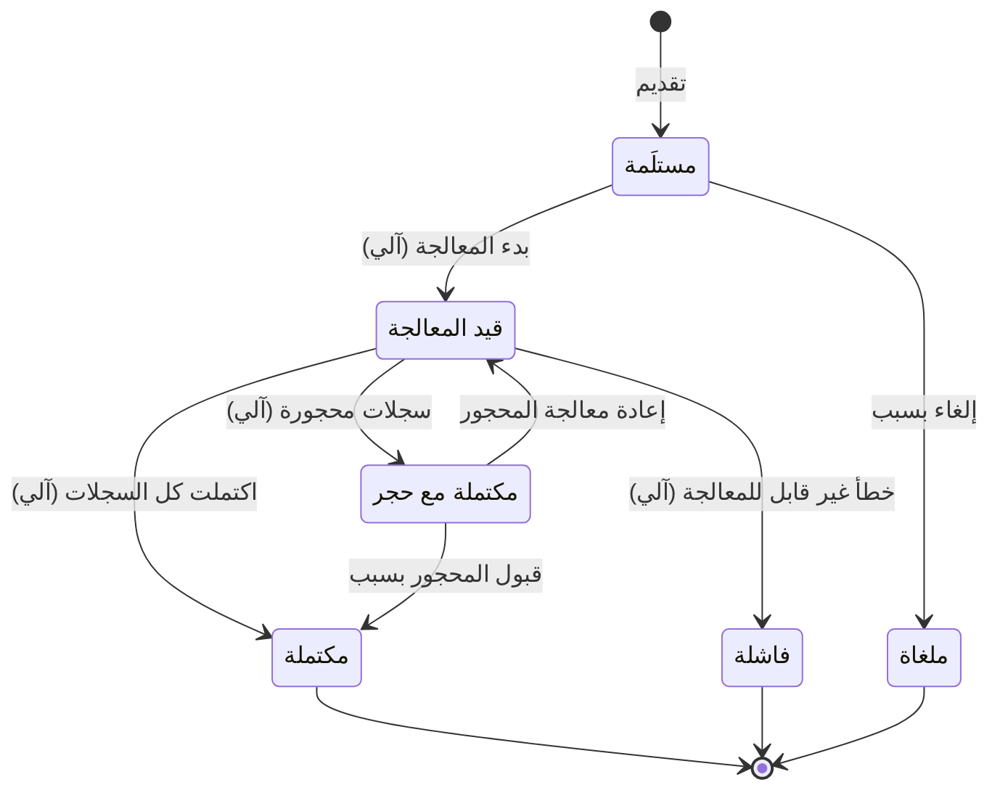

# استيراد البيانات والحجر

<!-- BEGIN GENERATED: doc -->
| البند | القيمة |
|---|---|
| المعرّف | FEAT-COL-IMPORT |
| الإصدار | 0.1 |
| الحالة | مسودة |
| القدرة | CAP-02 جمع المعلومات |
| القدرة الفرعية | CAP-02.04 الاستيعاب والتكامل (R1) |
| الأدوار | مسؤول الإدارة؛ النظام |
| الشاشات | SCR-64 الاستيراد والحجر |
| حالات الاستخدام | UC-094 |
| القصص | 14: 9 من المواصفة، و5 جديدة |
<!-- END GENERATED: doc -->

## 1. نظرة عامة

### 1.1 القيمة

يتيح استيراد دفعات بيانات خارجية مع عزل السجلات المعيبة ومعالجتها قبل نشرها.

### 1.2 النطاق

| البند | القيمة |
|---|---|
| المستخدمون | مسؤول الإدارة يقدّم دفعة الاستيراد ويلغيها ويقبل أو يعيد معالجة ما حُجر فيها، والنظام يعالج الدفعة ويحجر سجلاتها المعيبة آليًا، وفريقا المنصة والتشغيل يحميان المنصة من الدفعات الضخمة ويتابعان نسبة الحجر |
| الشاشات | SCR-64 الاستيراد والحجر: حالة الدفعة وعداداتها وسجلات الحجر |
| حالات الاستخدام | استيعاب بيانات خارجية (UC-094)، وهذه الميزة تغطي خطوة دفعة الاستيراد منها فقط |
| المتطلبات | لا يدخل بيانات خارجية إلا عبر محوّل مسجَّل أو دفعة استيراد تسجّل مصدرها وlineage (REQ-INF-005)، والسجل الذي يفشل التحقق يُحجر بسبب الفشل ولا يُنشر (REQ-INF-006)، وإعادة تقديم الدفعة لا تنشئ سجلات مكررة (REQ-INF-007) |
| خارج النطاق | تسجيل المحوّل وتفعيله وتحديث ربط حقوله (ميزة «إدارة محوّلات البيانات»)، وسحب البيانات من المصدر الخارجي نفسه (قصة «سحب البيانات وترجمتها وتسليمها دفعات» في تلك الميزة) |

### 1.3 خريطة الميزة

### 1.3 خريطة الميزة

**الشكل 1: خريطة ميزة استيراد البيانات والحجر**



تبدأ دفعة الاستيراد من «مستلَمة» (الشكل 2) ولا تعود إليها، وحالات المحوّل نفسه في ميزة «إدارة محوّلات البيانات».

**الشكل 2: رحلة دفعة الاستيراد**



> **ملاحظة:** «الفاشلة» حالة نهائية هنا، وما طُبِّق من سجلاتها يبقى (ثابت INV-IMP-01)؛ واستئناف العمل يكون بتقديم دفعة جديدة لا بأمر على الدفعة الفاشلة نفسها.

## 2. القواعد المشتركة

تنطبق على كل قصص الميزة، فلا تتكرر داخل القصص. وكل قصة تذكر ما يخصها فقط.

### 2.1 السياق المشترك

كل قصة تبدأ من ثلاثة شروط: مستأجر نشط، وحزمة السياسات الأساسية مفعّلة، ومستخدم مسجّل الدخول ومخوَّل. وتشير إليها القصص بخطوة واحدة: «بفرض السياق المشترك للميزة».

### 2.2 الصلاحية وعدم الإفصاح

- من لا يحق له رؤية العنصر يتلقى ردًا بشكل «غير متاح» تمامًا، فلا يعرف أنه موجود.
- من يرى العنصر ولا يحق له الإجراء يتلقى «لا تملك صلاحية هذا الإجراء».

### 2.3 أوامر تغيير الحالة

- **منع التكرار:** يُرسل كل أمر بمفتاح فريد، فإعادة الطلب نفسه لا تُنفَّذ مرتين.
- **حماية التعديل المتزامن:** يُرسل كل أمر بإصدار البيانات الذي يراه المستخدم. فإن عدّلها غيره في الأثناء، يُرفض الأمر.
- **السجل:** إن نجح الأمر، يُكتب حدثه وسجل التدقيق في المعاملة نفسها.

### 2.4 الرفض المشترك

```gherkin
# language: ar
خاصية: الرفض المشترك لأوامر الميزة

  سيناريو مخطط: رفض مشترك لكل أمر في الميزة
    بفرض السياق المشترك للميزة
    و <الحالة>
    عندما يُرسل المستخدم أي أمر من أوامر الميزة
    اذاً يُرفض برمز <الرمز> ويرى "<الرسالة>"
    و لا يتغير شيء

    امثلة:
      | الحالة                                  | الرمز                  | الرسالة                                                 |
      | العنصر خارج صلاحياته                    | NOT_FOUND              | غير متاح                                                |
      | العنصر مرئي له ولا يحق له الإجراء       | AUTHZ_DENIED           | لا تملك صلاحية هذا الإجراء                              |
      | غيره عدّل العنصر بعد أن فتحه            | VERSION_CONFLICT       | تغيّرت البيانات منذ فتحتها. راجع التغييرات ثم أعد المحاولة |
      | أعاد مفتاح منع التكرار بمحتوى مختلف     | IDEMPOTENCY_KEY_REUSED | طلب مكرر بمحتوى مختلف                                   |
      | البيانات ناقصة أو غير صحيحة             | VALIDATION_FAILED      | بعض البيانات ناقصة أو غير صحيحة. راجع الحقول المعلَّمة      |

  سيناريو: إعادة الطلب نفسه لا تُنفَّذ مرتين
    بفرض السياق المشترك للميزة
    و أمر نجح بمفتاح منع تكرار
    عندما يُعاد الطلب نفسه بالمفتاح نفسه
    اذاً تُعاد النتيجة الأولى ولا يُكتب حدث ثانٍ
```

### 2.5 الدفعة النهائية ومفتاح منع التكرار الخاص بالدفعة

- الدفعة «المكتملة» و«الفاشلة» و«الملغاة» في حالة نهائية، فلا يُقبل عليها أي أمر من أوامر الميزة.
- لكل محوّل مفتاح دفعة فريد (`batch_key`) إضافة إلى مفتاح منع التكرار العام: إعادة تقديم نفس المفتاح بنفس محتوى الدفعة تعيد الدفعة الموجودة، وبمحتوى مختلف تُرفض برمز `BATCH_KEY_REUSED`.

## 3. الجودة وتعريف الاكتمال

### 3.1 متطلبات الجودة

<!-- BEGIN GENERATED: quality -->
| المرجع | الموقف | المطلوب |
|---|---|---|
| QAS-DQ-001 | submits records with invalid geometry or missing CRS | 100 % of invalid records quarantined; 0 published |
| QAS-SCAL-002 | event burst of 50,000/s for 60 s | 0 lost events; critical alert p95 ≤ 30 s during burst; back within QAS-PERF-005 ≤ 5 min after |
<!-- END GENERATED: quality -->

### 3.2 تعريف الاكتمال

القصة مكتملة حين تتحقق الشروط الخمسة:

1. سيناريوهاتها والقواعد المشتركة تمر في الاختبار الآلي.
2. فحوص البنية المعمارية تمر.
3. نصوص الواجهة والرسائل موجودة بالعربية والإنجليزية.
4. مراجعة الكود مكتملة.
5. ما تضيفه القصة نفسها في قسم «القواعد» تحقق.

## 4. فهرس القصص

<!-- BEGIN GENERATED: story-index -->
| المعرّف | القصة | النوع | الحالة |
|---|---|---|---|
| `US-BC02-IMP-ACCEPT-QUARANTINE` | قبول العناصر المعزولة في دفعة الاستيراد | أمر | مسودة |
| `US-BC02-IMP-CANCEL` | إلغاء دفعة الاستيراد | أمر | مسودة |
| `US-BC02-IMP-REPROCESS-QUARANTINE` | إعادة معالجة العناصر المعزولة في دفعة الاستيراد | أمر | مسودة |
| `US-BC02-IMP-SUBMIT` | تقديم دفعة الاستيراد | أمر | مسودة |
| `US-BC02-Q-IMP-GET` | جلب: Batch status, counts, quarantine records (paged) | جلب | مسودة |
| `US-DOM-IMP-LIST` | عرض دفعات الاستيراد حسب المحوّل والحالة | جلب | مسودة |
| `US-BC02-S-IMPORT-BATCH-01` | تلقائي: processing started (دفعة الاستيراد) | نظام | مسودة |
| `US-BC02-S-IMPORT-BATCH-02` | تلقائي: all records applied (دفعة الاستيراد) | نظام | مسودة |
| `US-BC02-S-IMPORT-BATCH-03` | تلقائي: finished with invalid records (دفعة الاستيراد) | نظام | مسودة |
| `US-BC02-S-IMPORT-BATCH-04` | تلقائي: unrecoverable error (دفعة الاستيراد) | نظام | مسودة |
| `US-UI-SCR64-QUARANTINE-REVIEW` | مراجعة سجلات الحجر وقبولها أو إعادة معالجتها | واجهة | مسودة |
| `US-PLT-IMP-ASYNC-JOB` | تنفيذ الاستيراد مهمة غير متزامنة قابلة للاستئناف | منصة | مسودة |
| `US-PLT-IMP-LIMITS` | حماية المنصة من الدفعات الضخمة والمعيبة | منصة | مسودة |
| `US-OPS-IMP-QUARANTINE-RATIO` | التنبيه عند ارتفاع نسبة الحجر لمحوّل | تشغيل | مسودة |
<!-- END GENERATED: story-index -->

## 5. القصص

### 5.1 US-BC02-IMP-ACCEPT-QUARANTINE — قبول العناصر المعزولة في دفعة الاستيراد

| النوع | الإصدار | الأولوية | دون اتصال | الحالة |
|---|---|---|---|---|
| أمر | R1 | Must | لا | مسودة |

> **كـ** مسؤول الإدارة، **أريد** أن أقبل دفعة محجورة كما هي مع ذكر السبب، **حتى** أغلقها حين أقرر أن السجلات المحجورة لا تستحق إعادة المعالجة.

**باختصار:** الدفعة «المكتملة مع حجر» تصبح «مكتملة» بسبب مكتوب. وتبقى السجلات المحجورة محجورة ولا تُنشر.

#### القواعد

- **متى يُسمح:** الدفعة «مكتملة مع حجر».
- **من يُسمح له:** مسؤول الإدارة، أو حساب خدمة المحوّل الذي يملكها.
- **البيانات:** السبب (إلزامي).
- **الأثر:** تصبح الدفعة «مكتملة»، وتُسقَط السجلات المحجورة من متابعتها مع بقائها محجورة لا تظهر في أي استعلام أو عرض (ثابت INV-IMP-02)، ويُسجَّل حدث «قُبل حجر دفعة الاستيراد».

#### معايير القبول

```gherkin
# language: ar
خاصية: قبول العناصر المعزولة في دفعة الاستيراد

  سيناريو: قبول دفعة محجورة كما هي
    بفرض السياق المشترك للميزة
    و دفعة "مكتملة مع حجر"
    عندما يقبلها مسؤول الإدارة كما هي مع سبب
    اذاً تصبح حالة الدفعة "مكتملة"
    و تبقى سجلاتها المحجورة غير منشورة
    و يُسجَّل حدث "قُبل حجر دفعة الاستيراد"

  سيناريو مخطط: رفض خاص بقبول المحجور
    بفرض السياق المشترك للميزة
    و <الحالة>
    عندما يحاول مسؤول الإدارة قبول حجر الدفعة
    اذاً يُرفض برمز <الرمز> ويرى "<الرسالة>"
    و لا يتغير شيء

    امثلة:
      | الحالة | الرمز | الرسالة |
      | دفعة "مكتملة مع حجر" ولم يذكر السبب | REASON_REQUIRED | اذكر السبب |
      | الدفعة "فاشلة" | IMPORT_BATCH_INVALID_STATE_TRANSITION | الوضع الحالي لدفعة الاستيراد لا يسمح بهذا الإجراء |
```

<details><summary>المراجع التقنية والتتبع</summary>

<!-- BEGIN GENERATED: refs US-BC02-IMP-ACCEPT-QUARANTINE -->
| البند | المعرّف | المعنى |
|---|---|---|
| الواجهة البرمجية | `POST /api/v1/information/import-batches/{id}/actions/accept-quarantine` | — |
| الأمر | `CMD-IMP-ACCEPT-QUARANTINE` | قبول العناصر المعزولة في دفعة الاستيراد |
| السياسة | `POL-IMP-ACCEPT-QUARANTINE` | adapter service account · Administrator؛ tenant match; object visible to subject (label ≤ clearance); write p… |
| الحدث | `EVT-IMP-QUARANTINE-ACCEPTED` | يصل إلى: Import worker; Adapter owner notification |
| الكيان | `AGG-IMPORT-BATCH` | دفعة الاستيراد |
| الجدول | `information.import_batches` | الجدول الرئيسي لدفعة الاستيراد |
| وحدة النشر | DU-05 | — |
| المتطلبات | REQ-INF-005، REQ-INF-006، REQ-INF-007، REQ-INF-008، REQ-INF-009 | معانيها في القسم 6. التتبع |
| حالة الاستخدام | UC-094 | Ingest External Data |
| الاختبار | TST-IMPORT-BATCH-SM، TST-SLC02-INVARIANTS | دورة حالات دفعة الاستيراد، وثوابت الشريحة SLC-02 |
<!-- END GENERATED: refs US-BC02-IMP-ACCEPT-QUARANTINE -->

</details>

### 5.2 US-BC02-IMP-CANCEL — إلغاء دفعة الاستيراد

| النوع | الإصدار | الأولوية | دون اتصال | الحالة |
|---|---|---|---|---|
| أمر | R1 | Must | لا | مسودة |

> **كـ** مسؤول الإدارة، **أريد** أن ألغي دفعة استيراد لم تبدأ معالجتها بعد مع ذكر السبب، **حتى** أمنع استيراد بيانات تبيّن أنها خاطئة قبل أن تُعالَج.

**باختصار:** الدفعة «المستلَمة» تصبح «ملغاة» بسبب مكتوب، ولا تدخل مرحلة المعالجة.

#### القواعد

- **متى يُسمح:** الدفعة «مستلَمة» ولم تبدأ معالجتها.
- **من يُسمح له:** مسؤول الإدارة، أو حساب خدمة المحوّل الذي يملكها.
- **البيانات:** السبب (إلزامي).
- **الأثر:** تصبح الدفعة «ملغاة»، ويُسجَّل حدث «أُلغيت دفعة الاستيراد». وهذه حالة نهائية.

#### معايير القبول

```gherkin
# language: ar
خاصية: إلغاء دفعة الاستيراد

  سيناريو: إلغاء دفعة مستلَمة قبل معالجتها
    بفرض السياق المشترك للميزة
    و دفعة "مستلَمة" لم تبدأ معالجتها
    عندما يلغيها مسؤول الإدارة مع سبب
    اذاً تصبح حالة الدفعة "ملغاة"
    و يُسجَّل حدث "أُلغيت دفعة الاستيراد"

  سيناريو مخطط: رفض خاص بإلغاء دفعة الاستيراد
    بفرض السياق المشترك للميزة
    و <الحالة>
    عندما يحاول مسؤول الإدارة إلغاء الدفعة
    اذاً يُرفض برمز <الرمز> ويرى "<الرسالة>"
    و لا يتغير شيء

    امثلة:
      | الحالة | الرمز | الرسالة |
      | دفعة "مستلَمة" ولم يذكر السبب | REASON_REQUIRED | اذكر السبب |
      | الدفعة "قيد المعالجة" | IMPORT_BATCH_INVALID_STATE_TRANSITION | الوضع الحالي لدفعة الاستيراد لا يسمح بهذا الإجراء |
      | الدفعة "مكتملة مع حجر" | IMPORT_BATCH_INVALID_STATE_TRANSITION | الوضع الحالي لدفعة الاستيراد لا يسمح بهذا الإجراء |
```

<details><summary>المراجع التقنية والتتبع</summary>

<!-- BEGIN GENERATED: refs US-BC02-IMP-CANCEL -->
| البند | المعرّف | المعنى |
|---|---|---|
| الواجهة البرمجية | `POST /api/v1/information/import-batches/{id}/actions/cancel` | — |
| الأمر | `CMD-IMP-CANCEL` | إلغاء دفعة الاستيراد |
| السياسة | `POL-IMP-CANCEL` | adapter service account · Administrator؛ tenant match; object visible to subject (label ≤ clearance); write p… |
| الحدث | `EVT-IMP-CANCELLED` | يصل إلى: Import worker; Adapter owner notification |
| الكيان | `AGG-IMPORT-BATCH` | دفعة الاستيراد |
| الجدول | `information.import_batches` | الجدول الرئيسي لدفعة الاستيراد |
| وحدة النشر | DU-05 | — |
| المتطلبات | REQ-INF-005، REQ-INF-006، REQ-INF-007، REQ-INF-008، REQ-INF-009 | معانيها في القسم 6. التتبع |
| حالة الاستخدام | UC-094 | Ingest External Data |
| الاختبار | TST-IMPORT-BATCH-SM، TST-SLC02-INVARIANTS | دورة حالات دفعة الاستيراد، وثوابت الشريحة SLC-02 |
<!-- END GENERATED: refs US-BC02-IMP-CANCEL -->

</details>

### 5.3 US-BC02-IMP-REPROCESS-QUARANTINE — إعادة معالجة العناصر المعزولة في دفعة الاستيراد

| النوع | الإصدار | الأولوية | دون اتصال | الحالة |
|---|---|---|---|---|
| أمر | R1 | Must | لا | مسودة |

> **كـ** مسؤول الإدارة، **أريد** أن أعيد معالجة السجلات المحجورة في دفعة بإصدار ربط جديد أو بعد تصحيحها، **حتى** تُستكمَل البيانات الصحيحة منها دون إعادة تقديم الدفعة من جديد.

**باختصار:** الدفعة «المكتملة مع حجر» تعود إلى «قيد المعالجة» بإصدار ربط جديد أو سجلات مصححة.

#### القواعد

- **متى يُسمح:** الدفعة «مكتملة مع حجر».
- **من يُسمح له:** مسؤول الإدارة، أو حساب خدمة المحوّل الذي يملكها.
- **البيانات:** إصدار ربط جديد أو السجلات المصححة (أحدهما على الأقل).
- **الأثر:** تعود الدفعة إلى «قيد المعالجة»، ويُسجَّل حدث «إعادة معالجة دفعة الاستيراد»، ثم يحسم النظام نتيجتها من جديد (اكتمال، أو اكتمال مع حجر متبقٍ، أو خطأ).

#### معايير القبول

```gherkin
# language: ar
خاصية: إعادة معالجة العناصر المعزولة في دفعة الاستيراد

  سيناريو: إعادة معالجة دفعة محجورة بإصدار ربط جديد
    بفرض السياق المشترك للميزة
    و دفعة "مكتملة مع حجر"
    عندما يعيد مسؤول الإدارة معالجتها بإصدار ربط جديد
    اذاً تصبح حالة الدفعة "قيد المعالجة"
    و يُسجَّل حدث "إعادة معالجة دفعة الاستيراد"

  سيناريو مخطط: رفض خاص بإعادة معالجة المحجور
    بفرض السياق المشترك للميزة
    و <الحالة>
    عندما يحاول مسؤول الإدارة إعادة معالجة الدفعة
    اذاً يُرفض برمز <الرمز> ويرى "<الرسالة>"
    و لا يتغير شيء

    امثلة:
      | الحالة | الرمز | الرسالة |
      | الدفعة "مستلَمة" | IMPORT_BATCH_INVALID_STATE_TRANSITION | الوضع الحالي لدفعة الاستيراد لا يسمح بهذا الإجراء |
      | الدفعة "مكتملة" بلا حجر | IMPORT_BATCH_INVALID_STATE_TRANSITION | الوضع الحالي لدفعة الاستيراد لا يسمح بهذا الإجراء |
```

<details><summary>المراجع التقنية والتتبع</summary>

<!-- BEGIN GENERATED: refs US-BC02-IMP-REPROCESS-QUARANTINE -->
| البند | المعرّف | المعنى |
|---|---|---|
| الواجهة البرمجية | `POST /api/v1/information/import-batches/{id}/actions/reprocess-quarantine` | — |
| الأمر | `CMD-IMP-REPROCESS-QUARANTINE` | إعادة معالجة العناصر المعزولة في دفعة الاستيراد |
| السياسة | `POL-IMP-REPROCESS-QUARANTINE` | adapter service account · Administrator؛ tenant match; object visible to subject (label ≤ clearance); write p… |
| الحدث | `EVT-IMP-REPROCESSING` | يصل إلى: Import worker; Adapter owner notification |
| الكيان | `AGG-IMPORT-BATCH` | دفعة الاستيراد |
| الجدول | `information.import_batches` | الجدول الرئيسي لدفعة الاستيراد |
| وحدة النشر | DU-05 | — |
| المتطلبات | REQ-INF-005، REQ-INF-006، REQ-INF-007، REQ-INF-008، REQ-INF-009 | معانيها في القسم 6. التتبع |
| حالة الاستخدام | UC-094 | Ingest External Data |
| الاختبار | TST-IMPORT-BATCH-SM، TST-SLC02-INVARIANTS | دورة حالات دفعة الاستيراد، وثوابت الشريحة SLC-02 |
<!-- END GENERATED: refs US-BC02-IMP-REPROCESS-QUARANTINE -->

</details>

### 5.4 US-BC02-IMP-SUBMIT — تقديم دفعة الاستيراد

| النوع | الإصدار | الأولوية | دون اتصال | الحالة |
|---|---|---|---|---|
| أمر | R1 | Must | لا | مسودة |

> **كـ** مسؤول الإدارة، **أريد** أن أقدّم دفعة بيانات من محوّل نشط أو استيراد يدوي معتمَد، **حتى** تُعالَج بياناتها وتُحجر السجلات المعيبة دون أن تُنشر.

**باختصار:** تُقبل الدفعة وتصبح «مستلَمة» إذا كان المحوّل نشطًا ومفتاح الدفعة لم يُستخدم من قبل بمحتوى مختلف. ثم يبدأ النظام معالجتها آليًا.

#### القواعد

- **متى يُسمح:** لا دفعة سابقة بهذا المفتاح من نفس المحوّل، أو دفعة سابقة بالمفتاح نفسه والمحتوى نفسه تمامًا.
- **من يُسمح له:** مسؤول الإدارة، أو حساب خدمة المحوّل الذي يملكه.
- **البيانات:** المحوّل (إلزامي)، ومفتاح الدفعة (إلزامي)، وبصمة محتواها (إلزامي)، وصيغتها (إلزامية)، ومرفق حمولتها (إلزامي).
- **الأثر:** تصبح الدفعة «مستلَمة»، ويُسجَّل حدث «استُلمت دفعة الاستيراد»، ثم يبدأ النظام معالجتها.

#### معايير القبول

```gherkin
# language: ar
خاصية: تقديم دفعة الاستيراد

  سيناريو: تقديم دفعة جديدة من محوّل نشط
    بفرض السياق المشترك للميزة
    و محوّل "نشط" لم يسبق استيراد دفعة بمفتاحها
    عندما يقدّم مسؤول الإدارة الدفعة ببياناتها كاملة
    اذاً تصبح حالة الدفعة "مستلَمة"
    و يُسجَّل حدث "استُلمت دفعة الاستيراد"

  سيناريو: إعادة تقديم نفس الدفعة بنفس المحتوى
    بفرض السياق المشترك للميزة
    و دفعة سابقة بمفتاح ومحتوى معينين
    عندما تُقدَّم دفعة جديدة بنفس المفتاح ونفس بصمة المحتوى
    اذاً تُعاد الدفعة الموجودة نفسها دون إنشاء دفعة ثانية

  سيناريو مخطط: رفض خاص بتقديم دفعة الاستيراد
    بفرض السياق المشترك للميزة
    و <الحالة>
    عندما يقدّم مسؤول الإدارة الدفعة
    اذاً يُرفض برمز <الرمز> ويرى "<الرسالة>"
    و لا يتغير شيء

    امثلة:
      | الحالة | الرمز | الرسالة |
      | دفعة سابقة بنفس المفتاح وبمحتوى مختلف | BATCH_KEY_REUSED | استُخدم معرّف هذه الدفعة من قبل بمحتوى مختلف |
      | المحوّل غير نشط | VALIDATION_FAILED | المحوّل غير صحيح |
```

<details><summary>المراجع التقنية والتتبع</summary>

<!-- BEGIN GENERATED: refs US-BC02-IMP-SUBMIT -->
| البند | المعرّف | المعنى |
|---|---|---|
| الواجهة البرمجية | `POST /api/v1/information/import-batches` | — |
| الأمر | `CMD-IMP-SUBMIT` | تقديم دفعة الاستيراد |
| السياسة | `POL-IMP-SUBMIT` | adapter service account · Administrator؛ tenant match; object visible to subject (label ≤ clearance); write p… |
| الحدث | `EVT-IMP-RECEIVED` | يصل إلى: Import worker; Adapter owner notification |
| الكيان | `AGG-IMPORT-BATCH` | دفعة الاستيراد |
| الجدول | `information.import_batches` | الجدول الرئيسي لدفعة الاستيراد |
| وحدة النشر | DU-05 | — |
| المتطلبات | REQ-INF-005، REQ-INF-006، REQ-INF-007، REQ-INF-008، REQ-INF-009 | معانيها في القسم 6. التتبع |
| حالة الاستخدام | UC-094 | Ingest External Data |
| الاختبار | TST-IMPORT-BATCH-SM، TST-SLC02-INVARIANTS | دورة حالات دفعة الاستيراد، وثوابت الشريحة SLC-02 |
<!-- END GENERATED: refs US-BC02-IMP-SUBMIT -->

</details>

### 5.5 US-BC02-Q-IMP-GET — عرض دفعة الاستيراد وعداداتها وسجلات حجرها

| النوع | الإصدار | الأولوية | دون اتصال | الحالة |
|---|---|---|---|---|
| جلب | R1 | Must | لا | مسودة |

> **كـ** مسؤول الإدارة، **أريد** أن أرى حالة دفعة استيراد وعداداتها وسجلات حجرها صفحةً بعد صفحة، **حتى** أقرر قبول الحجر أو إعادة معالجته.

**باختصار:** يعرض الاستعلام حالة الدفعة وعدد سجلاتها المطبَّقة والمحجورة، وسجلات الحجر بالمؤشر مع سبب حجر كل منها.

#### القواعد

- **من يرى ماذا:** مسؤول الإدارة الذي يملك المحوّل، أو أي مسؤول إدارة في نطاق الدفعة. ومن لا تسمح له السياسة يتلقى ردًا بشكل غير الموجود نفسه.
- **المرشحات:** معرّف الدفعة.
- **ما يُعاد:** حالة الدفعة، وعدد السجلات المطبَّقة والمحجورة، وسجلات الحجر بالمؤشر مع سبب حجر كل سجل.
- **الترقيم:** سجلات الحجر بالمؤشر، ولا سجل محجور يظهر في استعلام آخر غير هذا (ثابت INV-IMP-02).

#### معايير القبول

```gherkin
# language: ar
خاصية: عرض دفعة الاستيراد وعداداتها وسجلات حجرها

  سيناريو: عرض دفعة مكتملة مع حجر
    بفرض السياق المشترك للميزة
    و دفعة "مكتملة مع حجر" فيها سجلات مطبَّقة وسجلات محجورة بأسباب
    عندما يطلب مسؤول الإدارة تفاصيل الدفعة
    اذاً تُعاد حالتها وعدد سجلاتها المطبَّقة والمحجورة
    و تُعاد سجلات الحجر صفحةً بعد صفحة مع سبب كل سجل
```

<details><summary>المراجع التقنية والتتبع</summary>

<!-- BEGIN GENERATED: refs US-BC02-Q-IMP-GET -->
| البند | المعرّف | المعنى |
|---|---|---|
| الواجهة البرمجية | `GET /api/v1/information/import-batches/{batch_id}` | — |
| الاستعلام | `QRY-IMP-GET` | Batch status, counts, quarantine records (paged) |
| السياسة | `POL-IMP-GET` | org scope ∩ classification rule; claims filtered by label |
| الكيان | `AGG-IMPORT-BATCH` | دفعة الاستيراد |
| الجدول | `information.import_batches` | الجدول الرئيسي لدفعة الاستيراد |
| وحدة النشر | DU-05 | — |
| المتطلب | REQ-INF-006 | If an ingested record fails validation, then the system shall quarantine it with the failure reason and shall… |
| حالة الاستخدام | UC-094 | Ingest External Data |
| الاختبار | TST-IMPORT-BATCH-SM، TST-SLC02-INVARIANTS | دورة حالات دفعة الاستيراد، وثوابت الشريحة SLC-02 |
<!-- END GENERATED: refs US-BC02-Q-IMP-GET -->

</details>

### 5.6 US-DOM-IMP-LIST — عرض دفعات الاستيراد حسب المحوّل والحالة

| النوع | الإصدار | الأولوية | دون اتصال | الحالة |
|---|---|---|---|---|
| جلب | R1 | Must | لا | مسودة |

> **كـ** مسؤول الإدارة، **أريد** قائمة بدفعات الاستيراد في نطاقي مصفّاة بالمحوّل وبالحالة، **حتى** أجد الدفعة التي أحتاج التدخل فيها دون أن أعرف معرّفها مسبقًا.

**باختصار:** تعرض القائمة دفعات الاستيراد في نطاق مسؤول الإدارة، بالمؤشر، مع إمكان التصفية بالمحوّل أو الحالة.

#### القواعد

- **من يرى ماذا:** مسؤول الإدارة دفعات محوّلاته ودفعات المستأجر في نطاقه. ومن لا تسمح له السياسة يتلقى ردًا بشكل غير الموجود نفسه.
- **المرشحات:** المحوّل، والحالة، والمؤشر والحد.
- **ما يُعاد لكل دفعة:** المحوّل، والحالة، وعدد السجلات المحجورة، ووقت التقديم.
- **الترقيم:** بالمؤشر، ولا عدد ولا إشارة إلى دفعة خارج ما يراه المستخدم.

> **ملاحظة:** هذا الاستعلام **[Derived]**: لا يعرّفه كتالوج الاستعلامات، وشاشة الاستيراد والحجر تحتاجه لعرض الدفعات قبل اختيار واحدة منها.

#### معايير القبول

```gherkin
# language: ar
خاصية: عرض دفعات الاستيراد حسب المحوّل والحالة

  سيناريو: تصفية الدفعات بالمحوّل والحالة
    بفرض السياق المشترك للميزة
    و في نطاق مسؤول الإدارة دفعتان "مكتملتان مع حجر" لمحوّلين مختلفين ودفعة "مكتملة" لأحدهما
    عندما يطلب الدفعات "مكتملة مع حجر" لأحد المحوّلين
    اذاً تُعاد دفعة ذلك المحوّل وحدها
```

<details><summary>المراجع التقنية والتتبع</summary>

<!-- BEGIN GENERATED: refs US-DOM-IMP-LIST -->
| البند | المعرّف | المعنى |
|---|---|---|
| الشاشة | SCR-64 | شاشة الاستيراد والحجر |
| حالة الاستخدام | UC-094 | Ingest External Data |
| المصدر | `[Derived]` | — |
| المتطلب | REQ-INF-006 | If an ingested record fails validation, then the system shall quarantine it with the failure reason and shall… |
| حالة الاستخدام | UC-094 | Ingest External Data |
<!-- END GENERATED: refs US-DOM-IMP-LIST -->

</details>

### 5.7 US-BC02-S-IMPORT-BATCH-01 — بدء معالجة دفعة الاستيراد آليًا

| النوع | الإصدار | الأولوية | دون اتصال | الحالة |
|---|---|---|---|---|
| نظام | R1 | Must | لا ينطبق | مسودة |

> **كـ** النظام، **أريد** أن أبدأ معالجة الدفعة حين يحصل أحد عمّال المعالجة على عهدتها، **حتى** تُطبَّق سجلاتها دون أن تعالجها دفعتان معًا.

**باختصار:** الدفعة «المستلَمة» تصبح «قيد المعالجة» حين يحصل عامل المعالجة على عهدتها.

#### القواعد

- **متى يحدث:** بعد حصول عامل معالجة على عهدة الدفعة «المستلَمة».
- **الأثر:** تصبح الدفعة «قيد المعالجة»، ويُسجَّل حدث «بدأت معالجة دفعة الاستيراد» بهوية النظام.

#### معايير القبول

```gherkin
# language: ar
خاصية: بدء معالجة دفعة الاستيراد آليًا

  سيناريو: بدء المعالجة عند حصول عامل على العهدة
    بفرض دفعة "مستلَمة"
    عندما يحصل عامل معالجة على عهدتها
    اذاً تصبح حالة الدفعة "قيد المعالجة"
    و يُسجَّل حدث "بدأت معالجة دفعة الاستيراد"

  سيناريو: لا يحدث شيء دون عهدة
    بفرض دفعة "مستلَمة" لم يحصل عليها أي عامل معالجة بعد
    عندما تُفحص حالتها
    اذاً تبقى حالتها "مستلَمة"
    و لا يتغير شيء
```

<details><summary>المراجع التقنية والتتبع</summary>

<!-- BEGIN GENERATED: refs US-BC02-S-IMPORT-BATCH-01 -->
| البند | المعرّف | المعنى |
|---|---|---|
| المحفِّز | `SYS:processing started` | worker lease acquired |
| الانتقال | RECEIVED ← PROCESSING | — |
| الحدث | `EVT-IMP-PROCESSING-STARTED` | يصل إلى: Import worker; Adapter owner notification |
| الكيان | `AGG-IMPORT-BATCH` | دفعة الاستيراد |
| الجدول | `information.import_batches` | الجدول الرئيسي لدفعة الاستيراد |
| وحدة النشر | DU-05 | — |
| المتطلبات | REQ-INF-005، REQ-INF-006، REQ-INF-007، REQ-INF-008، REQ-INF-009 | معانيها في القسم 6. التتبع |
| حالة الاستخدام | UC-094 | Ingest External Data |
| الاختبار | TST-IMPORT-BATCH-SM، TST-SLC02-INVARIANTS | دورة حالات دفعة الاستيراد، وثوابت الشريحة SLC-02 |
<!-- END GENERATED: refs US-BC02-S-IMPORT-BATCH-01 -->

</details>

### 5.8 US-BC02-S-IMPORT-BATCH-02 — اكتمال دفعة الاستيراد دون حجر

| النوع | الإصدار | الأولوية | دون اتصال | الحالة |
|---|---|---|---|---|
| نظام | R1 | Must | لا ينطبق | مسودة |

> **كـ** النظام، **أريد** أن أنهي الدفعة بنجاح حين تُطبَّق كل سجلاتها، **حتى** تُعرف أن البيانات كاملة دون حاجة لمراجعة.

**باختصار:** الدفعة «قيد المعالجة» تصبح «مكتملة» حين يُطبَّق كل سجل فيها دون أن يُحجر أي سجل.

#### القواعد

- **متى يحدث:** بعد تطبيق كل سجلات الدفعة بlineage كامل (محوّل، دفعة، إصدار ربط) دون أي سجل محجور.
- **الأثر:** تصبح الدفعة «مكتملة»، ويُسجَّل حدث «اكتملت دفعة الاستيراد» بهوية النظام. حالة نهائية.

#### معايير القبول

```gherkin
# language: ar
خاصية: اكتمال دفعة الاستيراد دون حجر

  سيناريو: اكتمال كل السجلات دون حجر
    بفرض دفعة "قيد المعالجة" بسجلات صالحة كلها
    عندما تُطبَّق كل سجلاتها
    اذاً تصبح حالة الدفعة "مكتملة"
    و يُسجَّل حدث "اكتملت دفعة الاستيراد"

  سيناريو: لا يحدث شيء قبل تطبيق كل السجلات
    بفرض دفعة "قيد المعالجة" لم تُطبَّق كل سجلاتها بعد
    عندما تُفحص حالتها
    اذاً تبقى حالتها "قيد المعالجة"
    و لا يتغير شيء
```

<details><summary>المراجع التقنية والتتبع</summary>

<!-- BEGIN GENERATED: refs US-BC02-S-IMPORT-BATCH-02 -->
| البند | المعرّف | المعنى |
|---|---|---|
| المحفِّز | `SYS:all records applied` | each record applied idempotently with lineage (adapter, batch, mapping version) |
| الانتقال | PROCESSING ← COMPLETED | — |
| الحدث | `EVT-IMP-COMPLETED` | يصل إلى: Import worker; Adapter owner notification |
| الكيان | `AGG-IMPORT-BATCH` | دفعة الاستيراد |
| الجدول | `information.import_batches` | الجدول الرئيسي لدفعة الاستيراد |
| وحدة النشر | DU-05 | — |
| المتطلبات | REQ-INF-005، REQ-INF-006، REQ-INF-007، REQ-INF-008، REQ-INF-009 | معانيها في القسم 6. التتبع |
| حالة الاستخدام | UC-094 | Ingest External Data |
| الاختبار | TST-IMPORT-BATCH-SM، TST-SLC02-INVARIANTS | دورة حالات دفعة الاستيراد، وثوابت الشريحة SLC-02 |
<!-- END GENERATED: refs US-BC02-S-IMPORT-BATCH-02 -->

</details>

### 5.9 US-BC02-S-IMPORT-BATCH-03 — اكتمال دفعة الاستيراد مع حجر سجلات معيبة

| النوع | الإصدار | الأولوية | دون اتصال | الحالة |
|---|---|---|---|---|
| نظام | R1 | Must | لا ينطبق | مسودة |

> **كـ** النظام، **أريد** أن أحجر كل سجل فشل التحقق مع سبب الفشل وأنهي الدفعة، **حتى** لا تُنشر بيانات معيبة وتبقى متاحة لمن يراجعها.

**باختصار:** الدفعة «قيد المعالجة» تصبح «مكتملة مع حجر» حين ينتهي تطبيق سجلاتها وفيها سجل معيب واحد على الأقل، فيُحجر كل سجل معيب بسبب فشله.

#### القواعد

- **متى يحدث:** بعد انتهاء معالجة الدفعة وفيها سجل واحد على الأقل فشل التحقق.
- **الأثر:** تصبح الدفعة «مكتملة مع حجر»، ويُحجر كل سجل فاشل بسبب فشله ولا يظهر في أي استعلام أو عرض (REQ-INF-006)، ويُسجَّل حدث «اكتملت دفعة الاستيراد مع حجر» بهوية النظام.

#### معايير القبول

```gherkin
# language: ar
خاصية: اكتمال دفعة الاستيراد مع حجر سجلات معيبة

  سيناريو: حجر السجلات المعيبة عند الاكتمال
    بفرض دفعة "قيد المعالجة" فيها سجل بلا نظام إحالة مكاني صالح
    عندما تنتهي معالجة الدفعة
    اذاً تصبح حالة الدفعة "مكتملة مع حجر"
    و يُحجر السجل المعيب بسبب فشله ولا يظهر في أي استعلام
    و يُسجَّل حدث "اكتملت دفعة الاستيراد مع حجر"

  سيناريو: لا يحدث شيء قبل انتهاء المعالجة
    بفرض دفعة "قيد المعالجة" لم تنتهِ معالجتها بعد
    عندما تُفحص حالتها
    اذاً تبقى حالتها "قيد المعالجة"
    و لا يتغير شيء
```

<details><summary>المراجع التقنية والتتبع</summary>

<!-- BEGIN GENERATED: refs US-BC02-S-IMPORT-BATCH-03 -->
| البند | المعرّف | المعنى |
|---|---|---|
| المحفِّز | `SYS:finished with invalid records` | invalid records quarantined with reason codes |
| الانتقال | PROCESSING ← COMPLETED_WITH_QUARANTINE | — |
| الحدث | `EVT-IMP-COMPLETED-WITH-QUARANTINE` | يصل إلى: Import worker; Adapter owner notification |
| الكيان | `AGG-IMPORT-BATCH` | دفعة الاستيراد |
| الجدول | `information.import_batches` | الجدول الرئيسي لدفعة الاستيراد |
| وحدة النشر | DU-05 | — |
| المتطلبات | REQ-INF-005، REQ-INF-006، REQ-INF-007، REQ-INF-008، REQ-INF-009 | معانيها في القسم 6. التتبع |
| حالة الاستخدام | UC-094 | Ingest External Data |
| الاختبار | TST-IMPORT-BATCH-SM، TST-SLC02-INVARIANTS | دورة حالات دفعة الاستيراد، وثوابت الشريحة SLC-02 |
<!-- END GENERATED: refs US-BC02-S-IMPORT-BATCH-03 -->

</details>

### 5.10 US-BC02-S-IMPORT-BATCH-04 — فشل دفعة الاستيراد بخطأ غير قابل للمعالجة

| النوع | الإصدار | الأولوية | دون اتصال | الحالة |
|---|---|---|---|---|
| نظام | R1 | Must | لا ينطبق | مسودة |

> **كـ** النظام، **أريد** أن أنهي الدفعة بالفشل حين يقع خطأ لا يمكن تجاوزه، **حتى** يُعلَم مسؤول الإدارة ليعيد تقديمها، مع بقاء ما طُبِّق منها.

**باختصار:** الدفعة «قيد المعالجة» تصبح «فاشلة» عند خطأ غير قابل للمعالجة. وما طُبِّق من سجلاتها يبقى.

#### القواعد

- **متى يحدث:** عند وقوع خطأ غير قابل للمعالجة في عامل معالجة الدفعة.
- **الأثر:** تصبح الدفعة «فاشلة»، وتبقى السجلات التي طُبِّقت قبل الخطأ (ثابت INV-IMP-01)، ويُسجَّل حدث «فشلت دفعة الاستيراد» بهوية النظام. حالة نهائية: استئناف العمل يكون بتقديم دفعة جديدة بالمفتاح نفسه، فتُطبَّق السجلات المتبقية دون تكرار ما طُبِّق.

#### معايير القبول

```gherkin
# language: ar
خاصية: فشل دفعة الاستيراد بخطأ غير قابل للمعالجة

  سيناريو: فشل دفعة أثناء المعالجة
    بفرض دفعة "قيد المعالجة" طُبِّق بعض سجلاتها
    عندما يقع خطأ غير قابل للمعالجة في عامل المعالجة
    اذاً تصبح حالة الدفعة "فاشلة"
    و تبقى السجلات التي طُبِّقت قبل الخطأ
    و يُسجَّل حدث "فشلت دفعة الاستيراد"

  سيناريو: لا يحدث شيء دون خطأ غير قابل للمعالجة
    بفرض دفعة "قيد المعالجة" تمضي معالجتها دون خطأ
    عندما تُفحص حالتها
    اذاً تبقى حالتها "قيد المعالجة"
    و لا يتغير شيء
```

<details><summary>المراجع التقنية والتتبع</summary>

<!-- BEGIN GENERATED: refs US-BC02-S-IMPORT-BATCH-04 -->
| البند | المعرّف | المعنى |
|---|---|---|
| المحفِّز | `SYS:unrecoverable error` | applied records remain; re-submit resumes idempotently |
| الانتقال | PROCESSING ← FAILED | — |
| الحدث | `EVT-IMP-FAILED` | يصل إلى: Import worker; Adapter owner notification |
| الكيان | `AGG-IMPORT-BATCH` | دفعة الاستيراد |
| الجدول | `information.import_batches` | الجدول الرئيسي لدفعة الاستيراد |
| وحدة النشر | DU-05 | — |
| المتطلبات | REQ-INF-005، REQ-INF-006، REQ-INF-007، REQ-INF-008، REQ-INF-009 | معانيها في القسم 6. التتبع |
| حالة الاستخدام | UC-094 | Ingest External Data |
| الاختبار | TST-IMPORT-BATCH-SM، TST-SLC02-INVARIANTS | دورة حالات دفعة الاستيراد، وثوابت الشريحة SLC-02 |
<!-- END GENERATED: refs US-BC02-S-IMPORT-BATCH-04 -->

</details>

### 5.11 US-UI-SCR64-QUARANTINE-REVIEW — مراجعة سجلات الحجر وقبولها أو إعادة معالجتها

| النوع | الإصدار | الأولوية | دون اتصال | الحالة |
|---|---|---|---|---|
| واجهة | R1 | Must | لا | مسودة |

> **كـ** مسؤول الإدارة، **أريد** أن أرى حالة الدفعة وسجلات حجرها وأسباب حجرها في شاشة واحدة، **حتى** أقرر بسرعة قبول الحجر أو إعادة معالجته.

**باختصار:** تعرض شاشة الاستيراد والحجر قائمة الدفعات، وتفاصيل كل دفعة بعداداتها وسجلات حجرها بأسبابها، وزرّي «قبول الحجر» و«إعادة المعالجة» على الدفعة المكتملة مع حجر.

#### القواعد

- القائمة بالمؤشر، مرشحة بالمحوّل أو الحالة، ولا عدد إلا لما يحسبه الخادم من المرئي.
- تفاصيل الدفعة تعرض حالتها وعدد سجلاتها المطبَّقة والمحجورة، وسجلات الحجر صفحةً بعد صفحة مع سبب حجر كل سجل.
- يظهر «قبول الحجر» و«إعادة المعالجة» على الدفعة «مكتملة مع حجر» فقط، إذا شملتهما صلاحيات المستخدم؛ وهذا تلميح والحكم للخادم.
- القبول وإعادة المعالجة يطلبان السبب أو إصدار الربط الجديد في حقل نصي إلزامي.
- عند تعارض الإصدار تعيد الشاشة تحميل الدفعة وتعرض ما تغيّر، وعند رفض الحالة تعيد تحميل الحالة وتخفي الزر غير المتاح.

#### معايير القبول

```gherkin
# language: ar
خاصية: مراجعة سجلات الحجر وقبولها أو إعادة معالجتها

  سيناريو: عرض سجلات حجر دفعة وقبولها
    بفرض السياق المشترك للميزة
    و دفعة "مكتملة مع حجر" فيها ثلاثة سجلات محجورة بأسباب مختلفة
    عندما يفتح مسؤول الإدارة تفاصيلها في شاشة الاستيراد والحجر
    اذاً يرى عدد السجلات المطبَّقة والمحجورة وسبب كل سجل محجور
    و حين يضغط "قبول الحجر" مع سبب تصبح حالة الدفعة "مكتملة"

  سيناريو مخطط: استجابة الشاشة لرفض الخادم
    بفرض السياق المشترك للميزة
    و تفاصيل دفعة "مكتملة مع حجر" مفتوحة
    و <الحالة>
    عندما يضغط مسؤول الإدارة زر الإجراء
    اذاً تعرض الشاشة "<الرسالة>"
    و لا يتغير شيء

    امثلة:
      | الحالة | الرمز | الرسالة |
      | ضغط "قبول الحجر" وترك السبب فارغًا | REASON_REQUIRED | اذكر السبب |
```

<details><summary>المراجع التقنية والتتبع</summary>

<!-- BEGIN GENERATED: refs US-UI-SCR64-QUARANTINE-REVIEW -->
| البند | المعرّف | المعنى |
|---|---|---|
| الشاشة | SCR-64 | شاشة الاستيراد والحجر |
| المصدر | `QRY-IMP-GET` | — |
| الجودة | QAS-DQ-001 | submits records with invalid geometry or missing CRS → 100 % of invalid records quarantined; 0 published |
| المتطلب | REQ-INF-006 | If an ingested record fails validation, then the system shall quarantine it with the failure reason and shall… |
| حالة الاستخدام | UC-094 | Ingest External Data |
<!-- END GENERATED: refs US-UI-SCR64-QUARANTINE-REVIEW -->

</details>

### 5.12 US-PLT-IMP-ASYNC-JOB — تنفيذ الاستيراد مهمة غير متزامنة قابلة للاستئناف

| النوع | الإصدار | الأولوية | دون اتصال | الحالة |
|---|---|---|---|---|
| منصة | R1 | Must | لا ينطبق | مسودة |

> **كـ** فريق المنصة، **أريد** أن تعمل معالجة دفعة الاستيراد مهمة غير متزامنة بحصة عادلة لكل مستأجر، **حتى** لا يحجب استيراد ضخم طلبًا متزامنًا، ويُستأنف عند انقطاع عامل المعالجة دون تكرار ما طُبِّق.

**باختصار:** تعمل معالجة الدفعة كمهمة Kubernetes منفصلة ضمن حصة المستأجر، من صورة موقّعة من سجل الحاويات الداخلي. وانقطاع العامل يستأنفه عامل آخر دون تكرار.

#### القواعد

- تُشغَّل معالجة الدفعة كمهمة Kubernetes منفصلة عبر Kueue، بحصة عادلة لكل مستأجر (TD-12).
- صورة العامل موقّعة وتُسحب من سجل الحاويات الداخلي فقط.
- عهدة عامل المعالجة محدودة المدة؛ انتهاؤها دون تأكيد يسمح لعامل آخر بأخذ العهدة واستئناف المعالجة دون تكرار ما طُبِّق من سجلات (ثابت INV-IMP-01، FM-S02-04).
- أي عملية ثقيلة في الميزة (معالجة الدفعة) تمر بحالة ومحاولة وإلغاء مثل بقية عمليات المنصة الثقيلة (REQ-PLT-005).

#### معايير القبول

```gherkin
# language: ar
خاصية: تنفيذ الاستيراد مهمة غير متزامنة قابلة للاستئناف

  سيناريو: معالجة دفعة ضمن حصة المستأجر
    بفرض دفعة استيراد كبيرة قُدِّمت لمستأجر له حصة معالجة محددة
    عندما تبدأ معالجتها
    اذاً تعمل كمهمة منفصلة لا تتجاوز حصة ذلك المستأجر
    و لا تحجب طلبات متزامنة أخرى

  سيناريو: استئناف المعالجة بعد انقطاع العامل
    بفرض دفعة "قيد المعالجة" طبّق عامل أول بعض سجلاتها قبل أن تنقطع عهدته
    عندما يأخذ عامل آخر العهدة
    اذاً يستأنف المعالجة من السجلات المتبقية
    و لا يُعاد تطبيق أي سجل طُبِّق من قبل
```

<details><summary>المراجع التقنية والتتبع</summary>

<!-- BEGIN GENERATED: refs US-PLT-IMP-ASYNC-JOB -->
| البند | المعرّف | المعنى |
|---|---|---|
| المصدر | `FM-S02-04` | — |
| القرار التقني | TD-12 | Kubernetes Jobs with Kueue (fair sharing, per-tenant quotas); images from internal Harbor registry, signed (c… |
| المتطلب | REQ-PLT-005 | The system shall run heavy operations (raster processing, bulk import, analysis runs, reconstruction, report… |
<!-- END GENERATED: refs US-PLT-IMP-ASYNC-JOB -->

</details>

### 5.13 US-PLT-IMP-LIMITS — حماية المنصة من الدفعات الضخمة والمعيبة

| النوع | الإصدار | الأولوية | دون اتصال | الحالة |
|---|---|---|---|---|
| منصة | R1 | Should | لا ينطبق | مسودة |

> **كـ** فريق المنصة، **أريد** حدًا لحجم دفعة الاستيراد وقارئًا تدفقيًا لها، **حتى** لا تستهلك دفعة ضخمة أو معيبة موارد المنصة من مستأجرين آخرين.

**باختصار:** لكل دفعة حد أعلى لحجمها، وتُقرأ بقارئ تدفقي لا يحمّلها كاملة في الذاكرة، وتخضع لحصة معالجة لكل مستأجر.

#### القواعد

- لكل دفعة حد أعلى لحجمها، يُرفض تجاوزه عند التقديم.
- تُقرأ الدفعة بقارئ تدفقي (streaming) لا يحمّل محتواها كاملًا في الذاكرة.
- تخضع كل دفعة لحصة معالجة لكل مستأجر، فلا تستهلك دفعة واحدة موارد مستأجر آخر (ثابت نظام منع الحرمان من الخدمة من استيراد ضخم أو معيب، THR-S02-10).
- حدود الحجم وأسلوب القراءة التدفقي بالتفصيل **[Derived]**: لا يذكر المصدر رقمًا محددًا.

#### معايير القبول

```gherkin
# language: ar
خاصية: حماية المنصة من الدفعات الضخمة والمعيبة

  سيناريو: رفض دفعة تتجاوز الحد الأعلى للحجم
    بفرض محوّل "نشط" وحد أعلى لحجم الدفعة في المستأجر
    عندما تُقدَّم دفعة يتجاوز حجمها ذلك الحد
    اذاً تُرفض الدفعة قبل بدء معالجتها

  سيناريو: دفعة ضخمة لا تستهلك حصة مستأجر آخر
    بفرض دفعة ضخمة قيد المعالجة لمستأجر، ومستأجر آخر يقدّم دفعة صغيرة في الوقت نفسه
    عندما تُعالَج الدفعتان معًا
    اذاً تُعالَج دفعة المستأجر الآخر ضمن حصته دون انتظار اكتمال الدفعة الضخمة
```

<details><summary>المراجع التقنية والتتبع</summary>

<!-- BEGIN GENERATED: refs US-PLT-IMP-LIMITS -->
| البند | المعرّف | المعنى |
|---|---|---|
| المصدر | `THR-S02-10` | — |
| المصدر | `THR-010` | — |
| الجودة | QAS-SCAL-002 | event burst of 50,000/s for 60 s → 0 lost events; critical alert p95 ≤ 30 s during burst; back within QAS-PER… |
<!-- END GENERATED: refs US-PLT-IMP-LIMITS -->

</details>

### 5.14 US-OPS-IMP-QUARANTINE-RATIO — التنبيه عند ارتفاع نسبة الحجر لمحوّل

| النوع | الإصدار | الأولوية | دون اتصال | الحالة |
|---|---|---|---|---|
| تشغيل | R1 | Should | لا ينطبق | مسودة |

> **كـ** فريق التشغيل، **أريد** تنبيهًا حين ترتفع نسبة السجلات المحجورة من محوّل بعينه، **حتى** أراجع ذلك المصدر قبل أن يتراكم حجر كثير يحتاج قرارات فردية.

**باختصار:** يرصد النظام نسبة الحجر لكل محوّل عبر دفعاته الأخيرة، ويُنبّه فريق التشغيل إذا ارتفعت عن الحد المعتاد.

#### القواعد

- يُحسب لكل محوّل متوسط نسبة سجلاته المحجورة عبر دفعاته الأخيرة.
- يُنبَّه فريق التشغيل إذا تجاوزت هذه النسبة حدًا معتادًا، لمراجعة موثوقية المحوّل (THR-S02-01: بيانات خارجية مُدَّعاة، لا حقيقة آلية).
- قيمة الحد والنافذة الزمنية بالتفصيل **[Derived]**: لا يذكرهما المصدر برقم محدد.

#### معايير القبول

```gherkin
# language: ar
خاصية: التنبيه عند ارتفاع نسبة الحجر لمحوّل

  سيناريو: تنبيه عند تجاوز نسبة الحجر المعتادة
    بفرض محوّل نسبة الحجر في دفعاته الأخيرة أعلى من الحد المعتاد
    عندما يُحسب متوسط نسبة الحجر له
    اذاً يصل تنبيه إلى فريق التشغيل يذكر المحوّل ونسبة حجره

  سيناريو: لا تنبيه عند نسبة حجر طبيعية
    بفرض محوّل نسبة الحجر في دفعاته الأخيرة ضمن الحد المعتاد
    عندما يُحسب متوسط نسبة الحجر له
    اذاً لا يصل أي تنبيه بسببه
```

<details><summary>المراجع التقنية والتتبع</summary>

<!-- BEGIN GENERATED: refs US-OPS-IMP-QUARANTINE-RATIO -->
| البند | المعرّف | المعنى |
|---|---|---|
| المصدر | `observability-slc02.md` | — |
| المصدر | `THR-S02-01` | — |
<!-- END GENERATED: refs US-OPS-IMP-QUARANTINE-RATIO -->

</details>

## 6. التتبع

<!-- BEGIN GENERATED: trace -->
| المتطلب | المعنى | القصص | الاختبار |
|---|---|---|---|
| REQ-INF-005 | The system shall ingest external data only through registered adapters or bulk import jobs that record source… | كل قصص الأوامر والنظام في الميزة (8) | TST-ADAPTER-SM، TST-IMPORT-BATCH-SM، TST-SLC02-INVARIANTS |
| REQ-INF-006 | If an ingested record fails validation, then the system shall quarantine it with the failure reason and shall… | `US-BC02-IMP-ACCEPT-QUARANTINE`، `US-BC02-IMP-CANCEL`، `US-BC02-IMP-REPROCESS-QUARANTINE`، `US-BC02-IMP-SUBMIT`، `US-BC02-Q-IMP-GET`، `US-BC02-S-IMPORT-BATCH-01`، `US-BC02-S-IMPORT-BATCH-02`، `US-BC02-S-IMPORT-BATCH-03`، `US-BC02-S-IMPORT-BATCH-04`، `US-DOM-IMP-LIST`، `US-UI-SCR64-QUARANTINE-REVIEW` | TST-IMPORT-BATCH-SM، TST-SLC02-INVARIANTS |
| REQ-INF-007 | When an ingestion batch is re-submitted, the system shall not create duplicate records. | كل قصص الأوامر والنظام في الميزة (8) | TST-IMPORT-BATCH-SM، TST-SLC02-INVARIANTS |
| REQ-INF-008 | The system shall import geospatial data via OGC API Features/Maps/Tiles, WMS/WFS, GeoJSON, GeoPackage, GeoTIF… | كل قصص الأوامر والنظام في الميزة (8) | TST-ADAPTER-SM، TST-IMPORT-BATCH-SM، TST-SLC02-INVARIANTS |
| REQ-INF-009 | The system shall ingest weather data through an adapter and register the provider as a source. | كل قصص الأوامر والنظام في الميزة (8) | TST-ADAPTER-SM، TST-IMPORT-BATCH-SM، TST-SLC02-INVARIANTS |
| REQ-PLT-005 | The system shall run heavy operations (raster processing, bulk import, analysis runs, reconstruction, report… | `US-PLT-IMP-ASYNC-JOB` | — |
<!-- END GENERATED: trace -->

## 7. سجل التغييرات

| الإصدار | التاريخ | التغيير |
|---|---|---|
| 0.1 | — | هيكل مولَّد من خريطة الميزات |
| 0.2 | 2026-10-03 | كتابة القصص كاملة بمعيار القصص |
