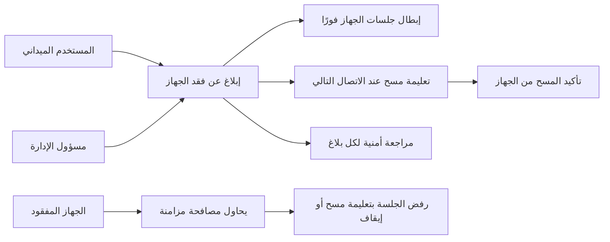
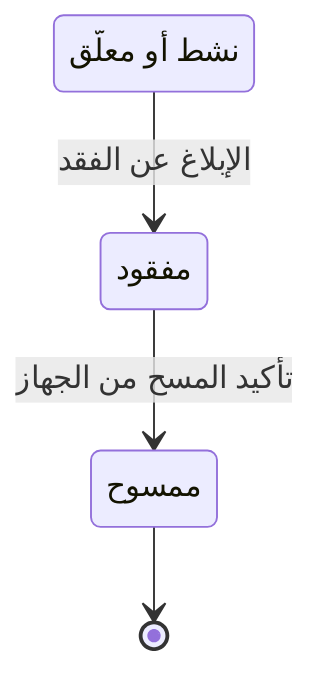

# الإبلاغ عن جهاز مفقود

<!-- BEGIN GENERATED: doc -->
| البند | القيمة |
|---|---|
| المعرّف | FEAT-COL-LOST-DEVICE |
| الإصدار | 0.2 |
| الحالة | مسودة |
| القدرة | CAP-02 جمع المعلومات |
| القدرة الفرعية | CAP-02.03 تسجيل الملاحظات (بما فيها دون اتصال) (R1) |
| الأدوار | المستخدم الميداني؛ مسؤول الإدارة؛ النظام |
| الشاشات | SCR-63 الأجهزة |
| حالات الاستخدام | UC-093 |
| القصص | 6: 3 من المواصفة، و3 جديدة |
<!-- END GENERATED: doc -->

## 1. نظرة عامة

### 1.1 القيمة

يتيح الإبلاغ عن فقد الجهاز فيمنع مزامنته ويمسح بياناته عن بعد حماية للمعلومات.

### 1.2 النطاق

| البند | القيمة |
|---|---|
| المستخدمون | المستخدم الميداني يبلّغ عن فقد جهازه هو، ومسؤول الإدارة يبلّغ عن أي جهاز في نطاقه، والنظام يرفض كل مزامنة من الجهاز المفقود ويؤكد مسحه، وفريقا المنصة والتشغيل يبطلان جلساته ويراجعان كل بلاغ |
| الشاشات | SCR-63 الأجهزة: الإبلاغ عن الفقد ومتابعة حالة المسح |
| حالات الاستخدام | مسح الجهاز المفقود (UC-093) |
| المتطلبات | تشفير كل ما يُحفظ على الأجهزة الميدانية ومسح الجهاز المفقود عن بعد (REQ-OFF-005) |
| خارج النطاق | تسجيل الجهاز وتأكيده وتعليقه وإحالته إلى التقاعد (ميزة «إدارة الأجهزة الميدانية»)، وحزم البيانات على الجهاز (ميزة «تحميل بيانات المنطقة مسبقًا»)، وحسم تعارضات المزامنة (ميزة «حل تعارضات المزامنة») |

### 1.3 خريطة الميزة

### 1.3 خريطة الميزة

**الشكل 1: خريطة ميزة الإبلاغ عن جهاز مفقود**



**الشكل 2: الحالات التي تمر بها هذه الميزة**



> **ملاحظة:** حالات الجهاز الكاملة الست في ميزة «إدارة الأجهزة الميدانية» (الشكل 2 هناك). هذه الميزة تغطي الانتقالين الأخيرين فقط، ورفض مصافحة المزامنة من جهاز «مفقود» أو «معلّق» في جلسة مزامنة مستقلة لا تغيّر حالة الجهاز.

## 2. القواعد المشتركة

تنطبق على كل قصص الميزة، فلا تتكرر داخل القصص. وكل قصة تذكر ما يخصها فقط.

### 2.1 السياق المشترك

كل قصة تبدأ من ثلاثة شروط: مستأجر نشط، وحزمة السياسات الأساسية مفعّلة، ومستخدم مسجّل الدخول ومخوَّل. وتشير إليها القصص بخطوة واحدة: «بفرض السياق المشترك للميزة».

### 2.2 الصلاحية وعدم الإفصاح

- من لا يحق له رؤية العنصر يتلقى ردًا بشكل «غير متاح» تمامًا، فلا يعرف أنه موجود.
- من يرى العنصر ولا يحق له الإجراء يتلقى «لا تملك صلاحية هذا الإجراء».

### 2.3 أوامر تغيير الحالة

- **منع التكرار:** يُرسل كل أمر بمفتاح فريد، فإعادة الطلب نفسه لا تُنفَّذ مرتين.
- **حماية التعديل المتزامن:** يُرسل كل أمر بإصدار البيانات الذي يراه المستخدم. فإن عدّلها غيره في الأثناء، يُرفض الأمر.
- **السجل:** إن نجح الأمر، يُكتب حدثه وسجل التدقيق في المعاملة نفسها.

### 2.4 الرفض المشترك

```gherkin
# language: ar
خاصية: الرفض المشترك لأوامر الميزة

  سيناريو مخطط: رفض مشترك لكل أمر في الميزة
    بفرض السياق المشترك للميزة
    و <الحالة>
    عندما يُرسل المستخدم أي أمر من أوامر الميزة
    اذاً يُرفض برمز <الرمز> ويرى "<الرسالة>"
    و لا يتغير شيء

    امثلة:
      | الحالة                                  | الرمز                  | الرسالة                                                 |
      | العنصر خارج صلاحياته                    | NOT_FOUND              | غير متاح                                                |
      | العنصر مرئي له ولا يحق له الإجراء       | AUTHZ_DENIED           | لا تملك صلاحية هذا الإجراء                              |
      | غيره عدّل العنصر بعد أن فتحه            | VERSION_CONFLICT       | تغيّرت البيانات منذ فتحتها. راجع التغييرات ثم أعد المحاولة |
      | أعاد مفتاح منع التكرار بمحتوى مختلف     | IDEMPOTENCY_KEY_REUSED | طلب مكرر بمحتوى مختلف                                   |
      | البيانات ناقصة أو غير صحيحة             | VALIDATION_FAILED      | بعض البيانات ناقصة أو غير صحيحة. راجع الحقول المعلَّمة      |

  سيناريو: إعادة الطلب نفسه لا تُنفَّذ مرتين
    بفرض السياق المشترك للميزة
    و أمر نجح بمفتاح منع تكرار
    عندما يُعاد الطلب نفسه بالمفتاح نفسه
    اذاً تُعاد النتيجة الأولى ولا يُكتب حدث ثانٍ
```

### 2.5 أثر فقد الجهاز على جلسات المزامنة

- محاولة مصافحة مزامنة من جهاز «مفقود» تُرفض بتعليمة مسح فقط، ومن جهاز «معلّق» بتعليمة إيقاف فقط؛ ولا تطبَّق أي أوامر معلّقة على الجهاز.
- أوامر على الجهاز صدرت بعد زمن الفقد تُوجَّه إلى المراجعة ولا تُطبَّق تلقائيًا (ثابت INV-SCF-03).

## 3. الجودة وتعريف الاكتمال

### 3.1 متطلبات الجودة

<!-- BEGIN GENERATED: quality -->
| المرجع | الموقف | المطلوب |
|---|---|---|
| QAS-OFF-001 | works 72 h offline then reconnects on a 1 Mbps link | 1,000 queued commands synced ≤ 10 min; 0 silent overwrites; 0 duplicates |
| QAS-SEC-003 | removes a user's compartment | effective on next request in every path, independent of index lag |
| QAS-SEC-007 | obtains a field device | 0 readable records without authentication; wipe on next connection |
<!-- END GENERATED: quality -->

### 3.2 تعريف الاكتمال

القصة مكتملة حين تتحقق الشروط الخمسة:

1. سيناريوهاتها والقواعد المشتركة تمر في الاختبار الآلي.
2. فحوص البنية المعمارية تمر.
3. نصوص الواجهة والرسائل موجودة بالعربية والإنجليزية.
4. مراجعة الكود مكتملة.
5. ما تضيفه القصة نفسها في قسم «القواعد» تحقق.

## 4. فهرس القصص

<!-- BEGIN GENERATED: story-index -->
| المعرّف | القصة | النوع | الحالة |
|---|---|---|---|
| `US-BC01-DEV-REPORT-LOST` | الإبلاغ عن فقد الجهاز الميداني | أمر | مسودة |
| `US-BC01-S-DEVICE-01` | تأكيد مسح الجهاز المفقود | نظام | مسودة |
| `US-BC07-S-SYNC-SESSION-01` | رفض مصافحة المزامنة من جهاز مفقود أو معلّق | نظام | مسودة |
| `US-UI-SCR63-REPORT-LOST` | الإبلاغ عن فقد جهاز ومتابعة مسحه | واجهة | مسودة |
| `US-PLT-LOST-DEVICE-TOKEN-REVOKE` | إبطال جلسات الجهاز المفقود فورًا | منصة | مسودة |
| `US-OPS-LOST-DEVICE-REVIEW` | مراجعة أمنية لكل جهاز مفقود | تشغيل | مسودة |
<!-- END GENERATED: story-index -->

## 5. القصص

### 5.1 US-BC01-DEV-REPORT-LOST — الإبلاغ عن فقد الجهاز الميداني

| النوع | الإصدار | الأولوية | دون اتصال | الحالة |
|---|---|---|---|---|
| أمر | R1 | Must | لا | مسودة |

> **كـ** مستخدم ميداني، **أريد** أن أبلّغ عن فقد جهازي فورًا، **حتى** يُبطَل مفتاحه ويُمسح عند أي اتصال تالٍ قبل أن يقرأ أحد بياناته أو ينتحل صفتي.

**باختصار:** الجهاز «النشط» أو «المعلّق» يصبح «مفقودًا». يُبطَل مفتاحه فورًا، وتُرفض كل مزامنة منه بتعليمة مسح، وتُراجَع أوامره الأخيرة.

#### القواعد

- **متى يُسمح:** الجهاز «نشط» أو «معلّق».
- **من يُسمح له:** مالك الجهاز نفسه، أو مسؤول الأمن.
- **البيانات:** لا مدخلات إلزامية غير تعريف الجهاز.
- **الأثر:** يصبح الجهاز «مفقودًا»، ويُبطَل مفتاحه في اللحظة نفسها، ويُسجَّل حدث «أُبلغ عن فقد الجهاز». وتُوجَّه أوامر وصلت من الجهاز بعد زمن الفقد إلى مراجعة تعارض المزامنة بدل تطبيقها تلقائيًا (القسم 2.5).

#### معايير القبول

```gherkin
# language: ar
خاصية: الإبلاغ عن فقد الجهاز الميداني

  سيناريو: مستخدم ميداني يبلّغ عن فقد جهازه النشط
    بفرض السياق المشترك للميزة
    و جهاز "نشط" مملوك للمستخدم الميداني
    عندما يبلّغ عن فقده
    اذاً تصبح حالة الجهاز "مفقود"
    و يُبطَل مفتاح الجهاز فورًا
    و يُسجَّل حدث "أُبلغ عن فقد الجهاز"

  سيناريو مخطط: رفض خاص بالإبلاغ عن الفقد
    بفرض السياق المشترك للميزة
    و <الحالة>
    عندما يحاول الإبلاغ عن فقد الجهاز
    اذاً يُرفض برمز <الرمز> ويرى "<الرسالة>"
    و لا يتغير شيء

    امثلة:
      | الحالة | الرمز | الرسالة |
      | الجهاز "مفقود" من قبل | DEVICE_INVALID_STATE_TRANSITION | الوضع الحالي للجهاز الميداني لا يسمح بهذا الإجراء |
      | الجهاز "بانتظار التأكيد" | DEVICE_INVALID_STATE_TRANSITION | الوضع الحالي للجهاز الميداني لا يسمح بهذا الإجراء |
      | الجهاز "متقاعد" | DEVICE_INVALID_STATE_TRANSITION | الوضع الحالي للجهاز الميداني لا يسمح بهذا الإجراء |
```

<details><summary>المراجع التقنية والتتبع</summary>

<!-- BEGIN GENERATED: refs US-BC01-DEV-REPORT-LOST -->
| البند | المعرّف | المعنى |
|---|---|---|
| الواجهة البرمجية | `POST /api/v1/foundation/devices/{id}/actions/report-lost` | — |
| الأمر | `CMD-DEV-REPORT-LOST` | الإبلاغ عن فقد الجهاز الميداني |
| السياسة | `POL-DEV-REPORT-LOST` | user (enroll, report lost) · Administrator / MDM policy (confirm, suspend, reinstate, retire) · Security Offi… |
| الحدث | `EVT-DEV-REPORTED-LOST` | يصل إلى: Security-version service (EVT-SEC-VERSION-INCREMENTED); PEP decision caches; Projection security-ver… |
| الكيان | `AGG-DEVICE` | الجهاز الميداني |
| الجدول | `foundation.devices` | الجدول الرئيسي للجهاز الميداني |
| وحدة النشر | DU-02 | — |
| المتطلب | REQ-OFF-005 | The system shall encrypt all data stored on field devices and shall support remote wipe of a lost device. |
| حالة الاستخدام | UC-093 | Wipe Lost Device |
| الاختبار | TST-DEVICE-SM، TST-SLC11-INVARIANTS | دورة حالات الجهاز الميداني، وثوابت الشريحة SLC-11 |
<!-- END GENERATED: refs US-BC01-DEV-REPORT-LOST -->

</details>

### 5.2 US-BC01-S-DEVICE-01 — تأكيد مسح الجهاز المفقود

| النوع | الإصدار | الأولوية | دون اتصال | الحالة |
|---|---|---|---|---|
| نظام | R1 | Must | لا ينطبق | مسودة |

> **كـ** النظام، **أريد** أن أسجّل تأكيد الجهاز المفقود مسحه عند أول اتصال له، **حتى** يُعرف أن بياناته لم تعد قابلة للقراءة.

**باختصار:** الجهاز «المفقود» يتصل فيستلم تعليمة المسح وحدها (القسم 2.5)، ويؤكد تنفيذها، فيصبح «ممسوحًا».

#### القواعد

- **متى يحدث:** عند أول اتصال من جهاز «مفقود»، بعد أن يؤكد الجهاز تنفيذ المسح.
- **الأثر:** يصبح الجهاز «ممسوحًا»، ويُسجَّل حدث «مُسح الجهاز». وهذه حالة نهائية لا يُقبل عليها أي أمر آخر.

#### معايير القبول

```gherkin
# language: ar
خاصية: تأكيد مسح الجهاز المفقود

  سيناريو: الجهاز المفقود يؤكد مسحه عند أول اتصال
    بفرض جهاز "مفقود"
    عندما يتصل الجهاز ويؤكد تنفيذ تعليمة المسح
    اذاً تصبح حالة الجهاز "ممسوح"
    و يُسجَّل حدث "مُسح الجهاز"

  سيناريو: لا يحدث شيء قبل تأكيد المسح
    بفرض جهاز "مفقود" لم يتصل بعد
    عندما تُفحص حالته
    اذاً تبقى حالته "مفقود"
    و لا يتغير شيء
```

<details><summary>المراجع التقنية والتتبع</summary>

<!-- BEGIN GENERATED: refs US-BC01-S-DEVICE-01 -->
| البند | المعرّف | المعنى |
|---|---|---|
| المحفِّز | `SYS:wipe confirmed by device` | device acknowledges wipe on next contact |
| الانتقال | LOST ← WIPED | — |
| الحدث | `EVT-DEV-WIPED` | يصل إلى: Sync gateway (device registry cache); Preload packages (revoke on LOST/SUSPENDED); Security-version… |
| الكيان | `AGG-DEVICE` | الجهاز الميداني |
| الجدول | `foundation.devices` | الجدول الرئيسي للجهاز الميداني |
| وحدة النشر | DU-02 | — |
| المتطلب | REQ-OFF-005 | The system shall encrypt all data stored on field devices and shall support remote wipe of a lost device. |
| حالة الاستخدام | UC-093 | Wipe Lost Device |
| الاختبار | TST-DEVICE-SM، TST-SLC11-INVARIANTS | دورة حالات الجهاز الميداني، وثوابت الشريحة SLC-11 |
<!-- END GENERATED: refs US-BC01-S-DEVICE-01 -->

</details>

### 5.3 US-BC07-S-SYNC-SESSION-01 — رفض مصافحة المزامنة من جهاز مفقود أو معلّق

| النوع | الإصدار | الأولوية | دون اتصال | الحالة |
|---|---|---|---|---|
| نظام | R1 | Must | لا ينطبق | مسودة |

> **كـ** النظام، **أريد** أن أرفض مصافحة مزامنة جهاز «مفقود» أو «معلّق» بتعليمة واحدة فقط، **حتى** لا تُطبَّق أوامره ولا يستمر في العمل بعد فقده أو تعليقه.

**باختصار:** جهاز «مفقود» أو «معلّق» يحاول فتح جلسة مزامنة، فتُرفض الجلسة فورًا دون فتحها، ويستلم الجهاز تعليمة مسح أو إيقاف فقط.

#### القواعد

- **متى يحدث:** عند مصافحة مزامنة من جهاز حالته «مفقود» أو «معلّق».
- **الأثر:** تُرفض الجلسة مباشرة دون أن تُفتح، ويُسجَّل حدث «رُفضت جلسة المزامنة». ولا يصل إلى الجهاز إلا تعليمة المسح (إن كان «مفقودًا») أو تعليمة الإيقاف (إن كان «معلّقًا»)، ولا أوامر معلّقة ولا بيانات.

#### معايير القبول

```gherkin
# language: ar
خاصية: رفض مصافحة المزامنة من جهاز مفقود أو معلّق

  سيناريو: جهاز مفقود يحاول المصافحة
    بفرض جهاز "مفقود"
    عندما يحاول الجهاز فتح جلسة مزامنة
    اذاً تُرفض الجلسة ولا تُفتح
    و يستلم الجهاز تعليمة مسح فقط
    و يُسجَّل حدث "رُفضت جلسة المزامنة"

  سيناريو: جهاز معلّق يحاول المصافحة
    بفرض جهاز "معلّق"
    عندما يحاول الجهاز فتح جلسة مزامنة
    اذاً تُرفض الجلسة ولا تُفتح
    و يستلم الجهاز تعليمة إيقاف فقط

  سيناريو: جهاز نشط لا يتأثر
    بفرض جهاز "نشط"
    عندما يحاول الجهاز فتح جلسة مزامنة
    اذاً تُفتح الجلسة ولا يتغير شيء في حالة الجهاز
```

<details><summary>المراجع التقنية والتتبع</summary>

<!-- BEGIN GENERATED: refs US-BC07-S-SYNC-SESSION-01 -->
| البند | المعرّف | المعنى |
|---|---|---|
| المحفِّز | `SYS:device LOST or SUSPENDED at handshake` | returns wipe (LOST) or stop (SUSPENDED) instruction only |
| الانتقال | ∅ ← REJECTED | — |
| الحدث | `EVT-SYN-REJECTED` | يصل إلى: Owner contexts (commands applied via their APIs); Field telemetry |
| الكيان | `AGG-SYNC-SESSION` | جلسة المزامنة |
| الجدول | `field.sync_sessions` | الجدول الرئيسي لجلسة المزامنة |
| وحدة النشر | DU-10 | — |
| المتطلبات | REQ-OFF-001، REQ-OFF-003، REQ-OFF-004، REQ-OFF-006 | معانيها في القسم 6. التتبع |
| حالات الاستخدام | UC-090، UC-091، UC-092 | Capture Observation Offline؛ Synchronize Field Device؛ Review Synchronization Conflict |
| الاختبار | TST-SYNC-SESSION-SM، TST-SLC11-INVARIANTS | دورة حالات جلسة المزامنة، وثوابت الشريحة SLC-11 |
<!-- END GENERATED: refs US-BC07-S-SYNC-SESSION-01 -->

</details>

### 5.4 US-UI-SCR63-REPORT-LOST — الإبلاغ عن فقد جهاز ومتابعة مسحه

| النوع | الإصدار | الأولوية | دون اتصال | الحالة |
|---|---|---|---|---|
| واجهة | R1 | Must | لا | مسودة |

> **كـ** المستخدم، **أريد** زر إبلاغ واضح في شاشة الأجهزة وأن أرى تأكيد المسح حين يحدث، **حتى** أتصرف بسرعة عند فقد جهاز وأتابع نتيجة بلاغي.

**باختصار:** تعرض شاشة الأجهزة زر «إبلاغ عن فقد» على الجهاز «النشط» أو «المعلّق»، وتعرض بعده حالة «مفقود» ثم «ممسوح» حين يتصل الجهاز ويؤكد المسح.

#### القواعد

- يظهر زر «إبلاغ عن فقد» للجهاز «نشط» أو «معلّق» إذا شملته صلاحيات المستخدم، وهذا تلميح والحكم للخادم.
- بعد الإبلاغ تعرض الشاشة تأكيدًا فوريًا بأن مفتاح الجهاز أُبطل، ثم شارة «مفقود».
- حين يؤكد الجهاز المسح تتحول الشارة إلى «ممسوح» دون أن يطلب المستخدم شيئًا، وتحديثها من استعلام قائمة الأجهزة **[Derived]**.
- عند تعارض الإصدار تعيد الشاشة تحميل الجهاز وتعرض ما تغيّر، وعند رفض الحالة تعيد تحميل الحالة وتخفي الزر إن لم يعد متاحًا.

#### معايير القبول

```gherkin
# language: ar
خاصية: الإبلاغ عن فقد جهاز ومتابعة مسحه

  سيناريو: الإبلاغ عن الفقد ثم ظهور تأكيد المسح
    بفرض السياق المشترك للميزة
    و شاشة الأجهزة مفتوحة على جهاز "نشط" يملكه المستخدم
    عندما يضغط زر "إبلاغ عن فقد"
    اذاً تعرض الشاشة شارة "مفقود" فورًا
    و حين يؤكد الجهاز المسح تتحول الشارة إلى "ممسوح" في القائمة

  سيناريو مخطط: استجابة الشاشة لرفض الخادم
    بفرض السياق المشترك للميزة
    و شاشة الأجهزة مفتوحة
    و <الحالة>
    عندما يضغط زر "إبلاغ عن فقد"
    اذاً تعرض الشاشة "<الرسالة>"
    و لا يتغير شيء

    امثلة:
      | الحالة | الرمز | الرسالة |
      | الجهاز "مفقود" من قبل | DEVICE_INVALID_STATE_TRANSITION | الوضع الحالي للجهاز الميداني لا يسمح بهذا الإجراء |
```

<details><summary>المراجع التقنية والتتبع</summary>

<!-- BEGIN GENERATED: refs US-UI-SCR63-REPORT-LOST -->
| البند | المعرّف | المعنى |
|---|---|---|
| الشاشة | SCR-63 | شاشة الأجهزة |
| حالة الاستخدام | UC-093 | Wipe Lost Device |
| المصدر | `21-ui-design.md §6.2` | — |
| المصدر | `[Derived]` | — |
| المتطلب | REQ-OFF-005 | The system shall encrypt all data stored on field devices and shall support remote wipe of a lost device. |
| حالة الاستخدام | UC-093 | Wipe Lost Device |
<!-- END GENERATED: refs US-UI-SCR63-REPORT-LOST -->

</details>

### 5.5 US-PLT-LOST-DEVICE-TOKEN-REVOKE — إبطال جلسات الجهاز المفقود فورًا

| النوع | الإصدار | الأولوية | دون اتصال | الحالة |
|---|---|---|---|---|
| منصة | R1 | Should | لا ينطبق | مسودة |

> **كـ** فريق المنصة، **أريد** أن يسري إبطال مفتاح الجهاز المفقود على كل مسار وصول من لحظة الإبلاغ، **حتى** لا تقبل بوابة المزامنة ولا أي خدمة أخرى أمرًا منه حتى لو تأخر تحديث فهرس أو ذاكرة مؤقتة.

**باختصار:** إبطال مفتاح الجهاز يُحفظ في مصدر القرار الذي يفحصه كل طلب مزامنة، فيرى كل مسار الإبطال من أول طلب تالٍ، بلا انتظار تحديث فهارس.

#### القواعد

- إبطال مفتاح الجهاز يُحفظ في نفس معاملة الإبلاغ عن الفقد، ويقرؤه كل مسار وصول عند الفحص، لا من نسخة مؤجَّلة.
- لا فرق بين مسار وآخر في زمن سريان الإبطال: كلها تراه من الطلب التالي مباشرة، بصرف النظر عن تأخر الفهرسة في مسارات أخرى (أثر مماثل لسريان تغيير التصريح الأمني، REQ-GOV-004).
- جلسة مزامنة مفتوحة فعلًا وقت الإبلاغ تُنهى عند أول طلب تالٍ فيها، لا تُترك حتى تنتهي من نفسها.

#### معايير القبول

```gherkin
# language: ar
خاصية: إبطال جلسات الجهاز المفقود فورًا

  سيناريو: الإبطال يسري على أول طلب تالٍ
    بفرض جهاز "نشط" أُبلغ عن فقده في هذه اللحظة
    عندما يحاول الجهاز إرسال أي طلب فور ذلك
    اذاً يُرفض الطلب لأن مفتاحه مُبطَل
    و لا يعتمد الرفض على تحديث أي فهرس أو ذاكرة مؤقتة

  سيناريو: جلسة مفتوحة وقت الإبلاغ تُنهى عند أول طلب تالٍ فيها
    بفرض جلسة مزامنة مفتوحة لجهاز نشط
    عندما يُبلَّغ عن فقد الجهاز خلال الجلسة
    اذاً يُرفض أول طلب تالٍ في تلك الجلسة
```

<details><summary>المراجع التقنية والتتبع</summary>

<!-- BEGIN GENERATED: refs US-PLT-LOST-DEVICE-TOKEN-REVOKE -->
| البند | المعرّف | المعنى |
|---|---|---|
| المصدر | `17-security-design.md §2` | — |
| المصدر | `17-security-design.md §3.5` | — |
| الجودة | QAS-SEC-003 | removes a user's compartment → effective on next request in every path, independent of index lag |
| المصدر | `THR-S11-04` | — |
| المصدر | `[Derived]` | — |
<!-- END GENERATED: refs US-PLT-LOST-DEVICE-TOKEN-REVOKE -->

</details>

### 5.6 US-OPS-LOST-DEVICE-REVIEW — مراجعة أمنية لكل جهاز مفقود

| النوع | الإصدار | الأولوية | دون اتصال | الحالة |
|---|---|---|---|---|
| تشغيل | R1 | Should | لا ينطبق | مسودة |

> **كـ** فريق الأمن، **أريد** أن يصلني إشعار بكل بلاغ فقد جهاز وأن أراجع ما سُجِّل عليه حول زمن الفقد، **حتى** أحسم الأوامر المشكوك فيها وأتابع أثر سرقة الجهاز قبل تأكيد مسحه.

**باختصار:** كل بلاغ فقد جهاز يفتح مراجعة أمنية. يتابعها فريق الأمن حتى تأكيد المسح أو حسم ما وصل من أوامر مشكوكة.

#### القواعد

- كل حدث «أُبلغ عن فقد الجهاز» يفتح مراجعة أمنية لفريق الأمن.
- المراجعة تتابع: زمن الفقد، وما سُجِّل من أوامر معلّقة أو مزامنة سابقة قريبة من ذلك الزمن، وحالة المسح.
- تُغلق المراجعة عند تأكيد المسح أو عند حسم كل ما نتج عنها من مراجعات تعارض مزامنة. وتفاصيل المؤشرات والحدود **[Derived]**.

#### معايير القبول

```gherkin
# language: ar
خاصية: مراجعة أمنية لكل جهاز مفقود

  سيناريو: فتح مراجعة أمنية عند الإبلاغ عن الفقد
    بفرض جهاز نشط لم يُبلَّغ عن فقده
    عندما يُبلَّغ عن فقده
    اذاً تُفتح مراجعة أمنية لفريق الأمن تحمل زمن الفقد

  سيناريو: إغلاق المراجعة عند تأكيد المسح
    بفرض مراجعة أمنية مفتوحة لجهاز "مفقود"
    عندما يؤكد الجهاز تنفيذ المسح
    اذاً تُغلق المراجعة الأمنية لذلك الجهاز
```

<details><summary>المراجع التقنية والتتبع</summary>

<!-- BEGIN GENERATED: refs US-OPS-LOST-DEVICE-REVIEW -->
| البند | المعرّف | المعنى |
|---|---|---|
| المصدر | `observability-slc11.md` | — |
| المصدر | `THR-S11-01` | — |
| المصدر | `THR-011` | — |
<!-- END GENERATED: refs US-OPS-LOST-DEVICE-REVIEW -->

</details>

## 6. التتبع

<!-- BEGIN GENERATED: trace -->
| المتطلب | المعنى | القصص | الاختبار |
|---|---|---|---|
| REQ-OFF-001 | Where the mobile field application is used, the system shall allow recording observations with location, time… | `US-BC07-S-SYNC-SESSION-01` | TST-SLC03-INVARIANTS، TST-SLC11-INVARIANTS، TST-SYNC-SESSION-SM، TST-TASK-SM |
| REQ-OFF-003 | When a device reconnects, the system shall receive the device's recorded commands in their original order wit… | `US-BC07-S-SYNC-SESSION-01` | TST-SLC11-INVARIANTS، TST-SYNC-SESSION-SM |
| REQ-OFF-004 | If a synchronized command conflicts with the current server state, then the system shall route it to conflict… | `US-BC07-S-SYNC-SESSION-01` | TST-SLC11-INVARIANTS، TST-SYNC-CONFLICT-SM، TST-SYNC-SESSION-SM |
| REQ-OFF-005 | The system shall encrypt all data stored on field devices and shall support remote wipe of a lost device. | `US-BC01-DEV-REPORT-LOST`، `US-BC01-S-DEVICE-01`، `US-UI-SCR63-REPORT-LOST` | TST-DEVICE-SM، TST-PRELOAD-PACKAGE-SM، TST-SLC11-INVARIANTS |
| REQ-OFF-006 | When a synchronization is interrupted, the system shall resume it without duplicating commands. | `US-BC07-S-SYNC-SESSION-01` | TST-SLC11-INVARIANTS، TST-SYNC-SESSION-SM |
<!-- END GENERATED: trace -->

## 7. سجل التغييرات

| الإصدار | التاريخ | التغيير |
|---|---|---|
| 0.1 | — | هيكل مولَّد من خريطة الميزات |
| 0.2 | 2026-10-03 | كتابة القصص كاملة بمعيار القصص |
