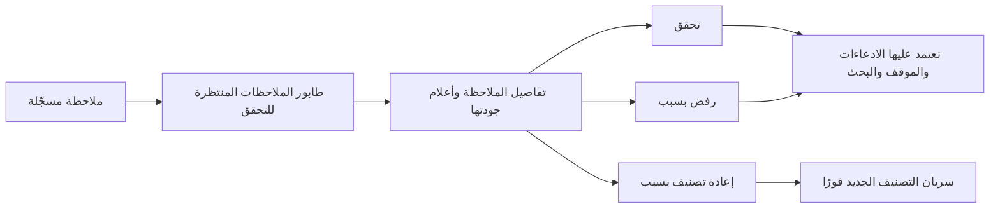
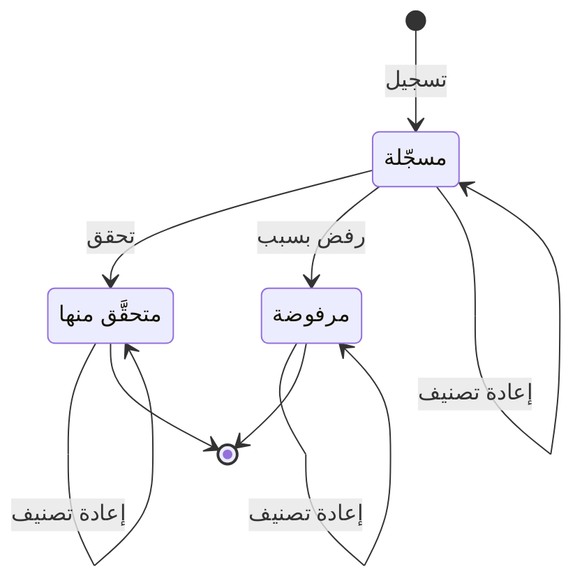

# التحقق من الملاحظات

<!-- BEGIN GENERATED: doc -->
| البند | القيمة |
|---|---|
| المعرّف | FEAT-COL-OBS-REVIEW |
| الإصدار | 0.1 |
| الحالة | مسودة |
| القدرة | CAP-02 جمع المعلومات |
| القدرة الفرعية | CAP-02.03 تسجيل الملاحظات (بما فيها دون اتصال) (R1) |
| الأدوار | المحلل |
| الشاشات | SCR-23 الملاحظات، SCR-06 قوائم المراجعة |
| حالات الاستخدام | UC-005 |
| القصص | 4: 3 من المواصفة، و1 جديدة |
<!-- END GENERATED: doc -->

## 1. نظرة عامة

### 1.1 القيمة

يتيح للمحلل اعتماد الملاحظة أو رفضها أو إعادة تصنيفها قبل أن تعتمد عليها التحليلات.

### 1.2 النطاق

| البند | القيمة |
|---|---|
| المستخدمون | المحلل يتحقق من الملاحظة أو يرفضها أو يعيد تصنيفها، ولا يتحقق مما رصده بنفسه |
| الشاشات | SCR-23 الملاحظات: طابور الملاحظات المنتظرة للتحقق وتفاصيل كل ملاحظة، وSCR-06 قوائم المراجعة |
| حالات الاستخدام | تسجيل الملاحظة (UC-005)، وهذه الميزة خطوتها الثانية: التحقق أو الرفض |
| المتطلبات | الملاحظة تحفظ زمن الرصد وزمن التسجيل والموقع والمصدر والراصد (REQ-INF-002)، وتغيير التصنيف يحتاج السلطة التي تحددها سياسة المستأجر ويُحفظ إصدارًا جديدًا ويسري فورًا في كل مسارات الوصول (REQ-GOV-004) |
| خارج النطاق | تسجيل الملاحظة وتعديلها وإرفاق الأدلة بها (ميزة «تسجيل الملاحظات»)، والتقاطها دون اتصال (ميزة «العمل الميداني دون اتصال») |

### 1.3 خريطة الميزة

**الشكل 1: خريطة ميزة التحقق من الملاحظات**



تبدأ الملاحظة «مسجّلة»، وتنتقل مرة واحدة إلى «متحقَّق منها» أو «مرفوضة» (الشكل 2). وإعادة التصنيف لا تغيّر الحالة.

**الشكل 2: رحلة الملاحظة**



## 2. القواعد المشتركة

تنطبق على كل قصص الميزة، فلا تتكرر داخل القصص. وكل قصة تذكر ما يخصها فقط.

### 2.1 السياق المشترك

كل قصة تبدأ من ثلاثة شروط: مستأجر نشط، وحزمة السياسات الأساسية مفعّلة، ومستخدم مسجّل الدخول ومخوَّل. وتشير إليها القصص بخطوة واحدة: «بفرض السياق المشترك للميزة».

### 2.2 الصلاحية وعدم الإفصاح

- من لا يحق له رؤية العنصر يتلقى ردًا بشكل «غير متاح» تمامًا، فلا يعرف أنه موجود.
- من يرى العنصر ولا يحق له الإجراء يتلقى «لا تملك صلاحية هذا الإجراء».

### 2.3 أوامر تغيير الحالة

- **منع التكرار:** يُرسل كل أمر بمفتاح فريد، فإعادة الطلب نفسه لا تُنفَّذ مرتين.
- **حماية التعديل المتزامن:** يُرسل كل أمر بإصدار البيانات الذي يراه المستخدم. فإن عدّلها غيره في الأثناء، يُرفض الأمر.
- **السجل:** إن نجح الأمر، يُكتب حدثه وسجل التدقيق في المعاملة نفسها.

### 2.4 الرفض المشترك

```gherkin
# language: ar
خاصية: الرفض المشترك لأوامر الميزة

  سيناريو مخطط: رفض مشترك لكل أمر في الميزة
    بفرض السياق المشترك للميزة
    و <الحالة>
    عندما يُرسل المستخدم أي أمر من أوامر الميزة
    اذاً يُرفض برمز <الرمز> ويرى "<الرسالة>"
    و لا يتغير شيء

    امثلة:
      | الحالة                                  | الرمز                  | الرسالة                                                 |
      | العنصر خارج صلاحياته                    | NOT_FOUND              | غير متاح                                                |
      | العنصر مرئي له ولا يحق له الإجراء       | AUTHZ_DENIED           | لا تملك صلاحية هذا الإجراء                              |
      | غيره عدّل العنصر بعد أن فتحه            | VERSION_CONFLICT       | تغيّرت البيانات منذ فتحتها. راجع التغييرات ثم أعد المحاولة |
      | أعاد مفتاح منع التكرار بمحتوى مختلف     | IDEMPOTENCY_KEY_REUSED | طلب مكرر بمحتوى مختلف                                   |
      | البيانات ناقصة أو غير صحيحة             | VALIDATION_FAILED      | بعض البيانات ناقصة أو غير صحيحة. راجع الحقول المعلَّمة      |

  سيناريو: إعادة الطلب نفسه لا تُنفَّذ مرتين
    بفرض السياق المشترك للميزة
    و أمر نجح بمفتاح منع تكرار
    عندما يُعاد الطلب نفسه بالمفتاح نفسه
    اذاً تُعاد النتيجة الأولى ولا يُكتب حدث ثانٍ
```

### 2.5 الملاحظة بعد التحقق أو الرفض

- الملاحظة «المتحقَّق منها» و«المرفوضة» في حالة نهائية: لا يتغير محتواها بعد ذلك، وإعادة التصنيف وحدها مسموحة عليها، وتغيّر التصنيف فقط بإصدار جديد.
- التحقق والرفض يصلان إلى ثلاثة مستقبلين: تلخيص المواقع في الادعاءات المشتقة، وعضوية الموقف، والبحث.

## 3. الجودة وتعريف الاكتمال

### 3.1 متطلبات الجودة

<!-- BEGIN GENERATED: quality -->
لا متطلبات جودة مرتبطة بمتطلبات هذه الميزة مباشرة. تنطبق متطلبات المنصة العامة (`FEAT-PLT-*`).
<!-- END GENERATED: quality -->

### 3.2 تعريف الاكتمال

القصة مكتملة حين تتحقق الشروط الخمسة:

1. سيناريوهاتها والقواعد المشتركة تمر في الاختبار الآلي.
2. فحوص البنية المعمارية تمر.
3. نصوص الواجهة والرسائل موجودة بالعربية والإنجليزية.
4. مراجعة الكود مكتملة.
5. ما تضيفه القصة نفسها في قسم «القواعد» تحقق.

## 4. فهرس القصص

<!-- BEGIN GENERATED: story-index -->
| المعرّف | القصة | النوع | الحالة |
|---|---|---|---|
| `US-BC02-OBS-RECLASSIFY` | إعادة تصنيف الملاحظة | أمر | مسودة |
| `US-BC02-OBS-REJECT` | رفض الملاحظة | أمر | مسودة |
| `US-BC02-OBS-VALIDATE` | التحقق من الملاحظة | أمر | مسودة |
| `US-UI-SCR23-VALIDATION-QUEUE` | طابور الملاحظات المنتظرة للتحقق | واجهة | مسودة |
<!-- END GENERATED: story-index -->

## 5. القصص

### 5.1 US-BC02-OBS-RECLASSIFY — إعادة تصنيف الملاحظة

| النوع | الإصدار | الأولوية | دون اتصال | الحالة |
|---|---|---|---|---|
| أمر | R1 | Must | لا | مسودة |

> **كـ** محلل، **أريد** أن أغيّر التصنيف الأمني لملاحظة مع ذكر السبب، **حتى** لا يراها إلا من يحق له بعد أن تبيّن أن تصنيفها الأول خاطئ.

**باختصار:** يغيّر المحلل تصنيف الملاحظة في أي حالة من حالاتها الثلاث. فتبقى الحالة كما هي، ويُحفظ التصنيف الجديد إصدارًا جديدًا يسري فورًا.

#### القواعد

- **متى يُسمح:** الملاحظة «مسجّلة» أو «متحقَّق منها» أو «مرفوضة».
- **من يُسمح له:** المحلل الذي يرى الملاحظة ويملك صلاحية الكتابة في نطاقها من المؤسسة، ويملك سلطة تغيير التصنيف التي تحددها سياسة المستأجر (REQ-GOV-004).
- **البيانات:** التصنيف الجديد (إلزامي)، والسبب (إلزامي).
- **الأثر:** تبقى الحالة كما هي، ويُحفظ التصنيف في إصدار جديد ولا يتغير شيء آخر من المحتوى. ويُسجَّل حدث «أُعيد تصنيف الملاحظة»، ويرتفع الإصدار الأمني للملاحظة فتُبطل قرارات الصلاحية المحفوظة. ومن لم يعد يحق له رؤيتها لا تصله من لحظة التغيير في البحث ولا الخريطة ولا التصدير ولا الواجهة البرمجية، مهما تأخر تحديث الفهارس (REQ-GOV-004).

#### معايير القبول

```gherkin
# language: ar
خاصية: إعادة تصنيف الملاحظة

  سيناريو: رفع تصنيف ملاحظة متحقَّق منها
    بفرض السياق المشترك للميزة
    و ملاحظة "متحقَّق منها" يراها مستخدم تصريحه أدنى من التصنيف الجديد
    و المحلل يملك سلطة تغيير التصنيف في سياسة المستأجر
    عندما يعيد المحلل تصنيفها إلى تصنيف أعلى مع سبب
    اذاً تبقى حالة الملاحظة "متحقَّق منها" بإصدار جديد
    و يُسجَّل حدث "أُعيد تصنيف الملاحظة"
    و لا تظهر الملاحظة لذلك المستخدم في طلبه التالي في البحث أو الخريطة أو التصدير

  سيناريو مخطط: رفض خاص بإعادة التصنيف
    بفرض السياق المشترك للميزة
    و ملاحظة "مسجّلة"
    و <الحالة>
    عندما يحاول المحلل إعادة تصنيفها
    اذاً يُرفض برمز <الرمز> ويرى "<الرسالة>"
    و لا يتغير شيء

    امثلة:
      | الحالة | الرمز | الرسالة |
      | لا يملك سلطة تغيير التصنيف في سياسة المستأجر | CLASSIFICATION_CHANGE_NOT_AUTHORIZED | لا تملك صلاحية تغيير التصنيف |
      | لم يختر التصنيف الجديد | VALIDATION_FAILED | التصنيف مطلوب |
      | لم يذكر السبب | VALIDATION_FAILED | السبب مطلوب |
```

<details><summary>المراجع التقنية والتتبع</summary>

<!-- BEGIN GENERATED: refs US-BC02-OBS-RECLASSIFY -->
| البند | المعرّف | المعنى |
|---|---|---|
| الواجهة البرمجية | `POST /api/v1/information/observations/{id}/actions/reclassify` | — |
| الأمر | `CMD-OBS-RECLASSIFY` | إعادة تصنيف الملاحظة |
| السياسة | `POL-OBS-RECLASSIFY` | Analyst (reclassify)؛ tenant match; object visible to subject (label ≤ clearance); write permission in org sc… |
| الحدث | `EVT-OBS-RECLASSIFIED` | يصل إلى: Security-version service (EVT-SEC-VERSION-INCREMENTED); PEP decision caches; Projection security-ver… |
| الكيان | `AGG-OBSERVATION` | الملاحظة |
| الجدول | `information.observations` | الجدول الرئيسي للملاحظة |
| وحدة النشر | DU-05 | — |
| المتطلب | REQ-INF-002 | When an observation is recorded, the system shall store its observation time, its event time where known, its… |
| حالة الاستخدام | UC-005 | Register Observation |
| الاختبار | TST-OBSERVATION-SM، TST-SLC02-INVARIANTS | دورة حالات الملاحظة، وثوابت الشريحة SLC-02 |
<!-- END GENERATED: refs US-BC02-OBS-RECLASSIFY -->

</details>

### 5.2 US-BC02-OBS-REJECT — رفض الملاحظة

| النوع | الإصدار | الأولوية | دون اتصال | الحالة |
|---|---|---|---|---|
| أمر | R1 | Must | لا | مسودة |

> **كـ** محلل، **أريد** أن أرفض ملاحظة مسجّلة مع ذكر السبب، **حتى** لا تعتمد التحليلات والموقف على رصد خاطئ أو مختلق.

**باختصار:** الملاحظة «المسجّلة» تصبح «مرفوضة» بسبب مكتوب. ولا يتغير محتواها بعد ذلك.

#### القواعد

- **متى يُسمح:** الملاحظة «مسجّلة».
- **من يُسمح له:** المحلل الذي يرى الملاحظة ويملك صلاحية الكتابة في نطاقها من المؤسسة.
- **البيانات:** السبب (إلزامي).
- **الأثر:** تصبح الملاحظة «مرفوضة» ولا يتغير محتواها بعد ذلك (القسم 2.5). ويُسجَّل حدث «رُفضت الملاحظة»، فيصل إلى الادعاءات المشتقة والموقف والبحث.

#### معايير القبول

```gherkin
# language: ar
خاصية: رفض الملاحظة

  سيناريو: رفض ملاحظة مسجّلة
    بفرض السياق المشترك للميزة
    و ملاحظة "مسجّلة"
    عندما يرفضها المحلل مع سبب
    اذاً تصبح حالة الملاحظة "مرفوضة"
    و يُسجَّل حدث "رُفضت الملاحظة"
    و يُرفض أي تعديل لاحق على محتواها

  سيناريو مخطط: رفض خاص برفض الملاحظة
    بفرض السياق المشترك للميزة
    و <الحالة>
    عندما يحاول المحلل رفض الملاحظة
    اذاً يُرفض برمز <الرمز> ويرى "<الرسالة>"
    و لا يتغير شيء

    امثلة:
      | الحالة | الرمز | الرسالة |
      | ملاحظة "مسجّلة" ولم يذكر السبب | REASON_REQUIRED | اذكر السبب |
      | الملاحظة "متحقَّق منها" | OBSERVATION_INVALID_STATE_TRANSITION | الوضع الحالي للملاحظة لا يسمح بهذا الإجراء |
      | الملاحظة "مرفوضة" من قبل | OBSERVATION_INVALID_STATE_TRANSITION | الوضع الحالي للملاحظة لا يسمح بهذا الإجراء |
```

<details><summary>المراجع التقنية والتتبع</summary>

<!-- BEGIN GENERATED: refs US-BC02-OBS-REJECT -->
| البند | المعرّف | المعنى |
|---|---|---|
| الواجهة البرمجية | `POST /api/v1/information/observations/{id}/actions/reject` | — |
| الأمر | `CMD-OBS-REJECT` | رفض الملاحظة |
| السياسة | `POL-OBS-REJECT` | Field User / Operator / Analyst / adapter service account (record) · Analyst (validate, reject)؛ tenant match… |
| الحدث | `EVT-OBS-REJECTED` | يصل إلى: Derived-claim processor (position summarization); Situation membership (SLC-06); Search projection (… |
| الكيان | `AGG-OBSERVATION` | الملاحظة |
| الجدول | `information.observations` | الجدول الرئيسي للملاحظة |
| وحدة النشر | DU-05 | — |
| المتطلب | REQ-INF-002 | When an observation is recorded, the system shall store its observation time, its event time where known, its… |
| حالة الاستخدام | UC-005 | Register Observation |
| الاختبار | TST-OBSERVATION-SM، TST-SLC02-INVARIANTS | دورة حالات الملاحظة، وثوابت الشريحة SLC-02 |
<!-- END GENERATED: refs US-BC02-OBS-REJECT -->

</details>

### 5.3 US-BC02-OBS-VALIDATE — التحقق من الملاحظة

| النوع | الإصدار | الأولوية | دون اتصال | الحالة |
|---|---|---|---|---|
| أمر | R1 | Must | لا | مسودة |

> **كـ** محلل، **أريد** أن أتحقق من ملاحظة رصدها غيري، **حتى** تعتمد عليها التحليلات وهي مراجَعة من شخص ثانٍ.

**باختصار:** الملاحظة «المسجّلة» تصبح «متحقَّقًا منها» بيد محلل غير راصدها. ولا يتغير محتواها بعد ذلك.

#### القواعد

- **متى يُسمح:** الملاحظة «مسجّلة».
- **من يُسمح له:** المحلل الذي يرى الملاحظة ويملك صلاحية الكتابة في نطاقها من المؤسسة، ولم يكن هو راصدها (فصل المهام). والاستثناء الوحيد تحقق النظام الآلي من ملاحظات مصادر الاستشعار التي تقييم موثوقيتها A أو B على مقياس الأميرالية، إذا سمحت به سياسة المستأجر.
- **البيانات:** ملاحظة (اختيارية).
- **الأثر:** تصبح الملاحظة «متحقَّقًا منها» ولا يتغير محتواها بعد ذلك (القسم 2.5). ويُسجَّل حدث «جرى التحقق من الملاحظة»، فيصل إلى الادعاءات المشتقة والموقف والبحث.

> **ملاحظة:** فصل المهام هنا أحد ضوابط خطر الملاحظة المختلقة بوقت جهاز مزوّر، مع وقت التسجيل الذي يضعه الخادم وعلم انحراف ساعة الجهاز وموثوقية المصدر.

#### معايير القبول

```gherkin
# language: ar
خاصية: التحقق من الملاحظة

  سيناريو: محلل يتحقق من ملاحظة رصدها غيره
    بفرض السياق المشترك للميزة
    و ملاحظة "مسجّلة" رصدها مستخدم ميداني
    عندما يتحقق منها المحلل
    اذاً تصبح حالة الملاحظة "متحقَّق منها"
    و يُسجَّل حدث "جرى التحقق من الملاحظة"

  سيناريو مخطط: رفض خاص بالتحقق من الملاحظة
    بفرض السياق المشترك للميزة
    و <الحالة>
    عندما يحاول المحلل التحقق من الملاحظة
    اذاً يُرفض برمز <الرمز> ويرى "<الرسالة>"
    و لا يتغير شيء

    امثلة:
      | الحالة | الرمز | الرسالة |
      | ملاحظة "مسجّلة" رصدها المحلل نفسه | SEGREGATION_OF_DUTIES | لا يجوز أن يعتمد الشخص نفسه ما قدّمه أو طلبه |
      | الملاحظة "متحقَّق منها" من قبل | OBSERVATION_INVALID_STATE_TRANSITION | الوضع الحالي للملاحظة لا يسمح بهذا الإجراء |
      | الملاحظة "مرفوضة" | OBSERVATION_INVALID_STATE_TRANSITION | الوضع الحالي للملاحظة لا يسمح بهذا الإجراء |
```

<details><summary>المراجع التقنية والتتبع</summary>

<!-- BEGIN GENERATED: refs US-BC02-OBS-VALIDATE -->
| البند | المعرّف | المعنى |
|---|---|---|
| الواجهة البرمجية | `POST /api/v1/information/observations/{id}/actions/validate` | — |
| الأمر | `CMD-OBS-VALIDATE` | التحقق من الملاحظة |
| السياسة | `POL-OBS-VALIDATE` | Field User / Operator / Analyst / adapter service account (record) · Analyst (validate, reject)؛ tenant match… |
| الحدث | `EVT-OBS-VALIDATED` | يصل إلى: Derived-claim processor (position summarization); Situation membership (SLC-06); Search projection (… |
| الكيان | `AGG-OBSERVATION` | الملاحظة |
| الجدول | `information.observations` | الجدول الرئيسي للملاحظة |
| وحدة النشر | DU-05 | — |
| المتطلب | REQ-INF-002 | When an observation is recorded, the system shall store its observation time, its event time where known, its… |
| حالة الاستخدام | UC-005 | Register Observation |
| الاختبار | TST-OBSERVATION-SM، TST-SLC02-INVARIANTS | دورة حالات الملاحظة، وثوابت الشريحة SLC-02 |
<!-- END GENERATED: refs US-BC02-OBS-VALIDATE -->

</details>

### 5.4 US-UI-SCR23-VALIDATION-QUEUE — طابور الملاحظات المنتظرة للتحقق

| النوع | الإصدار | الأولوية | دون اتصال | الحالة |
|---|---|---|---|---|
| واجهة | R1 | Should | لا | مسودة |

> **كـ** محلل، **أريد** طابورًا بالملاحظات «المسجّلة» في نطاقي مع ما يساعدني على الحكم عليها، **حتى** أتحقق منها أو أرفضها دون أن أبحث عنها واحدة واحدة.

**باختصار:** تعرض شاشة الملاحظات طابورًا بالملاحظات «المسجّلة» ضمن نافذة زمنية، ولكل ملاحظة مصدرها وموثوقيته وأعلام جودتها. ومن التفاصيل يتحقق المحلل أو يرفض أو يعيد التصنيف.

#### القواعد

- الطابور قائمة الملاحظات بحالة «مسجّلة»، مع نافذة زمنية إلزامية لا تتجاوز 31 يومًا، ومرشحات بالمنطقة والمصدر. وكونه طابورًا مستقلًا في الشاشة **[Derived]**.
- القائمة بالمؤشر، ولا عدد إلا لما يحسبه الخادم من المرئي، ولا إشارة إلى ملاحظات مخفية.
- كل صف يعرض زمن الرصد وزمن التسجيل الذي وضعه الخادم، والمصدر وتقييم موثوقيته، وشارة التصنيف. ويظهر علم «ساعة الجهاز مشكوك فيها» إذا زاد انحراف ساعة الجهاز على 5 دقائق.
- يظهر «تحقق» و«رفض» و«إعادة تصنيف» إذا شملتها صلاحيات المستخدم وسمحت بها الحالة المعروضة، وهذا تلميح والحكم للخادم. وتمييز الملاحظات التي رصدها المحلل نفسه في الطابور **[Derived]**.
- الرفض وإعادة التصنيف يطلبان السبب في حقل نصي إلزامي.
- بعد نجاح التحقق أو الرفض تخرج الملاحظة من الطابور. وعند تعارض الإصدار تعيد الشاشة تحميل الملاحظة وتعرض ما تغيّر.

#### معايير القبول

```gherkin
# language: ar
خاصية: طابور الملاحظات المنتظرة للتحقق

  سيناريو: عرض الطابور والتحقق من ملاحظة
    بفرض السياق المشترك للميزة
    و في نطاق المحلل ملاحظتان "مسجّلتان" خلال آخر 7 أيام إحداهما بانحراف ساعة 9 دقائق
    عندما يفتح طابور التحقق في شاشة الملاحظات
    اذاً يرى الملاحظتين بمصدر كل منهما وموثوقيته وزمن الرصد وزمن التسجيل
    و تحمل الثانية علم "ساعة الجهاز مشكوك فيها"
    و حين يتحقق من الأولى تخرج من الطابور

  سيناريو مخطط: استجابة الشاشة لرفض الخادم
    بفرض السياق المشترك للميزة
    و تفاصيل ملاحظة "مسجّلة" مفتوحة من الطابور
    و <الحالة>
    عندما يضغط المحلل زر الإجراء
    اذاً تعرض الشاشة "<الرسالة>"
    و لا يتغير شيء

    امثلة:
      | الحالة | الرمز | الرسالة |
      | ضغط "تحقق" على ملاحظة رصدها بنفسه | SEGREGATION_OF_DUTIES | لا يجوز أن يعتمد الشخص نفسه ما قدّمه أو طلبه |
      | ضغط "رفض" وترك السبب فارغًا | REASON_REQUIRED | اذكر السبب |
```

<details><summary>المراجع التقنية والتتبع</summary>

<!-- BEGIN GENERATED: refs US-UI-SCR23-VALIDATION-QUEUE -->
| البند | المعرّف | المعنى |
|---|---|---|
| الشاشة | SCR-23 | شاشة الملاحظات |
| المصدر | `THR-S02-07` | — |
| المصدر | `21-ui-design.md §6.3` | — |
| حالة الاستخدام | UC-005 | Register Observation |
| المصدر | `[Derived]` | — |
<!-- END GENERATED: refs US-UI-SCR23-VALIDATION-QUEUE -->

</details>

## 6. التتبع

<!-- BEGIN GENERATED: trace -->
| المتطلب | المعنى | القصص | الاختبار |
|---|---|---|---|
| REQ-INF-002 | When an observation is recorded, the system shall store its observation time, its event time where known, its… | كل قصص الميزة المأخوذة من المواصفة (3) | TST-OBSERVATION-SM، TST-SLC02-INVARIANTS |
<!-- END GENERATED: trace -->

## 7. سجل التغييرات

| الإصدار | التاريخ | التغيير |
|---|---|---|
| 0.1 | — | هيكل مولَّد من خريطة الميزات |
| 0.2 | 2026-10-03 | كتابة القصص كاملة بمعيار القصص |
