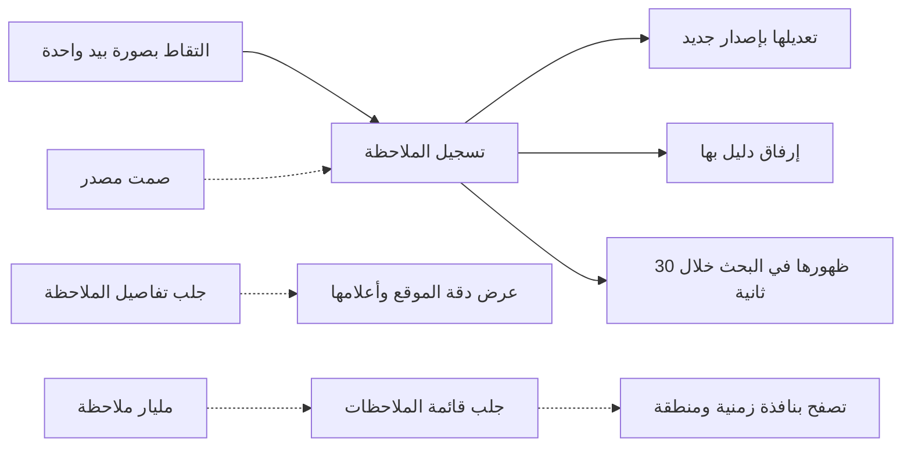

# تسجيل الملاحظات

<!-- BEGIN GENERATED: doc -->
| البند | القيمة |
|---|---|
| المعرّف | FEAT-COL-OBSERVATIONS |
| الإصدار | 0.2 |
| الحالة | مسودة |
| القدرة | CAP-02 جمع المعلومات |
| القدرة الفرعية | CAP-02.03 تسجيل الملاحظات (بما فيها دون اتصال) (R1) |
| الأدوار | المستخدم الميداني؛ المشغِّل؛ المحلل؛ النظام |
| الشاشات | SCR-23 الملاحظات، SCR-11 الصورة العملياتية المشتركة (COP) |
| حالات الاستخدام | UC-005، UC-090 |
| القصص | 11: 5 من المواصفة، و6 جديدة |
<!-- END GENERATED: doc -->

## 1. نظرة عامة

### 1.1 القيمة

يتيح للمستخدم الميداني والمحلل تسجيل ما رصده في زمان ومكان محددين مع مرفقاته وتصحيحه بإصدار جديد والبحث فيه.

### 1.2 النطاق

| البند | القيمة |
|---|---|
| المستخدمون | المستخدم الميداني والمحلل والمشغِّل، ممن يرصدون الملاحظة أو يسجلونها بالآلة؛ وأي مستخدم مخوَّل يبحث فيها |
| الشاشات | شاشة الملاحظات (SCR-23): التقاط وتفاصيل وقائمة، وظهورها على الصورة العملياتية المشتركة (SCR-11) |
| حالات الاستخدام | تسجيل الملاحظة بزمانها ومكانها ومرفقاتها (UC-005)؛ التقاطها دون اتصال (UC-090، جزئيًا: الالتقاط نفسه، وتفاصيل العمل دون اتصال في ميزة أخرى) |
| المتطلبات | تسجيل زمن الرصد وزمن التسجيل والموقع والمصدر والراصد والمرفقات (REQ-INF-002)؛ قائمة بلا ترقيم بالإزاحة (FIT-13) |
| خارج النطاق | التحقق من الملاحظة أو رفضها أو إعادة تصنيفها («مراجعة الملاحظات»)؛ العمل الميداني دون اتصال وحالة المزامنة («العمل الميداني دون اتصال»)؛ تسجيل الدليل نفسه («الأدلة») |

### 1.3 خريطة الميزة

يسجّل المستخدم الملاحظة بموقعها وزمنها، ثم يعدّلها بإصدار جديد أو يرفق بها دليلًا، وكلتاهما لا تغيّر حالتها. وتصل إلى البحث والصورة العملياتية خلال ثوانٍ، ويراها من يملك صلاحيتها في التفاصيل أو القائمة.

**الشكل 1: خريطة ميزة «تسجيل الملاحظات»**



## 2. القواعد المشتركة

تنطبق على كل قصص الميزة، فلا تتكرر داخل القصص. وكل قصة تذكر ما يخصها فقط.

### 2.1 السياق المشترك

كل قصة تبدأ من ثلاثة شروط: مستأجر نشط، وحزمة السياسات الأساسية مفعّلة، ومستخدم مسجّل الدخول ومخوَّل. وتشير إليها القصص بخطوة واحدة: «بفرض السياق المشترك للميزة».

### 2.2 الصلاحية وعدم الإفصاح

- من لا يحق له رؤية العنصر يتلقى ردًا بشكل «غير متاح» تمامًا، فلا يعرف أنه موجود.
- من يرى العنصر ولا يحق له الإجراء يتلقى «لا تملك صلاحية هذا الإجراء».

### 2.3 أوامر تغيير الحالة

- **منع التكرار:** يُرسل كل أمر بمفتاح فريد، فإعادة الطلب نفسه لا تُنفَّذ مرتين.
- **حماية التعديل المتزامن:** يُرسل كل أمر بإصدار البيانات الذي يراه المستخدم. فإن عدّلها غيره في الأثناء، يُرفض الأمر.
- **السجل:** إن نجح الأمر، يُكتب حدثه وسجل التدقيق في المعاملة نفسها.

### 2.4 الرفض المشترك

```gherkin
# language: ar
خاصية: الرفض المشترك لأوامر الميزة

  سيناريو مخطط: رفض مشترك لكل أمر في الميزة
    بفرض السياق المشترك للميزة
    و <الحالة>
    عندما يُرسل المستخدم أي أمر من أوامر الميزة
    اذاً يُرفض برمز <الرمز> ويرى "<الرسالة>"
    و لا يتغير شيء

    امثلة:
      | الحالة                                  | الرمز                  | الرسالة                                                 |
      | العنصر خارج صلاحياته                    | NOT_FOUND              | غير متاح                                                |
      | العنصر مرئي له ولا يحق له الإجراء       | AUTHZ_DENIED           | لا تملك صلاحية هذا الإجراء                              |
      | غيره عدّل العنصر بعد أن فتحه            | VERSION_CONFLICT       | تغيّرت البيانات منذ فتحتها. راجع التغييرات ثم أعد المحاولة |
      | أعاد مفتاح منع التكرار بمحتوى مختلف     | IDEMPOTENCY_KEY_REUSED | طلب مكرر بمحتوى مختلف                                   |
      | البيانات ناقصة أو غير صحيحة             | VALIDATION_FAILED      | بعض البيانات ناقصة أو غير صحيحة. راجع الحقول المعلَّمة      |

  سيناريو: إعادة الطلب نفسه لا تُنفَّذ مرتين
    بفرض السياق المشترك للميزة
    و أمر نجح بمفتاح منع تكرار
    عندما يُعاد الطلب نفسه بالمفتاح نفسه
    اذاً تُعاد النتيجة الأولى ولا يُكتب حدث ثانٍ
```

## 3. الجودة وتعريف الاكتمال

### 3.1 متطلبات الجودة

<!-- BEGIN GENERATED: quality -->
| المرجع | الموقف | المطلوب |
|---|---|---|
| QAS-PERF-002 | reads a single object or a list page | single object p95 ≤ 300 ms; list page p95 ≤ 1 s |
| QAS-PERF-004 | an object is created or changed | index lag p95 ≤ 30 s |
| QAS-PERF-008 | records an observation (online) | p95 ≤ 30 s |
| QAS-SCAL-004 | observations grow to 1e9 | QAS-PERF-002 holds for queries with a time window ≤ 30 days |
| QAS-USA-001 | records an observation with one photo on the mobile app | median ≤ 60 s in usability test with 10 field users |
<!-- END GENERATED: quality -->

### 3.2 تعريف الاكتمال

القصة مكتملة حين تتحقق الشروط الخمسة:

1. سيناريوهاتها والقواعد المشتركة تمر في الاختبار الآلي.
2. فحوص البنية المعمارية تمر.
3. نصوص الواجهة والرسائل موجودة بالعربية والإنجليزية.
4. مراجعة الكود مكتملة.
5. ما تضيفه القصة نفسها في قسم «القواعد» تحقق.

## 4. فهرس القصص

<!-- BEGIN GENERATED: story-index -->
| المعرّف | القصة | النوع | الحالة |
|---|---|---|---|
| `US-BC02-OBS-AMEND` | تعديل الملاحظة بإصدار جديد | أمر | مسودة |
| `US-BC02-OBS-ATTACH-EVIDENCE` | إرفاق دليل بـالملاحظة | أمر | مسودة |
| `US-BC02-OBS-RECORD` | تسجيل الملاحظة | أمر | مسودة |
| `US-BC02-Q-OBS-GET` | جلب: Observation with measurements and attachment refs | جلب | مسودة |
| `US-BC02-Q-OBS-LIST` | جلب: Observations by bbox, time window (mandatory, ≤ 31 days), source, state | جلب | مسودة |
| `US-UI-SCR23-LOCATION-QUALITY` | عرض دقة الموقع وأعلام جودة الملاحظة | واجهة | مسودة |
| `US-UI-SCR23-OBS-LIST` | تصفح الملاحظات بنافذة زمنية ومنطقة | واجهة | مسودة |
| `US-UI-SCR23-QUICK-CAPTURE` | تسجيل ملاحظة بصورة بيد واحدة | واجهة | مسودة |
| `US-PLT-OBS-SEARCHABLE` | ظهور الملاحظة في البحث خلال 30 ثانية | منصة | مسودة |
| `US-PLT-OBS-VOLUME` | ثبات الأداء مع مليار ملاحظة | منصة | مسودة |
| `US-OPS-OBS-SOURCE-SILENCE` | التنبيه عند صمت مصادر الملاحظات | تشغيل | مسودة |
<!-- END GENERATED: story-index -->

## 5. القصص

### 5.1 US-BC02-OBS-AMEND — تعديل الملاحظة بإصدار جديد

| النوع | الإصدار | الأولوية | دون اتصال | الحالة |
|---|---|---|---|---|
| أمر | R1 | Must | نعم | مسودة |

> **كـ** المستخدم الميداني أو المحلل، **أريد** أن أعدّل ملاحظة سجّلتُها بإصدار جديد مع ذكر السبب، **حتى** أصحّح ما سجّلته قبل أن يُعتمد عليها في التحليل.

**باختصار:** يعدّل الراصد أو المحلل محتوى الملاحظة «مسجّلة» بإصدار جديد وسبب، دون أن تتغير حالتها.

#### القواعد

- **متى يُسمح:** الملاحظة «مسجّلة». وبعد أن تصير «متحقَّق منها» أو «مرفوضة» (ميزة «مراجعة الملاحظات») يتوقف التعديل، وتبقى إعادة التصنيف فقط.
- **من يُسمح له:** الراصد نفسه، أو المحلل، ضمن نطاقه من المؤسسة.
- **البيانات:** التغييرات المطلوبة، والسبب (إلزاميان).
- **الأثر:** يُحفظ إصدار جديد من محتوى الملاحظة، ويُسجَّل حدث «عُدِّلت الملاحظة» يصل إلى معالجة الادعاءات المشتقة والبحث والصورة العملياتية.

#### معايير القبول

```gherkin
# language: ar
خاصية: تعديل الملاحظة بإصدار جديد

  سيناريو: تعديل ملاحظة مسجّلة
    بفرض السياق المشترك للميزة
    و ملاحظة "مسجّلة" سجّلها المستخدم
    عندما يعدّلها مع سبب
    اذاً يُحفظ المحتوى الجديد بإصدار جديد وتبقى حالتها "مسجّلة"
    و يُسجَّل حدث "عُدِّلت الملاحظة"

  سيناريو مخطط: رفض خاص بتعديل الملاحظة
    بفرض السياق المشترك للميزة
    و <الحالة>
    عندما يحاول تعديل الملاحظة
    اذاً يُرفض برمز <الرمز> ويرى <الرسالة>
    و لا يتغير شيء

    امثلة:
      | الحالة                               | الرمز                             | الرسالة                                           |
      | الملاحظة "متحقَّق منها" أو "مرفوضة"  | OBSERVATION_INVALID_STATE_TRANSITION | الوضع الحالي للملاحظة لا يسمح بهذا الإجراء      |
      | لم يُذكر السبب                        | REASON_REQUIRED                   | اذكر السبب                                        |
```

<details><summary>المراجع التقنية والتتبع</summary>

<!-- BEGIN GENERATED: refs US-BC02-OBS-AMEND -->
| البند | المعرّف | المعنى |
|---|---|---|
| الواجهة البرمجية | `POST /api/v1/information/observations/{id}/actions/amend` | دون اتصال: نعم |
| الأمر | `CMD-OBS-AMEND` | تعديل الملاحظة بإصدار جديد |
| السياسة | `POL-OBS-AMEND` | Field User / Operator / Analyst / adapter service account (amend)؛ tenant match; object visible to subject (l… |
| الحدث | `EVT-OBS-AMENDED` | يصل إلى: Derived-claim processor (position summarization); Situation membership (SLC-06); Search projection (… |
| الكيان | `AGG-OBSERVATION` | الملاحظة |
| الجدول | `information.observations` | الجدول الرئيسي للملاحظة |
| وحدة النشر | DU-05 | — |
| المتطلب | REQ-INF-002 | When an observation is recorded, the system shall store its observation time, its event time where known, its… |
| حالة الاستخدام | UC-005 | Register Observation |
| الاختبار | TST-OBSERVATION-SM، TST-SLC02-INVARIANTS | دورة حالات الملاحظة، وثوابت الشريحة SLC-02 |
<!-- END GENERATED: refs US-BC02-OBS-AMEND -->

</details>

### 5.2 US-BC02-OBS-ATTACH-EVIDENCE — إرفاق دليل بـالملاحظة

| النوع | الإصدار | الأولوية | دون اتصال | الحالة |
|---|---|---|---|---|
| أمر | R1 | Must | نعم | مسودة |

> **كـ** المستخدم الميداني أو المحلل، **أريد** أن أربط دليلًا مسجَّلًا بملاحظتي، **حتى** يستند من يراجعها إلى ما يثبتها.

**باختصار:** يرفق الراصد أو المحلل بالملاحظة «مسجّلة» دليلًا «مسجَّلًا» أو «مختومًا»، دون أن تتغير حالتها.

#### القواعد

- **متى يُسمح:** الملاحظة «مسجّلة»، والدليل «مسجَّل» أو «مختوم».
- **من يُسمح له:** الراصد أو المحلل، ضمن نطاقه من المؤسسة.
- **البيانات:** مرجع الدليل (إلزامي).
- **الأثر:** يُحفظ الرابط بإصدار جديد من الملاحظة، ويُسجَّل حدث «أُرفق دليل بالملاحظة» يصل إلى معالجة الادعاءات المشتقة والبحث.

#### معايير القبول

```gherkin
# language: ar
خاصية: إرفاق دليل بالملاحظة

  سيناريو: إرفاق دليل مختوم
    بفرض السياق المشترك للميزة
    و ملاحظة "مسجّلة" ودليل "مختوم"
    عندما يرفق المستخدم الدليل بالملاحظة
    اذاً يُحفظ الرابط بإصدار جديد وتبقى حالتها "مسجّلة"
    و يُسجَّل حدث "أُرفق دليل بالملاحظة"

  سيناريو مخطط: رفض خاص بإرفاق الدليل
    بفرض السياق المشترك للميزة
    و <الحالة>
    عندما يحاول إرفاق الدليل
    اذاً يُرفض برمز <الرمز> ويرى <الرسالة>
    و لا يتغير شيء

    امثلة:
      | الحالة                               | الرمز                             | الرسالة                                      |
      | الملاحظة "متحقَّق منها" أو "مرفوضة"  | OBSERVATION_INVALID_STATE_TRANSITION | الوضع الحالي للملاحظة لا يسمح بهذا الإجراء |
      | الدليل ليس "مسجَّلًا" ولا "مختومًا"   | EVIDENCE_INVALID                  | بيانات الدليل غير صحيحة                      |
```

<details><summary>المراجع التقنية والتتبع</summary>

<!-- BEGIN GENERATED: refs US-BC02-OBS-ATTACH-EVIDENCE -->
| البند | المعرّف | المعنى |
|---|---|---|
| الواجهة البرمجية | `POST /api/v1/information/observations/{id}/actions/attach-evidence` | دون اتصال: نعم |
| الأمر | `CMD-OBS-ATTACH-EVIDENCE` | إرفاق دليل بـالملاحظة |
| السياسة | `POL-OBS-ATTACH-EVIDENCE` | Field User / Operator / Analyst / adapter service account (attach evidence)؛ tenant match; object visible to… |
| الحدث | `EVT-OBS-EVIDENCE-ATTACHED` | يصل إلى: Derived-claim processor (position summarization); Situation membership (SLC-06); Search projection (… |
| الكيان | `AGG-OBSERVATION` | الملاحظة |
| الجدول | `information.observations` | الجدول الرئيسي للملاحظة |
| وحدة النشر | DU-05 | — |
| المتطلب | REQ-INF-002 | When an observation is recorded, the system shall store its observation time, its event time where known, its… |
| حالة الاستخدام | UC-005 | Register Observation |
| الاختبار | TST-OBSERVATION-SM، TST-SLC02-INVARIANTS | دورة حالات الملاحظة، وثوابت الشريحة SLC-02 |
<!-- END GENERATED: refs US-BC02-OBS-ATTACH-EVIDENCE -->

</details>

### 5.3 US-BC02-OBS-RECORD — تسجيل الملاحظة

| النوع | الإصدار | الأولوية | دون اتصال | الحالة |
|---|---|---|---|---|
| أمر | R1 | Must | نعم | مسودة |

> **كـ** المستخدم الميداني أو المحلل، **أريد** أن أسجّل ما رصدته بزمانه ومكانه وقياساته، **حتى** يصبح معلومة يُعتمد عليها.

**باختصار:** يسجّل المستخدم أو جهة آلية الملاحظة بمصدرها وراصدها وزمن رصدها وموقعه، فتُنشأ «مسجّلة» بزمن تسجيل يضعه الخادم.

#### القواعد

- **متى يُسمح:** المصدر «نشط»، والموقع بإسناد مرجعي ودقة وهندسة صالحة، والوحدات بمعيار UCUM، وزمن الرصد لا يتجاوز زمن الخادم بأكثر من 5 دقائق.
- **من يُسمح له:** المستخدم الميداني أو المشغِّل أو المحلل، أو حساب خدمة محوّل، ضمن نطاقه من المؤسسة.
- **البيانات:** المصدر، والراصد، وزمن الرصد، والموقع، والطريقة، والتصنيف (إلزامية)؛ زمن الحدث، والقياسات، والوصف، والمرفقات، والجلسة الميدانية، والجهاز (اختيارية).
- **الأثر:** تُنشأ الملاحظة «مسجّلة»، ويضع الخادم زمن التسجيل. ويُسجَّل حدث «سُجِّلت الملاحظة» يصل إلى معالجة الادعاءات المشتقة، وعضوية المواقف، والبحث، والصورة العملياتية.

#### معايير القبول

```gherkin
# language: ar
خاصية: تسجيل الملاحظة

  سيناريو: تسجيل ملاحظة بموقع صالح
    بفرض السياق المشترك للميزة
    و مصدر "نشط" وموقع بإسناد مرجعي ودقة وهندسة صالحة
    عندما يسجّل المستخدم الملاحظة بزمن رصد لا يتجاوز زمن الخادم بأكثر من 5 دقائق
    اذاً تُنشأ الملاحظة "مسجّلة" وزمن التسجيل من الخادم
    و يُسجَّل حدث "سُجِّلت الملاحظة"

  سيناريو مخطط: رفض خاص بتسجيل الملاحظة
    بفرض السياق المشترك للميزة
    و <الحالة>
    عندما يحاول تسجيل الملاحظة
    اذاً يُرفض برمز <الرمز> ويرى <الرسالة>
    و لا يتغير شيء

    امثلة:
      | الحالة                                            | الرمز                | الرسالة                                     |
      | زمن الرصد يتجاوز زمن الخادم بأكثر من 5 دقائق      | OBSERVATION_INVALID  | بيانات الملاحظة غير صحيحة                   |
      | المصدر مطلوب ومفقود                               | VALIDATION_FAILED    | المصدر مطلوب                                |
      | الراصد مطلوب ومفقود                               | VALIDATION_FAILED    | الراصد مطلوب                                |
      | الموقع مطلوب ومفقود أو هندسته غير صالحة           | VALIDATION_FAILED    | الموقع غير صحيح                             |
```

<details><summary>المراجع التقنية والتتبع</summary>

<!-- BEGIN GENERATED: refs US-BC02-OBS-RECORD -->
| البند | المعرّف | المعنى |
|---|---|---|
| الواجهة البرمجية | `POST /api/v1/information/observations` | دون اتصال: نعم |
| الأمر | `CMD-OBS-RECORD` | تسجيل الملاحظة |
| السياسة | `POL-OBS-RECORD` | Field User / Operator / Analyst / adapter service account (record) · Analyst (validate, reject)؛ tenant match… |
| الحدث | `EVT-OBS-RECORDED` | يصل إلى: Derived-claim processor (position summarization); Situation membership (SLC-06); Search projection (… |
| الكيان | `AGG-OBSERVATION` | الملاحظة |
| الجدول | `information.observations` | الجدول الرئيسي للملاحظة |
| وحدة النشر | DU-05 | — |
| المتطلب | REQ-INF-002 | When an observation is recorded, the system shall store its observation time, its event time where known, its… |
| حالة الاستخدام | UC-005 | Register Observation |
| الاختبار | TST-OBSERVATION-SM، TST-SLC02-INVARIANTS | دورة حالات الملاحظة، وثوابت الشريحة SLC-02 |
<!-- END GENERATED: refs US-BC02-OBS-RECORD -->

</details>

### 5.4 US-BC02-Q-OBS-GET — جلب: Observation with measurements and attachment refs

| النوع | الإصدار | الأولوية | دون اتصال | الحالة |
|---|---|---|---|---|
| جلب | R1 | Must | لا | مسودة |

> **كـ** أي مستخدم مخوَّل، **أريد** تفاصيل ملاحظة بقياساتها ومرفقاتها، **حتى** أراجعها أو أستند إليها.

**باختصار:** تُعاد الملاحظة بقياساتها ومراجع مرفقاتها لمن يحق له رؤيتها فقط.

#### القواعد

- **من يرى ماذا:** من يقع نطاق المؤسسة للملاحظة ضمن نطاقه، وتصنيفها لا يتجاوز تصريحه.

#### معايير القبول

```gherkin
# language: ar
خاصية: جلب تفاصيل الملاحظة

  سيناريو: جلب ملاحظة مرئية
    بفرض السياق المشترك للميزة
    و ملاحظة ضمن نطاق المستخدم وتصنيفها لا يتجاوز تصريحه
    عندما يطلب تفاصيلها
    اذاً تُعاد بقياساتها ومراجع مرفقاتها
```

<details><summary>المراجع التقنية والتتبع</summary>

<!-- BEGIN GENERATED: refs US-BC02-Q-OBS-GET -->
| البند | المعرّف | المعنى |
|---|---|---|
| الواجهة البرمجية | `GET /api/v1/information/observations/{observation_id}` | — |
| الاستعلام | `QRY-OBS-GET` | Observation with measurements and attachment refs |
| السياسة | `POL-OBS-GET` | org scope ∩ classification rule; claims filtered by label |
| الكيان | `AGG-OBSERVATION` | الملاحظة |
| الجدول | `information.observations` | الجدول الرئيسي للملاحظة |
| وحدة النشر | DU-05 | — |
| المتطلب | REQ-INF-002 | When an observation is recorded, the system shall store its observation time, its event time where known, its… |
| حالة الاستخدام | UC-005 | Register Observation |
| الاختبار | TST-OBSERVATION-SM، TST-SLC02-INVARIANTS | دورة حالات الملاحظة، وثوابت الشريحة SLC-02 |
<!-- END GENERATED: refs US-BC02-Q-OBS-GET -->

</details>

### 5.5 US-BC02-Q-OBS-LIST — جلب: Observations by bbox, time window (mandatory, ≤ 31 days), source, state

| النوع | الإصدار | الأولوية | دون اتصال | الحالة |
|---|---|---|---|---|
| جلب | R1 | Must | لا | مسودة |

> **كـ** أي مستخدم مخوَّل، **أريد** قائمة الملاحظات ضمن منطقة ونافذة زمنية ومصدر وحالة، **حتى** أستعرض ما رُصد في نطاقي.

**باختصار:** تُعاد الملاحظات ضمن النطاق الجغرافي والنافذة الزمنية المطلوبة (31 يومًا على الأكثر)، صفحةً بعد صفحة بمؤشر، ولمن يحق له رؤيتها فقط.

#### القواعد

- **من يرى ماذا:** من يقع نطاق المؤسسة للملاحظة ضمن نطاقه، وتصنيفها لا يتجاوز تصريحه.
- **البيانات:** المنطقة (bbox)، والنافذة الزمنية (إلزامية، 31 يومًا على الأكثر)، والمصدر، والحالة، والمؤشر والحد.

#### معايير القبول

```gherkin
# language: ar
خاصية: جلب قائمة الملاحظات

  سيناريو: قائمة ضمن نافذة زمنية ومنطقة
    بفرض السياق المشترك للميزة
    و ملاحظات داخل منطقة ونافذة 7 أيام ضمن نطاق المستخدم، وأخرى خارج نطاقه
    عندما يطلب القائمة بالمنطقة والنافذة
    اذاً تُعاد الملاحظات ضمن نطاقه فقط
    و لا يكشف أي عدد أو اقتراح وجود ملاحظة محجوبة

  سيناريو: الصفحة التالية
    بفرض السياق المشترك للميزة
    و ملاحظات أكثر من صفحة ضمن النافذة المطلوبة
    عندما يطلب الصفحة التالية بالمؤشر
    اذاً تُعاد الملاحظات التالية دون تكرار ولا فجوة
```

<details><summary>المراجع التقنية والتتبع</summary>

<!-- BEGIN GENERATED: refs US-BC02-Q-OBS-LIST -->
| البند | المعرّف | المعنى |
|---|---|---|
| الواجهة البرمجية | `GET /api/v1/information/observations` | — |
| الاستعلام | `QRY-OBS-LIST` | Observations by bbox, time window (mandatory, ≤ 31 days), source, state |
| السياسة | `POL-OBS-LIST` | org scope ∩ classification rule; claims filtered by label |
| الكيان | `AGG-OBSERVATION` | الملاحظة |
| الجدول | `information.observations` | الجدول الرئيسي للملاحظة |
| وحدة النشر | DU-05 | — |
| المتطلب | REQ-INF-002 | When an observation is recorded, the system shall store its observation time, its event time where known, its… |
| حالة الاستخدام | UC-005 | Register Observation |
| الاختبار | TST-OBSERVATION-SM، TST-SLC02-INVARIANTS | دورة حالات الملاحظة، وثوابت الشريحة SLC-02 |
<!-- END GENERATED: refs US-BC02-Q-OBS-LIST -->

</details>

### 5.6 US-UI-SCR23-LOCATION-QUALITY — عرض دقة الموقع وأعلام جودة الملاحظة

| النوع | الإصدار | الأولوية | دون اتصال | الحالة |
|---|---|---|---|---|
| واجهة | R1 | Must | لا | مسودة |

> **كـ** المستخدم، **أريد** أن أرى دقة موقع الملاحظة وأعلام جودتها، **حتى** أزن الثقة بموقعها قبل أن أستند إليها.

**باختصار:** شاشة تفاصيل الملاحظة ترسم دائرة دقة حول موقعها، وتعرض أعلام الجودة كانحراف ساعة الجهاز المشتبه به.

#### القواعد

- دقة الموقع (`accuracy_m`) تُرسم دائرة حول النقطة.
- انحراف ساعة الجهاز أكثر من 5 دقائق يضيف علامة جودة «ساعة الجهاز مشكوك فيها» تظهر في بطاقة الملاحظة (INV-OBS-04).
- الموقع المعمَّم يظهر في مركز خلية ثابتة مع علامة «معمم» حين يعيده الخادم كذلك.

#### معايير القبول

```gherkin
# language: ar
خاصية: عرض دقة الموقع وأعلام جودة الملاحظة

  سيناريو: ملاحظة بانحراف ساعة مشتبه به
    بفرض السياق المشترك للميزة
    و ملاحظة موقعها بدقة معلومة، وانحراف ساعة جهازها 6 دقائق
    عندما يفتح المستخدم تفاصيلها
    اذاً تُرسم دائرة الدقة حول الموقع
    و تظهر علامة "ساعة الجهاز مشكوك فيها"

  سيناريو: ملاحظة بموقع معمَّم
    بفرض السياق المشترك للميزة
    و ملاحظة موقعها معمَّم من الخادم
    عندما يفتح المستخدم تفاصيلها
    اذاً يظهر الموقع في مركز خلية ثابتة مع علامة "معمم"
```

<details><summary>المراجع التقنية والتتبع</summary>

<!-- BEGIN GENERATED: refs US-UI-SCR23-LOCATION-QUALITY -->
| البند | المعرّف | المعنى |
|---|---|---|
| الشاشة | SCR-23 | شاشة الملاحظات |
| المصدر | `21-ui-design.md §7` | — |
| المصدر | `INV-OBS-04` | — |
| المتطلب | REQ-INF-002 | When an observation is recorded, the system shall store its observation time, its event time where known, its… |
| حالة الاستخدام | UC-005 | Register Observation |
<!-- END GENERATED: refs US-UI-SCR23-LOCATION-QUALITY -->

</details>

### 5.7 US-UI-SCR23-OBS-LIST — تصفح الملاحظات بنافذة زمنية ومنطقة

| النوع | الإصدار | الأولوية | دون اتصال | الحالة |
|---|---|---|---|---|
| واجهة | R1 | Should | لا | مسودة |

> **كـ** المستخدم، **أريد** أن أتصفح الملاحظات بنافذة زمنية ومنطقة، **حتى** أجد ما يهمني دون تحميل كل الملاحظات.

**باختصار:** شاشة الملاحظات تعرض قائمة مرقّمة بمؤشر، ومرشحاتها في عنوان الصفحة، فيُشارَك الرابط بما فيه النافذة الزمنية والمنطقة.

#### القواعد

- القائمة مرقّمة بمؤشر، بلا إزاحة.
- المرشحات (المنطقة، والنافذة الزمنية، والمصدر، والحالة) تُحفظ في عنوان الصفحة.
- لا عدد إجمالي يُعرض إلا ما يحسبه الخادم من المرئي، ولا «ملاحظة مخفية».

#### معايير القبول

```gherkin
# language: ar
خاصية: تصفح الملاحظات بنافذة زمنية ومنطقة

  سيناريو: تصفية بمنطقة ونافذة زمنية
    بفرض السياق المشترك للميزة
    و ملاحظات داخل منطقة ونافذة محددة وأخرى خارجها
    عندما يحدد المستخدم المنطقة والنافذة الزمنية
    اذاً تُعرض الملاحظات داخلها فقط، ومرشحاتها في عنوان الصفحة
    و لا يُعرض عدد إجمالي يكشف ملاحظة مخفية
```

<details><summary>المراجع التقنية والتتبع</summary>

<!-- BEGIN GENERATED: refs US-UI-SCR23-OBS-LIST -->
| البند | المعرّف | المعنى |
|---|---|---|
| الشاشة | SCR-23 | شاشة الملاحظات |
| المصدر | `QRY-OBS-LIST` | — |
| المصدر | `21-ui-design.md §6.1` | — |
<!-- END GENERATED: refs US-UI-SCR23-OBS-LIST -->

</details>

### 5.8 US-UI-SCR23-QUICK-CAPTURE — تسجيل ملاحظة بصورة بيد واحدة

| النوع | الإصدار | الأولوية | دون اتصال | الحالة |
|---|---|---|---|---|
| واجهة | R1 | Must | لا | مسودة |

> **كـ** المستخدم الميداني، **أريد** أن أسجّل ملاحظة بصورة بيد واحدة، **حتى** أسجّل ما رصدته دون أن أتوقف عن عملي.

**باختصار:** التقاط ملاحظة في التطبيق الميداني بموقع وزمن وصورة بضغطة واحدة، ووسيط زمنه 60 ثانية أو أقل.

#### القواعد

- أهداف اللمس 44 بكسل على الأقل في التطبيق الميداني، للاستعمال بيد واحدة.
- الموقع والزمن يُؤخذان تلقائيًا من الجهاز، والصورة تُلتقط وتُرفق دون خطوة إضافية.
- الوسيط 60 ثانية أو أقل في اختبار قابلية الاستخدام مع 10 مستخدمين ميدانيين (QAS-USA-001).

#### معايير القبول

```gherkin
# language: ar
خاصية: تسجيل ملاحظة بصورة بيد واحدة

  سيناريو: التقاط ملاحظة بصورة
    بفرض السياق المشترك للميزة
    و المستخدم في الميدان بجهازه
    عندما يلتقط صورة ويرسل الملاحظة بضغطة واحدة
    اذاً تُسجَّل الملاحظة بموقعها وزمنها وصورتها المرفقة
    و يتم ذلك في وسيط 60 ثانية أو أقل
```

<details><summary>المراجع التقنية والتتبع</summary>

<!-- BEGIN GENERATED: refs US-UI-SCR23-QUICK-CAPTURE -->
| البند | المعرّف | المعنى |
|---|---|---|
| الشاشة | SCR-23 | شاشة الملاحظات |
| الجودة | QAS-USA-001 | records an observation with one photo on the mobile app → median ≤ 60 s in usability test with 10 field users |
| المصدر | `21-ui-design.md §8.1` | — |
| المصدر | `21-ui-design.md §10` | — |
| المتطلب | REQ-INF-002 | When an observation is recorded, the system shall store its observation time, its event time where known, its… |
| حالة الاستخدام | UC-005 | Register Observation |
<!-- END GENERATED: refs US-UI-SCR23-QUICK-CAPTURE -->

</details>

### 5.9 US-PLT-OBS-SEARCHABLE — ظهور الملاحظة في البحث خلال 30 ثانية

| النوع | الإصدار | الأولوية | دون اتصال | الحالة |
|---|---|---|---|---|
| منصة | R1 | Should | لا ينطبق | مسودة |

> **كـ** فريق المنصة، **أريد** أن تظهر الملاحظة المسجَّلة في البحث الموحد خلال 30 ثانية، **حتى** يجدها المحلل دون انتظار.

**باختصار:** فهرس البحث يستقبل تحديث الملاحظة فورًا، فيصل زمن ظهورها إلى 30 ثانية عند المئين 95.

#### القواعد

- تسجيل ملاحظة متصلة بالشبكة يتم خلال 30 ثانية عند المئين 95 (QAS-PERF-008).
- تحديث فهرس البحث بعد إنشاء أو تغيير أي كائن يتأخر 30 ثانية عند المئين 95 على الأكثر (QAS-PERF-004).

#### معايير القبول

```gherkin
# language: ar
خاصية: ظهور الملاحظة في البحث خلال 30 ثانية

  سيناريو: الهدف تحت حمل التصميم
    بفرض حمل بمزيج استراتيجية اختبار الأداء
    عندما تُسجَّل ملاحظة
    اذاً تظهر في نتائج البحث خلال 30 ثانية عند المئين 95
```

<details><summary>المراجع التقنية والتتبع</summary>

<!-- BEGIN GENERATED: refs US-PLT-OBS-SEARCHABLE -->
| البند | المعرّف | المعنى |
|---|---|---|
| الجودة | QAS-PERF-008 | records an observation (online) → p95 ≤ 30 s |
| الجودة | QAS-PERF-004 | an object is created or changed → index lag p95 ≤ 30 s |
<!-- END GENERATED: refs US-PLT-OBS-SEARCHABLE -->

</details>

### 5.10 US-PLT-OBS-VOLUME — ثبات الأداء مع مليار ملاحظة

| النوع | الإصدار | الأولوية | دون اتصال | الحالة |
|---|---|---|---|---|
| منصة | R1 | Should | لا ينطبق | مسودة |

> **كـ** فريق المنصة، **أريد** أن يبقى أداء قراءة الملاحظة وقوائمها ثابتًا مع نمو عددها إلى مليار، **حتى** لا يبطئ البحث والعرض مع الزمن.

**باختصار:** تخزين الملاحظات مقسَّم بتقسيم تصريحي زمني في قاعدة PostgreSQL، فتبقى أهداف زمن القراءة محققة لنوافذ حتى 30 يومًا رغم مليار ملاحظة.

#### القواعد

- مع نمو الملاحظات إلى مليار، يبقى زمن جلب الكائن الواحد 300 ms عند المئين 95، وصفحة القائمة ثانية واحدة، لنافذة زمنية حتى 30 يومًا (QAS-SCAL-004، QAS-PERF-002).
- التخزين PostgreSQL 16 فما بعد مع PostGIS وأنواع المدى والتقسيم التصريحي، عنقود واحد لكل مستأجر كبير (TD-01).

#### معايير القبول

```gherkin
# language: ar
خاصية: ثبات الأداء مع مليار ملاحظة

  سيناريو: قراءة ضمن نافذة 30 يومًا
    بفرض مليار ملاحظة مخزَّنة بتقسيم زمني
    عندما يطلب المستخدم صفحة قائمة ضمن نافذة 30 يومًا
    اذاً يكون زمن الاستجابة ثانية واحدة أو أقل عند المئين 95
```

<details><summary>المراجع التقنية والتتبع</summary>

<!-- BEGIN GENERATED: refs US-PLT-OBS-VOLUME -->
| البند | المعرّف | المعنى |
|---|---|---|
| الجودة | QAS-SCAL-004 | observations grow to 1e9 → QAS-PERF-002 holds for queries with a time window ≤ 30 days |
| القرار التقني | TD-01 | PostgreSQL 16+ with PostGIS, btree_gist, range types (tstzrange), RLS, declarative partitioning; one cluster… |
| الجودة | QAS-PERF-002 | reads a single object or a list page → single object p95 ≤ 300 ms; list page p95 ≤ 1 s |
<!-- END GENERATED: refs US-PLT-OBS-VOLUME -->

</details>

### 5.11 US-OPS-OBS-SOURCE-SILENCE — التنبيه عند صمت مصادر الملاحظات

| النوع | الإصدار | الأولوية | دون اتصال | الحالة |
|---|---|---|---|---|
| تشغيل | R1 | Should | لا ينطبق | مسودة |

> **كـ** فريق التشغيل، **أريد** تنبيهًا حين ينقطع معدل ملاحظات مصدر عن معدله المعتاد، **حتى** أكتشف عطل التغذية قبل أن يفوت المحلل ما كان يجب رصده.

**باختصار:** تنبيه حين ينخفض معدل الملاحظات الواردة من مستأجر عن 10% من معدله المعتاد لمدة 10 دقائق.

#### القواعد

- تنبيه صمت المصدر حين ينخفض معدل الملاحظات لكل مستأجر عن 10% من معدله المعتاد لمدة 10 دقائق.
- التنبيه يصل إلى فريق التشغيل، ولا يغيّر حالة أي ملاحظة.

#### معايير القبول

```gherkin
# language: ar
خاصية: التنبيه عند صمت مصادر الملاحظات

  سيناريو: انقطاع معدل الملاحظات
    بفرض معدل ملاحظات مستأجر انخفض إلى أقل من 10% من معدله المعتاد لمدة 10 دقائق
    عندما تُقيَّم قواعد التنبيه
    اذاً يصل تنبيه صمت المصدر إلى فريق التشغيل

  سيناريو: معدل طبيعي لا يُطلق تنبيهًا
    بفرض معدل ملاحظات مستأجر عند معدله المعتاد أو أعلى
    عندما تُقيَّم قواعد التنبيه
    اذاً لا يصل أي تنبيه صمت
```

<details><summary>المراجع التقنية والتتبع</summary>

<!-- BEGIN GENERATED: refs US-OPS-OBS-SOURCE-SILENCE -->
| البند | المعرّف | المعنى |
|---|---|---|
| المصدر | `observability-slc02.md` | — |
| المصدر | `FM-S02-05` | — |
<!-- END GENERATED: refs US-OPS-OBS-SOURCE-SILENCE -->

</details>

## 6. التتبع

<!-- BEGIN GENERATED: trace -->
| المتطلب | المعنى | القصص | الاختبار |
|---|---|---|---|
| REQ-INF-002 | When an observation is recorded, the system shall store its observation time, its event time where known, its… | `US-BC02-OBS-AMEND`، `US-BC02-OBS-ATTACH-EVIDENCE`، `US-BC02-OBS-RECORD`، `US-BC02-Q-OBS-GET`، `US-BC02-Q-OBS-LIST`، `US-UI-SCR23-LOCATION-QUALITY`، `US-UI-SCR23-QUICK-CAPTURE` | TST-OBSERVATION-SM، TST-SLC02-INVARIANTS |
<!-- END GENERATED: trace -->

## 7. سجل التغييرات

| الإصدار | التاريخ | التغيير |
|---|---|---|
| 0.1 | — | هيكل مولَّد من خريطة الميزات |
| 0.2 | 2026-10-03 | كتابة القصص كاملة بمعيار القصص |
