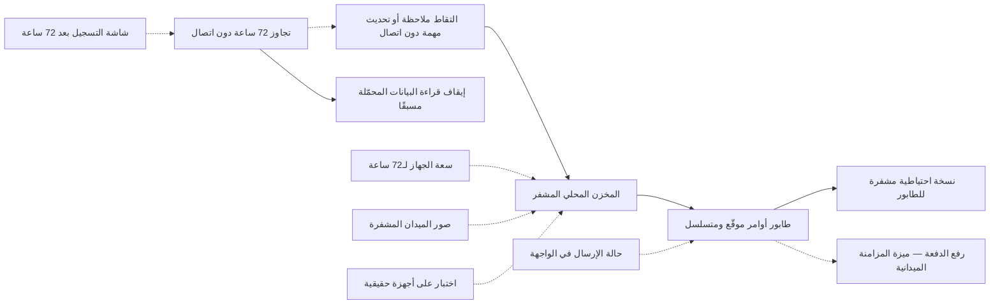

# العمل الميداني دون اتصال

<!-- BEGIN GENERATED: doc -->
| البند | القيمة |
|---|---|
| المعرّف | FEAT-COL-OFFLINE-WORK |
| الإصدار | 0.3 |
| الحالة | مسودة |
| القدرة | CAP-02 جمع المعلومات |
| القدرة الفرعية | CAP-02.03 تسجيل الملاحظات (بما فيها دون اتصال) (R1) |
| الأدوار | المستخدم الميداني |
| الشاشات | SCR-01 مهامي، SCR-23 الملاحظات |
| حالات الاستخدام | UC-090 |
| القصص | 9: 0 من المواصفة، و9 جديدة |
<!-- END GENERATED: doc -->

## 1. نظرة عامة

### 1.1 القيمة

يبقى الجهاز الميداني صالحًا للعمل حتى 72 ساعة دون شبكة، ببيانات مشفرة عليه تُمسح عن بعد إن فُقد.

### 1.2 النطاق

| البند | القيمة |
|---|---|
| المستخدمون | المستخدم الميداني بجهازه المسجّل؛ وفريق المنصة والتشغيل والأمن، ممن يبنون ويختبرون قدرة الجهاز على العمل دون شبكة |
| الشاشات | شاشة الملاحظات (SCR-23) تعرض حالة إرسال ما سُجِّل دون اتصال؛ ومهامي (SCR-01) من النسخة المحلية للجهاز |
| حالات الاستخدام | التقاط الملاحظة دون اتصال (UC-090)؛ الاستعداد على الجهاز لمسح البيانات عند تعليمة من الخادم (UC-093، جانب الجهاز فقط) |
| المتطلبات | التسجيل وتحديث المهام دون اتصال 72 ساعة على الأقل (REQ-OFF-001)؛ تشفير بيانات الجهاز ودعم مسحها عن بعد (REQ-OFF-005) |
| خارج النطاق | فتح جلسة المزامنة ورفع الدفعة وتنزيل التحديثات وحسم التعارضات («المزامنة الميدانية»)؛ تسجيل الملاحظة نفسها وتعديلها وإرفاق الأدلة بها («تسجيل الملاحظات»)؛ قبول المهمة وبدؤها وتعليقها («مهامي»)؛ الإبلاغ عن جهاز مفقود ورفض جلسته («الإبلاغ عن جهاز مفقود»)؛ تسجيل الجهاز وتعليقه («إدارة الأجهزة الميدانية»)؛ تحميل حزمة منطقة مسبقًا («تحميل بيانات المنطقة مسبقًا») |

### 1.3 خريطة الميزة

يلتقط الجهاز ما يسجله المستخدم في مخزن محلي مشفر، ويضيف كل أمر إلى طابور موقّع ومتسلسل له نسخة احتياطية مشفرة. وبعد 72 ساعة دون اتصال يستمر الالتقاط وتتوقف قراءة البيانات المحمَّلة مسبقًا. ورفع الطابور ومزامنته تغطيه ميزة أخرى.

**الشكل 1: خريطة ميزة «العمل الميداني دون اتصال»**



## 2. القواعد المشتركة

تنطبق على كل قصص الميزة، فلا تتكرر داخل القصص. وكل قصة تذكر ما يخصها فقط.

### 2.1 السياق المشترك

كل قصة تبدأ من ثلاثة شروط: مستأجر نشط، وحزمة السياسات الأساسية مفعّلة، ومستخدم مسجّل الدخول ومخوَّل. وتشير إليها القصص بخطوة واحدة: «بفرض السياق المشترك للميزة».

### 2.2 الصلاحية وعدم الإفصاح

- من لا يحق له رؤية العنصر يتلقى ردًا بشكل «غير متاح» تمامًا، فلا يعرف أنه موجود.
- من يرى العنصر ولا يحق له الإجراء يتلقى «لا تملك صلاحية هذا الإجراء».

### 2.3 لا أوامر ولا استعلامات خاصة بهذه الميزة

قصص هذه الميزة تصف سلوك الواجهة وتصميم المنصة والتشغيل على الجهاز الميداني نفسه، لا واجهة برمجية مستقلة. الأوامر الميدانية (تسجيل الملاحظة، تحديث المهمة) ورفضها المشترك مذكوران في ميزتي «تسجيل الملاحظات» و«مهامي»، ورفع الدفعة في ميزة «المزامنة الميدانية».

## 3. الجودة وتعريف الاكتمال

### 3.1 متطلبات الجودة

<!-- BEGIN GENERATED: quality -->
| المرجع | الموقف | المطلوب |
|---|---|---|
| QAS-OFF-001 | works 72 h offline then reconnects on a 1 Mbps link | 1,000 queued commands synced ≤ 10 min; 0 silent overwrites; 0 duplicates |
| QAS-SEC-007 | obtains a field device | 0 readable records without authentication; wipe on next connection |
<!-- END GENERATED: quality -->

### 3.2 تعريف الاكتمال

القصة مكتملة حين تتحقق الشروط الخمسة:

1. سيناريوهاتها والقواعد المشتركة تمر في الاختبار الآلي.
2. فحوص البنية المعمارية تمر.
3. نصوص الواجهة والرسائل موجودة بالعربية والإنجليزية.
4. مراجعة الكود مكتملة.
5. ما تضيفه القصة نفسها في قسم «القواعد» تحقق.

## 4. فهرس القصص

<!-- BEGIN GENERATED: story-index -->
| المعرّف | القصة | النوع | الحالة |
|---|---|---|---|
| `US-UI-SCR23-OFFLINE-STALE` | التسجيل بعد 72 ساعة دون عرض المحمّل | واجهة | مسودة |
| `US-UI-SCR23-OFFLINE-STATUS` | حالة إرسال كل ملاحظة ومرفق دون اتصال | واجهة | مسودة |
| `US-PLT-DEVICE-STORE` | المخزن المحلي المشفر والمسح عن بعد | منصة | مسودة |
| `US-PLT-OFFLINE-ATTACH-STORE` | حفظ صور الميدان مشفرة حتى رفعها | منصة | مسودة |
| `US-PLT-OFFLINE-CAPACITY` | سعة الجهاز لعمل 72 ساعة دون اتصال | منصة | مسودة |
| `US-PLT-OFFLINE-COMMAND-QUEUE` | طابور أوامر موقّع ومتسلسل على الجهاز | منصة | مسودة |
| `US-PLT-OFFLINE-QUEUE-BACKUP` | نسخ احتياطي مشفر لطابور الجهاز | منصة | مسودة |
| `US-PLT-OFFLINE-TIME-LIMIT` | استمرار الالتقاط بعد 72 ساعة وإيقاف القراءة | منصة | مسودة |
| `US-OPS-OFFLINE-DEVICE-TEST` | اختبار العمل دون اتصال على أجهزة حقيقية | تشغيل | مسودة |
<!-- END GENERATED: story-index -->

## 5. القصص

### 5.1 US-UI-SCR23-OFFLINE-STALE — التسجيل بعد 72 ساعة دون عرض المحمّل

| النوع | الإصدار | الأولوية | دون اتصال | الحالة |
|---|---|---|---|---|
| واجهة | R1 | Should | لا | مسودة |

> **كـ** المستخدم الميداني، **أريد** أن أستمر في التسجيل بعد تجاوز 72 ساعة دون اتصال، مع تنبيهي إلى أن البيانات المعروضة قديمة، **حتى** لا أفوّت ما أرصده ولا أثق خطأً ببيانات لم تتحدث.

**باختصار:** بعد تجاوز 72 ساعة دون اتصال يستمر الالتقاط، لكن قراءة البيانات المحمَّلة مسبقًا (الخريطة وحزمها) تتوقف وتظهر رسالة توضح السبب.

#### القواعد

- **متى يحدث:** تجاوز الجهاز 72 ساعة دون اتصال (الحد في الإصدار الأول؛ 7 أيام في التصميم).
- **الأثر:** يبقى التسجيل متاحًا؛ ويتوقف عرض البيانات المحمَّلة مسبقًا لأن حزمتها تعتبر منتهية الصلاحية، مع رسالة توضح السبب.

#### معايير القبول

```gherkin
# language: ar
خاصية: التسجيل بعد 72 ساعة دون عرض المحمّل

  سيناريو: تجاوز 72 ساعة دون اتصال
    بفرض السياق المشترك للميزة
    و الجهاز دون اتصال منذ أكثر من 72 ساعة
    عندما يفتح المستخدم التطبيق
    اذاً يستطيع تسجيل ملاحظة جديدة
    لكن لا تُعرض البيانات المحمّلة مسبقًا، وتظهر رسالة توضح السبب

  سيناريو: لم يتجاوز الحد بعد
    بفرض السياق المشترك للميزة
    و الجهاز دون اتصال منذ 40 ساعة
    عندما يفتح المستخدم التطبيق
    اذاً تُعرض البيانات المحمَّلة مسبقًا كما هي
```

<details><summary>المراجع التقنية والتتبع</summary>

<!-- BEGIN GENERATED: refs US-UI-SCR23-OFFLINE-STALE -->
| البند | المعرّف | المعنى |
|---|---|---|
| الشاشة | SCR-23 | شاشة الملاحظات |
| المصدر | `21-ui-design.md §8.2` | — |
| المصدر | `field-sync-protocol.md §1` | — |
<!-- END GENERATED: refs US-UI-SCR23-OFFLINE-STALE -->

</details>

### 5.2 US-UI-SCR23-OFFLINE-STATUS — حالة إرسال كل ملاحظة ومرفق دون اتصال

| النوع | الإصدار | الأولوية | دون اتصال | الحالة |
|---|---|---|---|---|
| واجهة | R1 | Must | لا | مسودة |

> **كـ** المستخدم الميداني، **أريد** أن أرى حالة إرسال كل ملاحظة ومرفق سجّلته دون اتصال، **حتى** أعرف ما وصل الخادم وما لا يزال في جهازي.

**باختصار:** كل ملاحظة أو مرفق مسجَّل دون اتصال يحمل علامة «لم يُرسل» حتى يُقرّ به الخادم في المزامنة، فتصير «متزامن»، أو «قيد المراجعة» إن صار تعارضًا.

#### القواعد

- الحالة المعروضة لكل عنصر: «لم يُرسل» حتى يُقرّ به الخادم، أو «متزامن» بعده، أو «قيد المراجعة» إن صار تعارضًا، حسب مؤشر حالة المزامنة المقترح **[Derived]** (21-ui-design.md §8.2).
- العنصر الذي يصير تعارضًا يحمل سبب الرفض المسموح عرضه معه.
- لا يُفقد عنصر من الطابور ولا يُعرض مرتين.

#### معايير القبول

```gherkin
# language: ar
خاصية: حالة إرسال كل ملاحظة ومرفق دون اتصال

  سيناريو: ملاحظة لم تُرسل بعد
    بفرض السياق المشترك للميزة
    و المستخدم سجّل ملاحظة ومرفقها دون اتصال
    عندما يفتح شاشة الملاحظات
    اذاً يرى الملاحظة والمرفق بعلامة "لم يُرسل"

  سيناريو: الخادم يقرّ بالملاحظة
    بفرض السياق المشترك للميزة
    و ملاحظة بعلامة "لم يُرسل" رفعتها المزامنة وأقرّ بها الخادم
    عندما يفتح المستخدم شاشة الملاحظات
    اذاً تحمل الملاحظة علامة "متزامن"

  سيناريو: الخادم يرفض الملاحظة
    بفرض السياق المشترك للميزة
    و ملاحظة رفضها الخادم فصارت تعارض مزامنة
    عندما يفتح المستخدم شاشة الملاحظات
    اذاً تحمل الملاحظة علامة "قيد المراجعة" مع سبب الرفض
```

<details><summary>المراجع التقنية والتتبع</summary>

<!-- BEGIN GENERATED: refs US-UI-SCR23-OFFLINE-STATUS -->
| البند | المعرّف | المعنى |
|---|---|---|
| الشاشة | SCR-23 | شاشة الملاحظات |
| المصدر | `21-ui-design.md §8.2` | — |
| القرار المعماري | ADR-P09 | Field Synchronization |
| المصدر | `[Derived]` | — |
| المتطلب | REQ-OFF-001 | Where the mobile field application is used, the system shall allow recording observations with location, time… |
| حالة الاستخدام | UC-090 | Capture Observation Offline |
<!-- END GENERATED: refs US-UI-SCR23-OFFLINE-STATUS -->

</details>

### 5.3 US-PLT-DEVICE-STORE — المخزن المحلي المشفر والمسح عن بعد

| النوع | الإصدار | الأولوية | دون اتصال | الحالة |
|---|---|---|---|---|
| منصة | R1 | Must | لا ينطبق | مسودة |

> **كـ** فريق المنصة، **أريد** مخزنًا محليًا مشفرًا على الجهاز الميداني يُمسح فورًا عند تعليمة من الخادم، **حتى** لا تُقرأ بيانات الجهاز دون مصادقة، ولا تبقى بعد فقدانه.

**باختصار:** التخزين المحلي مشفَّر بمفتاح مرتبط بالمستخدم والجهاز، ولا يُفتح دون PIN أو بصمة. وتعليمة «مسح» من الخادم تُطبَّق في أول اتصال تالٍ فتمسح كل البيانات المحلية.

#### القواعد

- التشفير بمفتاح مرتبط بالمستخدم والجهاز؛ لا تُقرأ بيانات المخزن دون فتح التطبيق بـPIN أو بصمة.
- تعليمة «مسح» من الخادم تُطبَّق في أول اتصال تالٍ، فتُمسح البيانات المحلية كلها ويظهر طلب إعادة المصادقة.
- الهدف: صفر سجلات مقروءة دون مصادقة (QAS-SEC-007).

#### معايير القبول

```gherkin
# language: ar
خاصية: المخزن المحلي المشفر والمسح عن بعد

  سيناريو: فتح التطبيق بمصادقة صحيحة
    بفرض بيانات محلية مشفرة على الجهاز
    عندما يفتح المستخدم التطبيق بـPIN أو بصمة صحيحين
    اذاً يُفَكّ تشفير المخزن المحلي وتُعرض بياناته

  سيناريو: تعليمة مسح من الخادم
    بفرض أن الخادم أرسل تعليمة مسح للجهاز
    عندما يتصل الجهاز
    اذاً تُمسح البيانات المحلية كلها
    و يعرض التطبيق شاشة إعادة المصادقة
```

<details><summary>المراجع التقنية والتتبع</summary>

<!-- BEGIN GENERATED: refs US-PLT-DEVICE-STORE -->
| البند | المعرّف | المعنى |
|---|---|---|
| القرار التقني | TD-16 | Web: React + MapLibre GL JS, i18n with ICU messages, RTL via CSS logical properties, Hijri display via Intl (… |
| الجودة | QAS-SEC-007 | obtains a field device → 0 readable records without authentication; wipe on next connection |
| المصدر | `field-sync-protocol.md §1` | — |
| المتطلب | REQ-OFF-005 | The system shall encrypt all data stored on field devices and shall support remote wipe of a lost device. |
| حالة الاستخدام | UC-093 | Wipe Lost Device |
<!-- END GENERATED: refs US-PLT-DEVICE-STORE -->

</details>

### 5.4 US-PLT-OFFLINE-ATTACH-STORE — حفظ صور الميدان مشفرة حتى رفعها

| النوع | الإصدار | الأولوية | دون اتصال | الحالة |
|---|---|---|---|---|
| منصة | R1 | Must | لا ينطبق | مسودة |

> **كـ** فريق المنصة، **أريد** حفظ صور ومرفقات الميدان مشفرة محليًا حتى تُرفع، **حتى** لا تُفقد ولا تُقرأ دون مصادقة قبل اكتمال الرفع.

**باختصار:** المرفقات تُحفظ مشفرة محليًا بمفتاح المخزن نفسه، وتُرفع منفصلة عن طابور الأوامر برفع قابل للاستئناف فلا تؤخره.

#### القواعد

- المرفقات تُحفظ مشفرة محليًا بالمفتاح نفسه لبقية المخزن المحلي.
- تُرفع بعد الاتصال عبر أهداف رفع مباشرة قابلة للاستئناف، منفصلة عن طابور الأوامر.
- الرفع المنقطع يُستأنف من النقطة التي توقف عندها، دون إعادة الجزء المكتمل.

#### معايير القبول

```gherkin
# language: ar
خاصية: حفظ صور الميدان مشفرة حتى رفعها

  سيناريو: صورة محفوظة دون اتصال
    بفرض أن المستخدم التقط صورة لملاحظة دون اتصال
    عندما تُحفظ الصورة محليًا
    اذاً تكون مشفرة بمفتاح المخزن المحلي ولا تُقرأ دون مصادقة

  سيناريو: استئناف رفع منقطع
    بفرض أن رفع صورة انقطع في منتصفه
    عندما يعود الاتصال
    اذاً يُستأنف الرفع من حيث انقطع دون إعادة الجزء المكتمل
```

<details><summary>المراجع التقنية والتتبع</summary>

<!-- BEGIN GENERATED: refs US-PLT-OFFLINE-ATTACH-STORE -->
| البند | المعرّف | المعنى |
|---|---|---|
| المصدر | `field-sync-protocol.md §1` | — |
| المتطلب | REQ-OFF-001 | Where the mobile field application is used, the system shall allow recording observations with location, time… |
| حالة الاستخدام | UC-090 | Capture Observation Offline |
<!-- END GENERATED: refs US-PLT-OFFLINE-ATTACH-STORE -->

</details>

### 5.5 US-PLT-OFFLINE-CAPACITY — سعة الجهاز لعمل 72 ساعة دون اتصال

| النوع | الإصدار | الأولوية | دون اتصال | الحالة |
|---|---|---|---|---|
| منصة | R1 | Must | لا ينطبق | مسودة |

> **كـ** فريق المنصة، **أريد** سعة تخزين وطاقة كافيتين على الجهاز لتسجيل 500 ملاحظة و100 تحديث مهمة خلال 72 ساعة دون اتصال، **حتى** يثبت الجهاز هدف الاستخدام المقبول قبل اعتماده.

**باختصار:** الهدف المرجعي: جهاز دون اتصال 72 ساعة يسجّل 500 ملاحظة و100 تحديث مهمة، ثم يزامنها كلها دون أن تمتلئ سعته.

#### القواعد

- الهدف المرجعي: جهاز دون اتصال 72 ساعة يسجّل 500 ملاحظة و100 تحديث مهمة ويزامنها كلها (REQ-OFF-001).
- حساب السعة اللازمة لهذا الهدف مستنتج **[Derived]**: حجم كل ملاحظة ومرفقها مضروبًا في 500، زائد حجم طابور نحو 600 أمر.

#### معايير القبول

```gherkin
# language: ar
خاصية: سعة الجهاز لعمل 72 ساعة دون اتصال

  سيناريو: تحقيق الهدف المرجعي
    بفرض جهاز دون اتصال لمدة 72 ساعة
    عندما يسجّل المستخدم 500 ملاحظة و100 تحديث مهمة
    اذاً تُحفظ كلها محليًا دون أن تمتلئ السعة المخصصة
    و تُزامن كلها عند عودة الاتصال
```

<details><summary>المراجع التقنية والتتبع</summary>

<!-- BEGIN GENERATED: refs US-PLT-OFFLINE-CAPACITY -->
| البند | المعرّف | المعنى |
|---|---|---|
| الجودة | QAS-OFF-001 | works 72 h offline then reconnects on a 1 Mbps link → 1,000 queued commands synced ≤ 10 min; 0 silent overwri… |
| المصدر | `[Derived]` | — |
| المتطلب | REQ-OFF-001 | Where the mobile field application is used, the system shall allow recording observations with location, time… |
| حالة الاستخدام | UC-090 | Capture Observation Offline |
<!-- END GENERATED: refs US-PLT-OFFLINE-CAPACITY -->

</details>

### 5.6 US-PLT-OFFLINE-COMMAND-QUEUE — طابور أوامر موقّع ومتسلسل على الجهاز

| النوع | الإصدار | الأولوية | دون اتصال | الحالة |
|---|---|---|---|---|
| منصة | R1 | Should | لا ينطبق | مسودة |

> **كـ** فريق المنصة، **أريد** طابورًا على الجهاز لكل أمر دون اتصال، بتسلسل متتابع ومعرّف ثابت وتوقيع بمفتاح الجهاز وسلسلة بصمات، **حتى** يصل كل أمر إلى الخادم بترتيبه الصحيح ولا يُقبل أمر مزوّر.

**باختصار:** الأوامر الاثنا عشر المسموحة دون اتصال تُضاف إلى طابور الجهاز بتسلسل متتابع ومعرّف ثابت وتوقيع وسلسلة بصمات، وما سواها يحتاج اتصالًا.

#### القواعد

- الأوامر المسموحة دون اتصال اثنا عشر أمرًا فقط: الستة الخاصة بالمهام (قبول، بدء، الحجب، استئناف، إضافة نتيجة، تقديم)، وستة لتسجيل الملاحظات والأدلة والمرفقات (تسجيل الملاحظة، تعديلها، إرفاق دليل بها، تسجيل الدليل، بدء رفع المرفق وإكماله) (20-integration-design.md §7).
- كل أمر في الطابور يحمل تسلسلًا متتاليًا، ومعرّفًا ثابتًا يولّده الجهاز، وزمن الجهاز، والإصدار الذي بُني عليه إن كان يغيّر حالة، وتوقيعًا بمفتاح الجهاز، وبصمة تتصل بالأمر السابق.
- الأمر المزوّر أو المعاد حقنه يُكشف بالتوقيع وسلسلة البصمات قبل أن يُطبَّق.

#### معايير القبول

```gherkin
# language: ar
خاصية: طابور أوامر موقّع ومتسلسل على الجهاز

  سيناريو: إضافة أمر إلى الطابور
    بفرض جهاز دون اتصال نفّذ أمرًا من الأوامر الاثني عشر المسموحة
    عندما يُضاف الأمر إلى الطابور
    اذاً يحمل تسلسلًا تاليًا للأمر السابق، ومعرّفًا ثابتًا، وتوقيعًا بمفتاح الجهاز، وبصمة متصلة بسابقه

  سيناريو: أمر خارج الاثني عشر لا يُنفَّذ دون اتصال
    بفرض جهاز دون اتصال
    عندما يحاول المستخدم تنفيذ أمر غير مسموح دون اتصال
    اذاً لا يُضاف إلى الطابور وتظهر رسالة توضح أنه يحتاج اتصالًا
```

<details><summary>المراجع التقنية والتتبع</summary>

<!-- BEGIN GENERATED: refs US-PLT-OFFLINE-COMMAND-QUEUE -->
| البند | المعرّف | المعنى |
|---|---|---|
| المصدر | `field-sync-protocol.md §1` | — |
| المصدر | `CR-50` | — |
| المصدر | `20-integration-design.md §7` | — |
| المصدر | `THR-S03-05` | — |
<!-- END GENERATED: refs US-PLT-OFFLINE-COMMAND-QUEUE -->

</details>

### 5.7 US-PLT-OFFLINE-QUEUE-BACKUP — نسخ احتياطي مشفر لطابور الجهاز

| النوع | الإصدار | الأولوية | دون اتصال | الحالة |
|---|---|---|---|---|
| منصة | R1 | Should | لا ينطبق | مسودة |

> **كـ** فريق المنصة، **أريد** نسخة احتياطية مشفرة لطابور الجهاز تُرفع إلى الخادم عند الاتصال، **حتى** لا يضيع عمل المستخدم إن تلف تخزين جهازه.

**باختصار:** عطل العتاد قد يفسد المخزن المحلي ويضيع ما في الطابور؛ نسخة احتياطية مشفرة دورية تتيح استعادة الجزء السليم منه.

#### القواعد

- عطل العتاد قد يفسد المخزن المحلي فيضيع ما في الطابور (خطورة عالية، احتمال منخفض).
- الكشف: انكسار سلسلة بصمات الطابور عند المصافحة التالية.
- التعافي: نسخة احتياطية مشفرة دورية تُرفع إلى الخادم عند الاتصال، يُستعاد منها الجزء السليم من الطابور عند الحاجة.

#### معايير القبول

```gherkin
# language: ar
خاصية: نسخ احتياطي مشفر لطابور الجهاز

  سيناريو: نسخ احتياطي دوري عند الاتصال
    بفرض جهاز متصل بالشبكة
    عندما يحين وقت النسخ الاحتياطي الدوري
    اذاً يُرفع طابور الأوامر مشفرًا إلى الخادم

  سيناريو: تلف التخزين المحلي
    بفرض أن تخزين الجهاز تلف وانكسرت سلسلة بصمات الطابور
    عندما يتصل الجهاز بالخادم
    اذاً يُكتشف الانكسار عند المصافحة
    و يُستعاد الجزء السليم من آخر نسخة احتياطية
```

<details><summary>المراجع التقنية والتتبع</summary>

<!-- BEGIN GENERATED: refs US-PLT-OFFLINE-QUEUE-BACKUP -->
| البند | المعرّف | المعنى |
|---|---|---|
| المصدر | `FM-S11-04` | — |
<!-- END GENERATED: refs US-PLT-OFFLINE-QUEUE-BACKUP -->

</details>

### 5.8 US-PLT-OFFLINE-TIME-LIMIT — استمرار الالتقاط بعد 72 ساعة وإيقاف القراءة

| النوع | الإصدار | الأولوية | دون اتصال | الحالة |
|---|---|---|---|---|
| منصة | R1 | Must | لا ينطبق | مسودة |

> **كـ** فريق المنصة، **أريد** استمرار التقاط الملاحظات وتحديثات المهام بعد تجاوز 72 ساعة دون اتصال، مع إيقاف قراءة البيانات المحمَّلة مسبقًا، **حتى** لا يفوت تسجيل قيّم، ولا يعتمد المستخدم على بيانات لم تتحدث من 72 ساعة.

**باختصار:** بعد 72 ساعة دون اتصال (الحد في الإصدار الأول؛ 7 أيام في التصميم) يستمر الالتقاط، وتتوقف قراءة البيانات المحمَّلة مسبقًا لأن حزمتها تنتهي صلاحيتها.

#### القواعد

- بعد 72 ساعة دون اتصال يستمر الالتقاط، وتتوقف قراءة البيانات المحمَّلة مسبقًا: الالتقاط قيّم، وقراءة بيانات حساسة قديمة خطر.
- الاستئناف: عودة الاتصال وتنزيل حزمة جديدة يعيدان قراءة البيانات المحمَّلة **[Derived]**.

#### معايير القبول

```gherkin
# language: ar
خاصية: استمرار الالتقاط بعد 72 ساعة وإيقاف القراءة

  سيناريو: تجاوز 72 ساعة
    بفرض جهاز دون اتصال منذ أكثر من 72 ساعة
    عندما يسجّل المستخدم ملاحظة جديدة
    اذاً تُسجَّل الملاحظة محليًا
    لكن لا تُعرض بيانات الحزمة المحمَّلة مسبقًا

  سيناريو: عودة الاتصال بعد التجاوز
    بفرض جهاز تجاوز 72 ساعة دون اتصال
    عندما يعود الاتصال وتنزل حزمة جديدة
    اذاً تُعرض البيانات المحمَّلة من جديد
```

<details><summary>المراجع التقنية والتتبع</summary>

<!-- BEGIN GENERATED: refs US-PLT-OFFLINE-TIME-LIMIT -->
| البند | المعرّف | المعنى |
|---|---|---|
| المصدر | `field-sync-protocol.md §1` | — |
| المصدر | `21-ui-design.md §8.2` | — |
| المتطلب | REQ-OFF-001 | Where the mobile field application is used, the system shall allow recording observations with location, time… |
| حالة الاستخدام | UC-090 | Capture Observation Offline |
<!-- END GENERATED: refs US-PLT-OFFLINE-TIME-LIMIT -->

</details>

### 5.9 US-OPS-OFFLINE-DEVICE-TEST — اختبار العمل دون اتصال على أجهزة حقيقية

| النوع | الإصدار | الأولوية | دون اتصال | الحالة |
|---|---|---|---|---|
| تشغيل | R1 | Must | لا ينطبق | مسودة |

> **كـ** فريق التشغيل، **أريد** اختبارًا دوريًا للعمل 72 ساعة دون اتصال على أجهزة حقيقية، يغطي التسجيل والمزامنة والمسح، **حتى** يثبت الهدف المرجعي قبل كل إصدار يمس المزامنة الميدانية أو المخزن المحلي.

**باختصار:** اختبار دوري على أجهزة حقيقية (لا محاكٍ فقط) يسجّل 500 ملاحظة و100 تحديث مهمة خلال 72 ساعة دون اتصال، ويتحقق من المزامنة الكاملة والمسح الآمن.

#### القواعد

- يغطي الاختبار: 500 ملاحظة و100 تحديث مهمة خلال 72 ساعة دون اتصال، تُزامن كلها دون فقد ولا تكرار (QAS-OFF-001، REQ-OFF-001).
- يغطي أيضًا: صفر سجلات مقروءة دون مصادقة، ومسحًا كاملًا عند أول اتصال تالٍ لتعليمة المسح (QAS-SEC-007).
- يُنفَّذ على أجهزة حقيقية بمنصتي Android وiOS **[Derived]**، لا على محاكٍ فقط.

#### معايير القبول

```gherkin
# language: ar
خاصية: اختبار العمل دون اتصال على أجهزة حقيقية

  سيناريو: اختبار الهدف المرجعي الدوري
    بفرض جهاز حقيقي بمنصتيه Android وiOS، معزول عن الشبكة لمدة 72 ساعة
    عندما يُسجَّل 500 ملاحظة و100 تحديث مهمة ثم يُعاد الاتصال
    اذاً تُزامن كلها دون فقد ولا تكرار
    و تُسجَّل نتيجة الاختبار قبل أي إصدار يمس المزامنة أو المخزن المحلي
```

<details><summary>المراجع التقنية والتتبع</summary>

<!-- BEGIN GENERATED: refs US-OPS-OFFLINE-DEVICE-TEST -->
| البند | المعرّف | المعنى |
|---|---|---|
| الجودة | QAS-SEC-007 | obtains a field device → 0 readable records without authentication; wipe on next connection |
| الجودة | QAS-OFF-001 | works 72 h offline then reconnects on a 1 Mbps link → 1,000 queued commands synced ≤ 10 min; 0 silent overwri… |
| المصدر | `[Derived]` | — |
| المتطلب | REQ-OFF-001 | Where the mobile field application is used, the system shall allow recording observations with location, time… |
| حالة الاستخدام | UC-090 | Capture Observation Offline |
<!-- END GENERATED: refs US-OPS-OFFLINE-DEVICE-TEST -->

</details>

## 6. التتبع

<!-- BEGIN GENERATED: trace -->
| المتطلب | المعنى | القصص | الاختبار |
|---|---|---|---|
| REQ-OFF-001 | Where the mobile field application is used, the system shall allow recording observations with location, time… | `US-OPS-OFFLINE-DEVICE-TEST`، `US-PLT-OFFLINE-ATTACH-STORE`، `US-PLT-OFFLINE-CAPACITY`، `US-PLT-OFFLINE-TIME-LIMIT`، `US-UI-SCR23-OFFLINE-STATUS` | TST-SLC03-INVARIANTS، TST-SLC11-INVARIANTS، TST-SYNC-SESSION-SM، TST-TASK-SM |
| REQ-OFF-005 | The system shall encrypt all data stored on field devices and shall support remote wipe of a lost device. | `US-PLT-DEVICE-STORE` | TST-DEVICE-SM، TST-PRELOAD-PACKAGE-SM، TST-SLC11-INVARIANTS |
<!-- END GENERATED: trace -->

## 7. سجل التغييرات

| الإصدار | التاريخ | التغيير |
|---|---|---|
| 0.1 | — | هيكل مولَّد من خريطة الميزات |
| 0.2 | 2026-10-03 | كتابة القصص كاملة بمعيار القصص |
| 0.3 | 2026-10-11 | تصحيحات المراجعة المستقلة (الدفعة الأولى) |
