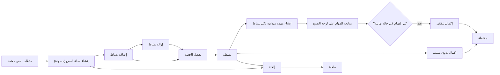
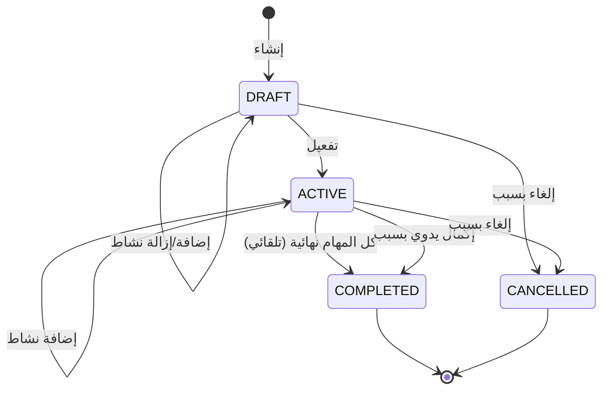

# تخطيط أنشطة الجمع

<!-- BEGIN GENERATED: doc -->
| البند | القيمة |
|---|---|
| المعرّف | FEAT-COL-PLAN |
| الإصدار | 0.2 |
| الحالة | مسودة |
| القدرة | CAP-02 جمع المعلومات |
| القدرة الفرعية | CAP-02.01 الحاجة المعلوماتية وتخطيط الجمع (R2) |
| الأدوار | مخطط الجمع؛ النظام |
| الشاشات | SCR-13 لوحة الجمع |
| حالات الاستخدام | UC-121 |
| القصص | 11: 8 من المواصفة، و3 جديدة |
<!-- END GENERATED: doc -->

## 1. نظرة عامة

### 1.1 القيمة

يتيح لمخطط الجمع أن يحول المتطلب المعتمد إلى خطة أنشطة ومصادر ومهام ميدانية ويتابعها حتى الاكتمال.

### 1.2 النطاق

| البند | القيمة |
|---|---|
| الأدوار | مخطط الجمع؛ النظام |
| الشاشات | SCR-13 لوحة الجمع |
| حالات الاستخدام | إعداد أنشطة خطة الجمع وتفعيلها ومتابعتها حتى الاكتمال |
| المتطلبات | السماح بتخطيط أنشطة الجمع بأساليبها ومصادرها ومهامها الميدانية بعد اعتماد متطلب الجمع، وربط كل نشاط بمهمته |
| خارج النطاق | صياغة متطلب الجمع نفسه واعتماده (ميزة «طلب حاجة معلوماتية»)؛ متابعة استيفاء المتطلب بالملاحظات (ميزة الاستيفاء)؛ تنفيذ المهمة الميدانية نفسها (قدرة التخطيط والتنفيذ) |

### 1.3 خريطة الميزة

**الشكل 1: من المتطلب المعتمد إلى اكتمال خطة الجمع**



**الشكل 2: حالات خطة الجمع**



## 2. القواعد المشتركة

تنطبق على كل قصص الميزة، فلا تتكرر داخل القصص. وكل قصة تذكر ما يخصها فقط.

### 2.1 السياق المشترك

كل قصة تبدأ من ثلاثة شروط: مستأجر نشط، وحزمة السياسات الأساسية مفعّلة، ومستخدم مسجّل الدخول ومخوَّل. وتشير إليها القصص بخطوة واحدة: «بفرض السياق المشترك للميزة».

### 2.2 الصلاحية وعدم الإفصاح

- من لا يحق له رؤية العنصر يتلقى ردًا بشكل «غير متاح» تمامًا، فلا يعرف أنه موجود.
- من يرى العنصر ولا يحق له الإجراء يتلقى «لا تملك صلاحية هذا الإجراء».

### 2.3 أوامر تغيير الحالة

- **منع التكرار:** يُرسل كل أمر بمفتاح فريد، فإعادة الطلب نفسه لا تُنفَّذ مرتين.
- **حماية التعديل المتزامن:** يُرسل كل أمر بإصدار البيانات الذي يراه المستخدم. فإن عدّلها غيره في الأثناء، يُرفض الأمر.
- **السجل:** إن نجح الأمر، يُكتب حدثه وسجل التدقيق في المعاملة نفسها.

### 2.4 الرفض المشترك

```gherkin
# language: ar
خاصية: الرفض المشترك لأوامر الميزة

  سيناريو مخطط: رفض مشترك لكل أمر في الميزة
    بفرض السياق المشترك للميزة
    و <الحالة>
    عندما يُرسل المستخدم أي أمر من أوامر الميزة
    اذاً يُرفض برمز <الرمز> ويرى "<الرسالة>"
    و لا يتغير شيء

    امثلة:
      | الحالة                                  | الرمز                  | الرسالة                                                 |
      | العنصر خارج صلاحياته                    | NOT_FOUND              | غير متاح                                                |
      | العنصر مرئي له ولا يحق له الإجراء       | AUTHZ_DENIED           | لا تملك صلاحية هذا الإجراء                              |
      | غيره عدّل العنصر بعد أن فتحه            | VERSION_CONFLICT       | تغيّرت البيانات منذ فتحتها. راجع التغييرات ثم أعد المحاولة |
      | أعاد مفتاح منع التكرار بمحتوى مختلف     | IDEMPOTENCY_KEY_REUSED | طلب مكرر بمحتوى مختلف                                   |
      | البيانات ناقصة أو غير صحيحة             | VALIDATION_FAILED      | بعض البيانات ناقصة أو غير صحيحة. راجع الحقول المعلَّمة      |

  سيناريو: إعادة الطلب نفسه لا تُنفَّذ مرتين
    بفرض السياق المشترك للميزة
    و أمر نجح بمفتاح منع تكرار
    عندما يُعاد الطلب نفسه بالمفتاح نفسه
    اذاً تُعاد النتيجة الأولى ولا يُكتب حدث ثانٍ
```

## 3. الجودة وتعريف الاكتمال

### 3.1 متطلبات الجودة

<!-- BEGIN GENERATED: quality -->
| المرجع | الموقف | المطلوب |
|---|---|---|
| QAS-PERF-021 | plan version baselined with 500 task-generating activities | task synchronization completes ≤ 60 s; idempotent on retry |
<!-- END GENERATED: quality -->

### 3.2 تعريف الاكتمال

القصة مكتملة حين تتحقق الشروط الخمسة:

1. سيناريوهاتها والقواعد المشتركة تمر في الاختبار الآلي.
2. فحوص البنية المعمارية تمر.
3. نصوص الواجهة والرسائل موجودة بالعربية والإنجليزية.
4. مراجعة الكود مكتملة.
5. ما تضيفه القصة نفسها في قسم «القواعد» تحقق.

## 4. فهرس القصص

<!-- BEGIN GENERATED: story-index -->
| المعرّف | القصة | النوع | الحالة |
|---|---|---|---|
| `US-BC02-CPL-ACTIVATE` | تفعيل خطة الجمع | أمر | مسودة |
| `US-BC02-CPL-ADD-ACTIVITY` | إضافة نشاط إلى خطة الجمع | أمر | مسودة |
| `US-BC02-CPL-CANCEL` | إلغاء خطة الجمع | أمر | مسودة |
| `US-BC02-CPL-COMPLETE` | إكمال خطة الجمع | أمر | مسودة |
| `US-BC02-CPL-CREATE` | إنشاء خطة الجمع | أمر | مسودة |
| `US-BC02-CPL-REMOVE-ACTIVITY` | إزالة نشاط من خطة الجمع | أمر | مسودة |
| `US-BC02-Q-CPL-GET` | جلب خطة الجمع بأنشطتها ومهامها | جلب | مسودة |
| `US-BC02-S-COLLECTION-PLAN-01` | إكمال خطة الجمع تلقائيًا عند انتهاء كل مهامها | نظام | مسودة |
| `US-UI-SCR13-PLAN-EDITOR` | إعداد خطة الجمع وأنشطتها على الخريطة | واجهة | مسودة |
| `US-UI-SCR13-PLAN-PROGRESS` | متابعة مهام أنشطة الخطة حتى اكتمالها | واجهة | مسودة |
| `US-PLT-CPL-TASK-SPAWN` | إنشاء مهام الأنشطة مرة واحدة دون تكرار | منصة | مسودة |
<!-- END GENERATED: story-index -->

## 5. القصص

### 5.1 US-BC02-CPL-ACTIVATE — تفعيل خطة الجمع

| النوع | الإصدار | الأولوية | دون اتصال | الحالة |
|---|---|---|---|---|
| أمر | R2 | Must | لا | مسودة |

> **كـ** مخطط الجمع، **أريد** تفعيل خطة الجمع بعد أن تضم نشاطًا واحدًا على الأقل، **حتى** تتحول أنشطتها إلى مهام ميدانية فعلية.

**باختصار:** يفعّل المخطط خطة «مسودة» فيها نشاط واحد على الأقل، فتصير «نشطة» وتُنشأ مهمة ميدانية واحدة لكل نشاط من أنشطتها.

#### القواعد

- **متى يُسمح:** الخطة في حالة «مسودة»، وفيها نشاط واحد على الأقل.
- **من يُسمح له:** مخطط الجمع الذي تقع الخطة ضمن نطاقه.
- **الأثر:** تصبح حالة الخطة «نشطة»، وتُنشأ مهمة ميدانية واحدة لكل نشاط ترتبط به (REQ-COL-002، القصة 5.11)، ويُسجَّل حدث «فُعِّلت خطة الجمع».

#### معايير القبول

```gherkin
# language: ar
خاصية: تفعيل خطة الجمع

  سيناريو: تفعيل خطة فيها نشاط واحد على الأقل
    بفرض السياق المشترك للميزة
    و خطة جمع "مسودة" لمخطط الجمع فيها نشاط واحد على الأقل
    عندما يفعّل مخطط الجمع الخطة
    اذاً تصبح حالتها "نشطة"
    و تُنشأ مهمة ميدانية واحدة لكل نشاط من أنشطتها
    و يُسجَّل حدث "فُعِّلت خطة الجمع"

  سيناريو مخطط: رفض خاص بتفعيل الخطة
    بفرض السياق المشترك للميزة
    و <الحالة>
    عندما يحاول مخطط الجمع تفعيل الخطة
    اذاً يُرفض برمز <الرمز> ويرى <الرسالة>
    و لا يتغير شيء

    امثلة:
      | الحالة                   | الرمز                                    | الرسالة                                             |
      | الخطة ليست "مسودة"       | COLLECTION_PLAN_INVALID_STATE_TRANSITION | الوضع الحالي لخطة الجمع لا يسمح بهذا الإجراء        |
      | الخطة بلا أي نشاط        | PLAN_EMPTY                               | أضف نشاطًا واحدًا على الأقل                         |
```

<details><summary>المراجع التقنية والتتبع</summary>

<!-- BEGIN GENERATED: refs US-BC02-CPL-ACTIVATE -->
| البند | المعرّف | المعنى |
|---|---|---|
| الواجهة البرمجية | `POST /api/v1/information/collection-plans/{id}/actions/activate` | — |
| الأمر | `CMD-CPL-ACTIVATE` | تفعيل خطة الجمع |
| السياسة | `POL-CPL-ACTIVATE` | collection planner؛ tenant match; area within scope |
| الحدث | `EVT-CPL-ACTIVATED` | يصل إلى: Task creation (SLC-03); Notification (units) |
| الكيان | `AGG-COLLECTION-PLAN` | خطة الجمع |
| الجدول | `information.collection_plans` | الجدول الرئيسي لخطة الجمع |
| وحدة النشر | DU-04 | — |
| المتطلب | REQ-COL-002 | When a collection requirement is approved, the system shall allow planning collection activities with methods… |
| حالة الاستخدام | UC-121 | Plan Collection Activities |
| الاختبار | TST-COLLECTION-PLAN-SM، TST-SLC14-INVARIANTS | دورة حالات خطة الجمع، وثوابت الشريحة SLC-14 |
<!-- END GENERATED: refs US-BC02-CPL-ACTIVATE -->

</details>

### 5.2 US-BC02-CPL-ADD-ACTIVITY — إضافة نشاط إلى خطة الجمع

| النوع | الإصدار | الأولوية | دون اتصال | الحالة |
|---|---|---|---|---|
| أمر | R2 | Must | لا | مسودة |

> **كـ** مخطط الجمع، **أريد** إضافة نشاط جمع بأسلوبه ومصادره ونطاقه إلى الخطة، **حتى** يغطي النشاط حاجة معلوماتية ضمن متطلب معتمد.

**باختصار:** يضيف المخطط نشاطًا بأسلوب ومصادر نشطة ونطاق مكاني ونافذة زمنية داخل حدود متطلبات الخطة، إلى خطة «مسودة» أو «نشطة»، دون تغيير حالتها.

#### القواعد

- **متى يُسمح:** الخطة في حالة «مسودة» أو «نشطة».
- **من يُسمح له:** مخطط الجمع الذي تقع الخطة ضمن نطاقه.
- **البيانات:** الأسلوب (من أساليب الجمع المعتمدة)، المصادر (نشطة)، النطاق المكاني (داخل نطاق متطلبات الخطة)، النافذة الزمنية (داخل نافذة متطلبات الخطة)، الوحدة المسندة، نوع المهمة، عناصر المعلومات الأساسية المستهدفة.
- **الأثر:** تبقى حالة الخطة كما هي ويزداد إصدارها، ويُسجَّل حدث «أُضيف نشاط إلى خطة الجمع».

#### معايير القبول

```gherkin
# language: ar
خاصية: إضافة نشاط إلى خطة الجمع

  سيناريو: إضافة نشاط صحيح
    بفرض السياق المشترك للميزة
    و خطة جمع "مسودة" أو "نشطة" لمخطط الجمع
    عندما يضيف نشاطًا بأسلوب ومصادر نشطة ونطاق ونافذة داخل حدود متطلبات الخطة
    اذاً تبقى حالة الخطة كما هي ويزداد إصدارها
    و يُسجَّل حدث "أُضيف نشاط إلى خطة الجمع"

  سيناريو مخطط: رفض خاص بإضافة النشاط
    بفرض السياق المشترك للميزة
    و <الحالة>
    عندما يحاول مخطط الجمع إضافة النشاط
    اذاً يُرفض برمز <الرمز> ويرى <الرسالة>
    و لا يتغير شيء

    امثلة:
      | الحالة                              | الرمز                                    | الرسالة                                              |
      | مصدر من مصادر النشاط غير نشط        | ACTIVITY_INVALID                         | بيانات نشاط الجمع غير مكتملة أو خارج نطاق المتطلب    |
      | الخطة "مكتملة" أو "ملغاة"            | COLLECTION_PLAN_INVALID_STATE_TRANSITION | الوضع الحالي لخطة الجمع لا يسمح بهذا الإجراء         |
```

<details><summary>المراجع التقنية والتتبع</summary>

<!-- BEGIN GENERATED: refs US-BC02-CPL-ADD-ACTIVITY -->
| البند | المعرّف | المعنى |
|---|---|---|
| الواجهة البرمجية | `POST /api/v1/information/collection-plans/{id}/actions/add-activity` | — |
| الأمر | `CMD-CPL-ADD-ACTIVITY` | إضافة نشاط إلى خطة الجمع |
| السياسة | `POL-CPL-ADD-ACTIVITY` | collection planner؛ tenant match; area within scope |
| الحدث | `EVT-CPL-ACTIVITY-ADDED` | يصل إلى: Task creation (SLC-03); Notification (units) |
| الكيان | `AGG-COLLECTION-PLAN` | خطة الجمع |
| الجدول | `information.collection_plans` | الجدول الرئيسي لخطة الجمع |
| وحدة النشر | DU-04 | — |
| المتطلب | REQ-COL-002 | When a collection requirement is approved, the system shall allow planning collection activities with methods… |
| حالة الاستخدام | UC-121 | Plan Collection Activities |
| الاختبار | TST-COLLECTION-PLAN-SM، TST-SLC14-INVARIANTS | دورة حالات خطة الجمع، وثوابت الشريحة SLC-14 |
<!-- END GENERATED: refs US-BC02-CPL-ADD-ACTIVITY -->

</details>

### 5.3 US-BC02-CPL-CANCEL — إلغاء خطة الجمع

| النوع | الإصدار | الأولوية | دون اتصال | الحالة |
|---|---|---|---|---|
| أمر | R2 | Must | لا | مسودة |

> **كـ** مخطط الجمع، **أريد** إلغاء خطة الجمع بذكر السبب، **حتى** يتوقف العمل عليها وتُلغى مهامها الميدانية المفتوحة.

**باختصار:** يلغي المخطط خطة «مسودة» أو «نشطة» بذكر السبب، فتصير «ملغاة» وتُلغى مهامها الميدانية المفتوحة.

#### القواعد

- **متى يُسمح:** الخطة في حالة «مسودة» أو «نشطة».
- **من يُسمح له:** مخطط الجمع الذي تقع الخطة ضمن نطاقه.
- **البيانات:** سبب الإلغاء (إلزامي).
- **الأثر:** تصبح حالة الخطة «ملغاة»، وتُلغى مهامها الميدانية المفتوحة، ويُسجَّل حدث «أُلغيت خطة الجمع».

#### معايير القبول

```gherkin
# language: ar
خاصية: إلغاء خطة الجمع

  سيناريو: إلغاء خطة بسبب
    بفرض السياق المشترك للميزة
    و خطة جمع "مسودة" أو "نشطة" لمخطط الجمع
    عندما يلغيها بذكر السبب
    اذاً تصبح حالتها "ملغاة"
    و تُلغى مهامها الميدانية المفتوحة
    و يُسجَّل حدث "أُلغيت خطة الجمع"

  سيناريو مخطط: رفض خاص بالإلغاء
    بفرض السياق المشترك للميزة
    و <الحالة>
    عندما يحاول مخطط الجمع إلغاء الخطة
    اذاً يُرفض برمز <الرمز> ويرى <الرسالة>
    و لا يتغير شيء

    امثلة:
      | الحالة                   | الرمز                                    | الرسالة                                      |
      | السبب غير مذكور          | REASON_REQUIRED                          | اذكر السبب                                   |
      | الخطة "مكتملة" أو "ملغاة" | COLLECTION_PLAN_INVALID_STATE_TRANSITION | الوضع الحالي لخطة الجمع لا يسمح بهذا الإجراء |
```

<details><summary>المراجع التقنية والتتبع</summary>

<!-- BEGIN GENERATED: refs US-BC02-CPL-CANCEL -->
| البند | المعرّف | المعنى |
|---|---|---|
| الواجهة البرمجية | `POST /api/v1/information/collection-plans/{id}/actions/cancel` | — |
| الأمر | `CMD-CPL-CANCEL` | إلغاء خطة الجمع |
| السياسة | `POL-CPL-CANCEL` | collection planner؛ tenant match; area within scope |
| الحدث | `EVT-CPL-CANCELLED` | يصل إلى: Task creation (SLC-03); Notification (units) |
| الكيان | `AGG-COLLECTION-PLAN` | خطة الجمع |
| الجدول | `information.collection_plans` | الجدول الرئيسي لخطة الجمع |
| وحدة النشر | DU-04 | — |
| المتطلب | REQ-COL-002 | When a collection requirement is approved, the system shall allow planning collection activities with methods… |
| حالة الاستخدام | UC-121 | Plan Collection Activities |
| الاختبار | TST-COLLECTION-PLAN-SM، TST-SLC14-INVARIANTS | دورة حالات خطة الجمع، وثوابت الشريحة SLC-14 |
<!-- END GENERATED: refs US-BC02-CPL-CANCEL -->

</details>

### 5.4 US-BC02-CPL-COMPLETE — إكمال خطة الجمع

| النوع | الإصدار | الأولوية | دون اتصال | الحالة |
|---|---|---|---|---|
| أمر | R2 | Must | لا | مسودة |

> **كـ** مخطط الجمع، **أريد** إكمال خطة «نشطة» بذكر سبب دون انتظار كل مهامها، **حتى** أغلقها حين يصبح الاستمرار فيها بلا قيمة.

**باختصار:** يكمل المخطط خطة «نشطة» بذكر سبب، فتُلغى مهام أنشطتها المفتوحة وتصير الخطة «مكتملة».

#### القواعد

- **متى يُسمح:** الخطة في حالة «نشطة».
- **من يُسمح له:** مخطط الجمع الذي تقع الخطة ضمن نطاقه.
- **البيانات:** سبب الإكمال (إلزامي).
- **الأثر:** تُلغى مهام أنشطة الخطة المفتوحة، وتصبح حالة الخطة «مكتملة»، ويُسجَّل حدث «اكتملت خطة الجمع».

> **ملاحظة:** هذا إكمال يدوي يختاره المخطط قبل انتهاء كل المهام. الإكمال التلقائي حين تنتهي كل مهام الأنشطة في القصة 5.8.

#### معايير القبول

```gherkin
# language: ar
خاصية: إكمال خطة الجمع

  سيناريو: إكمال خطة نشطة بسبب
    بفرض السياق المشترك للميزة
    و خطة جمع "نشطة" لمخطط الجمع فيها مهام أنشطة مفتوحة
    عندما يكملها بذكر السبب
    اذاً تُلغى مهام أنشطتها المفتوحة
    و تصبح حالتها "مكتملة"
    و يُسجَّل حدث "اكتملت خطة الجمع"

  سيناريو مخطط: رفض خاص بالإكمال
    بفرض السياق المشترك للميزة
    و <الحالة>
    عندما يحاول مخطط الجمع إكمال الخطة
    اذاً يُرفض برمز <الرمز> ويرى <الرسالة>
    و لا يتغير شيء

    امثلة:
      | الحالة                          | الرمز                                    | الرسالة                                      |
      | السبب غير مذكور                 | REASON_REQUIRED                          | اذكر السبب                                   |
      | الخطة ليست "نشطة"               | COLLECTION_PLAN_INVALID_STATE_TRANSITION | الوضع الحالي لخطة الجمع لا يسمح بهذا الإجراء |
```

<details><summary>المراجع التقنية والتتبع</summary>

<!-- BEGIN GENERATED: refs US-BC02-CPL-COMPLETE -->
| البند | المعرّف | المعنى |
|---|---|---|
| الواجهة البرمجية | `POST /api/v1/information/collection-plans/{id}/actions/complete` | — |
| الأمر | `CMD-CPL-COMPLETE` | إكمال خطة الجمع |
| السياسة | `POL-CPL-COMPLETE` | collection planner؛ tenant match; area within scope |
| الحدث | `EVT-CPL-COMPLETED` | يصل إلى: Task creation (SLC-03); Notification (units) |
| الكيان | `AGG-COLLECTION-PLAN` | خطة الجمع |
| الجدول | `information.collection_plans` | الجدول الرئيسي لخطة الجمع |
| وحدة النشر | DU-04 | — |
| المتطلب | REQ-COL-002 | When a collection requirement is approved, the system shall allow planning collection activities with methods… |
| حالة الاستخدام | UC-121 | Plan Collection Activities |
| الاختبار | TST-COLLECTION-PLAN-SM، TST-SLC14-INVARIANTS | دورة حالات خطة الجمع، وثوابت الشريحة SLC-14 |
<!-- END GENERATED: refs US-BC02-CPL-COMPLETE -->

</details>

### 5.5 US-BC02-CPL-CREATE — إنشاء خطة الجمع

| النوع | الإصدار | الأولوية | دون اتصال | الحالة |
|---|---|---|---|---|
| أمر | R2 | Must | لا | مسودة |

> **كـ** مخطط الجمع، **أريد** إنشاء خطة جمع من متطلب معتمد أو أكثر، **حتى** أنظّم أنشطة الجمع التي تلبّيه.

**باختصار:** ينشئ المخطط خطة بعنوان وتصنيف أمني لا يقل عن تصنيف متطلباتها، مرتبطة بمتطلب جمع معتمد واحد على الأقل، فتبدأ «مسودة».

#### القواعد

- **متى يُسمح:** يوجد متطلب جمع معتمد واحد على الأقل، والمخطط ضمن نطاقه.
- **من يُسمح له:** مخطط الجمع.
- **البيانات:** المتطلبات المرتبطة (إلزامي)، العنوان (إلزامي)، التصنيف الأمني (لا يقل عن تصنيف المتطلبات المرتبطة).
- **الأثر:** تُنشأ الخطة بحالة «مسودة»، ويُسجَّل حدث «أُنشئت خطة الجمع».

#### معايير القبول

```gherkin
# language: ar
خاصية: إنشاء خطة الجمع

  سيناريو: إنشاء خطة من متطلب معتمد
    بفرض السياق المشترك للميزة
    و متطلب جمع معتمد واحد على الأقل ضمن نطاق مخطط الجمع
    عندما ينشئ المخطط خطة بعنوان وتصنيف أمني لا يقل عن تصنيف المتطلب مرتبطة به
    اذاً تُنشأ الخطة بحالة "مسودة"
    و يُسجَّل حدث "أُنشئت خطة الجمع"

  سيناريو مخطط: رفض خاص بإنشاء الخطة
    بفرض السياق المشترك للميزة
    و <الحالة>
    عندما يحاول مخطط الجمع إنشاء الخطة
    اذاً يُرفض برمز <الرمز> ويرى <الرسالة>
    و لا يتغير شيء

    امثلة:
      | الحالة                         | الرمز                   | الرسالة                                 |
      | لا يوجد متطلب معتمد مرتبط       | REQUIREMENT_NOT_APPROVED | يلزم متطلب جمع معتمد واحد على الأقل     |
      | العنوان غير مذكور               | VALIDATION_FAILED        | العنوان مطلوب                           |
```

<details><summary>المراجع التقنية والتتبع</summary>

<!-- BEGIN GENERATED: refs US-BC02-CPL-CREATE -->
| البند | المعرّف | المعنى |
|---|---|---|
| الواجهة البرمجية | `POST /api/v1/information/collection-plans` | — |
| الأمر | `CMD-CPL-CREATE` | إنشاء خطة الجمع |
| السياسة | `POL-CPL-CREATE` | collection planner؛ tenant match; area within scope |
| الحدث | `EVT-CPL-CREATED` | يصل إلى: Task creation (SLC-03); Notification (units) |
| الكيان | `AGG-COLLECTION-PLAN` | خطة الجمع |
| الجدول | `information.collection_plans` | الجدول الرئيسي لخطة الجمع |
| وحدة النشر | DU-04 | — |
| المتطلب | REQ-COL-002 | When a collection requirement is approved, the system shall allow planning collection activities with methods… |
| حالة الاستخدام | UC-121 | Plan Collection Activities |
| الاختبار | TST-COLLECTION-PLAN-SM، TST-SLC14-INVARIANTS | دورة حالات خطة الجمع، وثوابت الشريحة SLC-14 |
<!-- END GENERATED: refs US-BC02-CPL-CREATE -->

</details>

### 5.6 US-BC02-CPL-REMOVE-ACTIVITY — إزالة نشاط من خطة الجمع

| النوع | الإصدار | الأولوية | دون اتصال | الحالة |
|---|---|---|---|---|
| أمر | R2 | Must | لا | مسودة |

> **كـ** مخطط الجمع، **أريد** إزالة نشاط لم تُنشأ له مهمة بعد، **حتى** أصحح الخطة قبل تفعيلها.

**باختصار:** يزيل المخطط نشاطًا من خطة «مسودة» لم تُنشأ له مهمة ميدانية بعد.

#### القواعد

- **متى يُسمح:** الخطة في حالة «مسودة»، والنشاط لم تُنشأ له مهمة ميدانية بعد.
- **من يُسمح له:** مخطط الجمع الذي تقع الخطة ضمن نطاقه.
- **البيانات:** معرّف النشاط (إلزامي).
- **الأثر:** تبقى حالة الخطة كما هي ويزداد إصدارها، ويُسجَّل حدث «أُزيل نشاط من خطة الجمع».

#### معايير القبول

```gherkin
# language: ar
خاصية: إزالة نشاط من خطة الجمع

  سيناريو: إزالة نشاط لم تُنشأ له مهمة
    بفرض السياق المشترك للميزة
    و خطة جمع "مسودة" لمخطط الجمع فيها نشاط لم تُنشأ له مهمة بعد
    عندما يزيل النشاط
    اذاً تبقى حالة الخطة كما هي ويزداد إصدارها
    و يُسجَّل حدث "أُزيل نشاط من خطة الجمع"

  سيناريو مخطط: رفض خاص بالإزالة
    بفرض السياق المشترك للميزة
    و <الحالة>
    عندما يحاول مخطط الجمع إزالة النشاط
    اذاً يُرفض برمز <الرمز> ويرى <الرسالة>
    و لا يتغير شيء

    امثلة:
      | الحالة                       | الرمز                                    | الرسالة                                      |
      | أُنشئت مهمة لهذا النشاط       | ACTIVITY_ALREADY_TASKED                  | أُنشئت مهمة لهذا النشاط من قبل               |
      | الخطة ليست "مسودة"           | COLLECTION_PLAN_INVALID_STATE_TRANSITION | الوضع الحالي لخطة الجمع لا يسمح بهذا الإجراء |
```

<details><summary>المراجع التقنية والتتبع</summary>

<!-- BEGIN GENERATED: refs US-BC02-CPL-REMOVE-ACTIVITY -->
| البند | المعرّف | المعنى |
|---|---|---|
| الواجهة البرمجية | `POST /api/v1/information/collection-plans/{id}/actions/remove-activity` | — |
| الأمر | `CMD-CPL-REMOVE-ACTIVITY` | إزالة نشاط من خطة الجمع |
| السياسة | `POL-CPL-REMOVE-ACTIVITY` | collection planner؛ tenant match; area within scope |
| الحدث | `EVT-CPL-ACTIVITY-REMOVED` | يصل إلى: Task creation (SLC-03); Notification (units) |
| الكيان | `AGG-COLLECTION-PLAN` | خطة الجمع |
| الجدول | `information.collection_plans` | الجدول الرئيسي لخطة الجمع |
| وحدة النشر | DU-04 | — |
| المتطلب | REQ-COL-002 | When a collection requirement is approved, the system shall allow planning collection activities with methods… |
| حالة الاستخدام | UC-121 | Plan Collection Activities |
| الاختبار | TST-COLLECTION-PLAN-SM، TST-SLC14-INVARIANTS | دورة حالات خطة الجمع، وثوابت الشريحة SLC-14 |
<!-- END GENERATED: refs US-BC02-CPL-REMOVE-ACTIVITY -->

</details>

### 5.7 US-BC02-Q-CPL-GET — جلب خطة الجمع بأنشطتها ومهامها

| النوع | الإصدار | الأولوية | دون اتصال | الحالة |
|---|---|---|---|---|
| جلب | R2 | Must | لا | مسودة |

> **كـ** مخطط الجمع، **أريد** جلب خطة الجمع بأنشطتها والمهام الميدانية المرتبطة بها، **حتى** أتابع تنفيذها.

**باختصار:** تُعاد الخطة وأنشطتها والمهمة المرتبطة بكل نشاط، لمن يحق له رؤيتها فقط.

#### القواعد

- **من يرى ماذا:** مخطط الجمع الذي تقع الخطة ضمن نطاقه.
- **البيانات:** لا تُعاد مهمة ميدانية مرتبطة بنشاط إن لم يحق لمخطط الجمع رؤيتها، ولا يُكشف عددها ولا وجودها (قاعدة عدم الإفصاح، §2.2). **[Derived]**

#### معايير القبول

```gherkin
# language: ar
خاصية: جلب خطة الجمع

  سيناريو: جلب خطة بأنشطتها ومهامها
    بفرض السياق المشترك للميزة
    و خطة جمع ضمن نطاق مخطط الجمع، لكل نشاط فيها مهمة ميدانية
    عندما يطلب جلب الخطة
    اذاً تُعاد الخطة وأنشطتها والمهمة المرتبطة بكل نشاط

  سيناريو: مهمة لا يحق للمخطط رؤيتها لا تُكشف
    بفرض السياق المشترك للميزة
    و خطة فيها نشاط مرتبط بمهمة لا يحق لمخطط الجمع رؤيتها
    عندما يطلب جلب الخطة
    اذاً تُعاد الخطة دون تلك المهمة
    و لا يُكشف عددها ولا وجودها
```

<details><summary>المراجع التقنية والتتبع</summary>

<!-- BEGIN GENERATED: refs US-BC02-Q-CPL-GET -->
| البند | المعرّف | المعنى |
|---|---|---|
| الواجهة البرمجية | `GET /api/v1/information/collection-plans/{plan_id}` | — |
| الاستعلام | `QRY-CPL-GET` | Plan with activities and linked tasks |
| السياسة | `POL-CPL-GET` | planner scope |
| الكيان | `AGG-COLLECTION-PLAN` | خطة الجمع |
| الجدول | `information.collection_plans` | الجدول الرئيسي لخطة الجمع |
| وحدة النشر | DU-04 | — |
| المتطلب | REQ-COL-002 | When a collection requirement is approved, the system shall allow planning collection activities with methods… |
| حالة الاستخدام | UC-121 | Plan Collection Activities |
| الاختبار | TST-COLLECTION-PLAN-SM، TST-SLC14-INVARIANTS | دورة حالات خطة الجمع، وثوابت الشريحة SLC-14 |
<!-- END GENERATED: refs US-BC02-Q-CPL-GET -->

</details>

### 5.8 US-BC02-S-COLLECTION-PLAN-01 — إكمال خطة الجمع تلقائيًا عند انتهاء كل مهامها

| النوع | الإصدار | الأولوية | دون اتصال | الحالة |
|---|---|---|---|---|
| نظام | R2 | Must | لا ينطبق | مسودة |

> **كـ** النظام، **أريد** إكمال خطة الجمع تلقائيًا حين تصل كل مهام أنشطتها إلى حالة نهائية، **حتى** لا تبقى خطة «نشطة» دون عمل متبقٍ.

**باختصار:** حين تصبح كل المهام الميدانية التابعة لأنشطة خطة «نشطة» في حالة نهائية، يكملها النظام دون تدخل المخطط.

#### القواعد

- **متى يحدث:** الخطة في حالة «نشطة»، وكل مهام أنشطتها وصلت إلى حالة نهائية (مكتملة أو ملغاة).
- **الأثر:** تصبح حالة الخطة «مكتملة»، ويُسجَّل حدث «اكتملت خطة الجمع» وسجل تدقيق بهوية النظام.

> **ملاحظة:** الإكمال اليدوي قبل انتهاء كل المهام في القصة 5.4.

#### معايير القبول

```gherkin
# language: ar
خاصية: إكمال خطة الجمع تلقائيًا

  سيناريو: كل مهام الأنشطة انتهت
    بفرض خطة جمع "نشطة" وصلت كل مهام أنشطتها إلى حالة نهائية
    عندما يصل آخرها إلى حالته النهائية
    اذاً تصبح حالة الخطة "مكتملة"
    و يُسجَّل حدث "اكتملت خطة الجمع" وسجل تدقيق بهوية النظام

  سيناريو: مهمة واحدة ما زالت مفتوحة
    بفرض خطة جمع "نشطة" فيها مهمة واحدة غير منتهية وبقية المهام منتهية
    عندما تُفحص حالة مهام الخطة
    اذاً تبقى حالة الخطة "نشطة"
    و لا يُسجَّل حدث إكمال
```

<details><summary>المراجع التقنية والتتبع</summary>

<!-- BEGIN GENERATED: refs US-BC02-S-COLLECTION-PLAN-01 -->
| البند | المعرّف | المعنى |
|---|---|---|
| المحفِّز | `SYS:all activity tasks terminal` | SLC-03 events |
| الانتقال | ACTIVE ← COMPLETED | — |
| الحدث | `EVT-CPL-COMPLETED` | يصل إلى: Task creation (SLC-03); Notification (units) |
| الكيان | `AGG-COLLECTION-PLAN` | خطة الجمع |
| الجدول | `information.collection_plans` | الجدول الرئيسي لخطة الجمع |
| وحدة النشر | DU-04 | — |
| المتطلب | REQ-COL-002 | When a collection requirement is approved, the system shall allow planning collection activities with methods… |
| حالة الاستخدام | UC-121 | Plan Collection Activities |
| الاختبار | TST-COLLECTION-PLAN-SM، TST-SLC14-INVARIANTS | دورة حالات خطة الجمع، وثوابت الشريحة SLC-14 |
<!-- END GENERATED: refs US-BC02-S-COLLECTION-PLAN-01 -->

</details>

### 5.9 US-UI-SCR13-PLAN-EDITOR — إعداد خطة الجمع وأنشطتها على الخريطة

| النوع | الإصدار | الأولوية | دون اتصال | الحالة |
|---|---|---|---|---|
| واجهة | R2 | Must | لا | مسودة |

> **كـ** مخطط الجمع، **أريد** أن أعدّ خطة الجمع وأنشطتها على خريطة لوحة الجمع، **حتى** أحدد النطاق المكاني والنافذة الزمنية والمصادر بصريًا قبل التفعيل.

**باختصار:** تعرض شاشة لوحة الجمع (SCR-13) خطة الجمع وأنشطتها على الخريطة، ويرسم المخطط نطاق نشاط جديد أو يعدّله مباشرة عليها. **[Derived]**

#### القواعد

- تعرض الخريطة نطاق كل نشاط من أنشطة الخطة إلى جانب نطاق متطلباتها، لحصر الرسم داخله. **[Derived]**
- رسم نطاق نشاط جديد أو تعديله يرسل أمر إضافة النشاط بالقواعد نفسها في القصة 5.2.

#### معايير القبول

```gherkin
# language: ar
خاصية: إعداد خطة الجمع على الخريطة

  سيناريو: رسم نطاق نشاط جديد
    بفرض السياق المشترك للميزة
    و خطة جمع "مسودة" أو "نشطة" مفتوحة في لوحة الجمع
    عندما يرسم المخطط نطاق نشاط جديد داخل نطاق متطلبات الخطة ويحدد أسلوبه ومصادره
    اذاً يُضاف النشاط إلى الخطة
    و يظهر نطاقه على الخريطة

  سيناريو مخطط: رفض خاص بالرسم على الخريطة
    بفرض السياق المشترك للميزة
    و <الحالة>
    عندما يحاول المخطط إضافة النشاط بهذه البيانات
    اذاً يُرفض برمز <الرمز> ويرى <الرسالة>

    امثلة:
      | الحالة                                | الرمز             | الرسالة                                           |
      | النطاق المرسوم خارج نطاق متطلبات الخطة | ACTIVITY_INVALID  | بيانات نشاط الجمع غير مكتملة أو خارج نطاق المتطلب |
```

<details><summary>المراجع التقنية والتتبع</summary>

<!-- BEGIN GENERATED: refs US-UI-SCR13-PLAN-EDITOR -->
| البند | المعرّف | المعنى |
|---|---|---|
| الشاشة | SCR-13 | شاشة لوحة الجمع |
| حالة الاستخدام | UC-121 | Plan Collection Activities |
| المصدر | `[Derived]` | — |
| المتطلب | REQ-COL-002 | When a collection requirement is approved, the system shall allow planning collection activities with methods… |
| حالة الاستخدام | UC-121 | Plan Collection Activities |
<!-- END GENERATED: refs US-UI-SCR13-PLAN-EDITOR -->

</details>

### 5.10 US-UI-SCR13-PLAN-PROGRESS — متابعة مهام أنشطة الخطة حتى اكتمالها

| النوع | الإصدار | الأولوية | دون اتصال | الحالة |
|---|---|---|---|---|
| واجهة | R2 | Should | لا | مسودة |

> **كـ** مخطط الجمع، **أريد** أن أتابع حالة مهام كل نشاط في الخطة ونسبة تقدّمها، **حتى** أعرف متى تكتمل الخطة أو أتدخل إن تأخرت.

**باختصار:** تعرض لوحة الجمع لكل نشاط عدد مهامه المكتملة من إجماليها، والحالة الإجمالية للخطة. **[Derived]**

#### القواعد

- تعرض الشاشة نسبة اكتمال مهام كل نشاط، دون كشف مهمة لا يحق لمخطط الجمع رؤيتها (قاعدة عدم الإفصاح، §2.2). **[Derived]**
- تعتمد الشاشة على جلب خطة الجمع بأنشطتها ومهامها (القصة 5.7).

#### معايير القبول

```gherkin
# language: ar
خاصية: متابعة مهام أنشطة الخطة

  سيناريو: تحديث نسبة الاكتمال
    بفرض السياق المشترك للميزة
    و خطة جمع "نشطة" فيها نشاط بمهمتين، أُكملت واحدة منهما
    عندما يفتح مخطط الجمع لوحة الجمع
    اذاً يرى نسبة اكتمال النشاط نصف مهامه
    و يرى الحالة الإجمالية للخطة "نشطة"
```

<details><summary>المراجع التقنية والتتبع</summary>

<!-- BEGIN GENERATED: refs US-UI-SCR13-PLAN-PROGRESS -->
| البند | المعرّف | المعنى |
|---|---|---|
| الشاشة | SCR-13 | شاشة لوحة الجمع |
| المصدر | `QRY-CPL-GET` | — |
| المصدر | `collection-spec.md §3` | — |
| المصدر | `[Derived]` | — |
<!-- END GENERATED: refs US-UI-SCR13-PLAN-PROGRESS -->

</details>

### 5.11 US-PLT-CPL-TASK-SPAWN — إنشاء مهام الأنشطة مرة واحدة دون تكرار

| النوع | الإصدار | الأولوية | دون اتصال | الحالة |
|---|---|---|---|---|
| منصة | R2 | Must | لا ينطبق | مسودة |

> **كـ** فريق المنصة، **أريد** ضمان إنشاء مهمة ميدانية واحدة فقط لكل نشاط عند تفعيل الخطة، **حتى** لا تتكرر المهمة إذا أعيد تنفيذ أمر التفعيل.

**باختصار:** عند تفعيل خطة الجمع تُنشأ مهمة واحدة لكل نشاط، مرتبطة بالخطة عبر `plan_ref`، وتكتمل المزامنة مع مهام الأنشطة خلال 60 ثانية لخطة بـ500 نشاط منتج للمهام (QAS-PERF-021).

#### القواعد

- **الأثر:** مهمة ميدانية واحدة ترتبط بكل نشاط من أنشطة الخطة عند التفعيل، في المعاملة نفسها (CR-59، القصة 5.1).
- إعادة تنفيذ أمر التفعيل بمفتاح منع التكرار نفسه تعيد النتيجة الأولى ولا تنشئ مهامًا إضافية.

#### معايير القبول

```gherkin
# language: ar
خاصية: إنشاء مهام الأنشطة دون تكرار

  سيناريو: التفعيل ينشئ مهمة واحدة لكل نشاط
    بفرض خطة جمع "مسودة" فيها عدة أنشطة
    عندما تُفعَّل الخطة
    اذاً تُنشأ مهمة ميدانية واحدة لكل نشاط ترتبط به عبر plan_ref
    و تكتمل مزامنة المهام خلال 60 ثانية عند 500 نشاط منتج للمهام

  سيناريو: إعادة المحاولة لا تضاعف المهام
    بفرض أن تفعيل الخطة نجح وأنشأ مهامه
    عندما يُعاد نفس أمر التفعيل بمفتاح منع التكرار نفسه
    اذاً تُعاد النتيجة الأولى
    و لا تُنشأ مهام إضافية
```

<details><summary>المراجع التقنية والتتبع</summary>

<!-- BEGIN GENERATED: refs US-PLT-CPL-TASK-SPAWN -->
| البند | المعرّف | المعنى |
|---|---|---|
| المصدر | `collection-spec.md §3` | — |
| المصدر | `CR-59` | — |
| الجودة | QAS-PERF-021 | plan version baselined with 500 task-generating activities → task synchronization completes ≤ 60 s; idempoten… |
| المصدر | `[Derived]` | — |
| المتطلب | REQ-COL-002 | When a collection requirement is approved, the system shall allow planning collection activities with methods… |
| حالة الاستخدام | UC-121 | Plan Collection Activities |
<!-- END GENERATED: refs US-PLT-CPL-TASK-SPAWN -->

</details>

## 6. التتبع

<!-- BEGIN GENERATED: trace -->
| المتطلب | المعنى | القصص | الاختبار |
|---|---|---|---|
| REQ-COL-002 | When a collection requirement is approved, the system shall allow planning collection activities with methods… | `US-BC02-CPL-ACTIVATE`، `US-BC02-CPL-ADD-ACTIVITY`، `US-BC02-CPL-CANCEL`، `US-BC02-CPL-COMPLETE`، `US-BC02-CPL-CREATE`، `US-BC02-CPL-REMOVE-ACTIVITY`، `US-BC02-Q-CPL-GET`، `US-BC02-S-COLLECTION-PLAN-01`، `US-PLT-CPL-TASK-SPAWN`، `US-UI-SCR13-PLAN-EDITOR` | TST-COLLECTION-PLAN-SM، TST-SLC14-INVARIANTS |
<!-- END GENERATED: trace -->

## 7. سجل التغييرات

| الإصدار | التاريخ | التغيير |
|---|---|---|
| 0.1 | — | هيكل مولَّد من خريطة الميزات |
| 0.2 | 2026-10-03 | كتابة القصص كاملة بمعيار القصص |
