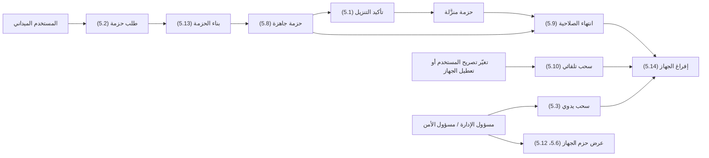
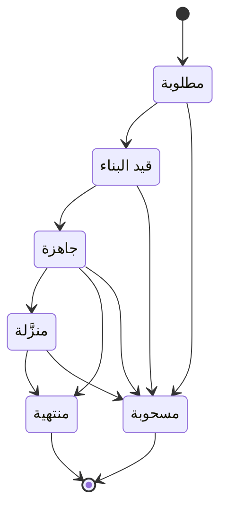

# تحميل بيانات المنطقة مسبقًا

<!-- BEGIN GENERATED: doc -->
| البند | القيمة |
|---|---|
| المعرّف | FEAT-COL-PRELOAD |
| الإصدار | 0.2 |
| الحالة | مسودة |
| القدرة | CAP-02 جمع المعلومات |
| القدرة الفرعية | CAP-02.03 تسجيل الملاحظات (بما فيها دون اتصال) (R1) |
| الأدوار | المستخدم الميداني؛ مسؤول الإدارة؛ مسؤول الأمن؛ النظام |
| الشاشات | SCR-63 الأجهزة، SCR-11 الصورة العملياتية المشتركة (COP) |
| حالات الاستخدام | UC-090، UC-093 |
| القصص | 14: 8 من المواصفة، و6 جديدة |
<!-- END GENERATED: doc -->

## 1. نظرة عامة

### 1.1 القيمة

يتيح للمستخدم الميداني تنزيل بيانات منطقة عمله المصرح بها قبل الخروج لتعمل دون اتصال وتنتهي صلاحيتها تلقائيًا.

### 1.2 النطاق

| البند | القيمة |
|---|---|
| المستخدمون | المستخدم الميداني (يطلب الحزمة وينزّلها ويسحبها)؛ مسؤول الإدارة ومسؤول الأمن (يتابعان حزم الأجهزة ويسحبانها، ويضبطان حدود المستأجر)؛ النظام (يبني الحزمة وينهيها ويسحبها تلقائيًا) |
| الشاشات | SCR-11 الصورة العملياتية المشتركة: اختيار المنطقة وطلب التنزيل؛ SCR-63 الأجهزة: عرض حزم الجهاز وسحبها |
| حالات الاستخدام (بالكلمات) | طلب حزمة بيانات لمنطقة عمل محددة، وتأكيد تنزيلها، وسحبها يدويًا أو تلقائيًا؛ عرض حزم مستخدم أو جهاز للمتابعة؛ ضبط الحدود القصوى للتحميل دون اتصال على مستوى المستأجر |
| المتطلبات (بالكلمات) | تحميل بيانات منطقة العمل مسبقًا بما لا يتجاوز صلاحية المستخدم وقت التنزيل، مع انتهاء الصلاحية بحسب سياسة المستأجر؛ تشفير بيانات الجهاز الميداني ودعم مسحه عن بُعد؛ تنفيذ بناء الحزمة كعملية غير متزامنة |
| خارج النطاق | تسجيل الملاحظات نفسها ورفعها ومزامنتها (ميزة «مهامي» ومزامنة الجهاز)؛ تعريف مخطط التصنيف نفسه أو مستوياته (قدرة الحوكمة والأمن) |

### 1.3 خريطة الميزة

**الشكل 1: مسار حزمة التحميل المسبق**



**الشكل 2: حالات حزمة التحميل المسبق**



> **ملاحظة:** «منتهية» و«مسحوبة» حالتان نهائيتان؛ لا يُقبل بعدهما أي تغيير على الحزمة.

## 2. القواعد المشتركة

تنطبق على كل قصص الميزة، فلا تتكرر داخل القصص. وكل قصة تذكر ما يخصها فقط.

### 2.1 السياق المشترك

كل قصة تبدأ من ثلاثة شروط: مستأجر نشط، وحزمة السياسات الأساسية مفعّلة، ومستخدم مسجّل الدخول ومخوَّل. وتشير إليها القصص بخطوة واحدة: «بفرض السياق المشترك للميزة».

### 2.2 الصلاحية وعدم الإفصاح

- من لا يحق له رؤية العنصر يتلقى ردًا بشكل «غير متاح» تمامًا، فلا يعرف أنه موجود.
- من يرى العنصر ولا يحق له الإجراء يتلقى «لا تملك صلاحية هذا الإجراء».

### 2.3 أوامر تغيير الحالة

- **منع التكرار:** يُرسل كل أمر بمفتاح فريد، فإعادة الطلب نفسه لا تُنفَّذ مرتين.
- **حماية التعديل المتزامن:** يُرسل كل أمر بإصدار البيانات الذي يراه المستخدم. فإن عدّلها غيره في الأثناء، يُرفض الأمر.
- **السجل:** إن نجح الأمر، يُكتب حدثه وسجل التدقيق في المعاملة نفسها.

### 2.4 الرفض المشترك

```gherkin
# language: ar
خاصية: الرفض المشترك لأوامر الميزة

  سيناريو مخطط: رفض مشترك لكل أمر في الميزة
    بفرض السياق المشترك للميزة
    و <الحالة>
    عندما يُرسل المستخدم أي أمر من أوامر الميزة
    اذاً يُرفض برمز <الرمز> ويرى "<الرسالة>"
    و لا يتغير شيء

    امثلة:
      | الحالة                                  | الرمز                  | الرسالة                                                 |
      | العنصر خارج صلاحياته                    | NOT_FOUND              | غير متاح                                                |
      | العنصر مرئي له ولا يحق له الإجراء       | AUTHZ_DENIED           | لا تملك صلاحية هذا الإجراء                              |
      | غيره عدّل العنصر بعد أن فتحه            | VERSION_CONFLICT       | تغيّرت البيانات منذ فتحتها. راجع التغييرات ثم أعد المحاولة |
      | أعاد مفتاح منع التكرار بمحتوى مختلف     | IDEMPOTENCY_KEY_REUSED | طلب مكرر بمحتوى مختلف                                   |
      | البيانات ناقصة أو غير صحيحة             | VALIDATION_FAILED      | بعض البيانات ناقصة أو غير صحيحة. راجع الحقول المعلَّمة      |

  سيناريو: إعادة الطلب نفسه لا تُنفَّذ مرتين
    بفرض السياق المشترك للميزة
    و أمر نجح بمفتاح منع تكرار
    عندما يُعاد الطلب نفسه بالمفتاح نفسه
    اذاً تُعاد النتيجة الأولى ولا يُكتب حدث ثانٍ
```

## 3. الجودة وتعريف الاكتمال

### 3.1 متطلبات الجودة

<!-- BEGIN GENERATED: quality -->
| المرجع | الموقف | المطلوب |
|---|---|---|
| QAS-OFF-002 | user's clearance reduced while device offline | packages revoked and purged on next contact; commands evaluated under current authorization |
| QAS-SEC-007 | obtains a field device | 0 readable records without authentication; wipe on next connection |
<!-- END GENERATED: quality -->

### 3.2 تعريف الاكتمال

القصة مكتملة حين تتحقق الشروط الخمسة:

1. سيناريوهاتها والقواعد المشتركة تمر في الاختبار الآلي.
2. فحوص البنية المعمارية تمر.
3. نصوص الواجهة والرسائل موجودة بالعربية والإنجليزية.
4. مراجعة الكود مكتملة.
5. ما تضيفه القصة نفسها في قسم «القواعد» تحقق.

## 4. فهرس القصص

<!-- BEGIN GENERATED: story-index -->
| المعرّف | القصة | النوع | الحالة |
|---|---|---|---|
| `US-BC07-PKG-CONFIRM-DOWNLOAD` | تأكيد تنزيل حزمة التحميل المسبق | أمر | مسودة |
| `US-BC07-PKG-REQUEST` | طلب حزمة التحميل المسبق | أمر | مسودة |
| `US-BC07-PKG-REVOKE` | سحب حزمة التحميل المسبق | أمر | مسودة |
| `US-DOM-PKG-TENANT-LIMITS` | ضبط حدود حزم التحميل للمستأجر | أمر | مسودة |
| `US-BC07-Q-PKG-GET` | جلب بيان الحزمة وعنوان تنزيلها | جلب | مسودة |
| `US-DOM-PKG-LIST` | عرض حزم مستخدم أو جهاز للمسؤول | جلب | مسودة |
| `US-BC07-S-PRELOAD-PACKAGE-01` | تلقائي: بدء بناء حزمة التحميل المسبق | نظام | مسودة |
| `US-BC07-S-PRELOAD-PACKAGE-02` | تلقائي: اكتمال بناء حزمة التحميل المسبق | نظام | مسودة |
| `US-BC07-S-PRELOAD-PACKAGE-03` | تلقائي: انتهاء صلاحية حزمة التحميل المسبق | نظام | مسودة |
| `US-BC07-S-PRELOAD-PACKAGE-04` | تلقائي: سحب حزم المستخدم عند تغيّر صلاحيته | نظام | مسودة |
| `US-UI-SCR11-PRELOAD-AREA` | اختيار منطقة العمل وتنزيل حزمتها | واجهة | مسودة |
| `US-UI-SCR63-DEVICE-PACKAGES` | عرض حزم الجهاز وسحبها | واجهة | مسودة |
| `US-PLT-PKG-BUILD` | بناء الحزمة بصلاحية المستخدم وقت البناء | منصة | مسودة |
| `US-PLT-PKG-DEVICE-PURGE` | إفراغ الحزم الملغاة والمنتهية من الجهاز | منصة | مسودة |
<!-- END GENERATED: story-index -->

## 5. القصص

### 5.1 US-BC07-PKG-CONFIRM-DOWNLOAD — تأكيد تنزيل حزمة التحميل المسبق

| النوع | الإصدار | الأولوية | دون اتصال | الحالة |
|---|---|---|---|---|
| أمر | R1 | Must | لا | مسودة |

> **كـ** المستخدم الميداني، **أريد** أن أؤكد نجاح تنزيل حزمة التحميل المسبق على جهازي، **حتى** تصبح بياناتها متاحة لي للعمل دون اتصال.

**باختصار:** بعد أن ينزّل الجهاز حزمة «جاهزة» ويتحقق من تطابق بصمة بيانها، يرسل المستخدم التأكيد فتصير الحزمة «منزَّلة».

#### القواعد

- **متى يُسمح:** الحزمة في حالة «جاهزة»، وتحقَّق الجهاز من تطابق بصمة البيان (manifest hash) التي نزّلها.
- **من يُسمح له:** المستخدم الميداني الذي طلب الحزمة، من جهازه.
- **البيانات:** بصمة البيان (manifest_sha256) إلزامية.
- **الأثر:** تصير الحزمة «منزَّلة»، ويُسجَّل حدث «نُزِّلت الحزمة».

#### معايير القبول

```gherkin
# language: ar
خاصية: تأكيد تنزيل حزمة التحميل المسبق

  سيناريو: تأكيد تنزيل حزمة جاهزة
    بفرض السياق المشترك للميزة
    و حزمة "جاهزة" نزّلها جهاز المستخدم وتطابقت بصمة بيانها
    عندما يؤكد المستخدم التنزيل
    اذاً تصبح حالة الحزمة "منزَّلة"
    و يُسجَّل حدث "نُزِّلت الحزمة"

  سيناريو مخطط: رفض خاص بتأكيد التنزيل
    بفرض السياق المشترك للميزة
    و <الحالة>
    عندما يحاول المستخدم تأكيد التنزيل
    اذاً يُرفض برمز <الرمز> ويرى "<الرسالة>"
    و لا يتغير شيء

    امثلة:
      | الحالة                                       | الرمز                                     | الرسالة                                           |
      | بصمة البيان لا تطابق ما نزّله الجهاز         | MANIFEST_MISMATCH                         | لم يؤكد الجهاز استلام الحزمة كاملة                |
      | الحزمة ليست في حالة "جاهزة"                  | PRELOAD_PACKAGE_INVALID_STATE_TRANSITION  | الوضع الحالي لحزمة التحميل المسبق لا يسمح بهذا الإجراء |
```

<details><summary>المراجع التقنية والتتبع</summary>

<!-- BEGIN GENERATED: refs US-BC07-PKG-CONFIRM-DOWNLOAD -->
| البند | المعرّف | المعنى |
|---|---|---|
| الواجهة البرمجية | `POST /api/v1/field/preload-packages/{id}/actions/confirm-download` | — |
| الأمر | `CMD-PKG-CONFIRM-DOWNLOAD` | تأكيد تنزيل حزمة التحميل المسبق |
| السياسة | `POL-PKG-CONFIRM-DOWNLOAD` | field user (request, confirm download, revoke) · Administrator / Security Officer (revoke)؛ tenant match; dev… |
| الحدث | `EVT-PKG-DOWNLOADED` | يصل إلى: Package builder; Sync delta (purge list) |
| الكيان | `AGG-PRELOAD-PACKAGE` | حزمة التحميل المسبق |
| الجدول | `field.preload_packages` | الجدول الرئيسي لحزمة التحميل المسبق |
| وحدة النشر | DU-10 | — |
| المتطلبات | REQ-OFF-002، REQ-OFF-005 | معانيها في القسم 6. التتبع |
| حالات الاستخدام | UC-090، UC-093 | Capture Observation Offline؛ Wipe Lost Device |
| الاختبار | TST-PRELOAD-PACKAGE-SM، TST-SLC11-INVARIANTS | دورة حالات حزمة التحميل المسبق، وثوابت الشريحة SLC-11 |
<!-- END GENERATED: refs US-BC07-PKG-CONFIRM-DOWNLOAD -->

</details>

### 5.2 US-BC07-PKG-REQUEST — طلب حزمة التحميل المسبق

| النوع | الإصدار | الأولوية | دون اتصال | الحالة |
|---|---|---|---|---|
| أمر | R1 | Must | لا | مسودة |

> **كـ** المستخدم الميداني، **أريد** أن أطلب حزمة تحميل مسبق لمنطقة عملي، **حتى** أعمل عليها دون اتصال قبل الخروج.

**باختصار:** يحدد المستخدم الجهاز والمنطقة والطبقات والفترة الزمنية ومستوى التصنيف المطلوب، فتُفتح الحزمة بحالة «مطلوبة» ويبدأ بناؤها.

#### القواعد

- **متى يُسمح:** الجهاز «نشط»؛ مساحة المنطقة المطلوبة لا تتجاوز الحد الأعلى للمستأجر؛ مستوى التصنيف المطلوب لا يتجاوز حد التحميل دون اتصال للمستأجر (افتراضيًا «داخلي»، القصة 5.4).
- **من يُسمح له:** المستخدم الميداني.
- **البيانات:** الجهاز، والمنطقة (مضلع)، والطبقات، والفترة الزمنية، ومستوى التصنيف المطلوب — كلها إلزامية.
- **الأثر:** تُفتح الحزمة بحالة «مطلوبة»، ويُسجَّل حدث «طُلبت الحزمة»، فيبدأ بناؤها (القصة 5.7).

#### معايير القبول

```gherkin
# language: ar
خاصية: طلب حزمة التحميل المسبق

  سيناريو: طلب حزمة لمنطقة عمل ضمن الحدود المسموحة
    بفرض السياق المشترك للميزة
    و جهاز المستخدم "نشط"، ومنطقة طلبه ومستوى التصنيف ضمن حدود المستأجر
    عندما يطلب المستخدم حزمة لمنطقته وطبقاته وفترته
    اذاً تُفتح الحزمة بحالة "مطلوبة"
    و يُسجَّل حدث "طُلبت الحزمة"

  سيناريو مخطط: رفض خاص بطلب الحزمة
    بفرض السياق المشترك للميزة
    و <الحالة>
    عندما يطلب المستخدم حزمة
    اذاً يُرفض برمز <الرمز> ويرى "<الرسالة>"
    و لا يتغير شيء

    امثلة:
      | الحالة                                                  | الرمز              | الرسالة                                               |
      | مساحة المنطقة أو مستوى التصنيف يتجاوز حد المستأجر       | PRELOAD_NOT_ALLOWED | طلب التحميل المسبق يتجاوز المسموح للجهاز أو للجهة     |
      | المنطقة غير محددة                                       | VALIDATION_FAILED   | المنطقة مطلوبة                                        |
```

<details><summary>المراجع التقنية والتتبع</summary>

<!-- BEGIN GENERATED: refs US-BC07-PKG-REQUEST -->
| البند | المعرّف | المعنى |
|---|---|---|
| الواجهة البرمجية | `POST /api/v1/field/preload-packages` | — |
| الأمر | `CMD-PKG-REQUEST` | طلب حزمة التحميل المسبق |
| السياسة | `POL-PKG-REQUEST` | field user (request, confirm download, revoke) · Administrator / Security Officer (revoke)؛ tenant match; dev… |
| الحدث | `EVT-PKG-REQUESTED` | يصل إلى: Package builder; Sync delta (purge list) |
| الكيان | `AGG-PRELOAD-PACKAGE` | حزمة التحميل المسبق |
| الجدول | `field.preload_packages` | الجدول الرئيسي لحزمة التحميل المسبق |
| وحدة النشر | DU-10 | — |
| المتطلبات | REQ-OFF-002، REQ-OFF-005 | معانيها في القسم 6. التتبع |
| حالات الاستخدام | UC-090، UC-093 | Capture Observation Offline؛ Wipe Lost Device |
| الاختبار | TST-PRELOAD-PACKAGE-SM، TST-SLC11-INVARIANTS | دورة حالات حزمة التحميل المسبق، وثوابت الشريحة SLC-11 |
<!-- END GENERATED: refs US-BC07-PKG-REQUEST -->

</details>

### 5.3 US-BC07-PKG-REVOKE — سحب حزمة التحميل المسبق

| النوع | الإصدار | الأولوية | دون اتصال | الحالة |
|---|---|---|---|---|
| أمر | R1 | Must | لا | مسودة |

> **كـ** المستخدم الميداني أو مسؤول الإدارة أو مسؤول الأمن، **أريد** أن أسحب حزمة تحميل مسبق، **حتى** تُمنع قراءة بياناتها على الجهاز إن لم تعد مسموحة.

**باختصار:** يسحب المستخدم حزمته، أو يسحبها مسؤول الإدارة أو مسؤول الأمن لأي حزمة، بذكر السبب، فتصير «مسحوبة».

#### القواعد

- **متى يُسمح:** الحزمة في حالة غير نهائية (مطلوبة، قيد البناء، جاهزة، أو منزَّلة).
- **من يُسمح له:** المستخدم الميداني صاحب الحزمة، أو مسؤول الإدارة، أو مسؤول الأمن.
- **البيانات:** السبب إلزامي.
- **الأثر:** تصير الحزمة «مسحوبة»، ويُسجَّل حدث «سُحبت الحزمة»، فيتلقى الجهاز تعليمة إفراغها عند أول اتصال (القصة 5.14).

#### معايير القبول

```gherkin
# language: ar
خاصية: سحب حزمة التحميل المسبق

  سيناريو: سحب حزمة بسبب
    بفرض السياق المشترك للميزة
    و حزمة في حالة غير نهائية
    عندما يسحبها المستخدم صاحبها أو مسؤول مخوَّل بذكر السبب
    اذاً تصبح حالتها "مسحوبة"
    و يُسجَّل حدث "سُحبت الحزمة"

  سيناريو مخطط: رفض خاص بالسحب
    بفرض السياق المشترك للميزة
    و <الحالة>
    عندما يحاول سحب الحزمة
    اذاً يُرفض برمز <الرمز> ويرى "<الرسالة>"
    و لا يتغير شيء

    امثلة:
      | الحالة                           | الرمز                                     | الرسالة                                           |
      | السبب غير مذكور                  | REASON_REQUIRED                           | اذكر السبب                                         |
      | الحزمة "منتهية" أو "مسحوبة" أصلًا | PRELOAD_PACKAGE_INVALID_STATE_TRANSITION  | الوضع الحالي لحزمة التحميل المسبق لا يسمح بهذا الإجراء |
```

<details><summary>المراجع التقنية والتتبع</summary>

<!-- BEGIN GENERATED: refs US-BC07-PKG-REVOKE -->
| البند | المعرّف | المعنى |
|---|---|---|
| الواجهة البرمجية | `POST /api/v1/field/preload-packages/{id}/actions/revoke` | — |
| الأمر | `CMD-PKG-REVOKE` | سحب حزمة التحميل المسبق |
| السياسة | `POL-PKG-REVOKE` | field user (request, confirm download, revoke) · Administrator / Security Officer (revoke)؛ tenant match; dev… |
| الحدث | `EVT-PKG-REVOKED` | يصل إلى: Package builder; Sync delta (purge list) |
| الكيان | `AGG-PRELOAD-PACKAGE` | حزمة التحميل المسبق |
| الجدول | `field.preload_packages` | الجدول الرئيسي لحزمة التحميل المسبق |
| وحدة النشر | DU-10 | — |
| المتطلبات | REQ-OFF-002، REQ-OFF-005 | معانيها في القسم 6. التتبع |
| حالات الاستخدام | UC-090، UC-093 | Capture Observation Offline؛ Wipe Lost Device |
| الاختبار | TST-PRELOAD-PACKAGE-SM، TST-SLC11-INVARIANTS | دورة حالات حزمة التحميل المسبق، وثوابت الشريحة SLC-11 |
<!-- END GENERATED: refs US-BC07-PKG-REVOKE -->

</details>

### 5.4 US-DOM-PKG-TENANT-LIMITS — ضبط حدود حزم التحميل للمستأجر

| النوع | الإصدار | الأولوية | دون اتصال | الحالة |
|---|---|---|---|---|
| أمر | R1 | Must | لا | مسودة |

> **كـ** مسؤول الأمن (ولمسؤول الإدارة دور في حد المساحة)، **أريد** أن أضبط حد التصنيف المسموح للتحميل دون اتصال والمساحة القصوى لمنطقة الحزمة على مستوى المستأجر، **حتى** لا تتجاوز حزم التحميل المسبق ما تسمح به سياسة المستأجر. **[Derived]**

**باختصار:** يضبط مسؤول الأمن أعلى مستوى تصنيف يُسمح بتحميله دون اتصال (افتراضيًا «داخلي»)، ويضبط مسؤول الإدارة أقصى مساحة لمضلع الحزمة؛ وتُستخدم القيمتان في فحص كل طلب حزمة (القصة 5.2). **[Derived]**

#### القواعد

- **متى يُسمح:** لا يرتبط بحالة عنصر؛ هو ضبط إعداد على مستوى المستأجر.
- **من يُسمح له:** مسؤول الأمن لحد التصنيف، ومسؤول الإدارة لحد المساحة. **[Derived]**
- **البيانات:** حد التصنيف (قيمة من مخطط التصنيف المعتمد للمستأجر)، والمساحة القصوى لمضلع الحزمة.
- **الأثر:** تُحفظ القيمتان في سياسة المستأجر للتحميل دون اتصال، وتطبَّق على كل طلب حزمة تالٍ.

> **تنبيه:** المصدر لا يذكر أمرًا أو واجهة صريحة لضبط هاتين القيمتين، بل يذكرهما كشرط يُفحص عند طلب الحزمة. هذه القصة مستنتجة بالكامل وتحتاج تأكيد المالك لمكانها الصحيح (قد تكون ضمن إعدادات المستأجر في قدرة الحوكمة بدل هذه الميزة).

#### معايير القبول

```gherkin
# language: ar
خاصية: ضبط حدود التحميل المسبق للمستأجر

  سيناريو: ضبط حد التصنيف دون اتصال
    بفرض السياق المشترك للميزة
    و مستوى تصنيف معرَّف في مخطط التصنيف المعتمد
    عندما يضبط مسؤول الأمن حد التحميل دون اتصال إلى هذا المستوى
    اذاً يُحفظ الحد الجديد
    و يُطبَّق على طلبات الحزم التالية فقط

  سيناريو مخطط: رفض خاص بضبط الحدود
    بفرض السياق المشترك للميزة
    و <الحالة>
    عندما يحاول ضبط الحد
    اذاً يُرفض برمز <الرمز> ويرى "<الرسالة>"
    و لا يتغير شيء

    امثلة:
      | الحالة                                        | الرمز              | الرسالة          |
      | المستوى المطلوب غير معرَّف في مخطط التصنيف    | VALIDATION_FAILED  | المستوى غير صحيح |
```

<details><summary>المراجع التقنية والتتبع</summary>

<!-- BEGIN GENERATED: refs US-DOM-PKG-TENANT-LIMITS -->
| البند | المعرّف | المعنى |
|---|---|---|
| المصدر | `AGG-PRELOAD-PACKAGE` | — |
| المصدر | `POL-OFFLINE-PRELOAD` | — |
| المصدر | `[Derived]` | — |
| المتطلب | REQ-OFF-002 | The system shall let field users preload authorized area-of-interest data, which shall respect the user's aut… |
| حالة الاستخدام | UC-090 | Capture Observation Offline |
<!-- END GENERATED: refs US-DOM-PKG-TENANT-LIMITS -->

</details>

### 5.5 US-BC07-Q-PKG-GET — جلب بيان الحزمة وعنوان تنزيلها

| النوع | الإصدار | الأولوية | دون اتصال | الحالة |
|---|---|---|---|---|
| جلب | R1 | Must | لا | مسودة |

> **كـ** المستخدم الميداني، **أريد** أن أحصل على بيان حزمتي وعنوان تنزيلها الموقَّع، **حتى** ينزّل جهازي بياناتها.

**باختصار:** يعيد الاستعلام بيان الحزمة (العناصر وبصماتها وتصنيفاتها وتاريخ انتهائها) وعنوان تنزيل موقَّع صالح 5 دقائق على الأكثر، بعد إعادة فحص صلاحية صاحب الحزمة.

#### القواعد

- **من يُسمح له:** صاحب الحزمة من جهازه الذي طلبها فقط؛ غيره يتلقى «غير متاح».

#### معايير القبول

```gherkin
# language: ar
خاصية: جلب بيان الحزمة وعنوان تنزيلها

  سيناريو: صاحب الحزمة يجلب بيانها
    بفرض السياق المشترك للميزة
    و حزمة يملكها المستخدم من الجهاز نفسه الذي طلبها
    عندما يطلب بيان الحزمة
    اذاً يُعاد البيان مع عنوان تنزيل موقَّع صالح 5 دقائق على الأكثر، بعد إعادة فحص صلاحيته
```

<details><summary>المراجع التقنية والتتبع</summary>

<!-- BEGIN GENERATED: refs US-BC07-Q-PKG-GET -->
| البند | المعرّف | المعنى |
|---|---|---|
| الواجهة البرمجية | `GET /api/v1/field/preload-packages/{package_id}` | — |
| الاستعلام | `QRY-PKG-GET` | Package manifest and download target (signed, ≤ 5 min) |
| السياسة | `POL-PKG-GET` | package owner device + user |
| الكيان | `AGG-PRELOAD-PACKAGE` | حزمة التحميل المسبق |
| الجدول | `field.preload_packages` | الجدول الرئيسي لحزمة التحميل المسبق |
| وحدة النشر | DU-10 | — |
| المتطلب | REQ-OFF-002 | The system shall let field users preload authorized area-of-interest data, which shall respect the user's aut… |
| حالة الاستخدام | UC-090 | Capture Observation Offline |
| الاختبار | TST-PRELOAD-PACKAGE-SM، TST-SLC11-INVARIANTS | دورة حالات حزمة التحميل المسبق، وثوابت الشريحة SLC-11 |
<!-- END GENERATED: refs US-BC07-Q-PKG-GET -->

</details>

### 5.6 US-DOM-PKG-LIST — عرض حزم مستخدم أو جهاز للمسؤول

| النوع | الإصدار | الأولوية | دون اتصال | الحالة |
|---|---|---|---|---|
| جلب | R1 | Must | لا | مسودة |

> **كـ** مسؤول الإدارة أو مسؤول الأمن، **أريد** أن أرى حزم تحميل مسبق لمستخدم أو جهاز معيَّن، **حتى** أتابعها وأسحب ما يلزم منها عند الحاجة. **[Derived]**

**باختصار:** تعرض القائمة حزم المستخدم أو الجهاز المختار، بحالتها وتاريخ انتهائها، لتمكين السحب من القصة 5.3. **[Derived]**

#### القواعد

- **من يُسمح له:** مسؤول الإدارة ومسؤول الأمن، لحزم مستأجرهم فقط.
- **المرشحات:** المستخدم أو الجهاز، والحالة.

#### معايير القبول

```gherkin
# language: ar
خاصية: عرض حزم مستخدم أو جهاز

  سيناريو: المسؤول يعرض حزم جهاز
    بفرض السياق المشترك للميزة
    و لجهاز حزم بحالات مختلفة
    عندما يطلب المسؤول حزم هذا الجهاز
    اذاً تُعاد حزمه مع حالة كل منها وتاريخ انتهائها
```

<details><summary>المراجع التقنية والتتبع</summary>

<!-- BEGIN GENERATED: refs US-DOM-PKG-LIST -->
| البند | المعرّف | المعنى |
|---|---|---|
| المصدر | `AGG-PRELOAD-PACKAGE` | — |
| المصدر | `CMD-PKG-REVOKE` | — |
| المصدر | `[Derived]` | — |
| المتطلب | REQ-OFF-002 | The system shall let field users preload authorized area-of-interest data, which shall respect the user's aut… |
| حالة الاستخدام | UC-090 | Capture Observation Offline |
<!-- END GENERATED: refs US-DOM-PKG-LIST -->

</details>

### 5.7 US-BC07-S-PRELOAD-PACKAGE-01 — تلقائي: بدء بناء حزمة التحميل المسبق

| النوع | الإصدار | الأولوية | دون اتصال | الحالة |
|---|---|---|---|---|
| نظام | R1 | Must | لا ينطبق | مسودة |

> **كـ** النظام، **أريد** أن أبدأ بناء الحزمة حين يأخذها عامل البناء، **حتى** تتاح بياناتها للتنزيل.

**باختصار:** يأخذ عامل بناء (worker) حزمة «مطلوبة» فتصير «قيد البناء»، دون تدخل المستخدم.

#### القواعد

- **متى يحدث:** حين يأخذ عامل بناء متاح حزمة في حالة «مطلوبة».
- **الأثر:** تصير الحزمة «قيد البناء»، ويُسجَّل حدث «بدأ بناء الحزمة» وسجل تدقيق بهوية النظام.

#### معايير القبول

```gherkin
# language: ar
خاصية: بدء بناء حزمة التحميل المسبق

  سيناريو: عامل البناء يأخذ حزمة مطلوبة
    بفرض حزمة في حالة "مطلوبة"
    عندما يبدأ عامل البناء معالجتها
    اذاً تصبح حالتها "قيد البناء"
    و يُسجَّل حدث "بدأ بناء الحزمة" وسجل تدقيق بهوية النظام

  سيناريو: لا عامل متاح فلا يتغير شيء
    بفرض حزمة في حالة "مطلوبة" ولا عامل بناء متاح لها الآن
    عندما يحين وقت فحص طابور البناء
    اذاً تبقى حالتها "مطلوبة"
    و لا يتغير شيء
```

<details><summary>المراجع التقنية والتتبع</summary>

<!-- BEGIN GENERATED: refs US-BC07-S-PRELOAD-PACKAGE-01 -->
| البند | المعرّف | المعنى |
|---|---|---|
| المحفِّز | `SYS:build started` | worker |
| الانتقال | REQUESTED ← BUILDING | — |
| الحدث | `EVT-PKG-BUILDING` | يصل إلى: Package builder; Sync delta (purge list) |
| الكيان | `AGG-PRELOAD-PACKAGE` | حزمة التحميل المسبق |
| الجدول | `field.preload_packages` | الجدول الرئيسي لحزمة التحميل المسبق |
| وحدة النشر | DU-10 | — |
| المتطلبات | REQ-OFF-002، REQ-OFF-005 | معانيها في القسم 6. التتبع |
| حالات الاستخدام | UC-090، UC-093 | Capture Observation Offline؛ Wipe Lost Device |
| الاختبار | TST-PRELOAD-PACKAGE-SM، TST-SLC11-INVARIANTS | دورة حالات حزمة التحميل المسبق، وثوابت الشريحة SLC-11 |
<!-- END GENERATED: refs US-BC07-S-PRELOAD-PACKAGE-01 -->

</details>

### 5.8 US-BC07-S-PRELOAD-PACKAGE-02 — تلقائي: اكتمال بناء حزمة التحميل المسبق

| النوع | الإصدار | الأولوية | دون اتصال | الحالة |
|---|---|---|---|---|
| نظام | R1 | Must | لا ينطبق | مسودة |

> **كـ** النظام، **أريد** أن أنهي بناء الحزمة بصلاحية المستخدم في لحظة البناء، **حتى** لا تحمل الحزمة بيانات لا يحق له رؤيتها.

**باختصار:** يكتمل البناء فتضم الحزمة العناصر المرئية للمستخدم وقت البناء وبحدود المستوى المطلوب فقط، ضمن بيان يحمل البصمات والتصنيفات، بتاريخ انتهاء لا يتجاوز 72 ساعة في هذا الإصدار، فتصبح «جاهزة».

#### القواعد

- **متى يحدث:** حين تنتهي مهمة البناء من حساب محتوى الحزمة.
- **الأثر:** تصير الحزمة «جاهزة» ببيان يحمل العناصر والبصمات والتصنيفات وتاريخ انتهاء لا يتجاوز 72 ساعة، ويُسجَّل حدث «جهزت الحزمة» وسجل تدقيق بهوية النظام.

#### معايير القبول

```gherkin
# language: ar
خاصية: اكتمال بناء حزمة التحميل المسبق

  سيناريو: اكتمال البناء بصلاحية المستخدم وقت البناء
    بفرض حزمة في حالة "قيد البناء"
    عندما يكتمل البناء محسوبًا بالعناصر المرئية للمستخدم وقت البناء فقط
    اذاً تصبح حالتها "جاهزة"
    و يحمل بيانها تاريخ انتهاء لا يتجاوز 72 ساعة
    و يُسجَّل حدث "جهزت الحزمة" وسجل تدقيق بهوية النظام

  سيناريو: البناء لم يكتمل فلا يتغير شيء
    بفرض حزمة في حالة "قيد البناء" لم يكتمل بناؤها بعد
    عندما يحين وقت فحص حالة البناء
    اذاً تبقى حالتها "قيد البناء"
    و لا يتغير شيء
```

<details><summary>المراجع التقنية والتتبع</summary>

<!-- BEGIN GENERATED: refs US-BC07-S-PRELOAD-PACKAGE-02 -->
| البند | المعرّف | المعنى |
|---|---|---|
| المحفِّز | `SYS:build finished` | content = objects visible to the user at build time and ≤ requested level; manifest with hashes, labels, secu… |
| الانتقال | BUILDING ← READY | — |
| الحدث | `EVT-PKG-READY` | يصل إلى: Package builder; Sync delta (purge list) |
| الكيان | `AGG-PRELOAD-PACKAGE` | حزمة التحميل المسبق |
| الجدول | `field.preload_packages` | الجدول الرئيسي لحزمة التحميل المسبق |
| وحدة النشر | DU-10 | — |
| المتطلبات | REQ-OFF-002، REQ-OFF-005 | معانيها في القسم 6. التتبع |
| حالات الاستخدام | UC-090، UC-093 | Capture Observation Offline؛ Wipe Lost Device |
| الاختبار | TST-PRELOAD-PACKAGE-SM، TST-SLC11-INVARIANTS | دورة حالات حزمة التحميل المسبق، وثوابت الشريحة SLC-11 |
<!-- END GENERATED: refs US-BC07-S-PRELOAD-PACKAGE-02 -->

</details>

### 5.9 US-BC07-S-PRELOAD-PACKAGE-03 — تلقائي: انتهاء صلاحية حزمة التحميل المسبق

| النوع | الإصدار | الأولوية | دون اتصال | الحالة |
|---|---|---|---|---|
| نظام | R1 | Must | لا ينطبق | مسودة |

> **كـ** النظام، **أريد** أن أنهي صلاحية الحزمة عند موعدها، **حتى** لا تُقرأ بيانات قديمة على الجهاز.

**باختصار:** تنتهي صلاحية الحزمة «جاهزة» أو «منزَّلة» عند موعدها تلقائيًا؛ يمسحها الجهاز محليًا فور بلوغ الموعد ويؤكد المسح عند أول اتصال تالٍ.

#### القواعد

- **متى يحدث:** حين يبلغ تاريخ انتهاء حزمة «جاهزة» أو «منزَّلة».
- **الأثر:** تصير الحزمة «منتهية»، ويُسجَّل حدث «انتهت الحزمة» وسجل تدقيق بهوية النظام؛ ويمسحها الجهاز محليًا دون انتظار اتصال (القصة 5.14).

#### معايير القبول

```gherkin
# language: ar
خاصية: انتهاء صلاحية حزمة التحميل المسبق

  سيناريو: بلوغ موعد الانتهاء
    بفرض حزمة "جاهزة" أو "منزَّلة" بلغت موعد انتهائها
    عندما يحين الموعد
    اذاً تصبح حالتها "منتهية"
    و يُسجَّل حدث "انتهت الحزمة" وسجل تدقيق بهوية النظام

  سيناريو: لم يبلغ الموعد بعد فلا يتغير شيء
    بفرض حزمة "جاهزة" أو "منزَّلة" لم تبلغ موعد انتهائها
    عندما يحين وقت فحص الانتهاء
    اذاً تبقى حالتها كما هي
    و لا يتغير شيء
```

<details><summary>المراجع التقنية والتتبع</summary>

<!-- BEGIN GENERATED: refs US-BC07-S-PRELOAD-PACKAGE-03 -->
| البند | المعرّف | المعنى |
|---|---|---|
| المحفِّز | `SYS:expires_at reached` | device purges at expiry (local enforcement) and confirms on next contact |
| الانتقال | READY, DOWNLOADED ← EXPIRED | — |
| الحدث | `EVT-PKG-EXPIRED` | يصل إلى: Package builder; Sync delta (purge list) |
| الكيان | `AGG-PRELOAD-PACKAGE` | حزمة التحميل المسبق |
| الجدول | `field.preload_packages` | الجدول الرئيسي لحزمة التحميل المسبق |
| وحدة النشر | DU-10 | — |
| المتطلبات | REQ-OFF-002، REQ-OFF-005 | معانيها في القسم 6. التتبع |
| حالات الاستخدام | UC-090، UC-093 | Capture Observation Offline؛ Wipe Lost Device |
| الاختبار | TST-PRELOAD-PACKAGE-SM، TST-SLC11-INVARIANTS | دورة حالات حزمة التحميل المسبق، وثوابت الشريحة SLC-11 |
<!-- END GENERATED: refs US-BC07-S-PRELOAD-PACKAGE-03 -->

</details>

### 5.10 US-BC07-S-PRELOAD-PACKAGE-04 — تلقائي: سحب حزم المستخدم عند تغيّر صلاحيته

| النوع | الإصدار | الأولوية | دون اتصال | الحالة |
|---|---|---|---|---|
| نظام | R1 | Must | لا ينطبق | مسودة |

> **كـ** النظام، **أريد** أن أسحب حزم المستخدم تلقائيًا إذا تغيّر تصريحه الأمني أو صار جهازه غير نشط، **حتى** لا تبقى بيانات متاحة له بعد فقدان الصلاحية.

**باختصار:** يتغيّر تصريح المستخدم الأمني أو يصير جهازه غير نشط، فتُسحب كل حزمه غير النهائية تلقائيًا، وتصل للجهاز تعليمة إفراغها عند أول اتصال.

#### القواعد

- **متى يحدث:** حين يتغيّر تصريح المستخدم الأمني، أو يصير جهازه غير «نشط».
- **الأثر:** تصير كل حزم المستخدم غير النهائية «مسحوبة»، ويُسجَّل حدث «سُحبت الحزمة» وسجل تدقيق بهوية النظام لكل منها؛ ويتلقى الجهاز تعليمة إفراغها عند أول اتصال (القصة 5.14).

#### معايير القبول

```gherkin
# language: ar
خاصية: سحب حزم المستخدم تلقائيًا عند تغيّر صلاحيته

  سيناريو: تغيّر تصريح المستخدم أو تعطيل جهازه
    بفرض حزمة في حالة غير نهائية لمستخدم تغيّر تصريحه الأمني، أو لجهاز صار غير نشط
    عندما يُكتشف التغيير
    اذاً تصبح حالة الحزمة "مسحوبة"
    و يُسجَّل حدث "سُحبت الحزمة" وسجل تدقيق بهوية النظام

  سيناريو: لا تغيّر فلا يتغير شيء
    بفرض حزمة في حالة غير نهائية لمستخدم لم يتغيّر تصريحه، وجهاز لا يزال نشطًا
    عندما يحين وقت الفحص
    اذاً تبقى حالة الحزمة كما هي
    و لا يتغير شيء
```

<details><summary>المراجع التقنية والتتبع</summary>

<!-- BEGIN GENERATED: refs US-BC07-S-PRELOAD-PACKAGE-04 -->
| البند | المعرّف | المعنى |
|---|---|---|
| المحفِّز | `SYS:user security_version changed or device not ACTIVE` | purge instruction on next contact |
| الانتقال | REQUESTED, BUILDING, READY, DOWNLOADED ← REVOKED | — |
| الحدث | `EVT-PKG-REVOKED` | يصل إلى: Package builder; Sync delta (purge list) |
| الكيان | `AGG-PRELOAD-PACKAGE` | حزمة التحميل المسبق |
| الجدول | `field.preload_packages` | الجدول الرئيسي لحزمة التحميل المسبق |
| وحدة النشر | DU-10 | — |
| المتطلبات | REQ-OFF-002، REQ-OFF-005 | معانيها في القسم 6. التتبع |
| حالات الاستخدام | UC-090، UC-093 | Capture Observation Offline؛ Wipe Lost Device |
| الاختبار | TST-PRELOAD-PACKAGE-SM، TST-SLC11-INVARIANTS | دورة حالات حزمة التحميل المسبق، وثوابت الشريحة SLC-11 |
<!-- END GENERATED: refs US-BC07-S-PRELOAD-PACKAGE-04 -->

</details>

### 5.11 US-UI-SCR11-PRELOAD-AREA — اختيار منطقة العمل وتنزيل حزمتها

| النوع | الإصدار | الأولوية | دون اتصال | الحالة |
|---|---|---|---|---|
| واجهة | R1 | Must | لا | مسودة |

> **كـ** المستخدم الميداني، **أريد** أن أختار منطقة عملي من شاشة الصورة العملياتية المشتركة وأطلب تنزيل حزمتها، **حتى** أجهّز العمل دون اتصال قبل الخروج.

**باختصار:** من شاشة الصورة العملياتية المشتركة يرسم المستخدم حدود منطقته ويحدد الطبقات والفترة، فيُرسل طلب حزمة (القصة 5.2)، ويرى حالتها حتى تصير جاهزة للتنزيل (القصة 5.1).

#### معايير القبول

```gherkin
# language: ar
خاصية: اختيار منطقة العمل وتنزيل حزمتها

  سيناريو: طلب حزمة لمنطقة مرسومة على الخريطة
    بفرض السياق المشترك للميزة
    و المستخدم فتح شاشة الصورة العملياتية المشتركة
    عندما يرسم منطقته ويختار الطبقات والفترة ويطلب التنزيل
    اذاً يُرسل طلب الحزمة بهذه البيانات
    و تظهر للمستخدم حالة الحزمة حتى تصير "جاهزة" فيمكنه تأكيد تنزيلها

  سيناريو: المنطقة أو المستوى يتجاوز حد المستأجر
    بفرض السياق المشترك للميزة
    و المستخدم رسم منطقة أو اختار مستوى تصنيف يتجاوز حد المستأجر
    عندما يطلب التنزيل
    اذاً يُرفض الطلب برمز PRELOAD_NOT_ALLOWED ويرى "طلب التحميل المسبق يتجاوز المسموح للجهاز أو للجهة"
```

<details><summary>المراجع التقنية والتتبع</summary>

<!-- BEGIN GENERATED: refs US-UI-SCR11-PRELOAD-AREA -->
| البند | المعرّف | المعنى |
|---|---|---|
| الشاشة | SCR-11 | شاشة الصورة العملياتية المشتركة (COP) |
| المصدر | `21-ui-design.md §8.1` | — |
| المصدر | `AGG-PRELOAD-PACKAGE` | — |
| المصدر | `[Derived]` | — |
| المتطلب | REQ-OFF-002 | The system shall let field users preload authorized area-of-interest data, which shall respect the user's aut… |
| حالة الاستخدام | UC-090 | Capture Observation Offline |
<!-- END GENERATED: refs US-UI-SCR11-PRELOAD-AREA -->

</details>

### 5.12 US-UI-SCR63-DEVICE-PACKAGES — عرض حزم الجهاز وسحبها

| النوع | الإصدار | الأولوية | دون اتصال | الحالة |
|---|---|---|---|---|
| واجهة | R1 | Should | لا | مسودة |

> **كـ** مسؤول الإدارة أو مسؤول الأمن، **أريد** أن أرى حزم جهاز معيَّن من شاشة الأجهزة وأسحب ما يلزم منها، **حتى** أتحكم في البيانات المحمَّلة على الأجهزة الميدانية.

**باختصار:** من شاشة الأجهزة يرى المسؤول حزم الجهاز المختار وحالاتها (القصة 5.6)، ويسحب أيها بذكر سبب (القصة 5.3).

#### معايير القبول

```gherkin
# language: ar
خاصية: عرض حزم الجهاز وسحبها

  سيناريو: عرض حزم جهاز وسحب واحدة منها
    بفرض السياق المشترك للميزة
    و المسؤول فتح شاشة الأجهزة واختار جهازًا له حزم في حالات مختلفة
    عندما يسحب حزمة منها بذكر السبب
    اذاً تصبح حالتها "مسحوبة"
    و تُحدَّث قائمة حزم الجهاز
```

<details><summary>المراجع التقنية والتتبع</summary>

<!-- BEGIN GENERATED: refs US-UI-SCR63-DEVICE-PACKAGES -->
| البند | المعرّف | المعنى |
|---|---|---|
| الشاشة | SCR-63 | شاشة الأجهزة |
| المصدر | `US-BC07-PKG-REVOKE` | — |
| الجودة | QAS-OFF-002 | user's clearance reduced while device offline → packages revoked and purged on next contact; commands evaluat… |
| المصدر | `[Derived]` | — |
<!-- END GENERATED: refs US-UI-SCR63-DEVICE-PACKAGES -->

</details>

### 5.13 US-PLT-PKG-BUILD — بناء الحزمة بصلاحية المستخدم وقت البناء

| النوع | الإصدار | الأولوية | دون اتصال | الحالة |
|---|---|---|---|---|
| منصة | R1 | Must | لا ينطبق | مسودة |

> **كـ** فريق المنصة، **أريد** أن يُبنى محتوى الحزمة كمهمة غير متزامنة ومحسوبة بصلاحية المستخدم في لحظة البناء فقط، **حتى** لا تحمل الحزمة بيانات لا يحق له رؤيتها ولا يُحمَّل الخادم بعملية ثقيلة متزامنة.

**باختصار:** يعمل بناء الحزمة كمهمة خلفية تقرأ الطبقات المتجهية والنقطية من البلاطات التشغيلية وتحسب العناصر المرئية للمستخدم فقط عند لحظة البناء، فيبقى البيان ثابتًا حتى بعد تغيّر صلاحياته لاحقًا (يُسحب بدل أن يُعاد بناؤه، القصة 5.10).

#### القواعد

- **الأثر:** بيان الحزمة لقطة ثابتة من العناصر المرئية للمستخدم ومستوى التصنيف المطلوب وقت البناء، لا تُعاد حسابها بعد ذلك.

#### معايير القبول

```gherkin
# language: ar
خاصية: بناء الحزمة بصلاحية المستخدم وقت البناء

  سيناريو: بناء غير متزامن محدود بصلاحية لحظة البناء
    بفرض حزمة "قيد البناء" لمستخدم له صلاحية معيّنة في هذه اللحظة
    عندما تعمل مهمة البناء في الخلفية
    اذاً يضم بيان الحزمة العناصر المرئية لهذه الصلاحية فقط، ولا يتجاوز مستوى التصنيف المطلوب
    و لا يُنفَّذ البناء داخل طلب متزامن من الخادم
```

<details><summary>المراجع التقنية والتتبع</summary>

<!-- BEGIN GENERATED: refs US-PLT-PKG-BUILD -->
| البند | المعرّف | المعنى |
|---|---|---|
| المصدر | `THR-S11-06` | — |
| القرار التقني | TD-10 | Dynamic operational vector tiles from PostGIS (ST_AsMVT) via Martin tile server with scope-keyed cache; base… |
| المتطلبات | REQ-OFF-002، REQ-PLT-005 | معانيها في القسم 6. التتبع |
| حالة الاستخدام | UC-090 | Capture Observation Offline |
<!-- END GENERATED: refs US-PLT-PKG-BUILD -->

</details>

### 5.14 US-PLT-PKG-DEVICE-PURGE — إفراغ الحزم الملغاة والمنتهية من الجهاز

| النوع | الإصدار | الأولوية | دون اتصال | الحالة |
|---|---|---|---|---|
| منصة | R1 | Must | لا ينطبق | مسودة |

> **كـ** فريق المنصة، **أريد** أن يُفرغ الجهاز الحزم «المسحوبة» أو «المنتهية» من مخزنه المحلي فور استلام التعليمة أو بلوغ الموعد، **حتى** لا تُقرأ بيانات لم تعد مسموحة.

**باختصار:** الجهاز يطبّق الإفراغ محليًا فورًا دون انتظار اتصال (تنفيذ محلي عند الانتهاء أو استلام التعليمة)، ويؤكد الإفراغ للخادم عند أول اتصال تالٍ.

#### القواعد

- **الأثر:** البيانات المحلية للحزمة المسحوبة أو المنتهية تصير غير قابلة للقراءة فورًا على الجهاز، بصرف النظر عن توفر الاتصال.

#### معايير القبول

```gherkin
# language: ar
خاصية: إفراغ الحزم الملغاة والمنتهية من الجهاز

  سيناريو: إفراغ فوري محلي وتأكيد عند الاتصال
    بفرض حزمة "مسحوبة" أو "منتهية" على جهاز
    عندما يعالج الجهاز حالتها، متصلًا أو غير متصل
    اذاً يُفرغ محتواها من المخزن المحلي فورًا
    و يؤكد الجهاز الإفراغ للخادم عند أول اتصال تالٍ
```

<details><summary>المراجع التقنية والتتبع</summary>

<!-- BEGIN GENERATED: refs US-PLT-PKG-DEVICE-PURGE -->
| البند | المعرّف | المعنى |
|---|---|---|
| الجودة | QAS-OFF-002 | user's clearance reduced while device offline → packages revoked and purged on next contact; commands evaluat… |
| المصدر | `field-sync-protocol.md §4` | — |
| المتطلب | REQ-OFF-002 | The system shall let field users preload authorized area-of-interest data, which shall respect the user's aut… |
| حالة الاستخدام | UC-090 | Capture Observation Offline |
<!-- END GENERATED: refs US-PLT-PKG-DEVICE-PURGE -->

</details>

## 6. التتبع

<!-- BEGIN GENERATED: trace -->
| المتطلب | المعنى | القصص | الاختبار |
|---|---|---|---|
| REQ-OFF-002 | The system shall let field users preload authorized area-of-interest data, which shall respect the user's aut… | `US-BC07-PKG-CONFIRM-DOWNLOAD`، `US-BC07-PKG-REQUEST`، `US-BC07-PKG-REVOKE`، `US-BC07-Q-PKG-GET`، `US-BC07-S-PRELOAD-PACKAGE-01`، `US-BC07-S-PRELOAD-PACKAGE-02`، `US-BC07-S-PRELOAD-PACKAGE-03`، `US-BC07-S-PRELOAD-PACKAGE-04`، `US-DOM-PKG-LIST`، `US-DOM-PKG-TENANT-LIMITS`، `US-PLT-PKG-BUILD`، `US-PLT-PKG-DEVICE-PURGE`، `US-UI-SCR11-PRELOAD-AREA` | TST-PRELOAD-PACKAGE-SM، TST-SLC11-INVARIANTS |
| REQ-OFF-005 | The system shall encrypt all data stored on field devices and shall support remote wipe of a lost device. | كل قصص الأوامر والنظام في الميزة (7) | TST-DEVICE-SM، TST-PRELOAD-PACKAGE-SM، TST-SLC11-INVARIANTS |
| REQ-PLT-005 | The system shall run heavy operations (raster processing, bulk import, analysis runs, reconstruction, report… | `US-PLT-PKG-BUILD` | — |
<!-- END GENERATED: trace -->

## 7. سجل التغييرات

| الإصدار | التاريخ | التغيير |
|---|---|---|
| 0.1 | — | هيكل مولَّد من خريطة الميزات |
| 0.2 | 2026-10-03 | كتابة القصص كاملة بمعيار القصص |
