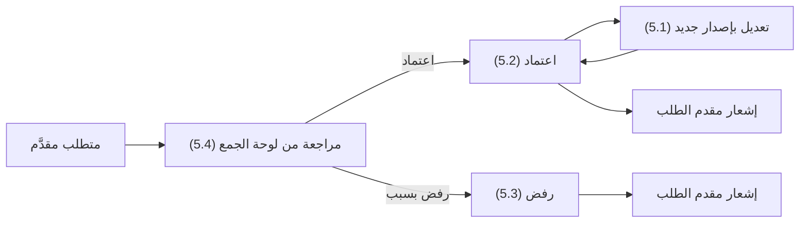
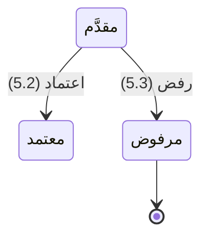

# اعتماد متطلبات الجمع

<!-- BEGIN GENERATED: doc -->
| البند | القيمة |
|---|---|
| المعرّف | FEAT-COL-REQ-APPROVAL |
| الإصدار | 0.1 |
| الحالة | مسودة |
| القدرة | CAP-02 جمع المعلومات |
| القدرة الفرعية | CAP-02.01 الحاجة المعلوماتية وتخطيط الجمع (R2) |
| الأدوار | مدير الجمع |
| الشاشات | SCR-13 لوحة الجمع، SCR-06 قوائم المراجعة |
| حالات الاستخدام | UC-120 |
| القصص | 4: 3 من المواصفة، و1 جديدة |
<!-- END GENERATED: doc -->

## 1. نظرة عامة

### 1.1 القيمة

يتيح لمدير الجمع أن يقبل أو يرفض أو يعدل طلبات المعلومات قبل توجيه جهد الجمع إليها.

### 1.2 النطاق

| البند | القيمة |
|---|---|
| المستخدمون | مدير الجمع (يعتمد ويرفض ويعدّل)؛ مقدم الطلب (المحلل أو أي طالب، يرى نتيجة طلبه عبر الإشعار فقط) |
| الشاشات | SCR-13 لوحة الجمع: قائمة المراجعة واتخاذ القرار؛ SCR-06 قوائم المراجعة (النمط المشترك للقائمة) |
| حالات الاستخدام (بالكلمات) | مراجعة متطلب جمع مقدَّم واعتماده لتوجيه جهد الجمع إليه، أو رفضه بسبب (تكرار أو خروج عن النطاق أو تعذّر التنفيذ)، أو تعديل متطلب معتمد بتمديد موعده أو تغيير منطقته أو عناصر معلوماته |
| المتطلبات (بالكلمات) | تسجيل الحاجة المعلوماتية كمتطلب جمع بسؤاله ومنطقته ونافذته الزمنية وأولويته وطالبه وموعده؛ تحديث حالة استيفاء المتطلب عند التحقق من الملاحظات التي تجيب عنه |
| خارج النطاق | إعداد مسودة المتطلب وتقديمه وإلغاؤه (ميزة أخرى في القدرة نفسها)؛ تخطيط أنشطة الجمع وإسناد مهامها بعد الاعتماد (CAP-02.02)؛ تحديث حالة الاستيفاء تلقائيًا عند تحقق الملاحظات (قصة نظام في ميزة أخرى) |

### 1.3 خريطة الميزة

**الشكل 1: مسار مراجعة متطلب الجمع**



**الشكل 2: حالات متطلب الجمع في هذه الميزة**



> **ملاحظة:** «مرفوض» حالة نهائية. والمتطلب «المعتمد» يبقى معتمدًا بعد التعديل (القصة 5.1)، إذ يزيد التعديل الإصدار دون تغيير الحالة. والحالات «مسودة» و«مكتمل» و«ملغى» و«منتهٍ» تخص ميزات أخرى من دورة حياة متطلب الجمع.

## 2. القواعد المشتركة

تنطبق على كل قصص الميزة، فلا تتكرر داخل القصص. وكل قصة تذكر ما يخصها فقط.

### 2.1 السياق المشترك

كل قصة تبدأ من ثلاثة شروط: مستأجر نشط، وحزمة السياسات الأساسية مفعّلة، ومستخدم مسجّل الدخول ومخوَّل. وتشير إليها القصص بخطوة واحدة: «بفرض السياق المشترك للميزة».

### 2.2 الصلاحية وعدم الإفصاح

- من لا يحق له رؤية العنصر يتلقى ردًا بشكل «غير متاح» تمامًا، فلا يعرف أنه موجود.
- من يرى العنصر ولا يحق له الإجراء يتلقى «لا تملك صلاحية هذا الإجراء».

### 2.3 أوامر تغيير الحالة

- **منع التكرار:** يُرسل كل أمر بمفتاح فريد، فإعادة الطلب نفسه لا تُنفَّذ مرتين.
- **حماية التعديل المتزامن:** يُرسل كل أمر بإصدار البيانات الذي يراه المستخدم. فإن عدّلها غيره في الأثناء، يُرفض الأمر.
- **السجل:** إن نجح الأمر، يُكتب حدثه وسجل التدقيق في المعاملة نفسها.

### 2.4 الرفض المشترك

```gherkin
# language: ar
خاصية: الرفض المشترك لأوامر الميزة

  سيناريو مخطط: رفض مشترك لكل أمر في الميزة
    بفرض السياق المشترك للميزة
    و <الحالة>
    عندما يُرسل المستخدم أي أمر من أوامر الميزة
    اذاً يُرفض برمز <الرمز> ويرى "<الرسالة>"
    و لا يتغير شيء

    امثلة:
      | الحالة                                  | الرمز                  | الرسالة                                                 |
      | العنصر خارج صلاحياته                    | NOT_FOUND              | غير متاح                                                |
      | العنصر مرئي له ولا يحق له الإجراء       | AUTHZ_DENIED           | لا تملك صلاحية هذا الإجراء                              |
      | غيره عدّل العنصر بعد أن فتحه            | VERSION_CONFLICT       | تغيّرت البيانات منذ فتحتها. راجع التغييرات ثم أعد المحاولة |
      | أعاد مفتاح منع التكرار بمحتوى مختلف     | IDEMPOTENCY_KEY_REUSED | طلب مكرر بمحتوى مختلف                                   |
      | البيانات ناقصة أو غير صحيحة             | VALIDATION_FAILED      | بعض البيانات ناقصة أو غير صحيحة. راجع الحقول المعلَّمة      |

  سيناريو: إعادة الطلب نفسه لا تُنفَّذ مرتين
    بفرض السياق المشترك للميزة
    و أمر نجح بمفتاح منع تكرار
    عندما يُعاد الطلب نفسه بالمفتاح نفسه
    اذاً تُعاد النتيجة الأولى ولا يُكتب حدث ثانٍ
```

## 3. الجودة وتعريف الاكتمال

### 3.1 متطلبات الجودة

<!-- BEGIN GENERATED: quality -->
لا متطلبات جودة مرتبطة بمتطلبات هذه الميزة مباشرة. تنطبق متطلبات المنصة العامة (`FEAT-PLT-*`).
<!-- END GENERATED: quality -->

### 3.2 تعريف الاكتمال

القصة مكتملة حين تتحقق الشروط الخمسة:

1. سيناريوهاتها والقواعد المشتركة تمر في الاختبار الآلي.
2. فحوص البنية المعمارية تمر.
3. نصوص الواجهة والرسائل موجودة بالعربية والإنجليزية.
4. مراجعة الكود مكتملة.
5. ما تضيفه القصة نفسها في قسم «القواعد» تحقق.

## 4. فهرس القصص

<!-- BEGIN GENERATED: story-index -->
| المعرّف | القصة | النوع | الحالة |
|---|---|---|---|
| `US-BC02-CRQ-AMEND` | تعديل متطلب الجمع بإصدار جديد | أمر | مسودة |
| `US-BC02-CRQ-APPROVE` | اعتماد متطلب الجمع | أمر | مسودة |
| `US-BC02-CRQ-REJECT` | رفض متطلب الجمع | أمر | مسودة |
| `US-UI-SCR13-CRQ-REVIEW` | مراجعة الطلبات المقدمة واعتمادها أو رفضها | واجهة | مسودة |
<!-- END GENERATED: story-index -->

## 5. القصص

### 5.1 US-BC02-CRQ-AMEND — تعديل متطلب الجمع بإصدار جديد

| النوع | الإصدار | الأولوية | دون اتصال | الحالة |
|---|---|---|---|---|
| أمر | R2 | Must | لا | مسودة |

> **كـ** مدير الجمع، **أريد** أن أعدّل متطلب جمع معتمدًا بتمديد موعده أو تعديل منطقته أو عناصر معلوماته الأساسية، **حتى** يبقى موجَّهًا لحاجة الجمع الفعلية دون فتح متطلب جديد.

**باختصار:** يعدّل مدير الجمع متطلبًا معتمدًا بذكر السبب، فيُحفظ التعديل بإصدار جديد دون تغيير حالته.

#### القواعد

- **متى يُسمح:** المتطلب في حالة «معتمد».
- **من يُسمح له:** مدير الجمع الذي له سلطة على نطاق المتطلب.
- **البيانات:** السبب إلزامي؛ الموعد أو المنطقة أو عناصر المعلومات الأساسية تُعدَّل اختياريًا.
- **الأثر:** يبقى المتطلب «معتمدًا»، ويزداد إصداره واحدًا، ويُسجَّل حدث «عُدِّل متطلب الجمع» يصل إلى محرك المطابقة ولوحة الجمع وفهرس البحث وإشعار مقدم الطلب.

#### معايير القبول

```gherkin
# language: ar
خاصية: تعديل متطلب الجمع بإصدار جديد

  سيناريو: تعديل متطلب معتمد
    بفرض السياق المشترك للميزة
    و متطلب جمع في حالة "معتمد"
    عندما يعدّل مدير الجمع موعده أو منطقته أو عناصر معلوماته بذكر السبب
    اذاً يبقى المتطلب في حالة "معتمد"
    و يزداد إصداره واحدًا
    و يُسجَّل حدث "عُدِّل متطلب الجمع"

  سيناريو مخطط: رفض خاص بالتعديل
    بفرض السياق المشترك للميزة
    و <الحالة>
    عندما يحاول مدير الجمع التعديل
    اذاً يُرفض برمز <الرمز> ويرى "<الرسالة>"
    و لا يتغير شيء

    امثلة:
      | الحالة                         | الرمز                                            | الرسالة                                                       |
      | المتطلب ليس في حالة "معتمد"   | COLLECTION_REQUIREMENT_INVALID_STATE_TRANSITION  | الوضع الحالي لمتطلب الجمع لا يسمح بهذا الإجراء               |
      | السبب غير مذكور               | VALIDATION_FAILED                                | السبب مطلوب                                                   |
```

<details><summary>المراجع التقنية والتتبع</summary>

<!-- BEGIN GENERATED: refs US-BC02-CRQ-AMEND -->
| البند | المعرّف | المعنى |
|---|---|---|
| الواجهة البرمجية | `POST /api/v1/information/collection-requirements/{id}/actions/amend` | — |
| الأمر | `CMD-CRQ-AMEND` | تعديل متطلب الجمع بإصدار جديد |
| السياسة | `POL-CRQ-AMEND` | Analyst / any requester (draft, edit, submit, satisfy, cancel) · collection manager (approve, reject, amend)؛… |
| الحدث | `EVT-CRQ-AMENDED` | يصل إلى: Matching engine (reload EEIs); Collection board; Search projection (SLC-05); Notification (requester) |
| الكيان | `AGG-COLLECTION-REQUIREMENT` | متطلب الجمع |
| الجدول | `information.collection_requirements` | الجدول الرئيسي لمتطلب الجمع |
| وحدة النشر | DU-04 | — |
| المتطلبات | REQ-COL-001، REQ-COL-003 | معانيها في القسم 6. التتبع |
| حالة الاستخدام | UC-120 | Define Collection Requirement |
| الاختبار | TST-COLLECTION-REQUIREMENT-SM، TST-SLC14-INVARIANTS | دورة حالات متطلب الجمع، وثوابت الشريحة SLC-14 |
<!-- END GENERATED: refs US-BC02-CRQ-AMEND -->

</details>

### 5.2 US-BC02-CRQ-APPROVE — اعتماد متطلب الجمع

| النوع | الإصدار | الأولوية | دون اتصال | الحالة |
|---|---|---|---|---|
| أمر | R2 | Must | لا | مسودة |

> **كـ** مدير الجمع، **أريد** أن أعتمد متطلب جمع مقدَّمًا، **حتى** يوجَّه جهد الجمع إليه.

**باختصار:** يعتمد مدير الجمع متطلبًا «مقدَّمًا» ضمن نطاق سلطته، على ألا يكون هو نفسه من قدّمه، فيصير «معتمدًا».

#### القواعد

- **متى يُسمح:** المتطلب في حالة «مقدَّم».
- **من يُسمح له:** مدير الجمع الذي له سلطة على نطاق المتطلب، ولا يجوز أن يكون معتمِده طالبه نفسه (فصل المهام).
- **البيانات:** ملاحظة اختيارية.
- **الأثر:** يصير المتطلب «معتمدًا»، ويُسجَّل حدث «اعتُمد متطلب الجمع» يصل إلى محرك المطابقة ولوحة الجمع وفهرس البحث وإشعار مقدم الطلب.

#### معايير القبول

```gherkin
# language: ar
خاصية: اعتماد متطلب الجمع

  سيناريو: اعتماد متطلب مقدَّم
    بفرض السياق المشترك للميزة
    و متطلب جمع في حالة "مقدَّم"، ومدير الجمع ليس طالبه
    عندما يعتمده مدير الجمع
    اذاً يصبح المتطلب في حالة "معتمد"
    و يُسجَّل حدث "اعتُمد متطلب الجمع"

  سيناريو مخطط: رفض خاص بالاعتماد
    بفرض السياق المشترك للميزة
    و <الحالة>
    عندما يحاول مدير الجمع الاعتماد
    اذاً يُرفض برمز <الرمز> ويرى "<الرسالة>"
    و لا يتغير شيء

    امثلة:
      | الحالة                                   | الرمز                                            | الرسالة                                                 |
      | المتطلب ليس في حالة "مقدَّم"             | COLLECTION_REQUIREMENT_INVALID_STATE_TRANSITION  | الوضع الحالي لمتطلب الجمع لا يسمح بهذا الإجراء          |
      | المعتمِد هو طالب المتطلب نفسه            | SEGREGATION_OF_DUTIES                            | لا يجوز أن يعتمد الشخص نفسه ما قدّمه أو طلبه            |
```

<details><summary>المراجع التقنية والتتبع</summary>

<!-- BEGIN GENERATED: refs US-BC02-CRQ-APPROVE -->
| البند | المعرّف | المعنى |
|---|---|---|
| الواجهة البرمجية | `POST /api/v1/information/collection-requirements/{id}/actions/approve` | — |
| الأمر | `CMD-CRQ-APPROVE` | اعتماد متطلب الجمع |
| السياسة | `POL-CRQ-APPROVE` | Analyst / any requester (draft, edit, submit, satisfy, cancel) · collection manager (approve, reject, amend)؛… |
| الحدث | `EVT-CRQ-APPROVED` | يصل إلى: Matching engine (reload EEIs); Collection board; Search projection (SLC-05); Notification (requester) |
| الكيان | `AGG-COLLECTION-REQUIREMENT` | متطلب الجمع |
| الجدول | `information.collection_requirements` | الجدول الرئيسي لمتطلب الجمع |
| وحدة النشر | DU-04 | — |
| المتطلبات | REQ-COL-001، REQ-COL-003 | معانيها في القسم 6. التتبع |
| حالة الاستخدام | UC-120 | Define Collection Requirement |
| الاختبار | TST-COLLECTION-REQUIREMENT-SM، TST-SLC14-INVARIANTS | دورة حالات متطلب الجمع، وثوابت الشريحة SLC-14 |
<!-- END GENERATED: refs US-BC02-CRQ-APPROVE -->

</details>

### 5.3 US-BC02-CRQ-REJECT — رفض متطلب الجمع

| النوع | الإصدار | الأولوية | دون اتصال | الحالة |
|---|---|---|---|---|
| أمر | R2 | Must | لا | مسودة |

> **كـ** مدير الجمع، **أريد** أن أرفض متطلب جمع مقدَّمًا بسبب، **حتى** لا يوجَّه جهد الجمع إلى ما هو مكرر أو خارج النطاق أو متعذّر التنفيذ.

**باختصار:** يرفض مدير الجمع متطلبًا «مقدَّمًا» بذكر السبب، فيصير «مرفوضًا» في حالة نهائية.

#### القواعد

- **متى يُسمح:** المتطلب في حالة «مقدَّم».
- **من يُسمح له:** مدير الجمع الذي له سلطة على نطاق المتطلب.
- **البيانات:** السبب إلزامي (تكرار، أو خروج عن النطاق، أو تعذّر التنفيذ).
- **الأثر:** يصير المتطلب «مرفوضًا» (حالة نهائية)، ويُسجَّل حدث «رُفض متطلب الجمع» يصل إلى لوحة الجمع وإشعار مقدم الطلب.

#### معايير القبول

```gherkin
# language: ar
خاصية: رفض متطلب الجمع

  سيناريو: رفض متطلب مقدَّم بسبب
    بفرض السياق المشترك للميزة
    و متطلب جمع في حالة "مقدَّم"
    عندما يرفضه مدير الجمع بذكر السبب
    اذاً يصبح المتطلب في حالة "مرفوض"
    و يُسجَّل حدث "رُفض متطلب الجمع"

  سيناريو مخطط: رفض خاص بالرفض
    بفرض السياق المشترك للميزة
    و <الحالة>
    عندما يحاول مدير الجمع الرفض
    اذاً يُرفض برمز <الرمز> ويرى "<الرسالة>"
    و لا يتغير شيء

    امثلة:
      | الحالة                         | الرمز                                            | الرسالة                                                 |
      | المتطلب ليس في حالة "مقدَّم"   | COLLECTION_REQUIREMENT_INVALID_STATE_TRANSITION  | الوضع الحالي لمتطلب الجمع لا يسمح بهذا الإجراء          |
      | السبب غير مذكور               | VALIDATION_FAILED                                | السبب مطلوب                                              |
```

<details><summary>المراجع التقنية والتتبع</summary>

<!-- BEGIN GENERATED: refs US-BC02-CRQ-REJECT -->
| البند | المعرّف | المعنى |
|---|---|---|
| الواجهة البرمجية | `POST /api/v1/information/collection-requirements/{id}/actions/reject` | — |
| الأمر | `CMD-CRQ-REJECT` | رفض متطلب الجمع |
| السياسة | `POL-CRQ-REJECT` | Analyst / any requester (draft, edit, submit, satisfy, cancel) · collection manager (approve, reject, amend)؛… |
| الحدث | `EVT-CRQ-REJECTED` | يصل إلى: Matching engine (reload EEIs); Collection board; Search projection (SLC-05); Notification (requester) |
| الكيان | `AGG-COLLECTION-REQUIREMENT` | متطلب الجمع |
| الجدول | `information.collection_requirements` | الجدول الرئيسي لمتطلب الجمع |
| وحدة النشر | DU-04 | — |
| المتطلبات | REQ-COL-001، REQ-COL-003 | معانيها في القسم 6. التتبع |
| حالة الاستخدام | UC-120 | Define Collection Requirement |
| الاختبار | TST-COLLECTION-REQUIREMENT-SM، TST-SLC14-INVARIANTS | دورة حالات متطلب الجمع، وثوابت الشريحة SLC-14 |
<!-- END GENERATED: refs US-BC02-CRQ-REJECT -->

</details>

### 5.4 US-UI-SCR13-CRQ-REVIEW — مراجعة الطلبات المقدمة واعتمادها أو رفضها

| النوع | الإصدار | الأولوية | دون اتصال | الحالة |
|---|---|---|---|---|
| واجهة | R2 | Should | لا | مسودة |

> **كـ** مدير الجمع، **أريد** أن أراجع متطلبات الجمع المقدَّمة من لوحة الجمع وأعتمدها أو أرفضها أو أعدّلها من مكان واحد، **حتى** أحسم كل طلب دون التنقل بين شاشات.

**باختصار:** تعرض لوحة الجمع متطلبات الجمع المقدَّمة بنمط قائمة المراجعة المشترك، وتظهر أفعال الاعتماد والرفض والتعديل حسب صلاحية المستخدم وحالة المتطلب المعروضة (القصص 5.1–5.3). **[Derived]**

#### معايير القبول

```gherkin
# language: ar
خاصية: مراجعة الطلبات المقدمة من لوحة الجمع

  سيناريو: عرض متطلب مقدَّم وأفعاله المتاحة
    بفرض السياق المشترك للميزة
    و متطلب جمع في حالة "مقدَّم" يملك مدير الجمع سلطة عليه
    عندما يفتح مدير الجمع لوحة الجمع
    اذاً يرى المتطلب مع فعلي الاعتماد والرفض
    و يحسم أحدهما من الشاشة نفسها دون فتح شاشة أخرى
```

> **ملاحظة:** الأفعال المعروضة تلميح فقط؛ القرار النهائي من الخادم عند تنفيذ الأمر (`21-ui-design.md` §6.3)، فقد يظهر فعل الاعتماد لمدير قدّم الطلب نفسه ثم يُرفض بـ`SEGREGATION_OF_DUTIES` (القصة 5.2).

<details><summary>المراجع التقنية والتتبع</summary>

<!-- BEGIN GENERATED: refs US-UI-SCR13-CRQ-REVIEW -->
| البند | المعرّف | المعنى |
|---|---|---|
| الشاشة | SCR-13 | شاشة لوحة الجمع |
| المصدر | `21-ui-design.md §6.3` | — |
| حالة الاستخدام | UC-120 | Define Collection Requirement |
| المصدر | `[Derived]` | — |
<!-- END GENERATED: refs US-UI-SCR13-CRQ-REVIEW -->

</details>

## 6. التتبع

<!-- BEGIN GENERATED: trace -->
| المتطلب | المعنى | القصص | الاختبار |
|---|---|---|---|
| REQ-COL-001 | The system shall record information needs as collection requirements with question, area, time window, priori… | كل قصص الميزة المأخوذة من المواصفة (3) | TST-COLLECTION-REQUIREMENT-SM، TST-SLC14-INVARIANTS |
| REQ-COL-003 | When observations answering a collection requirement are validated, the system shall update the requirement's… | كل قصص الميزة المأخوذة من المواصفة (3) | TST-COLLECTION-REQUIREMENT-SM، TST-SLC14-INVARIANTS |
<!-- END GENERATED: trace -->

## 7. سجل التغييرات

| الإصدار | التاريخ | التغيير |
|---|---|---|
| 0.1 | — | هيكل مولَّد من خريطة الميزات |
| 0.2 | 2026-10-03 | كتابة القصص كاملة بمعيار القصص |
