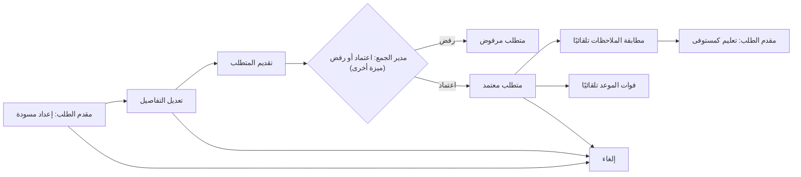
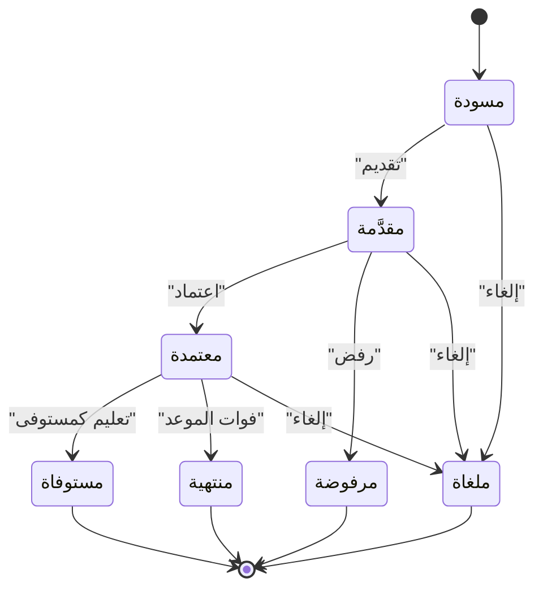

# طلب حاجة معلوماتية

<!-- BEGIN GENERATED: doc -->
| البند | القيمة |
|---|---|
| المعرّف | FEAT-COL-REQ-REQUEST |
| الإصدار | 0.1 |
| الحالة | مسودة |
| القدرة | CAP-02 جمع المعلومات |
| القدرة الفرعية | CAP-02.01 الحاجة المعلوماتية وتخطيط الجمع (R2) |
| الأدوار | المحلل؛ مقدم الطلب |
| الشاشات | SCR-13 لوحة الجمع |
| حالات الاستخدام | UC-120، UC-122 |
| القصص | 8: 6 من المواصفة، و2 جديدة |
<!-- END GENERATED: doc -->

## 1. نظرة عامة

### 1.1 القيمة

يتيح للمحلل أن يصوغ سؤاله المعلوماتي ومنطقته وموعده ويقدمه للجمع ثم يتابعه حتى يستوفى أو يلغى.

### 1.2 النطاق

| البند | القيمة |
|---|---|
| المستخدمون | مقدم الطلب (محلل يحتاج معلومة)؛ مدير الجمع يرى تقدم ما اعتمده فقط (اعتماده خارج هذه الميزة) |
| الشاشات | SCR-13 لوحة الجمع |
| حالات الاستخدام | تحديد الحاجة المعلوماتية (UC-120)؛ تتبع استيفاء المتطلب (UC-122) |
| المتطلبات | تسجيل الحاجة المعلوماتية كمتطلب جمع بسؤال ومنطقة ونافذة زمنية وأولوية وعناصر معلومات أساسية وموعد (REQ-COL-001)؛ تحديث حالة الاستيفاء تلقائيًا عند اعتماد الملاحظات المجيبة (REQ-COL-003) |
| خارج النطاق | اعتماد متطلب الجمع أو رفضه أو تعديله بإصدار جديد من مدير الجمع، وتخطيط أنشطة الجمع وربطها بالمهام الميدانية (REQ-COL-002) — ميزات أخرى |

### 1.3 خريطة الميزة

**الشكل 1: مسار متطلب الجمع من الفكرة إلى الاستيفاء**



كل قصص هذه الميزة تنفذ المربعات A وB وC وH وJ. والمربعات D وF وI من ميزة أخرى أو من النظام، وتُذكر هنا للسياق فقط.

**الشكل 2: دورة حالات متطلب الجمع**



## 2. القواعد المشتركة

تنطبق على كل قصص الميزة، فلا تتكرر داخل القصص. وكل قصة تذكر ما يخصها فقط.

### 2.1 السياق المشترك

كل قصة تبدأ من ثلاثة شروط: مستأجر نشط، وحزمة السياسات الأساسية مفعّلة، ومستخدم مسجّل الدخول ومخوَّل. وتشير إليها القصص بخطوة واحدة: «بفرض السياق المشترك للميزة».

### 2.2 الصلاحية وعدم الإفصاح

- من لا يحق له رؤية العنصر يتلقى ردًا بشكل «غير متاح» تمامًا، فلا يعرف أنه موجود.
- من يرى العنصر ولا يحق له الإجراء يتلقى «لا تملك صلاحية هذا الإجراء».

### 2.3 أوامر تغيير الحالة

- **منع التكرار:** يُرسل كل أمر بمفتاح فريد، فإعادة الطلب نفسه لا تُنفَّذ مرتين.
- **حماية التعديل المتزامن:** يُرسل كل أمر بإصدار البيانات الذي يراه المستخدم. فإن عدّلها غيره في الأثناء، يُرفض الأمر.
- **السجل:** إن نجح الأمر، يُكتب حدثه وسجل التدقيق في المعاملة نفسها.

### 2.4 الرفض المشترك

```gherkin
# language: ar
خاصية: الرفض المشترك لأوامر الميزة

  سيناريو مخطط: رفض مشترك لكل أمر في الميزة
    بفرض السياق المشترك للميزة
    و <الحالة>
    عندما يُرسل المستخدم أي أمر من أوامر الميزة
    اذاً يُرفض برمز <الرمز> ويرى "<الرسالة>"
    و لا يتغير شيء

    امثلة:
      | الحالة                                  | الرمز                  | الرسالة                                                 |
      | العنصر خارج صلاحياته                    | NOT_FOUND              | غير متاح                                                |
      | العنصر مرئي له ولا يحق له الإجراء       | AUTHZ_DENIED           | لا تملك صلاحية هذا الإجراء                              |
      | غيره عدّل العنصر بعد أن فتحه            | VERSION_CONFLICT       | تغيّرت البيانات منذ فتحتها. راجع التغييرات ثم أعد المحاولة |
      | أعاد مفتاح منع التكرار بمحتوى مختلف     | IDEMPOTENCY_KEY_REUSED | طلب مكرر بمحتوى مختلف                                   |
      | البيانات ناقصة أو غير صحيحة             | VALIDATION_FAILED      | بعض البيانات ناقصة أو غير صحيحة. راجع الحقول المعلَّمة      |

  سيناريو: إعادة الطلب نفسه لا تُنفَّذ مرتين
    بفرض السياق المشترك للميزة
    و أمر نجح بمفتاح منع تكرار
    عندما يُعاد الطلب نفسه بالمفتاح نفسه
    اذاً تُعاد النتيجة الأولى ولا يُكتب حدث ثانٍ
```

## 3. الجودة وتعريف الاكتمال

### 3.1 متطلبات الجودة

<!-- BEGIN GENERATED: quality -->
لا متطلبات جودة مرتبطة بمتطلبات هذه الميزة مباشرة. تنطبق متطلبات المنصة العامة (`FEAT-PLT-*`).
<!-- END GENERATED: quality -->

### 3.2 تعريف الاكتمال

القصة مكتملة حين تتحقق الشروط الخمسة:

1. سيناريوهاتها والقواعد المشتركة تمر في الاختبار الآلي.
2. فحوص البنية المعمارية تمر.
3. نصوص الواجهة والرسائل موجودة بالعربية والإنجليزية.
4. مراجعة الكود مكتملة.
5. ما تضيفه القصة نفسها في قسم «القواعد» تحقق.

## 4. فهرس القصص

<!-- BEGIN GENERATED: story-index -->
| المعرّف | القصة | النوع | الحالة |
|---|---|---|---|
| `US-BC02-CRQ-CANCEL` | إلغاء متطلب الجمع | أمر | مسودة |
| `US-BC02-CRQ-DRAFT` | إعداد مسودة متطلب الجمع | أمر | مسودة |
| `US-BC02-CRQ-EDIT` | تعديل متطلب الجمع | أمر | مسودة |
| `US-BC02-CRQ-MARK-SATISFIED` | تعليم متطلب الجمع كمستوفى | أمر | مسودة |
| `US-BC02-CRQ-SUBMIT` | تقديم متطلب الجمع | أمر | مسودة |
| `US-BC02-Q-CRQ-GET` | جلب: Requirement with EEIs and fulfilment computed over observations visible to the caller | جلب | مسودة |
| `US-UI-SCR13-CRQ-FORM` | صياغة طلب الجمع برسم المنطقة وعناصر المعلومات | واجهة | مسودة |
| `US-UI-SCR13-MY-REQUESTS` | متابعة مقدم الطلب لطلباته وحالة استيفائها | واجهة | مسودة |
<!-- END GENERATED: story-index -->

## 5. القصص

### 5.1 US-BC02-CRQ-CANCEL — إلغاء متطلب الجمع

| النوع | الإصدار | الأولوية | دون اتصال | الحالة |
|---|---|---|---|---|
| أمر | R2 | Must | لا | مسودة |

> **كـ** مقدم الطلب، **أريد** إلغاء متطلب الجمع إن لم تعد حاجتي المعلوماتية قائمة، **حتى** لا يبقى مفتوحًا بلا غرض.

**باختصار:** يلغي مقدم الطلب، أو مدير الجمع الذي اعتمده، متطلب الجمع بسبب، في أي حالة غير نهائية، فتصير حالته «ملغاة».

#### القواعد

- **متى يُسمح:** المتطلب في حالة «مسودة» أو «مقدَّمة» أو «معتمدة»، مع ذكر سبب الإلغاء.
- **من يُسمح له:** مقدم الطلب، أو مدير الجمع الذي اعتمده.
- **البيانات:** سبب الإلغاء (إلزامي).
- **الأثر:** تصبح حالة المتطلب «ملغاة»، ويُسجَّل حدث «أُلغي متطلب الجمع».

#### معايير القبول

```gherkin
# language: ar
خاصية: إلغاء متطلب الجمع

  سيناريو: مقدم الطلب يلغي متطلبًا لم تعد له حاجة
    بفرض السياق المشترك للميزة
    و متطلب جمع لمقدم الطلب في حالة "مسودة" أو "مقدَّمة" أو "معتمدة"
    عندما يلغيه بسبب
    اذاً تصبح حالته "ملغاة"
    و يُسجَّل حدث "أُلغي متطلب الجمع"

  سيناريو مخطط: رفض خاص بإلغاء متطلب الجمع
    بفرض السياق المشترك للميزة
    و <الحالة>
    عندما يحاول إلغاء المتطلب
    اذاً يُرفض برمز <الرمز> ويرى <الرسالة>
    و لا يتغير شيء

    امثلة:
      | الحالة                                           | الرمز                                             | الرسالة                                       |
      | المتطلب في حالة نهائية (مستوفاة أو منتهية أو مرفوضة أو ملغاة) | COLLECTION_REQUIREMENT_INVALID_STATE_TRANSITION | الوضع الحالي لمتطلب الجمع لا يسمح بهذا الإجراء |
      | لم يُذكر سبب الإلغاء                             | REASON_REQUIRED                                   | اذكر السبب                                    |
```

<details><summary>المراجع التقنية والتتبع</summary>

<!-- BEGIN GENERATED: refs US-BC02-CRQ-CANCEL -->
| البند | المعرّف | المعنى |
|---|---|---|
| الواجهة البرمجية | `POST /api/v1/information/collection-requirements/{id}/actions/cancel` | — |
| الأمر | `CMD-CRQ-CANCEL` | إلغاء متطلب الجمع |
| السياسة | `POL-CRQ-CANCEL` | Analyst / any requester (draft, edit, submit, satisfy, cancel) · collection manager (approve, reject, amend)؛… |
| الحدث | `EVT-CRQ-CANCELLED` | يصل إلى: Matching engine (reload EEIs); Collection board; Search projection (SLC-05); Notification (requester) |
| الكيان | `AGG-COLLECTION-REQUIREMENT` | متطلب الجمع |
| الجدول | `information.collection_requirements` | الجدول الرئيسي لمتطلب الجمع |
| وحدة النشر | DU-04 | — |
| المتطلبات | REQ-COL-001، REQ-COL-003 | معانيها في القسم 6. التتبع |
| حالات الاستخدام | UC-120، UC-122 | Define Collection Requirement؛ Track Requirement Fulfilment |
| الاختبار | TST-COLLECTION-REQUIREMENT-SM، TST-SLC14-INVARIANTS | دورة حالات متطلب الجمع، وثوابت الشريحة SLC-14 |
<!-- END GENERATED: refs US-BC02-CRQ-CANCEL -->

</details>

### 5.2 US-BC02-CRQ-DRAFT — إعداد مسودة متطلب الجمع

| النوع | الإصدار | الأولوية | دون اتصال | الحالة |
|---|---|---|---|---|
| أمر | R2 | Must | لا | مسودة |

> **كـ** مقدم الطلب، **أريد** أن أبدأ متطلب جمع بسؤالي المعلوماتي ومُعرِّفه، **حتى** أصوغ حاجتي قبل تحديد تفاصيلها كاملة.

**باختصار:** يسجل مقدم الطلب سؤاله المعلوماتي والمُعرِّف (التصنيف) الذي يحكم رؤية المتطلب، فيبدأ متطلب الجمع بحالة «مسودة» يُستكمل بعدها بالمنطقة والنافذة والأولوية وعناصر المعلومات الأساسية.

#### القواعد

- **متى يُسمح:** يبدأ متطلب جمع جديد؛ يلزم السؤال المعلوماتي والمُعرِّف.
- **من يُسمح له:** مقدم الطلب (أي محلل يطلب حاجة معلوماتية).
- **البيانات:** السؤال المعلوماتي (إلزامي)، المُعرِّف (إلزامي). تُضاف المنطقة والنافذة والأولوية وعناصر المعلومات الأساسية بالتعديل (القصة 5.3).
- **الأثر:** يُسجَّل متطلب الجمع بحالة «مسودة»، ويُسجَّل حدث «أُعدت مسودة متطلب الجمع».

#### معايير القبول

```gherkin
# language: ar
خاصية: إعداد مسودة متطلب الجمع

  سيناريو: مقدم الطلب يعد مسودة بسؤاله
    بفرض السياق المشترك للميزة
    عندما يسجل مقدم الطلب سؤاله المعلوماتي ومُعرِّفه
    اذاً يُنشأ متطلب الجمع بحالة "مسودة"
    و يُسجَّل حدث "أُعدت مسودة متطلب الجمع"

  سيناريو مخطط: رفض خاص بإعداد المسودة
    بفرض السياق المشترك للميزة
    و <الحالة>
    عندما يحاول إعداد المسودة
    اذاً يُرفض برمز <الرمز> ويرى <الرسالة>
    و لا يتغير شيء

    امثلة:
      | الحالة                           | الرمز              | الرسالة            |
      | السؤال المعلوماتي غير مذكور      | VALIDATION_FAILED  | السؤال المعلوماتي مطلوب |
      | المُعرِّف غير مذكور               | VALIDATION_FAILED  | المُعرِّف مطلوب        |
```

<details><summary>المراجع التقنية والتتبع</summary>

<!-- BEGIN GENERATED: refs US-BC02-CRQ-DRAFT -->
| البند | المعرّف | المعنى |
|---|---|---|
| الواجهة البرمجية | `POST /api/v1/information/collection-requirements` | — |
| الأمر | `CMD-CRQ-DRAFT` | إعداد مسودة متطلب الجمع |
| السياسة | `POL-CRQ-DRAFT` | Analyst / any requester (draft, edit, submit, satisfy, cancel) · collection manager (approve, reject, amend)؛… |
| الحدث | `EVT-CRQ-DRAFTED` | يصل إلى: Matching engine (reload EEIs); Collection board; Search projection (SLC-05); Notification (requester) |
| الكيان | `AGG-COLLECTION-REQUIREMENT` | متطلب الجمع |
| الجدول | `information.collection_requirements` | الجدول الرئيسي لمتطلب الجمع |
| وحدة النشر | DU-04 | — |
| المتطلبات | REQ-COL-001، REQ-COL-003 | معانيها في القسم 6. التتبع |
| حالات الاستخدام | UC-120، UC-122 | Define Collection Requirement؛ Track Requirement Fulfilment |
| الاختبار | TST-COLLECTION-REQUIREMENT-SM، TST-SLC14-INVARIANTS | دورة حالات متطلب الجمع، وثوابت الشريحة SLC-14 |
<!-- END GENERATED: refs US-BC02-CRQ-DRAFT -->

</details>

### 5.3 US-BC02-CRQ-EDIT — تعديل متطلب الجمع في مسودته

| النوع | الإصدار | الأولوية | دون اتصال | الحالة |
|---|---|---|---|---|
| أمر | R2 | Must | لا | مسودة |

> **كـ** مقدم الطلب، **أريد** أن أحدِّد منطقة متطلبي ونافذته الزمنية وأولويته وعناصر معلوماته الأساسية، **حتى** أكمله قبل تقديمه.

**باختصار:** بينما المتطلب في حالة «مسودة»، يحدّث مقدم الطلب المنطقة والنافذة الزمنية والأولوية وعناصر المعلومات الأساسية، فيرتفع إصداره دون تغيير حالته.

#### القواعد

- **متى يُسمح:** المتطلب في حالة «مسودة» فقط.
- **من يُسمح له:** مقدم الطلب.
- **البيانات:** المنطقة (رسم أو حدود)، والنافذة الزمنية، والأولوية (من 1 إلى 5)، والموعد، وعنصر معلومات أساسي واحد على الأقل — كلها إلزامية.
- **الأثر:** يرتفع إصدار المتطلب، ويُسجَّل حدث «عُدِّل متطلب الجمع».

#### معايير القبول

```gherkin
# language: ar
خاصية: تعديل متطلب الجمع في مسودته

  سيناريو: مقدم الطلب يكمل تفاصيل المسودة
    بفرض السياق المشترك للميزة
    و متطلب جمع لمقدم الطلب في حالة "مسودة"
    عندما يحدّث المنطقة والنافذة والأولوية وعناصر المعلومات الأساسية
    اذاً يرتفع إصدار المتطلب ولا تتغير حالته
    و يُسجَّل حدث "عُدِّل متطلب الجمع"

  سيناريو مخطط: رفض خاص بتعديل المسودة
    بفرض السياق المشترك للميزة
    و <الحالة>
    عندما يحاول التعديل
    اذاً يُرفض برمز <الرمز> ويرى <الرسالة>
    و لا يتغير شيء

    امثلة:
      | الحالة                                      | الرمز                                             | الرسالة                                       |
      | المتطلب ليس في حالة "مسودة"                 | COLLECTION_REQUIREMENT_INVALID_STATE_TRANSITION | الوضع الحالي لمتطلب الجمع لا يسمح بهذا الإجراء |
      | المنطقة أو النافذة أو الأولوية أو العناصر ناقصة | REQUIREMENT_INVALID                               | بيانات متطلب الجمع غير مكتملة                  |
```

<details><summary>المراجع التقنية والتتبع</summary>

<!-- BEGIN GENERATED: refs US-BC02-CRQ-EDIT -->
| البند | المعرّف | المعنى |
|---|---|---|
| الواجهة البرمجية | `POST /api/v1/information/collection-requirements/{id}/actions/edit` | — |
| الأمر | `CMD-CRQ-EDIT` | تعديل متطلب الجمع |
| السياسة | `POL-CRQ-EDIT` | Analyst / any requester (draft, edit, submit, satisfy, cancel) · collection manager (approve, reject, amend)؛… |
| الحدث | `EVT-CRQ-EDITED` | يصل إلى: Matching engine (reload EEIs); Collection board; Search projection (SLC-05); Notification (requester) |
| الكيان | `AGG-COLLECTION-REQUIREMENT` | متطلب الجمع |
| الجدول | `information.collection_requirements` | الجدول الرئيسي لمتطلب الجمع |
| وحدة النشر | DU-04 | — |
| المتطلبات | REQ-COL-001، REQ-COL-003 | معانيها في القسم 6. التتبع |
| حالات الاستخدام | UC-120، UC-122 | Define Collection Requirement؛ Track Requirement Fulfilment |
| الاختبار | TST-COLLECTION-REQUIREMENT-SM، TST-SLC14-INVARIANTS | دورة حالات متطلب الجمع، وثوابت الشريحة SLC-14 |
<!-- END GENERATED: refs US-BC02-CRQ-EDIT -->

</details>

### 5.4 US-BC02-CRQ-MARK-SATISFIED — تعليم متطلب الجمع كمستوفى

| النوع | الإصدار | الأولوية | دون اتصال | الحالة |
|---|---|---|---|---|
| أمر | R2 | Must | لا | مسودة |

> **كـ** مقدم الطلب، **أريد** أن أعلِّم متطلب الجمع كمستوفى حين تكفيني الملاحظات التي وصلته، **حتى** أغلقه ولا يبقى مفتوحًا بلا داعٍ.

**باختصار:** إذا كان استيفاء المتطلب كما يراه مقدم الطلب «مجابًا» بالكامل، أو «جزئيًا» مع ملاحظة قبول صريحة، يعلّمه مستوفى فتصير حالته «مستوفاة».

#### القواعد

- **متى يُسمح:** المتطلب معتمد، واستيفاؤه كما يراه مقدم الطلب «مجاب» بالكامل، أو «جزئي» مع ملاحظة قبول.
- **من يُسمح له:** مقدم الطلب (طالب المتطلب).
- **البيانات:** ملاحظة القبول (إلزامية عند الاستيفاء الجزئي).
- **الأثر:** تصبح حالة المتطلب «مستوفاة»، ويُسجَّل حدث «استُوفي متطلب الجمع».

#### معايير القبول

```gherkin
# language: ar
خاصية: تعليم متطلب الجمع كمستوفى

  سيناريو: مقدم الطلب يعلّم متطلبًا مجابًا كمستوفى
    بفرض السياق المشترك للميزة
    و متطلب جمع لمقدم الطلب في حالة "معتمدة" واستيفاؤه كما يراه "مجاب" بالكامل
    عندما يعلّمه كمستوفى
    اذاً تصبح حالته "مستوفاة"
    و يُسجَّل حدث "استُوفي متطلب الجمع"

  سيناريو مخطط: رفض خاص بالتعليم كمستوفى
    بفرض السياق المشترك للميزة
    و <الحالة>
    عندما يحاول تعليم المتطلب كمستوفى
    اذاً يُرفض برمز <الرمز> ويرى <الرسالة>
    و لا يتغير شيء

    امثلة:
      | الحالة                                                        | الرمز                                             | الرسالة                                       |
      | المتطلب ليس في حالة "معتمدة"                                   | COLLECTION_REQUIREMENT_INVALID_STATE_TRANSITION | الوضع الحالي لمتطلب الجمع لا يسمح بهذا الإجراء |
      | استيفاؤه كما يراه مقدم الطلب ليس "مجابًا" ولا "جزئيًا" بملاحظة قبول | FULFILMENT_INSUFFICIENT                           | لم يُستوفَ المتطلب بعد                        |
```

<details><summary>المراجع التقنية والتتبع</summary>

<!-- BEGIN GENERATED: refs US-BC02-CRQ-MARK-SATISFIED -->
| البند | المعرّف | المعنى |
|---|---|---|
| الواجهة البرمجية | `POST /api/v1/information/collection-requirements/{id}/actions/mark-satisfied` | — |
| الأمر | `CMD-CRQ-MARK-SATISFIED` | تعليم متطلب الجمع كمستوفى |
| السياسة | `POL-CRQ-MARK-SATISFIED` | Analyst / any requester (draft, edit, submit, satisfy, cancel) · collection manager (approve, reject, amend)؛… |
| الحدث | `EVT-CRQ-SATISFIED` | يصل إلى: Matching engine (reload EEIs); Collection board; Search projection (SLC-05); Notification (requester) |
| الكيان | `AGG-COLLECTION-REQUIREMENT` | متطلب الجمع |
| الجدول | `information.collection_requirements` | الجدول الرئيسي لمتطلب الجمع |
| وحدة النشر | DU-04 | — |
| المتطلبات | REQ-COL-001، REQ-COL-003 | معانيها في القسم 6. التتبع |
| حالات الاستخدام | UC-120، UC-122 | Define Collection Requirement؛ Track Requirement Fulfilment |
| الاختبار | TST-COLLECTION-REQUIREMENT-SM، TST-SLC14-INVARIANTS | دورة حالات متطلب الجمع، وثوابت الشريحة SLC-14 |
<!-- END GENERATED: refs US-BC02-CRQ-MARK-SATISFIED -->

</details>

### 5.5 US-BC02-CRQ-SUBMIT — تقديم متطلب الجمع

| النوع | الإصدار | الأولوية | دون اتصال | الحالة |
|---|---|---|---|---|
| أمر | R2 | Must | لا | مسودة |

> **كـ** مقدم الطلب، **أريد** تقديم متطلب الجمع بعد اكتمال تفاصيله، **حتى** يراجعه مدير الجمع ويعتمده.

**باختصار:** بعد اكتمال المنطقة والنافذة الزمنية والأولوية وعنصر معلومات أساسي واحد على الأقل، يقدّم مقدم الطلب مسودته فتصير حالتها «مقدَّمة» بانتظار اعتماد مدير الجمع.

#### القواعد

- **متى يُسمح:** المتطلب في حالة «مسودة»، وفيه منطقة ونافذة زمنية وأولوية وعنصر معلومات أساسي واحد على الأقل.
- **من يُسمح له:** مقدم الطلب.
- **الأثر:** تصبح حالة المتطلب «مقدَّمة»، ويصل حدث «قُدِّم متطلب الجمع» إلى مدير الجمع ولوحة الجمع.

#### معايير القبول

```gherkin
# language: ar
خاصية: تقديم متطلب الجمع

  سيناريو: مقدم الطلب يقدّم متطلبًا مكتملًا
    بفرض السياق المشترك للميزة
    و متطلب جمع لمقدم الطلب في حالة "مسودة" وفيه منطقة ونافذة وأولوية وعنصر معلومات أساسي واحد على الأقل
    عندما يقدّمه
    اذاً تصبح حالته "مقدَّمة"
    و يُسجَّل حدث "قُدِّم متطلب الجمع"

  سيناريو مخطط: رفض خاص بتقديم المتطلب
    بفرض السياق المشترك للميزة
    و <الحالة>
    عندما يحاول تقديم المتطلب
    اذاً يُرفض برمز <الرمز> ويرى <الرسالة>
    و لا يتغير شيء

    امثلة:
      | الحالة                                                 | الرمز                                             | الرسالة                                                 |
      | المتطلب ليس في حالة "مسودة"                            | COLLECTION_REQUIREMENT_INVALID_STATE_TRANSITION | الوضع الحالي لمتطلب الجمع لا يسمح بهذا الإجراء          |
      | المنطقة أو النافذة أو الأولوية أو عنصر المعلومات ناقص  | REQUIREMENT_INCOMPLETE                            | المتطلب يحتاج منطقة وفترة وأولوية وعنصر معلومات واحدًا على الأقل |
```

<details><summary>المراجع التقنية والتتبع</summary>

<!-- BEGIN GENERATED: refs US-BC02-CRQ-SUBMIT -->
| البند | المعرّف | المعنى |
|---|---|---|
| الواجهة البرمجية | `POST /api/v1/information/collection-requirements/{id}/actions/submit` | — |
| الأمر | `CMD-CRQ-SUBMIT` | تقديم متطلب الجمع |
| السياسة | `POL-CRQ-SUBMIT` | Analyst / any requester (draft, edit, submit, satisfy, cancel) · collection manager (approve, reject, amend)؛… |
| الحدث | `EVT-CRQ-SUBMITTED` | يصل إلى: Matching engine (reload EEIs); Collection board; Search projection (SLC-05); Notification (requester) |
| الكيان | `AGG-COLLECTION-REQUIREMENT` | متطلب الجمع |
| الجدول | `information.collection_requirements` | الجدول الرئيسي لمتطلب الجمع |
| وحدة النشر | DU-04 | — |
| المتطلبات | REQ-COL-001، REQ-COL-003 | معانيها في القسم 6. التتبع |
| حالات الاستخدام | UC-120، UC-122 | Define Collection Requirement؛ Track Requirement Fulfilment |
| الاختبار | TST-COLLECTION-REQUIREMENT-SM، TST-SLC14-INVARIANTS | دورة حالات متطلب الجمع، وثوابت الشريحة SLC-14 |
<!-- END GENERATED: refs US-BC02-CRQ-SUBMIT -->

</details>

### 5.6 US-BC02-Q-CRQ-GET — جلب تفاصيل متطلب الجمع واستيفائه

| النوع | الإصدار | الأولوية | دون اتصال | الحالة |
|---|---|---|---|---|
| جلب | R2 | Must | لا | مسودة |

> **كـ** مقدم الطلب أو مدير الجمع، **أريد** عرض تفاصيل متطلب الجمع وعناصر معلوماته وحالة استيفائه، **حتى** أتابع ما استُوفي منه وما تبقى.

**باختصار:** يُعاد متطلب الجمع بعناصر معلوماته الأساسية، وحالة استيفائه محسوبة فقط على الملاحظات التي يحق للمستخدم رؤيتها، فلا تكشف ما لا يراه.

#### القواعد

- **من يُسمح له:** مقدم الطلب الذي طلبه، ومديرو الجمع.

#### معايير القبول

```gherkin
# language: ar
خاصية: جلب تفاصيل متطلب الجمع واستيفائه

  سيناريو: مقدم الطلب يرى متطلبه واستيفاءه المرئي له
    بفرض السياق المشترك للميزة
    و متطلب جمع يحق لمقدم الطلب رؤيته وله ملاحظات مطابقة بعضها غير مرئي له
    عندما يطلب تفاصيله
    اذاً تُعاد عناصر معلوماته الأساسية وحالة استيفائه محسوبة على ما يراه فقط
    و لا يكشف الرد وجود أي رابط استيفاء غير مرئي له
```

<details><summary>المراجع التقنية والتتبع</summary>

<!-- BEGIN GENERATED: refs US-BC02-Q-CRQ-GET -->
| البند | المعرّف | المعنى |
|---|---|---|
| الواجهة البرمجية | `GET /api/v1/information/collection-requirements/{requirement_id}` | — |
| الاستعلام | `QRY-CRQ-GET` | Requirement with EEIs and fulfilment computed over observations visible to the caller |
| السياسة | `POL-CRQ-GET` | requester, collection managers; label rule |
| الكيان | `AGG-COLLECTION-REQUIREMENT` | متطلب الجمع |
| الجدول | `information.collection_requirements` | الجدول الرئيسي لمتطلب الجمع |
| وحدة النشر | DU-04 | — |
| المتطلب | REQ-COL-003 | When observations answering a collection requirement are validated, the system shall update the requirement's… |
| حالة الاستخدام | UC-122 | Track Requirement Fulfilment |
| الاختبار | TST-COLLECTION-REQUIREMENT-SM، TST-SLC14-INVARIANTS | دورة حالات متطلب الجمع، وثوابت الشريحة SLC-14 |
<!-- END GENERATED: refs US-BC02-Q-CRQ-GET -->

</details>

### 5.7 US-UI-SCR13-CRQ-FORM — صياغة طلب الجمع برسم المنطقة وعناصر المعلومات

| النوع | الإصدار | الأولوية | دون اتصال | الحالة |
|---|---|---|---|---|
| واجهة | R2 | Must | لا | مسودة |

> **كـ** مقدم الطلب، **أريد** أن أصيغ طلب الجمع برسم منطقته على الخريطة وتحديد عناصر معلوماته، **حتى** أُعد متطلب جمع كاملًا من شاشة واحدة.

**باختصار:** نموذج في شاشة لوحة الجمع يتيح رسم منطقة الطلب بمضلع، وتحديد نافذته الزمنية وأولويته وعناصر معلوماته الأساسية، ثم حفظه مسودة أو تقديمه مباشرة إن اكتمل.

#### القواعد

- **العرض:** رسم المنطقة بمضلع على الخريطة، وحقول السؤال المعلوماتي والنافذة الزمنية والأولوية وعناصر المعلومات الأساسية في النموذج نفسه.
- **الحفظ:** الحفظ يرسل إعداد المسودة (القصة 5.2) أو تعديلها (القصة 5.3)؛ والتقديم يرسل أمر التقديم (القصة 5.5) إن اكتملت العناصر الإلزامية، وإلا تبقى أزرار التقديم معطَّلة.

#### معايير القبول

```gherkin
# language: ar
خاصية: صياغة طلب الجمع برسم المنطقة وعناصر المعلومات

  سيناريو: صياغة الطلب ثم حفظه مسودة
    بفرض السياق المشترك للميزة
    عندما يرسم مقدم الطلب منطقة طلبه ويحدد عنصر معلومات أساسيًا واحدًا على الأقل
    اذاً تُحفظ مسودة متطلب الجمع بهذه التفاصيل

  سيناريو: التقديم من الشاشة نفسها بعد الاكتمال
    بفرض السياق المشترك للميزة
    و مسودة فيها منطقة ونافذة وأولوية وعنصر معلومات أساسي واحد على الأقل
    عندما يضغط مقدم الطلب تقديم
    اذاً يصل أمر التقديم وتصبح حالة المتطلب "مقدَّمة"
```

<details><summary>المراجع التقنية والتتبع</summary>

<!-- BEGIN GENERATED: refs US-UI-SCR13-CRQ-FORM -->
| البند | المعرّف | المعنى |
|---|---|---|
| الشاشة | SCR-13 | شاشة لوحة الجمع |
| المصدر | `collection-spec.md §1` | — |
| حالة الاستخدام | UC-120 | Define Collection Requirement |
| المصدر | `[Derived]` | — |
| المتطلب | REQ-COL-001 | The system shall record information needs as collection requirements with question, area, time window, priori… |
| حالة الاستخدام | UC-120 | Define Collection Requirement |
<!-- END GENERATED: refs US-UI-SCR13-CRQ-FORM -->

</details>

### 5.8 US-UI-SCR13-MY-REQUESTS — متابعة مقدم الطلب لطلباته وحالة استيفائها

| النوع | الإصدار | الأولوية | دون اتصال | الحالة |
|---|---|---|---|---|
| واجهة | R2 | Must | لا | مسودة |

> **كـ** مقدم الطلب، **أريد** أن أتابع طلباتي وحالة استيفاء كل منها، **حتى** أعرف ما استُوفي منها وما يحتاج تعديلًا أو إلغاءً.

**باختصار:** قائمة بطلبات مقدم الطلب في لوحة الجمع، بحالة كل منها ونسبة استيفائه كما يراها هو، مع أزرار التعديل والتقديم والإلغاء والتعليم كمستوفى بحسب حالة كل طلب.

#### القواعد

- **العرض:** حالة الطلب (مسودة، مقدَّمة، معتمدة، مرفوضة، مستوفاة، منتهية، ملغاة) ونسبة استيفائه (مجاب، جزئي، مفتوح).
- **الإجراءات المتاحة:** تظهر فقط حسب حالة الطلب: التعديل والتقديم والإلغاء في «مسودة»؛ الإلغاء في «مقدَّمة» و«معتمدة»؛ التعليم كمستوفى في «معتمدة» إن كان الاستيفاء مجابًا أو جزئيًا بملاحظة قبول.

#### معايير القبول

```gherkin
# language: ar
خاصية: متابعة مقدم الطلب لطلباته وحالة استيفائها

  سيناريو: عرض حالة الاستيفاء والإجراءات المتاحة
    بفرض السياق المشترك للميزة
    و لمقدم الطلب متطلبات بحالات مختلفة
    عندما يفتح متابعة طلباته
    اذاً يرى كل طلب بحالته ونسبة استيفائه المحسوبة على ما يراه فقط
    و تظهر له إجراءات هذا الطلب حسب حالته فقط
```

<details><summary>المراجع التقنية والتتبع</summary>

<!-- BEGIN GENERATED: refs US-UI-SCR13-MY-REQUESTS -->
| البند | المعرّف | المعنى |
|---|---|---|
| الشاشة | SCR-13 | شاشة لوحة الجمع |
| حالة الاستخدام | UC-122 | Track Requirement Fulfilment |
| المصدر | `[Derived]` | — |
| المتطلب | REQ-COL-003 | When observations answering a collection requirement are validated, the system shall update the requirement's… |
| حالة الاستخدام | UC-122 | Track Requirement Fulfilment |
<!-- END GENERATED: refs US-UI-SCR13-MY-REQUESTS -->

</details>

## 6. التتبع

<!-- BEGIN GENERATED: trace -->
| المتطلب | المعنى | القصص | الاختبار |
|---|---|---|---|
| REQ-COL-001 | The system shall record information needs as collection requirements with question, area, time window, priori… | `US-BC02-CRQ-CANCEL`، `US-BC02-CRQ-DRAFT`، `US-BC02-CRQ-EDIT`، `US-BC02-CRQ-MARK-SATISFIED`، `US-BC02-CRQ-SUBMIT`، `US-UI-SCR13-CRQ-FORM` | TST-COLLECTION-REQUIREMENT-SM، TST-SLC14-INVARIANTS |
| REQ-COL-003 | When observations answering a collection requirement are validated, the system shall update the requirement's… | `US-BC02-CRQ-CANCEL`، `US-BC02-CRQ-DRAFT`، `US-BC02-CRQ-EDIT`، `US-BC02-CRQ-MARK-SATISFIED`، `US-BC02-CRQ-SUBMIT`، `US-BC02-Q-CRQ-GET`، `US-UI-SCR13-MY-REQUESTS` | TST-COLLECTION-REQUIREMENT-SM، TST-SLC14-INVARIANTS |
<!-- END GENERATED: trace -->

## 7. سجل التغييرات

| الإصدار | التاريخ | التغيير |
|---|---|---|
| 0.1 | — | هيكل مولَّد من خريطة الميزات |
| 0.2 | 2026-10-03 | كتابة القصص كاملة بمعيار القصص |
