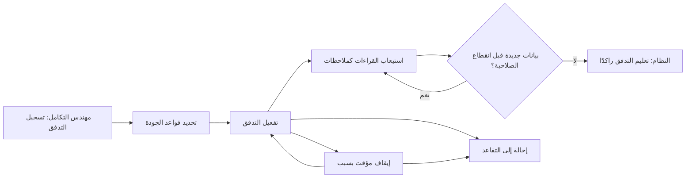
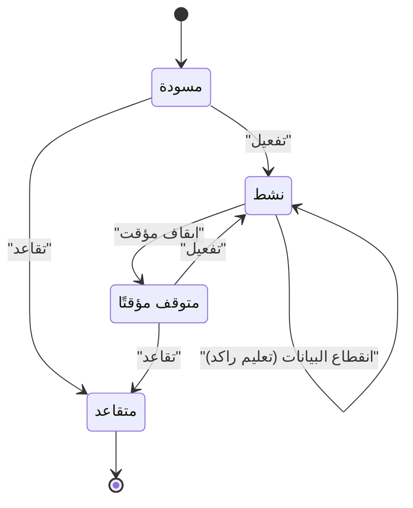

# تدفقات الحساسات

<!-- BEGIN GENERATED: doc -->
| البند | القيمة |
|---|---|
| المعرّف | FEAT-COL-SENSORS |
| الإصدار | 0.2 |
| الحالة | مسودة |
| القدرة | CAP-02 جمع المعلومات |
| القدرة الفرعية | CAP-02.04 الاستيعاب والتكامل (R1) |
| الأدوار | مهندس التكامل؛ المحلل؛ النظام |
| الشاشات | SCR-65 المحوّلات والاتصالات والحساسات |
| حالات الاستخدام | UC-094 |
| القصص | 11: 7 من المواصفة، و4 جديدة |
<!-- END GENERATED: doc -->

## 1. نظرة عامة

### 1.1 القيمة

يتيح ربط تدفقات الحساسات وتحديد قواعد جودتها والتنبيه عند انقطاع بياناتها.

### 1.2 النطاق

| البند | القيمة |
|---|---|
| المستخدمون | مهندس التكامل يسجل تدفقات الحساسات ويديرها؛ المحلل يتابعها قراءة فقط؛ النظام يعلّمها راكدة عند انقطاع بياناتها |
| الشاشات | SCR-65 المحوّلات والاتصالات والحساسات |
| حالات الاستخدام | استيعاب بيانات خارجية (UC-094) |
| المتطلبات | استيعاب تدفقات الحساسات عبر محولات إلى ملاحظات بمعدلات التصميم: 5,000 قراءة في الثانية مستدامة، وحتى 50,000 في الثانية في الدفعات القصيرة (REQ-INT-002) |
| خارج النطاق | تسجيل المصدر نفسه الذي يرتبط به التدفق (ميزة إدارة المصادر)، وإعداد اتصال بوابة الحساسات نفسه (ميزة المحولات) |

### 1.3 خريطة الميزة

**الشكل 1: حياة تدفق الحسّاس من التسجيل إلى الاستيعاب**



**الشكل 2: دورة حالات تدفق الحسّاس**



قواعد الجودة (القصة 5.5) تُحدَّد في أي حالة غير نهائية دون أن تغيّرها.

## 2. القواعد المشتركة

تنطبق على كل قصص الميزة، فلا تتكرر داخل القصص. وكل قصة تذكر ما يخصها فقط.

### 2.1 السياق المشترك

كل قصة تبدأ من ثلاثة شروط: مستأجر نشط، وحزمة السياسات الأساسية مفعّلة، ومستخدم مسجّل الدخول ومخوَّل. وتشير إليها القصص بخطوة واحدة: «بفرض السياق المشترك للميزة».

### 2.2 الصلاحية وعدم الإفصاح

- من لا يحق له رؤية العنصر يتلقى ردًا بشكل «غير متاح» تمامًا، فلا يعرف أنه موجود.
- من يرى العنصر ولا يحق له الإجراء يتلقى «لا تملك صلاحية هذا الإجراء».

### 2.3 أوامر تغيير الحالة

- **منع التكرار:** يُرسل كل أمر بمفتاح فريد، فإعادة الطلب نفسه لا تُنفَّذ مرتين.
- **حماية التعديل المتزامن:** يُرسل كل أمر بإصدار البيانات الذي يراه المستخدم. فإن عدّلها غيره في الأثناء، يُرفض الأمر.
- **السجل:** إن نجح الأمر، يُكتب حدثه وسجل التدقيق في المعاملة نفسها.

### 2.4 الرفض المشترك

```gherkin
# language: ar
خاصية: الرفض المشترك لأوامر الميزة

  سيناريو مخطط: رفض مشترك لكل أمر في الميزة
    بفرض السياق المشترك للميزة
    و <الحالة>
    عندما يُرسل المستخدم أي أمر من أوامر الميزة
    اذاً يُرفض برمز <الرمز> ويرى "<الرسالة>"
    و لا يتغير شيء

    امثلة:
      | الحالة                                  | الرمز                  | الرسالة                                                 |
      | العنصر خارج صلاحياته                    | NOT_FOUND              | غير متاح                                                |
      | العنصر مرئي له ولا يحق له الإجراء       | AUTHZ_DENIED           | لا تملك صلاحية هذا الإجراء                              |
      | غيره عدّل العنصر بعد أن فتحه            | VERSION_CONFLICT       | تغيّرت البيانات منذ فتحتها. راجع التغييرات ثم أعد المحاولة |
      | أعاد مفتاح منع التكرار بمحتوى مختلف     | IDEMPOTENCY_KEY_REUSED | طلب مكرر بمحتوى مختلف                                   |
      | البيانات ناقصة أو غير صحيحة             | VALIDATION_FAILED      | بعض البيانات ناقصة أو غير صحيحة. راجع الحقول المعلَّمة      |

  سيناريو: إعادة الطلب نفسه لا تُنفَّذ مرتين
    بفرض السياق المشترك للميزة
    و أمر نجح بمفتاح منع تكرار
    عندما يُعاد الطلب نفسه بالمفتاح نفسه
    اذاً تُعاد النتيجة الأولى ولا يُكتب حدث ثانٍ
```

## 3. الجودة وتعريف الاكتمال

### 3.1 متطلبات الجودة

<!-- BEGIN GENERATED: quality -->
| المرجع | الموقف | المطلوب |
|---|---|---|
| QAS-PERF-012 | batch of 1,000 observations | batch commit p95 ≤ 1 s; 0 duplicates on retry |
| QAS-SCAL-002 | event burst of 50,000/s for 60 s | 0 lost events; critical alert p95 ≤ 30 s during burst; back within QAS-PERF-005 ≤ 5 min after |
<!-- END GENERATED: quality -->

### 3.2 تعريف الاكتمال

القصة مكتملة حين تتحقق الشروط الخمسة:

1. سيناريوهاتها والقواعد المشتركة تمر في الاختبار الآلي.
2. فحوص البنية المعمارية تمر.
3. نصوص الواجهة والرسائل موجودة بالعربية والإنجليزية.
4. مراجعة الكود مكتملة.
5. ما تضيفه القصة نفسها في قسم «القواعد» تحقق.

## 4. فهرس القصص

<!-- BEGIN GENERATED: story-index -->
| المعرّف | القصة | النوع | الحالة |
|---|---|---|---|
| `US-BC07-SNS-ACTIVATE` | تفعيل تدفق الحسّاس | أمر | مسودة |
| `US-BC07-SNS-PAUSE` | إيقاف تدفق الحسّاس مؤقتًا | أمر | مسودة |
| `US-BC07-SNS-REGISTER` | تسجيل تدفق الحسّاس | أمر | مسودة |
| `US-BC07-SNS-RETIRE` | إحالة تدفق الحسّاس إلى التقاعد | أمر | مسودة |
| `US-BC07-SNS-SET-QUALITY-RULES` | تحديد قواعد جودة تدفق الحسّاس | أمر | مسودة |
| `US-BC07-Q-SNS-LIST` | جلب قائمة تدفقات الحساسات وجودتها | جلب | مسودة |
| `US-BC07-S-SENSOR-STREAM-01` | تعليم تدفق الحسّاس راكدًا عند انقطاع بياناته | نظام | مسودة |
| `US-UI-SCR65-SENSOR-STREAMS` | متابعة تدفقات الحساسات وجودتها | واجهة | مسودة |
| `US-PLT-SENSOR-QUALITY-EVAL` | تقييم جودة القراءات دون حذفها | منصة | مسودة |
| `US-PLT-SENSOR-THROUGHPUT` | استيعاب خمسة آلاف قراءة في الثانية | منصة | مسودة |
| `US-INT-SENSOR-GATEWAY` | استقبال قراءات بوابة الحساسات كملاحظات | تكامل | مسودة |
<!-- END GENERATED: story-index -->

## 5. القصص

### 5.1 US-BC07-SNS-ACTIVATE — تفعيل تدفق الحسّاس

| النوع | الإصدار | الأولوية | دون اتصال | الحالة |
|---|---|---|---|---|
| أمر | R1 | Must | لا | مسودة |

> **كـ** مهندس التكامل، **أريد** تفعيل تدفق الحسّاس بعد اختبار ربطه، **حتى** تبدأ قراءاته تدخل النظام ملاحظات.

**باختصار:** بعد تسجيل التدفق واختبار ربطه بأوامر تسجيل الملاحظات، يفعّله مهندس التكامل فتصير حالته «نشط» ويبدأ استيعاب قراءاته.

#### القواعد

- **متى يُسمح:** التدفق في حالة «مسودة» أو «متوقف مؤقتًا»، واتصال بوابة الحساسات الذي يستخدمه نشط، وربطه بأوامر تسجيل الملاحظات مُختبَر.
- **من يُسمح له:** مهندس التكامل.
- **الأثر:** تصبح حالة التدفق «نشط»، ويُسجَّل حدث «فُعِّل تدفق الحسّاس» يصل إلى عمال الاستيعاب وتنبيهات التشغيل.

#### معايير القبول

```gherkin
# language: ar
خاصية: تفعيل تدفق الحسّاس

  سيناريو: مهندس التكامل يفعّل تدفقًا جاهزًا
    بفرض السياق المشترك للميزة
    و تدفق حسّاس في حالة "مسودة" واتصاله نشط وربطه مُختبَر
    عندما يفعّله مهندس التكامل
    اذاً تصبح حالته "نشط"
    و يُسجَّل حدث "فُعِّل تدفق الحسّاس"

  سيناريو مخطط: رفض خاص بتفعيل التدفق
    بفرض السياق المشترك للميزة
    و <الحالة>
    عندما يحاول تفعيل التدفق
    اذاً يُرفض برمز <الرمز> ويرى <الرسالة>
    و لا يتغير شيء

    امثلة:
      | الحالة                         | الرمز                               | الرسالة                                      |
      | اتصال بوابة الحساسات غير نشط   | CONNECTION_NOT_ACTIVE               | الاتصال المرتبط غير نشط                      |
      | التدفق في حالة "نشط" أو "متقاعد" | SENSOR_STREAM_INVALID_STATE_TRANSITION | الوضع الحالي لتدفق الحسّاس لا يسمح بهذا الإجراء |
```

<details><summary>المراجع التقنية والتتبع</summary>

<!-- BEGIN GENERATED: refs US-BC07-SNS-ACTIVATE -->
| البند | المعرّف | المعنى |
|---|---|---|
| الواجهة البرمجية | `POST /api/v1/integration/sensor-streams/{id}/actions/activate` | — |
| الأمر | `CMD-SNS-ACTIVATE` | تفعيل تدفق الحسّاس |
| السياسة | `POL-SNS-ACTIVATE` | integration engineer؛ tenant match |
| الحدث | `EVT-SNS-ACTIVATED` | يصل إلى: Ingestion workers (SLC-02 batches); Operations alerting |
| الكيان | `AGG-SENSOR-STREAM` | تدفق الحسّاس |
| الجدول | `integration.sensor_streams` | الجدول الرئيسي لتدفق الحسّاس |
| وحدة النشر | DU-11 | — |
| المتطلب | REQ-INT-002 | The system shall ingest sensor streams through adapters into observations at the design rates of WL-06a. |
| حالة الاستخدام | UC-094 | Ingest External Data |
| الاختبار | TST-SENSOR-STREAM-SM، TST-SLC16-INVARIANTS | دورة حالات تدفق الحسّاس، وثوابت الشريحة SLC-16 |
<!-- END GENERATED: refs US-BC07-SNS-ACTIVATE -->

</details>

### 5.2 US-BC07-SNS-PAUSE — إيقاف تدفق الحسّاس مؤقتًا

| النوع | الإصدار | الأولوية | دون اتصال | الحالة |
|---|---|---|---|---|
| أمر | R1 | Must | لا | مسودة |

> **كـ** مهندس التكامل، **أريد** إيقاف تدفق الحسّاس مؤقتًا بسبب، **حتى** أمنع استيعاب قراءاته دون إحالته إلى التقاعد.

**باختصار:** يوقف مهندس التكامل التدفق النشط بسبب، فتصير حالته «متوقف مؤقتًا» ويمكن إعادة تفعيله فيما بعد.

#### القواعد

- **متى يُسمح:** التدفق في حالة «نشط»، مع ذكر السبب.
- **من يُسمح له:** مهندس التكامل.
- **البيانات:** سبب الإيقاف (إلزامي).
- **الأثر:** تصبح حالة التدفق «متوقف مؤقتًا»، ويُسجَّل حدث «أُوقف تدفق الحسّاس مؤقتًا».

#### معايير القبول

```gherkin
# language: ar
خاصية: إيقاف تدفق الحسّاس مؤقتًا

  سيناريو: مهندس التكامل يوقف تدفقًا نشطًا بسبب
    بفرض السياق المشترك للميزة
    و تدفق حسّاس في حالة "نشط"
    عندما يوقفه مهندس التكامل مؤقتًا بسبب
    اذاً تصبح حالته "متوقف مؤقتًا"
    و يُسجَّل حدث "أُوقف تدفق الحسّاس مؤقتًا"

  سيناريو مخطط: رفض خاص بالإيقاف المؤقت
    بفرض السياق المشترك للميزة
    و <الحالة>
    عندما يحاول إيقاف التدفق مؤقتًا
    اذاً يُرفض برمز <الرمز> ويرى <الرسالة>
    و لا يتغير شيء

    امثلة:
      | الحالة                                          | الرمز                               | الرسالة                                      |
      | لم يُذكر سبب الإيقاف                             | REASON_REQUIRED                     | اذكر السبب                                   |
      | التدفق في حالة "مسودة" أو "متوقف مؤقتًا" أو "متقاعد" | SENSOR_STREAM_INVALID_STATE_TRANSITION | الوضع الحالي لتدفق الحسّاس لا يسمح بهذا الإجراء |
```

<details><summary>المراجع التقنية والتتبع</summary>

<!-- BEGIN GENERATED: refs US-BC07-SNS-PAUSE -->
| البند | المعرّف | المعنى |
|---|---|---|
| الواجهة البرمجية | `POST /api/v1/integration/sensor-streams/{id}/actions/pause` | — |
| الأمر | `CMD-SNS-PAUSE` | إيقاف تدفق الحسّاس مؤقتًا |
| السياسة | `POL-SNS-PAUSE` | integration engineer؛ tenant match |
| الحدث | `EVT-SNS-PAUSED` | يصل إلى: Ingestion workers (SLC-02 batches); Operations alerting |
| الكيان | `AGG-SENSOR-STREAM` | تدفق الحسّاس |
| الجدول | `integration.sensor_streams` | الجدول الرئيسي لتدفق الحسّاس |
| وحدة النشر | DU-11 | — |
| المتطلب | REQ-INT-002 | The system shall ingest sensor streams through adapters into observations at the design rates of WL-06a. |
| حالة الاستخدام | UC-094 | Ingest External Data |
| الاختبار | TST-SENSOR-STREAM-SM، TST-SLC16-INVARIANTS | دورة حالات تدفق الحسّاس، وثوابت الشريحة SLC-16 |
<!-- END GENERATED: refs US-BC07-SNS-PAUSE -->

</details>

### 5.3 US-BC07-SNS-REGISTER — تسجيل تدفق الحسّاس

| النوع | الإصدار | الأولوية | دون اتصال | الحالة |
|---|---|---|---|---|
| أمر | R1 | Must | لا | مسودة |

> **كـ** مهندس التكامل، **أريد** تسجيل تدفق حسّاس جديد بمصدره وكميته ومعدله المتوقع، **حتى** يصبح جاهزًا للتفعيل.

**باختصار:** يسجل مهندس التكامل تدفق الحسّاس بربطه باتصال بوابة الحساسات ومصدر من نوع حسّاس نشط، وكميته ووحدته ومعدله المتوقع وموقعه أو الكيان المرتبط به، فيُنشأ بحالة «مسودة».

#### القواعد

- **متى يُسمح:** اتصال بوابة الحساسات المحدد موجود، والمصدر من نوع حسّاس في حالة «نشط»، ومعه كمية بوحدة معيارية ومعدل متوقع، وموقع أو كيان مرتبط.
- **من يُسمح له:** مهندس التكامل.
- **البيانات:** الاتصال، المصدر، الكمية، الوحدة، المعدل المتوقع (إلزامية)، والموقع أو الكيان المرتبط.
- **الأثر:** يُسجَّل تدفق الحسّاس بحالة «مسودة»، ويُسجَّل حدث «سُجِّل تدفق الحسّاس».

#### معايير القبول

```gherkin
# language: ar
خاصية: تسجيل تدفق الحسّاس

  سيناريو: مهندس التكامل يسجل تدفقًا جديدًا
    بفرض السياق المشترك للميزة
    و اتصال بوابة حساسات نشط ومصدر من نوع حسّاس نشط
    عندما يسجل مهندس التكامل تدفقًا بالاتصال والمصدر والكمية والوحدة والمعدل المتوقع
    اذاً يُنشأ التدفق بحالة "مسودة"
    و يُسجَّل حدث "سُجِّل تدفق الحسّاس"

  سيناريو مخطط: رفض خاص بتسجيل التدفق
    بفرض السياق المشترك للميزة
    و <الحالة>
    عندما يحاول تسجيل التدفق
    اذاً يُرفض برمز <الرمز> ويرى <الرسالة>
    و لا يتغير شيء

    امثلة:
      | الحالة                                                              | الرمز          | الرسالة                                                      |
      | الاتصال غير موجود، أو المصدر ليس حسّاسًا نشطًا، أو الكمية والوحدة أو المعدل ناقص | STREAM_INVALID | إعداد التدفق غير صحيح |
```

<details><summary>المراجع التقنية والتتبع</summary>

<!-- BEGIN GENERATED: refs US-BC07-SNS-REGISTER -->
| البند | المعرّف | المعنى |
|---|---|---|
| الواجهة البرمجية | `POST /api/v1/integration/sensor-streams` | — |
| الأمر | `CMD-SNS-REGISTER` | تسجيل تدفق الحسّاس |
| السياسة | `POL-SNS-REGISTER` | integration engineer؛ tenant match |
| الحدث | `EVT-SNS-REGISTERED` | يصل إلى: Ingestion workers (SLC-02 batches); Operations alerting |
| الكيان | `AGG-SENSOR-STREAM` | تدفق الحسّاس |
| الجدول | `integration.sensor_streams` | الجدول الرئيسي لتدفق الحسّاس |
| وحدة النشر | DU-11 | — |
| المتطلب | REQ-INT-002 | The system shall ingest sensor streams through adapters into observations at the design rates of WL-06a. |
| حالة الاستخدام | UC-094 | Ingest External Data |
| الاختبار | TST-SENSOR-STREAM-SM، TST-SLC16-INVARIANTS | دورة حالات تدفق الحسّاس، وثوابت الشريحة SLC-16 |
<!-- END GENERATED: refs US-BC07-SNS-REGISTER -->

</details>

### 5.4 US-BC07-SNS-RETIRE — إحالة تدفق الحسّاس إلى التقاعد

| النوع | الإصدار | الأولوية | دون اتصال | الحالة |
|---|---|---|---|---|
| أمر | R1 | Must | لا | مسودة |

> **كـ** مهندس التكامل، **أريد** إحالة تدفق الحسّاس إلى التقاعد بسبب، **حتى** أوقفه نهائيًا بعد أن لم تعد قراءاته مطلوبة.

**باختصار:** يحيل مهندس التكامل التدفق غير النشط إلى التقاعد بسبب، فتصير حالته «متقاعد» نهائيًا ولا يُفعَّل بعدها.

#### القواعد

- **متى يُسمح:** التدفق في حالة «مسودة» أو «متوقف مؤقتًا»، مع ذكر السبب.
- **من يُسمح له:** مهندس التكامل.
- **البيانات:** سبب التقاعد (إلزامي).
- **الأثر:** تصبح حالة التدفق «متقاعد»، ويُسجَّل حدث «أُحيل تدفق الحسّاس إلى التقاعد».

#### معايير القبول

```gherkin
# language: ar
خاصية: إحالة تدفق الحسّاس إلى التقاعد

  سيناريو: مهندس التكامل يحيل تدفقًا متوقفًا إلى التقاعد
    بفرض السياق المشترك للميزة
    و تدفق حسّاس في حالة "متوقف مؤقتًا"
    عندما يحيله مهندس التكامل إلى التقاعد بسبب
    اذاً تصبح حالته "متقاعد"
    و يُسجَّل حدث "أُحيل تدفق الحسّاس إلى التقاعد"

  سيناريو مخطط: رفض خاص بالإحالة إلى التقاعد
    بفرض السياق المشترك للميزة
    و <الحالة>
    عندما يحاول إحالة التدفق إلى التقاعد
    اذاً يُرفض برمز <الرمز> ويرى <الرسالة>
    و لا يتغير شيء

    امثلة:
      | الحالة                           | الرمز                               | الرسالة                                      |
      | لم يُذكر سبب التقاعد              | REASON_REQUIRED                     | اذكر السبب                                   |
      | التدفق في حالة "نشط" أو "متقاعد"  | SENSOR_STREAM_INVALID_STATE_TRANSITION | الوضع الحالي لتدفق الحسّاس لا يسمح بهذا الإجراء |
```

<details><summary>المراجع التقنية والتتبع</summary>

<!-- BEGIN GENERATED: refs US-BC07-SNS-RETIRE -->
| البند | المعرّف | المعنى |
|---|---|---|
| الواجهة البرمجية | `POST /api/v1/integration/sensor-streams/{id}/actions/retire` | — |
| الأمر | `CMD-SNS-RETIRE` | إحالة تدفق الحسّاس إلى التقاعد |
| السياسة | `POL-SNS-RETIRE` | integration engineer؛ tenant match |
| الحدث | `EVT-SNS-RETIRED` | يصل إلى: Ingestion workers (SLC-02 batches); Operations alerting |
| الكيان | `AGG-SENSOR-STREAM` | تدفق الحسّاس |
| الجدول | `integration.sensor_streams` | الجدول الرئيسي لتدفق الحسّاس |
| وحدة النشر | DU-11 | — |
| المتطلب | REQ-INT-002 | The system shall ingest sensor streams through adapters into observations at the design rates of WL-06a. |
| حالة الاستخدام | UC-094 | Ingest External Data |
| الاختبار | TST-SENSOR-STREAM-SM، TST-SLC16-INVARIANTS | دورة حالات تدفق الحسّاس، وثوابت الشريحة SLC-16 |
<!-- END GENERATED: refs US-BC07-SNS-RETIRE -->

</details>

### 5.5 US-BC07-SNS-SET-QUALITY-RULES — تحديد قواعد جودة تدفق الحسّاس

| النوع | الإصدار | الأولوية | دون اتصال | الحالة |
|---|---|---|---|---|
| أمر | R1 | Must | لا | مسودة |

> **كـ** مهندس التكامل، **أريد** تحديد نطاق القيم المقبول ومعدل تغيرها ومدة اعتبارها راكدة ونافذة التكرار، **حتى** تُعلَّم القراءات المخالفة بدل أن تُقبل بصمت أو تُحذف.

**باختصار:** يحدّد مهندس التكامل قواعد جودة التدفق (النطاق، ومعدل التغير، وزمن الركود، ونافذة التكرار)؛ وأي قراءة تخالفها تُعلَّم مخالفة جودة ولا تُرفض ولا تُحذف.

#### القواعد

- **متى يُسمح:** التدفق في أي حالة غير نهائية: «مسودة» أو «نشط» أو «متوقف مؤقتًا».
- **من يُسمح له:** مهندس التكامل.
- **البيانات:** نطاق القيم، ومعدل التغير المسموح، وزمن الركود، ونافذة التكرار (إلزامية).
- **الأثر:** يرتفع إصدار التدفق، ويُسجَّل حدث «حُدِّدت قواعد جودة تدفق الحسّاس». ولا تُحذف أي قراءة تخالف القواعد بعدها، بل تُعلَّم مخالفة جودة فقط.

#### معايير القبول

```gherkin
# language: ar
خاصية: تحديد قواعد جودة تدفق الحسّاس

  سيناريو: مهندس التكامل يحدد قواعد الجودة
    بفرض السياق المشترك للميزة
    و تدفق حسّاس في حالة غير نهائية
    عندما يحدّد مهندس التكامل نطاق القيم ومعدل التغير وزمن الركود ونافذة التكرار
    اذاً يرتفع إصدار التدفق ولا تتغير حالته
    و يُسجَّل حدث "حُدِّدت قواعد جودة تدفق الحسّاس"

  سيناريو مخطط: رفض خاص بتحديد قواعد الجودة
    بفرض السياق المشترك للميزة
    و <الحالة>
    عندما يحاول تحديد القواعد
    اذاً يُرفض برمز <الرمز> ويرى <الرسالة>
    و لا يتغير شيء

    امثلة:
      | الحالة                           | الرمز                               | الرسالة                                      |
      | أحد مكوّنات القواعد ناقص أو غير صحيح | QUALITY_RULES_INVALID               | قواعد جودة البيانات غير صحيحة                |
      | التدفق في حالة "متقاعد"           | SENSOR_STREAM_INVALID_STATE_TRANSITION | الوضع الحالي لتدفق الحسّاس لا يسمح بهذا الإجراء |
```

<details><summary>المراجع التقنية والتتبع</summary>

<!-- BEGIN GENERATED: refs US-BC07-SNS-SET-QUALITY-RULES -->
| البند | المعرّف | المعنى |
|---|---|---|
| الواجهة البرمجية | `POST /api/v1/integration/sensor-streams/{id}/actions/set-quality-rules` | — |
| الأمر | `CMD-SNS-SET-QUALITY-RULES` | تحديد قواعد جودة تدفق الحسّاس |
| السياسة | `POL-SNS-SET-QUALITY-RULES` | integration engineer؛ tenant match |
| الحدث | `EVT-SNS-QUALITY-RULES-SET` | يصل إلى: Ingestion workers (SLC-02 batches); Operations alerting |
| الكيان | `AGG-SENSOR-STREAM` | تدفق الحسّاس |
| الجدول | `integration.sensor_streams` | الجدول الرئيسي لتدفق الحسّاس |
| وحدة النشر | DU-11 | — |
| المتطلب | REQ-INT-002 | The system shall ingest sensor streams through adapters into observations at the design rates of WL-06a. |
| حالة الاستخدام | UC-094 | Ingest External Data |
| الاختبار | TST-SENSOR-STREAM-SM، TST-SLC16-INVARIANTS | دورة حالات تدفق الحسّاس، وثوابت الشريحة SLC-16 |
<!-- END GENERATED: refs US-BC07-SNS-SET-QUALITY-RULES -->

</details>

### 5.6 US-BC07-Q-SNS-LIST — جلب قائمة تدفقات الحساسات وجودتها

| النوع | الإصدار | الأولوية | دون اتصال | الحالة |
|---|---|---|---|---|
| جلب | R1 | Must | لا | مسودة |

> **كـ** مهندس التكامل أو المحلل، **أريد** قائمة تدفقات الحساسات بمعدلها وحالة ركودها وعدد مخالفات جودتها، **حتى** أتابع سلامة الاستيعاب.

**باختصار:** تُعاد تدفقات الحساسات التي يحق للمستخدم رؤيتها، صفحة بعد صفحة، بمعدل كل تدفق وحالة ركوده وعدد مخالفات جودته.

#### القواعد

- **من يُسمح له:** مهندس التكامل والمحلل، كلٌّ ضمن نطاقه.

#### معايير القبول

```gherkin
# language: ar
خاصية: جلب قائمة تدفقات الحساسات وجودتها

  سيناريو: يرى المستخدم تدفقات نطاقه فقط
    بفرض السياق المشترك للميزة
    و تدفقات حساسات داخل نطاق المستخدم وأخرى خارجه
    عندما يطلب قائمة التدفقات
    اذاً تُعاد التدفقات داخل نطاقه فقط بمعدلها وحالة ركودها وعدد مخالفات جودتها
    و لا يكشف أي عدد أو اقتراح وجود تدفق محجوب
```

<details><summary>المراجع التقنية والتتبع</summary>

<!-- BEGIN GENERATED: refs US-BC07-Q-SNS-LIST -->
| البند | المعرّف | المعنى |
|---|---|---|
| الواجهة البرمجية | `GET /api/v1/integration/sensor-streams` | — |
| الاستعلام | `QRY-SNS-LIST` | Streams with rate, staleness, quality violation counts |
| السياسة | `POL-SNS-LIST` | integration engineers, Analyst |
| الكيان | `AGG-SENSOR-STREAM` | تدفق الحسّاس |
| الجدول | `integration.sensor_streams` | الجدول الرئيسي لتدفق الحسّاس |
| وحدة النشر | DU-11 | — |
| المتطلب | REQ-INT-002 | The system shall ingest sensor streams through adapters into observations at the design rates of WL-06a. |
| حالة الاستخدام | UC-094 | Ingest External Data |
| الاختبار | TST-SENSOR-STREAM-SM، TST-SLC16-INVARIANTS | دورة حالات تدفق الحسّاس، وثوابت الشريحة SLC-16 |
<!-- END GENERATED: refs US-BC07-Q-SNS-LIST -->

</details>

### 5.7 US-BC07-S-SENSOR-STREAM-01 — تعليم تدفق الحسّاس راكدًا عند انقطاع بياناته

| النوع | الإصدار | الأولوية | دون اتصال | الحالة |
|---|---|---|---|---|
| نظام | R1 | Must | لا ينطبق | مسودة |

> **كـ** النظام، **أريد** أن أعلِّم تدفق الحسّاس راكدًا حين تتجاوز قراءاته زمن الركود المحدد له، **حتى** يعرف مهندس التكامل أن مصدر البيانات انقطع.

**باختصار:** يفحص النظام كل تدفق نشط دوريًا، فإن لم تصله قراءة جديدة قبل انقضاء زمن الركود الذي حدده مهندس التكامل، يعلّمه راكدًا دون تغيير حالته وينبّه مالكه.

#### القواعد

- **متى يحدث:** التدفق في حالة «نشط»، ولم تصله قراءة جديدة قبل انقضاء زمن الركود من قواعد جودته.
- **الأثر:** تبقى حالة التدفق «نشط»، ويُسجَّل حدث «صار تدفق الحسّاس راكدًا» وتنبيه إلى مهندس التكامل.

#### معايير القبول

```gherkin
# language: ar
خاصية: تعليم تدفق الحسّاس راكدًا عند انقطاع بياناته

  سيناريو: انقطاع بيانات تدفق نشط
    بفرض تدفق حسّاس نشط تجاوزت آخر قراءة له زمن الركود المحدد
    عندما يحين وقت فحص النظام
    اذاً تبقى حالته "نشط"
    و يُسجَّل حدث "صار تدفق الحسّاس راكدًا" وتنبيه إلى مهندس التكامل

  سيناريو: لا ركود حين تصل القراءات في وقتها
    بفرض تدفق حسّاس نشط وصلته قراءة قبل انقضاء زمن الركود
    عندما يحين وقت فحص النظام
    اذاً لا يُسجَّل أي تعليم ركود
```

<details><summary>المراجع التقنية والتتبع</summary>

<!-- BEGIN GENERATED: refs US-BC07-S-SENSOR-STREAM-01 -->
| البند | المعرّف | المعنى |
|---|---|---|
| المحفِّز | `SYS:no data beyond stale-after` | stream flagged STALE; alert to owner |
| الانتقال | ACTIVE ← (بلا تغيير) | — |
| الحدث | `EVT-SNS-STALE` | يصل إلى: Ingestion workers (SLC-02 batches); Operations alerting |
| الكيان | `AGG-SENSOR-STREAM` | تدفق الحسّاس |
| الجدول | `integration.sensor_streams` | الجدول الرئيسي لتدفق الحسّاس |
| وحدة النشر | DU-11 | — |
| المتطلب | REQ-INT-002 | The system shall ingest sensor streams through adapters into observations at the design rates of WL-06a. |
| حالة الاستخدام | UC-094 | Ingest External Data |
| الاختبار | TST-SENSOR-STREAM-SM، TST-SLC16-INVARIANTS | دورة حالات تدفق الحسّاس، وثوابت الشريحة SLC-16 |
<!-- END GENERATED: refs US-BC07-S-SENSOR-STREAM-01 -->

</details>

### 5.8 US-UI-SCR65-SENSOR-STREAMS — متابعة تدفقات الحساسات وجودتها

| النوع | الإصدار | الأولوية | دون اتصال | الحالة |
|---|---|---|---|---|
| واجهة | R1 | Should | لا | مسودة |

> **كـ** مهندس التكامل، **أريد** شاشة تعرض كل تدفقات الحساسات بحالتها ومعدلها وركودها ومخالفات جودتها، **حتى** أتابعها وأتصرف من نفس الشاشة.

**باختصار:** شاشة المحوّلات والاتصالات والحساسات تعرض قائمة التدفقات (القصة 5.6) مع حالة كل تدفق وعلامة الركود إن وُجدت، وأزرار تفعيله أو إيقافه أو إحالته إلى التقاعد أو تحديد قواعد جودته بحسب حالته.

#### القواعد

- **العرض:** حالة التدفق (مسودة، نشط، متوقف مؤقتًا، متقاعد)، معدله الحالي، وعلامة «راكد» إن انقطعت بياناته، وعدد مخالفات جودته.
- **الإجراءات المتاحة:** التفعيل في «مسودة» و«متوقف مؤقتًا»؛ الإيقاف المؤقت في «نشط»؛ الإحالة إلى التقاعد في «مسودة» و«متوقف مؤقتًا»؛ تحديد قواعد الجودة في أي حالة غير «متقاعد».

#### معايير القبول

```gherkin
# language: ar
خاصية: متابعة تدفقات الحساسات وجودتها

  سيناريو: عرض التدفقات وعلامة الركود
    بفرض السياق المشترك للميزة
    و تدفق حسّاس راكد وتدفقات أخرى سليمة في نطاق مهندس التكامل
    عندما يفتح شاشة تدفقات الحساسات
    اذاً يرى كل تدفق بحالته ومعدله، والتدفق الراكد بعلامة "راكد"
    و تظهر له إجراءات كل تدفق حسب حالته فقط
```

<details><summary>المراجع التقنية والتتبع</summary>

<!-- BEGIN GENERATED: refs US-UI-SCR65-SENSOR-STREAMS -->
| البند | المعرّف | المعنى |
|---|---|---|
| الشاشة | SCR-65 | شاشة المحوّلات والاتصالات والحساسات |
| المصدر | `QRY-SNS-LIST` | — |
| المصدر | `AGG-SENSOR-STREAM` | — |
<!-- END GENERATED: refs US-UI-SCR65-SENSOR-STREAMS -->

</details>

### 5.9 US-PLT-SENSOR-QUALITY-EVAL — تقييم جودة القراءات دون حذفها

| النوع | الإصدار | الأولوية | دون اتصال | الحالة |
|---|---|---|---|---|
| منصة | R1 | Should | لا ينطبق | مسودة |

> **كـ** فريق المنصة، **أريد** أن يقيّم الاستيعاب كل قراءة مقابل قواعد جودة تدفقها دون حذف أي قراءة، **حتى** تبقى كل القراءات محفوظة ومعلَّمة بدل أن تضيع بصمت.

**باختصار:** كل قراءة تدخل عبر تدفق حسّاس تُفحص مقابل قواعد جودته (النطاق، معدل التغير، الركود، التكرار)، وأي مخالفة تُعلَّم في بيانات القراءة دون أن تمنعها من الدخول أو تحذفها.

#### معايير القبول

```gherkin
# language: ar
خاصية: تقييم جودة القراءات دون حذفها

  سيناريو: قراءة تخالف نطاق القيم
    بفرض تدفق حسّاس بقواعد جودة محددة
    عندما تصل قراءة تخالف نطاق القيم المحدد
    اذاً تُسجَّل القراءة ملاحظة مع علامة مخالفة جودة
    و لا تُحذف ولا تُرفض لهذا السبب
```

<details><summary>المراجع التقنية والتتبع</summary>

<!-- BEGIN GENERATED: refs US-PLT-SENSOR-QUALITY-EVAL -->
| البند | المعرّف | المعنى |
|---|---|---|
| المصدر | `INV-SNS-02` | — |
| المصدر | `AGG-SENSOR-STREAM` | — |
| المصدر | `observability-slc16.md` | — |
<!-- END GENERATED: refs US-PLT-SENSOR-QUALITY-EVAL -->

</details>

### 5.10 US-PLT-SENSOR-THROUGHPUT — استيعاب خمسة آلاف قراءة في الثانية

| النوع | الإصدار | الأولوية | دون اتصال | الحالة |
|---|---|---|---|---|
| منصة | R1 | Must | لا ينطبق | مسودة |

> **كـ** فريق المنصة، **أريد** أن يستوعب مسار دفعات تدفقات الحساسات 5,000 قراءة في الثانية مستدامة، وحتى 50,000 في الثانية لمدة دقيقة، **حتى** لا تفقد الحساسات عالية المعدل أي قراءة في لحظات الذروة.

**باختصار:** دفعات القراءات (حتى 1,000 قراءة للدفعة، بمنع تكرار لكل قراءة) تُكتب بزمن تثبيت للدفعة ≤ ثانية عند المئين 95، ودون فقد أي حدث حتى في الذروة.

#### معايير القبول

```gherkin
# language: ar
خاصية: أداء استيعاب تدفقات الحساسات

  سيناريو: الحمل المستدام
    بفرض دفعات قراءات بحجم 1,000 قراءة للدفعة
    عندما تُرسل بمعدل 5,000 قراءة في الثانية
    اذاً يكون زمن تثبيت الدفعة ثانية واحدة أو أقل عند المئين 95
    و لا تتكرر قراءة واحدة عند إعادة إرسال دفعة بالمفتاح نفسه

  سيناريو: ذروة لمدة دقيقة
    بفرض حمل بمعدل 50,000 قراءة في الثانية لمدة 60 ثانية
    عندما يُقاس الاستيعاب خلال الذروة وبعدها
    اذاً لا يُفقد أي حدث
    و يعود التنبيه الحرج إلى هدفه المعتاد خلال خمس دقائق من انتهاء الذروة
```

<details><summary>المراجع التقنية والتتبع</summary>

<!-- BEGIN GENERATED: refs US-PLT-SENSOR-THROUGHPUT -->
| البند | المعرّف | المعنى |
|---|---|---|
| الجودة | QAS-PERF-012 | batch of 1,000 observations → batch commit p95 ≤ 1 s; 0 duplicates on retry |
| الجودة | QAS-SCAL-002 | event burst of 50,000/s for 60 s → 0 lost events; critical alert p95 ≤ 30 s during burst; back within QAS-PER… |
| المتطلب | REQ-INT-002 | The system shall ingest sensor streams through adapters into observations at the design rates of WL-06a. |
| حالة الاستخدام | UC-094 | Ingest External Data |
<!-- END GENERATED: refs US-PLT-SENSOR-THROUGHPUT -->

</details>

### 5.11 US-INT-SENSOR-GATEWAY — استقبال قراءات بوابة الحساسات كملاحظات

| النوع | الإصدار | الأولوية | دون اتصال | الحالة |
|---|---|---|---|---|
| تكامل | R1 | Must | لا ينطبق | مسودة |

> **كـ** بوابة الحساسات، **أريد** أن تدخل قراءاتي إلى النظام ملاحظات عبر تدفقها النشط، **حتى** يستفيد المحللون منها دون أن يدخلوها يدويًا.

**باختصار:** كل قراءة تصل من بوابة الحساسات تدخل في دفعة ملاحظات (حتى 1,000 قراءة للدفعة، بمنع تكرار لكل قراءة)، وتحمل وقت رصد الحسّاس نفسه ووقت استلام الخادم منفصلين؛ ولا تدخل القراءة إلا عبر تدفق حسّاس نشط.

#### القواعد

- **متى يحدث:** التدفق المرتبط بالبوابة في حالة «نشط».
- **البيانات:** الرسالة المتبادلة: دفعة قراءات، كل قراءة بوقت رصدها وقيمتها ومعرِّف منع تكرارها.
- **الأثر:** تُسجَّل القراءات ملاحظات تحمل وقت رصد الحسّاس (observed_at) ووقت استلام الخادم (recorded_from) منفصلين، وتخضع لقواعد جودة التدفق (القصة 5.9) دون حذف.

#### معايير القبول

```gherkin
# language: ar
خاصية: استقبال قراءات بوابة الحساسات كملاحظات

  سيناريو: دفعة قراءات عبر تدفق نشط
    بفرض تدفق حسّاس في حالة "نشط"
    عندما تصل منه دفعة قراءات
    اذاً تُسجَّل كل قراءة ملاحظة بوقت رصد الحسّاس ووقت استلام الخادم
    و تُقيَّم كل قراءة مقابل قواعد جودة التدفق دون حذف أي منها

  سيناريو: لا استيعاب من تدفق غير نشط
    بفرض تدفق حسّاس في حالة "مسودة" أو "متوقف مؤقتًا" أو "متقاعد"
    عندما تصل منه قراءات
    اذاً لا تدخل القراءات ملاحظات
    و لا يتغير شيء
```

<details><summary>المراجع التقنية والتتبع</summary>

<!-- BEGIN GENERATED: refs US-INT-SENSOR-GATEWAY -->
| البند | المعرّف | المعنى |
|---|---|---|
| المصدر | `INV-SNS-01` | — |
| المصدر | `INV-SNS-03` | — |
| المصدر | `THR-S16-05` | — |
| المصدر | `enterprise-integration-spec.md §2` | — |
| المتطلب | REQ-INT-002 | The system shall ingest sensor streams through adapters into observations at the design rates of WL-06a. |
| حالة الاستخدام | UC-094 | Ingest External Data |
<!-- END GENERATED: refs US-INT-SENSOR-GATEWAY -->

</details>

## 6. التتبع

<!-- BEGIN GENERATED: trace -->
| المتطلب | المعنى | القصص | الاختبار |
|---|---|---|---|
| REQ-INT-002 | The system shall ingest sensor streams through adapters into observations at the design rates of WL-06a. | `US-BC07-Q-SNS-LIST`، `US-BC07-S-SENSOR-STREAM-01`، `US-BC07-SNS-ACTIVATE`، `US-BC07-SNS-PAUSE`، `US-BC07-SNS-REGISTER`، `US-BC07-SNS-RETIRE`، `US-BC07-SNS-SET-QUALITY-RULES`، `US-INT-SENSOR-GATEWAY`، `US-PLT-SENSOR-THROUGHPUT` | TST-SENSOR-STREAM-SM، TST-SLC16-INVARIANTS |
<!-- END GENERATED: trace -->

## 7. سجل التغييرات

| الإصدار | التاريخ | التغيير |
|---|---|---|
| 0.1 | — | هيكل مولَّد من خريطة الميزات |
| 0.2 | 2026-10-03 | كتابة القصص كاملة بمعيار القصص |
