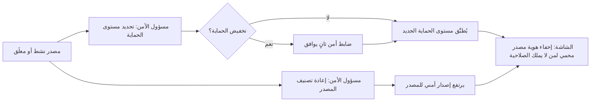

# حماية هوية المصادر

<!-- BEGIN GENERATED: doc -->
| البند | القيمة |
|---|---|
| المعرّف | FEAT-COL-SOURCE-PROTECT |
| الإصدار | 0.2 |
| الحالة | مسودة |
| القدرة | CAP-02 جمع المعلومات |
| القدرة الفرعية | CAP-02.02 إدارة المصادر (R1) |
| الأدوار | مسؤول الأمن |
| الشاشات | SCR-22 الادعاء والدليل والمصدر |
| حالات الاستخدام | UC-004 |
| القصص | 4: 2 من المواصفة، و2 جديدة |
<!-- END GENERATED: doc -->

## 1. نظرة عامة

### 1.1 القيمة

يتيح لمسؤول الأمن تحديد مستوى حماية المصدر وتصنيفه بحيث لا يرى هويته إلا المخولون.

### 1.2 النطاق

| البند | القيمة |
|---|---|
| المستخدمون | مسؤول الأمن يحدد تصنيف المصدر ومستوى حماية هويته |
| الشاشات | SCR-22 الادعاء والدليل والمصدر |
| حالات الاستخدام | إدارة المصدر (UC-004) |
| المتطلبات | تسجيل المصدر بتصنيفه وموثوقيته مع حماية لهويته (REQ-INF-001)؛ عدم كشف سمات هوية مصدر بشري محمي لمن لا يملك صلاحية `source.identity.view` (QAS-SEC-009) |
| خارج النطاق | تسجيل المصدر نفسه وتقييم موثوقيته وتعليقه وإحالته إلى التقاعد (ميزة إدارة المصدر الأساسية)؛ تدفقات الحساسات (ميزة أخرى) |

### 1.3 خريطة الميزة

**الشكل 1: حماية هوية المصدر وتصنيفه**



متطلبا الحماية والتصنيف يرفعان إصدار المصدر نفسه، فتعيد كل الشاشات والمخرجات فحص الرؤية به.

## 2. القواعد المشتركة

تنطبق على كل قصص الميزة، فلا تتكرر داخل القصص. وكل قصة تذكر ما يخصها فقط.

### 2.1 السياق المشترك

كل قصة تبدأ من ثلاثة شروط: مستأجر نشط، وحزمة السياسات الأساسية مفعّلة، ومستخدم مسجّل الدخول ومخوَّل. وتشير إليها القصص بخطوة واحدة: «بفرض السياق المشترك للميزة».

### 2.2 الصلاحية وعدم الإفصاح

- من لا يحق له رؤية العنصر يتلقى ردًا بشكل «غير متاح» تمامًا، فلا يعرف أنه موجود.
- من يرى العنصر ولا يحق له الإجراء يتلقى «لا تملك صلاحية هذا الإجراء».

### 2.3 أوامر تغيير الحالة

- **منع التكرار:** يُرسل كل أمر بمفتاح فريد، فإعادة الطلب نفسه لا تُنفَّذ مرتين.
- **حماية التعديل المتزامن:** يُرسل كل أمر بإصدار البيانات الذي يراه المستخدم. فإن عدّلها غيره في الأثناء، يُرفض الأمر.
- **السجل:** إن نجح الأمر، يُكتب حدثه وسجل التدقيق في المعاملة نفسها.

### 2.4 الرفض المشترك

```gherkin
# language: ar
خاصية: الرفض المشترك لأوامر الميزة

  سيناريو مخطط: رفض مشترك لكل أمر في الميزة
    بفرض السياق المشترك للميزة
    و <الحالة>
    عندما يُرسل المستخدم أي أمر من أوامر الميزة
    اذاً يُرفض برمز <الرمز> ويرى "<الرسالة>"
    و لا يتغير شيء

    امثلة:
      | الحالة                                  | الرمز                  | الرسالة                                                 |
      | العنصر خارج صلاحياته                    | NOT_FOUND              | غير متاح                                                |
      | العنصر مرئي له ولا يحق له الإجراء       | AUTHZ_DENIED           | لا تملك صلاحية هذا الإجراء                              |
      | غيره عدّل العنصر بعد أن فتحه            | VERSION_CONFLICT       | تغيّرت البيانات منذ فتحتها. راجع التغييرات ثم أعد المحاولة |
      | أعاد مفتاح منع التكرار بمحتوى مختلف     | IDEMPOTENCY_KEY_REUSED | طلب مكرر بمحتوى مختلف                                   |
      | البيانات ناقصة أو غير صحيحة             | VALIDATION_FAILED      | بعض البيانات ناقصة أو غير صحيحة. راجع الحقول المعلَّمة      |

  سيناريو: إعادة الطلب نفسه لا تُنفَّذ مرتين
    بفرض السياق المشترك للميزة
    و أمر نجح بمفتاح منع تكرار
    عندما يُعاد الطلب نفسه بالمفتاح نفسه
    اذاً تُعاد النتيجة الأولى ولا يُكتب حدث ثانٍ
```

## 3. الجودة وتعريف الاكتمال

### 3.1 متطلبات الجودة

<!-- BEGIN GENERATED: quality -->
| المرجع | الموقف | المطلوب |
|---|---|---|
| QAS-SEC-009 | user without source-protection permission reads claims of a protected human source | 0 identity attributes disclosed in any response, export or lineage |
<!-- END GENERATED: quality -->

### 3.2 تعريف الاكتمال

القصة مكتملة حين تتحقق الشروط الخمسة:

1. سيناريوهاتها والقواعد المشتركة تمر في الاختبار الآلي.
2. فحوص البنية المعمارية تمر.
3. نصوص الواجهة والرسائل موجودة بالعربية والإنجليزية.
4. مراجعة الكود مكتملة.
5. ما تضيفه القصة نفسها في قسم «القواعد» تحقق.

## 4. فهرس القصص

<!-- BEGIN GENERATED: story-index -->
| المعرّف | القصة | النوع | الحالة |
|---|---|---|---|
| `US-BC02-SRC-RECLASSIFY` | إعادة تصنيف المصدر | أمر | مسودة |
| `US-BC02-SRC-SET-PROTECTION` | تحديد مستوى حماية المصدر | أمر | مسودة |
| `US-UI-SCR22-SOURCE-REDACTED` | إخفاء هوية المصدر المحمي في الشاشة | واجهة | مسودة |
| `US-PLT-SRCPROT-NO-LEAK` | منع تسرب هوية المصدر المحمي من أي مسار | منصة | مسودة |
<!-- END GENERATED: story-index -->

## 5. القصص

### 5.1 US-BC02-SRC-RECLASSIFY — إعادة تصنيف المصدر

| النوع | الإصدار | الأولوية | دون اتصال | الحالة |
|---|---|---|---|---|
| أمر | R1 | Must | لا | مسودة |

> **كـ** مسؤول الأمن، **أريد** إعادة تصنيف المصدر بسبب، **حتى** يطابق تصنيفه حساسية ما يصدر عنه فعلًا.

**باختصار:** يعيد مسؤول الأمن تصنيف المصدر (رفعًا أو خفضًا) بسبب، فيرتفع إصداره الأمني ويعاد فحص رؤية كل ما يرتبط به على التصنيف الجديد.

#### القواعد

- **متى يُسمح:** المصدر في حالة «نشط» أو «معلَّق»، وإعادة التصنيف بسلطة مسؤول الأمن حسب سياسة المستأجر.
- **من يُسمح له:** مسؤول الأمن.
- **البيانات:** التصنيف الجديد، وسبب إعادة التصنيف (إلزاميان).
- **الأثر:** يرتفع إصدار المصدر وإصداره الأمني، ويُسجَّل حدث «أُعيد تصنيف المصدر» يصل إلى خدمة الإصدار الأمني وذاكرات قرارات الصلاحية.

#### معايير القبول

```gherkin
# language: ar
خاصية: إعادة تصنيف المصدر

  سيناريو: مسؤول الأمن يعيد تصنيف مصدر نشط
    بفرض السياق المشترك للميزة
    و مصدر في حالة "نشط" وسلطة مسؤول الأمن تغطي تصنيفه الجديد
    عندما يعيد تصنيفه بسبب
    اذاً يرتفع إصداره الأمني
    و يُسجَّل حدث "أُعيد تصنيف المصدر"

  سيناريو مخطط: رفض خاص بإعادة التصنيف
    بفرض السياق المشترك للميزة
    و <الحالة>
    عندما يحاول إعادة تصنيف المصدر
    اذاً يُرفض برمز <الرمز> ويرى <الرسالة>
    و لا يتغير شيء

    امثلة:
      | الحالة                                       | الرمز                                 | الرسالة                                  |
      | لا تغطي سلطة مسؤول الأمن هذا التصنيف الجديد  | CLASSIFICATION_CHANGE_NOT_AUTHORIZED | لا تملك صلاحية تغيير التصنيف              |
      | المصدر في حالة "متقاعد"                       | SOURCE_INVALID_STATE_TRANSITION       | الوضع الحالي للمصدر لا يسمح بهذا الإجراء |
```

<details><summary>المراجع التقنية والتتبع</summary>

<!-- BEGIN GENERATED: refs US-BC02-SRC-RECLASSIFY -->
| البند | المعرّف | المعنى |
|---|---|---|
| الواجهة البرمجية | `POST /api/v1/information/sources/{id}/actions/reclassify` | — |
| الأمر | `CMD-SRC-RECLASSIFY` | إعادة تصنيف المصدر |
| السياسة | `POL-SRC-RECLASSIFY` | Analyst (register, rate, profile) · Security Officer (protection, reclassify)؛ tenant match; object visible t… |
| الحدث | `EVT-SRC-RECLASSIFIED` | يصل إلى: Security-version service (EVT-SEC-VERSION-INCREMENTED); PEP decision caches; Projection security-ver… |
| الكيان | `AGG-SOURCE` | المصدر |
| الجدول | `information.sources` | الجدول الرئيسي للمصدر |
| وحدة النشر | DU-04 | — |
| المتطلب | REQ-INF-001 | The system shall register each source with type, owner, classification and a reliability rating, and keep the… |
| حالة الاستخدام | UC-004 | Manage Source |
| الاختبار | TST-SOURCE-SM، TST-SLC02-INVARIANTS | دورة حالات المصدر، وثوابت الشريحة SLC-02 |
<!-- END GENERATED: refs US-BC02-SRC-RECLASSIFY -->

</details>

### 5.2 US-BC02-SRC-SET-PROTECTION — تحديد مستوى حماية المصدر

| النوع | الإصدار | الأولوية | دون اتصال | الحالة |
|---|---|---|---|---|
| أمر | R1 | Must | لا | مسودة |

> **كـ** مسؤول الأمن، **أريد** تحديد مستوى حماية هوية المصدر، **حتى** لا يرى هويته إلا من يحمل صلاحية الحماية.

**باختصار:** يحدّد مسؤول الأمن مستوى حماية المصدر؛ ورفعه يكفي فيه مسؤول أمن واحد، بينما خفضه يحتاج موافقة ضابط أمن ثانٍ ومصادقة معززة.

#### القواعد

- **متى يُسمح:** المصدر في حالة «نشط» أو «معلَّق». خفض مستوى الحماية يحتاج موافقة ضابط أمن ثانٍ غير مسؤول الأمن الذي طلب التخفيض.
- **من يُسمح له:** مسؤول الأمن.
- **البيانات:** مستوى الحماية الجديد (إلزامي)، والضابط الثاني الموافق عند التخفيض.
- **الأثر:** يرتفع إصدار المصدر، ويُسجَّل حدث «تغيَّر مستوى حماية المصدر» يصل إلى خدمة الإصدار الأمني وذاكرات قرارات الصلاحية. وإن كان المصدر من النوع البشري، تبقى سمات هويته غير مرئية لمن لا يملك صلاحية الحماية (القصتان 5.3 و5.4).

#### معايير القبول

```gherkin
# language: ar
خاصية: تحديد مستوى حماية المصدر

  سيناريو: مسؤول الأمن يرفع مستوى الحماية
    بفرض السياق المشترك للميزة
    و مصدر في حالة "نشط"
    عندما يرفع مسؤول الأمن مستوى حمايته
    اذاً يرتفع إصدار المصدر
    و يُسجَّل حدث "تغيَّر مستوى حماية المصدر"

  سيناريو: تخفيض مستوى الحماية يحتاج ضابط أمن ثانٍ
    بفرض السياق المشترك للميزة
    و مصدر في حالة "نشط" مستوى حمايته أعلى من الذي يطلبه مسؤول الأمن
    عندما يخفِّضه مسؤول الأمن مع موافقة ضابط أمن ثانٍ
    اذاً يرتفع إصدار المصدر
    و يُسجَّل حدث "تغيَّر مستوى حماية المصدر"

  سيناريو مخطط: رفض خاص بتحديد مستوى الحماية
    بفرض السياق المشترك للميزة
    و <الحالة>
    عندما يحاول تحديد مستوى الحماية
    اذاً يُرفض برمز <الرمز> ويرى <الرسالة>
    و لا يتغير شيء

    امثلة:
      | الحالة                                                    | الرمز                       | الرسالة                                       |
      | تخفيض بلا موافقة ضابط أمن ثانٍ                             | SEGREGATION_OF_DUTIES       | لا يجوز أن يعتمد الشخص نفسه ما قدّمه أو طلبه  |
      | المصدر في حالة "متقاعد"                                    | SOURCE_INVALID_STATE_TRANSITION | الوضع الحالي للمصدر لا يسمح بهذا الإجراء  |
```

> **ملاحظة:** لا يذكر عقد `CMD-SRC-SET-PROTECTION` ولا حارس `AGG-SOURCE` شرط مصادقة معززة (MFA step-up) لهذا الإجراء؛ صف `MFA_STEP_UP_REQUIRED` الذي كان هنا أُزيل لعدم استناده إلى مصدر، ويبقى سؤالًا مفتوحًا هل يلزم مثل هذا الشرط لتخفيض الحماية **[Needs Review]**.

<details><summary>المراجع التقنية والتتبع</summary>

<!-- BEGIN GENERATED: refs US-BC02-SRC-SET-PROTECTION -->
| البند | المعرّف | المعنى |
|---|---|---|
| الواجهة البرمجية | `POST /api/v1/information/sources/{id}/actions/set-protection` | — |
| الأمر | `CMD-SRC-SET-PROTECTION` | تحديد مستوى حماية المصدر |
| السياسة | `POL-SRC-SET-PROTECTION` | Analyst (register, rate, profile) · Security Officer (protection, reclassify)؛ tenant match; object visible t… |
| الحدث | `EVT-SRC-PROTECTION-CHANGED` | يصل إلى: Security-version service (EVT-SEC-VERSION-INCREMENTED); PEP decision caches; Projection security-ver… |
| الكيان | `AGG-SOURCE` | المصدر |
| الجدول | `information.sources` | الجدول الرئيسي للمصدر |
| وحدة النشر | DU-04 | — |
| المتطلب | REQ-INF-001 | The system shall register each source with type, owner, classification and a reliability rating, and keep the… |
| حالة الاستخدام | UC-004 | Manage Source |
| الاختبار | TST-SOURCE-SM، TST-SLC02-INVARIANTS | دورة حالات المصدر، وثوابت الشريحة SLC-02 |
<!-- END GENERATED: refs US-BC02-SRC-SET-PROTECTION -->

</details>

### 5.3 US-UI-SCR22-SOURCE-REDACTED — إخفاء هوية المصدر المحمي في الشاشة

| النوع | الإصدار | الأولوية | دون اتصال | الحالة |
|---|---|---|---|---|
| واجهة | R1 | Should | لا | مسودة |

> **كـ** المستخدم، **أريد** أن أرى تقييم المصدر وتصنيفه حتى لو كانت هويته محمية، **حتى** أحكم على ما أمامي دون أن تظهر لي هوية لا يحق لي رؤيتها.

**باختصار:** في شاشة الادعاء والدليل والمصدر، سمات هوية المصدر البشري المحمي (مثل اسمه) تظهر بعلامة «محجوب» ثابتة لمن لا يملك صلاحية حماية هوية المصدر، بينما يبقى نوعه وموثوقيته وتصنيفه ظاهرة للجميع ضمن صلاحياتهم.

#### القواعد

- **العرض:** حقل هوية المصدر البشري المحمي يظهر بعلامة «محجوب» ثابتة لا تكشف طوله ولا نوعه، لمن لا يملك صلاحية `source.identity.view`. نوع المصدر وموثوقيته وتصنيفه يبقى ظاهرًا كالعادة.
- **من يرى ماذا:** من يملك صلاحية حماية هوية المصدر يرى الهوية كاملة؛ ومن لا يملكها يرى العلامة الثابتة فقط.

#### معايير القبول

```gherkin
# language: ar
خاصية: إخفاء هوية المصدر المحمي في الشاشة

  سيناريو: مستخدم بلا صلاحية الحماية يرى الادعاء محجوب الهوية
    بفرض السياق المشترك للميزة
    و ادعاء مصدره بشري ومحمي ومستخدم لا يملك صلاحية حماية هوية المصدر
    عندما يفتح المستخدم تفاصيل الادعاء
    اذاً يرى نوع المصدر وموثوقيته وتصنيفه
    و يرى حقل هوية المصدر بعلامة "محجوب" الثابتة دون كشف طولها أو نوعها

  سيناريو: مستخدم يملك صلاحية الحماية يرى الهوية كاملة
    بفرض السياق المشترك للميزة
    و ادعاء مصدره بشري ومحمي ومستخدم يملك صلاحية حماية هوية المصدر
    عندما يفتح المستخدم تفاصيل الادعاء
    اذاً يرى هوية المصدر كاملة
```

<details><summary>المراجع التقنية والتتبع</summary>

<!-- BEGIN GENERATED: refs US-UI-SCR22-SOURCE-REDACTED -->
| البند | المعرّف | المعنى |
|---|---|---|
| الشاشة | SCR-22 | شاشة الادعاء والدليل والمصدر |
| المصدر | `21-ui-design.md §11` | — |
| المصدر | `PB-08` | — |
| الجودة | QAS-SEC-009 | user without source-protection permission reads claims of a protected human source → 0 identity attributes di… |
<!-- END GENERATED: refs US-UI-SCR22-SOURCE-REDACTED -->

</details>

### 5.4 US-PLT-SRCPROT-NO-LEAK — منع تسرب هوية المصدر المحمي من أي مسار

| النوع | الإصدار | الأولوية | دون اتصال | الحالة |
|---|---|---|---|---|
| منصة | R1 | Should | لا ينطبق | مسودة |

> **كـ** فريق المنصة، **أريد** أن تمتنع كل الاستجابات والتصديرات وتتبعات النسب عن كشف هوية مصدر بشري محمي لمن لا يملك صلاحيتها، **حتى** لا يكفي حجب الشاشة وحدها لحماية المصدر.

**باختصار:** سمات هوية مصدر بشري محمي لا تظهر في أي استجابة واجهة برمجية، ولا في أي تصدير، ولا في تتبع نسب يتوقف عند أول عقدة غير مرئية، دون صلاحية حماية هوية المصدر. ولا يُحذف الدليل ولا يُحجب وجوده، بل تُحجب هويته فقط.

#### معايير القبول

```gherkin
# language: ar
خاصية: منع تسرب هوية المصدر المحمي من أي مسار

  سيناريو: التصدير لا يكشف الهوية
    بفرض مصدر بشري محمي ومستخدم لا يملك صلاحية حماية هوية المصدر
    عندما يصدِّر المستخدم بيانات تستشهد بهذا المصدر
    اذاً لا يحتوي التصدير على أي سمة من سمات هوية المصدر

  سيناريو: تتبع النسب يتوقف عند المصدر المحمي
    بفرض سلسلة نسب تمر بمصدر بشري محمي ومستخدم لا يملك صلاحية حماية هوية المصدر
    عندما يتتبع المستخدم نسب المعلومة
    اذاً يتوقف التتبع عند هذه العقدة
    و لا يكشف اسم المصدر ولا أي سمة من سماته
```

<details><summary>المراجع التقنية والتتبع</summary>

<!-- BEGIN GENERATED: refs US-PLT-SRCPROT-NO-LEAK -->
| البند | المعرّف | المعنى |
|---|---|---|
| الجودة | QAS-SEC-009 | user without source-protection permission reads claims of a protected human source → 0 identity attributes di… |
| المصدر | `THR-S02-02` | — |
| المصدر | `PB-08` | — |
| المصدر | `PB-11` | — |
| المصدر | `17-security-design.md §4` | — |
<!-- END GENERATED: refs US-PLT-SRCPROT-NO-LEAK -->

</details>

## 6. التتبع

<!-- BEGIN GENERATED: trace -->
| المتطلب | المعنى | القصص | الاختبار |
|---|---|---|---|
| REQ-INF-001 | The system shall register each source with type, owner, classification and a reliability rating, and keep the… | `US-BC02-SRC-RECLASSIFY`، `US-BC02-SRC-SET-PROTECTION` | TST-SLC02-INVARIANTS، TST-SOURCE-SM |
<!-- END GENERATED: trace -->

## 7. سجل التغييرات

| الإصدار | التاريخ | التغيير |
|---|---|---|
| 0.1 | — | هيكل مولَّد من خريطة الميزات |
| 0.2 | 2026-10-03 | كتابة القصص كاملة بمعيار القصص |
