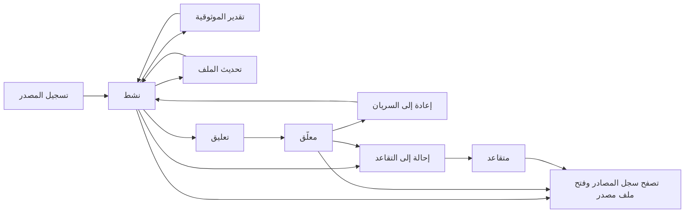
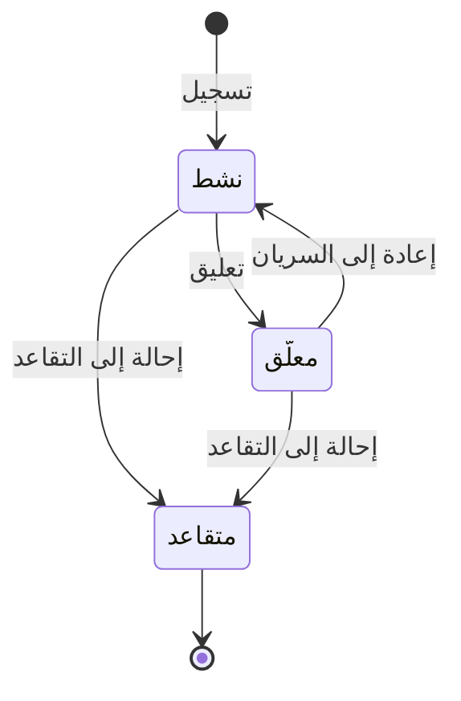

# سجل المصادر وموثوقيتها

<!-- BEGIN GENERATED: doc -->
| البند | القيمة |
|---|---|
| المعرّف | FEAT-COL-SOURCES |
| الإصدار | 0.2 |
| الحالة | مسودة |
| القدرة | CAP-02 جمع المعلومات |
| القدرة الفرعية | CAP-02.02 إدارة المصادر (R1) |
| الأدوار | المحلل |
| الشاشات | SCR-22 الادعاء والدليل والمصدر |
| حالات الاستخدام | UC-004، UC-095 |
| القصص | 10: 7 من المواصفة، و3 جديدة |
<!-- END GENERATED: doc -->

## 1. نظرة عامة

### 1.1 القيمة

يحفظ لكل مصدر ملفه ونوعه وتقدير موثوقيته عبر الزمن ويتيح تعليقه أو إحالته إلى التقاعد.

### 1.2 النطاق

| البند | القيمة |
|---|---|
| المستخدمون | المحلل: يسجّل المصدر، ويقدّر موثوقيته، ويحدّث ملفه، ويعلّقه أو يعيده إلى السريان أو يحيله إلى التقاعد. وأي مستخدم مخوَّل يتصفح السجل ويفتح ملف مصدر |
| الشاشات | SCR-22 الادعاء والدليل والمصدر |
| حالات الاستخدام (بالكلام) | تسجيل مصدر جديد بنوعه وجهته المالكة وتصنيفه وموثوقيته الأولى؛ تقدير موثوقية جديدة له مع بقاء التقديرات السابقة قابلة للاستعلام بوقتها؛ تحديث اسمه أو بيانات الاتصال به؛ تعليقه مؤقتًا أو إعادته إلى السريان؛ إحالته إلى التقاعد؛ تصفح سجل المصادر وتصفيته، وفتح ملف مصدر واحد |
| المتطلبات (بالكلام) | كل مصدر مسجَّل بنوعه وجهته المالكة وتصنيفه وتقدير موثوقية مؤرخ، وتاريخ التقديرات السابقة يبقى قابلاً للاستعلام (REQ-INF-001) |
| خارج النطاق | تحديد مستوى حماية هوية المصدر وإعادة تصنيفه، وإخفاء هويته في الشاشة — في ميزة حماية المصدر المنفصلة؛ وحسم تعارض ادعاءات مصدرين على الشيء نفسه — في قدرة التحليل |

### 1.3 خريطة الميزة

**الشكل 1: خريطة ميزة سجل المصادر وموثوقيتها**



**الشكل 2: رحلة حالات المصدر**



## 2. القواعد المشتركة

تنطبق على كل قصص الميزة، فلا تتكرر داخل القصص. وكل قصة تذكر ما يخصها فقط.

### 2.1 السياق المشترك

كل قصة تبدأ من ثلاثة شروط: مستأجر نشط، وحزمة السياسات الأساسية مفعّلة، ومستخدم مسجّل الدخول ومخوَّل. وتشير إليها القصص بخطوة واحدة: «بفرض السياق المشترك للميزة».

### 2.2 الصلاحية وعدم الإفصاح

- من لا يحق له رؤية العنصر يتلقى ردًا بشكل «غير متاح» تمامًا، فلا يعرف أنه موجود.
- من يرى العنصر ولا يحق له الإجراء يتلقى «لا تملك صلاحية هذا الإجراء».

### 2.3 أوامر تغيير الحالة

- **منع التكرار:** يُرسل كل أمر بمفتاح فريد، فإعادة الطلب نفسه لا تُنفَّذ مرتين.
- **حماية التعديل المتزامن:** يُرسل كل أمر بإصدار البيانات الذي يراه المستخدم. فإن عدّلها غيره في الأثناء، يُرفض الأمر.
- **السجل:** إن نجح الأمر، يُكتب حدثه وسجل التدقيق في المعاملة نفسها.

### 2.4 الرفض المشترك

```gherkin
# language: ar
خاصية: الرفض المشترك لأوامر الميزة

  سيناريو مخطط: رفض مشترك لكل أمر في الميزة
    بفرض السياق المشترك للميزة
    و <الحالة>
    عندما يُرسل المستخدم أي أمر من أوامر الميزة
    اذاً يُرفض برمز <الرمز> ويرى "<الرسالة>"
    و لا يتغير شيء

    امثلة:
      | الحالة                                  | الرمز                  | الرسالة                                                 |
      | العنصر خارج صلاحياته                    | NOT_FOUND              | غير متاح                                                |
      | العنصر مرئي له ولا يحق له الإجراء       | AUTHZ_DENIED           | لا تملك صلاحية هذا الإجراء                              |
      | غيره عدّل العنصر بعد أن فتحه            | VERSION_CONFLICT       | تغيّرت البيانات منذ فتحتها. راجع التغييرات ثم أعد المحاولة |
      | أعاد مفتاح منع التكرار بمحتوى مختلف     | IDEMPOTENCY_KEY_REUSED | طلب مكرر بمحتوى مختلف                                   |
      | البيانات ناقصة أو غير صحيحة             | VALIDATION_FAILED      | بعض البيانات ناقصة أو غير صحيحة. راجع الحقول المعلَّمة      |

  سيناريو: إعادة الطلب نفسه لا تُنفَّذ مرتين
    بفرض السياق المشترك للميزة
    و أمر نجح بمفتاح منع تكرار
    عندما يُعاد الطلب نفسه بالمفتاح نفسه
    اذاً تُعاد النتيجة الأولى ولا يُكتب حدث ثانٍ
```

## 3. الجودة وتعريف الاكتمال

### 3.1 متطلبات الجودة

<!-- BEGIN GENERATED: quality -->
لا متطلبات جودة مرتبطة بمتطلبات هذه الميزة مباشرة. تنطبق متطلبات المنصة العامة (`FEAT-PLT-*`).
<!-- END GENERATED: quality -->

### 3.2 تعريف الاكتمال

القصة مكتملة حين تتحقق الشروط الخمسة:

1. سيناريوهاتها والقواعد المشتركة تمر في الاختبار الآلي.
2. فحوص البنية المعمارية تمر.
3. نصوص الواجهة والرسائل موجودة بالعربية والإنجليزية.
4. مراجعة الكود مكتملة.
5. ما تضيفه القصة نفسها في قسم «القواعد» تحقق.

## 4. فهرس القصص

<!-- BEGIN GENERATED: story-index -->
| المعرّف | القصة | النوع | الحالة |
|---|---|---|---|
| `US-BC02-SRC-RATE-RELIABILITY` | تقدير موثوقية المصدر | أمر | مسودة |
| `US-BC02-SRC-REGISTER` | تسجيل المصدر | أمر | مسودة |
| `US-BC02-SRC-REINSTATE` | إعادة المصدر إلى السريان | أمر | مسودة |
| `US-BC02-SRC-RETIRE` | إحالة المصدر إلى التقاعد | أمر | مسودة |
| `US-BC02-SRC-SUSPEND` | تعليق المصدر | أمر | مسودة |
| `US-BC02-SRC-UPDATE-PROFILE` | تحديث ملف المصدر | أمر | مسودة |
| `US-BC02-Q-SRC-GET` | جلب تفاصيل مصدر واحد | جلب | مسودة |
| `US-DOM-SRC-LIST` | عرض سجل المصادر وتصفيته | جلب | مسودة |
| `US-UI-SCR22-SOURCE-LIST` | تصفح المصادر حسب النوع والحالة والموثوقية | واجهة | مسودة |
| `US-UI-SCR22-SOURCE-PROFILE` | ملف المصدر وتاريخ تقديرات موثوقيته | واجهة | مسودة |
<!-- END GENERATED: story-index -->

## 5. القصص

### 5.1 US-BC02-SRC-RATE-RELIABILITY — تقدير موثوقية المصدر

| النوع | الإصدار | الأولوية | دون اتصال | الحالة |
|---|---|---|---|---|
| أمر | R1 | Must | لا | مسودة |

> **كـ** المحلل، **أريد** أن أسجّل تقدير موثوقية جديدًا للمصدر مع تاريخ نفاذه وسببه، **حتى** يعرف من يستخدم ادعاءاته أي موثوقية كانت سارية في كل وقت.

**باختصار:** تقدير موثوقية جديد (من A إلى F) مع تاريخ نفاذ وسبب يُضاف تقديرًا جديدًا مؤرخًا، والتقدير السابق يبقى قابلاً للاستعلام بوقته (REQ-INF-001).

#### القواعد

- **متى يُسمح:** المصدر نشط أو معلّق، وليس متقاعدًا.
- **من يُسمح له:** المحلل.
- **البيانات:** درجة الموثوقية (من A إلى F)، وتاريخ نفاذها، والسبب — الثلاثة إلزامية.
- **الأثر:** يُسجَّل حدث «قُدِّرت موثوقية المصدر»، والتقدير السابق يبقى قابلاً للاستعلام بوقته.

#### معايير القبول

```gherkin
# language: ar
خاصية: تقدير موثوقية المصدر

  سيناريو: المحلل يقدّر موثوقية مصدر نشط
    بفرض السياق المشترك للميزة
    و مصدر نشط
    عندما يسجّل المحلل درجة موثوقية جديدة بتاريخ نفاذ وسبب
    اذاً يُضاف تقدير موثوقية جديد للمصدر
    و يُسجَّل حدث "قُدِّرت موثوقية المصدر"
    و يبقى التقدير السابق قابلاً للاستعلام بوقته

  سيناريو مخطط: رفض خاص بتقدير الموثوقية
    بفرض السياق المشترك للميزة
    و <الحالة>
    عندما يحاول المحلل تقدير موثوقية المصدر
    اذاً يُرفض برمز <الرمز> ويرى "<الرسالة>"
    و لا يتغير شيء

    امثلة:
      | الحالة                          | الرمز                          | الرسالة                                             |
      | المصدر متقاعد                   | SOURCE_INVALID_STATE_TRANSITION | الوضع الحالي للمصدر لا يسمح بهذا الإجراء            |
      | درجة الموثوقية خارج المدى من A إلى F | RATING_INVALID             | درجة الموثوقية يجب أن تكون من A إلى F مع تاريخ بداية |
      | تاريخ النفاذ فارغ               | VALIDATION_FAILED               | تاريخ النفاذ مطلوب                                  |
```

<details><summary>المراجع التقنية والتتبع</summary>

<!-- BEGIN GENERATED: refs US-BC02-SRC-RATE-RELIABILITY -->
| البند | المعرّف | المعنى |
|---|---|---|
| الواجهة البرمجية | `POST /api/v1/information/sources/{id}/actions/rate-reliability` | — |
| الأمر | `CMD-SRC-RATE-RELIABILITY` | تقدير موثوقية المصدر |
| السياسة | `POL-SRC-RATE-RELIABILITY` | Analyst (register, rate, profile) · Security Officer (protection, reclassify)؛ tenant match; object visible t… |
| الحدث | `EVT-SRC-RELIABILITY-RATED` | يصل إلى: Search/Graph projections (SLC-05) |
| الكيان | `AGG-SOURCE` | المصدر |
| الجدول | `information.sources` | الجدول الرئيسي للمصدر |
| وحدة النشر | DU-04 | — |
| المتطلب | REQ-INF-001 | The system shall register each source with type, owner, classification and a reliability rating, and keep the… |
| حالات الاستخدام | UC-004، UC-095 | Manage Source؛ Rate Source Reliability |
| الاختبار | TST-SOURCE-SM، TST-SLC02-INVARIANTS | دورة حالات المصدر، وثوابت الشريحة SLC-02 |
<!-- END GENERATED: refs US-BC02-SRC-RATE-RELIABILITY -->

</details>

### 5.2 US-BC02-SRC-REGISTER — تسجيل المصدر

| النوع | الإصدار | الأولوية | دون اتصال | الحالة |
|---|---|---|---|---|
| أمر | R1 | Must | لا | مسودة |

> **كـ** المحلل، **أريد** أن أسجّل مصدرًا جديدًا بنوعه وجهته المالكة وتصنيفه وتقدير موثوقيته الأول، **حتى** يمكن الاستشهاد به في الادعاءات والملاحظات.

**باختصار:** يُسجَّل المصدر بنوع من الأنواع المعتمدة وتقدير موثوقية أول فيصبح نشطًا فورًا؛ ومصادر الأشخاص تأخذ مستوى حماية هوية لا يقل عن 1، وتصنيفًا لا يقل عن تصنيف المستأجر الافتراضي برتبة واحدة.

#### القواعد

- **متى يُسمح:** لا يوجد مصدر بهذا التسجيل من قبل؛ إنشاء جديد فقط.
- **من يُسمح له:** المحلل.
- **البيانات:** النوع (من الأنواع المعتمدة)، والاسم، والجهة المالكة، ودرجة الموثوقية الأولى وتاريخ نفاذها، والتصنيف — إلزامية؛ مستوى الحماية إلزامي لمصادر الأشخاص فقط.
- **الأثر:** يصبح المصدر نشطًا، ويُسجَّل حدث «سُجِّل المصدر».

#### معايير القبول

```gherkin
# language: ar
خاصية: تسجيل المصدر

  سيناريو: المحلل يسجّل مصدرًا جديدًا
    بفرض السياق المشترك للميزة
    عندما يسجّل المحلل مصدرًا بنوع معتمد وموثوقية أولى وتصنيف
    اذاً يصبح المصدر نشطًا
    و يُسجَّل حدث "سُجِّل المصدر"

  سيناريو مخطط: رفض خاص بتسجيل المصدر
    بفرض السياق المشترك للميزة
    و <الحالة>
    عندما يحاول المحلل تسجيل المصدر
    اذاً يُرفض برمز <الرمز> ويرى "<الرسالة>"
    و لا يتغير شيء

    امثلة:
      | الحالة                                                        | الرمز           | الرسالة                     |
      | النوع ليس من الأنواع المعتمدة، أو مصدر شخص بلا مستوى حماية كافٍ | SOURCE_INVALID | بيانات المصدر غير صحيحة     |
      | التصنيف فارغ                                                  | VALIDATION_FAILED | التصنيف مطلوب            |
```

<details><summary>المراجع التقنية والتتبع</summary>

<!-- BEGIN GENERATED: refs US-BC02-SRC-REGISTER -->
| البند | المعرّف | المعنى |
|---|---|---|
| الواجهة البرمجية | `POST /api/v1/information/sources` | — |
| الأمر | `CMD-SRC-REGISTER` | تسجيل المصدر |
| السياسة | `POL-SRC-REGISTER` | Analyst (register, rate, profile) · Security Officer (protection, reclassify)؛ tenant match; object visible t… |
| الحدث | `EVT-SRC-REGISTERED` | يصل إلى: Search/Graph projections (SLC-05) |
| الكيان | `AGG-SOURCE` | المصدر |
| الجدول | `information.sources` | الجدول الرئيسي للمصدر |
| وحدة النشر | DU-04 | — |
| المتطلب | REQ-INF-001 | The system shall register each source with type, owner, classification and a reliability rating, and keep the… |
| حالات الاستخدام | UC-004، UC-095 | Manage Source؛ Rate Source Reliability |
| الاختبار | TST-SOURCE-SM، TST-SLC02-INVARIANTS | دورة حالات المصدر، وثوابت الشريحة SLC-02 |
<!-- END GENERATED: refs US-BC02-SRC-REGISTER -->

</details>

### 5.3 US-BC02-SRC-REINSTATE — إعادة المصدر إلى السريان

| النوع | الإصدار | الأولوية | دون اتصال | الحالة |
|---|---|---|---|---|
| أمر | R1 | Must | لا | مسودة |

> **كـ** المحلل، **أريد** أن أعيد مصدرًا معلّقًا إلى السريان، **حتى** يمكن الاستشهاد به من جديد في ادعاءات وملاحظات جديدة.

**باختصار:** يعيد المحلل المصدر المعلّق إلى حالة نشط دون شروط إضافية.

#### القواعد

- **متى يُسمح:** المصدر معلّق فقط.
- **من يُسمح له:** المحلل.
- **البيانات:** لا مدخلات.
- **الأثر:** يصبح المصدر نشطًا، ويُسجَّل حدث «أُعيد المصدر إلى السريان».

#### معايير القبول

```gherkin
# language: ar
خاصية: إعادة المصدر إلى السريان

  سيناريو: المحلل يعيد مصدرًا معلّقًا إلى السريان
    بفرض السياق المشترك للميزة
    و مصدر معلّق
    عندما يعيد المحلل المصدر إلى السريان
    اذاً يصبح المصدر نشطًا
    و يُسجَّل حدث "أُعيد المصدر إلى السريان"

  سيناريو مخطط: رفض خاص بإعادة السريان
    بفرض السياق المشترك للميزة
    و <الحالة>
    عندما يحاول المحلل إعادة المصدر إلى السريان
    اذاً يُرفض برمز <الرمز> ويرى "<الرسالة>"
    و لا يتغير شيء

    امثلة:
      | الحالة                          | الرمز                          | الرسالة                                  |
      | المصدر نشط أو متقاعد، وليس معلّقًا | SOURCE_INVALID_STATE_TRANSITION | الوضع الحالي للمصدر لا يسمح بهذا الإجراء |
```

<details><summary>المراجع التقنية والتتبع</summary>

<!-- BEGIN GENERATED: refs US-BC02-SRC-REINSTATE -->
| البند | المعرّف | المعنى |
|---|---|---|
| الواجهة البرمجية | `POST /api/v1/information/sources/{id}/actions/reinstate` | — |
| الأمر | `CMD-SRC-REINSTATE` | إعادة المصدر إلى السريان |
| السياسة | `POL-SRC-REINSTATE` | Analyst (reinstate)؛ tenant match; object visible to subject (label ≤ clearance); write permission in org sco… |
| الحدث | `EVT-SRC-REINSTATED` | يصل إلى: Search/Graph projections (SLC-05) |
| الكيان | `AGG-SOURCE` | المصدر |
| الجدول | `information.sources` | الجدول الرئيسي للمصدر |
| وحدة النشر | DU-04 | — |
| المتطلب | REQ-INF-001 | The system shall register each source with type, owner, classification and a reliability rating, and keep the… |
| حالات الاستخدام | UC-004، UC-095 | Manage Source؛ Rate Source Reliability |
| الاختبار | TST-SOURCE-SM، TST-SLC02-INVARIANTS | دورة حالات المصدر، وثوابت الشريحة SLC-02 |
<!-- END GENERATED: refs US-BC02-SRC-REINSTATE -->

</details>

### 5.4 US-BC02-SRC-RETIRE — إحالة المصدر إلى التقاعد

| النوع | الإصدار | الأولوية | دون اتصال | الحالة |
|---|---|---|---|---|
| أمر | R1 | Must | لا | مسودة |

> **كـ** المحلل، **أريد** أن أحيل مصدرًا إلى التقاعد بسبب، **حتى** يتوقف الاستشهاد به مستقبلًا مع بقاء سجله وتقديراته السابقة كما هي.

**باختصار:** إحالة مصدر نشط أو معلّق إلى التقاعد بسبب؛ حالة نهائية لا رجوع منها، ولا تتغير التقديرات والادعاءات السابقة.

#### القواعد

- **متى يُسمح:** المصدر نشط أو معلّق.
- **من يُسمح له:** المحلل.
- **البيانات:** السبب — إلزامي.
- **الأثر:** يصبح المصدر متقاعدًا (حالة نهائية)، ويُسجَّل حدث «أُحيل المصدر إلى التقاعد». ولا يجوز الاستشهاد به بعدها في ادعاءات أو ملاحظات جديدة.

#### معايير القبول

```gherkin
# language: ar
خاصية: إحالة المصدر إلى التقاعد

  سيناريو: المحلل يحيل مصدرًا نشطًا إلى التقاعد
    بفرض السياق المشترك للميزة
    و مصدر نشط
    عندما يحيله المحلل إلى التقاعد بسبب
    اذاً يصبح المصدر متقاعدًا
    و يُسجَّل حدث "أُحيل المصدر إلى التقاعد"

  سيناريو مخطط: رفض خاص بإحالة التقاعد
    بفرض السياق المشترك للميزة
    و <الحالة>
    عندما يحاول المحلل إحالة المصدر إلى التقاعد
    اذاً يُرفض برمز <الرمز> ويرى "<الرسالة>"
    و لا يتغير شيء

    امثلة:
      | الحالة            | الرمز                          | الرسالة                                  |
      | السبب فارغ         | REASON_REQUIRED                | اذكر السبب                               |
      | المصدر متقاعد من قبل | SOURCE_INVALID_STATE_TRANSITION | الوضع الحالي للمصدر لا يسمح بهذا الإجراء |
```

<details><summary>المراجع التقنية والتتبع</summary>

<!-- BEGIN GENERATED: refs US-BC02-SRC-RETIRE -->
| البند | المعرّف | المعنى |
|---|---|---|
| الواجهة البرمجية | `POST /api/v1/information/sources/{id}/actions/retire` | — |
| الأمر | `CMD-SRC-RETIRE` | إحالة المصدر إلى التقاعد |
| السياسة | `POL-SRC-RETIRE` | Analyst (retire)؛ tenant match; object visible to subject (label ≤ clearance); write permission in org scope |
| الحدث | `EVT-SRC-RETIRED` | يصل إلى: Search/Graph projections (SLC-05) |
| الكيان | `AGG-SOURCE` | المصدر |
| الجدول | `information.sources` | الجدول الرئيسي للمصدر |
| وحدة النشر | DU-04 | — |
| المتطلب | REQ-INF-001 | The system shall register each source with type, owner, classification and a reliability rating, and keep the… |
| حالات الاستخدام | UC-004، UC-095 | Manage Source؛ Rate Source Reliability |
| الاختبار | TST-SOURCE-SM، TST-SLC02-INVARIANTS | دورة حالات المصدر، وثوابت الشريحة SLC-02 |
<!-- END GENERATED: refs US-BC02-SRC-RETIRE -->

</details>

### 5.5 US-BC02-SRC-SUSPEND — تعليق المصدر

| النوع | الإصدار | الأولوية | دون اتصال | الحالة |
|---|---|---|---|---|
| أمر | R1 | Must | لا | مسودة |

> **كـ** المحلل، **أريد** أن أعلّق مصدرًا نشطًا بسبب، **حتى** يتوقف الاستشهاد به مؤقتًا إلى أن تُراجَع موثوقيته.

**باختصار:** تعليق مصدر نشط بسبب؛ لا يجوز الاستشهاد به في ادعاءات أو ملاحظات جديدة ما دام معلّقًا، ويمكن إعادته إلى السريان لاحقًا.

#### القواعد

- **متى يُسمح:** المصدر نشط فقط.
- **من يُسمح له:** المحلل.
- **البيانات:** السبب — إلزامي.
- **الأثر:** يصبح المصدر معلّقًا، ويُسجَّل حدث «عُلِّق المصدر».

#### معايير القبول

```gherkin
# language: ar
خاصية: تعليق المصدر

  سيناريو: المحلل يعلّق مصدرًا نشطًا
    بفرض السياق المشترك للميزة
    و مصدر نشط
    عندما يعلّقه المحلل بسبب
    اذاً يصبح المصدر معلّقًا
    و يُسجَّل حدث "عُلِّق المصدر"

  سيناريو مخطط: رفض خاص بالتعليق
    بفرض السياق المشترك للميزة
    و <الحالة>
    عندما يحاول المحلل تعليق المصدر
    اذاً يُرفض برمز <الرمز> ويرى "<الرسالة>"
    و لا يتغير شيء

    امثلة:
      | الحالة                            | الرمز                          | الرسالة                                  |
      | السبب فارغ                        | REASON_REQUIRED                | اذكر السبب                               |
      | المصدر معلّق أو متقاعد من قبل، وليس نشطًا | SOURCE_INVALID_STATE_TRANSITION | الوضع الحالي للمصدر لا يسمح بهذا الإجراء |
```

<details><summary>المراجع التقنية والتتبع</summary>

<!-- BEGIN GENERATED: refs US-BC02-SRC-SUSPEND -->
| البند | المعرّف | المعنى |
|---|---|---|
| الواجهة البرمجية | `POST /api/v1/information/sources/{id}/actions/suspend` | — |
| الأمر | `CMD-SRC-SUSPEND` | تعليق المصدر |
| السياسة | `POL-SRC-SUSPEND` | Analyst (suspend)؛ tenant match; object visible to subject (label ≤ clearance); write permission in org scope |
| الحدث | `EVT-SRC-SUSPENDED` | يصل إلى: Search/Graph projections (SLC-05) |
| الكيان | `AGG-SOURCE` | المصدر |
| الجدول | `information.sources` | الجدول الرئيسي للمصدر |
| وحدة النشر | DU-04 | — |
| المتطلب | REQ-INF-001 | The system shall register each source with type, owner, classification and a reliability rating, and keep the… |
| حالات الاستخدام | UC-004، UC-095 | Manage Source؛ Rate Source Reliability |
| الاختبار | TST-SOURCE-SM، TST-SLC02-INVARIANTS | دورة حالات المصدر، وثوابت الشريحة SLC-02 |
<!-- END GENERATED: refs US-BC02-SRC-SUSPEND -->

</details>

### 5.6 US-BC02-SRC-UPDATE-PROFILE — تحديث ملف المصدر

| النوع | الإصدار | الأولوية | دون اتصال | الحالة |
|---|---|---|---|---|
| أمر | R1 | Must | لا | مسودة |

> **كـ** المحلل، **أريد** أن أحدّث اسم المصدر أو بيانات الاتصال به، **حتى** يبقى ملفه دقيقًا دون التأثير في موثوقيته أو حالته.

**باختصار:** تحديث الاسم أو بيانات الاتصال لمصدر نشط أو معلّق، دون تغيير حالته أو موثوقيته.

#### القواعد

- **متى يُسمح:** المصدر نشط أو معلّق.
- **من يُسمح له:** المحلل.
- **البيانات:** الاسم أو بيانات الاتصال — عند وجودها في الطلب.
- **الأثر:** تتحدَّث بيانات الملف، ويُسجَّل حدث «حُدِّث ملف المصدر»، دون تغيير الحالة أو الموثوقية.

#### معايير القبول

```gherkin
# language: ar
خاصية: تحديث ملف المصدر

  سيناريو: المحلل يحدّث ملف مصدر نشط
    بفرض السياق المشترك للميزة
    و مصدر نشط
    عندما يحدّث المحلل اسمه أو بيانات الاتصال به
    اذاً تتحدَّث بيانات الملف
    و يُسجَّل حدث "حُدِّث ملف المصدر"

  سيناريو مخطط: رفض خاص بتحديث الملف
    بفرض السياق المشترك للميزة
    و <الحالة>
    عندما يحاول المحلل تحديث ملف المصدر
    اذاً يُرفض برمز <الرمز> ويرى "<الرسالة>"
    و لا يتغير شيء

    امثلة:
      | الحالة         | الرمز                          | الرسالة                                  |
      | المصدر متقاعد   | SOURCE_INVALID_STATE_TRANSITION | الوضع الحالي للمصدر لا يسمح بهذا الإجراء |
```

<details><summary>المراجع التقنية والتتبع</summary>

<!-- BEGIN GENERATED: refs US-BC02-SRC-UPDATE-PROFILE -->
| البند | المعرّف | المعنى |
|---|---|---|
| الواجهة البرمجية | `POST /api/v1/information/sources/{id}/actions/update-profile` | — |
| الأمر | `CMD-SRC-UPDATE-PROFILE` | تحديث ملف المصدر |
| السياسة | `POL-SRC-UPDATE-PROFILE` | Analyst (register, rate, profile) · Security Officer (protection, reclassify)؛ tenant match; object visible t… |
| الحدث | `EVT-SRC-PROFILE-UPDATED` | يصل إلى: Search/Graph projections (SLC-05) |
| الكيان | `AGG-SOURCE` | المصدر |
| الجدول | `information.sources` | الجدول الرئيسي للمصدر |
| وحدة النشر | DU-04 | — |
| المتطلب | REQ-INF-001 | The system shall register each source with type, owner, classification and a reliability rating, and keep the… |
| حالات الاستخدام | UC-004، UC-095 | Manage Source؛ Rate Source Reliability |
| الاختبار | TST-SOURCE-SM، TST-SLC02-INVARIANTS | دورة حالات المصدر، وثوابت الشريحة SLC-02 |
<!-- END GENERATED: refs US-BC02-SRC-UPDATE-PROFILE -->

</details>

### 5.7 US-BC02-Q-SRC-GET — جلب تفاصيل مصدر واحد

| النوع | الإصدار | الأولوية | دون اتصال | الحالة |
|---|---|---|---|---|
| جلب | R1 | Must | لا | مسودة |

> **كـ** المحلل، **أريد** أن أطّلع على تفاصيل مصدر واحد، **حتى** أعرف نوعه وموثوقيته الحالية وتاريخ تقديراته.

**باختصار:** تُعاد تفاصيل المصدر لمن يحق له رؤيته؛ وهوية مصادر الأشخاص لا تظهر إلا لمن يحمل صلاحية حماية المصدر.

#### القواعد

- **من يُسمح له:** من يرى ماذا: أي مستخدم مخوَّل ضمن نطاقه يرى النوع والموثوقية؛ وهوية مصدر من نوع «شخص» لا تظهر إلا لحامل صلاحية حماية المصدر.
- **البيانات:** لا مرشحات؛ الطلب بمعرّف المصدر.

#### معايير القبول

```gherkin
# language: ar
خاصية: جلب تفاصيل المصدر

  سيناريو: المحلل يرى تفاصيل مصدر مرئي له
    بفرض السياق المشترك للميزة
    و مصدر داخل نطاقه
    عندما يطلب تفاصيل المصدر
    اذاً تُعاد التفاصيل بعد إعادة فحص الصلاحية

  سيناريو: هوية مصدر الشخص محجوبة عن غير المخوَّل بحمايته
    بفرض السياق المشترك للميزة
    و مصدر من نوع شخص وليس للمستخدم صلاحية حماية المصدر عليه
    عندما يطلب تفاصيل المصدر
    اذاً تُعاد التفاصيل بلا سمات الهوية، وتظهر النوع والموثوقية فقط
```

<details><summary>المراجع التقنية والتتبع</summary>

<!-- BEGIN GENERATED: refs US-BC02-Q-SRC-GET -->
| البند | المعرّف | المعنى |
|---|---|---|
| الواجهة البرمجية | `GET /api/v1/information/sources/{source_id}` | — |
| الاستعلام | `QRY-SRC-GET` | Source; identity only with source-protection permission |
| السياسة | `POL-SRC-GET` | org scope ∩ classification rule; claims filtered by label |
| الكيان | `AGG-SOURCE` | المصدر |
| الجدول | `information.sources` | الجدول الرئيسي للمصدر |
| وحدة النشر | DU-04 | — |
| المتطلب | REQ-INF-001 | The system shall register each source with type, owner, classification and a reliability rating, and keep the… |
| حالات الاستخدام | UC-004، UC-095 | Manage Source؛ Rate Source Reliability |
| الاختبار | TST-SOURCE-SM، TST-SLC02-INVARIANTS | دورة حالات المصدر، وثوابت الشريحة SLC-02 |
<!-- END GENERATED: refs US-BC02-Q-SRC-GET -->

</details>

### 5.8 US-DOM-SRC-LIST — عرض سجل المصادر وتصفيته

| النوع | الإصدار | الأولوية | دون اتصال | الحالة |
|---|---|---|---|---|
| جلب | R1 | Must | لا | مسودة |

> **كـ** المحلل، **أريد** أن أتصفح سجل المصادر وأصفيه حسب النوع والحالة والموثوقية، **حتى** أجد المصدر الذي أحتاجه بسرعة. **[Derived]**

**باختصار:** قائمة بالمصادر المرئية للمستخدم فقط، صفحةً بعد صفحة، مع مرشحات النوع والحالة ودرجة الموثوقية. **[Derived]**: لا يذكر أمر أو استعلام في المواصفة شاشة سجل المصادر صريحًا؛ استُنتجت من REQ-INF-001 وشاشة SCR-22.

#### القواعد

- **من يُسمح له:** من يرى ماذا: كل مستخدم مخوَّل يرى المصادر ضمن نطاقه فقط. **[Derived]**
- **البيانات:** مرشحات النوع والحالة ودرجة الموثوقية، والمؤشر والحد. **[Derived]**

#### معايير القبول

```gherkin
# language: ar
خاصية: عرض سجل المصادر وتصفيته

  سيناريو: يرى المحلل المصادر المرئية له فقط
    بفرض السياق المشترك للميزة
    و للمستخدم مصادر داخل نطاقه وأخرى خارجه
    عندما يطلب سجل المصادر
    اذاً تُعاد المصادر داخل نطاقه فقط
    و لا يكشف أي عدد أو اقتراح وجود مصدر محجوب

  سيناريو: الصفحة التالية
    بفرض السياق المشترك للميزة
    و مصادره أكثر من صفحة
    عندما يطلب الصفحة التالية بالمؤشر
    اذاً تُعاد المصادر التالية دون تكرار ولا فجوة
```

<details><summary>المراجع التقنية والتتبع</summary>

<!-- BEGIN GENERATED: refs US-DOM-SRC-LIST -->
| البند | المعرّف | المعنى |
|---|---|---|
| حالة الاستخدام | UC-004 | Manage Source |
| الشاشة | SCR-22 | شاشة الادعاء والدليل والمصدر |
| المصدر | `[Derived]` | — |
| المتطلب | REQ-INF-001 | The system shall register each source with type, owner, classification and a reliability rating, and keep the… |
| حالات الاستخدام | UC-004، UC-095 | Manage Source؛ Rate Source Reliability |
<!-- END GENERATED: refs US-DOM-SRC-LIST -->

</details>

### 5.9 US-UI-SCR22-SOURCE-LIST — تصفح المصادر حسب النوع والحالة والموثوقية

| النوع | الإصدار | الأولوية | دون اتصال | الحالة |
|---|---|---|---|---|
| واجهة | R1 | Must | لا | مسودة |

> **كـ** المحلل، **أريد** أن أتصفح قائمة المصادر في شاشة الادعاء والدليل والمصدر، **حتى** أختار المصدر الصحيح عند تسجيل ادعاء أو دليل.

**باختصار:** قائمة مرقّمة بالمؤشر مع مرشحات النوع والحالة والموثوقية في عنوان الرابط، بلا عدد إجمالي يكشف عناصر محجوبة (21-ui-design.md §6.1).

#### معايير القبول

```gherkin
# language: ar
خاصية: تصفح المصادر

  سيناريو: المحلل يصفّي القائمة حسب النوع والحالة
    بفرض السياق المشترك للميزة
    عندما يختار المحلل نوعًا وحالة من المرشحات
    اذاً تُعاد المصادر المطابقة فقط، داخل نطاقه
    و لا يُعرض عدد إجمالي يكشف عناصر محجوبة

  سيناريو: اختيار مصدر من القائمة
    بفرض السياق المشترك للميزة
    و قائمة مصادر معروضة
    عندما يختار المحلل مصدرًا منها
    اذاً تُفتح شاشة ملف المصدر بنفس الإصدار المعروض
```

<details><summary>المراجع التقنية والتتبع</summary>

<!-- BEGIN GENERATED: refs US-UI-SCR22-SOURCE-LIST -->
| البند | المعرّف | المعنى |
|---|---|---|
| الشاشة | SCR-22 | شاشة الادعاء والدليل والمصدر |
| المصدر | `21-ui-design.md §6.1` | — |
| المصدر | `[Derived]` | — |
| المتطلب | REQ-INF-001 | The system shall register each source with type, owner, classification and a reliability rating, and keep the… |
| حالات الاستخدام | UC-004، UC-095 | Manage Source؛ Rate Source Reliability |
<!-- END GENERATED: refs US-UI-SCR22-SOURCE-LIST -->

</details>

### 5.10 US-UI-SCR22-SOURCE-PROFILE — ملف المصدر وتاريخ تقديرات موثوقيته

| النوع | الإصدار | الأولوية | دون اتصال | الحالة |
|---|---|---|---|---|
| واجهة | R1 | Must | لا | مسودة |

> **كـ** المحلل، **أريد** أن أرى ملف المصدر وتاريخ كل تقدير موثوقية سجَّله مؤرَّخًا، **حتى** أفهم كيف تغيرت موثوقيته قبل أن أستشهد به.

**باختصار:** تعرض الشاشة بيانات ملف المصدر الحالية، وتحتها تاريخ تقديرات الموثوقية من الأحدث إلى الأقدم، كل تقدير بتاريخ نفاذه وسببه (UC-095).

#### معايير القبول

```gherkin
# language: ar
خاصية: ملف المصدر وتاريخ موثوقيته

  سيناريو: المحلل يفتح ملف مصدر ويرى تاريخ موثوقيته
    بفرض السياق المشترك للميزة
    و مصدر له أكثر من تقدير موثوقية
    عندما يفتح المحلل ملف المصدر
    اذاً يرى بياناته الحالية
    و يرى تقديرات موثوقيته من الأحدث إلى الأقدم، كل تقدير بتاريخ نفاذه وسببه

  سيناريو: هوية مصدر الشخص لا تظهر في الملف لغير المخوَّل بحمايته
    بفرض السياق المشترك للميزة
    و مصدر من نوع شخص وليس للمستخدم صلاحية حماية المصدر عليه
    عندما يفتح المحلل ملف المصدر
    اذاً لا تظهر سمات الهوية، ويظهر النوع والموثوقية فقط
```

<details><summary>المراجع التقنية والتتبع</summary>

<!-- BEGIN GENERATED: refs US-UI-SCR22-SOURCE-PROFILE -->
| البند | المعرّف | المعنى |
|---|---|---|
| الشاشة | SCR-22 | شاشة الادعاء والدليل والمصدر |
| حالة الاستخدام | UC-095 | Rate Source Reliability |
| المصدر | `21-ui-design.md §6.3` | — |
| المتطلب | REQ-INF-001 | The system shall register each source with type, owner, classification and a reliability rating, and keep the… |
| حالات الاستخدام | UC-004، UC-095 | Manage Source؛ Rate Source Reliability |
<!-- END GENERATED: refs US-UI-SCR22-SOURCE-PROFILE -->

</details>

## 6. التتبع

<!-- BEGIN GENERATED: trace -->
| المتطلب | المعنى | القصص | الاختبار |
|---|---|---|---|
| REQ-INF-001 | The system shall register each source with type, owner, classification and a reliability rating, and keep the… | `US-BC02-Q-SRC-GET`، `US-BC02-SRC-RATE-RELIABILITY`، `US-BC02-SRC-REGISTER`، `US-BC02-SRC-REINSTATE`، `US-BC02-SRC-RETIRE`، `US-BC02-SRC-SUSPEND`، `US-BC02-SRC-UPDATE-PROFILE`، `US-DOM-SRC-LIST`، `US-UI-SCR22-SOURCE-LIST`، `US-UI-SCR22-SOURCE-PROFILE` | TST-SLC02-INVARIANTS، TST-SOURCE-SM |
<!-- END GENERATED: trace -->

## 7. سجل التغييرات

| الإصدار | التاريخ | التغيير |
|---|---|---|
| 0.1 | — | هيكل مولَّد من خريطة الميزات |
| 0.2 | 2026-10-03 | كتابة القصص كاملة بمعيار القصص |
