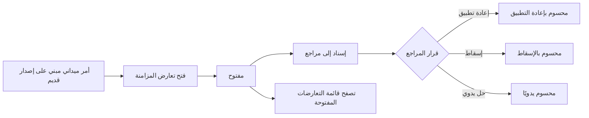
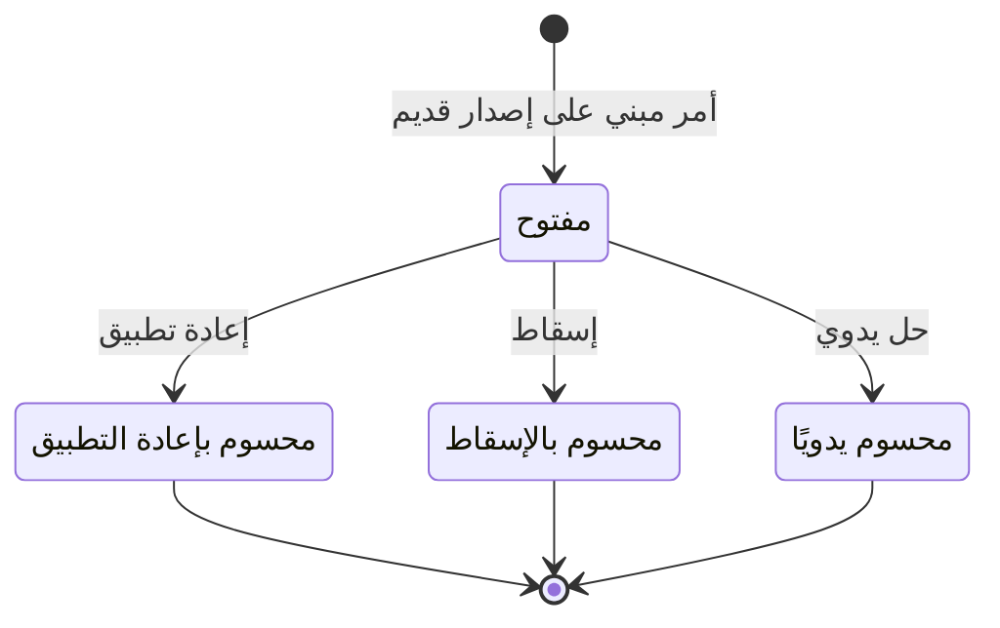

# حل تعارضات المزامنة

<!-- BEGIN GENERATED: doc -->
| البند | القيمة |
|---|---|
| المعرّف | FEAT-COL-SYNC-CONFLICTS |
| الإصدار | 0.2 |
| الحالة | مسودة |
| القدرة | CAP-02 جمع المعلومات |
| القدرة الفرعية | CAP-02.03 تسجيل الملاحظات (بما فيها دون اتصال) (R1) |
| الأدوار | المخطِّط؛ المحلل؛ النظام |
| الشاشات | SCR-06 قوائم المراجعة |
| حالات الاستخدام | UC-092 |
| القصص | 9: 7 من المواصفة، و2 جديدة |
<!-- END GENERATED: doc -->

## 1. نظرة عامة

### 1.1 القيمة

يعرض على المراجع ما تعارض من تسجيلات ميدانية مع الوضع الحالي ليقرر إعادة تطبيقها أو إسقاطها أو حلها يدويًا.

### 1.2 النطاق

| البند | القيمة |
|---|---|
| المستخدمون | المراجع: مالك المهمة أو المخطِّط لتعارضات المهام، والمحلل لتعارضات الملاحظات؛ والنظام يفتح التعارض آليًا |
| الشاشات | SCR-06 قوائم المراجعة |
| حالات الاستخدام (بالكلام) | فتح تعارض مزامنة آليًا حين يصل أمر ميداني مغيّر للحالة مبنيًا على إصدار قديم أو مسجَّل بعد فقد الجهاز؛ إسناد التعارض إلى مراجع؛ وحسمه بإعادة تطبيق الأمر على الإصدار الحالي، أو بإسقاطه بسبب، أو بحل يدوي بملاحظة؛ وتصفح قائمة التعارضات المفتوحة ومراجعة تفاصيل واحد منها؛ والتنبيه حين ترتفع نسبة التعارضات |
| المتطلبات (بالكلام) | الأمر المتعارض لا يُطبَّق بـ«آخر كتابة تغلب» ولا يُرفض بصمت، بل يصل كل تعارض إلى مراجعة إنسان يحسمه (REQ-OFF-004) |
| خارج النطاق | فتح جلسة المزامنة ورفع دفعة الأوامر نفسها — في ميزة جلسة المزامنة؛ وتعارض الادعاءات بين مصدرين على الشيء نفسه — في محرك تعارض الادعاءات بقدرة التحليل |

### 1.3 خريطة الميزة

**الشكل 1: خريطة ميزة حل تعارضات المزامنة**



**الشكل 2: رحلة حالات تعارض المزامنة**



## 2. القواعد المشتركة

تنطبق على كل قصص الميزة، فلا تتكرر داخل القصص. وكل قصة تذكر ما يخصها فقط.

### 2.1 السياق المشترك

كل قصة تبدأ من ثلاثة شروط: مستأجر نشط، وحزمة السياسات الأساسية مفعّلة، ومستخدم مسجّل الدخول ومخوَّل. وتشير إليها القصص بخطوة واحدة: «بفرض السياق المشترك للميزة».

### 2.2 الصلاحية وعدم الإفصاح

- من لا يحق له رؤية العنصر يتلقى ردًا بشكل «غير متاح» تمامًا، فلا يعرف أنه موجود.
- من يرى العنصر ولا يحق له الإجراء يتلقى «لا تملك صلاحية هذا الإجراء».

### 2.3 أوامر تغيير الحالة

- **منع التكرار:** يُرسل كل أمر بمفتاح فريد، فإعادة الطلب نفسه لا تُنفَّذ مرتين.
- **حماية التعديل المتزامن:** يُرسل كل أمر بإصدار البيانات الذي يراه المستخدم. فإن عدّلها غيره في الأثناء، يُرفض الأمر.
- **السجل:** إن نجح الأمر، يُكتب حدثه وسجل التدقيق في المعاملة نفسها.

### 2.4 الرفض المشترك

```gherkin
# language: ar
خاصية: الرفض المشترك لأوامر الميزة

  سيناريو مخطط: رفض مشترك لكل أمر في الميزة
    بفرض السياق المشترك للميزة
    و <الحالة>
    عندما يُرسل المستخدم أي أمر من أوامر الميزة
    اذاً يُرفض برمز <الرمز> ويرى "<الرسالة>"
    و لا يتغير شيء

    امثلة:
      | الحالة                                  | الرمز                  | الرسالة                                                 |
      | العنصر خارج صلاحياته                    | NOT_FOUND              | غير متاح                                                |
      | العنصر مرئي له ولا يحق له الإجراء       | AUTHZ_DENIED           | لا تملك صلاحية هذا الإجراء                              |
      | غيره عدّل العنصر بعد أن فتحه            | VERSION_CONFLICT       | تغيّرت البيانات منذ فتحتها. راجع التغييرات ثم أعد المحاولة |
      | أعاد مفتاح منع التكرار بمحتوى مختلف     | IDEMPOTENCY_KEY_REUSED | طلب مكرر بمحتوى مختلف                                   |
      | البيانات ناقصة أو غير صحيحة             | VALIDATION_FAILED      | بعض البيانات ناقصة أو غير صحيحة. راجع الحقول المعلَّمة      |

  سيناريو: إعادة الطلب نفسه لا تُنفَّذ مرتين
    بفرض السياق المشترك للميزة
    و أمر نجح بمفتاح منع تكرار
    عندما يُعاد الطلب نفسه بالمفتاح نفسه
    اذاً تُعاد النتيجة الأولى ولا يُكتب حدث ثانٍ
```

## 3. الجودة وتعريف الاكتمال

### 3.1 متطلبات الجودة

<!-- BEGIN GENERATED: quality -->
| المرجع | الموقف | المطلوب |
|---|---|---|
| QAS-OFF-001 | works 72 h offline then reconnects on a 1 Mbps link | 1,000 queued commands synced ≤ 10 min; 0 silent overwrites; 0 duplicates |
<!-- END GENERATED: quality -->

### 3.2 تعريف الاكتمال

القصة مكتملة حين تتحقق الشروط الخمسة:

1. سيناريوهاتها والقواعد المشتركة تمر في الاختبار الآلي.
2. فحوص البنية المعمارية تمر.
3. نصوص الواجهة والرسائل موجودة بالعربية والإنجليزية.
4. مراجعة الكود مكتملة.
5. ما تضيفه القصة نفسها في قسم «القواعد» تحقق.

## 4. فهرس القصص

<!-- BEGIN GENERATED: story-index -->
| المعرّف | القصة | النوع | الحالة |
|---|---|---|---|
| `US-BC07-SCF-ASSIGN` | إسناد تعارض المزامنة | أمر | مسودة |
| `US-BC07-SCF-DISCARD` | حسم تعارض المزامنة بإسقاط الأمر الميداني | أمر | مسودة |
| `US-BC07-SCF-REAPPLY` | إعادة تطبيق تعارض المزامنة | أمر | مسودة |
| `US-BC07-SCF-RESOLVE-MANUALLY` | حل تعارض المزامنة يدويًا | أمر | مسودة |
| `US-BC07-Q-SCF-GET` | جلب تفاصيل تعارض مزامنة واحد | جلب | مسودة |
| `US-BC07-Q-SCF-LIST` | جلب قائمة تعارضات المزامنة المفتوحة | جلب | مسودة |
| `US-BC07-S-SYNC-CONFLICT-01` | فتح تعارض مزامنة لأمر ميداني مبني على حالة قديمة | نظام | مسودة |
| `US-UI-SCR06-SYNC-CONFLICT` | مقارنة الأمر المتعارض بالحالة الحالية وحسمه | واجهة | مسودة |
| `US-OPS-SCF-RATIO-ALERT` | التنبيه عند ارتفاع نسبة التعارضات | تشغيل | مسودة |
<!-- END GENERATED: story-index -->

## 5. القصص

### 5.1 US-BC07-SCF-ASSIGN — إسناد تعارض المزامنة

| النوع | الإصدار | الأولوية | دون اتصال | الحالة |
|---|---|---|---|---|
| أمر | R1 | Must | لا | مسودة |

> **كـ** مالك المهمة أو المخطِّط (أو المحلل لتعارض ملاحظة)، **أريد** أن أسند تعارض المزامنة المفتوح إلى مراجع، **حتى** يتولى أحدهم حسمه.

**باختصار:** إسناد تعارض مفتوح إلى مراجع مخوَّل على العنصر المتعارض، دون تغيير حالة التعارض نفسه.

#### القواعد

- **متى يُسمح:** التعارض مفتوح.
- **من يُسمح له:** المراجع الحالي، ويكون المراجع الجديد مخوَّلًا على العنصر المستهدف.
- **البيانات:** المراجع الجديد — إلزامي.
- **الأثر:** يُسجَّل حدث «أُسند تعارض المزامنة»؛ يصل إشعار إلى المراجع الجديد، وإشعار التعارض يصل إلى المستخدم الميداني في تنزيل التغييرات التالي.

#### معايير القبول

```gherkin
# language: ar
خاصية: إسناد تعارض المزامنة

  سيناريو: إسناد تعارض مفتوح إلى مراجع مخوَّل
    بفرض السياق المشترك للميزة
    و تعارض مزامنة مفتوح
    عندما يسنده مراجع إلى مراجع آخر مخوَّل على العنصر المستهدف
    اذاً يبقى التعارض مفتوحًا
    و يُسجَّل حدث "أُسند تعارض المزامنة"

  سيناريو مخطط: رفض خاص بالإسناد
    بفرض السياق المشترك للميزة
    و <الحالة>
    عندما يحاول إسناد التعارض
    اذاً يُرفض برمز <الرمز> ويرى "<الرسالة>"
    و لا يتغير شيء

    امثلة:
      | الحالة                                     | الرمز                             | الرسالة                                               |
      | المراجع المختار غير مخوَّل على العنصر المستهدف | REVIEWER_NOT_AUTHORIZED           | المراجع المختار لا يملك صلاحية على هذا العنصر         |
      | التعارض محسوم من قبل                        | SYNC_CONFLICT_INVALID_STATE_TRANSITION | الوضع الحالي لتعارض المزامنة لا يسمح بهذا الإجراء |
```

<details><summary>المراجع التقنية والتتبع</summary>

<!-- BEGIN GENERATED: refs US-BC07-SCF-ASSIGN -->
| البند | المعرّف | المعنى |
|---|---|---|
| الواجهة البرمجية | `POST /api/v1/field/sync-conflicts/{id}/actions/assign` | — |
| الأمر | `CMD-SCF-ASSIGN` | إسناد تعارض المزامنة |
| السياسة | `POL-SCF-ASSIGN` | reviewer: task owner/Planner, Analyst for observations (assign, reapply, discard, resolve)؛ tenant match; dev… |
| الحدث | `EVT-SCF-ASSIGNED` | يصل إلى: Reviewer notification; Sync delta (conflict notice to field user) |
| الكيان | `AGG-SYNC-CONFLICT` | تعارض المزامنة |
| الجدول | `field.sync_conflicts` | الجدول الرئيسي لتعارض المزامنة |
| وحدة النشر | DU-10 | — |
| المتطلب | REQ-OFF-004 | If a synchronized command conflicts with the current server state, then the system shall route it to conflict… |
| حالة الاستخدام | UC-092 | Review Synchronization Conflict |
| الاختبار | TST-SYNC-CONFLICT-SM، TST-SLC11-INVARIANTS | دورة حالات تعارض المزامنة، وثوابت الشريحة SLC-11 |
<!-- END GENERATED: refs US-BC07-SCF-ASSIGN -->

</details>

### 5.2 US-BC07-SCF-DISCARD — حسم تعارض المزامنة بإسقاط الأمر الميداني

| النوع | الإصدار | الأولوية | دون اتصال | الحالة |
|---|---|---|---|---|
| أمر | R1 | Must | لا | مسودة |

> **كـ** مالك المهمة أو المخطِّط (أو المحلل لتعارض ملاحظة)، **أريد** أن أُسقط الأمر الميداني المتعارض بسبب، **حتى** يُحسم التعارض دون تطبيق تحديث بُني على حالة قديمة.

**باختصار:** إسقاط الأمر الأصلي نهائيًا بسبب؛ يُشعر المستخدم الميداني بالسبب، ولا تتغير حالة العنصر المستهدف نفسه.

#### القواعد

- **متى يُسمح:** التعارض مفتوح.
- **من يُسمح له:** المراجع المخوَّل على العنصر المستهدف.
- **البيانات:** السبب — إلزامي.
- **الأثر:** يصبح التعارض محسومًا بالإسقاط، ويُسجَّل حدث «أُسقط تعارض المزامنة»؛ يصل سبب الإسقاط إلى المستخدم الميداني في تنزيل التغييرات التالي.

#### معايير القبول

```gherkin
# language: ar
خاصية: حسم تعارض المزامنة بالإسقاط

  سيناريو: المراجع يسقط الأمر المتعارض بسبب
    بفرض السياق المشترك للميزة
    و تعارض مزامنة مفتوح
    عندما يسقطه المراجع بسبب
    اذاً يصبح التعارض محسومًا بالإسقاط
    و يُسجَّل حدث "أُسقط تعارض المزامنة"

  سيناريو مخطط: رفض خاص بالإسقاط
    بفرض السياق المشترك للميزة
    و <الحالة>
    عندما يحاول المراجع إسقاط التعارض
    اذاً يُرفض برمز <الرمز> ويرى "<الرسالة>"
    و لا يتغير شيء

    امثلة:
      | الحالة            | الرمز                             | الرسالة                                               |
      | السبب فارغ         | REASON_REQUIRED                   | اذكر السبب                                            |
      | التعارض محسوم من قبل | SYNC_CONFLICT_INVALID_STATE_TRANSITION | الوضع الحالي لتعارض المزامنة لا يسمح بهذا الإجراء |
```

<details><summary>المراجع التقنية والتتبع</summary>

<!-- BEGIN GENERATED: refs US-BC07-SCF-DISCARD -->
| البند | المعرّف | المعنى |
|---|---|---|
| الواجهة البرمجية | `POST /api/v1/field/sync-conflicts/{id}/actions/discard` | — |
| الأمر | `CMD-SCF-DISCARD` | حسم تعارض المزامنة بإسقاط الأمر الميداني |
| السياسة | `POL-SCF-DISCARD` | reviewer: task owner/Planner, Analyst for observations (assign, reapply, discard, resolve)؛ tenant match; dev… |
| الحدث | `EVT-SCF-DISCARDED` | يصل إلى: Reviewer notification; Sync delta (conflict notice to field user) |
| الكيان | `AGG-SYNC-CONFLICT` | تعارض المزامنة |
| الجدول | `field.sync_conflicts` | الجدول الرئيسي لتعارض المزامنة |
| وحدة النشر | DU-10 | — |
| المتطلب | REQ-OFF-004 | If a synchronized command conflicts with the current server state, then the system shall route it to conflict… |
| حالة الاستخدام | UC-092 | Review Synchronization Conflict |
| الاختبار | TST-SYNC-CONFLICT-SM، TST-SLC11-INVARIANTS | دورة حالات تعارض المزامنة، وثوابت الشريحة SLC-11 |
<!-- END GENERATED: refs US-BC07-SCF-DISCARD -->

</details>

### 5.3 US-BC07-SCF-REAPPLY — إعادة تطبيق تعارض المزامنة

| النوع | الإصدار | الأولوية | دون اتصال | الحالة |
|---|---|---|---|---|
| أمر | R1 | Must | لا | مسودة |

> **كـ** مالك المهمة أو المخطِّط (أو المحلل لتعارض ملاحظة)، **أريد** أن أعيد تطبيق الأمر الميداني الأصلي على الإصدار الحالي، **حتى** يُنفَّذ التحديث الذي سجّله المستخدم الميداني بعد أن تغيرت الحالة.

**باختصار:** يُعاد إرسال نيّة الأمر الأصلي على الإصدار الحالي للعنصر، وتنطبق عليه شروط العنصر كاملة كأي أمر جديد؛ إعادة التطبيق لا تتجاوز حراسات العنصر ولا سياساته.

#### القواعد

- **متى يُسمح:** التعارض مفتوح.
- **من يُسمح له:** المراجع المخوَّل على العنصر المستهدف.
- **البيانات:** ملاحظة — اختيارية.
- **الأثر:** يصبح التعارض محسومًا بإعادة التطبيق، ويُسجَّل حدث «أُعيد تطبيق تعارض المزامنة»، ويُطبَّق الأمر الأصلي على العنصر إن قبلته حراساته.

#### معايير القبول

```gherkin
# language: ar
خاصية: إعادة تطبيق تعارض المزامنة

  سيناريو: المراجع يعيد تطبيق الأمر على الإصدار الحالي
    بفرض السياق المشترك للميزة
    و تعارض مزامنة مفتوح، وحراسات العنصر المستهدف تقبل الأمر الأصلي على إصداره الحالي
    عندما يعيد المراجع تطبيق الأمر
    اذاً يُطبَّق الأمر على العنصر المستهدف
    و يصبح التعارض محسومًا بإعادة التطبيق
    و يُسجَّل حدث "أُعيد تطبيق تعارض المزامنة"

  سيناريو مخطط: رفض خاص بإعادة التطبيق
    بفرض السياق المشترك للميزة
    و <الحالة>
    عندما يحاول المراجع إعادة تطبيق الأمر
    اذاً يُرفض برمز <الرمز> ويرى "<الرسالة>"
    و لا يتغير شيء

    امثلة:
      | الحالة                                          | الرمز                             | الرسالة                                                        |
      | حراسات العنصر المستهدف ترفض الأمر على إصداره الحالي | OWNER_REJECTED                    | رُفض تطبيق التغيير لأن العنصر المستهدف لا يستوفي شروطه         |
      | التعارض محسوم من قبل                             | SYNC_CONFLICT_INVALID_STATE_TRANSITION | الوضع الحالي لتعارض المزامنة لا يسمح بهذا الإجراء          |
```

<details><summary>المراجع التقنية والتتبع</summary>

<!-- BEGIN GENERATED: refs US-BC07-SCF-REAPPLY -->
| البند | المعرّف | المعنى |
|---|---|---|
| الواجهة البرمجية | `POST /api/v1/field/sync-conflicts/{id}/actions/reapply` | — |
| الأمر | `CMD-SCF-REAPPLY` | إعادة تطبيق تعارض المزامنة |
| السياسة | `POL-SCF-REAPPLY` | reviewer: task owner/Planner, Analyst for observations (assign, reapply, discard, resolve)؛ tenant match; dev… |
| الحدث | `EVT-SCF-REAPPLIED` | يصل إلى: Reviewer notification; Sync delta (conflict notice to field user) |
| الكيان | `AGG-SYNC-CONFLICT` | تعارض المزامنة |
| الجدول | `field.sync_conflicts` | الجدول الرئيسي لتعارض المزامنة |
| وحدة النشر | DU-10 | — |
| المتطلب | REQ-OFF-004 | If a synchronized command conflicts with the current server state, then the system shall route it to conflict… |
| حالة الاستخدام | UC-092 | Review Synchronization Conflict |
| الاختبار | TST-SYNC-CONFLICT-SM، TST-SLC11-INVARIANTS | دورة حالات تعارض المزامنة، وثوابت الشريحة SLC-11 |
<!-- END GENERATED: refs US-BC07-SCF-REAPPLY -->

</details>

### 5.4 US-BC07-SCF-RESOLVE-MANUALLY — حل تعارض المزامنة يدويًا

| النوع | الإصدار | الأولوية | دون اتصال | الحالة |
|---|---|---|---|---|
| أمر | R1 | Must | لا | مسودة |

> **كـ** مالك المهمة أو المخطِّط (أو المحلل لتعارض ملاحظة)، **أريد** أن أحسم التعارض بملاحظة ومرجع للإجراء البديل الذي اتخذته، **حتى** يُسجَّل القرار دون إعادة تطبيق الأمر الأصلي أو إسقاطه.

**باختصار:** حسم يدوي بملاحظة إلزامية ومرجع اختياري للإجراء البديل المتخذ خارج الأمر الأصلي؛ لا يغيّر حالة العنصر المستهدف.

#### القواعد

- **متى يُسمح:** التعارض مفتوح.
- **من يُسمح له:** المراجع المخوَّل على العنصر المستهدف.
- **البيانات:** الملاحظة — إلزامية؛ مرجع الإجراء البديل — اختياري.
- **الأثر:** يصبح التعارض محسومًا يدويًا، ويُسجَّل حدث «حُلَّ تعارض المزامنة يدويًا»، دون تغيير حالة العنصر المستهدف.

#### معايير القبول

```gherkin
# language: ar
خاصية: حل تعارض المزامنة يدويًا

  سيناريو: المراجع يحل التعارض بملاحظة
    بفرض السياق المشترك للميزة
    و تعارض مزامنة مفتوح
    عندما يحله المراجع بملاحظة ومرجع للإجراء البديل
    اذاً يصبح التعارض محسومًا يدويًا
    و يُسجَّل حدث "حُلَّ تعارض المزامنة يدويًا"

  سيناريو مخطط: رفض خاص بالحل اليدوي
    بفرض السياق المشترك للميزة
    و <الحالة>
    عندما يحاول المراجع حل التعارض يدويًا
    اذاً يُرفض برمز <الرمز> ويرى "<الرسالة>"
    و لا يتغير شيء

    امثلة:
      | الحالة            | الرمز                             | الرسالة                                               |
      | الملاحظة فارغة      | REASON_REQUIRED                   | اذكر السبب                                            |
      | التعارض محسوم من قبل | SYNC_CONFLICT_INVALID_STATE_TRANSITION | الوضع الحالي لتعارض المزامنة لا يسمح بهذا الإجراء |
```

<details><summary>المراجع التقنية والتتبع</summary>

<!-- BEGIN GENERATED: refs US-BC07-SCF-RESOLVE-MANUALLY -->
| البند | المعرّف | المعنى |
|---|---|---|
| الواجهة البرمجية | `POST /api/v1/field/sync-conflicts/{id}/actions/resolve-manually` | — |
| الأمر | `CMD-SCF-RESOLVE-MANUALLY` | حل تعارض المزامنة يدويًا |
| السياسة | `POL-SCF-RESOLVE-MANUALLY` | reviewer: task owner/Planner, Analyst for observations (assign, reapply, discard, resolve)؛ tenant match; dev… |
| الحدث | `EVT-SCF-RESOLVED-MANUALLY` | يصل إلى: Reviewer notification; Sync delta (conflict notice to field user) |
| الكيان | `AGG-SYNC-CONFLICT` | تعارض المزامنة |
| الجدول | `field.sync_conflicts` | الجدول الرئيسي لتعارض المزامنة |
| وحدة النشر | DU-10 | — |
| المتطلب | REQ-OFF-004 | If a synchronized command conflicts with the current server state, then the system shall route it to conflict… |
| حالة الاستخدام | UC-092 | Review Synchronization Conflict |
| الاختبار | TST-SYNC-CONFLICT-SM، TST-SLC11-INVARIANTS | دورة حالات تعارض المزامنة، وثوابت الشريحة SLC-11 |
<!-- END GENERATED: refs US-BC07-SCF-RESOLVE-MANUALLY -->

</details>

### 5.5 US-BC07-Q-SCF-GET — جلب تفاصيل تعارض مزامنة واحد

| النوع | الإصدار | الأولوية | دون اتصال | الحالة |
|---|---|---|---|---|
| جلب | R1 | Must | لا | مسودة |

> **كـ** المراجع المخوَّل على العنصر المستهدف، **أريد** أن أرى الأمر الميداني الأصلي ولقطة الحالة الحالية وسبب الرفض، **حتى** أقرر إعادة التطبيق أو الإسقاط أو الحل اليدوي.

**باختصار:** تُعاد تفاصيل تعارض واحد: الأمر الميداني الأصلي، ولقطة حالة العنصر عند التعارض، وسبب الرفض؛ لمن يحق له المراجعة على العنصر المستهدف فقط.

#### القواعد

- **من يُسمح له:** من يرى ماذا: المراجع المخوَّل على العنصر المستهدف فقط.
- **البيانات:** لا مرشحات؛ الطلب بمعرّف التعارض.

#### معايير القبول

```gherkin
# language: ar
خاصية: جلب تفاصيل تعارض المزامنة

  سيناريو: المراجع يرى تفاصيل تعارض مرئي له
    بفرض السياق المشترك للميزة
    و تعارض مزامنة مرئي له
    عندما يطلب تفاصيله
    اذاً تُعاد تفاصيل الأمر الأصلي ولقطة الحالة وسبب الرفض، بعد إعادة فحص الصلاحية
```

<details><summary>المراجع التقنية والتتبع</summary>

<!-- BEGIN GENERATED: refs US-BC07-Q-SCF-GET -->
| البند | المعرّف | المعنى |
|---|---|---|
| الواجهة البرمجية | `GET /api/v1/field/sync-conflicts/{conflict_id}` | — |
| الاستعلام | `QRY-SCF-GET` | Original envelope, current state snapshot, owner rejection reason |
| السياسة | `POL-SCF-GET` | reviewer authorized on target |
| الكيان | `AGG-SYNC-CONFLICT` | تعارض المزامنة |
| الجدول | `field.sync_conflicts` | الجدول الرئيسي لتعارض المزامنة |
| وحدة النشر | DU-10 | — |
| المتطلب | REQ-OFF-004 | If a synchronized command conflicts with the current server state, then the system shall route it to conflict… |
| حالة الاستخدام | UC-092 | Review Synchronization Conflict |
| الاختبار | TST-SYNC-CONFLICT-SM، TST-SLC11-INVARIANTS | دورة حالات تعارض المزامنة، وثوابت الشريحة SLC-11 |
<!-- END GENERATED: refs US-BC07-Q-SCF-GET -->

</details>

### 5.6 US-BC07-Q-SCF-LIST — جلب قائمة تعارضات المزامنة المفتوحة

| النوع | الإصدار | الأولوية | دون اتصال | الحالة |
|---|---|---|---|---|
| جلب | R1 | Must | لا | مسودة |

> **كـ** المراجع، **أريد** أن أرى تعارضات المزامنة المفتوحة مصفّاة حسب نوع العنصر المستهدف والمُسنَد إليه، **حتى** أعرف ما يحتاج قراري.

**باختصار:** قائمة بالتعارضات المفتوحة المرئية للمراجع فقط، صفحةً بعد صفحة، دون كشف عدد أو وجود تعارضات محجوبة.

#### القواعد

- **من يُسمح له:** من يرى ماذا: المراجعون المخوَّلون على العناصر المستهدفة فقط، كلٌّ على ما يحق له.
- **البيانات:** مرشح نوع العنصر المستهدف، والمُسنَد إليه، والمؤشر والحد.

#### معايير القبول

```gherkin
# language: ar
خاصية: جلب قائمة تعارضات المزامنة المفتوحة

  سيناريو: يرى المراجع التعارضات المرئية له فقط
    بفرض السياق المشترك للميزة
    و تعارضات مفتوحة داخل نطاقه وأخرى خارجه
    عندما يطلب قائمة التعارضات المفتوحة
    اذاً تُعاد التعارضات داخل نطاقه فقط
    و لا يكشف أي عدد أو اقتراح وجود تعارض محجوب

  سيناريو: الصفحة التالية
    بفرض السياق المشترك للميزة
    و تعارضاته أكثر من صفحة
    عندما يطلب الصفحة التالية بالمؤشر
    اذاً تُعاد التعارضات التالية دون تكرار ولا فجوة
```

<details><summary>المراجع التقنية والتتبع</summary>

<!-- BEGIN GENERATED: refs US-BC07-Q-SCF-LIST -->
| البند | المعرّف | المعنى |
|---|---|---|
| الواجهة البرمجية | `GET /api/v1/field/sync-conflicts` | — |
| الاستعلام | `QRY-SCF-LIST` | Open sync conflicts by target type, assignee |
| السياسة | `POL-SCF-LIST` | reviewers authorized on targets |
| الكيان | `AGG-SYNC-CONFLICT` | تعارض المزامنة |
| الجدول | `field.sync_conflicts` | الجدول الرئيسي لتعارض المزامنة |
| وحدة النشر | DU-10 | — |
| المتطلب | REQ-OFF-004 | If a synchronized command conflicts with the current server state, then the system shall route it to conflict… |
| حالة الاستخدام | UC-092 | Review Synchronization Conflict |
| الاختبار | TST-SYNC-CONFLICT-SM، TST-SLC11-INVARIANTS | دورة حالات تعارض المزامنة، وثوابت الشريحة SLC-11 |
<!-- END GENERATED: refs US-BC07-Q-SCF-LIST -->

</details>

### 5.7 US-BC07-S-SYNC-CONFLICT-01 — فتح تعارض مزامنة لأمر ميداني مبني على حالة قديمة

| النوع | الإصدار | الأولوية | دون اتصال | الحالة |
|---|---|---|---|---|
| نظام | R1 | Must | لا ينطبق | مسودة |

> **كـ** النظام، **أريد** أن أفتح تعارض مزامنة حين يصل أمر ميداني مغيّر للحالة مبنيًا على إصدار قديم أو بعد فقد الجهاز، **حتى** يحسمه إنسان بدل أن يُطبَّق فوق تحديث غيره أو يُرفض بصمت.

**باختصار:** عند رفع دفعة المزامنة، كل أمر مغيّر للحالة لا يطابق إصداره الأساس الإصدار الحالي للعنصر المستهدف يُفتح له تعارض يحفظ الأمر الأصلي ولقطة الحالة وسبب الرفض، دون أن يُطبَّق الأمر أو تتغير حالة العنصر؛ والأمر المسجَّل بعد وقت فقد الجهاز يُفتح له تعارض دائمًا ولا يُطبَّق تلقائيًا أبدًا.

#### القواعد

- **متى يحدث:** عند رفع دفعة المزامنة، لكل أمر ميداني مغيّر للحالة يختلف إصداره الأساس عن الإصدار الحالي للعنصر المستهدف؛ وأيضًا لكل أمر مُسجَّل بعد وقت فقد الجهاز، ولو طابق إصداره الأساس.
- **الأثر:** يُفتح تعارض مزامنة جديد بحالة «مفتوح» يحفظ الأمر الأصلي ولقطة حالة العنصر وسبب الرفض؛ ويُسجَّل حدث «فُتح تعارض المزامنة» وسجل تدقيق بهوية النظام؛ ويصل إشعار إلى المراجع الافتراضي (مالك المهمة أو المخطِّط للمهام، والمحلل للملاحظات)، وإشعار التعارض يصل إلى المستخدم الميداني في تنزيل التغييرات التالي.

#### معايير القبول

```gherkin
# language: ar
خاصية: فتح تعارض مزامنة لأمر ميداني متقادم

  سيناريو: أمر مغيّر للحالة مبني على إصدار قديم
    بفرض عنصر مستهدف وصل إصداره الحالي إلى إصدار أعلى من إصدار الأمر الميداني
    عندما يرفع الجهاز دفعة المزامنة الحاملة لهذا الأمر
    اذاً لا يُطبَّق الأمر ولا تتغير حالة العنصر المستهدف
    و يُفتح تعارض مزامنة جديد بحالة "مفتوح" يحفظ الأمر الأصلي ولقطة الحالة وسبب الرفض
    و يُسجَّل حدث "فُتح تعارض المزامنة" وسجل تدقيق بهوية النظام

  سيناريو: أمر إلحاقي لا يفتح تعارضًا
    بفرض أمر ميداني إلحاقي، مثل إضافة بند نتيجة
    عندما يرفع الجهاز دفعة المزامنة الحاملة لهذا الأمر
    اذاً يُطبَّق الأمر إن قبلته حراسات العنصر المستهدف
    و لا يُفتح تعارض مزامنة
```

<details><summary>المراجع التقنية والتتبع</summary>

<!-- BEGIN GENERATED: refs US-BC07-S-SYNC-CONFLICT-01 -->
| البند | المعرّف | المعنى |
|---|---|---|
| المحفِّز | `SYS:stale state-changing command` | rule CF-05: base_version ≠ current; stores original envelope, current state snapshot and owner rejection reas… |
| الانتقال | ∅ ← OPEN | — |
| الحدث | `EVT-SCF-OPENED` | يصل إلى: Reviewer notification; Sync delta (conflict notice to field user) |
| الكيان | `AGG-SYNC-CONFLICT` | تعارض المزامنة |
| الجدول | `field.sync_conflicts` | الجدول الرئيسي لتعارض المزامنة |
| وحدة النشر | DU-10 | — |
| المتطلب | REQ-OFF-004 | If a synchronized command conflicts with the current server state, then the system shall route it to conflict… |
| حالة الاستخدام | UC-092 | Review Synchronization Conflict |
| الاختبار | TST-SYNC-CONFLICT-SM، TST-SLC11-INVARIANTS | دورة حالات تعارض المزامنة، وثوابت الشريحة SLC-11 |
<!-- END GENERATED: refs US-BC07-S-SYNC-CONFLICT-01 -->

</details>

### 5.8 US-UI-SCR06-SYNC-CONFLICT — مقارنة الأمر المتعارض بالحالة الحالية وحسمه

| النوع | الإصدار | الأولوية | دون اتصال | الحالة |
|---|---|---|---|---|
| واجهة | R1 | Should | لا | مسودة |

> **كـ** المراجع، **أريد** أن أقارن الأمر الميداني المتعارض بالحالة الحالية للعنصر وأحسم التعارض من شاشة واحدة، **حتى** أقرر بسرعة دون فتح أدوات أخرى.

**باختصار:** تعرض شاشة قوائم المراجعة الأمر الميداني الأصلي بجانب الحالة الحالية للعنصر وسبب الرفض، مع أفعال الحسم الثلاثة (إعادة تطبيق، إسقاط، حل يدوي) حسب حالة التعارض وصلاحية المستخدم.

#### معايير القبول

```gherkin
# language: ar
خاصية: مقارنة الأمر المتعارض وحسمه

  سيناريو: المراجع يقارن الأمر المتعارض بالحالة الحالية
    بفرض السياق المشترك للميزة
    و تعارض مزامنة مفتوح مرئي للمراجع
    عندما يفتح المراجع شاشة التعارض
    اذاً يرى الأمر الميداني الأصلي بجانب الحالة الحالية للعنصر وسبب الرفض
    و يرى أفعال الحسم المتاحة له حسب صلاحيته

  سيناريو: لا تُعرض أفعال الحسم بعد أن يُحسم التعارض
    بفرض السياق المشترك للميزة
    و تعارض مزامنة محسوم
    عندما يفتح المراجع شاشة التعارض
    اذاً لا يُعرض أي فعل حسم
    و تظهر حالته النهائية فقط
```

> **ملاحظة:** الأمر المسجَّل بعد أن أُبلِغ عن فقد الجهاز يفتح تعارضًا دائمًا ولا يُطبَّق تلقائيًا أبدًا (INV-SCF-03)، فتعرض الشاشة ذلك ضمن سبب الرفض.

<details><summary>المراجع التقنية والتتبع</summary>

<!-- BEGIN GENERATED: refs US-UI-SCR06-SYNC-CONFLICT -->
| البند | المعرّف | المعنى |
|---|---|---|
| الشاشة | SCR-06 | شاشة قوائم المراجعة |
| المصدر | `QRY-SCF-GET` | — |
| حالة الاستخدام | UC-092 | Review Synchronization Conflict |
| المصدر | `INV-SCF-03` | — |
<!-- END GENERATED: refs US-UI-SCR06-SYNC-CONFLICT -->

</details>

### 5.9 US-OPS-SCF-RATIO-ALERT — التنبيه عند ارتفاع نسبة التعارضات

| النوع | الإصدار | الأولوية | دون اتصال | الحالة |
|---|---|---|---|---|
| تشغيل | R1 | Must | لا ينطبق | مسودة |

> **كـ** فريق التشغيل، **أريد** أن أُنبَّه حين ترتفع نسبة تعارضات المزامنة إلى إجمالي الأوامر عن 5%، **حتى** أتحقق من سبب الارتفاع قبل أن يتراكم العمل اليدوي على المراجعين.

**باختصار:** مؤشر نسبة تعارضات المزامنة إلى إجمالي الأوامر المُزامَنة يُحسب باستمرار، وتجاوزه 5% يُطلق تنبيهًا لفريق التشغيل (`sync.conflict_ratio`، `observability-slc11.md`).

#### معايير القبول

```gherkin
# language: ar
خاصية: التنبيه عند ارتفاع نسبة تعارضات المزامنة

  سيناريو: نسبة التعارضات تتجاوز الحد
    بفرض أن نسبة تعارضات المزامنة إلى إجمالي الأوامر خلال فترة القياس بلغت 5% أو أكثر
    عندما يُحسب المؤشر عند الفترة التالية
    اذاً يُطلق تنبيه لفريق التشغيل بالنسبة الحالية

  سيناريو: النسبة تحت الحد لا تُطلق تنبيهًا
    بفرض أن نسبة تعارضات المزامنة أقل من 5%
    عندما يُحسب المؤشر عند الفترة التالية
    اذاً لا يُطلق أي تنبيه
```

<details><summary>المراجع التقنية والتتبع</summary>

<!-- BEGIN GENERATED: refs US-OPS-SCF-RATIO-ALERT -->
| البند | المعرّف | المعنى |
|---|---|---|
| المصدر | `observability-slc11.md` | — |
| المتطلب | REQ-OFF-004 | If a synchronized command conflicts with the current server state, then the system shall route it to conflict… |
| حالة الاستخدام | UC-092 | Review Synchronization Conflict |
<!-- END GENERATED: refs US-OPS-SCF-RATIO-ALERT -->

</details>

## 6. التتبع

<!-- BEGIN GENERATED: trace -->
| المتطلب | المعنى | القصص | الاختبار |
|---|---|---|---|
| REQ-OFF-004 | If a synchronized command conflicts with the current server state, then the system shall route it to conflict… | `US-BC07-Q-SCF-GET`، `US-BC07-Q-SCF-LIST`، `US-BC07-S-SYNC-CONFLICT-01`، `US-BC07-SCF-ASSIGN`، `US-BC07-SCF-DISCARD`، `US-BC07-SCF-REAPPLY`، `US-BC07-SCF-RESOLVE-MANUALLY`، `US-OPS-SCF-RATIO-ALERT` | TST-SLC11-INVARIANTS، TST-SYNC-CONFLICT-SM، TST-SYNC-SESSION-SM |
<!-- END GENERATED: trace -->

## 7. سجل التغييرات

| الإصدار | التاريخ | التغيير |
|---|---|---|
| 0.1 | — | هيكل مولَّد من خريطة الميزات |
| 0.2 | 2026-10-03 | كتابة القصص كاملة بمعيار القصص |
