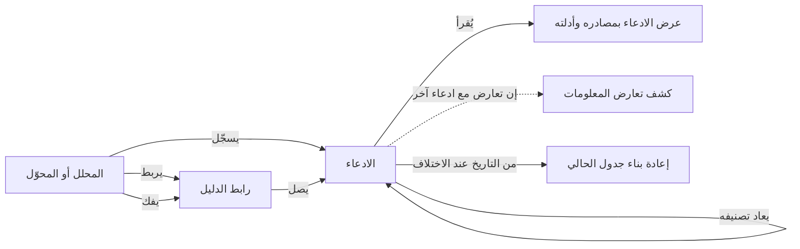
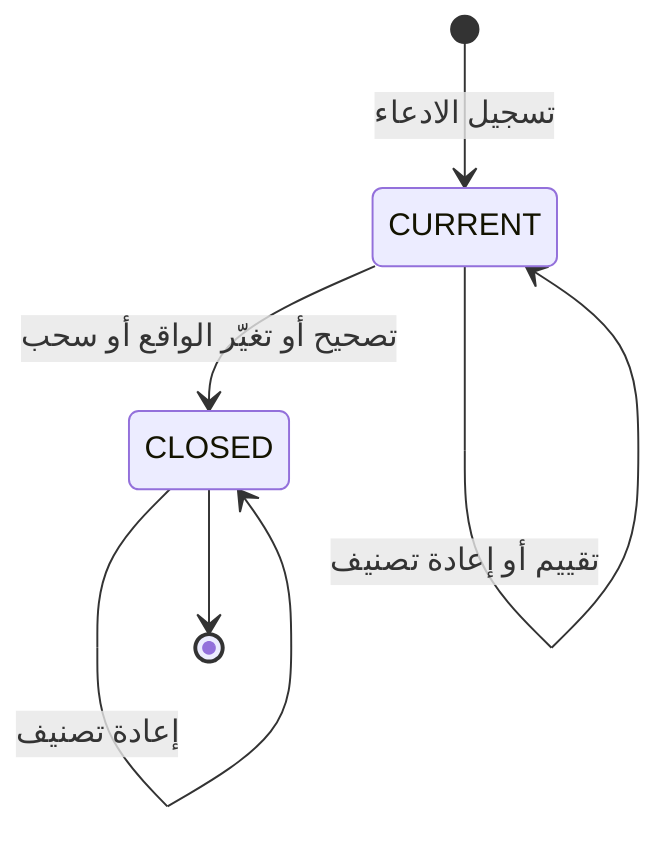

# الادعاءات وأدلتها

<!-- BEGIN GENERATED: doc -->
| البند | القيمة |
|---|---|
| المعرّف | FEAT-INF-CLAIMS-EVIDENCE |
| الإصدار | 0.2 |
| الحالة | مسودة |
| القدرة | CAP-03 إدارة المعلومات |
| القدرة الفرعية | CAP-03.02 الادعاءات والأدلة (R1) |
| الأدوار | المحلل؛ النظام؛ أي مستخدم مخوَّل |
| الشاشات | SCR-22 الادعاء والدليل والمصدر |
| حالات الاستخدام | UC-006 |
| القصص | 13: 7 من المواصفة، و6 جديدة |
<!-- END GENERATED: doc -->

## 1. نظرة عامة

### 1.1 القيمة

يسجّل المحلل كل معلومة كادعاء مسند إلى مصادره وأدلته ويصححه أو يسحبه دون أن يُمحى أصله.

### 1.2 النطاق

| البند | القيمة |
|---|---|
| المستخدمون | المحلل، وحساب خدمة المحوّل، وهوية تشغيل التحليل، والنظام |
| الشاشات | شاشة الادعاء والدليل والمصدر |
| حالات الاستخدام | تسجيل الادعاء بمصدره وزمنه، وتصحيحه أو سحبه أو إعادة تصنيفه دون محو أصله، وربط الدليل به أو فكه، وعرضه بسلسلة تصحيحه |
| المتطلبات | كل قيمة سمة لعنصر من المستوى الأول تُسجَّل ادعاءً مسندًا إلى مصدره ودليله؛ الادعاء من المستوى الأول لا يُكتب فوقه أبدًا؛ الادعاء بلا مصدر يُرفض؛ قيم الأنظمة الخارجية تدخل ادعاءات بمصدرها لا حقائق |
| خارج النطاق | حسم تعارض الادعاءات (ميزة كشف تعارض المعلومات)، وتسجيل الدليل نفسه ورفعه (ميزة الأدلة والمرفقات)، ومطابقة الكيانات وربطها |

**الشكل 1: مسار الادعاء ودليله**



**الشكل 2: حالات الادعاء**



## 2. القواعد المشتركة

تنطبق على كل قصص الميزة، فلا تتكرر داخل القصص. وكل قصة تذكر ما يخصها فقط.

### 2.1 السياق المشترك

كل قصة تبدأ من ثلاثة شروط: مستأجر نشط، وحزمة السياسات الأساسية مفعّلة، ومستخدم مسجّل الدخول ومخوَّل. وتشير إليها القصص بخطوة واحدة: «بفرض السياق المشترك للميزة».

### 2.2 الصلاحية وعدم الإفصاح

- من لا يحق له رؤية العنصر يتلقى ردًا بشكل «غير متاح» تمامًا، فلا يعرف أنه موجود.
- من يرى العنصر ولا يحق له الإجراء يتلقى «لا تملك صلاحية هذا الإجراء».

### 2.3 أوامر تغيير الحالة

- **منع التكرار:** يُرسل كل أمر بمفتاح فريد، فإعادة الطلب نفسه لا تُنفَّذ مرتين.
- **حماية التعديل المتزامن:** يُرسل كل أمر بإصدار البيانات الذي يراه المستخدم. فإن عدّلها غيره في الأثناء، يُرفض الأمر.
- **السجل:** إن نجح الأمر، يُكتب حدثه وسجل التدقيق في المعاملة نفسها.

### 2.4 الرفض المشترك

```gherkin
# language: ar
خاصية: الرفض المشترك لأوامر الميزة

  سيناريو مخطط: رفض مشترك لكل أمر في الميزة
    بفرض السياق المشترك للميزة
    و <الحالة>
    عندما يُرسل المستخدم أي أمر من أوامر الميزة
    اذاً يُرفض برمز <الرمز> ويرى "<الرسالة>"
    و لا يتغير شيء

    امثلة:
      | الحالة                                  | الرمز                  | الرسالة                                                 |
      | العنصر خارج صلاحياته                    | NOT_FOUND              | غير متاح                                                |
      | العنصر مرئي له ولا يحق له الإجراء       | AUTHZ_DENIED           | لا تملك صلاحية هذا الإجراء                              |
      | غيره عدّل العنصر بعد أن فتحه            | VERSION_CONFLICT       | تغيّرت البيانات منذ فتحتها. راجع التغييرات ثم أعد المحاولة |
      | أعاد مفتاح منع التكرار بمحتوى مختلف     | IDEMPOTENCY_KEY_REUSED | طلب مكرر بمحتوى مختلف                                   |
      | البيانات ناقصة أو غير صحيحة             | VALIDATION_FAILED      | بعض البيانات ناقصة أو غير صحيحة. راجع الحقول المعلَّمة      |

  سيناريو: إعادة الطلب نفسه لا تُنفَّذ مرتين
    بفرض السياق المشترك للميزة
    و أمر نجح بمفتاح منع تكرار
    عندما يُعاد الطلب نفسه بالمفتاح نفسه
    اذاً تُعاد النتيجة الأولى ولا يُكتب حدث ثانٍ
```

## 3. الجودة وتعريف الاكتمال

### 3.1 متطلبات الجودة

<!-- BEGIN GENERATED: quality -->
لا متطلبات جودة مرتبطة بمتطلبات هذه الميزة مباشرة. تنطبق متطلبات المنصة العامة (`FEAT-PLT-*`).
<!-- END GENERATED: quality -->

### 3.2 تعريف الاكتمال

القصة مكتملة حين تتحقق الشروط الخمسة:

1. سيناريوهاتها والقواعد المشتركة تمر في الاختبار الآلي.
2. فحوص البنية المعمارية تمر.
3. نصوص الواجهة والرسائل موجودة بالعربية والإنجليزية.
4. مراجعة الكود مكتملة.
5. ما تضيفه القصة نفسها في قسم «القواعد» تحقق.

## 4. فهرس القصص

<!-- BEGIN GENERATED: story-index -->
| المعرّف | القصة | النوع | الحالة |
|---|---|---|---|
| `US-BC02-CLM-ASSERT` | تسجيل الادعاء | أمر | مسودة |
| `US-BC02-CLM-CORRECT` | تصحيح الادعاء | أمر | مسودة |
| `US-BC02-CLM-RECLASSIFY` | إعادة تصنيف الادعاء | أمر | مسودة |
| `US-BC02-CLM-RETRACT` | سحب الادعاء | أمر | مسودة |
| `US-BC02-EVL-LINK` | ربط رابط الدليل | أمر | مسودة |
| `US-BC02-EVL-UNLINK` | فك ربط رابط الدليل | أمر | مسودة |
| `US-BC02-Q-CLM-GET` | جلب: Claim with sources (per protection), evidence links, supersession chain | جلب | مسودة |
| `US-UI-SCR22-CLAIM-DETAIL` | عرض الادعاء بمصادره وأدلته وسلسلة تصحيحه | واجهة | مسودة |
| `US-UI-SCR22-CLAIM-FORM` | تسجيل ادعاء بمصدره وزمن صحته ودليله | واجهة | مسودة |
| `US-UI-SCR22-CORRECT-OR-CHANGE` | التمييز بين تصحيح القيمة وتغيرها في الواقع | واجهة | مسودة |
| `US-PLT-CLAIMS-IMMUTABLE` | عدم الكتابة فوق ادعاءات المستوى الأول أبدًا | منصة | مسودة |
| `US-INT-CLAIMS-FROM-ADAPTER` | تسجيل قيم الأنظمة الخارجية ادعاءات بمصدرها | تكامل | مسودة |
| `US-OPS-CLAIMS-CURRENT-REBUILD` | إعادة بناء القيم الحالية من التاريخ عند اختلافها | تشغيل | مسودة |
<!-- END GENERATED: story-index -->

## 5. القصص

### 5.1 US-BC02-CLM-ASSERT — تسجيل الادعاء

| النوع | الإصدار | الأولوية | دون اتصال | الحالة |
|---|---|---|---|---|
| أمر | R1 | Must | لا | مسودة |

> **كـ** المحلل، **أريد** تسجيل ادعاء جديد عن موضوع وسمة بقيمته ومصدره وفترة صحته، **حتى** تُسند كل معلومة إلى مصدرها بدل أن تُكتب كحقيقة مطلقة.

**باختصار:** يسجّل المحلل أو المحوّل ادعاءً جديدًا بموضوعه وسمته وقيمته وفترة صحته ومصدر واحد نشط على الأقل، فيصبح «حاليًا».

#### القواعد

- **متى يُسمح:** الموضوع موجود، والسمة من القاموس المعتمد، والقيمة توافق نوعها ووحدتها، ومصدر واحد نشط على الأقل، وبداية فترة الصحة قبل نهايتها.
- **من يُسمح له:** المحلل، أو حساب خدمة المحوّل، أو هوية تشغيل التحليل.
- **البيانات:** الموضوع، والسمة، والقيمة، وفترة الصحة، ومصدر واحد على الأقل، وتقييم الثقة، والتصنيف الأمني (إلزامي).
- **الأثر:** حدث «سُجِّل الادعاء» يصل إلى عرض القيمة الحالية، وكاشف التعارض، وعضوية الموقف، والبحث.

#### معايير القبول

```gherkin
# language: ar
خاصية: تسجيل الادعاء

  سيناريو: تسجيل ادعاء جديد بمصدر نشط
    بفرض السياق المشترك للميزة
    و موضوع قائم وسمة معروفة ومصدر واحد نشط على الأقل
    عندما يسجّل المحلل الادعاء بقيمته وفترة صحته
    اذاً تصبح حالته "حاليًا"
    و يُسجَّل حدث "سُجِّل الادعاء"

  سيناريو مخطط: رفض خاص بتسجيل الادعاء
    بفرض السياق المشترك للميزة
    و <الحالة>
    عندما يسجّل المحلل الادعاء
    اذاً يُرفض برمز <الرمز> ويرى <الرسالة>
    و لا يتغير شيء

    امثلة:
      | الحالة                                                        | الرمز         | الرسالة                                  |
      | المصدر غير نشط، أو السمة أو القيمة غير متوافقة، أو فترة الصحة غير صحيحة | CLAIM_INVALID | بيانات الادعاء غير صحيحة أو بلا مصدر |
      | الموضوع غير مذكور                                            | VALIDATION_FAILED | الموضوع مطلوب                        |
```

<details><summary>المراجع التقنية والتتبع</summary>

<!-- BEGIN GENERATED: refs US-BC02-CLM-ASSERT -->
| البند | المعرّف | المعنى |
|---|---|---|
| الواجهة البرمجية | `POST /api/v1/information/claims` | — |
| الأمر | `CMD-CLM-ASSERT` | تسجيل الادعاء |
| السياسة | `POL-CLM-ASSERT` | Analyst · adapter service account · analysis-run identity (assert) · Analyst or verification re-evaluator sys… |
| الحدث | `EVT-CLM-ASSERTED` | يصل إلى: Current-view maintainer (async materialized resolved views); Conflict detector (SLC-04); Situation m… |
| الكيان | `AGG-CLAIM` | الادعاء |
| الجدول | `information.claims` | الجدول الرئيسي للادعاء |
| وحدة النشر | DU-04 | — |
| المتطلبات | REQ-INF-021، REQ-INF-024 | معانيها في القسم 6. التتبع |
| حالة الاستخدام | UC-006 | Manage Evidence |
| الاختبار | TST-CLAIM-SM، TST-SLC02-INVARIANTS | دورة حالات الادعاء، وثوابت الشريحة SLC-02 |
<!-- END GENERATED: refs US-BC02-CLM-ASSERT -->

</details>

### 5.2 US-BC02-CLM-CORRECT — تصحيح الادعاء

| النوع | الإصدار | الأولوية | دون اتصال | الحالة |
|---|---|---|---|---|
| أمر | R1 | Must | لا | مسودة |

> **كـ** المحلل، **أريد** تصحيح قيمة ادعاء كانت خاطئة، **حتى** يُحفظ ما عرفناه خطأً دون محوه ويحل محله ادعاء بالقيمة الصحيحة.

**باختصار:** يغلق المحلل الادعاء «الحالي» ويسجّل بديله بنفس الموضوع والسمة وسبب التصحيح، في المعاملة نفسها.

#### القواعد

- **متى يُسمح:** الادعاء «حاليًا»، وذُكر سبب التصحيح.
- **من يُسمح له:** المحلل فقط.
- **البيانات:** القيمة المصححة (إلزامي)، ومصدر واحد على الأقل، وتقييم الثقة، وسبب التصحيح (إلزامي).
- **الأثر:** الادعاء القديم يُغلق ولا يُمحى، ويُسجَّل البديل بنفس الموضوع والسمة؛ حدث «صُحِّح الادعاء» يصل إلى عرض القيمة الحالية، وكاشف التعارض، وعضوية الموقف، والبحث.

> **ملاحظة:** تصحيح القيمة يختلف عن تسجيل تغيّرها في الواقع (القصة 5.10): الأول يصحح ما عرفناه عن الماضي، والثاني يضيف حقيقة جديدة.

#### معايير القبول

```gherkin
# language: ar
خاصية: تصحيح الادعاء

  سيناريو: تصحيح ادعاء حالي
    بفرض السياق المشترك للميزة
    و ادعاء "حاليًا" قيمته خاطئة
    عندما يصحّحه المحلل بقيمة جديدة وسبب
    اذاً يصبح الادعاء القديم "مغلقًا" ويبدأ البديل "حاليًا"
    و يُسجَّل حدث "صُحِّح الادعاء"

  سيناريو مخطط: رفض خاص بتصحيح الادعاء
    بفرض السياق المشترك للميزة
    و <الحالة>
    عندما يحاول المحلل تصحيح الادعاء
    اذاً يُرفض برمز <الرمز> ويرى <الرسالة>
    و لا يتغير شيء

    امثلة:
      | الحالة                   | الرمز                          | الرسالة                           |
      | الادعاء ليس "حاليًا"     | CLAIM_INVALID_STATE_TRANSITION | الوضع الحالي للادعاء لا يسمح بهذا الإجراء |
      | لم يُذكر سبب التصحيح      | REASON_REQUIRED                | اذكر السبب                        |
      | القيمة الجديدة غير مذكورة | VALIDATION_FAILED              | القيمة مطلوبة                     |
```

<details><summary>المراجع التقنية والتتبع</summary>

<!-- BEGIN GENERATED: refs US-BC02-CLM-CORRECT -->
| البند | المعرّف | المعنى |
|---|---|---|
| الواجهة البرمجية | `POST /api/v1/information/claims/{id}/actions/correct` | — |
| الأمر | `CMD-CLM-CORRECT` | تصحيح الادعاء |
| السياسة | `POL-CLM-CORRECT` | Analyst · adapter service account · analysis-run identity (assert) · Analyst or verification re-evaluator sys… |
| الحدث | `EVT-CLM-CORRECTED` | يصل إلى: Current-view maintainer (async materialized resolved views); Conflict detector (SLC-04); Situation m… |
| الكيان | `AGG-CLAIM` | الادعاء |
| الجدول | `information.claims` | الجدول الرئيسي للادعاء |
| وحدة النشر | DU-04 | — |
| المتطلبات | REQ-INF-021، REQ-INF-024 | معانيها في القسم 6. التتبع |
| حالة الاستخدام | UC-006 | Manage Evidence |
| الاختبار | TST-CLAIM-SM، TST-SLC02-INVARIANTS | دورة حالات الادعاء، وثوابت الشريحة SLC-02 |
<!-- END GENERATED: refs US-BC02-CLM-CORRECT -->

</details>

### 5.3 US-BC02-CLM-RECLASSIFY — إعادة تصنيف الادعاء

| النوع | الإصدار | الأولوية | دون اتصال | الحالة |
|---|---|---|---|---|
| أمر | R1 | Must | لا | مسودة |

> **كـ** المحلل، **أريد** إعادة تصنيف ادعاء قائم، **حتى** يطابق تصنيفه الأمني حساسية ما يحمله دون تغيير قيمته.

**باختصار:** يغيّر المحلل أو المحوّل تصنيف الادعاء بسبب، فيرتفع إصدار الأمان للعنصر دون أن تتغير حالته أو قيمته.

#### القواعد

- **متى يُسمح:** الادعاء «حاليًا» أو «مغلقًا»، وللطالب سلطة تغيير التصنيف بحسب سياسة الجهة.
- **من يُسمح له:** المحلل، أو حساب خدمة المحوّل.
- **البيانات:** التصنيف الجديد (إلزامي)، وسبب إعادة التصنيف (إلزامي).
- **الأثر:** لا تغيير في الحالة ولا القيمة؛ يرتفع إصدار الأمان للعنصر فتُعاد كل قرارات الصلاحية المحفوظة عنه؛ حدث «أُعيد تصنيف الادعاء».

#### معايير القبول

```gherkin
# language: ar
خاصية: إعادة تصنيف الادعاء

  سيناريو: إعادة تصنيف ادعاء بسلطة كافية
    بفرض السياق المشترك للميزة
    و ادعاء "حاليًا" أو "مغلقًا" وللمحلل سلطة تغيير التصنيف عليه
    عندما يعيد تصنيفه بتصنيف جديد وسبب
    اذاً تبقى حالته وقيمته كما هي ويرتفع إصدار الأمان للعنصر
    و يُسجَّل حدث "أُعيد تصنيف الادعاء"

  سيناريو مخطط: رفض خاص بإعادة التصنيف
    بفرض السياق المشترك للميزة
    و <الحالة>
    عندما يحاول إعادة تصنيف الادعاء
    اذاً يُرفض برمز <الرمز> ويرى <الرسالة>
    و لا يتغير شيء

    امثلة:
      | الحالة                                   | الرمز                                | الرسالة                     |
      | لا يملك سلطة تغيير التصنيف بحسب سياسة الجهة | CLASSIFICATION_CHANGE_NOT_AUTHORIZED | لا تملك صلاحية تغيير التصنيف |
      | التصنيف الجديد غير مذكور                  | VALIDATION_FAILED                    | التصنيف مطلوب               |
```

<details><summary>المراجع التقنية والتتبع</summary>

<!-- BEGIN GENERATED: refs US-BC02-CLM-RECLASSIFY -->
| البند | المعرّف | المعنى |
|---|---|---|
| الواجهة البرمجية | `POST /api/v1/information/claims/{id}/actions/reclassify` | — |
| الأمر | `CMD-CLM-RECLASSIFY` | إعادة تصنيف الادعاء |
| السياسة | `POL-CLM-RECLASSIFY` | Analyst · adapter service account · analysis-run identity (assert) · Analyst or verification re-evaluator sys… |
| الحدث | `EVT-CLM-RECLASSIFIED` | يصل إلى: Security-version service (EVT-SEC-VERSION-INCREMENTED); PEP decision caches; Projection security-ver… |
| الكيان | `AGG-CLAIM` | الادعاء |
| الجدول | `information.claims` | الجدول الرئيسي للادعاء |
| وحدة النشر | DU-04 | — |
| المتطلبات | REQ-INF-021، REQ-INF-024 | معانيها في القسم 6. التتبع |
| حالة الاستخدام | UC-006 | Manage Evidence |
| الاختبار | TST-CLAIM-SM، TST-SLC02-INVARIANTS | دورة حالات الادعاء، وثوابت الشريحة SLC-02 |
<!-- END GENERATED: refs US-BC02-CLM-RECLASSIFY -->

</details>

### 5.4 US-BC02-CLM-RETRACT — سحب الادعاء

| النوع | الإصدار | الأولوية | دون اتصال | الحالة |
|---|---|---|---|---|
| أمر | R1 | Must | لا | مسودة |

> **كـ** المحلل، **أريد** سحب ادعاء دون بديل، **حتى** يُعرف أنه لم يعد صحيحًا دون أن يُستبدل بقيمة أخرى.

**باختصار:** يغلق المحلل الادعاء «الحالي» بسبب السحب، بلا بديل يحل محله.

#### القواعد

- **متى يُسمح:** الادعاء «حاليًا»، وذُكر سبب السحب.
- **من يُسمح له:** المحلل فقط.
- **البيانات:** سبب السحب (إلزامي).
- **الأثر:** الادعاء يُغلق بلا بديل؛ حدث «سُحِب الادعاء» يصل إلى عرض القيمة الحالية، وكاشف التعارض، وعضوية الموقف، والبحث.

#### معايير القبول

```gherkin
# language: ar
خاصية: سحب الادعاء

  سيناريو: سحب ادعاء حالي
    بفرض السياق المشترك للميزة
    و ادعاء "حاليًا" لم يعد صحيحًا
    عندما يسحبه المحلل بسبب
    اذاً يصبح "مغلقًا" بلا بديل
    و يُسجَّل حدث "سُحِب الادعاء"

  سيناريو مخطط: رفض خاص بسحب الادعاء
    بفرض السياق المشترك للميزة
    و <الحالة>
    عندما يحاول المحلل سحب الادعاء
    اذاً يُرفض برمز <الرمز> ويرى <الرسالة>
    و لا يتغير شيء

    امثلة:
      | الحالة               | الرمز                          | الرسالة                                    |
      | الادعاء ليس "حاليًا" | CLAIM_INVALID_STATE_TRANSITION | الوضع الحالي للادعاء لا يسمح بهذا الإجراء |
      | لم يُذكر سبب السحب    | REASON_REQUIRED                | اذكر السبب                                 |
```

<details><summary>المراجع التقنية والتتبع</summary>

<!-- BEGIN GENERATED: refs US-BC02-CLM-RETRACT -->
| البند | المعرّف | المعنى |
|---|---|---|
| الواجهة البرمجية | `POST /api/v1/information/claims/{id}/actions/retract` | — |
| الأمر | `CMD-CLM-RETRACT` | سحب الادعاء |
| السياسة | `POL-CLM-RETRACT` | Analyst · adapter service account · analysis-run identity (assert) · Analyst or verification re-evaluator sys… |
| الحدث | `EVT-CLM-RETRACTED` | يصل إلى: Current-view maintainer (async materialized resolved views); Conflict detector (SLC-04); Situation m… |
| الكيان | `AGG-CLAIM` | الادعاء |
| الجدول | `information.claims` | الجدول الرئيسي للادعاء |
| وحدة النشر | DU-04 | — |
| المتطلبات | REQ-INF-021، REQ-INF-024 | معانيها في القسم 6. التتبع |
| حالة الاستخدام | UC-006 | Manage Evidence |
| الاختبار | TST-CLAIM-SM، TST-SLC02-INVARIANTS | دورة حالات الادعاء، وثوابت الشريحة SLC-02 |
<!-- END GENERATED: refs US-BC02-CLM-RETRACT -->

</details>

### 5.5 US-BC02-EVL-LINK — ربط رابط الدليل

| النوع | الإصدار | الأولوية | دون اتصال | الحالة |
|---|---|---|---|---|
| أمر | R1 | Must | لا | مسودة |

> **كـ** المحلل، **أريد** ربط دليل بادعاء بنوع استناد محدد، **حتى** تُعرف درجة دعم كل دليل للادعاء أو نفيه له.

**باختصار:** يربط المحلل دليلًا بادعاء بنوع استناد: يدعم، أو ينفي، أو سياق، فيصير الرابط «نشطًا».

#### القواعد

- **متى يُسمح:** الدليل غير «مسحوب»، والادعاء موجود، ونوع الاستناد أحد الثلاثة، ولا رابط نشط مكرر بنفس الدليل والادعاء ونوع الاستناد.
- **من يُسمح له:** المحلل فقط.
- **البيانات:** الدليل والادعاء (إلزاميان)، نوع الاستناد (إلزامي)، ملاحظة (اختياري).
- **الأثر:** حدث «رُبط الدليل» يصل إلى فهارس البحث والرسم.

#### معايير القبول

```gherkin
# language: ar
خاصية: ربط رابط الدليل

  سيناريو: ربط دليل بادعاء
    بفرض السياق المشترك للميزة
    و دليل غير مسحوب وادعاء قائم بلا رابط نشط مكرر بينهما
    عندما يربط المحلل الدليل بالادعاء بنوع استناد
    اذاً يصبح الرابط "نشطًا"
    و يُسجَّل حدث "رُبط الدليل"

  سيناريو مخطط: رفض خاص بربط الدليل
    بفرض السياق المشترك للميزة
    و <الحالة>
    عندما يحاول المحلل ربط الدليل بالادعاء
    اذاً يُرفض برمز <الرمز> ويرى <الرسالة>
    و لا يتغير شيء

    امثلة:
      | الحالة                                        | الرمز         | الرسالة                 |
      | رابط نشط بنفس الدليل والادعاء ونوع الاستناد موجود | LINK_DUPLICATE | هذا الربط موجود من قبل |
      | نوع الاستناد غير مذكور                        | VALIDATION_FAILED | نوع الاستناد غير صحيح  |
```

<details><summary>المراجع التقنية والتتبع</summary>

<!-- BEGIN GENERATED: refs US-BC02-EVL-LINK -->
| البند | المعرّف | المعنى |
|---|---|---|
| الواجهة البرمجية | `POST /api/v1/information/evidence-links` | — |
| الأمر | `CMD-EVL-LINK` | ربط رابط الدليل |
| السياسة | `POL-EVL-LINK` | Analyst؛ tenant match; object visible to subject (label ≤ clearance); write permission in org scope |
| الحدث | `EVT-EVL-LINKED` | يصل إلى: Search/Graph projections (SLC-05) |
| الكيان | `AGG-EVIDENCE-LINK` | رابط الدليل |
| الجدول | `information.evidence_links` | الجدول الرئيسي لرابط الدليل |
| وحدة النشر | DU-04 | — |
| المتطلب | REQ-INF-021 | The system shall represent each attribute value of an importance-tier T1 object as a claim linked to its sour… |
| حالة الاستخدام | UC-006 | Manage Evidence |
| الاختبار | TST-EVIDENCE-LINK-SM، TST-SLC02-INVARIANTS | دورة حالات رابط الدليل، وثوابت الشريحة SLC-02 |
<!-- END GENERATED: refs US-BC02-EVL-LINK -->

</details>

### 5.6 US-BC02-EVL-UNLINK — فك ربط رابط الدليل

| النوع | الإصدار | الأولوية | دون اتصال | الحالة |
|---|---|---|---|---|
| أمر | R1 | Must | لا | مسودة |

> **كـ** المحلل، **أريد** فك ربط دليل عن ادعاء بسبب، **حتى** يتوقف عن احتسابه في درجة الاستناد دون أن يُمحى أنه كان مرتبطًا.

**باختصار:** يفك المحلل رابطًا «نشطًا» بسبب، فيصير «منزوعًا» وتُغلق فترة سريانه دون أن يُحذف.

#### القواعد

- **متى يُسمح:** الرابط «نشط»، وذُكر سبب الفك.
- **من يُسمح له:** المحلل فقط.
- **البيانات:** سبب الفك (إلزامي).
- **الأثر:** حدث «فُكَّ ربط الدليل» يصل إلى فهارس البحث والرسم.

#### معايير القبول

```gherkin
# language: ar
خاصية: فك ربط رابط الدليل

  سيناريو: فك رابط نشط
    بفرض السياق المشترك للميزة
    و رابط دليل "نشط"
    عندما يفكه المحلل بسبب
    اذاً يصبح "منزوعًا" وتُغلق فترة سريانه
    و يُسجَّل حدث "فُكَّ ربط الدليل"

  سيناريو مخطط: رفض خاص بفك الربط
    بفرض السياق المشترك للميزة
    و <الحالة>
    عندما يحاول المحلل فك الربط
    اذاً يُرفض برمز <الرمز> ويرى <الرسالة>
    و لا يتغير شيء

    امثلة:
      | الحالة            | الرمز                                  | الرسالة                                       |
      | الرابط ليس "نشطًا" | EVIDENCE_LINK_INVALID_STATE_TRANSITION | الوضع الحالي لرابط الدليل لا يسمح بهذا الإجراء |
      | لم يُذكر سبب الفك   | REASON_REQUIRED                        | اذكر السبب                                    |
```

<details><summary>المراجع التقنية والتتبع</summary>

<!-- BEGIN GENERATED: refs US-BC02-EVL-UNLINK -->
| البند | المعرّف | المعنى |
|---|---|---|
| الواجهة البرمجية | `POST /api/v1/information/evidence-links/{id}/actions/unlink` | — |
| الأمر | `CMD-EVL-UNLINK` | فك ربط رابط الدليل |
| السياسة | `POL-EVL-UNLINK` | Analyst؛ tenant match; object visible to subject (label ≤ clearance); write permission in org scope |
| الحدث | `EVT-EVL-UNLINKED` | يصل إلى: Search/Graph projections (SLC-05) |
| الكيان | `AGG-EVIDENCE-LINK` | رابط الدليل |
| الجدول | `information.evidence_links` | الجدول الرئيسي لرابط الدليل |
| وحدة النشر | DU-04 | — |
| المتطلب | REQ-INF-021 | The system shall represent each attribute value of an importance-tier T1 object as a claim linked to its sour… |
| حالة الاستخدام | UC-006 | Manage Evidence |
| الاختبار | TST-EVIDENCE-LINK-SM، TST-SLC02-INVARIANTS | دورة حالات رابط الدليل، وثوابت الشريحة SLC-02 |
<!-- END GENERATED: refs US-BC02-EVL-UNLINK -->

</details>

### 5.7 US-BC02-Q-CLM-GET — جلب: Claim with sources (per protection), evidence links, supersession chain

| النوع | الإصدار | الأولوية | دون اتصال | الحالة |
|---|---|---|---|---|
| جلب | R1 | Must | لا | مسودة |

> **كـ** أي مستخدم مخوَّل، **أريد** جلب الادعاء بمصادره وأدلته وسلسلة تصحيحه، **حتى** أفهم أساسه الكامل كما كان معروفًا في لحظة أرغب فيها.

**باختصار:** يُعاد الادعاء مع مصادره المفلترة بحمايتها، وروابط دليله، وسلسلة الادعاءات التي سبقته أو صحّحته، باستعلام بأثر رجعي عبر وقت الصحة ووقت المعرفة.

#### القواعد

- **من يُسمح له:** من يقع الادعاء ضمن نطاقه ويسمح تصنيفه بتصريحه الأمني؛ من لا يحق له يتلقى «غير متاح».
- **البيانات (المرشحات):** وقت الصحة، ووقت المعرفة؛ لعرض الادعاء كما كان صحيحًا أو كما كان معروفًا في لحظة سابقة.

#### معايير القبول

```gherkin
# language: ar
خاصية: جلب الادعاء بمصادره وأدلته

  سيناريو: جلب ادعاء مرئي بمصادره وسلسلة تصحيحه
    بفرض السياق المشترك للميزة
    و ادعاء مرئي له له مصدر واحد على الأقل وادعاء سابق صحّحه
    عندما يطلب الادعاء
    اذاً يُعاد مع مصادره المفلترة بحمايتها، وروابط دليله، وسلسلة تصحيحه

  سيناريو: جلب الادعاء كما كان معروفًا في لحظة سابقة
    بفرض السياق المشترك للميزة
    و ادعاء صُحِّح بعد لحظة معيّنة
    عندما يطلبه بوقت صحة ووقت معرفة يسبقان التصحيح
    اذاً تُعاد نسخته السابقة للتصحيح
```

<details><summary>المراجع التقنية والتتبع</summary>

<!-- BEGIN GENERATED: refs US-BC02-Q-CLM-GET -->
| البند | المعرّف | المعنى |
|---|---|---|
| الواجهة البرمجية | `GET /api/v1/information/claims/{claim_id}` | — |
| الاستعلام | `QRY-CLM-GET` | Claim with sources (per protection), evidence links, supersession chain |
| السياسة | `POL-CLM-GET` | org scope ∩ classification rule; claims filtered by label |
| الكيان | `AGG-CLAIM` | الادعاء |
| الجدول | `information.claims` | الجدول الرئيسي للادعاء |
| وحدة النشر | DU-04 | — |
| المتطلب | REQ-INF-021 | The system shall represent each attribute value of an importance-tier T1 object as a claim linked to its sour… |
| حالة الاستخدام | UC-006 | Manage Evidence |
| الاختبار | TST-CLAIM-SM، TST-SLC02-INVARIANTS | دورة حالات الادعاء، وثوابت الشريحة SLC-02 |
<!-- END GENERATED: refs US-BC02-Q-CLM-GET -->

</details>

### 5.8 US-UI-SCR22-CLAIM-DETAIL — عرض الادعاء بمصادره وأدلته وسلسلة تصحيحه

| النوع | الإصدار | الأولوية | دون اتصال | الحالة |
|---|---|---|---|---|
| واجهة | R1 | Must | لا | مسودة |

> **كـ** المحلل، **أريد** أن أرى الادعاء بمصادره وأدلته وسلسلة تصحيحه في شاشة واحدة، **حتى** أفهم أساس كل قيمة وتاريخها قبل أن أعتمد عليها.

**باختصار:** تعرض الشاشة الادعاء الحالي بشارة حالته وتصنيفه، ومصادره ودليله المرتبط بنوع الاستناد، وسلسلة الادعاءات التي صحّحته، وتحجب ما لا يحق للمستخدم رؤيته من المصادر دون كشف وجوده.

#### القواعد

- **البيانات المعروضة:** القيمة وفترة صحتها، شارة التصنيف، المصادر (محجوبة إن لم يحق له رؤيتها)، روابط الدليل بنوع استنادها، سلسلة التصحيح بالترتيب الزمني.
- **الأثر:** عرض فقط، بلا تغيير في البيانات.

#### معايير القبول

```gherkin
# language: ar
خاصية: عرض الادعاء بمصادره وأدلته

  سيناريو: عرض ادعاء بمصادره وأدلته وسلسلة تصحيحه
    بفرض السياق المشترك للميزة
    و ادعاء مرئي له مصحَّح من ادعاء سابق وله رابط دليل واحد على الأقل
    عندما يفتح شاشة الادعاء
    اذاً يرى القيمة وفترة صحتها وشارة التصنيف
    و يرى رابط الدليل بنوع استناده
    و يرى سلسلة التصحيح من الأصل إلى الحالي

  سيناريو: مصدر محجوب لا يكشف وجوده
    بفرض السياق المشترك للميزة
    و للادعاء مصدر لا يحق للمستخدم رؤيته
    عندما يفتح شاشة الادعاء
    اذاً يظهر المصدر بعلامة "محجوب" دون كشف نوعه أو طوله
```

<details><summary>المراجع التقنية والتتبع</summary>

<!-- BEGIN GENERATED: refs US-UI-SCR22-CLAIM-DETAIL -->
| البند | المعرّف | المعنى |
|---|---|---|
| الشاشة | SCR-22 | شاشة الادعاء والدليل والمصدر |
| المصدر | `21-ui-design.md §11` | — |
| المتطلب | REQ-INF-021 | The system shall represent each attribute value of an importance-tier T1 object as a claim linked to its sour… |
| حالة الاستخدام | UC-006 | Manage Evidence |
<!-- END GENERATED: refs US-UI-SCR22-CLAIM-DETAIL -->

</details>

### 5.9 US-UI-SCR22-CLAIM-FORM — تسجيل ادعاء بمصدره وزمن صحته ودليله

| النوع | الإصدار | الأولوية | دون اتصال | الحالة |
|---|---|---|---|---|
| واجهة | R1 | Must | لا | مسودة |

> **كـ** المحلل، **أريد** نموذجًا واحدًا لتسجيل الادعاء بمصدره وفترة صحته وتصنيفه، **حتى** لا أسجّل قيمة بلا مصدر ولا تصنيف.

**باختصار:** النموذج مولَّد من مخطط العقد، ويطلب تصنيفًا ومصدرًا واحدًا على الأقل قبل الحفظ، ويرسل الأمر بمفتاح منع تكرار يتولد تلقائيًا ويتغير إن عدّل المستخدم أي حقل.

#### القواعد

- **البيانات المطلوبة:** الموضوع والسمة والقيمة وفترة الصحة (إلزامية)، والتصنيف (إلزامي)، ومصدر واحد على الأقل (إلزامي).
- **الأثر:** يرسل النموذج أمر تسجيل الادعاء بمفتاح منع التكرار المولَّد؛ وعند رفض الخادم يبقى النموذج مفتوحًا ببياناته.

#### معايير القبول

```gherkin
# language: ar
خاصية: نموذج تسجيل الادعاء

  سيناريو: حفظ الادعاء بمصدره وتصنيفه
    بفرض السياق المشترك للميزة
    و أدخل المحلل القيمة وفترة الصحة والتصنيف ومصدرًا واحدًا على الأقل
    عندما يحفظ النموذج
    اذاً يُرسل أمر تسجيل الادعاء بمفتاح منع تكرار جديد
    و يصبح الادعاء "حاليًا"

  سيناريو مخطط: رفض خاص بنموذج التسجيل
    بفرض السياق المشترك للميزة
    و <الحالة>
    عندما يحفظ النموذج
    اذاً يُرفض برمز <الرمز> ويرى <الرسالة>
    و يبقى النموذج مفتوحًا ببياناته

    امثلة:
      | الحالة              | الرمز              | الرسالة        |
      | التصنيف غير مذكور   | VALIDATION_FAILED  | التصنيف مطلوب  |
      | لا مصدر مذكور       | VALIDATION_FAILED  | المصدر مطلوب   |
```

<details><summary>المراجع التقنية والتتبع</summary>

<!-- BEGIN GENERATED: refs US-UI-SCR22-CLAIM-FORM -->
| البند | المعرّف | المعنى |
|---|---|---|
| الشاشة | SCR-22 | شاشة الادعاء والدليل والمصدر |
| المصدر | `21-ui-design.md §6.1` | — |
| المتطلبات | REQ-INF-021، REQ-INF-037، REQ-GOV-002 | معانيها في القسم 6. التتبع |
| حالة الاستخدام | UC-006 | Manage Evidence |
<!-- END GENERATED: refs US-UI-SCR22-CLAIM-FORM -->

</details>

### 5.10 US-UI-SCR22-CORRECT-OR-CHANGE — التمييز بين تصحيح القيمة وتغيرها في الواقع

| النوع | الإصدار | الأولوية | دون اتصال | الحالة |
|---|---|---|---|---|
| واجهة | R1 | Must | لا | مسودة |

> **كـ** المحلل، **أريد** أن تسألني الشاشة هل القيمة كانت خاطئة أم تغيّرت في الواقع عند تعديل ادعاء، **حتى** يُسجَّل السبب الصحيح ولا يُخلط بين ما عرفناه خطأً وما تغيّر فعلاً.

**باختصار:** عند تعديل ادعاء «حاليًا» تعرض الشاشة خيارين فقط: «تصحيح قيمة كانت خاطئة» أو «تغيّر القيمة في الواقع»، ويحدد كل خيار الأمر الذي يُرسل ووقت النفاذ المطلوب. **[Derived]** — التمييز نفسه بين العمليتين مذكور في النموذج الزمني، أما عرضه كخيارين في الشاشة فاستنتاج من ذلك الفارق.

#### القواعد

- **متى يُسمح:** الادعاء «حاليًا».
- **البيانات:** الخيار المختار، والقيمة الجديدة، ولخيار تغيّر الواقع وقت التغيّر الفعلي أيضًا.
- **الأثر:** خيار التصحيح يرسل أمر تصحيح الادعاء؛ وخيار تغيّر الواقع يرسل أمر تسجيل التغيّر بوقت نفاذ يبدأ من وقت التغيّر.

#### معايير القبول

```gherkin
# language: ar
خاصية: التمييز بين تصحيح القيمة وتغيرها في الواقع

  سيناريو: اختيار تصحيح قيمة كانت خاطئة
    بفرض السياق المشترك للميزة
    و ادعاء "حاليًا" يريد المحلل تعديله
    عندما يختار "تصحيح قيمة كانت خاطئة" ويدخل القيمة الصحيحة وسببها
    اذاً يُرسل أمر تصحيح الادعاء
    و يصبح الادعاء القديم "مغلقًا" ويبدأ البديل "حاليًا"

  سيناريو: اختيار تغيّر القيمة في الواقع
    بفرض السياق المشترك للميزة
    و ادعاء "حاليًا" يريد المحلل تعديله
    عندما يختار "تغيّر القيمة في الواقع" ويدخل وقت التغيّر والقيمة الجديدة
    اذاً يُرسل أمر تسجيل التغيّر بوقت نفاذ يبدأ من وقت التغيّر
    و يُحفظ الادعاء القديم بفترة صحة تنتهي عند وقت التغيّر

  سيناريو مخطط: رفض خاص بالتمييز
    بفرض السياق المشترك للميزة
    و <الحالة>
    عندما يختار "تغيّر القيمة في الواقع"
    اذاً يُرفض برمز <الرمز> ويرى <الرسالة>
    و لا يتغير شيء

    امثلة:
      | الحالة                                | الرمز              | الرسالة                                      |
      | وقت التغيير خارج فترة صحة الادعاء      | CHANGE_TIME_INVALID | وقت التغيير يجب أن يقع داخل فترة صلاحية السجل |
```

<details><summary>المراجع التقنية والتتبع</summary>

<!-- BEGIN GENERATED: refs US-UI-SCR22-CORRECT-OR-CHANGE -->
| البند | المعرّف | المعنى |
|---|---|---|
| الشاشة | SCR-22 | شاشة الادعاء والدليل والمصدر |
| المصدر | `temporal-model.md §3` | — |
| المصدر | `[Derived]` | — |
| المتطلب | REQ-INF-024 | The system shall never overwrite a T1 claim; a correction shall close the record-time interval of the previou… |
<!-- END GENERATED: refs US-UI-SCR22-CORRECT-OR-CHANGE -->

</details>

### 5.11 US-PLT-CLAIMS-IMMUTABLE — عدم الكتابة فوق ادعاءات المستوى الأول أبدًا

| النوع | الإصدار | الأولوية | دون اتصال | الحالة |
|---|---|---|---|---|
| منصة | R1 | Must | لا ينطبق | مسودة |

> **كـ** فريق المنصة، **أريد** أن يضمن المخزن ألا يُكتب فوق ادعاء من المستوى الأول أبدًا، وأن تعلن كل سمة مستوى أهميتها، **حتى** يبقى تاريخ المعلومة كاملاً ولا يُفقد دليل سابق.

**باختصار:** فحص بنيوي يتحقق أن كل تعديل على ادعاء من المستوى الأول يغلق الفترة السابقة ويضيف سجلًا جديدًا دون تعديل أي حقل في القديم، وأن كل سمة في القاموس المعتمد تحمل مستوى أهمية معلنًا.

#### القواعد

- **الأثر:** فحص بنيوي في خط البناء يفشل إذا وُجد تعديل فوق سجل ادعاء قديم، أو سمة بلا مستوى أهمية معلن.

#### معايير القبول

```gherkin
# language: ar
خاصية: عدم الكتابة فوق ادعاءات المستوى الأول

  سيناريو: لا كتابة فوق ادعاء قديم
    بفرض فحص بنية المخزن
    عندما يُفحص كل تعديل على ادعاء من المستوى الأول
    اذاً يكون كل تعديل إغلاقًا للفترة السابقة وإضافة سجل جديد، لا تحديثًا في مكانه

  سيناريو: كل سمة تعلن مستوى أهميتها
    بفرض فحص قاموس السمات
    عندما يُفحص كل تعريف سمة
    اذاً يحمل كل تعريف مستوى أهمية معلنًا
```

<details><summary>المراجع التقنية والتتبع</summary>

<!-- BEGIN GENERATED: refs US-PLT-CLAIMS-IMMUTABLE -->
| البند | المعرّف | المعنى |
|---|---|---|
| فحص البنية | FIT-05 | T1 claims are never updated in place except closing recorded_to |
| فحص البنية | FIT-06 | Every attribute declares importance tier |
| المتطلبات | REQ-INF-024، REQ-INF-021 | معانيها في القسم 6. التتبع |
| حالة الاستخدام | UC-006 | Manage Evidence |
<!-- END GENERATED: refs US-PLT-CLAIMS-IMMUTABLE -->

</details>

### 5.12 US-INT-CLAIMS-FROM-ADAPTER — تسجيل قيم الأنظمة الخارجية ادعاءات بمصدرها

| النوع | الإصدار | الأولوية | دون اتصال | الحالة |
|---|---|---|---|---|
| تكامل | R1 | Must | لا ينطبق | مسودة |

> **كـ** مهندس التكامل، **أريد** أن تدخل قيمة كل نظام خارجي ادعاءً بمصدره وموثوقيته، لا حقيقة تُكتب مباشرة، **حتى** تبقى الأنظمة الخارجية مصادر لا مستودعات حقيقة، وتُحل القيم المتعارضة بتعارض بدل أن تُكتب فوق ما في المنصة.

**باختصار:** يترجم المحوّل بيانات النظام الخارجي إلى أمر تسجيل ادعاء بهوية حساب خدمة، فتدخل القيمة ادعاءً مسندًا إلى مصدره دون أن تتسرب أنواع النظام الخارجي إلى داخل المنصة.

#### القواعد

- **متى يحدث:** عند استيراد دفعة أو وصول بيانات من محوّل مسجَّل.
- **من يُسمح له:** حساب خدمة المحوّل المسجَّل فقط.
- **البيانات المتبادلة:** قيمة السمة من النظام الخارجي، ومرجع المصدر وموثوقيته، ونسب الدفعة.
- **الأثر:** يُسجَّل الادعاء بنفس قواعد تسجيله (القصة 5.1)؛ وما يفشل التحقق من مخططه يُحجر ولا يدخل المنصة.

#### معايير القبول

```gherkin
# language: ar
خاصية: تسجيل قيم الأنظمة الخارجية ادعاءات بمصدرها

  سيناريو: قيمة من نظام خارجي تدخل ادعاءً بمصدره
    بفرض السياق المشترك للميزة
    و محوّل مسجَّل يحمل بيانات متوافقة مع المخطط المعتمد
    عندما يترجم المحوّل القيمة إلى أمر تسجيل الادعاء
    اذاً يُسجَّل الادعاء بمصدره النظام الخارجي وموثوقيته
    و لا تُكتب القيمة فوق أي ادعاء قائم، بل تدخل ادعاءً جديدًا قد يفتح تعارضًا

  سيناريو: بيانات لا تطابق المخطط تُحجر
    بفرض السياق المشترك للميزة
    و دفعة من محوّل تحمل سجلًا لا يطابق المخطط المعتمد
    عندما يعالج المحوّل الدفعة
    اذاً يُحجر السجل ولا يدخل ادعاءً
    و تبقى بقية سجلات الدفعة الصحيحة قابلة للمعالجة
```

<details><summary>المراجع التقنية والتتبع</summary>

<!-- BEGIN GENERATED: refs US-INT-CLAIMS-FROM-ADAPTER -->
| البند | المعرّف | المعنى |
|---|---|---|
| المصدر | `20-integration-design.md §1` | — |
| المصدر | `THR-S02-01` | — |
| المتطلب | REQ-INF-005 | The system shall ingest external data only through registered adapters or bulk import jobs that record source… |
| حالة الاستخدام | UC-094 | Ingest External Data |
<!-- END GENERATED: refs US-INT-CLAIMS-FROM-ADAPTER -->

</details>

### 5.13 US-OPS-CLAIMS-CURRENT-REBUILD — إعادة بناء القيم الحالية من التاريخ عند اختلافها

| النوع | الإصدار | الأولوية | دون اتصال | الحالة |
|---|---|---|---|---|
| تشغيل | R1 | Should | لا ينطبق | مسودة |

> **كـ** فريق التشغيل، **أريد** إعادة بناء جدول الحالي من تاريخ الادعاءات حين يختلف عنه، **حتى** تعود القراءات السريعة لتطابق الحقيقة بعد عطل أو إصلاح جزئي.

**باختصار:** مهمة تسوية ليلية تقارن جدول الحالي بتاريخ الادعاءات؛ فإن اختلفا، يُعاد بناء جدول الحالي من التاريخ دون فقد بيانات، وتبقى القراءات تعرض قيمًا قديمة حتى تمام إعادة البناء.

#### القواعد

- **الأثر:** إعادة بناء جدول الحالي من تاريخ الادعاءات، وتنبيه فريق التشغيل بالاختلاف الذي عولج.

#### معايير القبول

```gherkin
# language: ar
خاصية: إعادة بناء جدول الحالي من التاريخ

  سيناريو: اختلاف جدول الحالي عن التاريخ يُعاد بناؤه
    بفرض أن مهمة التسوية الليلية وجدت اختلافًا بين جدول الحالي وتاريخ الادعاءات
    عندما تُنفَّذ مهمة إعادة البناء
    اذاً يُعاد بناء جدول الحالي من التاريخ دون فقد بيانات
    و يُسجَّل تنبيه لفريق التشغيل بالاختلاف الذي عولج

  سيناريو: لا اختلاف فلا إعادة بناء
    بفرض أن جدول الحالي يطابق تاريخ الادعاءات
    عندما تُنفَّذ مهمة التسوية الليلية
    اذاً لا يتغير شيء
```

<details><summary>المراجع التقنية والتتبع</summary>

<!-- BEGIN GENERATED: refs US-OPS-CLAIMS-CURRENT-REBUILD -->
| البند | المعرّف | المعنى |
|---|---|---|
| المصدر | `FM-S02-03` | — |
| المصدر | `temporal-model.md §9` | — |
<!-- END GENERATED: refs US-OPS-CLAIMS-CURRENT-REBUILD -->

</details>

## 6. التتبع

<!-- BEGIN GENERATED: trace -->
| المتطلب | المعنى | القصص | الاختبار |
|---|---|---|---|
| REQ-GOV-002 | The system shall require a classification on every object of importance tier T1 or T2. | `US-UI-SCR22-CLAIM-FORM` | — |
| REQ-INF-005 | The system shall ingest external data only through registered adapters or bulk import jobs that record source… | `US-INT-CLAIMS-FROM-ADAPTER` | TST-ADAPTER-SM، TST-IMPORT-BATCH-SM، TST-SLC02-INVARIANTS |
| REQ-INF-021 | The system shall represent each attribute value of an importance-tier T1 object as a claim linked to its sour… | `US-BC02-CLM-ASSERT`، `US-BC02-CLM-CORRECT`، `US-BC02-CLM-RECLASSIFY`، `US-BC02-CLM-RETRACT`، `US-BC02-EVL-LINK`، `US-BC02-EVL-UNLINK`، `US-BC02-Q-CLM-GET`، `US-PLT-CLAIMS-IMMUTABLE`، `US-UI-SCR22-CLAIM-DETAIL`، `US-UI-SCR22-CLAIM-FORM` | TST-CLAIM-SM، TST-ENTITY-SM، TST-EVIDENCE-LINK-SM، TST-SLC02-INVARIANTS |
| REQ-INF-024 | The system shall never overwrite a T1 claim; a correction shall close the record-time interval of the previou… | `US-BC02-CLM-ASSERT`، `US-BC02-CLM-CORRECT`، `US-BC02-CLM-RECLASSIFY`، `US-BC02-CLM-RETRACT`، `US-PLT-CLAIMS-IMMUTABLE`، `US-UI-SCR22-CORRECT-OR-CHANGE` | TST-CLAIM-SM، TST-CONFLICT-SM، TST-SLC02-INVARIANTS، TST-SLC04-INVARIANTS |
| REQ-INF-037 | If a T1 object is submitted without a source reference, then the system shall reject it. | `US-UI-SCR22-CLAIM-FORM` | TST-CLAIM-SM، TST-SLC02-INVARIANTS |
<!-- END GENERATED: trace -->

## 7. سجل التغييرات

| الإصدار | التاريخ | التغيير |
|---|---|---|
| 0.1 | — | هيكل مولَّد من خريطة الميزات |
| 0.2 | 2026-10-03 | كتابة القصص كاملة بمعيار القصص |
