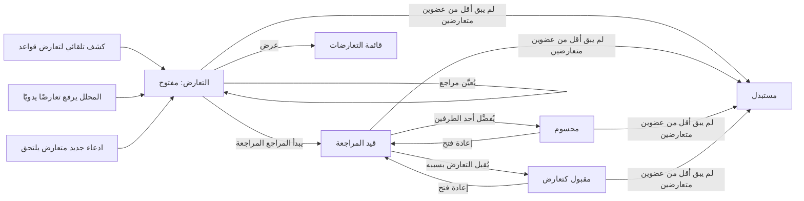
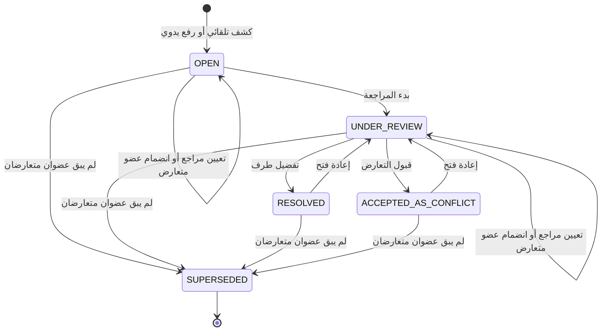

# كشف تعارض المعلومات

<!-- BEGIN GENERATED: doc -->
| البند | القيمة |
|---|---|
| المعرّف | FEAT-INF-CONFLICT-DETECT |
| الإصدار | 0.1 |
| الحالة | مسودة |
| القدرة | CAP-03 إدارة المعلومات |
| القدرة الفرعية | CAP-03.06 إدارة التعارض (R1) |
| الأدوار | النظام؛ المحلل |
| الشاشات | SCR-06 قوائم المراجعة |
| حالات الاستخدام | UC-008 |
| القصص | 8: 5 من المواصفة، و3 جديدة |
<!-- END GENERATED: doc -->

## 1. نظرة عامة

### 1.1 القيمة

يُكشف تلقائيًا أو يدويًا كل تناقض بين معلومتين عن الشيء نفسه فيُحفظ الطرفان ولا يُخفى أحدهما.

### 1.2 النطاق

| البند | القيمة |
|---|---|
| المستخدمون | المحلل، وقائد المحللين، والنظام |
| الشاشات | شاشة قوائم المراجعة |
| حالات الاستخدام | رفع تعارض بين ادعاءين يدويًا أو كشفه تلقائيًا، وتعيين مراجع، وبدء المراجعة وحسمها بتفضيل أو بقبول التعارض، وإعادة فتحه، وعرض قائمته مصفاة |
| المتطلبات | حين يتداخل ادعاءان حول نفس الموضوع والسمة في فترة متداخلة بقيمتين متعارضتين، يُفتح تعارض يحفظ الطرفين، لا يُخفي أحدهما ولا يُعدّل أي ادعاء |
| خارج النطاق | تسجيل الادعاءات نفسها وتصحيحها (ميزة الادعاءات وأدلتها)، ومطابقة الكيانات وربط الملاحظات |

**الشكل 1: مسار كشف التعارض وحسمه**



**الشكل 2: حالات التعارض**



## 2. القواعد المشتركة

تنطبق على كل قصص الميزة، فلا تتكرر داخل القصص. وكل قصة تذكر ما يخصها فقط.

### 2.1 السياق المشترك

كل قصة تبدأ من ثلاثة شروط: مستأجر نشط، وحزمة السياسات الأساسية مفعّلة، ومستخدم مسجّل الدخول ومخوَّل. وتشير إليها القصص بخطوة واحدة: «بفرض السياق المشترك للميزة».

### 2.2 الصلاحية وعدم الإفصاح

- من لا يحق له رؤية العنصر يتلقى ردًا بشكل «غير متاح» تمامًا، فلا يعرف أنه موجود.
- من يرى العنصر ولا يحق له الإجراء يتلقى «لا تملك صلاحية هذا الإجراء».

### 2.3 أوامر تغيير الحالة

- **منع التكرار:** يُرسل كل أمر بمفتاح فريد، فإعادة الطلب نفسه لا تُنفَّذ مرتين.
- **حماية التعديل المتزامن:** يُرسل كل أمر بإصدار البيانات الذي يراه المستخدم. فإن عدّلها غيره في الأثناء، يُرفض الأمر.
- **السجل:** إن نجح الأمر، يُكتب حدثه وسجل التدقيق في المعاملة نفسها.

### 2.4 الرفض المشترك

```gherkin
# language: ar
خاصية: الرفض المشترك لأوامر الميزة

  سيناريو مخطط: رفض مشترك لكل أمر في الميزة
    بفرض السياق المشترك للميزة
    و <الحالة>
    عندما يُرسل المستخدم أي أمر من أوامر الميزة
    اذاً يُرفض برمز <الرمز> ويرى "<الرسالة>"
    و لا يتغير شيء

    امثلة:
      | الحالة                                  | الرمز                  | الرسالة                                                 |
      | العنصر خارج صلاحياته                    | NOT_FOUND              | غير متاح                                                |
      | العنصر مرئي له ولا يحق له الإجراء       | AUTHZ_DENIED           | لا تملك صلاحية هذا الإجراء                              |
      | غيره عدّل العنصر بعد أن فتحه            | VERSION_CONFLICT       | تغيّرت البيانات منذ فتحتها. راجع التغييرات ثم أعد المحاولة |
      | أعاد مفتاح منع التكرار بمحتوى مختلف     | IDEMPOTENCY_KEY_REUSED | طلب مكرر بمحتوى مختلف                                   |
      | البيانات ناقصة أو غير صحيحة             | VALIDATION_FAILED      | بعض البيانات ناقصة أو غير صحيحة. راجع الحقول المعلَّمة      |

  سيناريو: إعادة الطلب نفسه لا تُنفَّذ مرتين
    بفرض السياق المشترك للميزة
    و أمر نجح بمفتاح منع تكرار
    عندما يُعاد الطلب نفسه بالمفتاح نفسه
    اذاً تُعاد النتيجة الأولى ولا يُكتب حدث ثانٍ
```

## 3. الجودة وتعريف الاكتمال

### 3.1 متطلبات الجودة

<!-- BEGIN GENERATED: quality -->
| المرجع | الموقف | المطلوب |
|---|---|---|
| QAS-CNF-001 | incompatible claim committed | conflict opened p95 ≤ 30 s |
<!-- END GENERATED: quality -->

### 3.2 تعريف الاكتمال

القصة مكتملة حين تتحقق الشروط الخمسة:

1. سيناريوهاتها والقواعد المشتركة تمر في الاختبار الآلي.
2. فحوص البنية المعمارية تمر.
3. نصوص الواجهة والرسائل موجودة بالعربية والإنجليزية.
4. مراجعة الكود مكتملة.
5. ما تضيفه القصة نفسها في قسم «القواعد» تحقق.

## 4. فهرس القصص

<!-- BEGIN GENERATED: story-index -->
| المعرّف | القصة | النوع | الحالة |
|---|---|---|---|
| `US-BC02-CNF-RAISE` | رفع التعارض | أمر | مسودة |
| `US-BC02-Q-CNF-LIST` | جلب: Conflicts by subject, predicate, state, assignee | جلب | مسودة |
| `US-BC02-S-CONFLICT-01` | تلقائي: conflict rule matched (التعارض) | نظام | مسودة |
| `US-BC02-S-CONFLICT-02` | تلقائي: incompatible claim joined (التعارض) | نظام | مسودة |
| `US-BC02-S-CONFLICT-03` | تلقائي: member set no longer conflicting (التعارض) | نظام | مسودة |
| `US-UI-SCR06-INFO-CONFLICTS` | قائمة التعارضات مصفاة بالموضوع والحالة والمسند إليه | واجهة | مسودة |
| `US-PLT-CONFLICT-DETECT-LATENCY` | فتح التعارض خلال 30 ثانية دون فقد | منصة | مسودة |
| `US-OPS-CONFLICT-LAG-WATCH` | مراقبة تأخر كشف التعارضات | تشغيل | مسودة |
<!-- END GENERATED: story-index -->

## 5. القصص

### 5.1 US-BC02-CNF-RAISE — رفع التعارض

| النوع | الإصدار | الأولوية | دون اتصال | الحالة |
|---|---|---|---|---|
| أمر | R1 | Must | لا | مسودة |

> **كـ** المحلل، **أريد** رفع تعارض يدوي بين ادعاءين متعارضين لم يكشفهما النظام تلقائيًا، **حتى** يُحفظ الطرفان ولا يُخفى أحدهما حتى يحسمه إنسان.

**باختصار:** يسمّي المحلل ادعاءين مرئيين على الأقل حول نفس الموضوع والسمة بفترة صحة متداخلة، فيُفتح تعارض «مفتوح».

#### القواعد

- **متى يُسمح:** لا تعارض غير نهائي قائم لنفس العنقود والسمة والفترة، وسمّى المحلل ادعاءين مرئيين «حاليين» على الأقل حول الموضوع والسمة نفسها بفترة متداخلة.
- **من يُسمح له:** المحلل فقط.
- **البيانات:** الادعاءان (إلزامي، اثنان على الأقل)، والسمة (إلزامي)، وملاحظة (اختياري).
- **الأثر:** حدث «رُفع التعارض» يصل إلى عرض الحل، وإشعارات المحللين، وعضوية الموقف («متنازع عليه»).

#### معايير القبول

```gherkin
# language: ar
خاصية: رفع التعارض

  سيناريو: رفع تعارض بين ادعاءين متداخلين
    بفرض السياق المشترك للميزة
    و ادعاءان مرئيان "حاليان" حول موضوع وسمة واحدة بفترة صحة متداخلة
    عندما يرفع المحلل تعارضًا بينهما
    اذاً يصبح التعارض "مفتوحًا"
    و يُسجَّل حدث "رُفع التعارض"

  سيناريو مخطط: رفض خاص برفع التعارض
    بفرض السياق المشترك للميزة
    و <الحالة>
    عندما يحاول المحلل رفع التعارض
    اذاً يُرفض برمز <الرمز> ويرى <الرسالة>
    و لا يتغير شيء

    امثلة:
      | الحالة                                                          | الرمز           | الرسالة                                                      |
      | الادعاءان ليسا "حاليين" مرئيين، أو فترتاهما لا تتداخلان        | CONFLICT_INVALID | التعارض يحتاج ادعاءين مرئيين على الأقل لنفس الشيء في فترة متداخلة |
      | الادعاءان غير مذكورين                                          | VALIDATION_FAILED | الادعاءات مطلوبة                                             |
```

<details><summary>المراجع التقنية والتتبع</summary>

<!-- BEGIN GENERATED: refs US-BC02-CNF-RAISE -->
| البند | المعرّف | المعنى |
|---|---|---|
| الواجهة البرمجية | `POST /api/v1/information/conflicts` | — |
| الأمر | `CMD-CNF-RAISE` | رفع التعارض |
| السياسة | `POL-CNF-RAISE` | Analyst (raise, review, resolve, accept, reopen) · Analyst lead (assign)؛ tenant match; object visible |
| الحدث | `EVT-CNF-RAISED` | يصل إلى: Resolved-view materializer (SLC-05); Analyst notifications; Situation membership (SLC-06: DISPUTED m… |
| الكيان | `AGG-CONFLICT` | التعارض |
| الجدول | `information.conflicts` | الجدول الرئيسي للتعارض |
| وحدة النشر | DU-04 | — |
| المتطلب | REQ-INF-025 | When two claims about the same subject and attribute overlap in valid time with incompatible values, the syst… |
| حالة الاستخدام | UC-008 | Resolve Conflict |
| الاختبار | TST-CONFLICT-SM، TST-SLC04-INVARIANTS | دورة حالات التعارض، وثوابت الشريحة SLC-04 |
<!-- END GENERATED: refs US-BC02-CNF-RAISE -->

</details>

### 5.2 US-BC02-Q-CNF-LIST — جلب: Conflicts by subject, predicate, state, assignee

| النوع | الإصدار | الأولوية | دون اتصال | الحالة |
|---|---|---|---|---|
| جلب | R1 | Must | لا | مسودة |

> **كـ** المحلل، **أريد** قائمة التعارضات مصفاة بالموضوع والسمة والحالة والمسند إليه، **حتى** أعرف ما يحتاج مراجعتي الآن.

**باختصار:** تُعاد التعارضات التي يرى المحلل فيها عضوين متعارضين مرئيين على الأقل، صفحةً بعد صفحة، ولا يكشف عددها وجود تعارض محجوب.

#### القواعد

- **من يُسمح له:** المحلل الذي يرى عضوين متعارضين مرئيين على الأقل من التعارض؛ وما دون ذلك «غير متاح».
- **البيانات (المرشحات):** الموضوع، والسمة، والحالة، والمسند إليه، والمؤشر والحد.

#### معايير القبول

```gherkin
# language: ar
خاصية: جلب قائمة التعارضات

  سيناريو: يرى المحلل التعارضات التي يحق له رؤيتها فقط
    بفرض السياق المشترك للميزة
    و تعارضات يرى المحلل فيها عضوين متعارضين مرئيين على الأقل، وأخرى لا يرى منها إلا عضوًا واحدًا
    عندما يطلب قائمة التعارضات
    اذاً تُعاد التعارضات التي يرى عضوين متعارضين منها على الأقل فقط
    و لا يكشف أي عدد أو اقتراح وجود تعارض محجوب

  سيناريو: التصفية بالحالة والمسند إليه
    بفرض السياق المشترك للميزة
    و تعارضات بحالات مختلفة ومسندة إلى محللين مختلفين
    عندما يطلب القائمة مصفاة بحالة ومسند إليه معيَّنين
    اذاً تُعاد التعارضات المطابقة لهما فقط
```

<details><summary>المراجع التقنية والتتبع</summary>

<!-- BEGIN GENERATED: refs US-BC02-Q-CNF-LIST -->
| البند | المعرّف | المعنى |
|---|---|---|
| الواجهة البرمجية | `GET /api/v1/information/conflicts` | — |
| الاستعلام | `QRY-CNF-LIST` | Conflicts by subject, predicate, state, assignee |
| السياسة | `POL-CNF-LIST` | Analyst; only conflicts with ≥ 2 visible member claims |
| الكيان | `AGG-CONFLICT` | التعارض |
| الجدول | `information.conflicts` | الجدول الرئيسي للتعارض |
| وحدة النشر | DU-04 | — |
| المتطلب | REQ-INF-025 | When two claims about the same subject and attribute overlap in valid time with incompatible values, the syst… |
| حالة الاستخدام | UC-008 | Resolve Conflict |
| الاختبار | TST-CONFLICT-SM، TST-SLC04-INVARIANTS | دورة حالات التعارض، وثوابت الشريحة SLC-04 |
<!-- END GENERATED: refs US-BC02-Q-CNF-LIST -->

</details>

### 5.3 US-BC02-S-CONFLICT-01 — تلقائي: conflict rule matched (التعارض)

| النوع | الإصدار | الأولوية | دون اتصال | الحالة |
|---|---|---|---|---|
| نظام | R1 | Must | لا ينطبق | مسودة |

> **كـ** النظام، **أريد** أن أفتح تعارضًا حين تتطابق إحدى قواعد التعارض على ادعاءين متعارضين، **حتى** يُكشف التعارض دون انتظار رفع يدوي.

**باختصار:** حين يجتمع ادعاءان من نفس العنقود والسمة بفترة متداخلة وقيمتين لا تتوافقان، تفتح إحدى قواعد التعارض تعارضًا «مفتوحًا»، إلا إن وُجد تعارض غير نهائي قائم لنفس المفتاح فيلتحق الادعاء به (القصة 5.4) بدل فتح تعارض جديد.

#### القواعد

- **متى يحدث:** كلما كشفت إحدى قواعد التعارض عن ادعاءين من نفس العنقود والسمة متداخلَين في الفترة وغير متوافقَين في القيمة.
- **الأثر:** حدث «كُشف التعارض» وسجل تدقيق بهوية النظام.

#### معايير القبول

```gherkin
# language: ar
خاصية: تصعيد التعارض بقاعدة كشف تلقائية

  سيناريو: ادعاءان متعارضان لأول مرة
    بفرض ادعاءين مرئيين من نفس العنقود والسمة بفترة متداخلة وقيمتين غير متوافقتين، ولا تعارض غير نهائي قائم لهما
    عندما تطابق إحدى قواعد الكشف
    اذاً يُفتح تعارض "مفتوح"
    و يُسجَّل حدث "كُشف التعارض" وسجل تدقيق بهوية النظام

  سيناريو: لا تعارض جديد إن وُجد تعارض غير نهائي قائم
    بفرض تعارض غير نهائي قائم لنفس العنقود والسمة والفترة
    عندما يصل ادعاء متعارض آخر
    اذاً لا يُفتح تعارض جديد
```

<details><summary>المراجع التقنية والتتبع</summary>

<!-- BEGIN GENERATED: refs US-BC02-S-CONFLICT-01 -->
| البند | المعرّف | المعنى |
|---|---|---|
| المحفِّز | `SYS:conflict rule matched` | rule CF-01..CF-04 on claims of the same identity cluster, same predicate, overlapping valid; no non-terminal… |
| الانتقال | ∅ ← OPEN | — |
| الحدث | `EVT-CNF-DETECTED` | يصل إلى: Resolved-view materializer (SLC-05); Analyst notifications; Situation membership (SLC-06: DISPUTED m… |
| الكيان | `AGG-CONFLICT` | التعارض |
| الجدول | `information.conflicts` | الجدول الرئيسي للتعارض |
| وحدة النشر | DU-04 | — |
| المتطلب | REQ-INF-025 | When two claims about the same subject and attribute overlap in valid time with incompatible values, the syst… |
| حالة الاستخدام | UC-008 | Resolve Conflict |
| الاختبار | TST-CONFLICT-SM، TST-SLC04-INVARIANTS | دورة حالات التعارض، وثوابت الشريحة SLC-04 |
<!-- END GENERATED: refs US-BC02-S-CONFLICT-01 -->

</details>

### 5.4 US-BC02-S-CONFLICT-02 — تلقائي: incompatible claim joined (التعارض)

| النوع | الإصدار | الأولوية | دون اتصال | الحالة |
|---|---|---|---|---|
| نظام | R1 | Must | لا ينطبق | مسودة |

> **كـ** النظام، **أريد** أن أضيف الادعاء المتعارض الجديد إلى تعارض قائم دون تغيير حالته، **حتى** يبقى تعارض واحد فقط لكل مجموعة متعارضة.

**باختصار:** حين يصل ادعاء «حاليًا» جديد يتعارض مع أعضاء تعارض «مفتوح» أو «قيد المراجعة» بنفس المفتاح والفترة، يُضاف عضوًا إليه دون أن تتغير حالته.

#### القواعد

- **متى يحدث:** كل مرة يصل ادعاء «حاليًا» جديد يتعارض مع أعضاء تعارض غير نهائي بنفس الموضوع والسمة والفترة المتداخلة.
- **الأثر:** حدث «أُضيف ادعاء للتعارض» وسجل تدقيق بهوية النظام؛ حالة التعارض لا تتغير.

#### معايير القبول

```gherkin
# language: ar
خاصية: انضمام ادعاء متعارض إلى تعارض قائم

  سيناريو: ادعاء جديد يلتحق بتعارض قائم
    بفرض تعارض "مفتوح" أو "قيد المراجعة" له أعضاء
    عندما يصل ادعاء "حاليًا" جديد يتعارض معهم بنفس المفتاح والفترة
    اذاً يُضاف الادعاء عضوًا في التعارض دون تغيير حالته
    و يُسجَّل حدث "أُضيف ادعاء للتعارض" وسجل تدقيق بهوية النظام

  سيناريو: ادعاء متوافق لا ينضم
    بفرض تعارض "مفتوح" له أعضاء
    عندما يصل ادعاء "حاليًا" جديد يتوافق مع قيمهم
    اذاً لا يتغير شيء
```

<details><summary>المراجع التقنية والتتبع</summary>

<!-- BEGIN GENERATED: refs US-BC02-S-CONFLICT-02 -->
| البند | المعرّف | المعنى |
|---|---|---|
| المحفِّز | `SYS:incompatible claim joined` | new CURRENT claim incompatible with members (same key, overlapping window) |
| الانتقال | OPEN, UNDER_REVIEW ← (بلا تغيير) | — |
| الحدث | `EVT-CNF-CLAIM-ADDED` | يصل إلى: Resolved-view materializer (SLC-05); Analyst notifications; Situation membership (SLC-06: DISPUTED m… |
| الكيان | `AGG-CONFLICT` | التعارض |
| الجدول | `information.conflicts` | الجدول الرئيسي للتعارض |
| وحدة النشر | DU-04 | — |
| المتطلب | REQ-INF-025 | When two claims about the same subject and attribute overlap in valid time with incompatible values, the syst… |
| حالة الاستخدام | UC-008 | Resolve Conflict |
| الاختبار | TST-CONFLICT-SM، TST-SLC04-INVARIANTS | دورة حالات التعارض، وثوابت الشريحة SLC-04 |
<!-- END GENERATED: refs US-BC02-S-CONFLICT-02 -->

</details>

### 5.5 US-BC02-S-CONFLICT-03 — تلقائي: member set no longer conflicting (التعارض)

| النوع | الإصدار | الأولوية | دون اتصال | الحالة |
|---|---|---|---|---|
| نظام | R1 | Must | لا ينطبق | مسودة |

> **كـ** النظام، **أريد** أن أستبدل التعارض حين يقل عدد أعضائه المتعارضين «حاليًا» عن اثنين، **حتى** لا يبقى تعارض مفتوح بعد أن حسمه الواقع.

**باختصار:** حين يُغلق أحد الادعاءين المتعارضين أو يُصحح فيقل عدد الأعضاء المتعارضين «حاليًا» عن اثنين، يصير التعارض «مستبدلاً» من أي حالة غير نهائية كان فيها، بما فيها «محسوم» و«مقبول كتعارض».

#### القواعد

- **متى يحدث:** كل مرة يصبح عدد أعضاء التعارض المتعارضين «حاليًا» أقل من اثنين، بسبب إغلاق ادعاء أو تصحيحه أو تقسيمه.
- **الأثر:** حدث «استُبدل التعارض» وسجل تدقيق بهوية النظام.

#### معايير القبول

```gherkin
# language: ar
خاصية: استبدال التعارض حين ينتهي التعارض فعليًا

  سيناريو: إغلاق أحد الادعاءين المتعارضين يُستبدل التعارض
    بفرض تعارض غير نهائي له عضوان متعارضان "حاليًا" فقط
    عندما يُغلق أحدهما بتصحيح أو سحب
    اذاً يصبح التعارض "مستبدلًا"
    و يُسجَّل حدث "استُبدل التعارض" وسجل تدقيق بهوية النظام

  سيناريو: عضوان متعارضان لا يزالان حاليين فلا استبدال
    بفرض تعارض "مفتوح" له عضوان متعارضان "حاليًا"
    عندما يصحَّح ادعاء آخر غير متعلق بهما
    اذاً لا يتغير شيء
```

<details><summary>المراجع التقنية والتتبع</summary>

<!-- BEGIN GENERATED: refs US-BC02-S-CONFLICT-03 -->
| البند | المعرّف | المعنى |
|---|---|---|
| المحفِّز | `SYS:member set no longer conflicting` | fewer than 2 incompatible CURRENT members (claims closed, split, or corrected) |
| الانتقال | OPEN, UNDER_REVIEW, RESOLVED, ACCEPTED_AS_CONFLICT ← SUPERSEDED | — |
| الحدث | `EVT-CNF-SUPERSEDED` | يصل إلى: Resolved-view materializer (SLC-05); Analyst notifications; Situation membership (SLC-06: DISPUTED m… |
| الكيان | `AGG-CONFLICT` | التعارض |
| الجدول | `information.conflicts` | الجدول الرئيسي للتعارض |
| وحدة النشر | DU-04 | — |
| المتطلب | REQ-INF-025 | When two claims about the same subject and attribute overlap in valid time with incompatible values, the syst… |
| حالة الاستخدام | UC-008 | Resolve Conflict |
| الاختبار | TST-CONFLICT-SM، TST-SLC04-INVARIANTS | دورة حالات التعارض، وثوابت الشريحة SLC-04 |
<!-- END GENERATED: refs US-BC02-S-CONFLICT-03 -->

</details>

### 5.6 US-UI-SCR06-INFO-CONFLICTS — قائمة التعارضات مصفاة بالموضوع والحالة والمسند إليه

| النوع | الإصدار | الأولوية | دون اتصال | الحالة |
|---|---|---|---|---|
| واجهة | R1 | Must | لا | مسودة |

> **كـ** المحلل، **أريد** قائمة التعارضات مصفاة بالموضوع والحالة والمسند إليه في شاشة قوائم المراجعة، **حتى** أراجع ما يخصني أولاً دون أن أفتح كل تعارض يدويًا.

**باختصار:** تعرض الشاشة التعارضات بشارة حالتها وتصنيفها، قابلة للتصفية بالموضوع والسمة والحالة والمسند إليه، وتخفي ما لا يحق للمستخدم رؤيته دون كشف عدده.

#### القواعد

- **البيانات المعروضة:** الموضوع، والسمة، والحالة، والمسند إليه، وعدد الأعضاء المتعارضين المرئيين.
- **الأثر:** عرض فقط؛ فتح عنصر منها يفتح شاشة تفاصيله.

#### معايير القبول

```gherkin
# language: ar
خاصية: قائمة التعارضات في شاشة قوائم المراجعة

  سيناريو: تصفية القائمة بالحالة والمسند إليه
    بفرض السياق المشترك للميزة
    و تعارضات داخل نطاق المحلل بحالات مختلفة، وتعارضات خارج نطاقه
    عندما يصفّي القائمة بالحالة "قيد المراجعة" والمسند إليه نفسه
    اذاً تُعاد التعارضات المطابقة داخل نطاقه فقط
    و لا يكشف أي عدد أو اقتراح وجود تعارض محجوب
```

<details><summary>المراجع التقنية والتتبع</summary>

<!-- BEGIN GENERATED: refs US-UI-SCR06-INFO-CONFLICTS -->
| البند | المعرّف | المعنى |
|---|---|---|
| الشاشة | SCR-06 | شاشة قوائم المراجعة |
| المصدر | `THR-S04-03` | — |
| المتطلب | REQ-INF-025 | When two claims about the same subject and attribute overlap in valid time with incompatible values, the syst… |
| حالة الاستخدام | UC-008 | Resolve Conflict |
<!-- END GENERATED: refs US-UI-SCR06-INFO-CONFLICTS -->

</details>

### 5.7 US-PLT-CONFLICT-DETECT-LATENCY — فتح التعارض خلال 30 ثانية دون فقد

| النوع | الإصدار | الأولوية | دون اتصال | الحالة |
|---|---|---|---|---|
| منصة | R1 | Must | لا ينطبق | مسودة |

> **كـ** فريق المنصة، **أريد** أن يفتح كاشف التعارض كل تعارض خلال 30 ثانية من التزام الادعاء المتعارض دون أن يفقد أحدًا منها، **حتى** يرى المحللون التعارض بسرعة كافية قبل أن يُبنى عليه قرار خاطئ.

**باختصار:** كاشف التعارض عامل بلا حالة يعالج كل حدث التزام ادعاء مرة واحدة فعليًا، فيفتح التعارض أو يحدّثه خلال 30 ثانية عند المئين 95، ويستدرك ما تأخر دون فقد عند توقفه مؤقتًا.

#### القواعد

- **الأثر:** زمن فتح التعارض من التزام الادعاء المتعارض ≤ 30 ثانية عند المئين 95 (QAS-CNF-001)؛ لا فقد بيانات عند تعطل الكاشف، بل تأخر يُستدرك.

#### معايير القبول

```gherkin
# language: ar
خاصية: أداء كشف التعارض

  سيناريو: الهدف تحت حمل التصميم
    بفرض حمل بادعاءات متعارضة بحجم التصميم
    عندما تُلتزم الادعاءات المتعارضة
    اذاً يُفتح التعارض المطابق خلال 30 ثانية عند المئين 95

  سيناريو: توقف الكاشف لا يفقد تعارضًا
    بفرض أن كاشف التعارض توقف مؤقتًا بينما وصلت ادعاءات متعارضة
    عندما يستعيد العمل
    اذاً يفتح كل التعارضات المتراكمة دون فقد أحدها
```

<details><summary>المراجع التقنية والتتبع</summary>

<!-- BEGIN GENERATED: refs US-PLT-CONFLICT-DETECT-LATENCY -->
| البند | المعرّف | المعنى |
|---|---|---|
| الجودة | QAS-CNF-001 | incompatible claim committed → conflict opened p95 ≤ 30 s |
| المصدر | `FM-S04-01` | — |
| المتطلب | REQ-INF-025 | When two claims about the same subject and attribute overlap in valid time with incompatible values, the syst… |
| حالة الاستخدام | UC-008 | Resolve Conflict |
<!-- END GENERATED: refs US-PLT-CONFLICT-DETECT-LATENCY -->

</details>

### 5.8 US-OPS-CONFLICT-LAG-WATCH — مراقبة تأخر كشف التعارضات

| النوع | الإصدار | الأولوية | دون اتصال | الحالة |
|---|---|---|---|---|
| تشغيل | R1 | Should | لا ينطبق | مسودة |

> **كـ** فريق التشغيل، **أريد** مراقبة مدى تأخر كاشف التعارض عن هدفه، **حتى** أتدخل قبل أن يتراكم تأخر يحجب تعارضات عن المحللين.

**باختصار:** يُرصد مقياس تأخر الكشف باستمرار، وينبّه الفريق إذا تجاوز المئين 95 ثلاثين ثانية، بما يدل على تعطل العامل أو زيادة الحمل.

#### القواعد

- **الأثر:** تنبيه تشغيلي عند تجاوز عتبة التأخر؛ لا أثر على بيانات التعارض نفسها.

#### معايير القبول

```gherkin
# language: ar
خاصية: مراقبة تأخر كشف التعارضات

  سيناريو: تجاوز عتبة التأخر يُصدر تنبيهًا
    بفرض أن مقياس تأخر الكشف تجاوز 30 ثانية عند المئين 95
    عندما يُفحص المقياس
    اذاً يُصدر تنبيه لفريق التشغيل

  سيناريو: التأخر ضمن الحد فلا تنبيه
    بفرض أن مقياس تأخر الكشف ضمن 30 ثانية عند المئين 95
    عندما يُفحص المقياس
    اذاً لا يُصدر تنبيه
```

<details><summary>المراجع التقنية والتتبع</summary>

<!-- BEGIN GENERATED: refs US-OPS-CONFLICT-LAG-WATCH -->
| البند | المعرّف | المعنى |
|---|---|---|
| المصدر | `observability-slc04.md` | — |
| المصدر | `FM-S04-01` | — |
<!-- END GENERATED: refs US-OPS-CONFLICT-LAG-WATCH -->

</details>

## 6. التتبع

<!-- BEGIN GENERATED: trace -->
| المتطلب | المعنى | القصص | الاختبار |
|---|---|---|---|
| REQ-INF-025 | When two claims about the same subject and attribute overlap in valid time with incompatible values, the syst… | `US-BC02-CNF-RAISE`، `US-BC02-Q-CNF-LIST`، `US-BC02-S-CONFLICT-01`، `US-BC02-S-CONFLICT-02`، `US-BC02-S-CONFLICT-03`، `US-PLT-CONFLICT-DETECT-LATENCY`، `US-UI-SCR06-INFO-CONFLICTS` | TST-CONFLICT-SM، TST-SLC04-INVARIANTS |
<!-- END GENERATED: trace -->

## 7. سجل التغييرات

| الإصدار | التاريخ | التغيير |
|---|---|---|
| 0.1 | — | هيكل مولَّد من خريطة الميزات |
| 0.2 | 2026-10-03 | كتابة القصص كاملة بمعيار القصص |
