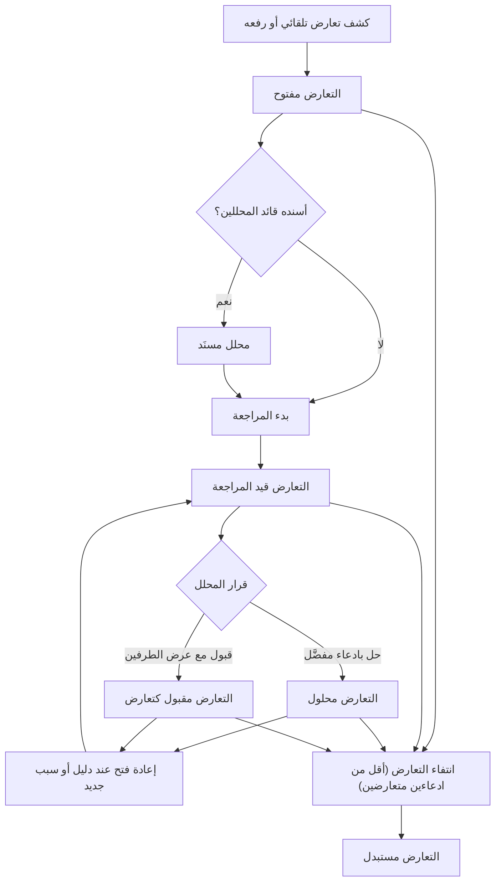
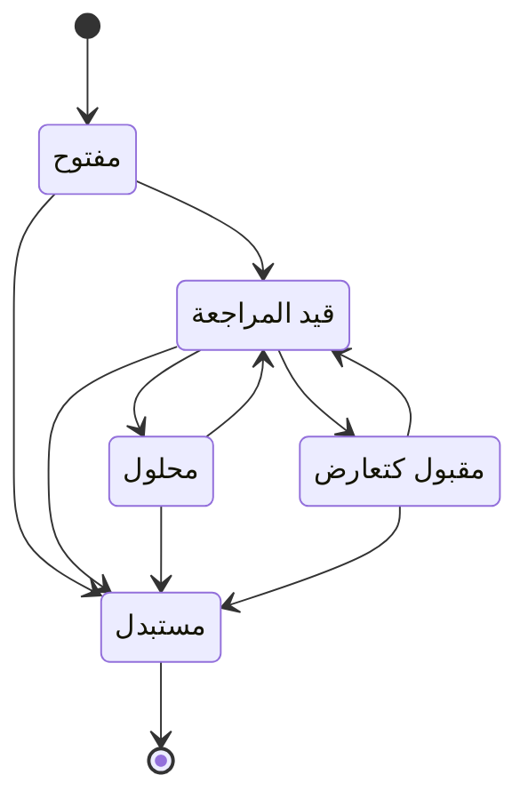

# حل التعارضات

<!-- BEGIN GENERATED: doc -->
| البند | القيمة |
|---|---|
| المعرّف | FEAT-INF-CONFLICT-RESOLVE |
| الإصدار | 0.2 |
| الحالة | مسودة |
| القدرة | CAP-03 إدارة المعلومات |
| القدرة الفرعية | CAP-03.06 إدارة التعارض (R1) |
| الأدوار | قائد المحللين؛ المحلل |
| الشاشات | SCR-26 التعارض ومطابقة الكيانات، SCR-06 قوائم المراجعة |
| حالات الاستخدام | UC-008 |
| القصص | 8: 6 من المواصفة، و2 جديدة |
<!-- END GENERATED: doc -->

## 1. نظرة عامة

### 1.1 القيمة

يُسند قائد المحللين التعارض لمحلل يدرسه ويحسمه أو يقبله مع إمكانية إعادة فتحه.

### 1.2 النطاق

| البند | القيمة |
|---|---|
| المستخدمون | المحلل، وقائد المحللين (الإسناد) |
| الشاشات | SCR-26 التعارض ومطابقة الكيانات، SCR-06 قوائم المراجعة |
| حالات الاستخدام | حسم تعارض بين ادعاءين أو أكثر حول نفس الموضوع والسمة: الإسناد، بدء المراجعة، الحل أو القبول، إعادة الفتح عند دليل جديد |
| المتطلبات | كل تعارض يحتفظ بالادعاءين المتعارضين دون تعديلهما، وقرار الحسم سجل زمني بمن قرر وسببه؛ من لا يرى ادعاءين متعارضين على الأقل لا يرى التعارض |
| خارج النطاق | اكتشاف التعارض نفسه وقواعده الآلية (ميزة «كشف التعارضات»)، ومطابقة الكيانات وربط الملاحظات (ميزة «مراجعة المطابقة») |

### 1.3 خريطة الميزة

**الشكل 1: مسار حسم التعارض**



**الشكل 2: حالات التعارض**



## 2. القواعد المشتركة

تنطبق على كل قصص الميزة، فلا تتكرر داخل القصص. وكل قصة تذكر ما يخصها فقط.

### 2.1 السياق المشترك

كل قصة تبدأ من ثلاثة شروط: مستأجر نشط، وحزمة السياسات الأساسية مفعّلة، ومستخدم مسجّل الدخول ومخوَّل. وتشير إليها القصص بخطوة واحدة: «بفرض السياق المشترك للميزة».

### 2.2 الصلاحية وعدم الإفصاح

- من لا يحق له رؤية العنصر يتلقى ردًا بشكل «غير متاح» تمامًا، فلا يعرف أنه موجود.
- من يرى العنصر ولا يحق له الإجراء يتلقى «لا تملك صلاحية هذا الإجراء».

### 2.3 أوامر تغيير الحالة

- **منع التكرار:** يُرسل كل أمر بمفتاح فريد، فإعادة الطلب نفسه لا تُنفَّذ مرتين.
- **حماية التعديل المتزامن:** يُرسل كل أمر بإصدار البيانات الذي يراه المستخدم. فإن عدّلها غيره في الأثناء، يُرفض الأمر.
- **السجل:** إن نجح الأمر، يُكتب حدثه وسجل التدقيق في المعاملة نفسها.

### 2.4 الرفض المشترك

```gherkin
# language: ar
خاصية: الرفض المشترك لأوامر الميزة

  سيناريو مخطط: رفض مشترك لكل أمر في الميزة
    بفرض السياق المشترك للميزة
    و <الحالة>
    عندما يُرسل المستخدم أي أمر من أوامر الميزة
    اذاً يُرفض برمز <الرمز> ويرى "<الرسالة>"
    و لا يتغير شيء

    امثلة:
      | الحالة                                  | الرمز                  | الرسالة                                                 |
      | العنصر خارج صلاحياته                    | NOT_FOUND              | غير متاح                                                |
      | العنصر مرئي له ولا يحق له الإجراء       | AUTHZ_DENIED           | لا تملك صلاحية هذا الإجراء                              |
      | غيره عدّل العنصر بعد أن فتحه            | VERSION_CONFLICT       | تغيّرت البيانات منذ فتحتها. راجع التغييرات ثم أعد المحاولة |
      | أعاد مفتاح منع التكرار بمحتوى مختلف     | IDEMPOTENCY_KEY_REUSED | طلب مكرر بمحتوى مختلف                                   |
      | البيانات ناقصة أو غير صحيحة             | VALIDATION_FAILED      | بعض البيانات ناقصة أو غير صحيحة. راجع الحقول المعلَّمة      |

  سيناريو: إعادة الطلب نفسه لا تُنفَّذ مرتين
    بفرض السياق المشترك للميزة
    و أمر نجح بمفتاح منع تكرار
    عندما يُعاد الطلب نفسه بالمفتاح نفسه
    اذاً تُعاد النتيجة الأولى ولا يُكتب حدث ثانٍ
```

## 3. الجودة وتعريف الاكتمال

### 3.1 متطلبات الجودة

<!-- BEGIN GENERATED: quality -->
لا متطلبات جودة مرتبطة بمتطلبات هذه الميزة مباشرة. تنطبق متطلبات المنصة العامة (`FEAT-PLT-*`).
<!-- END GENERATED: quality -->

### 3.2 تعريف الاكتمال

القصة مكتملة حين تتحقق الشروط الخمسة:

1. سيناريوهاتها والقواعد المشتركة تمر في الاختبار الآلي.
2. فحوص البنية المعمارية تمر.
3. نصوص الواجهة والرسائل موجودة بالعربية والإنجليزية.
4. مراجعة الكود مكتملة.
5. ما تضيفه القصة نفسها في قسم «القواعد» تحقق.

## 4. فهرس القصص

<!-- BEGIN GENERATED: story-index -->
| المعرّف | القصة | النوع | الحالة |
|---|---|---|---|
| `US-BC02-CNF-ACCEPT` | قبول التعارض كما هو | أمر | مسودة |
| `US-BC02-CNF-ASSIGN` | إسناد التعارض لمحلل | أمر | مسودة |
| `US-BC02-CNF-REOPEN` | إعادة فتح التعارض | أمر | مسودة |
| `US-BC02-CNF-RESOLVE` | حل التعارض بادعاء مفضَّل | أمر | مسودة |
| `US-BC02-CNF-START-REVIEW` | بدء مراجعة التعارض | أمر | مسودة |
| `US-BC02-Q-CNF-GET` | جلب تفاصيل التعارض | جلب | مسودة |
| `US-UI-SCR26-CONFLICT-COMPARE` | مقارنة طرفي التعارض وحسمه أو قبوله | واجهة | مسودة |
| `US-OPS-CONFLICT-BACKLOG-WATCH` | مراقبة تراكم التعارضات المفتوحة | تشغيل | مسودة |
<!-- END GENERATED: story-index -->

## 5. القصص

### 5.1 US-BC02-CNF-ACCEPT — قبول التعارض كما هو

| النوع | الإصدار | الأولوية | دون اتصال | الحالة |
|---|---|---|---|---|
| أمر | R1 | Must | لا | مسودة |

> **كـ** المحلل، **أريد** أن أقبل تعارضًا قيد المراجعة مع عرض الادعاءين معًا، **حتى** يبقى الخلاف موثقًا دون أن أفرض ادعاءً مفضَّلًا لا يستوفي شروط الحل.

**باختصار:** يقبل المحلل التعارض قيد المراجعة مع سبب، فيصير «مقبولًا كتعارض» ويبقى الادعاءان ظاهرين معًا لمن يراهما.

#### القواعد

- **متى يُسمح:** التعارض «قيد المراجعة».
- **من يُسمح له:** المحلل.
- **البيانات:** السبب، إلزامي، يظهر للمستخدمين مع الادعاءين.
- **الأثر:** حدث «قُبل التعارض» يصل إلى العرض المحلول للكيان، ولا يعدّل أي ادعاء (القبول لا يحل الخلاف، بل يسجله).

#### معايير القبول

```gherkin
# language: ar
خاصية: قبول التعارض كما هو

  سيناريو: قبول تعارض قيد المراجعة
    بفرض السياق المشترك للميزة
    و تعارض قيد المراجعة بين ادعاءين مرئيين للمحلل
    عندما يقبله المحلل مع سبب
    اذاً تصبح حالته "مقبولًا كتعارض"
    و يُسجَّل حدث "قُبل التعارض"
    و يبقى الادعاءان كما هما دون تعديل

  سيناريو مخطط: رفض خاص بقبول التعارض
    بفرض السياق المشترك للميزة
    و <الحالة>
    عندما يحاول المحلل قبول التعارض
    اذاً يُرفض برمز <الرمز> ويرى <الرسالة>
    و لا يتغير شيء

    امثلة:
      | الحالة                          | الرمز                              | الرسالة                                           |
      | التعارض ليس "قيد المراجعة"     | CONFLICT_INVALID_STATE_TRANSITION | الوضع الحالي للتعارض لا يسمح بهذا الإجراء          |
      | السبب فارغ                      | REASON_REQUIRED                    | اذكر السبب                                         |
```

<details><summary>المراجع التقنية والتتبع</summary>

<!-- BEGIN GENERATED: refs US-BC02-CNF-ACCEPT -->
| البند | المعرّف | المعنى |
|---|---|---|
| الواجهة البرمجية | `POST /api/v1/information/conflicts/{id}/actions/accept` | — |
| الأمر | `CMD-CNF-ACCEPT` | قبول التعارض |
| السياسة | `POL-CNF-ACCEPT` | Analyst (raise, review, resolve, accept, reopen) · Analyst lead (assign)؛ tenant match; object visible |
| الحدث | `EVT-CNF-ACCEPTED` | يصل إلى: Resolved-view materializer (SLC-05); Analyst notifications; Situation membership (SLC-06: DISPUTED m… |
| الكيان | `AGG-CONFLICT` | التعارض |
| الجدول | `information.conflicts` | الجدول الرئيسي للتعارض |
| وحدة النشر | DU-04 | — |
| المتطلب | REQ-INF-025 | When two claims about the same subject and attribute overlap in valid time with incompatible values, the syst… |
| حالة الاستخدام | UC-008 | Resolve Conflict |
| الاختبار | TST-CONFLICT-SM، TST-SLC04-INVARIANTS | دورة حالات التعارض، وثوابت الشريحة SLC-04 |
<!-- END GENERATED: refs US-BC02-CNF-ACCEPT -->

</details>

### 5.2 US-BC02-CNF-ASSIGN — إسناد التعارض لمحلل

| النوع | الإصدار | الأولوية | دون اتصال | الحالة |
|---|---|---|---|---|
| أمر | R1 | Must | لا | مسودة |

> **كـ** قائد المحللين، **أريد** أن أسند التعارض لمحلل مصرَّح له برؤية ادعاءيه، **حتى** يراجعه من يحق له الاطلاع على كل طرف فيه.

**باختصار:** يسند قائد المحللين التعارض المفتوح أو قيد المراجعة لمحلل تصريحه الأمني يغطي كل الادعاءات المتعارضة، دون تغيير حالة التعارض.

#### القواعد

- **متى يُسمح:** التعارض «مفتوح» أو «قيد المراجعة».
- **من يُسمح له:** قائد المحللين.
- **البيانات:** المحلل المسند، إلزامي.
- **الأثر:** حالة التعارض لا تتغير، ويصل حدث «أُسند التعارض» إلى إشعارات المحلل المسند إليه.

#### معايير القبول

```gherkin
# language: ar
خاصية: إسناد التعارض لمحلل

  سيناريو: إسناد تعارض لمحلل مصرَّح له
    بفرض السياق المشترك للميزة
    و تعارض مفتوح، والمحلل المرشَّح مصرَّح له برؤية كل ادعاء من ادعاءاته
    عندما يسند قائد المحللين التعارض لهذا المحلل
    اذاً تبقى حالة التعارض كما هي
    و يُسجَّل حدث "أُسند التعارض"

  سيناريو مخطط: رفض خاص بالإسناد
    بفرض السياق المشترك للميزة
    و <الحالة>
    عندما يحاول قائد المحللين الإسناد
    اذاً يُرفض برمز <الرمز> ويرى <الرسالة>
    و لا يتغير شيء

    امثلة:
      | الحالة                                              | الرمز                              | الرسالة                                                    |
      | التعارض "محلول" أو "مقبول كتعارض" أو "مستبدل"      | CONFLICT_INVALID_STATE_TRANSITION | الوضع الحالي للتعارض لا يسمح بهذا الإجراء                   |
      | المحلل المرشَّح غير مصرَّح له بأحد ادعاءات التعارض | REVIEWER_NOT_CLEARED               | المراجع غير مصرَّح له بمستوى تصنيف هذه المواد               |
```

<details><summary>المراجع التقنية والتتبع</summary>

<!-- BEGIN GENERATED: refs US-BC02-CNF-ASSIGN -->
| البند | المعرّف | المعنى |
|---|---|---|
| الواجهة البرمجية | `POST /api/v1/information/conflicts/{id}/actions/assign` | — |
| الأمر | `CMD-CNF-ASSIGN` | إسناد التعارض |
| السياسة | `POL-CNF-ASSIGN` | Analyst (raise, review, resolve, accept, reopen) · Analyst lead (assign)؛ tenant match; assignee cleared for… |
| الحدث | `EVT-CNF-ASSIGNED` | يصل إلى: Resolved-view materializer (SLC-05); Analyst notifications; Situation membership (SLC-06: DISPUTED m… |
| الكيان | `AGG-CONFLICT` | التعارض |
| الجدول | `information.conflicts` | الجدول الرئيسي للتعارض |
| وحدة النشر | DU-04 | — |
| المتطلب | REQ-INF-025 | When two claims about the same subject and attribute overlap in valid time with incompatible values, the syst… |
| حالة الاستخدام | UC-008 | Resolve Conflict |
| الاختبار | TST-CONFLICT-SM، TST-SLC04-INVARIANTS | دورة حالات التعارض، وثوابت الشريحة SLC-04 |
<!-- END GENERATED: refs US-BC02-CNF-ASSIGN -->

</details>

### 5.3 US-BC02-CNF-REOPEN — إعادة فتح التعارض

| النوع | الإصدار | الأولوية | دون اتصال | الحالة |
|---|---|---|---|---|
| أمر | R1 | Must | لا | مسودة |

> **كـ** المحلل، **أريد** أن أعيد فتح تعارض محلول أو مقبول حين يظهر دليل جديد، **حتى** يُراجع الحسم السابق في ضوء ما استجد.

**باختصار:** يعيد المحلل فتح تعارض محلول أو مقبول بسبب أو دليل جديد، فيصير «قيد المراجعة» من جديد ويُقفل سجل الحسم السابق.

#### القواعد

- **متى يُسمح:** التعارض «محلول» أو «مقبول كتعارض».
- **من يُسمح له:** المحلل.
- **البيانات:** السبب، إلزامي؛ دليل جديد، اختياري.
- **الأثر:** سجل الحسم السابق يُقفل بوقت إعادة الفتح، ويُسجَّل حدث «أُعيد فتح التعارض».

#### معايير القبول

```gherkin
# language: ar
خاصية: إعادة فتح التعارض

  سيناريو: إعادة فتح تعارض محلول بدليل جديد
    بفرض السياق المشترك للميزة
    و تعارض "محلول"
    عندما يعيد المحلل فتحه مع سبب ودليل جديد
    اذاً تصبح حالته "قيد المراجعة"
    و يُقفل سجل الحسم السابق
    و يُسجَّل حدث "أُعيد فتح التعارض"

  سيناريو مخطط: رفض خاص بإعادة الفتح
    بفرض السياق المشترك للميزة
    و <الحالة>
    عندما يحاول المحلل إعادة فتح التعارض
    اذاً يُرفض برمز <الرمز> ويرى <الرسالة>
    و لا يتغير شيء

    امثلة:
      | الحالة                                   | الرمز                              | الرسالة                                           |
      | التعارض ليس "محلولًا" ولا "مقبولًا كتعارض" | CONFLICT_INVALID_STATE_TRANSITION | الوضع الحالي للتعارض لا يسمح بهذا الإجراء          |
      | السبب فارغ                                 | REASON_REQUIRED                    | اذكر السبب                                         |
```

<details><summary>المراجع التقنية والتتبع</summary>

<!-- BEGIN GENERATED: refs US-BC02-CNF-REOPEN -->
| البند | المعرّف | المعنى |
|---|---|---|
| الواجهة البرمجية | `POST /api/v1/information/conflicts/{id}/actions/reopen` | — |
| الأمر | `CMD-CNF-REOPEN` | إعادة فتح التعارض |
| السياسة | `POL-CNF-REOPEN` | Analyst (raise, review, resolve, accept, reopen) · Analyst lead (assign)؛ tenant match; object visible |
| الحدث | `EVT-CNF-REOPENED` | يصل إلى: Resolved-view materializer (SLC-05); Analyst notifications; Situation membership (SLC-06: DISPUTED m… |
| الكيان | `AGG-CONFLICT` | التعارض |
| الجدول | `information.conflicts` | الجدول الرئيسي للتعارض |
| وحدة النشر | DU-04 | — |
| المتطلب | REQ-INF-025 | When two claims about the same subject and attribute overlap in valid time with incompatible values, the syst… |
| حالة الاستخدام | UC-008 | Resolve Conflict |
| الاختبار | TST-CONFLICT-SM، TST-SLC04-INVARIANTS | دورة حالات التعارض، وثوابت الشريحة SLC-04 |
<!-- END GENERATED: refs US-BC02-CNF-REOPEN -->

</details>

### 5.4 US-BC02-CNF-RESOLVE — حل التعارض بادعاء مفضَّل

| النوع | الإصدار | الأولوية | دون اتصال | الحالة |
|---|---|---|---|---|
| أمر | R1 | Must | لا | مسودة |

> **كـ** المحلل، **أريد** أن أختار الادعاء الأرجح من بين طرفي التعارض مع سبب، **حتى** يُعرف الادعاء المعتمد وسبب تفضيله.

**باختصار:** يحل المحلل تعارضًا قيد المراجعة باختيار ادعاء مفضَّل من الادعاءات السارية وسبب، فيصير التعارض «محلولًا»، على ألا يكون هو من أثبت الادعاء المفضَّل.

#### القواعد

- **متى يُسمح:** التعارض «قيد المراجعة».
- **من يُسمح له:** المحلل، على ألا يكون مثبت الادعاء المفضَّل (فصل المهام).
- **البيانات:** الادعاء المفضَّل (من الادعاءات السارية في التعارض)، إلزامي؛ السبب، إلزامي؛ أدلة إضافية، اختيارية.
- **الأثر:** يُسجَّل سجل حسم بوقت بدايته من الآن، ويصل حدث «حُلّ التعارض» إلى العرض المحلول للكيان.

#### معايير القبول

```gherkin
# language: ar
خاصية: حل التعارض بادعاء مفضَّل

  سيناريو: حل تعارض باختيار الادعاء الأرجح
    بفرض السياق المشترك للميزة
    و تعارض قيد المراجعة بين ادعاءين ساريين، والمحلل لم يثبت أيًا منهما
    عندما يختار المحلل الادعاء المفضَّل مع سبب
    اذاً تصبح حالة التعارض "محلولًا"
    و يُسجَّل حدث "حُلّ التعارض" وسجل حسم من الآن

  سيناريو مخطط: رفض خاص بحل التعارض
    بفرض السياق المشترك للميزة
    و <الحالة>
    عندما يحاول المحلل حل التعارض
    اذاً يُرفض برمز <الرمز> ويرى <الرسالة>
    و لا يتغير شيء

    امثلة:
      | الحالة                                             | الرمز                              | الرسالة                                           |
      | التعارض ليس "قيد المراجعة"                        | CONFLICT_INVALID_STATE_TRANSITION | الوضع الحالي للتعارض لا يسمح بهذا الإجراء          |
      | المحلل نفسه أثبت الادعاء المفضَّل                 | SEGREGATION_OF_DUTIES              | لا يجوز أن يعتمد الشخص نفسه ما قدّمه أو طلبه       |
      | السبب فارغ                                          | VALIDATION_FAILED                  | السبب مطلوب                                        |
```

<details><summary>المراجع التقنية والتتبع</summary>

<!-- BEGIN GENERATED: refs US-BC02-CNF-RESOLVE -->
| البند | المعرّف | المعنى |
|---|---|---|
| الواجهة البرمجية | `POST /api/v1/information/conflicts/{id}/actions/resolve` | — |
| الأمر | `CMD-CNF-RESOLVE` | حل التعارض |
| السياسة | `POL-CNF-RESOLVE` | Analyst (raise, review, resolve, accept, reopen) · Analyst lead (assign)؛ tenant match; cleared for every mem… |
| الحدث | `EVT-CNF-RESOLVED` | يصل إلى: Resolved-view materializer (SLC-05); Analyst notifications; Situation membership (SLC-06: DISPUTED m… |
| الكيان | `AGG-CONFLICT` | التعارض |
| الجدول | `information.conflicts` | الجدول الرئيسي للتعارض |
| وحدة النشر | DU-04 | — |
| المتطلب | REQ-INF-025 | When two claims about the same subject and attribute overlap in valid time with incompatible values, the syst… |
| حالة الاستخدام | UC-008 | Resolve Conflict |
| الاختبار | TST-CONFLICT-SM، TST-SLC04-INVARIANTS | دورة حالات التعارض، وثوابت الشريحة SLC-04 |
<!-- END GENERATED: refs US-BC02-CNF-RESOLVE -->

</details>

### 5.5 US-BC02-CNF-START-REVIEW — بدء مراجعة التعارض

| النوع | الإصدار | الأولوية | دون اتصال | الحالة |
|---|---|---|---|---|
| أمر | R1 | Must | لا | مسودة |

> **كـ** المحلل المسنَد إليه التعارض، **أريد** أن أبدأ مراجعته، **حتى** يعرف الآخرون أنه قيد الدراسة ولا يبدأ غيري حسمه في الوقت نفسه.

**باختصار:** يبدأ المحلل المسنَد إليه التعارض (أو قائد المحللين) مراجعة تعارض مفتوح، فيصير «قيد المراجعة».

#### القواعد

- **متى يُسمح:** التعارض «مفتوح».
- **من يُسمح له:** المحلل المسنَد إليه التعارض، أو قائد المحللين.
- **الأثر:** يُسجَّل حدث «بدأت مراجعة التعارض».

#### معايير القبول

```gherkin
# language: ar
خاصية: بدء مراجعة التعارض

  سيناريو: المحلل المسنَد يبدأ المراجعة
    بفرض السياق المشترك للميزة
    و تعارض مفتوح مسنَد إلى هذا المحلل
    عندما يبدأ مراجعته
    اذاً تصبح حالته "قيد المراجعة"
    و يُسجَّل حدث "بدأت مراجعة التعارض"

  سيناريو مخطط: رفض خاص ببدء المراجعة
    بفرض السياق المشترك للميزة
    و <الحالة>
    عندما يحاول المستخدم بدء المراجعة
    اذاً يُرفض برمز <الرمز> ويرى <الرسالة>
    و لا يتغير شيء

    امثلة:
      | الحالة                                    | الرمز                              | الرسالة                                    |
      | التعارض ليس "مفتوحًا"                     | CONFLICT_INVALID_STATE_TRANSITION | الوضع الحالي للتعارض لا يسمح بهذا الإجراء   |
      | المستخدم ليس المحلل المسنَد ولا قائد المحللين | NOT_ASSIGNED_REVIEWER            | لست المراجع المسند إليه                     |
```

<details><summary>المراجع التقنية والتتبع</summary>

<!-- BEGIN GENERATED: refs US-BC02-CNF-START-REVIEW -->
| البند | المعرّف | المعنى |
|---|---|---|
| الواجهة البرمجية | `POST /api/v1/information/conflicts/{id}/actions/start-review` | — |
| الأمر | `CMD-CNF-START-REVIEW` | بدء مراجعة التعارض |
| السياسة | `POL-CNF-START-REVIEW` | Analyst (raise, review, resolve, accept, reopen) · Analyst lead (assign)؛ tenant match; object visible |
| الحدث | `EVT-CNF-REVIEW-STARTED` | يصل إلى: Resolved-view materializer (SLC-05); Analyst notifications; Situation membership (SLC-06: DISPUTED m… |
| الكيان | `AGG-CONFLICT` | التعارض |
| الجدول | `information.conflicts` | الجدول الرئيسي للتعارض |
| وحدة النشر | DU-04 | — |
| المتطلب | REQ-INF-025 | When two claims about the same subject and attribute overlap in valid time with incompatible values, the syst… |
| حالة الاستخدام | UC-008 | Resolve Conflict |
| الاختبار | TST-CONFLICT-SM، TST-SLC04-INVARIANTS | دورة حالات التعارض، وثوابت الشريحة SLC-04 |
<!-- END GENERATED: refs US-BC02-CNF-START-REVIEW -->

</details>

### 5.6 US-BC02-Q-CNF-GET — جلب تفاصيل التعارض

| النوع | الإصدار | الأولوية | دون اتصال | الحالة |
|---|---|---|---|---|
| جلب | R1 | Must | لا | مسودة |

> **كـ** المحلل، **أريد** أن أفتح تعارضًا فأرى ادعاءاته المرئية لي وأدلتها وسجل حسمه، **حتى** أقرر الإسناد أو المراجعة أو الحسم.

**باختصار:** يعيد الجلب التعارض بادعائيه المرئيين للمحلل، وأدلتهما، وسجل الحسم كما كان معروفًا في أي وقت سابق (`known_at`).

**من يرى ماذا:** المحلل لا يرى التعارض إلا إن رأى ادعاءين متعارضين على الأقل من أعضائه؛ وأي عضو لا يحق له رؤيته لا يظهر ولا يُحسب.

#### معايير القبول

```gherkin
# language: ar
خاصية: جلب تفاصيل التعارض

  سيناريو: فتح تعارض برؤية ادعاءيه
    بفرض السياق المشترك للميزة
    و تعارض يرى المحلل ادعاءيه المتعارضين كليهما
    عندما يطلب المحلل تفاصيل التعارض
    اذاً تُعاد الادعاءات المرئية له وأدلتها وسجل الحسم

  سيناريو: تعارض لا يرى المحلل منه إلا طرفًا واحدًا
    بفرض السياق المشترك للميزة
    و تعارض لا يرى المحلل فيه إلا ادعاءً واحدًا من ادعاءاته المتعارضة
    عندما يطلب المحلل تفاصيل التعارض
    اذاً يُرد عليه بردّ «غير متاح» تمامًا
```

<details><summary>المراجع التقنية والتتبع</summary>

<!-- BEGIN GENERATED: refs US-BC02-Q-CNF-GET -->
| البند | المعرّف | المعنى |
|---|---|---|
| الواجهة البرمجية | `GET /api/v1/information/conflicts/{conflict_id}` | — |
| الاستعلام | `QRY-CNF-GET` | Conflict with visible members, evidence, resolution history (as known_at) |
| السياسة | `POL-CNF-GET` | Analyst; visibility rule INV-CNF-04 |
| الكيان | `AGG-CONFLICT` | التعارض |
| الجدول | `information.conflicts` | الجدول الرئيسي للتعارض |
| وحدة النشر | DU-04 | — |
| المتطلب | REQ-INF-025 | When two claims about the same subject and attribute overlap in valid time with incompatible values, the syst… |
| حالة الاستخدام | UC-008 | Resolve Conflict |
| الاختبار | TST-CONFLICT-SM، TST-SLC04-INVARIANTS | دورة حالات التعارض، وثوابت الشريحة SLC-04 |
<!-- END GENERATED: refs US-BC02-Q-CNF-GET -->

</details>

### 5.7 US-UI-SCR26-CONFLICT-COMPARE — مقارنة طرفي التعارض وحسمه أو قبوله

| النوع | الإصدار | الأولوية | دون اتصال | الحالة |
|---|---|---|---|---|
| واجهة | R1 | Must | لا | مسودة |

> **كـ** المحلل، **أريد** أن أرى ادعاءي التعارض جنبًا إلى جنب وأفعاله المتاحة في شاشة واحدة، **حتى** أحسم التعارض أو أقبله دون أن أتنقل بين شاشات.

**باختصار:** شاشة التعارض (SCR-26) تعرض الادعاءين جنبًا إلى جنب بمصدر كل منهما وموثوقيته، وتظهر فعل الإسناد أو بدء المراجعة أو الحل أو القبول أو إعادة الفتح بحسب حالة التعارض وصلاحية المستخدم فقط، تاركة القرار النهائي للخادم.

#### القواعد

- **متى يحدث:** عند فتح المحلل أو قائد المحللين تعارضًا من قوائم المراجعة (SCR-06) أو من ملف الكيان.

#### معايير القبول

```gherkin
# language: ar
خاصية: مقارنة طرفي التعارض وحسمه أو قبوله

  سيناريو: عرض الطرفين والأفعال المتاحة
    بفرض السياق المشترك للميزة
    و تعارض قيد المراجعة مسنَد إلى هذا المحلل
    عندما يفتح المحلل شاشة التعارض
    اذاً تُعرض الادعاءات المتعارضة جنبًا إلى جنب بمصدر كل منها وموثوقيته
    و تظهر الأفعال التي يسمح بها دوره وحالة التعارض فقط

  سيناريو: فعل أخفته الشاشة رفضه الخادم لاحقًا
    بفرض السياق المشترك للميزة
    و حالة التعارض تغيّرت بعد فتح الشاشة ولم تُحدَّث بعد
    عندما يحاول المستخدم فعلًا لم تعد الحالة الحالية تسمح به
    اذاً يرفضه الخادم برمز انتقال الحالة غير المسموح، وتعيد الشاشة تحميل التعارض وتُخفي الفعل
```

<details><summary>المراجع التقنية والتتبع</summary>

<!-- BEGIN GENERATED: refs US-UI-SCR26-CONFLICT-COMPARE -->
| البند | المعرّف | المعنى |
|---|---|---|
| الشاشة | SCR-26 | شاشة التعارض ومطابقة الكيانات |
| حالة الاستخدام | UC-008 | Resolve Conflict |
| المتطلب | REQ-INF-025 | When two claims about the same subject and attribute overlap in valid time with incompatible values, the syst… |
| حالة الاستخدام | UC-008 | Resolve Conflict |
<!-- END GENERATED: refs US-UI-SCR26-CONFLICT-COMPARE -->

</details>

### 5.8 US-OPS-CONFLICT-BACKLOG-WATCH — مراقبة تراكم التعارضات المفتوحة

| النوع | الإصدار | الأولوية | دون اتصال | الحالة |
|---|---|---|---|---|
| تشغيل | R1 | Should | لا ينطبق | مسودة |

> **كـ** فريق التشغيل، **أريد** تنبيهًا حين يتأخر اكتشاف التعارضات أو يتراكم المفتوح منها، **حتى** أتدخل قبل أن يتضخم تراكم المراجعة على المحللين.

**باختصار:** مقياسان مستمران: زمن تأخر اكتشاف التعارض، وعدد التعارضات المفتوحة لكل سمة. تجاوز أي حد يصدر تنبيهًا لفريق التشغيل.

#### القواعد

- **متى يحدث:** عند حساب المقاييس الدورية للمنصة.
- **البيانات:** `cnf.detect_lag_s` (زمن تأخر الاكتشاف)، `cnf.open_total{predicate}` (عدد المفتوح حسب السمة).
- **الأثر:** تنبيه عند تجاوز 30 ثانية (المئين 95) لتأخر الاكتشاف، أو عند اتجاه متصاعد في عدد التعارضات المفتوحة (`observability-slc04.md`).

#### معايير القبول

```gherkin
# language: ar
خاصية: مراقبة تراكم التعارضات المفتوحة

  سيناريو: تأخر الاكتشاف يتجاوز الحد
    بفرض أن تأخر اكتشاف التعارضات عند المئين 95 تجاوز 30 ثانية
    عندما يُحسب المقياس الدوري
    اذاً يصدر تنبيه لفريق التشغيل

  سيناريو: عدد التعارضات المفتوحة في اتجاه متصاعد
    بفرض أن عدد التعارضات المفتوحة لسمة واحدة يتزايد عبر دورات القياس المتتالية
    عندما يُحسب المقياس الدوري
    اذاً يصدر تنبيه اتجاه لفريق التشغيل

  سيناريو: لا تنبيه عند الاستقرار
    بفرض أن تأخر الاكتشاف دون الحد وعدد التعارضات المفتوحة مستقر
    عندما يُحسب المقياس الدوري
    اذاً لا يصدر أي تنبيه
```

<details><summary>المراجع التقنية والتتبع</summary>

<!-- BEGIN GENERATED: refs US-OPS-CONFLICT-BACKLOG-WATCH -->
| البند | المعرّف | المعنى |
|---|---|---|
| المصدر | `observability-slc04.md` | — |
<!-- END GENERATED: refs US-OPS-CONFLICT-BACKLOG-WATCH -->

</details>

## 6. التتبع

<!-- BEGIN GENERATED: trace -->
| المتطلب | المعنى | القصص | الاختبار |
|---|---|---|---|
| REQ-INF-025 | When two claims about the same subject and attribute overlap in valid time with incompatible values, the syst… | `US-BC02-CNF-ACCEPT`، `US-BC02-CNF-ASSIGN`، `US-BC02-CNF-REOPEN`، `US-BC02-CNF-RESOLVE`، `US-BC02-CNF-START-REVIEW`، `US-BC02-Q-CNF-GET`، `US-UI-SCR26-CONFLICT-COMPARE` | TST-CONFLICT-SM، TST-SLC04-INVARIANTS |
<!-- END GENERATED: trace -->

## 7. سجل التغييرات

| الإصدار | التاريخ | التغيير |
|---|---|---|
| 0.1 | — | هيكل مولَّد من خريطة الميزات |
| 0.2 | 2026-10-03 | كتابة القصص كاملة بمعيار القصص |
