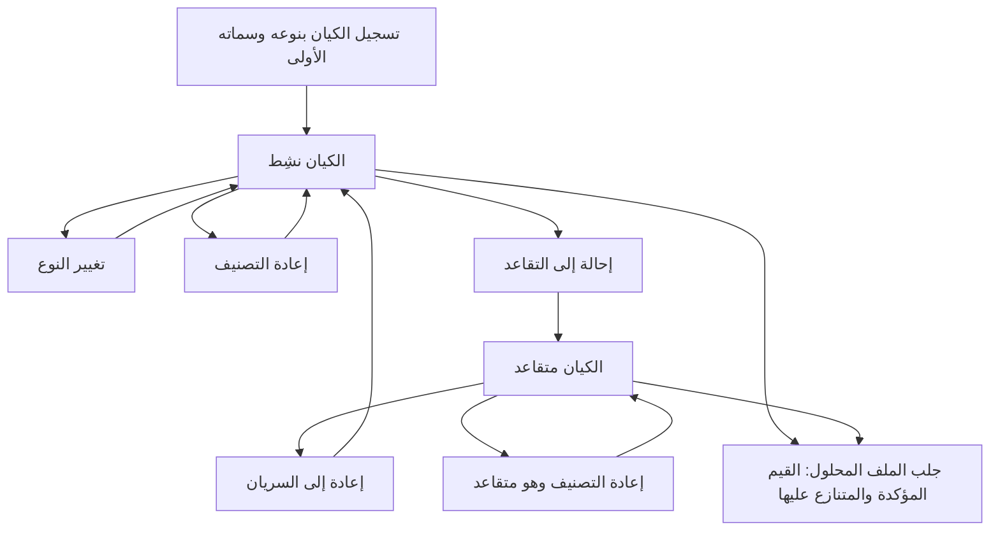
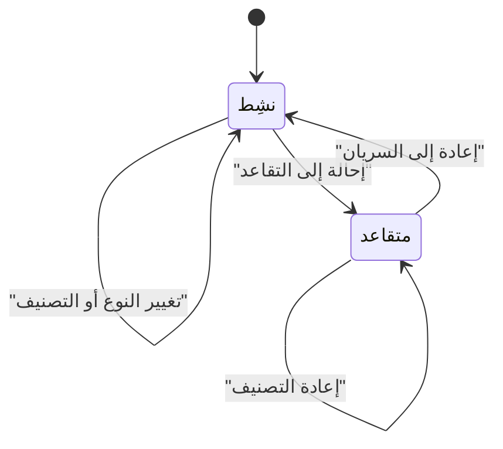

# إدارة الكيانات وملفاتها

<!-- BEGIN GENERATED: doc -->
| البند | القيمة |
|---|---|
| المعرّف | FEAT-INF-ENTITY-REGISTRY |
| الإصدار | 0.1 |
| الحالة | مسودة |
| القدرة | CAP-03 إدارة المعلومات |
| القدرة الفرعية | CAP-03.01 الكيانات والعلاقات (R1) |
| الأدوار | المحلل؛ النظام؛ أي مستخدم مخوَّل |
| الشاشات | SCR-21 الكيانات والأحداث: العرض المحلول |
| حالات الاستخدام | UC-001 |
| القصص | 14: 7 من المواصفة، و7 جديدة |
<!-- END GENERATED: doc -->

## 1. نظرة عامة

### 1.1 القيمة

يسجّل المحلل الأشخاص والجهات والأماكن ويعدّلها ويطّلع على ملف كل منها بقيمه المؤكدة والمتنازع عليها.

### 1.2 النطاق

| البند | القيمة |
|---|---|
| المستخدمون | المحلل، ومحوّل البيانات بهوية خدمة، وأي مستخدم مخوَّل (القراءة) |
| الشاشات | SCR-21 الكيانات والأحداث: العرض المحلول |
| حالات الاستخدام | تسجيل كيان (شخص، جهة، مكان) وسماته الأولى، تغيير نوعه أو تصنيفه، إحالته إلى التقاعد أو إعادته إلى السريان، تصفح الكيانات وفتح ملف كل منها بقيمه المؤكدة والمتنازع عليها كما كانت في أي وقت |
| المتطلبات | كل سمة من سمات الكيان ادعاء مستقل له مصدره، لا قيمة محفوظة في الكيان نفسه؛ الأسماء تُحفظ بصيغتها الأصلية والموحدة والمنقولة؛ القراءة لا تكشف ادعاءً محجوبًا عن القارئ ولا أثره في أي عدّاد |
| خارج النطاق | حل التعارض بين ادعاءين متنازعين (ميزة «حل التعارضات»)، ومطابقة الكيانات وتجميعها في عنقود هوية (ميزة «مراجعة المطابقة») |

### 1.3 خريطة الميزة

**الشكل 1: مسار إدارة الكيان**



**الشكل 2: حالتا الكيان**



## 2. القواعد المشتركة

تنطبق على كل قصص الميزة، فلا تتكرر داخل القصص. وكل قصة تذكر ما يخصها فقط.

### 2.1 السياق المشترك

كل قصة تبدأ من ثلاثة شروط: مستأجر نشط، وحزمة السياسات الأساسية مفعّلة، ومستخدم مسجّل الدخول ومخوَّل. وتشير إليها القصص بخطوة واحدة: «بفرض السياق المشترك للميزة».

### 2.2 الصلاحية وعدم الإفصاح

- من لا يحق له رؤية العنصر يتلقى ردًا بشكل «غير متاح» تمامًا، فلا يعرف أنه موجود.
- من يرى العنصر ولا يحق له الإجراء يتلقى «لا تملك صلاحية هذا الإجراء».

### 2.3 أوامر تغيير الحالة

- **منع التكرار:** يُرسل كل أمر بمفتاح فريد، فإعادة الطلب نفسه لا تُنفَّذ مرتين.
- **حماية التعديل المتزامن:** يُرسل كل أمر بإصدار البيانات الذي يراه المستخدم. فإن عدّلها غيره في الأثناء، يُرفض الأمر.
- **السجل:** إن نجح الأمر، يُكتب حدثه وسجل التدقيق في المعاملة نفسها.

### 2.4 الرفض المشترك

```gherkin
# language: ar
خاصية: الرفض المشترك لأوامر الميزة

  سيناريو مخطط: رفض مشترك لكل أمر في الميزة
    بفرض السياق المشترك للميزة
    و <الحالة>
    عندما يُرسل المستخدم أي أمر من أوامر الميزة
    اذاً يُرفض برمز <الرمز> ويرى "<الرسالة>"
    و لا يتغير شيء

    امثلة:
      | الحالة                                  | الرمز                  | الرسالة                                                 |
      | العنصر خارج صلاحياته                    | NOT_FOUND              | غير متاح                                                |
      | العنصر مرئي له ولا يحق له الإجراء       | AUTHZ_DENIED           | لا تملك صلاحية هذا الإجراء                              |
      | غيره عدّل العنصر بعد أن فتحه            | VERSION_CONFLICT       | تغيّرت البيانات منذ فتحتها. راجع التغييرات ثم أعد المحاولة |
      | أعاد مفتاح منع التكرار بمحتوى مختلف     | IDEMPOTENCY_KEY_REUSED | طلب مكرر بمحتوى مختلف                                   |
      | البيانات ناقصة أو غير صحيحة             | VALIDATION_FAILED      | بعض البيانات ناقصة أو غير صحيحة. راجع الحقول المعلَّمة      |

  سيناريو: إعادة الطلب نفسه لا تُنفَّذ مرتين
    بفرض السياق المشترك للميزة
    و أمر نجح بمفتاح منع تكرار
    عندما يُعاد الطلب نفسه بالمفتاح نفسه
    اذاً تُعاد النتيجة الأولى ولا يُكتب حدث ثانٍ
```

## 3. الجودة وتعريف الاكتمال

### 3.1 متطلبات الجودة

<!-- BEGIN GENERATED: quality -->
| المرجع | الموقف | المطلوب |
|---|---|---|
| QAS-PERF-013 | resolved entity read (current) | p95 ≤ 300 ms end-to-end |
| QAS-SEC-010 | user sees an entity but not some of its claims | hidden claims affect neither status, counts, completeness nor timing (inference suite) |
| QAS-TMP-001 | asks for state as of valid time T known at record time K | 100 % agreement with temporal oracle corpus |
| QAS-USA-002 | searches a name with Arabic spelling variants or Latin transliteration | recall ≥ 95 % on the Arabic name test set |
<!-- END GENERATED: quality -->

### 3.2 تعريف الاكتمال

القصة مكتملة حين تتحقق الشروط الخمسة:

1. سيناريوهاتها والقواعد المشتركة تمر في الاختبار الآلي.
2. فحوص البنية المعمارية تمر.
3. نصوص الواجهة والرسائل موجودة بالعربية والإنجليزية.
4. مراجعة الكود مكتملة.
5. ما تضيفه القصة نفسها في قسم «القواعد» تحقق.

## 4. فهرس القصص

<!-- BEGIN GENERATED: story-index -->
| المعرّف | القصة | النوع | الحالة |
|---|---|---|---|
| `US-BC02-ENT-CHANGE-TYPE` | تغيير نوع الكيان | أمر | مسودة |
| `US-BC02-ENT-RECLASSIFY` | إعادة تصنيف الكيان | أمر | مسودة |
| `US-BC02-ENT-REGISTER` | تسجيل الكيان | أمر | مسودة |
| `US-BC02-ENT-REINSTATE` | إعادة الكيان إلى السريان | أمر | مسودة |
| `US-BC02-ENT-RETIRE` | إحالة الكيان إلى التقاعد | أمر | مسودة |
| `US-BC02-Q-ENT-LIST` | جلب: Entities by type, bbox/polygon of current location, valid_at | جلب | مسودة |
| `US-BC02-Q-ENT-RESOLVED` | جلب: Resolved view per predicate at valid_at/known_at (value, CORROBORATED/DISPUTED candidates, confidence); resolves through the identity cluster and returns canonical_urn + requested_urn (SLC-04) | جلب | مسودة |
| `US-UI-SCR21-ENTITY-ACTIONS` | إظهار أفعال الكيان المتاحة حسب حالته | واجهة | مسودة |
| `US-UI-SCR21-ENTITY-LIST` | تصفح الكيانات وتصفيتها بالنوع والمكان والزمن | واجهة | مسودة |
| `US-UI-SCR21-RESOLVED-VIEW` | عرض ملف الكيان بقيمه المؤكدة والمتنازع عليها | واجهة | مسودة |
| `US-PLT-ENTITY-HIDDEN-CLAIMS` | ألا تكشف الادعاءات المحجوبة عبر ملف الكيان | منصة | مسودة |
| `US-PLT-ENTITY-RESOLVED-READ` | فتح ملف الكيان خلال 300 ميلي ثانية | منصة | مسودة |
| `US-PLT-NAMES-NORMALIZE` | حفظ الأسماء بصيغها الأصلية والموحدة والمنقولة | منصة | مسودة |
| `US-OPS-NAMES-NORM-UPGRADE` | ترقية قواعد توحيد الأسماء وإعادة الفهرسة | تشغيل | مسودة |
<!-- END GENERATED: story-index -->

## 5. القصص

### 5.1 US-BC02-ENT-CHANGE-TYPE — تغيير نوع الكيان

| النوع | الإصدار | الأولوية | دون اتصال | الحالة |
|---|---|---|---|---|
| أمر | R1 | Must | لا | مسودة |

> **كـ** المحلل، **أريد** أن أصحح نوع الكيان إلى نوع متوافق مع سبب، **حتى** يُصنَّف الكيان بدقة فيما بعد من فهرسة وبحث.

**باختصار:** يغيّر المحلل أو محوّل البيانات نوع كيان نشِط إلى نوع متوافق من القائمة المرجعية للأنواع مع سبب، دون أن تتغير حالة الكيان.

#### القواعد

- **متى يُسمح:** الكيان «نشِط».
- **من يُسمح له:** المحلل، أو محوّل البيانات بهوية خدمة.
- **البيانات:** النوع الجديد (من القائمة المرجعية للأنواع)، إلزامي؛ السبب، إلزامي.
- **الأثر:** حالة الكيان لا تتغير، ويصل حدث «تغيّر نوع الكيان» إلى مولِّد مرشحات المطابقة وإسقاطات البحث والرسم.

#### معايير القبول

```gherkin
# language: ar
خاصية: تغيير نوع الكيان

  سيناريو: تغيير النوع إلى نوع متوافق
    بفرض السياق المشترك للميزة
    و كيان نشِط من نوع "شخص"
    عندما يغيّر المحلل نوعه إلى نوع متوافق مع سبب
    اذاً يصبح نوع الكيان الجديد
    و يُسجَّل حدث "تغيّر نوع الكيان"

  سيناريو مخطط: رفض خاص بتغيير النوع
    بفرض السياق المشترك للميزة
    و <الحالة>
    عندما يحاول المحلل تغيير نوع الكيان
    اذاً يُرفض برمز <الرمز> ويرى <الرسالة>
    و لا يتغير شيء

    امثلة:
      | الحالة                                 | الرمز                          | الرسالة                                       |
      | الكيان "متقاعد"                       | ENTITY_INVALID_STATE_TRANSITION | الوضع الحالي للكيان لا يسمح بهذا الإجراء      |
      | النوع الجديد غير متوافق مع النوع الحالي | ENTITY_TYPE_INCOMPATIBLE       | النوع الجديد غير متوافق مع نوع الكيان          |
```

<details><summary>المراجع التقنية والتتبع</summary>

<!-- BEGIN GENERATED: refs US-BC02-ENT-CHANGE-TYPE -->
| البند | المعرّف | المعنى |
|---|---|---|
| الواجهة البرمجية | `POST /api/v1/information/entities/{id}/actions/change-type` | — |
| الأمر | `CMD-ENT-CHANGE-TYPE` | تغيير نوع الكيان |
| السياسة | `POL-ENT-CHANGE-TYPE` | Analyst · adapter service account؛ tenant match; object visible to subject (label ≤ clearance); write permiss… |
| الحدث | `EVT-ENT-TYPE-CHANGED` | يصل إلى: ER candidate generator (SLC-04); Search/Graph projections (SLC-05) |
| الكيان | `AGG-ENTITY` | الكيان |
| الجدول | `information.entities` | الجدول الرئيسي للكيان |
| وحدة النشر | DU-04 | — |
| المتطلبات | REQ-INF-020، REQ-INF-036 | معانيها في القسم 6. التتبع |
| حالة الاستخدام | UC-001 | Manage Entity |
| الاختبار | TST-ENTITY-SM، TST-SLC02-INVARIANTS | دورة حالات الكيان، وثوابت الشريحة SLC-02 |
<!-- END GENERATED: refs US-BC02-ENT-CHANGE-TYPE -->

</details>

### 5.2 US-BC02-ENT-RECLASSIFY — إعادة تصنيف الكيان

| النوع | الإصدار | الأولوية | دون اتصال | الحالة |
|---|---|---|---|---|
| أمر | R1 | Must | لا | مسودة |

> **كـ** المحلل، **أريد** أن أرفع أو أخفض التصنيف الأمني للكيان بسبب، **حتى** تطابق حمايته حساسية ما يحمله من معلومات.

**باختصار:** يعيد المحلل أو محوّل البيانات تصنيف كيان نشِط أو متقاعد مع سبب، فيحمل التصنيف الجديد سواء كان الكيان نشِطًا أو متقاعدًا.

#### القواعد

- **متى يُسمح:** لصاحب السلطة لتغيير التصنيف حسب سياسة المستأجر، في أي من حالتي الكيان.
- **من يُسمح له:** المحلل، أو محوّل البيانات بهوية خدمة.
- **البيانات:** التصنيف الجديد، إلزامي؛ السبب، إلزامي.
- **الأثر:** يُرفع رقم إصدار الأمان للكيان فتُعاد كل قرارات الصلاحية المخزَّنة عليه، ويصل حدث «أُعيد تصنيف الكيان» إلى خدمة إصدار الأمان ومولِّد مرشحات المطابقة وإسقاطات البحث.

#### معايير القبول

```gherkin
# language: ar
خاصية: إعادة تصنيف الكيان

  سيناريو: رفع التصنيف بسلطة مخوَّلة
    بفرض السياق المشترك للميزة
    و كيان نشِط، وللمحلل سلطة تغيير التصنيف حسب سياسة المستأجر
    عندما يعيد تصنيفه مع سبب
    اذاً يحمل الكيان التصنيف الجديد
    و يُرفع رقم إصدار الأمان للكيان
    و يُسجَّل حدث "أُعيد تصنيف الكيان"

  سيناريو مخطط: رفض خاص بإعادة التصنيف
    بفرض السياق المشترك للميزة
    و <الحالة>
    عندما يحاول المحلل إعادة التصنيف
    اذاً يُرفض برمز <الرمز> ويرى <الرسالة>
    و لا يتغير شيء

    امثلة:
      | الحالة                                              | الرمز                                  | الرسالة                                |
      | لا سلطة له بتغيير التصنيف حسب سياسة المستأجر       | CLASSIFICATION_CHANGE_NOT_AUTHORIZED   | لا تملك صلاحية تغيير التصنيف            |
```

<details><summary>المراجع التقنية والتتبع</summary>

<!-- BEGIN GENERATED: refs US-BC02-ENT-RECLASSIFY -->
| البند | المعرّف | المعنى |
|---|---|---|
| الواجهة البرمجية | `POST /api/v1/information/entities/{id}/actions/reclassify` | — |
| الأمر | `CMD-ENT-RECLASSIFY` | إعادة تصنيف الكيان |
| السياسة | `POL-ENT-RECLASSIFY` | Analyst · adapter service account؛ tenant match; object visible to subject (label ≤ clearance); write permiss… |
| الحدث | `EVT-ENT-RECLASSIFIED` | يصل إلى: Security-version service (EVT-SEC-VERSION-INCREMENTED); PEP decision caches; Projection security-ver… |
| الكيان | `AGG-ENTITY` | الكيان |
| الجدول | `information.entities` | الجدول الرئيسي للكيان |
| وحدة النشر | DU-04 | — |
| المتطلبات | REQ-INF-020، REQ-INF-036 | معانيها في القسم 6. التتبع |
| حالة الاستخدام | UC-001 | Manage Entity |
| الاختبار | TST-ENTITY-SM، TST-SLC02-INVARIANTS | دورة حالات الكيان، وثوابت الشريحة SLC-02 |
<!-- END GENERATED: refs US-BC02-ENT-RECLASSIFY -->

</details>

### 5.3 US-BC02-ENT-REGISTER — تسجيل كيان جديد

| النوع | الإصدار | الأولوية | دون اتصال | الحالة |
|---|---|---|---|---|
| أمر | R1 | Must | لا | مسودة |

> **كـ** المحلل، **أريد** أن أسجّل شخصًا أو جهة أو مكانًا جديدًا بنوعه وسماته الأولى، **حتى** يصير له ملف واحد يُبنى عليه ما يلي من معلومات.

**باختصار:** يسجّل المحلل أو محوّل البيانات كيانًا جديدًا بنوع من القائمة المرجعية وتصنيف وسمات أولية، فيُسجَّل الكيان وكل سمة من سماته كادعاء مستقل في معاملة واحدة.

#### القواعد

- **متى يُسمح:** عند عدم وجود الكيان بعد.
- **من يُسمح له:** المحلل، أو محوّل البيانات بهوية خدمة.
- **البيانات:** النوع (من القائمة المرجعية)، إلزامي؛ التصنيف، إلزامي؛ السمات الأولية، اختيارية، كل منها تُسجَّل كادعاء مستقل بصلاحيته الخاصة.
- **الأثر:** الكيان يُنشأ بحالة «نشِط»، ويصل حدث «سُجِّل الكيان» إلى مولِّد مرشحات المطابقة وإسقاطات البحث والرسم.

#### معايير القبول

```gherkin
# language: ar
خاصية: تسجيل كيان جديد

  سيناريو: تسجيل كيان بنوعه وسماته الأولى
    بفرض السياق المشترك للميزة
    و نوع كيان صحيح من القائمة المرجعية
    عندما يسجّل المحلل الكيان بتصنيفه وسماته الأولية
    اذاً يُنشأ الكيان بحالة "نشِط"
    و تُسجَّل سماته الأولية كادعاءات مستقلة في المعاملة نفسها
    و يُسجَّل حدث "سُجِّل الكيان"

  سيناريو مخطط: رفض خاص بالتسجيل
    بفرض السياق المشترك للميزة
    و <الحالة>
    عندما يحاول المحلل تسجيل الكيان
    اذاً يُرفض برمز <الرمز> ويرى <الرسالة>
    و لا يتغير شيء

    امثلة:
      | الحالة                                                    | الرمز          | الرسالة                     |
      | النوع ليس من القائمة المرجعية، أو إحدى السمات الأولية غير صحيحة | ENTITY_INVALID | بيانات الكيان غير صحيحة     |
      | النوع فارغ                                                | VALIDATION_FAILED | النوع مطلوب                |
```

<details><summary>المراجع التقنية والتتبع</summary>

<!-- BEGIN GENERATED: refs US-BC02-ENT-REGISTER -->
| البند | المعرّف | المعنى |
|---|---|---|
| الواجهة البرمجية | `POST /api/v1/information/entities` | — |
| الأمر | `CMD-ENT-REGISTER` | تسجيل الكيان |
| السياسة | `POL-ENT-REGISTER` | Analyst · adapter service account؛ tenant match; object visible to subject (label ≤ clearance); write permiss… |
| الحدث | `EVT-ENT-REGISTERED` | يصل إلى: ER candidate generator (SLC-04); Search/Graph projections (SLC-05) |
| الكيان | `AGG-ENTITY` | الكيان |
| الجدول | `information.entities` | الجدول الرئيسي للكيان |
| وحدة النشر | DU-04 | — |
| المتطلبات | REQ-INF-020، REQ-INF-036 | معانيها في القسم 6. التتبع |
| حالة الاستخدام | UC-001 | Manage Entity |
| الاختبار | TST-ENTITY-SM، TST-SLC02-INVARIANTS | دورة حالات الكيان، وثوابت الشريحة SLC-02 |
<!-- END GENERATED: refs US-BC02-ENT-REGISTER -->

</details>

### 5.4 US-BC02-ENT-REINSTATE — إعادة الكيان إلى السريان

| النوع | الإصدار | الأولوية | دون اتصال | الحالة |
|---|---|---|---|---|
| أمر | R1 | Must | لا | مسودة |

> **كـ** المحلل، **أريد** أن أعيد كيانًا متقاعدًا إلى السريان بسبب، **حتى** يُستأنف تتبُّعه بعد أن تبيّن أن إحالته للتقاعد كانت خطأ أو لم يعد صحيحًا سببها.

**باختصار:** يعيد المحلل أو محوّل البيانات كيانًا متقاعدًا إلى حالة «نشِط» مع سبب.

#### القواعد

- **متى يُسمح:** الكيان «متقاعد».
- **من يُسمح له:** المحلل، أو محوّل البيانات بهوية خدمة.
- **البيانات:** السبب، إلزامي.
- **الأثر:** حالة الكيان تصير «نشِط»، ويصل حدث «أُعيد الكيان إلى السريان» إلى مولِّد مرشحات المطابقة وإسقاطات البحث والرسم.

#### معايير القبول

```gherkin
# language: ar
خاصية: إعادة الكيان إلى السريان

  سيناريو: إعادة كيان متقاعد مع سبب
    بفرض السياق المشترك للميزة
    و كيان "متقاعد"
    عندما يعيده المحلل إلى السريان مع سبب
    اذاً تصبح حالته "نشِط"
    و يُسجَّل حدث "أُعيد الكيان إلى السريان"

  سيناريو مخطط: رفض خاص بالإعادة إلى السريان
    بفرض السياق المشترك للميزة
    و <الحالة>
    عندما يحاول المحلل إعادة الكيان إلى السريان
    اذاً يُرفض برمز <الرمز> ويرى <الرسالة>
    و لا يتغير شيء

    امثلة:
      | الحالة               | الرمز                            | الرسالة                                   |
      | الكيان "نشِط" أصلًا  | ENTITY_INVALID_STATE_TRANSITION | الوضع الحالي للكيان لا يسمح بهذا الإجراء  |
      | السبب فارغ            | REASON_REQUIRED                  | اذكر السبب                                 |
```

<details><summary>المراجع التقنية والتتبع</summary>

<!-- BEGIN GENERATED: refs US-BC02-ENT-REINSTATE -->
| البند | المعرّف | المعنى |
|---|---|---|
| الواجهة البرمجية | `POST /api/v1/information/entities/{id}/actions/reinstate` | — |
| الأمر | `CMD-ENT-REINSTATE` | إعادة الكيان إلى السريان |
| السياسة | `POL-ENT-REINSTATE` | Analyst · adapter service account؛ tenant match; object visible to subject (label ≤ clearance); write permiss… |
| الحدث | `EVT-ENT-REINSTATED` | يصل إلى: ER candidate generator (SLC-04); Search/Graph projections (SLC-05) |
| الكيان | `AGG-ENTITY` | الكيان |
| الجدول | `information.entities` | الجدول الرئيسي للكيان |
| وحدة النشر | DU-04 | — |
| المتطلبات | REQ-INF-020، REQ-INF-036 | معانيها في القسم 6. التتبع |
| حالة الاستخدام | UC-001 | Manage Entity |
| الاختبار | TST-ENTITY-SM، TST-SLC02-INVARIANTS | دورة حالات الكيان، وثوابت الشريحة SLC-02 |
<!-- END GENERATED: refs US-BC02-ENT-REINSTATE -->

</details>

### 5.5 US-BC02-ENT-RETIRE — إحالة الكيان إلى التقاعد

| النوع | الإصدار | الأولوية | دون اتصال | الحالة |
|---|---|---|---|---|
| أمر | R1 | Must | لا | مسودة |

> **كـ** المحلل، **أريد** أن أحيل كيانًا نشِطًا إلى التقاعد بسبب، **حتى** تتوقف متابعته الحية دون أن يُفقد سجله أو سماته.

**باختصار:** يحيل المحلل أو محوّل البيانات كيانًا نشِطًا إلى حالة «متقاعد» مع سبب (أُنشئ خطأً أو لم يعد مُتابَعًا)، وتبقى سماته كما هي.

#### القواعد

- **متى يُسمح:** الكيان «نشِط».
- **من يُسمح له:** المحلل، أو محوّل البيانات بهوية خدمة.
- **البيانات:** السبب، إلزامي.
- **الأثر:** حالة الكيان تصير «متقاعد» دون أن تتأثر سماته، ويبقى قابلًا للاستعلام عنه في السجل والاستعلامات بأثر رجعي. يصل حدث «أُحيل الكيان إلى التقاعد» إلى مولِّد مرشحات المطابقة وإسقاطات البحث والرسم.

#### معايير القبول

```gherkin
# language: ar
خاصية: إحالة الكيان إلى التقاعد

  سيناريو: إحالة كيان نشِط إلى التقاعد مع سبب
    بفرض السياق المشترك للميزة
    و كيان "نشِط"
    عندما يحيله المحلل إلى التقاعد مع سبب
    اذاً تصبح حالته "متقاعد"
    و تبقى سماته كما هي
    و يُسجَّل حدث "أُحيل الكيان إلى التقاعد"

  سيناريو مخطط: رفض خاص بالإحالة إلى التقاعد
    بفرض السياق المشترك للميزة
    و <الحالة>
    عندما يحاول المحلل إحالة الكيان إلى التقاعد
    اذاً يُرفض برمز <الرمز> ويرى <الرسالة>
    و لا يتغير شيء

    امثلة:
      | الحالة                  | الرمز                            | الرسالة                                   |
      | الكيان "متقاعد" أصلًا  | ENTITY_INVALID_STATE_TRANSITION | الوضع الحالي للكيان لا يسمح بهذا الإجراء  |
      | السبب فارغ               | REASON_REQUIRED                  | اذكر السبب                                 |
```

<details><summary>المراجع التقنية والتتبع</summary>

<!-- BEGIN GENERATED: refs US-BC02-ENT-RETIRE -->
| البند | المعرّف | المعنى |
|---|---|---|
| الواجهة البرمجية | `POST /api/v1/information/entities/{id}/actions/retire` | — |
| الأمر | `CMD-ENT-RETIRE` | إحالة الكيان إلى التقاعد |
| السياسة | `POL-ENT-RETIRE` | Analyst · adapter service account؛ tenant match; object visible to subject (label ≤ clearance); write permiss… |
| الحدث | `EVT-ENT-RETIRED` | يصل إلى: ER candidate generator (SLC-04); Search/Graph projections (SLC-05) |
| الكيان | `AGG-ENTITY` | الكيان |
| الجدول | `information.entities` | الجدول الرئيسي للكيان |
| وحدة النشر | DU-04 | — |
| المتطلبات | REQ-INF-020، REQ-INF-036 | معانيها في القسم 6. التتبع |
| حالة الاستخدام | UC-001 | Manage Entity |
| الاختبار | TST-ENTITY-SM، TST-SLC02-INVARIANTS | دورة حالات الكيان، وثوابت الشريحة SLC-02 |
<!-- END GENERATED: refs US-BC02-ENT-RETIRE -->

</details>

### 5.6 US-BC02-Q-ENT-LIST — تصفح قائمة الكيانات

| النوع | الإصدار | الأولوية | دون اتصال | الحالة |
|---|---|---|---|---|
| جلب | R1 | Must | لا | مسودة |

> **كـ** مستخدم مخوَّل، **أريد** قائمة بالكيانات أصفيها بالنوع والمكان والزمن، **حتى** أجد الكيان الذي أبحث عنه بسرعة.

**باختصار:** تُعاد الكيانات التي يحق للمستخدم رؤيتها فقط، مصفَّاة بالنوع وبموقعها الحالي ضمن مساحة محددة وبزمن محدد (`valid_at`)، صفحةً بعد صفحة.

**المرشحات:** النوع · حدود مكانية (مستطيل أو مضلَّع) لموقع الكيان الحالي · الزمن الساري (`valid_at`) · المؤشر والحد.

#### معايير القبول

```gherkin
# language: ar
خاصية: تصفح قائمة الكيانات

  سيناريو: يرى المستخدم الكيانات المسموح له بها فقط
    بفرض السياق المشترك للميزة
    و كيانات داخل نطاقه وأخرى خارجه، بعضها من النوع المطلوب وبعضها ليس منه
    عندما يطلب قائمة الكيانات بنوع ومنطقة محددين
    اذاً تُعاد الكيانات المطابقة داخل نطاقه فقط
    و لا يكشف أي عدد أو اقتراح وجود كيان محجوب

  سيناريو: الصفحة التالية بلا تكرار ولا فجوة
    بفرض السياق المشترك للميزة
    و نتائج أكثر من صفحة
    عندما يطلب المستخدم الصفحة التالية بالمؤشر
    اذاً تُعاد الكيانات التالية دون تكرار ولا فجوة
```

<details><summary>المراجع التقنية والتتبع</summary>

<!-- BEGIN GENERATED: refs US-BC02-Q-ENT-LIST -->
| البند | المعرّف | المعنى |
|---|---|---|
| الواجهة البرمجية | `GET /api/v1/information/entities` | — |
| الاستعلام | `QRY-ENT-LIST` | Entities by type, bbox/polygon of current location, valid_at |
| السياسة | `POL-ENT-LIST` | org scope ∩ classification rule; claims filtered by label |
| الكيان | `AGG-ENTITY` | الكيان |
| الجدول | `information.entities` | الجدول الرئيسي للكيان |
| وحدة النشر | DU-04 | — |
| المتطلب | REQ-INF-020 | The system shall represent Entity, Event, Relationship, Claim, Evidence, Source and Observation as distinct o… |
| حالة الاستخدام | UC-001 | Manage Entity |
| الاختبار | TST-ENTITY-SM، TST-SLC02-INVARIANTS | دورة حالات الكيان، وثوابت الشريحة SLC-02 |
<!-- END GENERATED: refs US-BC02-Q-ENT-LIST -->

</details>

### 5.7 US-BC02-Q-ENT-RESOLVED — جلب الملف المحلول للكيان

| النوع | الإصدار | الأولوية | دون اتصال | الحالة |
|---|---|---|---|---|
| جلب | R1 | Must | لا | مسودة |

> **كـ** مستخدم مخوَّل، **أريد** أن أفتح ملف الكيان فأرى قيمة كل سمة كما كانت في وقت محدد، مع ما يتنازع عليها ودرجة الثقة فيها، **حتى** أعرف ما هو مؤكد وما هو متنازع عليه قبل أن أستخدمه.

**باختصار:** يُعاد لكل سمة قيمتها السارية في الوقت المطلوب (`valid_at`) كما كانت معروفة في وقت آخر (`known_at`)، وتظهر المرشحة المؤكدة والمتنازع عليها معًا مع درجة الثقة. ويُحسم المعرّف المطلوب عبر عنقود الهوية فيُعاد المعرّف الكانوني إلى جانب المعرّف الذي طلبه المستخدم.

**المرشحات:** الزمن الساري (`valid_at`) · زمن المعرفة (`known_at`).

#### معايير القبول

```gherkin
# language: ar
خاصية: جلب الملف المحلول للكيان

  سيناريو: فتح ملف كيان بزمن محدد
    بفرض السياق المشترك للميزة
    و كيان له سمة متنازع عليها بين ادعاءين مرئيين للمستخدم
    عندما يطلب المستخدم ملف الكيان بزمن ساري محدد
    اذاً تُعاد قيمة كل سمة كما كانت سارية في ذلك الزمن
    و تظهر المرشحة المؤكدة والمرشحة المتنازع عليها معًا مع درجة الثقة
    و يُعاد المعرّف الكانوني للكيان إلى جانب المعرّف الذي طلبه المستخدم

  سيناريو: طلب كيان بمعرّف عضو في عنقود هوية
    بفرض السياق المشترك للميزة
    و كيان مطابَق لكيان آخر ضمن عنقود هوية واحد
    عندما يطلب المستخدم الملف بأحد المعرّفات الأصلية للعضو
    اذاً يُحسم الطلب عبر العنقود ويُعاد المعرّف الكانوني مع المعرّف المطلوب
```

<details><summary>المراجع التقنية والتتبع</summary>

<!-- BEGIN GENERATED: refs US-BC02-Q-ENT-RESOLVED -->
| البند | المعرّف | المعنى |
|---|---|---|
| الواجهة البرمجية | `GET /api/v1/information/entities/{entity_id}` | — |
| الاستعلام | `QRY-ENT-RESOLVED` | Resolved view per predicate at valid_at/known_at (value, CORROBORATED/DISPUTED candidates, confidence); resol… |
| السياسة | `POL-ENT-RESOLVED` | org scope ∩ classification rule; claims filtered by label |
| الكيان | `AGG-ENTITY` | الكيان |
| الجدول | `information.entities` | الجدول الرئيسي للكيان |
| وحدة النشر | DU-04 | — |
| المتطلب | REQ-INF-023 | When a query specifies a valid time T, a record time K, or both, the system shall return the state valid at T… |
| حالة الاستخدام | UC-096 | Query State As-Of / As-Known-At |
| الاختبار | TST-ENTITY-SM، TST-SLC02-INVARIANTS | دورة حالات الكيان، وثوابت الشريحة SLC-02 |
<!-- END GENERATED: refs US-BC02-Q-ENT-RESOLVED -->

</details>

### 5.8 US-UI-SCR21-ENTITY-ACTIONS — إظهار أفعال الكيان المتاحة حسب حالته

| النوع | الإصدار | الأولوية | دون اتصال | الحالة |
|---|---|---|---|---|
| واجهة | R1 | Should | لا | مسودة |

> **كـ** المستخدم، **أريد** أن أرى في تفاصيل الكيان الأفعال التي يسمح بها دوري وحالته الحالية فقط، **حتى** لا أحاول فعلًا يرفضه الخادم.

**باختصار:** شاشة الكيان (SCR-21) تعرض فعل تغيير النوع أو إعادة التصنيف أو الإحالة إلى التقاعد أو الإعادة إلى السريان حسب صلاحيات المستخدم وحالة الكيان المعروضة. هذا تلميح فقط: القرار النهائي يبقى عند الخادم عند تنفيذ الفعل.

#### القواعد

- **متى يحدث:** عند فتح المستخدم تفاصيل كيان.

#### معايير القبول

```gherkin
# language: ar
خاصية: إظهار أفعال الكيان المتاحة حسب حالته

  سيناريو: لا يظهر فعل لا تسمح به الحالة الحالية
    بفرض السياق المشترك للميزة
    و كيان "متقاعد" يحق للمستخدم تغيير نوعه لو كان نشِطًا
    عندما يفتح المستخدم تفاصيل الكيان
    اذاً لا يظهر فعل "تغيير النوع"
    و يظهر فعل "إعادة إلى السريان"

  سيناريو: فعل أخفته الشاشة رفضه الخادم لاحقًا
    بفرض السياق المشترك للميزة
    و حالة الكيان تغيّرت بعد فتح الشاشة ولم تُحدَّث بعد
    عندما يحاول المستخدم فعلًا لم تعد الحالة الحالية تسمح به
    اذاً يرفضه الخادم برمز انتقال الحالة غير المسموح، وتعيد الشاشة تحميل الكيان وتُخفي الفعل
```

<details><summary>المراجع التقنية والتتبع</summary>

<!-- BEGIN GENERATED: refs US-UI-SCR21-ENTITY-ACTIONS -->
| البند | المعرّف | المعنى |
|---|---|---|
| الشاشة | SCR-21 | شاشة الكيانات والأحداث: العرض المحلول |
| المصدر | `21-ui-design.md §6.3` | — |
<!-- END GENERATED: refs US-UI-SCR21-ENTITY-ACTIONS -->

</details>

### 5.9 US-UI-SCR21-ENTITY-LIST — تصفح الكيانات وتصفيتها بالنوع والمكان والزمن

| النوع | الإصدار | الأولوية | دون اتصال | الحالة |
|---|---|---|---|---|
| واجهة | R1 | Must | لا | مسودة |

> **كـ** المستخدم، **أريد** قائمة كيانات أصفيها بالنوع والمكان والزمن دون أن أعرف عدد ما هو محجوب عني، **حتى** أصل إلى الكيان الذي أبحث عنه بثقة في ما يظهر لي.

**باختصار:** شاشة قائمة الكيانات (SCR-21) تعرض نتائج `جلب قائمة الكيانات` بترقيم بالمؤشر ومرشحات النوع والمكان والزمن في عنوان الرابط، ولا تعرض عددًا إجماليًا أو رسالة «نتائج مخفية».

#### معايير القبول

```gherkin
# language: ar
خاصية: تصفح الكيانات وتصفيتها بالنوع والمكان والزمن

  سيناريو: تصفية القائمة بالنوع والمكان
    بفرض السياق المشترك للميزة
    و كيانات من أنواع مختلفة ومواقع مختلفة
    عندما يحدد المستخدم نوعًا ومنطقة مكانية
    اذاً تُعرض الكيانات المطابقة فقط دون عدد إجمالي ولا إشارة إلى ما هو محجوب

  سيناريو: جلب الصفحة التالية
    بفرض السياق المشترك للميزة
    و نتائج أكثر من صفحة
    عندما يطلب المستخدم مزيدًا من النتائج
    اذاً تُضاف الكيانات التالية إلى القائمة دون تكرار ما ظهر من قبل
```

<details><summary>المراجع التقنية والتتبع</summary>

<!-- BEGIN GENERATED: refs US-UI-SCR21-ENTITY-LIST -->
| البند | المعرّف | المعنى |
|---|---|---|
| الشاشة | SCR-21 | شاشة الكيانات والأحداث: العرض المحلول |
| المصدر | `21-ui-design.md §6.1` | — |
| المتطلب | REQ-INF-020 | The system shall represent Entity, Event, Relationship, Claim, Evidence, Source and Observation as distinct o… |
| حالة الاستخدام | UC-001 | Manage Entity |
<!-- END GENERATED: refs US-UI-SCR21-ENTITY-LIST -->

</details>

### 5.10 US-UI-SCR21-RESOLVED-VIEW — عرض ملف الكيان بقيمه المؤكدة والمتنازع عليها

| النوع | الإصدار | الأولوية | دون اتصال | الحالة |
|---|---|---|---|---|
| واجهة | R1 | Must | لا | مسودة |

> **كـ** المستخدم، **أريد** أن أرى في ملف الكيان كل سمة بقيمتها المؤكدة أو المرشحات المتنازع عليها ودرجة ثقتها واستشهادها، **حتى** أزن المعلومة قبل أن أعتمد عليها.

**باختصار:** شاشة الكيان (SCR-21) تعرض كل سمة بقيمتها السارية الآن، أو بمرشحاتها المتنازع عليها حين تكون موضع تعارض، كلٌّ بدرجة ثقتها واستشهادها بمصدرها، ولا تعرض سمة محجوبة عن المستخدم ولا تأثيرًا لها في أي عدّاد.

#### معايير القبول

```gherkin
# language: ar
خاصية: عرض ملف الكيان بقيمه المؤكدة والمتنازع عليها

  سيناريو: عرض سمة مؤكدة باستشهادها
    بفرض السياق المشترك للميزة
    و كيان له سمة غير متنازع عليها
    عندما يفتح المستخدم ملف الكيان
    اذاً تُعرض قيمة السمة مع درجة ثقتها واستشهادها بمصدرها

  سيناريو: عرض سمة متنازع عليها
    بفرض السياق المشترك للميزة
    و كيان له سمة بمرشحين متنازع عليهما، كلاهما مرئي للمستخدم
    عندما يفتح المستخدم ملف الكيان
    اذاً تُعرض المرشحتان معًا موسومتين "متنازع عليه" بدرجة ثقة كل منهما

  سيناريو: سمة محجوبة لا تترك أثرًا
    بفرض السياق المشترك للميزة
    و كيان له سمة لا يحق للمستخدم رؤيتها
    عندما يفتح المستخدم ملف الكيان
    اذاً لا تظهر السمة المحجوبة ولا يتأثر بها عدد السمات المكتملة ولا أي عدّاد آخر
```

<details><summary>المراجع التقنية والتتبع</summary>

<!-- BEGIN GENERATED: refs US-UI-SCR21-RESOLVED-VIEW -->
| البند | المعرّف | المعنى |
|---|---|---|
| الشاشة | SCR-21 | شاشة الكيانات والأحداث: العرض المحلول |
| المصدر | `21-ui-design.md §1` | — |
| المصدر | `21-ui-design.md §11` | — |
| المتطلبات | REQ-INF-021، REQ-INF-033 | معانيها في القسم 6. التتبع |
| حالات الاستخدام | UC-006، UC-007 | Manage Evidence؛ Resolve Entity |
<!-- END GENERATED: refs US-UI-SCR21-RESOLVED-VIEW -->

</details>

### 5.11 US-PLT-ENTITY-HIDDEN-CLAIMS — ألا تكشف الادعاءات المحجوبة عبر ملف الكيان

| النوع | الإصدار | الأولوية | دون اتصال | الحالة |
|---|---|---|---|---|
| منصة | R1 | Should | لا ينطبق | مسودة |

> **كـ** فريق المنصة، **أريد** أن تُبنى خدمة الملف المحلول بحيث لا يستدل أحد على وجود ادعاء محجوب من عدد السمات أو اكتمالها أو زمن الرد، **حتى** لا يُكشف عن غير قصد ما لا يحق للمستخدم رؤيته.

**باختصار:** حساب اكتمال الكيان وعدّ سماته وزمن استجابة ملفه المحلول يُحسب كل منها على المرئي للمستخدم فقط، فلا يختلف أي منها بوجود ادعاء محجوب أو غيابه.

#### معايير القبول

```gherkin
# language: ar
خاصية: ألا تكشف الادعاءات المحجوبة عبر ملف الكيان

  سيناريو: اكتمال الكيان لا يتأثر بادعاء محجوب
    بفرض كيانين بنفس السمات المرئية، ولأحدهما ادعاء إضافي محجوب عن المستخدم
    عندما يطلب المستخدم ملف كل كيان ودرجة اكتماله
    اذاً تتطابق درجتا الاكتمال والعدد المعروض للسمات

  سيناريو: زمن الرد لا يختلف بوجود الحجب
    بفرض كيانين متماثلين في السمات المرئية، يحمل أحدهما ادعاءات محجوبة كثيرة
    عندما يُقاس زمن استجابة ملف كل منهما في حزمة اختبار الاستدلال
    اذاً لا يكشف فرق الزمن بينهما وجود الادعاءات المحجوبة
```

<details><summary>المراجع التقنية والتتبع</summary>

<!-- BEGIN GENERATED: refs US-PLT-ENTITY-HIDDEN-CLAIMS -->
| البند | المعرّف | المعنى |
|---|---|---|
| الجودة | QAS-SEC-010 | user sees an entity but not some of its claims → hidden claims affect neither status, counts, completeness no… |
| المصدر | `THR-S02-03` | — |
<!-- END GENERATED: refs US-PLT-ENTITY-HIDDEN-CLAIMS -->

</details>

### 5.12 US-PLT-ENTITY-RESOLVED-READ — فتح ملف الكيان خلال 300 ميلي ثانية

| النوع | الإصدار | الأولوية | دون اتصال | الحالة |
|---|---|---|---|---|
| منصة | R1 | Should | لا ينطبق | مسودة |

> **كـ** فريق المنصة، **أريد** عرضًا ماديًا جاهزًا لحالة الكيان الحالية (ساري الآن ومسجَّل الآن)، **حتى** يفتح ملف الكيان خلال 300 ميلي ثانية في معظم الطلبات.

**باختصار:** تخدم المنصة قراءة ملف الكيان الحالي من عرض مادي محسوب مسبقًا، فلا يحتاج كل طلب إعادة حساب السمات من سجل الادعاءات كاملًا.

#### معايير القبول

```gherkin
# language: ar
خاصية: أداء فتح ملف الكيان

  سيناريو: الهدف تحت حمل التصميم
    بفرض حمل بمزيج استراتيجية اختبار الأداء وبيانات بحجم التصميم
    عندما يطلب المستخدمون ملف الكيان الحالي
    اذاً يكون زمن الاستجابة 300 ميلي ثانية أو أقل عند المئين 95

  سيناريو: القراءة بزمن سابق لا تستخدم العرض المادي الحالي
    بفرض طلب ملف الكيان بزمن ساري سابق
    عندما يصل الطلب
    اذاً يُحسب الرد من سجل الادعاءات بذلك الزمن، لا من العرض المادي للحالة الحالية
```

<details><summary>المراجع التقنية والتتبع</summary>

<!-- BEGIN GENERATED: refs US-PLT-ENTITY-RESOLVED-READ -->
| البند | المعرّف | المعنى |
|---|---|---|
| الجودة | QAS-PERF-013 | resolved entity read (current) → p95 ≤ 300 ms end-to-end |
| المصدر | `temporal-model.md §9` | — |
<!-- END GENERATED: refs US-PLT-ENTITY-RESOLVED-READ -->

</details>

### 5.13 US-PLT-NAMES-NORMALIZE — حفظ الأسماء بصيغها الأصلية والموحدة والمنقولة

| النوع | الإصدار | الأولوية | دون اتصال | الحالة |
|---|---|---|---|---|
| منصة | R1 | Must | لا ينطبق | مسودة |

> **كـ** فريق المنصة، **أريد** أن يُحفظ كل اسم بصيغته الأصلية ومعها صيغة موحدة وصيغ منقولة بالحروف اللاتينية، **حتى** يجد المستخدم الكيان باسمه رغم اختلاف كتابة الهمزات أو التشكيل أو النقحرة.

**باختصار:** يُحفظ الاسم الأصلي دون تعديل أبدًا، ومعه صيغة موحدة تُستخدم للمطابقة والبحث (حذف التشكيل والتطويل وتوحيد صور الألف والياء والتاء المربوطة)، وصيغ منقولة بالحروف اللاتينية، كل ذلك بإصدار قاعدة التوحيد الذي حُسبت به.

#### القواعد

- **البيانات:** الاسم الأصلي بلغته؛ الصيغة الموحدة، تُحسب تلقائيًا؛ الصيغ المنقولة، تُضاف ولا تُحذف؛ إصدار قاعدة التوحيد المستخدم.
- **الأثر:** البحث عن اسم بأي صيغة من صيغه (أصلية، مطبَّعة، منقولة) يصل إلى الكيان نفسه، والاسم الأصلي يبقى كما أدخله مصدره.

#### معايير القبول

```gherkin
# language: ar
خاصية: حفظ الأسماء بصيغها الأصلية والموحدة والمنقولة

  سيناريو: البحث باختلاف كتابة الهمزة أو التشكيل يصل إلى نفس الاسم
    بفرض اسم عربي محفوظ بصيغته الأصلية
    عندما يبحث المستخدم بصيغة أخرى للاسم تختلف في التشكيل أو صورة الهمزة أو الألف المقصورة
    اذاً تصل نتيجة البحث إلى الكيان نفسه عبر صيغته الموحدة

  سيناريو: البحث بالنقحرة اللاتينية يصل إلى الاسم العربي
    بفرض اسم عربي له صيغة منقولة بالحروف اللاتينية
    عندما يبحث المستخدم بالصيغة اللاتينية
    اذاً تصل نتيجة البحث إلى الكيان نفسه

  سيناريو: الاسم الأصلي لا يتغير أبدًا
    بفرض اسم محفوظ بصيغته الأصلية
    عندما تُحسب صيغته الموحدة أو تُضاف له صيغة منقولة
    اذاً تبقى الصيغة الأصلية كما أُدخلت أول مرة
```

<details><summary>المراجع التقنية والتتبع</summary>

<!-- BEGIN GENERATED: refs US-PLT-NAMES-NORMALIZE -->
| البند | المعرّف | المعنى |
|---|---|---|
| القرار المعماري | ADR-P15 | Language & Entity Matching |
| المصدر | `language-model.md §1` | — |
| المصدر | `language-model.md §2` | — |
| المصدر | `language-model.md §3` | — |
| الجودة | QAS-USA-002 | searches a name with Arabic spelling variants or Latin transliteration → recall ≥ 95 % on the Arabic name tes… |
| المتطلبات | REQ-INF-031، REQ-SRC-003 | معانيها في القسم 6. التتبع |
| حالة الاستخدام | UC-097 | Search Authorized Information |
<!-- END GENERATED: refs US-PLT-NAMES-NORMALIZE -->

</details>

### 5.14 US-OPS-NAMES-NORM-UPGRADE — ترقية قواعد توحيد الأسماء وإعادة الفهرسة

| النوع | الإصدار | الأولوية | دون اتصال | الحالة |
|---|---|---|---|---|
| تشغيل | R1 | Should | لا ينطبق | مسودة |

> **كـ** فريق التشغيل، **أريد** أن أُرقّي إصدار قواعد توحيد الأسماء وأُعيد فهرسة ما تأثر بها، **حتى** يستفيد البحث والمطابقة من تحسينات القواعد دون أن تختلط صيغ قديمة وجديدة في الفهرس نفسه.

**باختصار:** ترقية قواعد التطبيع (N1 إلى N10) تُصدَر برقم إصدار جديد، وتُعاد فهرسة كل الأسماء بالإصدار الجديد قبل أن يُعتمد في البحث، فلا يخلط إسقاط واحد بين صيغتين من إصدارين مختلفين.

#### القواعد

- **متى يحدث:** عند اعتماد فريق التشغيل إصدارًا جديدًا من قواعد التطبيع.
- **الأثر:** تُحسب الصيغة الموحدة والمنقولة والصوتية لكل الأسماء بالإصدار الجديد، وتُعاد فهرسة البحث والرسم بإصدار إسقاط جديد، فلا يُستخدم الإصدار الجديد في البحث حتى تكتمل إعادة الفهرسة.

#### معايير القبول

```gherkin
# language: ar
خاصية: ترقية قواعد توحيد الأسماء وإعادة الفهرسة

  سيناريو: اعتماد إصدار جديد من قواعد التطبيع
    بفرض أن فريق التشغيل اعتمد إصدارًا جديدًا من قواعد توحيد الأسماء
    عندما تبدأ إعادة الفهرسة بالإصدار الجديد
    اذاً تُحسب الصيغ الموحدة والمنقولة لكل الأسماء بالإصدار الجديد
    و يُفتح إصدار إسقاط جديد للبحث والرسم

  سيناريو: البحث يبقى على الإصدار القديم حتى تكتمل الفهرسة
    بفرض أن إعادة الفهرسة بالإصدار الجديد لم تكتمل بعد
    عندما يبحث مستخدم بالاسم
    اذاً يُخدَم من إصدار الإسقاط المكتمل والمتحقَّق منه فقط
```

<details><summary>المراجع التقنية والتتبع</summary>

<!-- BEGIN GENERATED: refs US-OPS-NAMES-NORM-UPGRADE -->
| البند | المعرّف | المعنى |
|---|---|---|
| القرار المعماري | ADR-P15 | Language & Entity Matching |
| المصدر | `language-model.md §1` | — |
| المصدر | `discovery-architecture.md §5` | — |
| المصدر | `23-crosscutting.md §5` | — |
<!-- END GENERATED: refs US-OPS-NAMES-NORM-UPGRADE -->

</details>

## 6. التتبع

<!-- BEGIN GENERATED: trace -->
| المتطلب | المعنى | القصص | الاختبار |
|---|---|---|---|
| REQ-INF-020 | The system shall represent Entity, Event, Relationship, Claim, Evidence, Source and Observation as distinct o… | `US-BC02-ENT-CHANGE-TYPE`، `US-BC02-ENT-RECLASSIFY`، `US-BC02-ENT-REGISTER`، `US-BC02-ENT-REINSTATE`، `US-BC02-ENT-RETIRE`، `US-BC02-Q-ENT-LIST`، `US-UI-SCR21-ENTITY-LIST` | TST-ENTITY-SM، TST-REALWORLD-EVENT-SM، TST-SLC02-INVARIANTS |
| REQ-INF-021 | The system shall represent each attribute value of an importance-tier T1 object as a claim linked to its sour… | `US-UI-SCR21-RESOLVED-VIEW` | TST-CLAIM-SM، TST-ENTITY-SM، TST-EVIDENCE-LINK-SM، TST-SLC02-INVARIANTS |
| REQ-INF-023 | When a query specifies a valid time T, a record time K, or both, the system shall return the state valid at T… | `US-BC02-Q-ENT-RESOLVED` | TST-SLC02-INVARIANTS |
| REQ-INF-031 | The system shall store names in their original form and in normalized and transliterated forms for Arabic and… | `US-PLT-NAMES-NORMALIZE` | TST-SLC02-INVARIANTS |
| REQ-INF-033 | When entities are matched, the system shall record a same-as link with the decision, reviewer and time, keep… | `US-UI-SCR21-RESOLVED-VIEW` | TST-ER-CASE-SM، TST-SLC04-INVARIANTS |
| REQ-INF-036 | The system shall identify every object by an internal ULID and a global URN of the form urn:<namespace>:<type… | كل قصص الأوامر والنظام في الميزة (5) | TST-ENTITY-SM، TST-EXTERNAL-ID-SM، TST-SLC02-INVARIANTS |
| REQ-SRC-003 | The system shall match Arabic text regardless of hamza forms, alef maqsura, taa marbuta, diacritics and tatwe… | `US-PLT-NAMES-NORMALIZE` | TST-MATCH-RULESET-SM، TST-SLC04-INVARIANTS، TST-SLC05-INVARIANTS |
<!-- END GENERATED: trace -->

## 7. سجل التغييرات

| الإصدار | التاريخ | التغيير |
|---|---|---|
| 0.1 | — | هيكل مولَّد من خريطة الميزات |
| 0.2 | 2026-10-03 | كتابة القصص كاملة بمعيار القصص |
