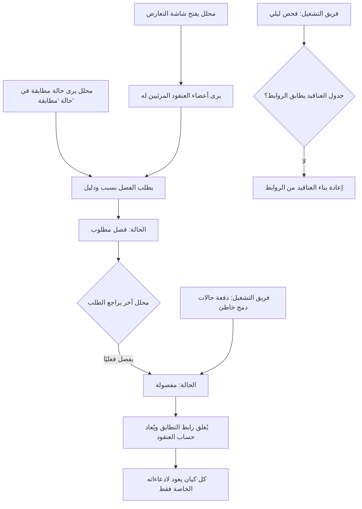

# فصل الكيانات المدموجة خطأً

<!-- BEGIN GENERATED: doc -->
| البند | القيمة |
|---|---|
| المعرّف | FEAT-INF-ENTITY-SPLIT |
| الإصدار | 0.3 |
| الحالة | مسودة |
| القدرة | CAP-03 إدارة المعلومات |
| القدرة الفرعية | CAP-03.05 مطابقة الكيانات (R1) |
| الأدوار | المحلل؛ الشخص الثاني؛ أي مستخدم مخوَّل |
| الشاشات | SCR-26 التعارض ومطابقة الكيانات، SCR-21 الكيانات والأحداث: العرض المحلول |
| حالات الاستخدام | UC-104 |
| القصص | 7: 3 من المواصفة، و4 جديدة |
<!-- END GENERATED: doc -->

## 1. نظرة عامة

### 1.1 القيمة

يستطيع المحلل التراجع عن دمج خاطئ فيعود كل كيان بمعلوماته الخاصة كما كانت.

### 1.2 النطاق

| البند | القيمة |
|---|---|
| المستخدمون | المحلل؛ محلل ثانٍ يراجع طلب الفصل ويحسمه؛ فريق المنصة؛ فريق التشغيل |
| الشاشات | شاشة التعارض ومطابقة الكيانات (عرض العنقود جنبًا إلى جنب وطلب الفصل)؛ شاشة الكيانات والأحداث بعرضها المحلول (الكيان بعد الفصل) |
| حالات الاستخدام (بالكلمات) | طلب فصل حالة دُمج فيها كيانان خطأً، ثم فصلها فعليًا بعد مراجعة محلل غير طالب الفصل؛ عرض أعضاء الهوية الموحدة قبل القرار؛ إبقاء قراءة الكيان المدموج سريعة؛ اكتشاف اختلاف جدول العناقيد وإصلاحه؛ فصل دفعة كاملة من حالات الدمج الخاطئ دفعة واحدة |
| المتطلبات (بالكلمات) | لا دمج دون قرار إنسان مسجَّل؛ كل دمج يُسجَّل برابط تطابق يمكن إغلاقه؛ عكس الدمج يُعيد كل كيان إلى ادعاءاته الخاصة فقط |
| خارج النطاق | اقتراح المطابقة وقرارها الأول (المطابقة ذاتها)؛ تحرير قواعد المطابقة؛ تحريك الادعاءات بين الكيانين (لا تُنقل أبدًا) |

### 1.3 خريطة الميزة

**الشكل 1: مسار فصل الكيانات المدموجة خطأً**



## 2. القواعد المشتركة

تنطبق على كل قصص الميزة، فلا تتكرر داخل القصص. وكل قصة تذكر ما يخصها فقط.

### 2.1 السياق المشترك

كل قصة تبدأ من ثلاثة شروط: مستأجر نشط، وحزمة السياسات الأساسية مفعّلة، ومستخدم مسجّل الدخول ومخوَّل. وتشير إليها القصص بخطوة واحدة: «بفرض السياق المشترك للميزة».

### 2.2 الصلاحية وعدم الإفصاح

- من لا يحق له رؤية العنصر يتلقى ردًا بشكل «غير متاح» تمامًا، فلا يعرف أنه موجود.
- من يرى العنصر ولا يحق له الإجراء يتلقى «لا تملك صلاحية هذا الإجراء».

### 2.3 أوامر تغيير الحالة

- **منع التكرار:** يُرسل كل أمر بمفتاح فريد، فإعادة الطلب نفسه لا تُنفَّذ مرتين.
- **حماية التعديل المتزامن:** يُرسل كل أمر بإصدار البيانات الذي يراه المستخدم. فإن عدّلها غيره في الأثناء، يُرفض الأمر.
- **السجل:** إن نجح الأمر، يُكتب حدثه وسجل التدقيق في المعاملة نفسها.

### 2.4 الرفض المشترك

```gherkin
# language: ar
خاصية: الرفض المشترك لأوامر الميزة

  سيناريو مخطط: رفض مشترك لكل أمر في الميزة
    بفرض السياق المشترك للميزة
    و <الحالة>
    عندما يُرسل المستخدم أي أمر من أوامر الميزة
    اذاً يُرفض برمز <الرمز> ويرى "<الرسالة>"
    و لا يتغير شيء

    امثلة:
      | الحالة                                  | الرمز                  | الرسالة                                                 |
      | العنصر خارج صلاحياته                    | NOT_FOUND              | غير متاح                                                |
      | العنصر مرئي له ولا يحق له الإجراء       | AUTHZ_DENIED           | لا تملك صلاحية هذا الإجراء                              |
      | غيره عدّل العنصر بعد أن فتحه            | VERSION_CONFLICT       | تغيّرت البيانات منذ فتحتها. راجع التغييرات ثم أعد المحاولة |
      | أعاد مفتاح منع التكرار بمحتوى مختلف     | IDEMPOTENCY_KEY_REUSED | طلب مكرر بمحتوى مختلف                                   |
      | البيانات ناقصة أو غير صحيحة             | VALIDATION_FAILED      | بعض البيانات ناقصة أو غير صحيحة. راجع الحقول المعلَّمة      |

  سيناريو: إعادة الطلب نفسه لا تُنفَّذ مرتين
    بفرض السياق المشترك للميزة
    و أمر نجح بمفتاح منع تكرار
    عندما يُعاد الطلب نفسه بالمفتاح نفسه
    اذاً تُعاد النتيجة الأولى ولا يُكتب حدث ثانٍ
```

### 2.5 فصل المهام في الفصل

لا يجوز أن يكون من يقرر الفصل الفعلي، فرديًا أو ضمن دفعة، هو من طلب الفصل نفسه. ينطبق هذا على قصتي «فصل حالة مطابقة الكيانات» و«فصل دفعة دمج خاطئ بقائمة حالات».

## 3. الجودة وتعريف الاكتمال

### 3.1 متطلبات الجودة

<!-- BEGIN GENERATED: quality -->
| المرجع | الموقف | المطلوب |
|---|---|---|
| QAS-PERF-015 | resolved read of clustered entity | ≤ 20 % overhead vs unclustered; p95 ≤ 300 ms |
<!-- END GENERATED: quality -->

### 3.2 تعريف الاكتمال

القصة مكتملة حين تتحقق الشروط الخمسة:

1. سيناريوهاتها والقواعد المشتركة تمر في الاختبار الآلي.
2. فحوص البنية المعمارية تمر.
3. نصوص الواجهة والرسائل موجودة بالعربية والإنجليزية.
4. مراجعة الكود مكتملة.
5. ما تضيفه القصة نفسها في قسم «القواعد» تحقق.

## 4. فهرس القصص

<!-- BEGIN GENERATED: story-index -->
| المعرّف | القصة | النوع | الحالة |
|---|---|---|---|
| `US-BC02-ER-REQUEST-SPLIT` | طلب فصل حالة مطابقة الكيانات | أمر | مسودة |
| `US-BC02-ER-SPLIT` | فصل حالة مطابقة الكيانات | أمر | مسودة |
| `US-BC02-Q-CLUSTER-GET` | أعضاء الهوية الموحدة لكيان | جلب | مسودة |
| `US-UI-SCR26-CLUSTER-VIEW` | عرض أعضاء الهوية الموحدة وطلب فصلها | واجهة | مسودة |
| `US-PLT-CLUSTER-RESOLVED-READ` | قراءة الكيان المدموج دون بطء ملحوظ | منصة | مسودة |
| `US-OPS-CLUSTER-RECONCILE` | اكتشاف اختلاف جدول الهويات وإعادة بنائه | تشغيل | مسودة |
| `US-OPS-ENTITY-BULK-SPLIT` | فصل دفعة دمج خاطئ بقائمة حالات | تشغيل | مسودة |
<!-- END GENERATED: story-index -->

## 5. القصص

### 5.1 US-BC02-ER-REQUEST-SPLIT — طلب فصل حالة مطابقة الكيانات

| النوع | الإصدار | الأولوية | دون اتصال | الحالة |
|---|---|---|---|---|
| أمر | R1 | Must | لا | مسودة |

> **كـ** المحلل، **أريد** أن أطلب فصل حالة دمج بين كيانين، **حتى** يحسم محلل آخر دمجًا أرى أنه كان خطأً.

**باختصار:** المحلل الذي يرى الكيانين يطلب فصل حالة «مطابقة» بذكر سبب ودليل، فتصبح «فصل مطلوب» بانتظار مراجعة محلل غيره.

#### القواعد

- **متى يُسمح:** الحالة الحالية «مطابقة».
- **من يُسمح له:** المحلل المصرَّح له بتصنيف كلا الكيانين.
- **البيانات:** السبب (إلزامي)، والدليل (قائمة اختيارية).
- **الأثر:** حدث «طُلب فصل حالة المطابقة» يصل إلى صيانة العنقود وكاشف التعارض ليُعاد تقييمهما.

#### معايير القبول

```gherkin
# language: ar
خاصية: طلب فصل حالة مطابقة الكيانات

  سيناريو: محلل يطلب فصل حالة مطابقة
    بفرض السياق المشترك للميزة
    و حالة مطابقة كيانات في حالة "مطابقة" ويرى طالب الفصل كلا الكيانين
    عندما يطلب فصلها بسبب ودليل
    اذاً تصبح حالتها "فصل مطلوب"
    و يُسجَّل حدث "طُلب فصل حالة المطابقة"

  سيناريو مخطط: رفض خاص بطلب الفصل
    بفرض السياق المشترك للميزة
    و <الحالة>
    عندما يحاول طلب الفصل
    اذاً يُرفض برمز <الرمز> ويرى <الرسالة>

    امثلة:
      | الحالة                   | الرمز                             | الرسالة                                                 |
      | الحالة ليست "مطابقة"     | ER_CASE_INVALID_STATE_TRANSITION  | الوضع الحالي لحالة مطابقة الكيانات لا يسمح بهذا الإجراء |
      | لم يُذكر السبب           | REASON_REQUIRED                   | اذكر السبب                                              |
```

<details><summary>المراجع التقنية والتتبع</summary>

<!-- BEGIN GENERATED: refs US-BC02-ER-REQUEST-SPLIT -->
| البند | المعرّف | المعنى |
|---|---|---|
| الواجهة البرمجية | `POST /api/v1/information/er-cases/{id}/actions/request-split` | — |
| الأمر | `CMD-ER-REQUEST-SPLIT` | طلب فصل حالة مطابقة الكيانات |
| السياسة | `POL-ER-REQUEST-SPLIT` | Analyst (propose, review, decide, request split) · second Analyst (confirm/split, large clusters)؛ tenant mat… |
| الحدث | `EVT-ER-SPLIT-REQUESTED` | يصل إلى: Cluster maintainer (same transaction) → EVT cluster changed; Conflict detector (re-run on cluster ch… |
| الكيان | `AGG-ER-CASE` | حالة مطابقة الكيانات |
| الجدول | `information.er_cases` | الجدول الرئيسي لحالة مطابقة الكيانات |
| وحدة النشر | DU-04 | — |
| المتطلبات | REQ-INF-032، REQ-INF-033، REQ-INF-034 | معانيها في القسم 6. التتبع |
| حالة الاستخدام | UC-104 | Split Merged Entity |
| الاختبار | TST-ER-CASE-SM، TST-SLC04-INVARIANTS | دورة حالات حالة مطابقة الكيانات، وثوابت الشريحة SLC-04 |
<!-- END GENERATED: refs US-BC02-ER-REQUEST-SPLIT -->

</details>

### 5.2 US-BC02-ER-SPLIT — فصل حالة مطابقة الكيانات

| النوع | الإصدار | الأولوية | دون اتصال | الحالة |
|---|---|---|---|---|
| أمر | R1 | Must | لا | مسودة |

> **كـ** المحلل، **أريد** أن أفصل حالة المطابقة فعليًا، **حتى** يعود كل كيان لمعلوماته الخاصة بعد التأكد من أن الدمج كان خطأً.

**باختصار:** بعد مراجعة طلب الفصل يقرر محلل غير طالبه الفصل الفعلي، فيُغلق رابط التطابق، ويُعاد حساب عنقود الهوية في المعاملة نفسها.

#### القواعد

- **متى يُسمح:** الحالة الحالية «فصل مطلوب».
- **من يُسمح له:** المحلل، بشرط ألا يكون هو من طلب الفصل (§2.5).
- **البيانات:** المبرر (إلزامي)، وتحديد صريح لتسجيل «ليسا تطابقًا» (إلزامي: قيمة منطقية تُرسَل دائمًا، صحيحة أو خاطئة).
- **الأثر:** حدث «فُصلت حالة المطابقة» يُغلق رابط التطابق، فيعود كل كيان إلى ادعاءاته فقط، مع بقاء الرابط قابلًا للاستعلام كما كان معروفًا قبل الفصل (REQ-INF-034).

#### معايير القبول

```gherkin
# language: ar
خاصية: فصل حالة مطابقة الكيانات

  سيناريو: فصل حالة بعد المراجعة
    بفرض السياق المشترك للميزة
    و حالة مطابقة كيانات في حالة "فصل مطلوب"
    عندما يفصلها محلل غير طالب الفصل بمبرر
    اذاً تصبح حالتها "مفصولة"
    و يُغلق رابط التطابق ويعود كل كيان إلى ادعاءاته فقط
    و يُسجَّل حدث "فُصلت حالة المطابقة"

  سيناريو مخطط: رفض خاص بالفصل
    بفرض السياق المشترك للميزة
    و <الحالة>
    عندما يحاول فصل الحالة
    اذاً يُرفض برمز <الرمز> ويرى <الرسالة>

    امثلة:
      | الحالة                         | الرمز                             | الرسالة                                                 |
      | الحالة ليست "فصل مطلوب"        | ER_CASE_INVALID_STATE_TRANSITION  | الوضع الحالي لحالة مطابقة الكيانات لا يسمح بهذا الإجراء |
      | المحلل نفسه هو من طلب الفصل    | SEGREGATION_OF_DUTIES             | لا يجوز أن يعتمد الشخص نفسه ما قدّمه أو طلبه            |
      | المبرر فارغ                    | VALIDATION_FAILED                 | المبرر مطلوب                                            |
```

<details><summary>المراجع التقنية والتتبع</summary>

<!-- BEGIN GENERATED: refs US-BC02-ER-SPLIT -->
| البند | المعرّف | المعنى |
|---|---|---|
| الواجهة البرمجية | `POST /api/v1/information/er-cases/{id}/actions/split` | — |
| الأمر | `CMD-ER-SPLIT` | فصل حالة مطابقة الكيانات |
| السياسة | `POL-ER-SPLIT` | Analyst (propose, review, decide, request split) · second Analyst (confirm/split, large clusters)؛ tenant mat… |
| الحدث | `EVT-ER-SPLIT` | يصل إلى: Cluster maintainer (same transaction) → EVT cluster changed; Conflict detector (re-run on cluster ch… |
| الكيان | `AGG-ER-CASE` | حالة مطابقة الكيانات |
| الجدول | `information.er_cases` | الجدول الرئيسي لحالة مطابقة الكيانات |
| وحدة النشر | DU-04 | — |
| المتطلبات | REQ-INF-032، REQ-INF-033، REQ-INF-034 | معانيها في القسم 6. التتبع |
| حالة الاستخدام | UC-104 | Split Merged Entity |
| الاختبار | TST-ER-CASE-SM، TST-SLC04-INVARIANTS | دورة حالات حالة مطابقة الكيانات، وثوابت الشريحة SLC-04 |
<!-- END GENERATED: refs US-BC02-ER-SPLIT -->

</details>

### 5.3 US-BC02-Q-CLUSTER-GET — أعضاء الهوية الموحدة لكيان

| النوع | الإصدار | الأولوية | دون اتصال | الحالة |
|---|---|---|---|---|
| جلب | R1 | Must | لا | مسودة |

> **كـ** المحلل، **أريد** أن أرى أعضاء الهوية الموحدة لكيان ومعرّفها الكانوني وروابطها، **حتى** أفهم من دُمج معه قبل أن أطلب الفصل.

**باختصار:** تُعاد قائمة أعضاء العنقود المرئيين للمحلل فقط، مع المعرّف الكانوني وروابط التطابق كما كانت معروفة في نقطة وقت محددة.

#### القواعد

- **من يُسمح له:** المحلل يرى الأعضاء الذين يحق له رؤيتهم فقط؛ العضو غير المرئي يُحذف من القائمة دون أن يُكشف وجوده (THR-S04-04).
- **البيانات (المرشحات):** الكيان، ونقطة الوقت known_at، والمؤشر والحد.

#### معايير القبول

```gherkin
# language: ar
خاصية: أعضاء الهوية الموحدة

  سيناريو: يرى المحلل أعضاء العنقود المرئيين له فقط
    بفرض السياق المشترك للميزة
    و عنقود هوية فيه أعضاء داخل نطاق المحلل وآخرون خارجه
    عندما يطلب أعضاء عنقود كيان فيه
    اذاً تُعاد الأعضاء داخل نطاقه فقط مع المعرّف الكانوني وروابط التطابق
    و لا يكشف أي عدد أو إشارة إلى وجود عضو محجوب
```

<details><summary>المراجع التقنية والتتبع</summary>

<!-- BEGIN GENERATED: refs US-BC02-Q-CLUSTER-GET -->
| البند | المعرّف | المعنى |
|---|---|---|
| الواجهة البرمجية | `GET /api/v1/information/entities/{entity_id}/identity-cluster` | — |
| الاستعلام | `QRY-CLUSTER-GET` | Cluster members, canonical URN, links, as known_at |
| السياسة | `POL-CLUSTER-GET` | Analyst; invisible members omitted |
| الكيان | `AGG-ENTITY` | الكيان |
| الجدول | `information.entities` | الجدول الرئيسي للكيان |
| وحدة النشر | DU-04 | — |
| المتطلب | REQ-INF-033 | When entities are matched, the system shall record a same-as link with the decision, reviewer and time, keep… |
| حالة الاستخدام | UC-007 | Resolve Entity |
| الاختبار | TST-ENTITY-SM، TST-SLC02-INVARIANTS | دورة حالات الكيان، وثوابت الشريحة SLC-02 |
<!-- END GENERATED: refs US-BC02-Q-CLUSTER-GET -->

</details>

### 5.4 US-UI-SCR26-CLUSTER-VIEW — عرض أعضاء الهوية الموحدة وطلب فصلها

| النوع | الإصدار | الأولوية | دون اتصال | الحالة |
|---|---|---|---|---|
| واجهة | R1 | Must | لا | مسودة |

> **كـ** المحلل، **أريد** أن أرى أعضاء الهوية الموحدة على شاشة واحدة وأطلب فصلها منها، **حتى** أحسم شكّي في الدمج دون تنقّل بين شاشات.

**باختصار:** شاشة التعارض ومطابقة الكيانات تعرض أعضاء العنقود جنبًا إلى جنب، وزر طلب الفصل يظهر فقط حين تكون الحالة «مطابقة» ويحق للمحلل تصنيف الكيانين.

#### القواعد

- **العرض:** تُعرض الأعضاء المرئيون للمحلل جنبًا إلى جنب مع تاريخ كل منهم.
- **زر طلب الفصل:** يظهر فقط حين تكون حالة المطابقة «مطابقة» ويحق للمحلل تصنيف الكيانين؛ يستدعي قصة «طلب فصل حالة مطابقة الكيانات».
- **بعد الفصل:** تعرض شاشة الكيانات والأحداث كل كيان بادعاءاته الخاصة فقط، دون أثر للدمج السابق.

#### معايير القبول

```gherkin
# language: ar
خاصية: عرض أعضاء الهوية الموحدة وطلب فصلها

  سيناريو: المحلل يرى العنقود ويطلب الفصل
    بفرض السياق المشترك للميزة
    و حالة مطابقة في حالة "مطابقة" بين كيانين يراهما المحلل
    عندما يفتح المحلل شاشة التعارض ومطابقة الكيانات
    اذاً يرى أعضاء العنقود جنبًا إلى جنب وزر طلب الفصل
    عندما يضغط زر طلب الفصل ويذكر السبب
    اذاً تنتقل الحالة إلى "فصل مطلوب" كما في قصة طلب الفصل

  سيناريو: الكيان بعد الفصل يعرض بياناته الخاصة فقط
    بفرض السياق المشترك للميزة
    و حالة مطابقة فُصلت حديثًا
    عندما يفتح المحلل شاشة الكيانات والأحداث لأحد الكيانين
    اذاً يرى ادعاءات هذا الكيان فقط دون ادعاءات الكيان الآخر
```

<details><summary>المراجع التقنية والتتبع</summary>

<!-- BEGIN GENERATED: refs US-UI-SCR26-CLUSTER-VIEW -->
| البند | المعرّف | المعنى |
|---|---|---|
| الشاشة | SCR-26 | شاشة التعارض ومطابقة الكيانات |
| الشاشة | SCR-21 | شاشة الكيانات والأحداث: العرض المحلول |
| حالة الاستخدام | UC-104 | Split Merged Entity |
| المصدر | `THR-S04-04` | — |
| المتطلب | REQ-INF-034 | When a match is reversed, the system shall close the same-as link so that each original entity again resolves… |
| حالة الاستخدام | UC-104 | Split Merged Entity |
<!-- END GENERATED: refs US-UI-SCR26-CLUSTER-VIEW -->

</details>

### 5.5 US-PLT-CLUSTER-RESOLVED-READ — قراءة الكيان المدموج دون بطء ملحوظ

| النوع | الإصدار | الأولوية | دون اتصال | الحالة |
|---|---|---|---|---|
| منصة | R1 | Should | لا ينطبق | مسودة |

> **كـ** فريق المنصة، **أريد** أن يبقى حمل القراءة المحلولة عبر العنقود منضبطًا، **حتى** لا يشعر المحلل ببطء ملحوظ عند قراءة كيان مدموج.

**باختصار:** جدول العناقيد مادي، فقراءة الكيان المحلول عبر عنقوده لا تزيد حملها عن 20 % فوق قراءة كيان غير مدموج، بزمن استجابة 300 ms عند المئين 95.

#### معايير القبول

```gherkin
# language: ar
خاصية: أداء القراءة المحلولة عبر العنقود

  سيناريو: الحمل تحت الهدف
    بفرض حمل بمزيج استراتيجية اختبار الأداء وبيانات بحجم التصميم
    عندما يُقرأ كيان مدموج عبر عنقود هويته
    اذاً يكون زمن الاستجابة 300 ms أو أقل عند المئين 95
    و لا يزيد الحمل الإضافي عن 20 % فوق قراءة كيان غير مدموج
```

<details><summary>المراجع التقنية والتتبع</summary>

<!-- BEGIN GENERATED: refs US-PLT-CLUSTER-RESOLVED-READ -->
| البند | المعرّف | المعنى |
|---|---|---|
| الجودة | QAS-PERF-015 | resolved read of clustered entity → ≤ 20 % overhead vs unclustered; p95 ≤ 300 ms |
<!-- END GENERATED: refs US-PLT-CLUSTER-RESOLVED-READ -->

</details>

### 5.6 US-OPS-CLUSTER-RECONCILE — اكتشاف اختلاف جدول الهويات وإعادة بنائه

| النوع | الإصدار | الأولوية | دون اتصال | الحالة |
|---|---|---|---|---|
| تشغيل | R1 | Should | لا ينطبق | مسودة |

> **كـ** فريق التشغيل، **أريد** أن يُكتشف أي اختلاف بين جدول العناقيد المادي وروابط التطابق الفعلية، **حتى** لا تُعرض هوية محلولة خاطئة.

**باختصار:** فحص ليلي يعيد حساب العناقيد من روابط التطابق؛ فإن وُجد اختلاف يُفتح تنبيه من الأولوية الأولى ويُعاد بناء الجدول من الروابط.

#### القواعد

- **متى يحدث:** فحص دوري ليلي يقارن جدول العناقيد المادي بروابط التطابق الحالية كما هي معروفة الآن.
- **الأثر:** أي اختلاف يفتح تنبيهًا من الأولوية الأولى (`cluster.reconciliation_diff`)، ويُعاد بناء الجدول من الروابط.

#### معايير القبول

```gherkin
# language: ar
خاصية: مطابقة جدول العناقيد مع الروابط

  سيناريو: اختلاف في الجدول فيُعاد بناؤه
    بفرض أن الفحص الليلي وجد عنقودًا في الجدول لا يطابق روابط التطابق الحالية
    عندما يكتمل الفحص
    اذاً يُفتح تنبيه من الأولوية الأولى
    و يُعاد بناء الجدول من روابط التطابق كما هي معروفة الآن

  سيناريو: لا اختلاف فلا تغيير
    بفرض أن الفحص الليلي لم يجد اختلافًا
    عندما يكتمل الفحص
    اذاً لا يُفتح تنبيه ولا يُعاد بناء شيء
```

<details><summary>المراجع التقنية والتتبع</summary>

<!-- BEGIN GENERATED: refs US-OPS-CLUSTER-RECONCILE -->
| البند | المعرّف | المعنى |
|---|---|---|
| المصدر | `FM-S04-03` | — |
| المصدر | `observability-slc04.md` | — |
<!-- END GENERATED: refs US-OPS-CLUSTER-RECONCILE -->

</details>

### 5.7 US-OPS-ENTITY-BULK-SPLIT — فصل دفعة دمج خاطئ بقائمة حالات

| النوع | الإصدار | الأولوية | دون اتصال | الحالة |
|---|---|---|---|---|
| تشغيل | R1 | Must | لا ينطبق | مسودة |

> **كـ** فريق التشغيل، **أريد** أن أفصل دفعة من حالات الدمج الخاطئ بقائمة حالات دفعة واحدة، **حتى** أصحّح أثر قرار خاطئ أو قاعدة مطابقة ضعيفة بسرعة.

**باختصار:** عند اكتشاف دمج جماعي خاطئ يرسل فريق التشغيل قائمة حالات مطابقة، فتُفصل كل حالة فيها بنفس أثر قصة «فصل حالة مطابقة الكيانات»، وتُسجَّل الدفعة في سجل تدقيق واحد.

#### القواعد

- **متى يُسمح:** بعد تنبيه حجم العنقود (أكبر من 50 عضوًا) أو معدل الفصل (أكثر من 5 % من المطابقات خلال 30 يومًا)، أو بطلب تشغيلي موثَّق.
- **من يُسمح له:** فريق التشغيل.
- **البيانات:** قائمة معرّفات حالات المطابقة، ومبرر الدفعة.
- **الأثر:** تُفصل كل حالة في القائمة بأثر قصة الفصل نفسها (§5.2)، وتُسجَّل الدفعة كاملة في سجل تدقيق واحد. ينطبق هنا فصل المهام في §2.5.

> **ملاحظة:** شكل أمر الدفعة ذاته **[Derived]** من `fmea-slc04.md` (FM-S04-04)، وضوابطه هي ضوابط فصل الحالة الفردية مطبّقة على قائمة.

#### معايير القبول

```gherkin
# language: ar
خاصية: فصل دفعة حالات دمج خاطئ

  سيناريو: فصل دفعة بعد اكتشاف دمج جماعي
    بفرض السياق المشترك للميزة
    و قائمة حالات مطابقة كلها في حالة "فصل مطلوب" ضمن دمج جماعي خاطئ
    عندما يرسل فريق التشغيل أمر الفصل الجماعي بمبرر الدفعة
    اذاً تُفصل كل حالة في القائمة بأثر قصة فصل حالة المطابقة
    و تُسجَّل الدفعة كاملة في سجل تدقيق واحد

  سيناريو مخطط: رفض خاص بالفصل الجماعي
    بفرض السياق المشترك للميزة
    و <الحالة>
    عندما يحاول فريق التشغيل الفصل الجماعي
    اذاً يُرفض برمز <الرمز> ويرى <الرسالة>

    امثلة:
      | الحالة                             | الرمز                             | الرسالة                                                 |
      | حالة في القائمة ليست "فصل مطلوب"   | ER_CASE_INVALID_STATE_TRANSITION  | الوضع الحالي لحالة مطابقة الكيانات لا يسمح بهذا الإجراء |
      | مبرر الدفعة فارغ                   | VALIDATION_FAILED                 | المبرر مطلوب                                            |
```

<details><summary>المراجع التقنية والتتبع</summary>

<!-- BEGIN GENERATED: refs US-OPS-ENTITY-BULK-SPLIT -->
| البند | المعرّف | المعنى |
|---|---|---|
| المصدر | `FM-S04-04` | — |
| المتطلب | REQ-INF-034 | When a match is reversed, the system shall close the same-as link so that each original entity again resolves… |
| حالة الاستخدام | UC-104 | Split Merged Entity |
<!-- END GENERATED: refs US-OPS-ENTITY-BULK-SPLIT -->

</details>

## 6. التتبع

<!-- BEGIN GENERATED: trace -->
| المتطلب | المعنى | القصص | الاختبار |
|---|---|---|---|
| REQ-INF-032 | When an entity-resolution candidate is detected, the system shall create a resolution case with candidates, m… | `US-BC02-ER-REQUEST-SPLIT`، `US-BC02-ER-SPLIT` | TST-ER-CASE-SM، TST-MATCH-RULESET-SM، TST-SLC04-INVARIANTS |
| REQ-INF-033 | When entities are matched, the system shall record a same-as link with the decision, reviewer and time, keep… | كل قصص الميزة المأخوذة من المواصفة (3) | TST-ER-CASE-SM، TST-SLC04-INVARIANTS |
| REQ-INF-034 | When a match is reversed, the system shall close the same-as link so that each original entity again resolves… | `US-BC02-ER-REQUEST-SPLIT`، `US-BC02-ER-SPLIT`، `US-OPS-ENTITY-BULK-SPLIT`، `US-UI-SCR26-CLUSTER-VIEW` | TST-ER-CASE-SM، TST-SLC04-INVARIANTS |
<!-- END GENERATED: trace -->

## 7. سجل التغييرات

| الإصدار | التاريخ | التغيير |
|---|---|---|
| 0.1 | — | هيكل مولَّد من خريطة الميزات |
| 0.2 | 2026-10-03 | كتابة القصص كاملة بمعيار القصص |
| 0.3 | 2026-10-11 | تصحيحات المراجعة المستقلة (الدفعة الأولى) |
