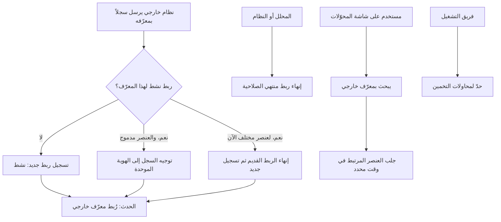

# ربط المعرّفات الخارجية

<!-- BEGIN GENERATED: doc -->
| البند | القيمة |
|---|---|
| المعرّف | FEAT-INF-EXTERNAL-IDS |
| الإصدار | 0.2 |
| الحالة | مسودة |
| القدرة | CAP-03 إدارة المعلومات |
| القدرة الفرعية | CAP-03.01 الكيانات والعلاقات (R1) |
| الأدوار | النظام؛ المحلل |
| الشاشات | SCR-65 المحوّلات والاتصالات والحساسات |
| حالات الاستخدام | — |
| القصص | 9: 3 من المواصفة، و6 جديدة |
<!-- END GENERATED: doc -->

## 1. نظرة عامة

### 1.1 القيمة

تبقى السجلات الواردة من الأنظمة الخارجية مرتبطة بالعنصر الصحيح لدينا فلا تتكرر ولا تضيع.

### 1.2 النطاق

| البند | القيمة |
|---|---|
| المستخدمون | النظام (حسابات خدمة المحوّلات)؛ المحلل؛ مهندس التكامل؛ فريق التشغيل |
| الشاشات | شاشة المحوّلات والاتصالات والحساسات |
| حالات الاستخدام (بالكلمات) | ربط سجل وارد من نظام خارجي بعنصر داخلي دون تكرار؛ إنهاء ربط لم يعد صحيحًا؛ البحث عن عنصر بمعرّفه الخارجي؛ توجيه سجل وارد لعنصر دُمج إلى هويته الموحدة؛ معالجة إعادة استخدام معرّف خارجي لعنصر آخر؛ الحد من تخمين المعرّفات الخارجية |
| المتطلبات (بالكلمات) | المعرّف الخارجي يشير إلى عنصر داخلي واحد فقط في كل وقت؛ الروابط لا تُحذف بل تُنهى؛ البيانات الواردة تدخل فقط عبر محوّلات مسجَّلة تحفظ مصدرها وتحويلها |
| خارج النطاق | تسجيل دفعة الاستيراد نفسها وحجر عناصرها (ميزة أخرى)؛ مطابقة الكيانات وقرار الدمج (ميزة فصل الكيانات) |

### 1.3 خريطة الميزة

**الشكل 1: ربط المعرّفات الخارجية عند الاستيراد**



## 2. القواعد المشتركة

تنطبق على كل قصص الميزة، فلا تتكرر داخل القصص. وكل قصة تذكر ما يخصها فقط.

### 2.1 السياق المشترك

كل قصة تبدأ من ثلاثة شروط: مستأجر نشط، وحزمة السياسات الأساسية مفعّلة، ومستخدم مسجّل الدخول ومخوَّل. وتشير إليها القصص بخطوة واحدة: «بفرض السياق المشترك للميزة».

### 2.2 الصلاحية وعدم الإفصاح

- من لا يحق له رؤية العنصر يتلقى ردًا بشكل «غير متاح» تمامًا، فلا يعرف أنه موجود.
- من يرى العنصر ولا يحق له الإجراء يتلقى «لا تملك صلاحية هذا الإجراء».

### 2.3 أوامر تغيير الحالة

- **منع التكرار:** يُرسل كل أمر بمفتاح فريد، فإعادة الطلب نفسه لا تُنفَّذ مرتين.
- **حماية التعديل المتزامن:** يُرسل كل أمر بإصدار البيانات الذي يراه المستخدم. فإن عدّلها غيره في الأثناء، يُرفض الأمر.
- **السجل:** إن نجح الأمر، يُكتب حدثه وسجل التدقيق في المعاملة نفسها.

### 2.4 الرفض المشترك

```gherkin
# language: ar
خاصية: الرفض المشترك لأوامر الميزة

  سيناريو مخطط: رفض مشترك لكل أمر في الميزة
    بفرض السياق المشترك للميزة
    و <الحالة>
    عندما يُرسل المستخدم أي أمر من أوامر الميزة
    اذاً يُرفض برمز <الرمز> ويرى "<الرسالة>"
    و لا يتغير شيء

    امثلة:
      | الحالة                                  | الرمز                  | الرسالة                                                 |
      | العنصر خارج صلاحياته                    | NOT_FOUND              | غير متاح                                                |
      | العنصر مرئي له ولا يحق له الإجراء       | AUTHZ_DENIED           | لا تملك صلاحية هذا الإجراء                              |
      | غيره عدّل العنصر بعد أن فتحه            | VERSION_CONFLICT       | تغيّرت البيانات منذ فتحتها. راجع التغييرات ثم أعد المحاولة |
      | أعاد مفتاح منع التكرار بمحتوى مختلف     | IDEMPOTENCY_KEY_REUSED | طلب مكرر بمحتوى مختلف                                   |
      | البيانات ناقصة أو غير صحيحة             | VALIDATION_FAILED      | بعض البيانات ناقصة أو غير صحيحة. راجع الحقول المعلَّمة      |

  سيناريو: إعادة الطلب نفسه لا تُنفَّذ مرتين
    بفرض السياق المشترك للميزة
    و أمر نجح بمفتاح منع تكرار
    عندما يُعاد الطلب نفسه بالمفتاح نفسه
    اذاً تُعاد النتيجة الأولى ولا يُكتب حدث ثانٍ
```

## 3. الجودة وتعريف الاكتمال

### 3.1 متطلبات الجودة

<!-- BEGIN GENERATED: quality -->
لا متطلبات جودة مرتبطة بمتطلبات هذه الميزة مباشرة. تنطبق متطلبات المنصة العامة (`FEAT-PLT-*`).
<!-- END GENERATED: quality -->

### 3.2 تعريف الاكتمال

القصة مكتملة حين تتحقق الشروط الخمسة:

1. سيناريوهاتها والقواعد المشتركة تمر في الاختبار الآلي.
2. فحوص البنية المعمارية تمر.
3. نصوص الواجهة والرسائل موجودة بالعربية والإنجليزية.
4. مراجعة الكود مكتملة.
5. ما تضيفه القصة نفسها في قسم «القواعد» تحقق.

## 4. فهرس القصص

<!-- BEGIN GENERATED: story-index -->
| المعرّف | القصة | النوع | الحالة |
|---|---|---|---|
| `US-BC02-EXT-END` | إنهاء ربط المعرّف الخارجي | أمر | مسودة |
| `US-BC02-EXT-MAP` | تسجيل ربط معرّف خارجي | أمر | مسودة |
| `US-BC02-Q-EXT-RESOLVE` | جلب العنصر بمعرّفه الخارجي | جلب | مسودة |
| `US-UI-SCR65-EXTID-LOOKUP` | البحث عن عنصر بمعرّفه في نظام خارجي | واجهة | مسودة |
| `US-PLT-EXTID-UNIQUE-AT-TIME` | معرّف خارجي يشير لعنصر واحد في كل وقت | منصة | مسودة |
| `US-INT-EXTID-IMPORT-UPSERT` | ربط السجل الوارد بالعنصر الموجود دون تكرار | تكامل | مسودة |
| `US-INT-EXTID-MERGED-TARGET` | توجيه السجل الوارد لكيان مدموج إلى هويته الموحدة | تكامل | مسودة |
| `US-INT-EXTID-REASSIGNED` | معالجة إعادة استخدام المعرّف في النظام الخارجي | تكامل | مسودة |
| `US-OPS-EXTID-PROBE-LIMIT` | منع تخمين المعرّفات الخارجية لمعرفة الوجود | تشغيل | مسودة |
<!-- END GENERATED: story-index -->

## 5. القصص

### 5.1 US-BC02-EXT-END — إنهاء ربط المعرّف الخارجي

| النوع | الإصدار | الأولوية | دون اتصال | الحالة |
|---|---|---|---|---|
| أمر | R1 | Must | لا | مسودة |

> **كـ** النظام (حساب خدمة المحوّل) أو المحلل، **أريد** أن أنهي ربط معرّف خارجي لم يعد صحيحًا، **حتى** لا يُوجَّه سجل وارد لاحقًا إلى عنصر لم يعد يطابقه.

**باختصار:** يُنهي النظام أو المحلل ربطًا نشطًا بذكر سبب ووقت الانتهاء، فتصبح حالته «منتهٍ» دون حذف الربط نفسه.

#### القواعد

- **متى يُسمح:** الحالة الحالية «نشط».
- **من يُسمح له:** النظام (حساب خدمة المحوّل) أو المحلل.
- **البيانات:** وقت الانتهاء (إلزامي)، والسبب (إلزامي).
- **الأثر:** حدث «أُنهي ربط المعرّف الخارجي» يصل إلى ذاكرة المحوّل المؤقتة، فلا يُستخدم هذا الربط بعد الآن عند استيراد سجلات جديدة.

#### معايير القبول

```gherkin
# language: ar
خاصية: إنهاء ربط المعرّف الخارجي

  سيناريو: إنهاء ربط نشط
    بفرض السياق المشترك للميزة
    و ربط معرّف خارجي في حالة "نشط"
    عندما يُنهيه النظام أو المحلل بوقت انتهاء وسبب
    اذاً تصبح حالته "منتهٍ"
    و يُسجَّل حدث "أُنهي ربط المعرّف الخارجي"

  سيناريو مخطط: رفض خاص بالإنهاء
    بفرض السياق المشترك للميزة
    و <الحالة>
    عندما يحاول إنهاء الربط
    اذاً يُرفض برمز <الرمز> ويرى <الرسالة>

    امثلة:
      | الحالة               | الرمز                                 | الرسالة                                                  |
      | الربط "منتهٍ" من قبل | EXTERNAL_ID_INVALID_STATE_TRANSITION  | الوضع الحالي لربط المعرّف الخارجي لا يسمح بهذا الإجراء  |
      | لم يُذكر السبب       | REASON_REQUIRED                       | اذكر السبب                                               |
```

<details><summary>المراجع التقنية والتتبع</summary>

<!-- BEGIN GENERATED: refs US-BC02-EXT-END -->
| البند | المعرّف | المعنى |
|---|---|---|
| الواجهة البرمجية | `POST /api/v1/information/external-ids/{id}/actions/end` | — |
| الأمر | `CMD-EXT-END` | إنهاء ربط المعرّف الخارجي |
| السياسة | `POL-EXT-END` | adapter service account · Analyst؛ tenant match; object visible to subject (label ≤ clearance); write permiss… |
| الحدث | `EVT-EXT-ENDED` | يصل إلى: Import worker cache |
| الكيان | `AGG-EXTERNAL-ID` | ربط المعرّف الخارجي |
| الجدول | `information.external_ids` | الجدول الرئيسي لربط المعرّف الخارجي |
| وحدة النشر | DU-04 | — |
| المتطلب | REQ-INF-036 | The system shall identify every object by an internal ULID and a global URN of the form urn:<namespace>:<type… |
| الاختبار | TST-EXTERNAL-ID-SM، TST-SLC02-INVARIANTS | دورة حالات ربط المعرّف الخارجي، وثوابت الشريحة SLC-02 |
<!-- END GENERATED: refs US-BC02-EXT-END -->

</details>

### 5.2 US-BC02-EXT-MAP — تسجيل ربط معرّف خارجي

| النوع | الإصدار | الأولوية | دون اتصال | الحالة |
|---|---|---|---|---|
| أمر | R1 | Must | لا | مسودة |

> **كـ** النظام (حساب خدمة المحوّل) أو المحلل، **أريد** أن أسجّل ربط معرّف نظام خارجي بعنصر داخلي، **حتى** تُعرف السجلات الواردة من هذا النظام دون تكرار.

**باختصار:** يُسجَّل ربط جديد بين (النظام الخارجي، معرّفه) وعنصر داخلي من تاريخ محدد، فيصير «نشط»، بشرط ألا يكون لهذا المعرّف ربط نشط آخر.

#### القواعد

- **متى يُسمح:** لا يوجد ربط نشط حالي لنفس (النظام، المعرّف الخارجي)، والعنصر الهدف موجود.
- **من يُسمح له:** النظام (حساب خدمة المحوّل) أو المحلل.
- **البيانات:** اسم النظام الخارجي، والمعرّف الخارجي، والعنصر الداخلي، وتاريخ بدء الصلاحية (إلزامية جميعًا).
- **الأثر:** حدث «رُبط معرّف خارجي» يصل إلى ذاكرة المحوّل المؤقتة.

#### معايير القبول

```gherkin
# language: ar
خاصية: تسجيل ربط معرّف خارجي

  سيناريو: تسجيل ربط جديد
    بفرض السياق المشترك للميزة
    و لا يوجد ربط نشط لـ(النظام، المعرّف الخارجي) والعنصر الهدف موجود
    عندما يسجّل النظام أو المحلل الربط ببيانات كاملة
    اذاً تصبح حالته "نشط"
    و يُسجَّل حدث "رُبط معرّف خارجي"

  سيناريو مخطط: رفض خاص بالتسجيل
    بفرض السياق المشترك للميزة
    و <الحالة>
    عندما يحاول تسجيل الربط
    اذاً يُرفض برمز <الرمز> ويرى <الرسالة>

    امثلة:
      | الحالة                                           | الرمز              | الرسالة                            |
      | يوجد ربط نشط آخر لنفس (النظام، المعرّف الخارجي) | EXTERNAL_ID_TAKEN  | هذا المعرّف الخارجي مرتبط بسجل آخر |
```

<details><summary>المراجع التقنية والتتبع</summary>

<!-- BEGIN GENERATED: refs US-BC02-EXT-MAP -->
| البند | المعرّف | المعنى |
|---|---|---|
| الواجهة البرمجية | `POST /api/v1/information/external-ids` | — |
| الأمر | `CMD-EXT-MAP` | تسجيل ربط ربط المعرّف الخارجي |
| السياسة | `POL-EXT-MAP` | adapter service account · Analyst؛ tenant match; object visible to subject (label ≤ clearance); write permiss… |
| الحدث | `EVT-EXT-MAPPED` | يصل إلى: Import worker cache |
| الكيان | `AGG-EXTERNAL-ID` | ربط المعرّف الخارجي |
| الجدول | `information.external_ids` | الجدول الرئيسي لربط المعرّف الخارجي |
| وحدة النشر | DU-04 | — |
| المتطلب | REQ-INF-036 | The system shall identify every object by an internal ULID and a global URN of the form urn:<namespace>:<type… |
| الاختبار | TST-EXTERNAL-ID-SM، TST-SLC02-INVARIANTS | دورة حالات ربط المعرّف الخارجي، وثوابت الشريحة SLC-02 |
<!-- END GENERATED: refs US-BC02-EXT-MAP -->

</details>

### 5.3 US-BC02-Q-EXT-RESOLVE — جلب العنصر بمعرّفه الخارجي

| النوع | الإصدار | الأولوية | دون اتصال | الحالة |
|---|---|---|---|---|
| جلب | R1 | Must | لا | مسودة |

> **كـ** النظام (حساب خدمة المحوّل) أو المحلل، **أريد** أن أعرف العنصر الداخلي الذي يطابق معرّفًا خارجيًا في وقت معيّن، **حتى** أربط السجل الوارد بالعنصر الصحيح.

**باختصار:** يُعاد العنصر الداخلي المرتبط بالمعرّف الخارجي في وقت الاستعلام، أو ردّ بشكل «غير متاح» إن كان العنصر مخفيًا عن المستدعي.

#### القواعد

- **من يُسمح له:** النظام (حساب خدمة المحوّل) أو المحلل؛ لا يُكشف العنصر لمن لا يحق له رؤيته.
- **البيانات (المرشحات):** النظام الخارجي، والمعرّف الخارجي، ونقطتا الوقت valid_at و known_at.

#### معايير القبول

```gherkin
# language: ar
خاصية: البحث عن العنصر بمعرّفه الخارجي

  سيناريو: يُعاد العنصر المرتبط في وقت الطلب
    بفرض السياق المشترك للميزة
    و ربط نشط بين معرّف خارجي وعنصر يرى المستدعي
    عندما يطلب النظام أو المحلل العنصر بهذا المعرّف في وقت معيّن
    اذاً يُعاد العنصر الداخلي المرتبط في ذلك الوقت

  سيناريو: العنصر مخفٍ عن المستدعي
    بفرض السياق المشترك للميزة
    و العنصر المرتبط بالمعرّف الخارجي لا يحق للمستدعي رؤيته
    عندما يطلب العنصر بهذا المعرّف
    اذاً يُعاد ردّ "غير متاح" تمامًا
```

<details><summary>المراجع التقنية والتتبع</summary>

<!-- BEGIN GENERATED: refs US-BC02-Q-EXT-RESOLVE -->
| البند | المعرّف | المعنى |
|---|---|---|
| الواجهة البرمجية | `GET /api/v1/information/external-ids/{system}/{external_id}` | — |
| الاستعلام | `QRY-EXT-RESOLVE` | Object URN mapped at time t (not-found shape if hidden) |
| السياسة | `POL-EXT-RESOLVE` | org scope ∩ classification rule; claims filtered by label |
| الكيان | `AGG-EXTERNAL-ID` | ربط المعرّف الخارجي |
| الجدول | `information.external_ids` | الجدول الرئيسي لربط المعرّف الخارجي |
| وحدة النشر | DU-04 | — |
| المتطلب | REQ-INF-036 | The system shall identify every object by an internal ULID and a global URN of the form urn:<namespace>:<type… |
| الاختبار | TST-EXTERNAL-ID-SM، TST-SLC02-INVARIANTS | دورة حالات ربط المعرّف الخارجي، وثوابت الشريحة SLC-02 |
<!-- END GENERATED: refs US-BC02-Q-EXT-RESOLVE -->

</details>

### 5.4 US-UI-SCR65-EXTID-LOOKUP — البحث عن عنصر بمعرّفه في نظام خارجي

| النوع | الإصدار | الأولوية | دون اتصال | الحالة |
|---|---|---|---|---|
| واجهة | R1 | Must | لا | مسودة |

> **كـ** مهندس التكامل أو المحلل، **أريد** أن أبحث عن عنصر بمعرّفه في نظام خارجي من شاشة المحوّلات، **حتى** أتحقق من ربط سجل معيّن دون العودة إلى الواجهة البرمجية.

**باختصار:** تضيف شاشة المحوّلات والاتصالات والحساسات حقل بحث بالنظام الخارجي ومعرّفه، يعرض العنصر الداخلي المرتبط حاليًا أو رسالة «غير متاح».

#### القواعد

- **العرض:** حقل يطلب اسم النظام الخارجي والمعرّف، ويعرض نتيجة واحدة أو رسالة عدم التوفر.
- **مصدر الصلاحية:** نفس صلاحية استعلام البحث عن العنصر بمعرّفه الخارجي (القصة 5.3).

> **ملاحظة:** شكل حقل البحث على شاشة المحوّلات **[Derived]**، لعدم وجود تصميم تفصيلي له في مصدر تصميم الواجهات.

#### معايير القبول

```gherkin
# language: ar
خاصية: البحث عن عنصر بمعرّفه في نظام خارجي

  سيناريو: بحث ناجح
    بفرض السياق المشترك للميزة
    و ربط نشط بين معرّف خارجي وعنصر يرى المستخدم
    عندما يبحث المستخدم باسم النظام الخارجي والمعرّف على شاشة المحوّلات
    اذاً يُعرض العنصر الداخلي المرتبط حاليًا

  سيناريو: لا نتيجة
    بفرض السياق المشترك للميزة
    و لا يوجد ربط نشط لهذا المعرّف أو العنصر لا يحق للمستخدم رؤيته
    عندما يبحث المستخدم بهذا المعرّف
    اذاً تُعرض رسالة "غير متاح"
```

<details><summary>المراجع التقنية والتتبع</summary>

<!-- BEGIN GENERATED: refs US-UI-SCR65-EXTID-LOOKUP -->
| البند | المعرّف | المعنى |
|---|---|---|
| الشاشة | SCR-65 | شاشة المحوّلات والاتصالات والحساسات |
| المصدر | `[Derived]` | — |
| المتطلب | REQ-INF-036 | The system shall identify every object by an internal ULID and a global URN of the form urn:<namespace>:<type… |
<!-- END GENERATED: refs US-UI-SCR65-EXTID-LOOKUP -->

</details>

### 5.5 US-PLT-EXTID-UNIQUE-AT-TIME — معرّف خارجي يشير لعنصر واحد في كل وقت

| النوع | الإصدار | الأولوية | دون اتصال | الحالة |
|---|---|---|---|---|
| منصة | R1 | Must | لا ينطبق | مسودة |

> **كـ** فريق المنصة، **أريد** أن يضمن تخزين روابط المعرّفات الخارجية أن المعرّف يشير لعنصر واحد في كل وقت، **حتى** لا تتوجّه سجلات واردة لأكثر من عنصر بالخطأ.

**باختصار:** قيد في قاعدة البيانات يمنع وجود أكثر من ربط نشط واحد لنفس (المستأجر، النظام، المعرّف الخارجي) في أي وقت، ولا يُعاد كتابة المعرّف الداخلي (ULID) لعنصر قائم أبدًا.

#### معايير القبول

```gherkin
# language: ar
خاصية: تفرّد المعرّف الخارجي في كل وقت

  سيناريو: لا يمكن وجود ربطين نشطين لنفس المعرّف
    بفرض أن ربطًا نشطًا قائم لـ(مستأجر، نظام، معرّف خارجي)
    عندما يحاول النظام تسجيل ربط نشط آخر لنفس الثلاثي
    اذاً يُرفض بقيد قاعدة البيانات قبل أن يصل إلى منطق التطبيق

  سيناريو: المعرّف الداخلي لا يُعاد كتابته
    عندما يُفحص مخطط قاعدة البيانات
    اذاً لا توجد عملية تعدّل قيمة ULID لعنصر قائم
```

<details><summary>المراجع التقنية والتتبع</summary>

<!-- BEGIN GENERATED: refs US-PLT-EXTID-UNIQUE-AT-TIME -->
| البند | المعرّف | المعنى |
|---|---|---|
| فحص البنية | FIT-07 | Identifiers are ULID + URN; no id rewrite on merge |
| القرار المعماري | ADR-P13 | Identifiers |
| المتطلب | REQ-INF-036 | The system shall identify every object by an internal ULID and a global URN of the form urn:<namespace>:<type… |
<!-- END GENERATED: refs US-PLT-EXTID-UNIQUE-AT-TIME -->

</details>

### 5.6 US-INT-EXTID-IMPORT-UPSERT — ربط السجل الوارد بالعنصر الموجود دون تكرار

| النوع | الإصدار | الأولوية | دون اتصال | الحالة |
|---|---|---|---|---|
| تكامل | R1 | Must | لا ينطبق | مسودة |

> **كـ** النظام الخارجي عبر محوّله، **أريد** أن يُربط سجلي الوارد بالعنصر الموجود دون تكرار، **حتى** لا تتكرر بياناتي كل مرة أستورد فيها.

**باختصار:** يطابق المحوّل كل سجل وارد بـ(النظام، معرّفه الخارجي)؛ فإن وُجد ربط نشط استُخدم عنصره، وإلا سُجِّل عنصر جديد وربط جديد، كل ذلك ضمن دفعة استيراد مسجَّلة بمصدرها وتحويلها.

#### القواعد

- **متى يحدث:** ضمن معالجة كل سجل في دفعة استيراد قيد التنفيذ.
- **الأثر:** تحديث العنصر الموجود إن وُجد ربط نشط، أو إنشاء عنصر وربط جديدين، مع تسجيل مصدر الدفعة وتحويلها (lineage).

#### معايير القبول

```gherkin
# language: ar
خاصية: ربط السجل الوارد بالعنصر الموجود دون تكرار

  سيناريو: سجل له ربط نشط
    بفرض أن دفعة استيراد قيد التنفيذ وفيها سجل بمعرّف خارجي له ربط نشط
    عندما يعالج المحوّل هذا السجل
    اذاً يُحدَّث العنصر المرتبط ولا يُنشأ عنصر جديد

  سيناريو: سجل جديد بلا ربط سابق
    بفرض أن دفعة استيراد قيد التنفيذ وفيها سجل بمعرّف خارجي بلا ربط نشط
    عندما يعالج المحوّل هذا السجل
    اذاً يُنشأ عنصر جديد وربط جديد له
```

<details><summary>المراجع التقنية والتتبع</summary>

<!-- BEGIN GENERATED: refs US-INT-EXTID-IMPORT-UPSERT -->
| البند | المعرّف | المعنى |
|---|---|---|
| المصدر | `20-integration-design.md §3` | — |
| المتطلبات | REQ-INF-036، REQ-INF-005 | معانيها في القسم 6. التتبع |
| حالة الاستخدام | UC-094 | Ingest External Data |
<!-- END GENERATED: refs US-INT-EXTID-IMPORT-UPSERT -->

</details>

### 5.7 US-INT-EXTID-MERGED-TARGET — توجيه السجل الوارد لكيان مدموج إلى هويته الموحدة

| النوع | الإصدار | الأولوية | دون اتصال | الحالة |
|---|---|---|---|---|
| تكامل | R1 | Must | لا ينطبق | مسودة |

> **كـ** النظام الخارجي عبر محوّله، **أريد** أن يُوجَّه سجلي الوارد لعنصر دُمج مع غيره إلى هويته الموحدة، **حتى** لا يُنشأ عنصر مكرر بعد دمج سابق.

**باختصار:** إن كان العنصر الذي يشير إليه الربط عضوًا في عنقود هوية موحدة، يُوجَّه السجل الوارد إلى المعرّف الكانوني للعنقود بدل العنصر الأصلي، دون أن يُعاد كتابة الربط نفسه.

#### القواعد

- **متى يحدث:** السجل الوارد مرتبط بعنصر صار عضوًا في عنقود هوية موحدة (نتيجة قصة مطابقة سابقة في ميزة فصل الكيانات).
- **الأثر:** يُوجَّه السجل إلى المعرّف الكانوني للعنقود؛ يبقى الربط الأصلي صحيحًا يذكر العنصر المُدمج كما كان.

#### معايير القبول

```gherkin
# language: ar
خاصية: توجيه السجل الوارد لكيان مدموج إلى هويته الموحدة

  سيناريو: العنصر المرتبط دُمج مع غيره
    بفرض أن ربطًا نشطًا يشير إلى عنصر صار عضوًا في عنقود هوية موحدة
    عندما يعالج المحوّل سجلًا بهذا المعرّف
    اذاً يُوجَّه السجل إلى المعرّف الكانوني للعنقود
    و يبقى الربط الأصلي دون تغيير
```

<details><summary>المراجع التقنية والتتبع</summary>

<!-- BEGIN GENERATED: refs US-INT-EXTID-MERGED-TARGET -->
| البند | المعرّف | المعنى |
|---|---|---|
| القرار المعماري | ADR-P13 | Identifiers |
| المصدر | `20-integration-design.md §3` | — |
| المتطلب | REQ-INF-033 | When entities are matched, the system shall record a same-as link with the decision, reviewer and time, keep… |
| حالة الاستخدام | UC-007 | Resolve Entity |
<!-- END GENERATED: refs US-INT-EXTID-MERGED-TARGET -->

</details>

### 5.8 US-INT-EXTID-REASSIGNED — معالجة إعادة استخدام المعرّف في النظام الخارجي

| النوع | الإصدار | الأولوية | دون اتصال | الحالة |
|---|---|---|---|---|
| تكامل | R1 | Must | لا ينطبق | مسودة |

> **كـ** النظام الخارجي عبر محوّله، **أريد** ألا يُطبَّق سجل جديد خطأً على عنصر قديم إذا أعاد نظامي استخدام معرّف كان يخص عنصرًا آخر، **حتى** لا تختلط بيانات العنصرين.

**باختصار:** عند وصول سجل بمعرّف خارجي له ربط نشط، لكن بياناته تخص عنصرًا مختلفًا بوضوح، يُنهى الربط القديم بسبب إعادة الاستخدام ويُسجَّل ربط جديد للعنصر الصحيح؛ أما الحالات غير الواضحة فتُحجر لمراجعة المحلل.

#### القواعد

- **متى يحدث:** السجل الوارد يحمل معرّفًا خارجيًا له ربط نشط، لكن محتواه يخص عنصرًا مختلفًا بوضوح **[Derived]**.
- **الأثر:** إنهاء الربط القديم بسبب إعادة الاستخدام، وتسجيل ربط جديد للعنصر الصحيح؛ الحالة غير الواضحة تُحجر بدل تطبيقها تلقائيًا.

> **ملاحظة:** شرط اكتشاف إعادة الاستخدام وحسمه التلقائي **[Derived]**؛ لم يرد نص صريح له في مصدر تصميم التكامل.

#### معايير القبول

```gherkin
# language: ar
خاصية: معالجة إعادة استخدام المعرّف في النظام الخارجي

  سيناريو: المعرّف أُعيد استخدامه لعنصر مختلف بوضوح
    بفرض أن ربطًا نشطًا قائم لمعرّف خارجي، وسجلًا جديدًا بنفس المعرّف يخص عنصرًا مختلفًا بوضوح
    عندما يعالج المحوّل السجل الجديد
    اذاً يُنهى الربط القديم بسبب إعادة الاستخدام
    و يُسجَّل ربط جديد للعنصر الصحيح

  سيناريو: الحالة غير واضحة فتُحجر
    بفرض أن سجلًا واردًا يخالف الربط القائم دون دليل كافٍ
    عندما يعالجه المحوّل
    اذاً يُحجر السجل لمراجعة المحلل ولا يتغيّر الربط القائم
```

<details><summary>المراجع التقنية والتتبع</summary>

<!-- BEGIN GENERATED: refs US-INT-EXTID-REASSIGNED -->
| البند | المعرّف | المعنى |
|---|---|---|
| المصدر | `20-integration-design.md §3` | — |
| المصدر | `[Derived]` | — |
| المتطلب | REQ-INF-036 | The system shall identify every object by an internal ULID and a global URN of the form urn:<namespace>:<type… |
<!-- END GENERATED: refs US-INT-EXTID-REASSIGNED -->

</details>

### 5.9 US-OPS-EXTID-PROBE-LIMIT — منع تخمين المعرّفات الخارجية لمعرفة الوجود

| النوع | الإصدار | الأولوية | دون اتصال | الحالة |
|---|---|---|---|---|
| تشغيل | R1 | Should | لا ينطبق | مسودة |

> **كـ** فريق التشغيل، **أريد** أن أحدّ من محاولات تخمين المعرّفات الخارجية لمعرفة وجودها، **حتى** لا يستكشف طرف غير مخوَّل عناصر النظام بالتجربة والخطأ.

**باختصار:** استعلامات البحث بمعرّف خارجي تُقيَّد بحد معدَّل لكل مستخدم أو جهة، وتُدقَّق، وتُرَد بشكل «غير متاح» سواء كان العنصر موجودًا أو غير موجود.

#### القواعد

- **متى يُسمح:** ضمن حد معدل الطلبات المحدَّد لكل مستخدم أو جهة.
- **الأثر:** تجاوز الحد يرفض الطلب دون كشف أي سبب يتعلق بوجود العنصر؛ كل استعلام بحث يُسجَّل في سجل التدقيق.

#### معايير القبول

```gherkin
# language: ar
خاصية: الحد من تخمين المعرّفات الخارجية

  سيناريو: طلبات داخل الحد
    بفرض السياق المشترك للميزة
    و مستخدم لم يتجاوز حد البحث بالمعرّف الخارجي
    عندما يبحث بمعرّف خارجي غير موجود
    اذاً يُعاد ردّ "غير متاح" دون كشف أن المعرّف غير موجود
    و يُسجَّل الاستعلام في سجل التدقيق

  سيناريو مخطط: تجاوز حد المحاولات
    بفرض السياق المشترك للميزة
    و <الحالة>
    عندما يرسل المستخدم طلب بحث إضافيًا
    اذاً يُرفض برمز <الرمز> ويرى <الرسالة>

    امثلة:
      | الحالة                           | الرمز        | الرسالة                                               |
      | تجاوز حد معدل طلبات البحث للجهة  | RATE_LIMITED | طلبات كثيرة في وقت قصير. انتظر قليلًا ثم أعد المحاولة |
```

<details><summary>المراجع التقنية والتتبع</summary>

<!-- BEGIN GENERATED: refs US-OPS-EXTID-PROBE-LIMIT -->
| البند | المعرّف | المعنى |
|---|---|---|
| المصدر | `THR-S02-09` | — |
<!-- END GENERATED: refs US-OPS-EXTID-PROBE-LIMIT -->

</details>

## 6. التتبع

<!-- BEGIN GENERATED: trace -->
| المتطلب | المعنى | القصص | الاختبار |
|---|---|---|---|
| REQ-INF-005 | The system shall ingest external data only through registered adapters or bulk import jobs that record source… | `US-INT-EXTID-IMPORT-UPSERT` | TST-ADAPTER-SM، TST-IMPORT-BATCH-SM، TST-SLC02-INVARIANTS |
| REQ-INF-033 | When entities are matched, the system shall record a same-as link with the decision, reviewer and time, keep… | `US-INT-EXTID-MERGED-TARGET` | TST-ER-CASE-SM، TST-SLC04-INVARIANTS |
| REQ-INF-036 | The system shall identify every object by an internal ULID and a global URN of the form urn:<namespace>:<type… | `US-BC02-EXT-END`، `US-BC02-EXT-MAP`، `US-BC02-Q-EXT-RESOLVE`، `US-INT-EXTID-IMPORT-UPSERT`، `US-INT-EXTID-REASSIGNED`، `US-PLT-EXTID-UNIQUE-AT-TIME`، `US-UI-SCR65-EXTID-LOOKUP` | TST-ENTITY-SM، TST-EXTERNAL-ID-SM، TST-SLC02-INVARIANTS |
<!-- END GENERATED: trace -->

## 7. سجل التغييرات

| الإصدار | التاريخ | التغيير |
|---|---|---|
| 0.1 | — | هيكل مولَّد من خريطة الميزات |
| 0.2 | 2026-10-03 | كتابة القصص كاملة بمعيار القصص |
