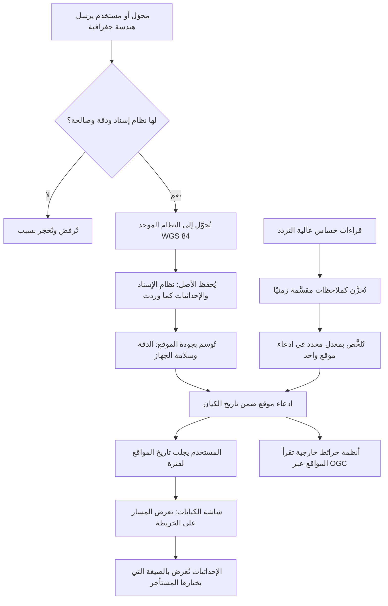

# مواقع الكيانات وتحركاتها

<!-- BEGIN GENERATED: doc -->
| البند | القيمة |
|---|---|
| المعرّف | FEAT-INF-GEO-LOCATION |
| الإصدار | 0.2 |
| الحالة | مسودة |
| القدرة | CAP-03 إدارة المعلومات |
| القدرة الفرعية | CAP-03.03 المعلومات الجغرافية (R1) |
| الأدوار | أي مستخدم مخوَّل؛ المحلل |
| الشاشات | SCR-21 الكيانات والأحداث: العرض المحلول، SCR-11 الصورة العملياتية المشتركة (COP) |
| حالات الاستخدام | — |
| القصص | 8: 1 من المواصفة، و7 جديدة |
<!-- END GENERATED: doc -->

## 1. نظرة عامة

### 1.1 القيمة

يرى المستخدم أين كان الكيان وكيف تحرّك عبر الزمن بمواقع دقيقة وموثوقة الإحداثيات.

### 1.2 النطاق

| البند | القيمة |
|---|---|
| المستخدمون | أي مستخدم مخوَّل؛ المحلل؛ فريق المنصة؛ أنظمة خرائط خارجية عبر التكامل |
| الشاشات | شاشة الكيانات والأحداث: العرض المحلول (المسار)؛ شاشة الصورة العملياتية المشتركة (صيغة الإحداثيات) |
| حالات الاستخدام (بالكلمات) | عرض سجل مواقع كيان متحرك عبر فترة؛ تلخيص قراءات الموقع عالية التردد في ادعاء موقع واحد؛ عرض الإحداثيات بالصيغة التي يختارها المستأجر؛ عرض مسار الكيان على الخريطة عبر فترة؛ تحويل الإحداثيات إلى النظام الموحد مع حفظ الأصل؛ رفض الأشكال الجغرافية غير الصالحة أو الناقصة؛ وسم جودة الموقع بالدقة وسلامة الجهاز؛ إتاحة مواقع الكيانات لأنظمة الخرائط الخارجية |
| المتطلبات (بالكلمات) | كل هندسة جغرافية تحمل نظام إسناد ودقة موضعية، وتُرفض إن كانت غير صالحة؛ الهندسة تُخزَّن بالنظام الموحد مع حفظ أصلها؛ يُحفظ تاريخ موقع الكيان المتحرك عبر الزمن |
| خارج النطاق | تعريف الأصل أو الكيان نفسه (ميزة أخرى)؛ رموز العرض الخرائطي (symbology)، لعدم وجود معيار محسوم؛ طبقات الوضع العملياتي غير الموقع (ميزة الوعي بالموقف) |

### 1.3 خريطة الميزة

**الشكل 1: من الهندسة الواردة إلى عرض مسار الكيان**



## 2. القواعد المشتركة

تنطبق على كل قصص الميزة، فلا تتكرر داخل القصص. وكل قصة تذكر ما يخصها فقط.

### 2.1 السياق المشترك

كل قصة تبدأ من ثلاثة شروط: مستأجر نشط، وحزمة السياسات الأساسية مفعّلة، ومستخدم مسجّل الدخول ومخوَّل. وتشير إليها القصص بخطوة واحدة: «بفرض السياق المشترك للميزة».

### 2.2 الصلاحية وعدم الإفصاح

- من لا يحق له رؤية العنصر يتلقى ردًا بشكل «غير متاح» تمامًا، فلا يعرف أنه موجود.
- من يرى العنصر ولا يحق له الإجراء يتلقى «لا تملك صلاحية هذا الإجراء».

### 2.3 أوامر تغيير الحالة

- **منع التكرار:** يُرسل كل أمر بمفتاح فريد، فإعادة الطلب نفسه لا تُنفَّذ مرتين.
- **حماية التعديل المتزامن:** يُرسل كل أمر بإصدار البيانات الذي يراه المستخدم. فإن عدّلها غيره في الأثناء، يُرفض الأمر.
- **السجل:** إن نجح الأمر، يُكتب حدثه وسجل التدقيق في المعاملة نفسها.

### 2.4 الرفض المشترك

```gherkin
# language: ar
خاصية: الرفض المشترك لأوامر الميزة

  سيناريو مخطط: رفض مشترك لكل أمر في الميزة
    بفرض السياق المشترك للميزة
    و <الحالة>
    عندما يُرسل المستخدم أي أمر من أوامر الميزة
    اذاً يُرفض برمز <الرمز> ويرى "<الرسالة>"
    و لا يتغير شيء

    امثلة:
      | الحالة                                  | الرمز                  | الرسالة                                                 |
      | العنصر خارج صلاحياته                    | NOT_FOUND              | غير متاح                                                |
      | العنصر مرئي له ولا يحق له الإجراء       | AUTHZ_DENIED           | لا تملك صلاحية هذا الإجراء                              |
      | غيره عدّل العنصر بعد أن فتحه            | VERSION_CONFLICT       | تغيّرت البيانات منذ فتحتها. راجع التغييرات ثم أعد المحاولة |
      | أعاد مفتاح منع التكرار بمحتوى مختلف     | IDEMPOTENCY_KEY_REUSED | طلب مكرر بمحتوى مختلف                                   |
      | البيانات ناقصة أو غير صحيحة             | VALIDATION_FAILED      | بعض البيانات ناقصة أو غير صحيحة. راجع الحقول المعلَّمة      |

  سيناريو: إعادة الطلب نفسه لا تُنفَّذ مرتين
    بفرض السياق المشترك للميزة
    و أمر نجح بمفتاح منع تكرار
    عندما يُعاد الطلب نفسه بالمفتاح نفسه
    اذاً تُعاد النتيجة الأولى ولا يُكتب حدث ثانٍ
```

## 3. الجودة وتعريف الاكتمال

### 3.1 متطلبات الجودة

<!-- BEGIN GENERATED: quality -->
| المرجع | الموقف | المطلوب |
|---|---|---|
| QAS-DQ-001 | submits records with invalid geometry or missing CRS | 100 % of invalid records quarantined; 0 published |
<!-- END GENERATED: quality -->

### 3.2 تعريف الاكتمال

القصة مكتملة حين تتحقق الشروط الخمسة:

1. سيناريوهاتها والقواعد المشتركة تمر في الاختبار الآلي.
2. فحوص البنية المعمارية تمر.
3. نصوص الواجهة والرسائل موجودة بالعربية والإنجليزية.
4. مراجعة الكود مكتملة.
5. ما تضيفه القصة نفسها في قسم «القواعد» تحقق.

## 4. فهرس القصص

<!-- BEGIN GENERATED: story-index -->
| المعرّف | القصة | النوع | الحالة |
|---|---|---|---|
| `US-BC02-Q-ENT-POSITIONS` | سجل مواقع الكيان | جلب | مسودة |
| `US-DOM-GEO-TRACK-SUMMARY` | تلخيص المواقع عالية التردد في ادعاء موقع | نظام | مسودة |
| `US-UI-SCR11-COORD-FORMAT` | عرض الإحداثيات بالصيغة التي يختارها المستأجر | واجهة | مسودة |
| `US-UI-SCR21-POSITION-TRACK` | عرض مسار الكيان على الخريطة عبر فترة | واجهة | مسودة |
| `US-PLT-GEO-CRS-CANONICAL` | تحويل الإحداثيات إلى النظام الموحد مع حفظ الأصل | منصة | مسودة |
| `US-PLT-GEO-GEOMETRY-VALIDATE` | رفض الأشكال الجغرافية غير الصالحة أو الناقصة | منصة | مسودة |
| `US-PLT-GEO-SPATIAL-QUALITY` | وسم جودة الموقع بالدقة وسلامة الجهاز | منصة | مسودة |
| `US-INT-GEO-OGC-FEATURES` | إتاحة مواقع الكيانات لأنظمة الخرائط الخارجية | تكامل | مسودة |
<!-- END GENERATED: story-index -->

## 5. القصص

### 5.1 US-BC02-Q-ENT-POSITIONS — سجل مواقع الكيان

| النوع | الإصدار | الأولوية | دون اتصال | الحالة |
|---|---|---|---|---|
| جلب | R1 | Must | لا | مسودة |

> **كـ** أي مستخدم مخوَّل، **أريد** أن أرى سجل مواقع كيان متحرك خلال فترة، **حتى** أعرف أين كان وكيف تحرَّك.

**باختصار:** تُعاد مواقع الكيان المسجَّلة بين وقتين كما كانت معروفة في نقطة زمن محددة، مع استبعاد ما لا يحق للمستخدم رؤيته وتعميم ما يفرض عليه ذلك.

#### القواعد

- **من يُسمح له:** أي مستخدم مخوَّل؛ المواقع تُصفَّى بحسب تصنيفها؛ موقع من يفرض عليه التعميم يُعاد بعلامة «معمم» في مركز خلية ثابتة.
- **البيانات (المرشحات):** الفترة [من، إلى)، ونقطة الوقت known_at، والمؤشر والحد.

#### معايير القبول

```gherkin
# language: ar
خاصية: سجل مواقع الكيان

  سيناريو: يرى المستخدم المواقع المرئية له خلال الفترة
    بفرض السياق المشترك للميزة
    و كيان متحرك له مواقع مسجَّلة داخل الفترة المطلوبة وأخرى خارج نطاق المستخدم
    عندما يطلب سجل مواقعه بين وقتين
    اذاً تُعاد المواقع المرئية له فقط مرتبة بالوقت
    و موقع من يفرض عليه التعميم يُعاد بعلامة "معمم"

  سيناريو: لا كشف لموقع محجوب
    بفرض السياق المشترك للميزة
    و موقع ضمن الفترة لا يحق للمستخدم رؤيته
    عندما يطلب سجل المواقع
    اذاً لا يظهر هذا الموقع ولا ما يدل على وجوده
```

<details><summary>المراجع التقنية والتتبع</summary>

<!-- BEGIN GENERATED: refs US-BC02-Q-ENT-POSITIONS -->
| البند | المعرّف | المعنى |
|---|---|---|
| الواجهة البرمجية | `GET /api/v1/information/entities/{entity_id}/positions` | — |
| الاستعلام | `QRY-ENT-POSITIONS` | Position history in [from,to) as known_at |
| السياسة | `POL-ENT-POSITIONS` | org scope ∩ classification rule; claims filtered by label |
| الكيان | `AGG-ENTITY` | الكيان |
| الجدول | `information.entities` | الجدول الرئيسي للكيان |
| وحدة النشر | DU-04 | — |
| المتطلب | REQ-INF-030 | The system shall keep the position history of located entities over time. |
| حالة الاستخدام | UC-096 | Query State As-Of / As-Known-At |
| الاختبار | TST-ENTITY-SM، TST-SLC02-INVARIANTS | دورة حالات الكيان، وثوابت الشريحة SLC-02 |
<!-- END GENERATED: refs US-BC02-Q-ENT-POSITIONS -->

</details>

### 5.2 US-DOM-GEO-TRACK-SUMMARY — تلخيص المواقع عالية التردد في ادعاء موقع

| النوع | الإصدار | الأولوية | دون اتصال | الحالة |
|---|---|---|---|---|
| نظام | R1 | Must | لا ينطبق | مسودة |

> **كـ** النظام، **أريد** أن ألخّص قراءات الموقع عالية التردد في ادعاء موقع واحد بمعدل محدد لكل نوع كيان، **حتى** لا يمتلئ تاريخ الكيان بآلاف النقاط الخام من الحساسات.

**باختصار:** قراءات الحساس عالية التردد تُخزَّن كملاحظات مقسَّمة زمنيًا، ثم يحسب النظام منها ادعاء موقع ملخَّصًا بمعدل أقصى محدد لكل نوع كيان، دون أن تُفقد الملاحظات الأصلية.

#### القواعد

- **متى يحدث:** عند حلول وقت التلخيص المجدول لكيان تجاوزت ملاحظاته منذ آخر تلخيص فترة التلخيص المحددة لنوعه.
- **الأثر:** يُسجَّل ادعاء موقع واحد يمثّل الفترة الملخَّصة، وتبقى الملاحظات الأصلية محفوظة دون حذف أو تعديل.

> **ملاحظة:** معدل التلخيص الدقيق لكل نوع كيان ومحفِّزه الزمني **[Derived]** من `spatial-model.md` §4؛ لا يحدد المصدر رقمًا صريحًا، ويُسجَّل في `00-open-questions.md`.

#### معايير القبول

```gherkin
# language: ar
خاصية: تلخيص المواقع عالية التردد

  سيناريو: يحين وقت التلخيص فيُسجَّل ادعاء موقع
    بفرض ملاحظات موقع من حساس وصلت منذ آخر تلخيص بما يفوق فترة التلخيص لنوع الكيان
    عندما يحين وقت التلخيص المجدول
    اذاً يُسجَّل ادعاء موقع واحد يمثّل الفترة
    و تبقى الملاحظات الأصلية محفوظة دون تغيير

  سيناريو: لم تحن فترة التلخيص فلا تغيير
    بفرض ملاحظات موقع وصلت منذ آخر تلخيص أقل من فترة التلخيص لنوع الكيان
    عندما يحين وقت فحص المجدول
    اذاً لا يُسجَّل ادعاء موقع جديد
```

<details><summary>المراجع التقنية والتتبع</summary>

<!-- BEGIN GENERATED: refs US-DOM-GEO-TRACK-SUMMARY -->
| البند | المعرّف | المعنى |
|---|---|---|
| المصدر | `spatial-model.md §4` | — |
| المصدر | `[Derived]` | — |
| المتطلب | REQ-INF-030 | The system shall keep the position history of located entities over time. |
| حالة الاستخدام | UC-096 | Query State As-Of / As-Known-At |
<!-- END GENERATED: refs US-DOM-GEO-TRACK-SUMMARY -->

</details>

### 5.3 US-UI-SCR11-COORD-FORMAT — عرض الإحداثيات بالصيغة التي يختارها المستأجر

| النوع | الإصدار | الأولوية | دون اتصال | الحالة |
|---|---|---|---|---|
| واجهة | R1 | Should | لا | مسودة |

> **كـ** أي مستخدم مخوَّل، **أريد** أن أرى إحداثيات الموقع بالصيغة التي يختارها مستأجري، **حتى** أقرأها بالشكل الذي أعرفه.

**باختصار:** تعرض شاشة الصورة العملياتية المشتركة إحداثيات كل عنصر بصيغة يحدّدها إعداد المستأجر، بينما يبقى التخزين الداخلي بالنظام الموحد دائمًا.

#### القواعد

- **العرض:** الإحداثية المعروضة تتبع صيغة إعداد المستأجر؛ التخزين الداخلي لا يتأثر بهذا الإعداد.

> **ملاحظة:** صيغ العرض وآلية اختيارها **[Needs Review]**؛ مصدر تصميم الواجهة يصفها بأنها غير محسومة، ويقترح درجات عشرية WGS 84 افتراضيًا وMGRS خيارًا للمستأجر دون قرار معتمد.

#### معايير القبول

```gherkin
# language: ar
خاصية: عرض الإحداثيات بصيغة المستأجر

  سيناريو: عرض بالصيغة المختارة
    بفرض السياق المشترك للميزة
    و مستأجر اختار صيغة عرض للإحداثيات
    عندما يفتح المستخدم عنصرًا له موقع
    اذاً تُعرض إحداثياته بالصيغة التي اختارها المستأجر

  سيناريو: التخزين لا يتأثر بالعرض
    بفرض السياق المشترك للميزة
    و عنصر عُرضت إحداثياته بصيغة غير النظام الموحد
    عندما يُستعلم عن الهندسة المخزَّنة
    اذاً تكون بالنظام الموحد WGS 84 كما خُزِّنت
```

<details><summary>المراجع التقنية والتتبع</summary>

<!-- BEGIN GENERATED: refs US-UI-SCR11-COORD-FORMAT -->
| البند | المعرّف | المعنى |
|---|---|---|
| الشاشة | SCR-11 | شاشة الصورة العملياتية المشتركة (COP) |
| المصدر | `21-ui-design.md §7` | — |
| القرار المعماري | ADR-P16 | Canonical CRS |
| المصدر | `[Derived]` | — |
<!-- END GENERATED: refs US-UI-SCR11-COORD-FORMAT -->

</details>

### 5.4 US-UI-SCR21-POSITION-TRACK — عرض مسار الكيان على الخريطة عبر فترة

| النوع | الإصدار | الأولوية | دون اتصال | الحالة |
|---|---|---|---|---|
| واجهة | R1 | Must | لا | مسودة |

> **كـ** المحلل، **أريد** أن أرى مسار الكيان على الخريطة عبر فترة، **حتى** أفهم تحركاته بدل قراءة جدول نقاط.

**باختصار:** تعرض شاشة الكيانات والأحداث مسار الكيان كخط مرسوم من مواقعه المرئية خلال الفترة المختارة، مع دائرة حول كل نقطة تمثّل دقتها الموضعية.

#### القواعد

- **العرض:** المسار خط مرتب زمنيًا من المواقع المرئية للمحلل فقط؛ دائرة الدقة حول كل نقطة من الدقة الموضعية؛ أعلام الجودة (دقة منخفضة، جهاز مشكوك فيه) تظهر في بطاقة العنصر.

#### معايير القبول

```gherkin
# language: ar
خاصية: عرض مسار الكيان على الخريطة

  سيناريو: عرض المسار لفترة
    بفرض السياق المشترك للميزة
    و كيان متحرك له مواقع مرئية للمحلل خلال فترة مختارة
    عندما يفتح المحلل الكيان على الخريطة لتلك الفترة
    اذاً يُرسم مسار من مواقعه مرتبة زمنيًا مع دائرة دقة حول كل نقطة

  سيناريو: علم الجودة يظهر عند الحاجة
    بفرض السياق المشترك للميزة
    و أحد المواقع موسوم بدقة منخفضة أو جهاز مشكوك في سلامته
    عندما يفتح المحلل تلك النقطة على المسار
    اذاً يرى علم الجودة في بطاقة العنصر
```

<details><summary>المراجع التقنية والتتبع</summary>

<!-- BEGIN GENERATED: refs US-UI-SCR21-POSITION-TRACK -->
| البند | المعرّف | المعنى |
|---|---|---|
| الشاشة | SCR-21 | شاشة الكيانات والأحداث: العرض المحلول |
| المصدر | `21-ui-design.md §7` | — |
| المتطلب | REQ-INF-030 | The system shall keep the position history of located entities over time. |
| حالة الاستخدام | UC-096 | Query State As-Of / As-Known-At |
<!-- END GENERATED: refs US-UI-SCR21-POSITION-TRACK -->

</details>

### 5.5 US-PLT-GEO-CRS-CANONICAL — تحويل الإحداثيات إلى النظام الموحد مع حفظ الأصل

| النوع | الإصدار | الأولوية | دون اتصال | الحالة |
|---|---|---|---|---|
| منصة | R1 | Must | لا ينطبق | مسودة |

> **كـ** فريق المنصة، **أريد** أن أحوّل كل إحداثيات واردة إلى النظام الموحد مع حفظ نظامها وإحداثياتها الأصلية، **حتى** تُقارَن كل المواقع بنظام واحد دون فقد مصدرها.

**باختصار:** كل هندسة جغرافية تُحفظ بالنظام الكانوني WGS 84 (EPSG:4326)، وتُحفظ معها نظام الإسناد والإحداثيات كما وردت، فيمكن استعادتها كما كانت.

#### معايير القبول

```gherkin
# language: ar
خاصية: التحويل إلى النظام الموحد مع حفظ الأصل

  سيناريو: حفظ الهندسة بالنظامين
    بفرض هندسة واردة بنظام إسناد غير النظام الموحد
    عندما تُسجَّل في النظام
    اذاً تُحوَّل إلى WGS 84 (EPSG:4326) للتخزين الكانوني
    و يُحفظ نظام الإسناد والإحداثيات الأصلية كما وردت

  سيناريو: استعادة الأصل بدقة
    بفرض هندسة محوَّلة ومحفوظة بنظامها الأصلي
    عندما يُطلب تحويلها عكسيًا إلى نظامها الأصلي
    اذاً تُعاد الإحداثيات الأصلية ضمن حدود الدقة المعلنة
```

<details><summary>المراجع التقنية والتتبع</summary>

<!-- BEGIN GENERATED: refs US-PLT-GEO-CRS-CANONICAL -->
| البند | المعرّف | المعنى |
|---|---|---|
| القرار المعماري | ADR-P16 | Canonical CRS |
| فحص البنية | FIT-08 | Every geometry has CRS and accuracy; canonical EPSG:4326 |
| المصدر | `spatial-model.md §2` | — |
| المتطلب | REQ-INF-029 | The system shall store each geometry in the canonical CRS WGS 84 (EPSG:4326) and shall keep the original CRS… |
<!-- END GENERATED: refs US-PLT-GEO-CRS-CANONICAL -->

</details>

### 5.6 US-PLT-GEO-GEOMETRY-VALIDATE — رفض الأشكال الجغرافية غير الصالحة أو الناقصة

| النوع | الإصدار | الأولوية | دون اتصال | الحالة |
|---|---|---|---|---|
| منصة | R1 | Must | لا ينطبق | مسودة |

> **كـ** فريق المنصة، **أريد** أن أرفض الأشكال الجغرافية غير الصالحة أو الناقصة، **حتى** لا تدخل بيانات موقع مضلِّلة إلى النظام.

**باختصار:** كل هندسة تُفحص قبل قبولها: تُرفض إن غابت عنها نظام الإسناد أو الدقة الموضعية، أو كانت غير صالحة هندسيًا، وتُحجر بسبب الرفض فلا تُنشر في أي استعلام أو عرض.

> **ملاحظة:** رمز الرفض الداخلي **[Needs Review]**؛ رمز هذه الحالة مذكور في المتطلبات دون رسالة مستخدم معتمدة في مسرد القصص، ويُحسم في `18-error-handling.md` §8. حتى حينه لا رمز ظاهر للمستخدم في هذه القصة، والحجر فقط داخلي.

#### معايير القبول

```gherkin
# language: ar
خاصية: رفض الأشكال الجغرافية غير الصالحة

  سيناريو مخطط: رفض هندسة غير صالحة أو ناقصة
    بفرض هندسة واردة فيها <النقص أو الخلل>
    عندما يُحاول تسجيلها
    اذاً تُرفض وتُحجر بسبب <النقص أو الخلل>
    و لا تُنشر في أي استعلام أو عرض

    امثلة:
      | النقص أو الخلل                 |
      | غياب نظام الإسناد (CRS)        |
      | غياب الدقة الموضعية            |
      | تقاطع ذاتي أو حلقة غير مغلقة    |
      | إحداثيات خارج النطاق المسموح   |

  سيناريو: هندسة صالحة تُقبل
    بفرض هندسة واردة بنظام إسناد ودقة موضعية وبلا خلل هندسي
    عندما يُحاول تسجيلها
    اذاً تُقبل وتُسجَّل
```

<details><summary>المراجع التقنية والتتبع</summary>

<!-- BEGIN GENERATED: refs US-PLT-GEO-GEOMETRY-VALIDATE -->
| البند | المعرّف | المعنى |
|---|---|---|
| الجودة | QAS-DQ-001 | submits records with invalid geometry or missing CRS → 100 % of invalid records quarantined; 0 published |
| فحص البنية | FIT-08 | Every geometry has CRS and accuracy; canonical EPSG:4326 |
| المصدر | `spatial-model.md §3` | — |
| المتطلب | REQ-INF-028 | The system shall require every geometry to carry a CRS and a positional accuracy, and shall reject invalid ge… |
<!-- END GENERATED: refs US-PLT-GEO-GEOMETRY-VALIDATE -->

</details>

### 5.7 US-PLT-GEO-SPATIAL-QUALITY — وسم جودة الموقع بالدقة وسلامة الجهاز

| النوع | الإصدار | الأولوية | دون اتصال | الحالة |
|---|---|---|---|---|
| منصة | R1 | Must | لا ينطبق | مسودة |

> **كـ** فريق المنصة، **أريد** أن أسم جودة كل موقع بالدقة وسلامة الجهاز، **حتى** يعرف المستخدم مدى الثقة بموقع يراه.

**باختصار:** كل موقع يحمل بُعد جودة مكانية: سليم، أو دقة منخفضة (أكبر من حد النوع)، أو محوَّل، أو جهاز مشكوك في سلامته، ويُعرض هذا الوسم مع الموقع.

#### معايير القبول

```gherkin
# language: ar
خاصية: وسم جودة الموقع

  سيناريو مخطط: تصنيف جودة الموقع
    بفرض موقع واردًا بخاصية <الخاصية>
    عندما يُسجَّل
    اذاً يُوسم ببُعد الجودة <الوسم>

    امثلة:
      | الخاصية                                | الوسم               |
      | دقة أعلى من حد النوع                    | LOW_ACCURACY        |
      | أُعيد حسابه من نظام إسناد آخر           | TRANSFORMED         |
      | وصل من جهاز مشكوك في سلامة قراءاته     | DEVICE_GPS_SUSPECT  |
      | لا شيء من السابق                        | SPATIAL_OK          |
```

<details><summary>المراجع التقنية والتتبع</summary>

<!-- BEGIN GENERATED: refs US-PLT-GEO-SPATIAL-QUALITY -->
| البند | المعرّف | المعنى |
|---|---|---|
| المصدر | `spatial-model.md §7` | — |
| المتطلب | REQ-INF-028 | The system shall require every geometry to carry a CRS and a positional accuracy, and shall reject invalid ge… |
<!-- END GENERATED: refs US-PLT-GEO-SPATIAL-QUALITY -->

</details>

### 5.8 US-INT-GEO-OGC-FEATURES — إتاحة مواقع الكيانات لأنظمة الخرائط الخارجية

| النوع | الإصدار | الأولوية | دون اتصال | الحالة |
|---|---|---|---|---|
| تكامل | R1 | Should | لا ينطبق | مسودة |

> **كـ** نظام خرائط خارجي، **أريد** أن أقرأ مواقع الكيانات بمعيار قياسي، **حتى** أعرضها في أدواتي دون تكامل خاص.

**باختصار:** تُتاح مواقع الكيانات المرئية للمستهلك عبر واجهة OGC القياسية للمعالم والبلاطات، فتتصفحها أنظمة الخرائط الخارجية دون محوّل مخصص لكل نظام.

#### القواعد

- **متى يحدث:** طلب نظام خارجي مخوَّل عبر واجهة OGC.
- **البيانات المتبادلة:** طبقات المواقع والهندسة بصيغة قياسية ضمن النظام الموحد.
- **الأثر:** تُعاد العناصر المرئية للمستهلك فقط، بنفس قواعد عدم الإفصاح في §2.2.

#### معايير القبول

```gherkin
# language: ar
خاصية: إتاحة مواقع الكيانات عبر معيار قياسي

  سيناريو: قراءة الطبقة المرئية
    بفرض السياق المشترك للميزة
    و نظام خرائط خارجي مخوَّل لنطاق معيّن
    عندما يطلب طبقة مواقع عبر الواجهة القياسية
    اذاً تُعاد العناصر المرئية له فقط بصيغة قياسية
```

<details><summary>المراجع التقنية والتتبع</summary>

<!-- BEGIN GENERATED: refs US-INT-GEO-OGC-FEATURES -->
| البند | المعرّف | المعنى |
|---|---|---|
| القرار المعماري | ADR-P12 | Map Serving & Tile Security |
| القرار التقني | TD-10 | Dynamic operational vector tiles from PostGIS (ST_AsMVT) via Martin tile server with scope-keyed cache; base… |
| المصدر | `20-integration-design.md §2` | — |
<!-- END GENERATED: refs US-INT-GEO-OGC-FEATURES -->

</details>

## 6. التتبع

<!-- BEGIN GENERATED: trace -->
| المتطلب | المعنى | القصص | الاختبار |
|---|---|---|---|
| REQ-INF-028 | The system shall require every geometry to carry a CRS and a positional accuracy, and shall reject invalid ge… | `US-PLT-GEO-GEOMETRY-VALIDATE`، `US-PLT-GEO-SPATIAL-QUALITY` | TST-OBSERVATION-SM، TST-SLC02-INVARIANTS |
| REQ-INF-029 | The system shall store each geometry in the canonical CRS WGS 84 (EPSG:4326) and shall keep the original CRS… | `US-PLT-GEO-CRS-CANONICAL` | TST-SLC02-INVARIANTS |
| REQ-INF-030 | The system shall keep the position history of located entities over time. | `US-BC02-Q-ENT-POSITIONS`، `US-DOM-GEO-TRACK-SUMMARY`، `US-UI-SCR21-POSITION-TRACK` | TST-SLC02-INVARIANTS |
<!-- END GENERATED: trace -->

## 7. سجل التغييرات

| الإصدار | التاريخ | التغيير |
|---|---|---|
| 0.1 | — | هيكل مولَّد من خريطة الميزات |
| 0.2 | 2026-10-03 | كتابة القصص كاملة بمعيار القصص |
