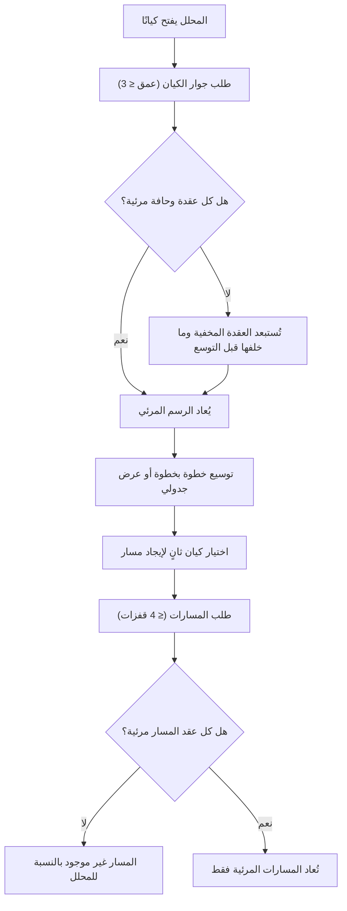

# استكشاف شبكة العلاقات

<!-- BEGIN GENERATED: doc -->
| البند | القيمة |
|---|---|
| المعرّف | FEAT-INF-GRAPH-EXPLORE |
| الإصدار | 0.2 |
| الحالة | مسودة |
| القدرة | CAP-03 إدارة المعلومات |
| القدرة الفرعية | CAP-03.01 الكيانات والعلاقات (R1) |
| الأدوار | المحلل |
| الشاشات | SCR-24 الرسم البياني |
| حالات الاستخدام | — |
| القصص | 8: 2 من المواصفة، و6 جديدة |
<!-- END GENERATED: doc -->

## 1. نظرة عامة

### 1.1 القيمة

يستكشف المحلل محيط الكيان والمسارات التي تربط كيانين دون أن يرى ما لا يحق له.

### 1.2 النطاق

| البند | القيمة |
|---|---|
| المستخدمون | المحلل، وكل مستخدم مخوَّل على الكيانات المعروضة |
| الشاشات | SCR-24 الرسم البياني |
| حالات الاستخدام | استكشاف محيط كيان حتى عمق 3، وإيجاد المسارات بين كيانين حتى 4 قفزات، وعرض بديل جدولي لمن لا يستخدم الفأرة |
| المتطلبات | تمثيل العلاقة بنوعها وطرفيها وفترة صلاحيتها ودليلها وتصنيفها، وحجب ما لا يحق للمستخدم رؤيته من عقد الرسم وحوافه |
| خارج النطاق | قاعدة بيانات رسم بياني مخصصة (R1 يستخدم استعلامات تكرارية محدودة في PostgreSQL، TD-03)، وتحليل الشبكة (مركزية، تجميع) |

### 1.3 خريطة الميزة

**الشكل 1: مسار استكشاف الرسم البياني**



## 2. القواعد المشتركة

تنطبق على كل قصص الميزة، فلا تتكرر داخل القصص. وكل قصة تذكر ما يخصها فقط.

### 2.1 السياق المشترك

كل قصة تبدأ من ثلاثة شروط: مستأجر نشط، وحزمة السياسات الأساسية مفعّلة، ومستخدم مسجّل الدخول ومخوَّل. وتشير إليها القصص بخطوة واحدة: «بفرض السياق المشترك للميزة».

### 2.2 الصلاحية وعدم الإفصاح

- من لا يحق له رؤية العنصر يتلقى ردًا بشكل «غير متاح» تمامًا، فلا يعرف أنه موجود.
- من يرى العنصر ولا يحق له الإجراء يتلقى «لا تملك صلاحية هذا الإجراء».

### 2.3 أوامر تغيير الحالة

- **منع التكرار:** يُرسل كل أمر بمفتاح فريد، فإعادة الطلب نفسه لا تُنفَّذ مرتين.
- **حماية التعديل المتزامن:** يُرسل كل أمر بإصدار البيانات الذي يراه المستخدم. فإن عدّلها غيره في الأثناء، يُرفض الأمر.
- **السجل:** إن نجح الأمر، يُكتب حدثه وسجل التدقيق في المعاملة نفسها.

### 2.4 الرفض المشترك

```gherkin
# language: ar
خاصية: الرفض المشترك لأوامر الميزة

  سيناريو مخطط: رفض مشترك لكل أمر في الميزة
    بفرض السياق المشترك للميزة
    و <الحالة>
    عندما يُرسل المستخدم أي أمر من أوامر الميزة
    اذاً يُرفض برمز <الرمز> ويرى "<الرسالة>"
    و لا يتغير شيء

    امثلة:
      | الحالة                                  | الرمز                  | الرسالة                                                 |
      | العنصر خارج صلاحياته                    | NOT_FOUND              | غير متاح                                                |
      | العنصر مرئي له ولا يحق له الإجراء       | AUTHZ_DENIED           | لا تملك صلاحية هذا الإجراء                              |
      | غيره عدّل العنصر بعد أن فتحه            | VERSION_CONFLICT       | تغيّرت البيانات منذ فتحتها. راجع التغييرات ثم أعد المحاولة |
      | أعاد مفتاح منع التكرار بمحتوى مختلف     | IDEMPOTENCY_KEY_REUSED | طلب مكرر بمحتوى مختلف                                   |
      | البيانات ناقصة أو غير صحيحة             | VALIDATION_FAILED      | بعض البيانات ناقصة أو غير صحيحة. راجع الحقول المعلَّمة      |

  سيناريو: إعادة الطلب نفسه لا تُنفَّذ مرتين
    بفرض السياق المشترك للميزة
    و أمر نجح بمفتاح منع تكرار
    عندما يُعاد الطلب نفسه بالمفتاح نفسه
    اذاً تُعاد النتيجة الأولى ولا يُكتب حدث ثانٍ
```

## 3. الجودة وتعريف الاكتمال

### 3.1 متطلبات الجودة

<!-- BEGIN GENERATED: quality -->
| المرجع | الموقف | المطلوب |
|---|---|---|
| QAS-ACC-001 | uses R1 web screens | WCAG 2.2 level AA conformance (AR and EN) |
| QAS-PERF-018 | graph neighborhood depth 2 | p95 ≤ 1 s |
| QAS-SEC-011 | inference test suite on search, suggestions, facets, graph and paths | 0 disclosures of hidden objects, hidden facts, hidden nodes/edges |
<!-- END GENERATED: quality -->

### 3.2 تعريف الاكتمال

القصة مكتملة حين تتحقق الشروط الخمسة:

1. سيناريوهاتها والقواعد المشتركة تمر في الاختبار الآلي.
2. فحوص البنية المعمارية تمر.
3. نصوص الواجهة والرسائل موجودة بالعربية والإنجليزية.
4. مراجعة الكود مكتملة.
5. ما تضيفه القصة نفسها في قسم «القواعد» تحقق.

## 4. فهرس القصص

<!-- BEGIN GENERATED: story-index -->
| المعرّف | القصة | النوع | الحالة |
|---|---|---|---|
| `US-BC07-Q-GRAPH-NEIGHBORHOOD` | جلب: Nodes/edges within depth ≤ 3, valid_at/known_at; hidden nodes and edges cut | جلب | مسودة |
| `US-BC07-Q-GRAPH-PATHS` | جلب: Paths between two entities, ≤ 4 hops, only through visible nodes and edges | جلب | مسودة |
| `US-UI-SCR24-GRAPH-EXPAND` | توسيع شبكة الكيان خطوة بخطوة | واجهة | مسودة |
| `US-UI-SCR24-GRAPH-LIST-VIEW` | بديل جدولي للرسم البياني لسهولة الوصول | واجهة | مسودة |
| `US-UI-SCR24-GRAPH-PATHS` | إيجاد المسارات بين كيانين وعرضها | واجهة | مسودة |
| `US-PLT-GRAPH-INFERENCE-SUITE` | اختبار عدم كشف العقد والحواف المخفية | منصة | مسودة |
| `US-PLT-GRAPH-NEIGHBORHOOD-PERF` | جوار الكيان بعمق اثنين خلال ثانية | منصة | مسودة |
| `US-OPS-GRAPH-LATENCY-WATCH` | مراقبة زمن استعلامات الرسم وكثافة الجوار | تشغيل | مسودة |
<!-- END GENERATED: story-index -->

## 5. القصص

### 5.1 US-BC07-Q-GRAPH-NEIGHBORHOOD — جلب: Nodes/edges within depth ≤ 3, valid_at/known_at; hidden nodes and edges cut

| النوع | الإصدار | الأولوية | دون اتصال | الحالة |
|---|---|---|---|---|
| جلب | R1 | Must | لا | مسودة |

> **كـ** المحلل، **أريد** أن أجلب جوار كيان حتى عمق ثلاث خطوات، **حتى** أفهم ما يرتبط به دون أن أرى ما لا يحق لي.

**باختصار:** يُعاد جوار الكيان، عقدًا وحوافًا، مع فترة صلاحية كل علاقة ووقت تسجيلها، وما لا يحق للمحلل رؤيته يُستبعد قبل التوسع لا بعده.

#### القواعد

- **من يُسمح له:** أي مستخدم مخوَّل، ولكل عقدة وحافة فحص صلاحية مستقل.
- **البيانات:** معرّف الكيان، وعمق الجوار (حتى 3)، ونقطتا الزمن الاختياريتان: وقت الصلاحية ووقت العلم بها.
- عند كل قفزة تُستبعد العقدة أو الحافة غير المرئية قبل التوسع خلفها، فلا يصل التوسع إلى ما تقطعه عقدة محجوبة.
- عدد الجيران المرئيين لكل قفزة محدود بـ500 بترتيب حتمي؛ وإن تجاوز المرئي هذا الحد يظهر مقطوعًا دون أن يُحتسب المحجوب (discovery-architecture.md §4.4).

#### معايير القبول

```gherkin
# language: ar
خاصية: جوار الكيان في الرسم البياني

  سيناريو: جوار كيان فيه عقد مرئية ومحجوبة
    بفرض السياق المشترك للميزة
    و كيان له جيران ضمن نطاق المحلل وجيران آخرون خارجه إلى عمق ثلاث خطوات
    عندما يطلب المحلل جوار الكيان
    اذاً تُعاد العقد والحواف المرئية فقط، وما خلف العقدة المحجوبة لا يظهر
    و لا يكشف الرد أي عدد أو إشارة إلى جار محجوب

  سيناريو: تجاوز كثافة الجوار المرئي
    بفرض السياق المشترك للميزة
    و كيان له أكثر من 500 جار مرئي في قفزة واحدة
    عندما يطلب المحلل جوار الكيان
    اذاً تُعاد أول 500 جار مرئي بترتيب حتمي، وتُعلَّم القائمة بأنها مقطوعة
```

<details><summary>المراجع التقنية والتتبع</summary>

<!-- BEGIN GENERATED: refs US-BC07-Q-GRAPH-NEIGHBORHOOD -->
| البند | المعرّف | المعنى |
|---|---|---|
| الواجهة البرمجية | `GET /api/v1/discovery/graph/entities/{entity_id}/neighborhood` | — |
| الاستعلام | `QRY-GRAPH-NEIGHBORHOOD` | Nodes/edges within depth ≤ 3, valid_at/known_at; hidden nodes and edges cut |
| السياسة | `POL-GRAPH-NEIGHBORHOOD` | PDP allowed_scope → pre-filter on doc and fact labels; LabelCheck re-check on page |
| المتطلب | REQ-INF-027 | The system shall represent relationships as objects with type, source, target, validity period, evidence, pro… |
| حالة الاستخدام | UC-003 | Manage Relationship |
<!-- END GENERATED: refs US-BC07-Q-GRAPH-NEIGHBORHOOD -->

</details>

### 5.2 US-BC07-Q-GRAPH-PATHS — جلب: Paths between two entities, ≤ 4 hops, only through visible nodes and edges

| النوع | الإصدار | الأولوية | دون اتصال | الحالة |
|---|---|---|---|---|
| جلب | R1 | Must | لا | مسودة |

> **كـ** المحلل، **أريد** أن أجد المسارات بين كيانين، **حتى** أعرف كيف يرتبطان دون أن يمر البحث بما لا يحق لي رؤيته.

**باختصار:** تُعاد المسارات بين كيانين حتى أربع قفزات، على الرسم المرئي للمحلل فقط؛ ومسار يعبر عقدة أو حافة محجوبة لا يُعاد ولا يظهر أنه موجود.

#### القواعد

- **من يُسمح له:** أي مستخدم مخوَّل، ولكل عقدة وحافة في المسار فحص صلاحية مستقل.
- **البيانات:** الكيان الأول والثاني (إلزاميان)، وأقصى عدد قفزات (حتى 4)، وأنواع العلاقات، ونقطتا الزمن الاختياريتان، وأقصى عدد مسارات.
- يُعاد حتى 20 مسارًا كحد أعلى، ولا يكشف عدم إعادة مسار أنه موجود ومحجوب.

#### معايير القبول

```gherkin
# language: ar
خاصية: المسارات بين كيانين

  سيناريو: مسار يمر بعقدة محجوبة
    بفرض السياق المشترك للميزة
    و المسار الوحيد بين كيانين يمر بعقدة خارج نطاق المحلل
    عندما يطلب المحلل المسارات بين الكيانين
    اذاً لا يُعاد أي مسار، ولا يظهر في الرد أن مسارًا محجوبًا موجود

  سيناريو: مسار مرئي بالكامل
    بفرض السياق المشترك للميزة
    و مسار بين كيانين لا يمر إلا بعقد وحواف مرئية للمحلل، حتى أربع قفزات
    عندما يطلب المحلل المسارات بين الكيانين
    اذاً يُعاد المسار بعقده وحوافه المرئية فقط
```

<details><summary>المراجع التقنية والتتبع</summary>

<!-- BEGIN GENERATED: refs US-BC07-Q-GRAPH-PATHS -->
| البند | المعرّف | المعنى |
|---|---|---|
| الواجهة البرمجية | `POST /api/v1/discovery/graph/paths` | — |
| الاستعلام | `QRY-GRAPH-PATHS` | Paths between two entities, ≤ 4 hops, only through visible nodes and edges |
| السياسة | `POL-GRAPH-PATHS` | PDP allowed_scope → pre-filter on doc and fact labels; LabelCheck re-check on page |
| المتطلب | REQ-INF-027 | The system shall represent relationships as objects with type, source, target, validity period, evidence, pro… |
| حالة الاستخدام | UC-003 | Manage Relationship |
<!-- END GENERATED: refs US-BC07-Q-GRAPH-PATHS -->

</details>

### 5.3 US-UI-SCR24-GRAPH-EXPAND — توسيع شبكة الكيان خطوة بخطوة

| النوع | الإصدار | الأولوية | دون اتصال | الحالة |
|---|---|---|---|---|
| واجهة | R1 | Should | لا | مسودة |

> **كـ** المحلل، **أريد** أن أوسّع شاشة الرسم البياني خطوة بخطوة، **حتى** أستكشف محيط الكيان دون أن تمتلئ الشاشة دفعة واحدة.

**باختصار:** يختار المحلل عقدة في الرسم فتتوسع خطوة واحدة فقط، حتى عمق ثلاث خطوات من الكيان الأصلي، والعقدة المحجوبة لا تظهر فلا تُعرض زرًا للتوسيع.

#### القواعد

- التوسيع خطوة بخطوة إلى أن يبلغ العمق حده الأقصى (ثلاث خطوات)، وبعده يُعرض زر التوسيع معطَّلًا.
- تجاوز 500 جار مرئي في خطوة واحدة يُعرض بعلامة «مقطوع» دون عدد الجيران المحجوبين.
- الأفعال المتاحة على كل عقدة تُحدَّد من صلاحية المحلل عليها، والرد النهائي من الخادم هو الحكم (23-crosscutting.md §6.3).

#### معايير القبول

```gherkin
# language: ar
خاصية: توسيع شبكة الكيان خطوة بخطوة

  سيناريو: توسيع خطوة واحدة
    بفرض السياق المشترك للميزة
    و كيان معروض في الرسم على عمق خطوة واحدة من الكيان الأصلي
    عندما يختار المحلل توسيع العقدة
    اذاً تُضاف عقدها وحوافها المرئية فقط، وتصبح على عمق خطوتين

  سيناريو: بلوغ أقصى عمق
    بفرض السياق المشترك للميزة
    و عقدة على عمق ثلاث خطوات من الكيان الأصلي
    عندما يفتح المحلل الرسم
    اذاً يظهر زر توسيعها معطَّلًا
```

<details><summary>المراجع التقنية والتتبع</summary>

<!-- BEGIN GENERATED: refs US-UI-SCR24-GRAPH-EXPAND -->
| البند | المعرّف | المعنى |
|---|---|---|
| الشاشة | SCR-24 | شاشة الرسم البياني |
| المصدر | `discovery-architecture.md §4.4` | — |
| المصدر | `23-crosscutting.md §10` | — |
<!-- END GENERATED: refs US-UI-SCR24-GRAPH-EXPAND -->

</details>

### 5.4 US-UI-SCR24-GRAPH-LIST-VIEW — بديل جدولي للرسم البياني لسهولة الوصول

| النوع | الإصدار | الأولوية | دون اتصال | الحالة |
|---|---|---|---|---|
| واجهة | R1 | Should | لا | مسودة |

> **كـ** المحلل، **أريد** بديلًا جدوليًا لرسم العلاقات، **حتى** أستكشف الجوار والمسارات بلوحة المفاتيح وقارئ الشاشة دون الاعتماد على الرسم المرئي.

**باختصار:** يعرض الجدول نفس عقد الرسم وحوافه المرئية للمحلل، صفًّا لكل علاقة، بالعنصر الأول والعلاقة والعنصر الثاني وفترة الصلاحية، ويقبل كل ما يقبله الرسم من التنقل والتوسيع.

#### القواعد

- **من يُسمح له:** من يرى الرسم نفسه (المحلل)؛ لا بيانات إضافية عن الرسم المرئي.
- متوافق مع WCAG 2.2 المستوى AA بالعربية والإنجليزية: تنقل كامل بلوحة المفاتيح، وتركيز مرئي، ولا تمييز بالحالة أو الخطورة بالون وحده (QAS-ACC-001).
- **[Derived]** العرض الجدولي يبدّل مكان الرسم عند طلب المستخدم، ولا ترتيب افتراضي غير الحالي للرسم؛ لم يحدد المصدر تفصيل الترتيب.

#### معايير القبول

```gherkin
# language: ar
خاصية: البديل الجدولي للرسم البياني

  سيناريو: التبديل إلى العرض الجدولي
    بفرض السياق المشترك للميزة
    و رسم جوار معروض لكيان
    عندما يختار المحلل العرض الجدولي
    اذاً يُعرض صف لكل علاقة مرئية بالعنصرين والعلاقة وفترة الصلاحية
    و لا يظهر في الجدول ما لا يظهر في الرسم المرئي
```

<details><summary>المراجع التقنية والتتبع</summary>

<!-- BEGIN GENERATED: refs US-UI-SCR24-GRAPH-LIST-VIEW -->
| البند | المعرّف | المعنى |
|---|---|---|
| الشاشة | SCR-24 | شاشة الرسم البياني |
| الجودة | QAS-ACC-001 | uses R1 web screens → WCAG 2.2 level AA conformance (AR and EN) |
| المصدر | `21-ui-design.md §10` | — |
| المصدر | `[Derived]` | — |
<!-- END GENERATED: refs US-UI-SCR24-GRAPH-LIST-VIEW -->

</details>

### 5.5 US-UI-SCR24-GRAPH-PATHS — إيجاد المسارات بين كيانين وعرضها

| النوع | الإصدار | الأولوية | دون اتصال | الحالة |
|---|---|---|---|---|
| واجهة | R1 | Should | لا | مسودة |

> **كـ** المحلل، **أريد** أن أختار كيانين وأرى المسارات التي تربطهما على الرسم، **حتى** أفهم طبيعة العلاقة بينهما.

**باختصار:** يختار المحلل كيانين من شاشة الرسم، فتُعرض مساراتهما المرئية حتى أربع قفزات، كل مسار بتتابع عقده وحوافه؛ وإن لم يوجد مسار مرئي تُعرض رسالة بذلك دون إشارة إلى مسار محجوب.

#### القواعد

- **من يُسمح له:** من يرى الكيانين (المحلل).
- **البيانات:** الكيان الأول والثاني، وأقصى عدد قفزات اختياري حتى 4.
- حتى 20 مسارًا تُعرض معًا؛ وتجاوز هذا العدد يُعلَّم بأن القائمة غير كاملة دون كشف عدد المسارات الأخرى.

#### معايير القبول

```gherkin
# language: ar
خاصية: إيجاد المسارات بين كيانين

  سيناريو: عرض مسار موجود
    بفرض السياق المشترك للميزة
    و مسار مرئي واحد على الأقل بين كيانين اختارهما المحلل
    عندما يطلب المحلل المسارات بينهما
    اذاً يُعرض كل مسار بتتابع عقده وحوافه المرئية

  سيناريو: لا مسار مرئي
    بفرض السياق المشترك للميزة
    و لا مسار مرئي للمحلل بين كيانين اختارهما
    عندما يطلب المحلل المسارات بينهما
    اذاً تُعرض رسالة بأن لا مسار موجود، دون إشارة إلى مسار محجوب
```

<details><summary>المراجع التقنية والتتبع</summary>

<!-- BEGIN GENERATED: refs US-UI-SCR24-GRAPH-PATHS -->
| البند | المعرّف | المعنى |
|---|---|---|
| الشاشة | SCR-24 | شاشة الرسم البياني |
| المصدر | `discovery-architecture.md §4.4` | — |
<!-- END GENERATED: refs US-UI-SCR24-GRAPH-PATHS -->

</details>

### 5.6 US-PLT-GRAPH-INFERENCE-SUITE — اختبار عدم كشف العقد والحواف المخفية

| النوع | الإصدار | الأولوية | دون اتصال | الحالة |
|---|---|---|---|---|
| منصة | R1 | Should | لا ينطبق | مسودة |

> **كـ** فريق المنصة، **أريد** حزمة اختبار استدلال على البحث والاقتراحات والفئات والرسم والمسارات، **حتى** أتأكد أن وجود عقدة أو حافة محجوبة لا ينكشف بأي طريق غير مباشر.

**باختصار:** تشغّل الحزمة محاولات استدلال معروفة (عدّ، فئات، ترتيب، زمن استجابة، وجود مسار) على بيانات فيها عناصر محجوبة، وتفحص أن النتيجة صفر حالات انكشاف.

#### القواعد

- تُشغَّل الحزمة في كل نشر، وعند أي تغيير في منطق التصفية أو الرسم.
- فشل حالة واحدة يمنع النشر، ويُسجَّل في مؤشر فشل حزمة الاستدلال بخطورة P0 (observability-slc05.md).

#### معايير القبول

```gherkin
# language: ar
خاصية: اختبار عدم كشف العقد والحواف المخفية

  سيناريو: الحزمة تمر دون أي كشف
    بفرض بيانات اختبار فيها عقد وحواف محجوبة عن ذاتٍ فاحصة
    عندما تُشغَّل حزمة اختبار الاستدلال
    اذاً تكون نتيجة كل حالة صفر انكشاف للعدد والفئات والترتيب والمسارات وزمن الاستجابة

  سيناريو: فشل حالة واحدة يمنع النشر
    بفرض حزمة اختبار الاستدلال قيد التشغيل في خط النشر
    عندما تكشف حالة واحدة وجود عقدة محجوبة
    اذاً يُمنع النشر ويُسجَّل الفشل بخطورة P0
```

<details><summary>المراجع التقنية والتتبع</summary>

<!-- BEGIN GENERATED: refs US-PLT-GRAPH-INFERENCE-SUITE -->
| البند | المعرّف | المعنى |
|---|---|---|
| الجودة | QAS-SEC-011 | inference test suite on search, suggestions, facets, graph and paths → 0 disclosures of hidden objects, hidde… |
| المصدر | `THR-S05-04` | — |
| المصدر | `discovery-architecture.md §4.4` | — |
<!-- END GENERATED: refs US-PLT-GRAPH-INFERENCE-SUITE -->

</details>

### 5.7 US-PLT-GRAPH-NEIGHBORHOOD-PERF — جوار الكيان بعمق اثنين خلال ثانية

| النوع | الإصدار | الأولوية | دون اتصال | الحالة |
|---|---|---|---|---|
| منصة | R1 | Should | لا ينطبق | مسودة |

> **كـ** فريق المنصة، **أريد** أن يستجيب استعلام جوار الكيان بعمق اثنين خلال ثانية تحت حمل التصميم، **حتى** يبقى استكشاف الرسم عمليًا مع كثافة العقد.

**باختصار:** استعلامات التكرار المحدود في R1 (TD-03، بلا قاعدة رسم مخصصة) تستجيب لجوار بعمق اثنين خلال ثانية عند المئين 95 تحت حمل التصميم.

#### القواعد

- بلا قاعدة رسم بياني مخصصة في R1: الاستعلام تكراري محدود العمق (حتى 3) في PostgreSQL، مع تصفية الصلاحية عند كل قفزة.
- إن قصر الأداء عن هذا الهدف عند الحمل التجريبي، أو تجاوز الجوار المرئي 500 بشكل متكرر، يُعاد النظر في قاعدة رسم مخصصة (TD-03).

#### معايير القبول

```gherkin
# language: ar
خاصية: أداء جوار الرسم البياني

  سيناريو: الهدف تحت حمل التصميم
    بفرض حمل بعقد كثيفة بحجم التصميم
    عندما يُطلب جوار كيان بعمق اثنين
    اذاً يكون زمن الاستجابة ثانية واحدة أو أقل عند المئين 95
```

<details><summary>المراجع التقنية والتتبع</summary>

<!-- BEGIN GENERATED: refs US-PLT-GRAPH-NEIGHBORHOOD-PERF -->
| البند | المعرّف | المعنى |
|---|---|---|
| الجودة | QAS-PERF-018 | graph neighborhood depth 2 → p95 ≤ 1 s |
| القرار التقني | TD-03 | No graph database in R1: relationship projection tables in PostgreSQL + bounded recursive queries (depth ≤ 3,… |
<!-- END GENERATED: refs US-PLT-GRAPH-NEIGHBORHOOD-PERF -->

</details>

### 5.8 US-OPS-GRAPH-LATENCY-WATCH — مراقبة زمن استعلامات الرسم وكثافة الجوار

| النوع | الإصدار | الأولوية | دون اتصال | الحالة |
|---|---|---|---|---|
| تشغيل | R1 | Should | لا ينطبق | مسودة |

> **كـ** فريق التشغيل، **أريد** تنبيهًا عند تجاوز زمن استعلامات الرسم حده، **حتى** أتدخل قبل أن يشعر المحلل بالتأخر.

**باختصار:** يُرصد زمن استجابة عمليات الرسم البياني باستمرار، وتجاوزه الحد عند المئين 95 يفتح تنبيهًا لفريق التشغيل.

#### القواعد

- مؤشر زمن عمليات الرسم يُرصد لكل عملية (جوار، مسارات)، والتنبيه عند تجاوزه ثانية واحدة عند المئين 95 (observability-slc05.md).
- بلا قاعدة رسم مخصصة في R1 (TD-03)، فتكرار تجاوز الحد مع كثافة جوار عالية مدخل لإعادة تقييم القرار التقني، لا إصلاح فوري.

#### معايير القبول

```gherkin
# language: ar
خاصية: مراقبة زمن استعلامات الرسم

  سيناريو: تجاوز زمن الاستجابة حده
    بفرض أن زمن استجابة عمليات الرسم عند المئين 95 تجاوز ثانية واحدة
    عندما تُجمع المقاييس الدورية
    اذاً يُفتح تنبيه لفريق التشغيل بالعملية المتأثرة

  سيناريو: الزمن ضمن الحد
    بفرض أن زمن استجابة عمليات الرسم عند المئين 95 ثانية واحدة أو أقل
    عندما تُجمع المقاييس الدورية
    اذاً لا يُفتح أي تنبيه
```

<details><summary>المراجع التقنية والتتبع</summary>

<!-- BEGIN GENERATED: refs US-OPS-GRAPH-LATENCY-WATCH -->
| البند | المعرّف | المعنى |
|---|---|---|
| المصدر | `observability-slc05.md` | — |
| القرار التقني | TD-03 | No graph database in R1: relationship projection tables in PostgreSQL + bounded recursive queries (depth ≤ 3,… |
<!-- END GENERATED: refs US-OPS-GRAPH-LATENCY-WATCH -->

</details>

## 6. التتبع

<!-- BEGIN GENERATED: trace -->
| المتطلب | المعنى | القصص | الاختبار |
|---|---|---|---|
| REQ-INF-027 | The system shall represent relationships as objects with type, source, target, validity period, evidence, pro… | `US-BC07-Q-GRAPH-NEIGHBORHOOD`، `US-BC07-Q-GRAPH-PATHS` | TST-RELATIONSHIP-SM، TST-SLC02-INVARIANTS، TST-SLC05-INVARIANTS |
<!-- END GENERATED: trace -->

## 7. سجل التغييرات

| الإصدار | التاريخ | التغيير |
|---|---|---|
| 0.1 | — | هيكل مولَّد من خريطة الميزات |
| 0.2 | 2026-10-03 | كتابة القصص كاملة بمعيار القصص |
