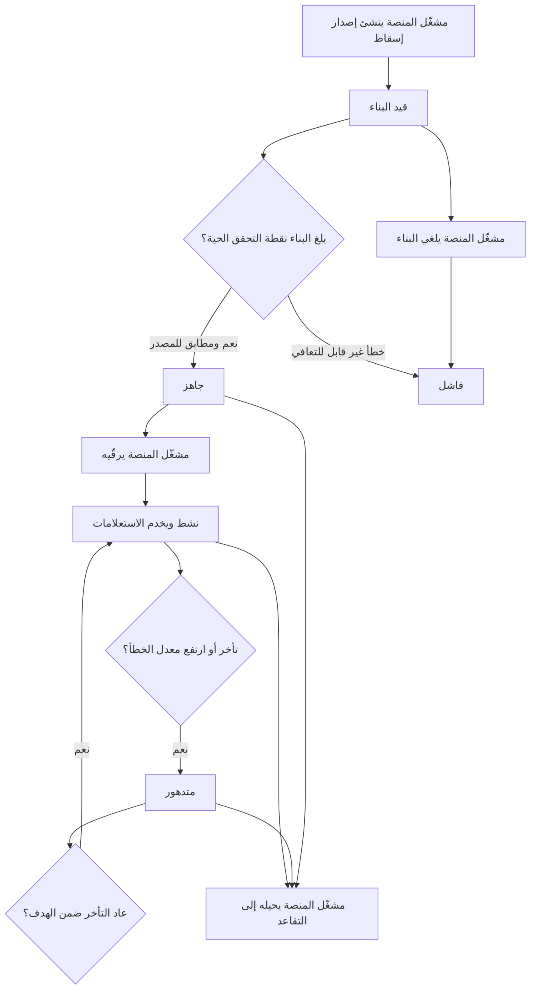
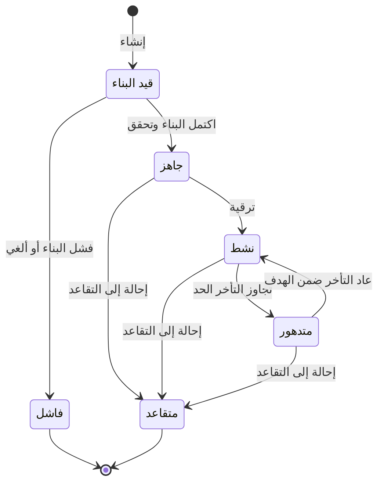

# إعادة بناء فهارس البحث

<!-- BEGIN GENERATED: doc -->
| البند | القيمة |
|---|---|
| المعرّف | FEAT-INF-INDEX-REBUILD |
| الإصدار | 0.1 |
| الحالة | مسودة |
| القدرة | CAP-03 إدارة المعلومات |
| القدرة الفرعية | CAP-03.01 الكيانات والعلاقات (R1) |
| الأدوار | مشغّل المنصة؛ النظام |
| الشاشات | SCR-71 حالة الإسقاطات (واجهة المشغل) |
| حالات الاستخدام | UC-078 |
| القصص | 16: 9 من المواصفة، و7 جديدة |
<!-- END GENERATED: doc -->

## 1. نظرة عامة

### 1.1 القيمة

يعيد مشغل المنصة بناء فهارس البحث والرسم البياني من المصدر الأصلي دون فقد بيانات ويراقب تأخرها.

### 1.2 النطاق

| البند | القيمة |
|---|---|
| المستخدمون | مشغّل المنصة؛ النظام بهوية عبء العمل |
| الشاشات | SCR-71 حالة الإسقاطات (واجهة المشغل) |
| حالات الاستخدام | إنشاء إصدار إسقاط وبنائه، ثم ترقيته بعد تحقق البناء، أو إحالته إلى التقاعد أو إلغاء بنائه؛ ومتابعة حالته وتأخره |
| المتطلبات | إعادة بناء كل إسقاط بحث أو رسم من المصدر الأصلي دون فقد بيانات، ونتائج مطابقة للمصدر، والوصول إلى الفهارس محصور بخدمة البحث فقط |
| خارج النطاق | محتوى الفهرس نفسه (البحث والرسم في ميزات أخرى)؛ المستأجرون لا يرون إصدارات الإسقاط |

### 1.3 خريطة الميزة

**الشكل 1: دورة إصدار الإسقاط**



**الشكل 2: حالات إصدار الإسقاط**



## 2. القواعد المشتركة

تنطبق على كل قصص الميزة، فلا تتكرر داخل القصص. وكل قصة تذكر ما يخصها فقط.

### 2.1 السياق المشترك

كل قصة تبدأ من ثلاثة شروط: مستأجر نشط، وحزمة السياسات الأساسية مفعّلة، ومستخدم مسجّل الدخول ومخوَّل. وتشير إليها القصص بخطوة واحدة: «بفرض السياق المشترك للميزة».

### 2.2 الصلاحية وعدم الإفصاح

- من لا يحق له رؤية العنصر يتلقى ردًا بشكل «غير متاح» تمامًا، فلا يعرف أنه موجود.
- من يرى العنصر ولا يحق له الإجراء يتلقى «لا تملك صلاحية هذا الإجراء».

### 2.3 أوامر تغيير الحالة

- **منع التكرار:** يُرسل كل أمر بمفتاح فريد، فإعادة الطلب نفسه لا تُنفَّذ مرتين.
- **حماية التعديل المتزامن:** يُرسل كل أمر بإصدار البيانات الذي يراه المستخدم. فإن عدّلها غيره في الأثناء، يُرفض الأمر.
- **السجل:** إن نجح الأمر، يُكتب حدثه وسجل التدقيق في المعاملة نفسها.

### 2.4 الرفض المشترك

```gherkin
# language: ar
خاصية: الرفض المشترك لأوامر الميزة

  سيناريو مخطط: رفض مشترك لكل أمر في الميزة
    بفرض السياق المشترك للميزة
    و <الحالة>
    عندما يُرسل المستخدم أي أمر من أوامر الميزة
    اذاً يُرفض برمز <الرمز> ويرى "<الرسالة>"
    و لا يتغير شيء

    امثلة:
      | الحالة                                  | الرمز                  | الرسالة                                                 |
      | العنصر خارج صلاحياته                    | NOT_FOUND              | غير متاح                                                |
      | العنصر مرئي له ولا يحق له الإجراء       | AUTHZ_DENIED           | لا تملك صلاحية هذا الإجراء                              |
      | غيره عدّل العنصر بعد أن فتحه            | VERSION_CONFLICT       | تغيّرت البيانات منذ فتحتها. راجع التغييرات ثم أعد المحاولة |
      | أعاد مفتاح منع التكرار بمحتوى مختلف     | IDEMPOTENCY_KEY_REUSED | طلب مكرر بمحتوى مختلف                                   |
      | البيانات ناقصة أو غير صحيحة             | VALIDATION_FAILED      | بعض البيانات ناقصة أو غير صحيحة. راجع الحقول المعلَّمة      |

  سيناريو: إعادة الطلب نفسه لا تُنفَّذ مرتين
    بفرض السياق المشترك للميزة
    و أمر نجح بمفتاح منع تكرار
    عندما يُعاد الطلب نفسه بالمفتاح نفسه
    اذاً تُعاد النتيجة الأولى ولا يُكتب حدث ثانٍ
```

## 3. الجودة وتعريف الاكتمال

### 3.1 متطلبات الجودة

<!-- BEGIN GENERATED: quality -->
| المرجع | الموقف | المطلوب |
|---|---|---|
| QAS-PERF-004 | an object is created or changed | index lag p95 ≤ 30 s |
| QAS-REL-002 | search projection unavailable | critical tier unaffected; index rebuilt without data loss |
| QAS-REL-004 | full projection rebuild | ≤ 24 h to READY with no loss of query service (old version stays ACTIVE) |
<!-- END GENERATED: quality -->

### 3.2 تعريف الاكتمال

القصة مكتملة حين تتحقق الشروط الخمسة:

1. سيناريوهاتها والقواعد المشتركة تمر في الاختبار الآلي.
2. فحوص البنية المعمارية تمر.
3. نصوص الواجهة والرسائل موجودة بالعربية والإنجليزية.
4. مراجعة الكود مكتملة.
5. ما تضيفه القصة نفسها في قسم «القواعد» تحقق.

## 4. فهرس القصص

<!-- BEGIN GENERATED: story-index -->
| المعرّف | القصة | النوع | الحالة |
|---|---|---|---|
| `US-BC07-PRJ-CANCEL-BUILD` | إلغاء بناء إصدار الإسقاط | أمر | مسودة |
| `US-BC07-PRJ-CREATE-VERSION` | إنشاء إصدار جديد من إصدار الإسقاط | أمر | مسودة |
| `US-BC07-PRJ-PROMOTE` | ترقية إصدار الإسقاط | أمر | مسودة |
| `US-BC07-PRJ-RETIRE` | إحالة إصدار الإسقاط إلى التقاعد | أمر | مسودة |
| `US-BC07-Q-PRJ-STATUS` | جلب: Projection versions, lag, state | جلب | مسودة |
| `US-BC07-S-PROJECTION-VERSION-01` | تلقائي: full rebuild reached live checkpoint (إصدار الإسقاط) | نظام | مسودة |
| `US-BC07-S-PROJECTION-VERSION-02` | تلقائي: build failed (إصدار الإسقاط) | نظام | مسودة |
| `US-BC07-S-PROJECTION-VERSION-03` | تلقائي: lag above threshold (إصدار الإسقاط) | نظام | مسودة |
| `US-BC07-S-PROJECTION-VERSION-04` | تلقائي: lag back within target (إصدار الإسقاط) | نظام | مسودة |
| `US-UI-SCR71-PROJECTION-BOARD` | متابعة إصدارات الإسقاطات وتأخرها وترقيتها | واجهة | مسودة |
| `US-PLT-INDEX-LAG` | ظهور التغييرات في البحث خلال 30 ثانية | منصة | مسودة |
| `US-PLT-INDEX-REBUILD-LIVE` | إعادة البناء الكاملة دون توقف خدمة البحث | منصة | مسودة |
| `US-PLT-INDEX-REBUILD-PARITY` | إعادة البناء تعطي نتائج مطابقة للمصدر | منصة | مسودة |
| `US-OPS-INDEX-ACCESS-ISOLATION` | حصر الوصول إلى الفهارس بخدمة البحث وحدها | تشغيل | مسودة |
| `US-OPS-INDEX-LAG-WATCH` | التنبيه عند تأخر الإسقاطات أو تدهورها | تشغيل | مسودة |
| `US-OPS-INDEX-RECONCILE` | مطابقة الفهرس مع المصدر ليلًا وإصلاح الفروق | تشغيل | مسودة |
<!-- END GENERATED: story-index -->

## 5. القصص

### 5.1 US-BC07-PRJ-CANCEL-BUILD — إلغاء بناء إصدار الإسقاط

| النوع | الإصدار | الأولوية | دون اتصال | الحالة |
|---|---|---|---|---|
| أمر | R1 | Must | لا | مسودة |

> **كـ** مشغّل المنصة، **أريد** أن ألغي بناء إصدار إسقاط جاريًا، **حتى** أوقف بناءً اكتشفت خللًا فيه قبل أن يُرقَّى.

**باختصار:** يلغي مشغّل المنصة إصدار إسقاط «قيد البناء» بسبب، فيصير «فاشلًا» ولا يُرقَّى أبدًا، بينما يستمر الإصدار النشط الحالي في خدمة الاستعلامات.

#### القواعد

- **متى يُسمح:** إصدار الإسقاط «قيد البناء» فقط.
- **من يُسمح له:** مشغّل المنصة في مستأجر المنصة.
- **البيانات:** سبب الإلغاء (إلزامي).
- **الأثر:** يصير «فاشلًا»؛ يُسجَّل حدث «فشل إصدار الإسقاط»، ويصل إلى تنبيهات التشغيل.

#### معايير القبول

```gherkin
# language: ar
خاصية: إلغاء بناء إصدار الإسقاط

  سيناريو: إلغاء بناء جارٍ
    بفرض السياق المشترك للميزة
    و إصدار إسقاط «قيد البناء»
    عندما يلغي مشغّل المنصة بناءه بسبب
    اذاً يصير الإصدار «فاشلًا»
    و يُسجَّل حدث «فشل إصدار الإسقاط»

  سيناريو مخطط: رفض خاص بإلغاء البناء
    بفرض السياق المشترك للميزة
    و <الحالة>
    عندما يحاول مشغّل المنصة إلغاء بناء الإصدار
    اذاً يُرفض برمز <الرمز> ويرى <الرسالة>

    امثلة:
      | الحالة                          | الرمز                                        | الرسالة                                             |
      | الإصدار ليس «قيد البناء»       | PROJECTION_VERSION_INVALID_STATE_TRANSITION | الوضع الحالي لإصدار الإسقاط لا يسمح بهذا الإجراء    |
      | لم يُذكر سبب الإلغاء            | REASON_REQUIRED                              | اذكر السبب                                          |
```

<details><summary>المراجع التقنية والتتبع</summary>

<!-- BEGIN GENERATED: refs US-BC07-PRJ-CANCEL-BUILD -->
| البند | المعرّف | المعنى |
|---|---|---|
| الواجهة البرمجية | `POST /api/v1/discovery/projection-versions/{id}/actions/cancel-build` | — |
| الأمر | `CMD-PRJ-CANCEL-BUILD` | إلغاء بناء إصدار الإسقاط |
| السياسة | `POL-PRJ-CANCEL-BUILD` | Platform Operator (platform tenant)؛ |
| الحدث | `EVT-PRJ-FAILED` | يصل إلى: Query router (alias switch); Operations alerting |
| الكيان | `AGG-PROJECTION-VERSION` | إصدار الإسقاط |
| وحدة النشر | DU-09 | — |
| المتطلب | REQ-SRC-004 | The system shall be able to rebuild every search and graph projection from the source of truth without data l… |
| حالة الاستخدام | UC-078 | Rebuild Search & Graph Projections |
| الاختبار | TST-PROJECTION-VERSION-SM، TST-SLC05-INVARIANTS | دورة حالات إصدار الإسقاط، وثوابت الشريحة SLC-05 |
<!-- END GENERATED: refs US-BC07-PRJ-CANCEL-BUILD -->

</details>

### 5.2 US-BC07-PRJ-CREATE-VERSION — إنشاء إصدار جديد من إصدار الإسقاط

| النوع | الإصدار | الأولوية | دون اتصال | الحالة |
|---|---|---|---|---|
| أمر | R1 | Must | لا | مسودة |

> **كـ** مشغّل المنصة، **أريد** أن أبدأ إصدارًا جديدًا من إسقاط البحث أو الرسم، **حتى** أعيد بناءه كاملًا من المصدر الأصلي عند تغيّر مخطط الفهرسة أو نموذج التحليل.

**باختصار:** يبدأ مشغّل المنصة بناء إصدار إسقاط جديد لنوعه ومجموعة مستأجريه، فيصير «قيد البناء» ويعيد تجميع وثائقه من المصدر الأصلي دون أن يوقف خدمة الإصدار النشط الحالي.

#### القواعد

- **متى يُسمح:** لا يوجد إصدار «قيد البناء» من النوع نفسه لمجموعة المستأجرين نفسها.
- **من يُسمح له:** مشغّل المنصة في مستأجر المنصة.
- **البيانات:** نوع الإسقاط (بحث، رسم، أو متجهات لاحقًا)، ومجموعة المستأجرين، وإصدار المخطط، وإصدار التسوية، وسبب الإنشاء (إلزامية).
- **الأثر:** يصير «قيد البناء»؛ يُسجَّل حدث «بدأ بناء إصدار الإسقاط»، ويصل إلى موجّه الاستعلامات وتنبيهات التشغيل. تغيير المخطط أو نموذج التسوية أو التحليل يحتاج دائمًا إصدارًا جديدًا، لا تعديلًا على القائم.

#### معايير القبول

```gherkin
# language: ar
خاصية: إنشاء إصدار جديد من إصدار الإسقاط

  سيناريو: بدء بناء إصدار جديد
    بفرض السياق المشترك للميزة
    و لا يوجد إصدار «قيد البناء» من نوع البحث لمجموعة المستأجرين نفسها
    عندما ينشئ مشغّل المنصة إصدارًا جديدًا من نوع البحث بسبب
    اذاً يصير الإصدار «قيد البناء»
    و يُسجَّل حدث «بدأ بناء إصدار الإسقاط»

  سيناريو مخطط: رفض خاص بإنشاء الإصدار
    بفرض السياق المشترك للميزة
    و <الحالة>
    عندما يحاول مشغّل المنصة إنشاء إصدار جديد
    اذاً يُرفض برمز <الرمز> ويرى <الرسالة>

    امثلة:
      | الحالة                                                    | الرمز                       | الرسالة                                        |
      | يوجد إصدار «قيد البناء» من النوع نفسه للمجموعة نفسها     | PROJECTION_BUILD_IN_PROGRESS | يوجد بناء جارٍ لهذا النوع                      |
      | نوع الإسقاط غير محدد                                      | VALIDATION_FAILED            | نوع الإسقاط مطلوب                               |
```

<details><summary>المراجع التقنية والتتبع</summary>

<!-- BEGIN GENERATED: refs US-BC07-PRJ-CREATE-VERSION -->
| البند | المعرّف | المعنى |
|---|---|---|
| الواجهة البرمجية | `POST /api/v1/discovery/projection-versions` | — |
| الأمر | `CMD-PRJ-CREATE-VERSION` | إنشاء إصدار جديد من إصدار الإسقاط |
| السياسة | `POL-PRJ-CREATE-VERSION` | Platform Operator (platform tenant)؛ |
| الحدث | `EVT-PRJ-BUILD-STARTED` | يصل إلى: Query router (alias switch); Operations alerting |
| الكيان | `AGG-PROJECTION-VERSION` | إصدار الإسقاط |
| وحدة النشر | DU-09 | — |
| المتطلب | REQ-SRC-004 | The system shall be able to rebuild every search and graph projection from the source of truth without data l… |
| حالة الاستخدام | UC-078 | Rebuild Search & Graph Projections |
| الاختبار | TST-PROJECTION-VERSION-SM، TST-SLC05-INVARIANTS | دورة حالات إصدار الإسقاط، وثوابت الشريحة SLC-05 |
<!-- END GENERATED: refs US-BC07-PRJ-CREATE-VERSION -->

</details>

### 5.3 US-BC07-PRJ-PROMOTE — ترقية إصدار الإسقاط

| النوع | الإصدار | الأولوية | دون اتصال | الحالة |
|---|---|---|---|---|
| أمر | R1 | Must | لا | مسودة |

> **كـ** مشغّل المنصة، **أريد** أن أرقّي إصدار إسقاط جاهزًا إلى الخدمة، **حتى** يحل محل الإصدار النشط دون أن تتوقف الاستعلامات لحظة واحدة.

**باختصار:** يرقّي مشغّل المنصة إصدارًا «جاهزًا» وقد تحقق بناؤه، فيصير «نشطًا» ويتولى خدمة الاستعلامات فورًا، بينما يُحال الإصدار النشط السابق من نوعه إلى التقاعد في الخطوة نفسها.

#### القواعد

- **متى يُسمح:** إصدار الإسقاط «جاهز»، وتحقق بناؤه (عيّنة التحقق تطابق المصدر).
- **من يُسمح له:** مشغّل المنصة في مستأجر المنصة، وبعد مصادقة معززة.
- **الأثر:** يصير «نشطًا»؛ يُسجَّل حدث «ترقية إصدار الإسقاط»؛ يُحال الإصدار النشط السابق من نوعه إلى التقاعد في المعاملة نفسها (تبديل الاسم المستعار الذري)، فلا يخدم إصداران نشطان من النوع نفسه معًا.

#### معايير القبول

```gherkin
# language: ar
خاصية: ترقية إصدار الإسقاط

  سيناريو: ترقية إصدار جاهز ومتحقق
    بفرض السياق المشترك للميزة
    و إصدار إسقاط «جاهز» تحقق بناؤه، وإصدار نشط سابق من نوعه
    عندما يرقّي مشغّل المنصة الإصدار الجاهز
    اذاً يصير الإصدار الجديد «نشطًا» ويخدم الاستعلامات
    و يصير الإصدار السابق «متقاعدًا» في الخطوة نفسها

  سيناريو مخطط: رفض خاص بالترقية
    بفرض السياق المشترك للميزة
    و <الحالة>
    عندما يحاول مشغّل المنصة ترقية الإصدار
    اذاً يُرفض برمز <الرمز> ويرى <الرسالة>

    امثلة:
      | الحالة                          | الرمز                                        | الرسالة                                          |
      | الإصدار ليس «جاهزًا»           | PROJECTION_VERSION_INVALID_STATE_TRANSITION | الوضع الحالي لإصدار الإسقاط لا يسمح بهذا الإجراء |
      | لم يتحقق بناؤه بعد              | PROJECTION_NOT_VERIFIED                      | لم يُتحقق من النسخة بعد                           |
      | مصادقة الجلسة أقل من المطلوب    | MFA_STEP_UP_REQUIRED                         | هذا الإجراء يحتاج تأكيد هويتك مرة أخرى            |
```

<details><summary>المراجع التقنية والتتبع</summary>

<!-- BEGIN GENERATED: refs US-BC07-PRJ-PROMOTE -->
| البند | المعرّف | المعنى |
|---|---|---|
| الواجهة البرمجية | `POST /api/v1/discovery/projection-versions/{id}/actions/promote` | — |
| الأمر | `CMD-PRJ-PROMOTE` | ترقية إصدار الإسقاط |
| السياسة | `POL-PRJ-PROMOTE` | Platform Operator (platform tenant)؛ |
| الحدث | `EVT-PRJ-PROMOTED` | يصل إلى: Query router (alias switch); Operations alerting |
| الكيان | `AGG-PROJECTION-VERSION` | إصدار الإسقاط |
| وحدة النشر | DU-09 | — |
| المتطلب | REQ-SRC-004 | The system shall be able to rebuild every search and graph projection from the source of truth without data l… |
| حالة الاستخدام | UC-078 | Rebuild Search & Graph Projections |
| الاختبار | TST-PROJECTION-VERSION-SM، TST-SLC05-INVARIANTS | دورة حالات إصدار الإسقاط، وثوابت الشريحة SLC-05 |
<!-- END GENERATED: refs US-BC07-PRJ-PROMOTE -->

</details>

### 5.4 US-BC07-PRJ-RETIRE — إحالة إصدار الإسقاط إلى التقاعد

| النوع | الإصدار | الأولوية | دون اتصال | الحالة |
|---|---|---|---|---|
| أمر | R1 | Must | لا | مسودة |

> **كـ** مشغّل المنصة، **أريد** أن أحيل إصدار إسقاط إلى التقاعد، **حتى** أزيل ما لم يعد يُستخدم منه ويوقف عن خدمة الاستعلامات.

**باختصار:** يحيل مشغّل المنصة إصدار إسقاط «جاهزًا» أو «نشطًا» أو «متدهورًا» إلى التقاعد بسبب، على ألا يكون آخر إصدار نشط من نوعه، فلا تنقطع خدمة النوع نفسه عن كل المستأجرين.

#### القواعد

- **متى يُسمح:** إصدار الإسقاط «جاهز» أو «نشط» أو «متدهور»، وليس آخر إصدار نشط من نوعه.
- **من يُسمح له:** مشغّل المنصة في مستأجر المنصة.
- **البيانات:** سبب الإحالة إلى التقاعد (إلزامي).
- **الأثر:** يصير «متقاعدًا» حالة نهائية؛ يُسجَّل حدث «تقاعد إصدار الإسقاط».

#### معايير القبول

```gherkin
# language: ar
خاصية: إحالة إصدار الإسقاط إلى التقاعد

  سيناريو: إحالة إصدار نشط إلى التقاعد مع وجود إصدار نشط آخر
    بفرض السياق المشترك للميزة
    و إصدار إسقاط «نشط» وليس الإصدار النشط الوحيد من نوعه
    عندما يحيله مشغّل المنصة إلى التقاعد بسبب
    اذاً يصير الإصدار «متقاعدًا»
    و يُسجَّل حدث «تقاعد إصدار الإسقاط»

  سيناريو مخطط: رفض خاص بالإحالة إلى التقاعد
    بفرض السياق المشترك للميزة
    و <الحالة>
    عندما يحاول مشغّل المنصة إحالة الإصدار إلى التقاعد
    اذاً يُرفض برمز <الرمز> ويرى <الرسالة>

    امثلة:
      | الحالة                                  | الرمز                                        | الرسالة                                             |
      | الإصدار «قيد البناء» أو «فاشل» أو «متقاعد» بالفعل | PROJECTION_VERSION_INVALID_STATE_TRANSITION | الوضع الحالي لإصدار الإسقاط لا يسمح بهذا الإجراء |
      | هو آخر إصدار نشط من نوعه                | LAST_ACTIVE_PROJECTION                       | لا يمكن إيقاف آخر نسخة نشطة                         |
      | لم يُذكر سبب الإحالة إلى التقاعد        | VALIDATION_FAILED                            | السبب مطلوب                                         |
```

<details><summary>المراجع التقنية والتتبع</summary>

<!-- BEGIN GENERATED: refs US-BC07-PRJ-RETIRE -->
| البند | المعرّف | المعنى |
|---|---|---|
| الواجهة البرمجية | `POST /api/v1/discovery/projection-versions/{id}/actions/retire` | — |
| الأمر | `CMD-PRJ-RETIRE` | إحالة إصدار الإسقاط إلى التقاعد |
| السياسة | `POL-PRJ-RETIRE` | Platform Operator (platform tenant)؛ |
| الحدث | `EVT-PRJ-RETIRED` | يصل إلى: Query router (alias switch); Operations alerting |
| الكيان | `AGG-PROJECTION-VERSION` | إصدار الإسقاط |
| وحدة النشر | DU-09 | — |
| المتطلب | REQ-SRC-004 | The system shall be able to rebuild every search and graph projection from the source of truth without data l… |
| حالة الاستخدام | UC-078 | Rebuild Search & Graph Projections |
| الاختبار | TST-PROJECTION-VERSION-SM، TST-SLC05-INVARIANTS | دورة حالات إصدار الإسقاط، وثوابت الشريحة SLC-05 |
<!-- END GENERATED: refs US-BC07-PRJ-RETIRE -->

</details>

### 5.5 US-BC07-Q-PRJ-STATUS — جلب: Projection versions, lag, state

| النوع | الإصدار | الأولوية | دون اتصال | الحالة |
|---|---|---|---|---|
| جلب | R1 | Must | لا | مسودة |

> **كـ** مشغّل المنصة، **أريد** قائمة بإصدارات الإسقاط وحالتها وتأخرها، **حتى** أعرف أيها نشط وأيها يحتاج ترقية أو تدخلًا.

**باختصار:** تُعاد إصدارات الإسقاط التي يحق لمشغّل المنصة رؤيتها، بحالة كل منها وتأخرها الحالي، صفحةً بعد صفحة.

#### القواعد

- **من يُسمح له:** مشغّل المنصة فقط؛ لا يرى المستأجرون إصدارات الإسقاط.

#### معايير القبول

```gherkin
# language: ar
خاصية: حالة إصدارات الإسقاط

  سيناريو: عرض إصدارات الإسقاط وحالتها
    بفرض السياق المشترك للميزة
    و إصدارات إسقاط بحالات مختلفة
    عندما يطلب مشغّل المنصة قائمة إصدارات الإسقاط
    اذاً تُعاد الإصدارات بحالة كل منها وتأخره الحالي
```

<details><summary>المراجع التقنية والتتبع</summary>

<!-- BEGIN GENERATED: refs US-BC07-Q-PRJ-STATUS -->
| البند | المعرّف | المعنى |
|---|---|---|
| الواجهة البرمجية | `GET /api/v1/discovery/projection-versions` | — |
| الاستعلام | `QRY-PRJ-STATUS` | Projection versions, lag, state |
| السياسة | `POL-PRJ-STATUS` | PDP allowed_scope → pre-filter on doc and fact labels; LabelCheck re-check on page |
| الكيان | `AGG-PROJECTION-VERSION` | إصدار الإسقاط |
| وحدة النشر | DU-09 | — |
| المتطلب | REQ-SRC-004 | The system shall be able to rebuild every search and graph projection from the source of truth without data l… |
| حالة الاستخدام | UC-078 | Rebuild Search & Graph Projections |
| الاختبار | TST-PROJECTION-VERSION-SM، TST-SLC05-INVARIANTS | دورة حالات إصدار الإسقاط، وثوابت الشريحة SLC-05 |
<!-- END GENERATED: refs US-BC07-Q-PRJ-STATUS -->

</details>

### 5.6 US-BC07-S-PROJECTION-VERSION-01 — تلقائي: full rebuild reached live checkpoint (إصدار الإسقاط)

| النوع | الإصدار | الأولوية | دون اتصال | الحالة |
|---|---|---|---|---|
| نظام | R1 | Must | لا ينطبق | مسودة |

> **كـ** النظام، **أريد** أن أنقل إصدار الإسقاط إلى «جاهز» حين يبلغ بناؤه نقطة التحقق الحية، **حتى** يصبح قابلًا للترقية.

**باختصار:** حين تُعاد كل تدفقات المصدر إلى نقطة التحقق الحالية وتطابق عيّنة التحقق المصدر، يصير إصدار الإسقاط «قيد البناء» جاهزًا.

#### القواعد

- **متى يحدث:** كل تدفقات المصدر أُعيدت إلى نقطة التحقق الحالية، وعيّنة التحقق تطابق المصدر.
- **الأثر:** يصير «جاهزًا»؛ يُسجَّل حدث «جهوزية إصدار الإسقاط» وسجل تدقيق بهوية النظام.

#### معايير القبول

```gherkin
# language: ar
خاصية: جهوزية إصدار الإسقاط

  سيناريو: بلوغ نقطة التحقق الحية
    بفرض إصدار إسقاط «قيد البناء» أعيدت كل تدفقاته إلى نقطة التحقق الحالية، وعيّنة التحقق تطابق المصدر
    عندما يفحص النظام حالة البناء
    اذاً يصير الإصدار «جاهزًا»
    و يُسجَّل حدث «جهوزية إصدار الإسقاط» وسجل تدقيق بهوية النظام

  سيناريو: لم تكتمل إعادة التدفقات بعد
    بفرض إصدار إسقاط «قيد البناء» لم تُستكمل إعادة تدفقاته إلى نقطة التحقق الحالية
    عندما يفحص النظام حالة البناء
    اذاً تبقى حالته «قيد البناء» ولا يُسجَّل أي حدث
```

<details><summary>المراجع التقنية والتتبع</summary>

<!-- BEGIN GENERATED: refs US-BC07-S-PROJECTION-VERSION-01 -->
| البند | المعرّف | المعنى |
|---|---|---|
| المحفِّز | `SYS:full rebuild reached live checkpoint` | all source streams replayed to current checkpoint; verification sample equals source (FIT-11) |
| الانتقال | BUILDING ← READY | — |
| الحدث | `EVT-PRJ-READY` | يصل إلى: Query router (alias switch); Operations alerting |
| الكيان | `AGG-PROJECTION-VERSION` | إصدار الإسقاط |
| وحدة النشر | DU-09 | — |
| المتطلب | REQ-SRC-004 | The system shall be able to rebuild every search and graph projection from the source of truth without data l… |
| حالة الاستخدام | UC-078 | Rebuild Search & Graph Projections |
| الاختبار | TST-PROJECTION-VERSION-SM، TST-SLC05-INVARIANTS | دورة حالات إصدار الإسقاط، وثوابت الشريحة SLC-05 |
<!-- END GENERATED: refs US-BC07-S-PROJECTION-VERSION-01 -->

</details>

### 5.7 US-BC07-S-PROJECTION-VERSION-02 — تلقائي: build failed (إصدار الإسقاط)

| النوع | الإصدار | الأولوية | دون اتصال | الحالة |
|---|---|---|---|---|
| نظام | R1 | Must | لا ينطبق | مسودة |

> **كـ** النظام، **أريد** أن أنقل إصدار الإسقاط إلى «فاشل» حين يفشل بناؤه بخطأ لا يُستعاد منه، **حتى** يتوقف البناء العاطل دون أن يؤثر في الإصدار النشط.

**باختصار:** حين يقع خطأ بناء لا يُستعاد منه، يصير إصدار الإسقاط «قيد البناء» فاشلًا، ويستمر الإصدار النشط الحالي في خدمة الاستعلامات دون أثر.

#### القواعد

- **متى يحدث:** خطأ بناء غير قابل للتعافي.
- **الأثر:** يصير «فاشلًا» حالة نهائية؛ يُسجَّل حدث «فشل إصدار الإسقاط» وسجل تدقيق بهوية النظام، ويصل إلى تنبيهات التشغيل.

#### معايير القبول

```gherkin
# language: ar
خاصية: فشل بناء إصدار الإسقاط

  سيناريو: خطأ بناء غير قابل للتعافي
    بفرض إصدار إسقاط «قيد البناء» وقع فيه خطأ غير قابل للتعافي
    عندما يفحص النظام حالة البناء
    اذاً يصير الإصدار «فاشلًا»
    و يُسجَّل حدث «فشل إصدار الإسقاط» وسجل تدقيق بهوية النظام

  سيناريو: خطأ عابر لا يوقف البناء
    بفرض إصدار إسقاط «قيد البناء» واجه خطأ عابرًا قابلًا للتعافي
    عندما يفحص النظام حالة البناء
    اذاً تبقى حالته «قيد البناء» ولا يُسجَّل أي حدث
```

<details><summary>المراجع التقنية والتتبع</summary>

<!-- BEGIN GENERATED: refs US-BC07-S-PROJECTION-VERSION-02 -->
| البند | المعرّف | المعنى |
|---|---|---|
| المحفِّز | `SYS:build failed` | unrecoverable build error |
| الانتقال | BUILDING ← FAILED | — |
| الحدث | `EVT-PRJ-FAILED` | يصل إلى: Query router (alias switch); Operations alerting |
| الكيان | `AGG-PROJECTION-VERSION` | إصدار الإسقاط |
| وحدة النشر | DU-09 | — |
| المتطلب | REQ-SRC-004 | The system shall be able to rebuild every search and graph projection from the source of truth without data l… |
| حالة الاستخدام | UC-078 | Rebuild Search & Graph Projections |
| الاختبار | TST-PROJECTION-VERSION-SM، TST-SLC05-INVARIANTS | دورة حالات إصدار الإسقاط، وثوابت الشريحة SLC-05 |
<!-- END GENERATED: refs US-BC07-S-PROJECTION-VERSION-02 -->

</details>

### 5.8 US-BC07-S-PROJECTION-VERSION-03 — تلقائي: lag above threshold (إصدار الإسقاط)

| النوع | الإصدار | الأولوية | دون اتصال | الحالة |
|---|---|---|---|---|
| نظام | R1 | Must | لا ينطبق | مسودة |

> **كـ** النظام، **أريد** أن أنقل إصدار الإسقاط النشط إلى «متدهور» حين يتجاوز تأخره الحد، **حتى** يعرف المشغّل أن نتائج البحث صارت جزئية.

**باختصار:** حين يتجاوز تأخر إصدار الإسقاط النشط خمس دقائق، أو يتجاوز معدل الخطأ 1% لخمس دقائق، يصير «متدهورًا» ويخدم بإشارة اكتمال جزئي.

#### القواعد

- **متى يحدث:** التأخر أكثر من خمس دقائق، أو معدل الخطأ أكثر من 1% لمدة خمس دقائق.
- **الأثر:** يصير «متدهورًا»؛ يُسجَّل حدث «تدهور إصدار الإسقاط» وسجل تدقيق بهوية النظام، ويصل إلى تنبيهات التشغيل. يستمر بخدمة الاستعلامات بإشارة اكتمال جزئي (discovery-architecture.md §7).

#### معايير القبول

```gherkin
# language: ar
خاصية: تدهور إصدار الإسقاط النشط

  سيناريو: تجاوز التأخر الحد
    بفرض إصدار إسقاط «نشط» تجاوز تأخره خمس دقائق
    عندما يفحص النظام مؤشرات التأخر
    اذاً يصير الإصدار «متدهورًا»
    و يُسجَّل حدث «تدهور إصدار الإسقاط» وسجل تدقيق بهوية النظام

  سيناريو: التأخر ضمن الحد
    بفرض إصدار إسقاط «نشط» تأخره أقل من خمس دقائق ومعدل خطأ أقل من 1%
    عندما يفحص النظام مؤشرات التأخر
    اذاً تبقى حالته «نشطًا» ولا يُسجَّل أي حدث
```

<details><summary>المراجع التقنية والتتبع</summary>

<!-- BEGIN GENERATED: refs US-BC07-S-PROJECTION-VERSION-03 -->
| البند | المعرّف | المعنى |
|---|---|---|
| المحفِّز | `SYS:lag above threshold` | lag > 5 min or error rate > 1 % for 5 min |
| الانتقال | ACTIVE ← DEGRADED | — |
| الحدث | `EVT-PRJ-DEGRADED` | يصل إلى: Query router (alias switch); Operations alerting |
| الكيان | `AGG-PROJECTION-VERSION` | إصدار الإسقاط |
| وحدة النشر | DU-09 | — |
| المتطلب | REQ-SRC-004 | The system shall be able to rebuild every search and graph projection from the source of truth without data l… |
| حالة الاستخدام | UC-078 | Rebuild Search & Graph Projections |
| الاختبار | TST-PROJECTION-VERSION-SM، TST-SLC05-INVARIANTS | دورة حالات إصدار الإسقاط، وثوابت الشريحة SLC-05 |
<!-- END GENERATED: refs US-BC07-S-PROJECTION-VERSION-03 -->

</details>

### 5.9 US-BC07-S-PROJECTION-VERSION-04 — تلقائي: lag back within target (إصدار الإسقاط)

| النوع | الإصدار | الأولوية | دون اتصال | الحالة |
|---|---|---|---|---|
| نظام | R1 | Must | لا ينطبق | مسودة |

> **كـ** النظام، **أريد** أن أعيد إصدار الإسقاط المتدهور إلى «نشط» حين يعود تأخره ضمن الهدف، **حتى** تُستكمل خدمة الاستعلامات دون اكتمال جزئي.

**باختصار:** حين يعود تأخر إصدار الإسقاط المتدهور إلى 30 ثانية أو أقل لمدة خمس دقائق متواصلة، يصير «نشطًا» من جديد.

#### القواعد

- **متى يحدث:** التأخر 30 ثانية أو أقل لمدة خمس دقائق متواصلة.
- **الأثر:** يصير «نشطًا»؛ يُسجَّل حدث «تعافي إصدار الإسقاط» وسجل تدقيق بهوية النظام، ويصل إلى تنبيهات التشغيل.

#### معايير القبول

```gherkin
# language: ar
خاصية: تعافي إصدار الإسقاط من التدهور

  سيناريو: عودة التأخر ضمن الهدف
    بفرض إصدار إسقاط «متدهور» عاد تأخره إلى 30 ثانية أو أقل لمدة خمس دقائق متواصلة
    عندما يفحص النظام مؤشرات التأخر
    اذاً يصير الإصدار «نشطًا»
    و يُسجَّل حدث «تعافي إصدار الإسقاط» وسجل تدقيق بهوية النظام

  سيناريو: التأخر لم يعد ضمن الهدف بعد
    بفرض إصدار إسقاط «متدهور» تأخره أكثر من 30 ثانية
    عندما يفحص النظام مؤشرات التأخر
    اذاً تبقى حالته «متدهورًا» ولا يُسجَّل أي حدث
```

<details><summary>المراجع التقنية والتتبع</summary>

<!-- BEGIN GENERATED: refs US-BC07-S-PROJECTION-VERSION-04 -->
| البند | المعرّف | المعنى |
|---|---|---|
| المحفِّز | `SYS:lag back within target` | lag ≤ 30 s for 5 min |
| الانتقال | DEGRADED ← ACTIVE | — |
| الحدث | `EVT-PRJ-RECOVERED` | يصل إلى: Query router (alias switch); Operations alerting |
| الكيان | `AGG-PROJECTION-VERSION` | إصدار الإسقاط |
| وحدة النشر | DU-09 | — |
| المتطلب | REQ-SRC-004 | The system shall be able to rebuild every search and graph projection from the source of truth without data l… |
| حالة الاستخدام | UC-078 | Rebuild Search & Graph Projections |
| الاختبار | TST-PROJECTION-VERSION-SM، TST-SLC05-INVARIANTS | دورة حالات إصدار الإسقاط، وثوابت الشريحة SLC-05 |
<!-- END GENERATED: refs US-BC07-S-PROJECTION-VERSION-04 -->

</details>

### 5.10 US-UI-SCR71-PROJECTION-BOARD — متابعة إصدارات الإسقاطات وتأخرها وترقيتها

| النوع | الإصدار | الأولوية | دون اتصال | الحالة |
|---|---|---|---|---|
| واجهة | R1 | Should | لا | مسودة |

> **كـ** مشغّل المنصة، **أريد** شاشة تعرض إصدارات الإسقاط وحالتها وتأخرها، **حتى** أرقّي الجاهز منها أو أتدخل في المتدهور دون الرجوع إلى سجلات التشغيل.

**باختصار:** تعرض الشاشة كل إصدار إسقاط بنوعه وحالته وتأخره، وتتيح لمشغّل المنصة إنشاء إصدار جديد أو ترقية الجاهز منها، وتُظهر الأفعال المتاحة حسب حالة كل إصدار.

#### القواعد

- أفعال الشاشة (إنشاء إصدار، ترقية) تُعرض حسب حالة الإصدار وصلاحية المشغّل، والرد النهائي من الخادم هو الحكم (23-crosscutting.md §6.3).
- الإصدار «المتدهور» يُعرض بشارة تمييز عن «النشط»، لأنه يخدم باكتمال جزئي (discovery-architecture.md §7).

#### معايير القبول

```gherkin
# language: ar
خاصية: متابعة إصدارات الإسقاط

  سيناريو: عرض الإصدارات بحالتها
    بفرض السياق المشترك للميزة
    و إصدارات إسقاط بحالات «قيد البناء» و«جاهز» و«نشط» و«متدهور»
    عندما يفتح مشغّل المنصة شاشة حالة الإسقاطات
    اذاً تُعرض كل الإصدارات بنوعها وحالتها وتأخرها
    و يُميَّز الإصدار «المتدهور» بشارة عن «النشط»

  سيناريو: ترقية إصدار جاهز من الشاشة
    بفرض السياق المشترك للميزة
    و إصدار إسقاط «جاهز» تحقق بناؤه
    عندما يختار مشغّل المنصة ترقيته من الشاشة
    اذاً يصير الإصدار «نشطًا» وتُحدَّث الشاشة بحالته الجديدة
```

<details><summary>المراجع التقنية والتتبع</summary>

<!-- BEGIN GENERATED: refs US-UI-SCR71-PROJECTION-BOARD -->
| البند | المعرّف | المعنى |
|---|---|---|
| الشاشة | SCR-71 | شاشة حالة الإسقاطات (واجهة المشغل) |
| حالة الاستخدام | UC-078 | Rebuild Search & Graph Projections |
| المصدر | `21-ui-design.md §2` | — |
<!-- END GENERATED: refs US-UI-SCR71-PROJECTION-BOARD -->

</details>

### 5.11 US-PLT-INDEX-LAG — ظهور التغييرات في البحث خلال 30 ثانية

| النوع | الإصدار | الأولوية | دون اتصال | الحالة |
|---|---|---|---|---|
| منصة | R1 | Should | لا ينطبق | مسودة |

> **كـ** فريق المنصة، **أريد** أن يظهر أي تغيير في البحث خلال 30 ثانية من وقوعه، **حتى** لا يعمل المحللون على نتائج قديمة.

**باختصار:** كل إنشاء أو تغيير في كائن يصل إلى إسقاط البحث والرسم خلال 30 ثانية عند المئين 95، عبر خط بناء يُشعَر بالحدث ثم يجلب الحالة الحالية من المالك.

#### القواعد

- خط البناء يُشعَر بحدث المالك فيجلب المحتوى الكامل من سياقه بهوية عبء عمل الاكتشاف؛ هذا يمنع كبر الحدث ويضمن أحدث حالة (discovery-architecture.md §2).
- تجاوز التأخر خمس دقائق ينقل الإصدار النشط إلى «متدهور» (القصة 5.8).

#### معايير القبول

```gherkin
# language: ar
خاصية: تأخر ظهور التغييرات في البحث

  سيناريو: الهدف تحت حمل التصميم
    بفرض حمل بحجم التصميم من إنشاء وتغيير الكائنات
    عندما يُقاس زمن ظهور التغيير في إسقاط البحث
    اذاً يكون 30 ثانية أو أقل عند المئين 95
```

<details><summary>المراجع التقنية والتتبع</summary>

<!-- BEGIN GENERATED: refs US-PLT-INDEX-LAG -->
| البند | المعرّف | المعنى |
|---|---|---|
| الجودة | QAS-PERF-004 | an object is created or changed → index lag p95 ≤ 30 s |
| المصدر | `discovery-architecture.md §2` | — |
<!-- END GENERATED: refs US-PLT-INDEX-LAG -->

</details>

### 5.12 US-PLT-INDEX-REBUILD-LIVE — إعادة البناء الكاملة دون توقف خدمة البحث

| النوع | الإصدار | الأولوية | دون اتصال | الحالة |
|---|---|---|---|---|
| منصة | R1 | Should | لا ينطبق | مسودة |

> **كـ** فريق المنصة، **أريد** أن تكتمل إعادة بناء إصدار إسقاط كامل خلال 24 ساعة دون أن تنقطع خدمة البحث، **حتى** يُستفاد من إعادة البناء كأداة تعافٍ وتطوير لا كصيانة معطِّلة.

**باختصار:** إعادة بناء إصدار إسقاط كامل من المصدر الأصلي، عند حجم التصميم، تبلغ «جاهزًا» خلال 24 ساعة، بينما يستمر الإصدار النشط الحالي بخدمة الاستعلامات طوال البناء.

#### القواعد

- البناء الكامل يعيد التصدير بالمؤشر من كل سياق مالك (بهوية عبء عمل فقط)، ثم يلحق بنقطة التحقق الحية قبل الترقية.
- إن أصبح إسقاط البحث غير متاح، تستمر الأوامر والقراءات المباشرة من المالكين دون أثر على الفئة الحرجة منها (discovery-architecture.md §7).

#### معايير القبول

```gherkin
# language: ar
خاصية: إعادة البناء الكاملة دون توقف خدمة البحث

  سيناريو: اكتمال البناء خلال الهدف
    بفرض إعادة بناء كاملة لإصدار إسقاط عند حجم التصميم
    عندما يكتمل البناء إلى حالة «جاهز»
    اذاً يكون ذلك خلال 24 ساعة أو أقل
    و لم تنقطع خدمة الاستعلامات طوال البناء
```

<details><summary>المراجع التقنية والتتبع</summary>

<!-- BEGIN GENERATED: refs US-PLT-INDEX-REBUILD-LIVE -->
| البند | المعرّف | المعنى |
|---|---|---|
| الجودة | QAS-REL-004 | full projection rebuild → ≤ 24 h to READY with no loss of query service (old version stays ACTIVE) |
| الجودة | QAS-REL-002 | search projection unavailable → critical tier unaffected; index rebuilt without data loss |
| المصدر | `FM-S05-04` | — |
| المصدر | `discovery-architecture.md §2` | — |
<!-- END GENERATED: refs US-PLT-INDEX-REBUILD-LIVE -->

</details>

### 5.13 US-PLT-INDEX-REBUILD-PARITY — إعادة البناء تعطي نتائج مطابقة للمصدر

| النوع | الإصدار | الأولوية | دون اتصال | الحالة |
|---|---|---|---|---|
| منصة | R1 | Must | لا ينطبق | مسودة |

> **كـ** فريق المنصة، **أريد** أن تعطي إعادة بناء الفهرس نتائج مطابقة لمصدرها الأصلي، **حتى** أثق أن الفهرس ليس مصدر حقيقة إضافيًا بل مجرد نسخة قابلة لإعادة الإنشاء.

**باختصار:** إسقاط الإسقاط أو حذفه وإعادة بنائه من المصدر الأصلي يعيد نتائج استعلام مطابقة لنتائج المرجع، دون أي فقد بيانات.

#### القواعد

- كل وثيقة في الإسقاط مشتقة ويمكن إعادة بناؤها من سياقات المالكين (INV-PRJ-01)؛ الإسقاط نفسه ليس مصدر حقيقة أبدًا.

#### معايير القبول

```gherkin
# language: ar
خاصية: تطابق إعادة البناء مع المصدر

  سيناريو: إعادة البناء على مجموعة مرجعية
    بفرض مجموعة بيانات مرجعية ونتائج استعلام معروفة عليها
    عندما يُعاد بناء الإسقاط من المصدر الأصلي لنفس المجموعة
    اذاً تكون نتائج الاستعلام مطابقة للنتائج المرجعية دون فقد بيانات
```

<details><summary>المراجع التقنية والتتبع</summary>

<!-- BEGIN GENERATED: refs US-PLT-INDEX-REBUILD-PARITY -->
| البند | المعرّف | المعنى |
|---|---|---|
| فحص البنية | FIT-11 | Projections rebuildable: rebuild yields identical results on reference set |
| المتطلب | REQ-SRC-004 | The system shall be able to rebuild every search and graph projection from the source of truth without data l… |
| حالة الاستخدام | UC-078 | Rebuild Search & Graph Projections |
<!-- END GENERATED: refs US-PLT-INDEX-REBUILD-PARITY -->

</details>

### 5.14 US-OPS-INDEX-ACCESS-ISOLATION — حصر الوصول إلى الفهارس بخدمة البحث وحدها

| النوع | الإصدار | الأولوية | دون اتصال | الحالة |
|---|---|---|---|---|
| تشغيل | R1 | Should | لا ينطبق | مسودة |

> **كـ** فريق التشغيل، **أريد** أن يُحصر الوصول إلى فهارس البحث والرسم بهوية خدمة الاكتشاف وحدها، **حتى** لا يصل أحد إلى بياناتها مباشرة متجاوزًا التخويل.

**باختصار:** الفهارس لا تُقرأ ولا تُكتب إلا من هوية عبء عمل خدمة الاكتشاف؛ أي وصول مباشر من هوية أخرى يُحظر ويُنبَّه عليه.

#### القواعد

- **متى يحدث:** عند كل محاولة اتصال بمخزن الفهرس.
- **من يُسمح له:** هوية عبء عمل خدمة الاكتشاف فقط.
- **الأثر:** يُرفض الاتصال من أي هوية أخرى، ويُسجَّل تنبيه أمني (تهديد تجاوز الإسقاط بالوصول المباشر للفهرس، threat-model-slc05.md).

#### معايير القبول

```gherkin
# language: ar
خاصية: حصر الوصول إلى الفهارس بخدمة الاكتشاف

  سيناريو: اتصال بهوية خدمة الاكتشاف
    بفرض طلب اتصال بمخزن الفهرس بهوية عبء عمل خدمة الاكتشاف
    عندما يصل الطلب
    اذاً يُقبل الاتصال

  سيناريو: اتصال مباشر بهوية أخرى
    بفرض طلب اتصال بمخزن الفهرس بهوية ليست خدمة الاكتشاف
    عندما يصل الطلب
    اذاً يُرفض الاتصال ويُسجَّل تنبيه أمني
```

<details><summary>المراجع التقنية والتتبع</summary>

<!-- BEGIN GENERATED: refs US-OPS-INDEX-ACCESS-ISOLATION -->
| البند | المعرّف | المعنى |
|---|---|---|
| المصدر | `THR-S05-07` | — |
| المصدر | `discovery-architecture.md §1` | — |
<!-- END GENERATED: refs US-OPS-INDEX-ACCESS-ISOLATION -->

</details>

### 5.15 US-OPS-INDEX-LAG-WATCH — التنبيه عند تأخر الإسقاطات أو تدهورها

| النوع | الإصدار | الأولوية | دون اتصال | الحالة |
|---|---|---|---|---|
| تشغيل | R1 | Should | لا ينطبق | مسودة |

> **كـ** فريق التشغيل، **أريد** تنبيهًا عند تأخر إصدار إسقاط أو تدهوره، **حتى** أتدخل قبل أن يزداد الأثر على البحث.

**باختصار:** يُرصد تأخر كل إصدار إسقاط باستمرار؛ تجاوزه الحد المستهدف، أو دخوله حالة «متدهور»، يفتح تنبيهًا لفريق التشغيل.

#### القواعد

- **متى يحدث:** تأخر الإسقاط عند المئين 95 يتجاوز 30 ثانية، أو يصير الإصدار «متدهورًا» لأكثر من خمس دقائق.
- **الأثر:** يُفتح تنبيه بالإصدار المتأثر ونوعه؛ تكرار الانجراف دون تعافٍ مدخل لمراجعة سعة خط البناء (FM-S05-01).

#### معايير القبول

```gherkin
# language: ar
خاصية: مراقبة تأخر إصدارات الإسقاط

  سيناريو: تجاوز تأخر الإسقاط حده
    بفرض أن تأخر إصدار إسقاط عند المئين 95 تجاوز 30 ثانية
    عندما تُجمع المقاييس الدورية
    اذاً يُفتح تنبيه لفريق التشغيل بالإصدار المتأثر

  سيناريو: التأخر ضمن الهدف
    بفرض أن تأخر كل إصدارات الإسقاط عند المئين 95 ضمن 30 ثانية
    عندما تُجمع المقاييس الدورية
    اذاً لا يُفتح أي تنبيه
```

<details><summary>المراجع التقنية والتتبع</summary>

<!-- BEGIN GENERATED: refs US-OPS-INDEX-LAG-WATCH -->
| البند | المعرّف | المعنى |
|---|---|---|
| المصدر | `observability-slc05.md` | — |
| المصدر | `FM-S05-01` | — |
<!-- END GENERATED: refs US-OPS-INDEX-LAG-WATCH -->

</details>

### 5.16 US-OPS-INDEX-RECONCILE — مطابقة الفهرس مع المصدر ليلًا وإصلاح الفروق

| النوع | الإصدار | الأولوية | دون اتصال | الحالة |
|---|---|---|---|---|
| تشغيل | R1 | Should | لا ينطبق | مسودة |

> **كـ** فريق التشغيل، **أريد** مطابقة ليلية بين الفهرس والمصدر مع إصلاح الفروق، **حتى** لا يستمر فقد حدث مفوَّت في تضليل نتائج البحث.

**باختصار:** تأخذ المطابقة الليلية عيّنة من الكائنات وتقارنها بين الإسقاط والمصدر الأصلي؛ تجاوز نسبة الفروق حدها يفتح إعادة فهرسة مستهدفة للعناصر المختلفة.

#### القواعد

- **متى يحدث:** دوريًا كل ليلة، على عيّنة من كل سياق مالك.
- **الأثر:** تجاوز نسبة عدم التطابق 0.01% يفتح إعادة فهرسة مستهدفة للعناصر المختلفة (لا إعادة بناء كاملة بالضرورة)، ويُسجَّل في مؤشر نسبة التعارض.

#### معايير القبول

```gherkin
# language: ar
خاصية: مطابقة الفهرس مع المصدر ليلًا

  سيناريو: فرق يتجاوز الحد
    بفرض عيّنة مطابقة ليلية بين الإسقاط والمصدر تجاوزت نسبة الفروق فيها 0.01%
    عندما تنتهي المطابقة الليلية
    اذاً تُفتح إعادة فهرسة مستهدفة للعناصر المختلفة

  سيناريو: لا فروق تتجاوز الحد
    بفرض عيّنة مطابقة ليلية بين الإسقاط والمصدر ضمن نسبة الفروق المسموحة
    عندما تنتهي المطابقة الليلية
    اذاً لا تُفتح أي إعادة فهرسة
```

<details><summary>المراجع التقنية والتتبع</summary>

<!-- BEGIN GENERATED: refs US-OPS-INDEX-RECONCILE -->
| البند | المعرّف | المعنى |
|---|---|---|
| المصدر | `FM-S05-05` | — |
| المصدر | `observability-slc05.md` | — |
<!-- END GENERATED: refs US-OPS-INDEX-RECONCILE -->

</details>

## 6. التتبع

<!-- BEGIN GENERATED: trace -->
| المتطلب | المعنى | القصص | الاختبار |
|---|---|---|---|
| REQ-SRC-004 | The system shall be able to rebuild every search and graph projection from the source of truth without data l… | `US-BC07-PRJ-CANCEL-BUILD`، `US-BC07-PRJ-CREATE-VERSION`، `US-BC07-PRJ-PROMOTE`، `US-BC07-PRJ-RETIRE`، `US-BC07-Q-PRJ-STATUS`، `US-BC07-S-PROJECTION-VERSION-01`، `US-BC07-S-PROJECTION-VERSION-02`، `US-BC07-S-PROJECTION-VERSION-03`، `US-BC07-S-PROJECTION-VERSION-04`، `US-PLT-INDEX-REBUILD-PARITY` | TST-PROJECTION-VERSION-SM، TST-SLC05-INVARIANTS |
<!-- END GENERATED: trace -->

## 7. سجل التغييرات

| الإصدار | التاريخ | التغيير |
|---|---|---|
| 0.1 | — | هيكل مولَّد من خريطة الميزات |
| 0.2 | 2026-10-03 | كتابة القصص كاملة بمعيار القصص |
