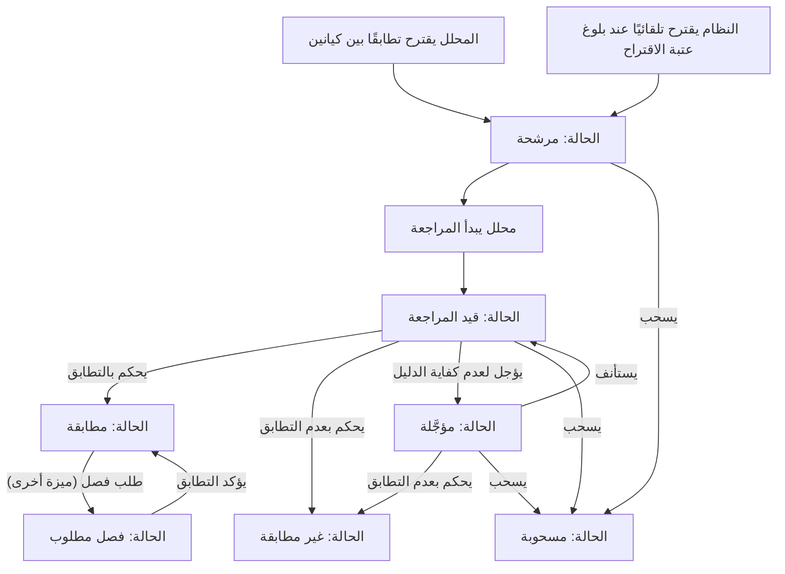
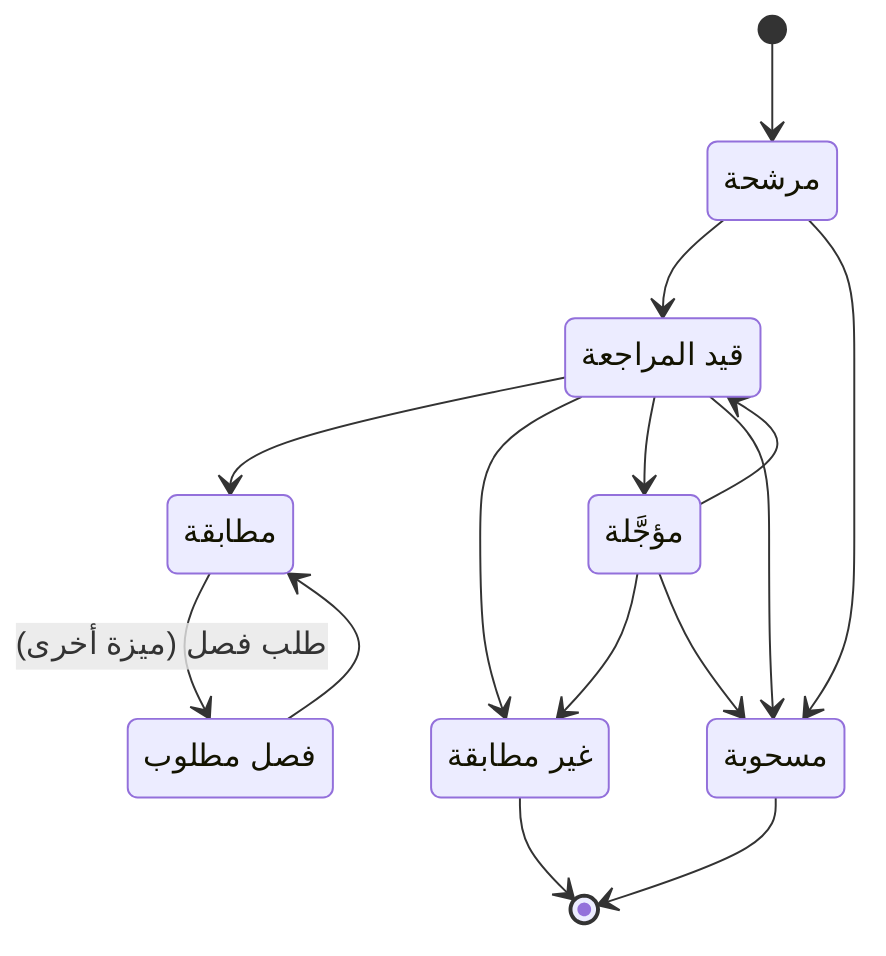

# مراجعة تطابق الكيانات

<!-- BEGIN GENERATED: doc -->
| البند | القيمة |
|---|---|
| المعرّف | FEAT-INF-MATCH-REVIEW |
| الإصدار | 0.2 |
| الحالة | مسودة |
| القدرة | CAP-03 إدارة المعلومات |
| القدرة الفرعية | CAP-03.05 مطابقة الكيانات (R1) |
| الأدوار | المحلل؛ الشخص الثاني؛ النظام |
| الشاشات | SCR-06 قوائم المراجعة، SCR-26 التعارض ومطابقة الكيانات |
| حالات الاستخدام | UC-007 |
| القصص | 15: 11 من المواصفة، و4 جديدة |
<!-- END GENERATED: doc -->

## 1. نظرة عامة

### 1.1 القيمة

يراجع المحللون الكيانات المشتبه بأنها الشيء نفسه ويقررون دمجها أو فصلها بقرار موثق ومؤكد من محلل ثانٍ.

### 1.2 النطاق

| البند | القيمة |
|---|---|
| المستخدمون | المحلل يقترح حالة المطابقة ويراجعها ويحكم فيها؛ محلل آخر يؤكد التطابق بعد طلب فصل سابق أو في العناقيد الكبيرة؛ النظام يقترح تلقائيًا من مولد المرشحات |
| الشاشات | شاشة قوائم المراجعة (قائمة حالات المطابقة مرتبة بالدرجة والنوع)؛ شاشة التعارض ومطابقة الكيانات (مقارنة الكيانين جنبًا إلى جنب واتخاذ القرار) |
| حالات الاستخدام (بالكلمات) | اقتراح تطابق بين كيانين يدويًا أو تلقائيًا؛ بدء مراجعته والحكم بتطابقه أو عدم تطابقه أو تأجيله؛ استئناف المؤجَّل منه أو سحبه؛ تأكيد التطابق بعد طلب فصل يأتي من ميزة أخرى؛ جلب حالة واحدة بمقارنة سماتها، وجلب قائمة المراجعة |
| المتطلبات (بالكلمات) | لا دمج دون قرار إنسان مسجَّل؛ كل قرار يُسجَّل برابط تطابق موثق بالمراجع والوقت؛ عكس الدمج يعيد كل كيان إلى ادعاءاته فقط |
| خارج النطاق | ضبط قواعد اكتشاف المطابقة نفسها وتقييمها (ميزة «قواعد المطابقة»)؛ فصل حالة مطابقة فعليًا وطلب الفصل (ميزة «فصل الكيانات المدموجة خطأً») |

### 1.3 خريطة الميزة

**الشكل 1: مسار مراجعة تطابق الكيانات**



**الشكل 2: دورة حالات حالة مطابقة الكيانات**



## 2. القواعد المشتركة

تنطبق على كل قصص الميزة، فلا تتكرر داخل القصص. وكل قصة تذكر ما يخصها فقط.

### 2.1 السياق المشترك

كل قصة تبدأ من ثلاثة شروط: مستأجر نشط، وحزمة السياسات الأساسية مفعّلة، ومستخدم مسجّل الدخول ومخوَّل. وتشير إليها القصص بخطوة واحدة: «بفرض السياق المشترك للميزة».

### 2.2 الصلاحية وعدم الإفصاح

- من لا يحق له رؤية العنصر يتلقى ردًا بشكل «غير متاح» تمامًا، فلا يعرف أنه موجود.
- من يرى العنصر ولا يحق له الإجراء يتلقى «لا تملك صلاحية هذا الإجراء».

### 2.3 أوامر تغيير الحالة

- **منع التكرار:** يُرسل كل أمر بمفتاح فريد، فإعادة الطلب نفسه لا تُنفَّذ مرتين.
- **حماية التعديل المتزامن:** يُرسل كل أمر بإصدار البيانات الذي يراه المستخدم. فإن عدّلها غيره في الأثناء، يُرفض الأمر.
- **السجل:** إن نجح الأمر، يُكتب حدثه وسجل التدقيق في المعاملة نفسها.

### 2.4 الرفض المشترك

```gherkin
# language: ar
خاصية: الرفض المشترك لأوامر الميزة

  سيناريو مخطط: رفض مشترك لكل أمر في الميزة
    بفرض السياق المشترك للميزة
    و <الحالة>
    عندما يُرسل المستخدم أي أمر من أوامر الميزة
    اذاً يُرفض برمز <الرمز> ويرى "<الرسالة>"
    و لا يتغير شيء

    امثلة:
      | الحالة                                  | الرمز                  | الرسالة                                                 |
      | العنصر خارج صلاحياته                    | NOT_FOUND              | غير متاح                                                |
      | العنصر مرئي له ولا يحق له الإجراء       | AUTHZ_DENIED           | لا تملك صلاحية هذا الإجراء                              |
      | غيره عدّل العنصر بعد أن فتحه            | VERSION_CONFLICT       | تغيّرت البيانات منذ فتحتها. راجع التغييرات ثم أعد المحاولة |
      | أعاد مفتاح منع التكرار بمحتوى مختلف     | IDEMPOTENCY_KEY_REUSED | طلب مكرر بمحتوى مختلف                                   |
      | البيانات ناقصة أو غير صحيحة             | VALIDATION_FAILED      | بعض البيانات ناقصة أو غير صحيحة. راجع الحقول المعلَّمة      |

  سيناريو: إعادة الطلب نفسه لا تُنفَّذ مرتين
    بفرض السياق المشترك للميزة
    و أمر نجح بمفتاح منع تكرار
    عندما يُعاد الطلب نفسه بالمفتاح نفسه
    اذاً تُعاد النتيجة الأولى ولا يُكتب حدث ثانٍ
```

## 3. الجودة وتعريف الاكتمال

### 3.1 متطلبات الجودة

<!-- BEGIN GENERATED: quality -->
| المرجع | الموقف | المطلوب |
|---|---|---|
| QAS-ER-001 | candidate recall on labelled AR/EN test set | ≥ 95 % of true matches proposed |
| QAS-ER-003 | new entity registered | candidates visible p95 ≤ 60 s |
<!-- END GENERATED: quality -->

### 3.2 تعريف الاكتمال

القصة مكتملة حين تتحقق الشروط الخمسة:

1. سيناريوهاتها والقواعد المشتركة تمر في الاختبار الآلي.
2. فحوص البنية المعمارية تمر.
3. نصوص الواجهة والرسائل موجودة بالعربية والإنجليزية.
4. مراجعة الكود مكتملة.
5. ما تضيفه القصة نفسها في قسم «القواعد» تحقق.

## 4. فهرس القصص

<!-- BEGIN GENERATED: story-index -->
| المعرّف | القصة | النوع | الحالة |
|---|---|---|---|
| `US-BC02-ER-CONFIRM-MATCH` | تأكيد التطابق بعد طلب الفصل | أمر | مسودة |
| `US-BC02-ER-DECIDE-MATCH` | الحكم بالتطابق بين الكيانين | أمر | مسودة |
| `US-BC02-ER-DECIDE-NOT-MATCH` | الحكم بعدم التطابق بين الكيانين | أمر | مسودة |
| `US-BC02-ER-PARK` | تأجيل حالة لعدم كفاية الدليل | أمر | مسودة |
| `US-BC02-ER-PROPOSE` | اقتراح تطابق بين كيانين | أمر | مسودة |
| `US-BC02-ER-RESUME` | استئناف مراجعة حالة مؤجَّلة | أمر | مسودة |
| `US-BC02-ER-START-REVIEW` | بدء مراجعة تطابق مقترح | أمر | مسودة |
| `US-BC02-ER-WITHDRAW` | سحب حالة مطابقة لم تعد تحتاج مراجعة | أمر | مسودة |
| `US-BC02-Q-ER-GET` | جلب تفاصيل حالة مطابقة ومقارنة سماتها | جلب | مسودة |
| `US-BC02-Q-ER-QUEUE` | جلب قائمة مراجعة حالات المطابقة | جلب | مسودة |
| `US-BC02-S-ER-CASE-01` | إنشاء تلقائي لحالة مطابقة عند بلوغ عتبة الاقتراح | نظام | مسودة |
| `US-UI-SCR06-ER-QUEUE` | قائمة حالات المطابقة مرتبة بالدرجة والنوع | واجهة | مسودة |
| `US-UI-SCR26-ER-COMPARE` | مقارنة الكيانين جنبًا إلى جنب واتخاذ القرار | واجهة | مسودة |
| `US-PLT-ER-CANDIDATES` | اقتراح المطابقات المحتملة خلال دقيقة | منصة | مسودة |
| `US-OPS-ER-QUEUE-WATCH` | مراقبة تأخر الاقتراح وازدحام قائمة المراجعة | تشغيل | مسودة |
<!-- END GENERATED: story-index -->

## 5. القصص

### 5.1 US-BC02-ER-CONFIRM-MATCH — تأكيد التطابق بعد طلب الفصل

| النوع | الإصدار | الأولوية | دون اتصال | الحالة |
|---|---|---|---|---|
| أمر | R1 | Must | لا | مسودة |

> **كـ** المحلل، **أريد** أن أؤكد أن التطابق صحيح بعد طلب فصل قدَّمه محلل آخر، **حتى** يبقى الدمج قائمًا إن ثبت أن الطلب غير مسوَّغ.

**باختصار:** حين يراجع محلل غير طالب الفصل حالة في «فصل مطلوب» ويقتنع بصحة الدمج، يؤكده فتعود الحالة إلى «مطابقة».

#### القواعد

- **متى يُسمح:** الحالة الحالية «فصل مطلوب»، وتصل الحالة إليها من طلب فصل سابق قدَّمه محلل آخر (القصة 5.1 في ميزة «فصل الكيانات المدموجة خطأً»).
- **من يُسمح له:** المحلل، بشرط ألا يكون هو من طلب الفصل نفسه.
- **البيانات:** مسوغ التأكيد.
- **الأثر:** الحالة ← «مطابقة»؛ يُسجَّل حدث «أُكِّد التطابق» يصل إلى صيانة العنقود وكاشف التعارض لإعادة التقييم.

#### معايير القبول

```gherkin
# language: ar
خاصية: تأكيد التطابق بعد طلب الفصل

  سيناريو: محلل غير طالب الفصل يؤكد التطابق
    بفرض السياق المشترك للميزة
    و حالة مطابقة في حالة "فصل مطلوب"
    عندما يؤكدها محلل غير طالب الفصل بمسوغ
    اذاً تعود حالتها إلى "مطابقة"
    و يُسجَّل حدث "أُكِّد التطابق"

  سيناريو مخطط: رفض خاص بالتأكيد
    بفرض السياق المشترك للميزة
    و <الحالة>
    عندما يحاول تأكيد التطابق
    اذاً يُرفض برمز <الرمز> ويرى "<الرسالة>"
    و لا يتغير شيء

    امثلة:
      | الحالة                          | الرمز                             | الرسالة                                                 |
      | الحالة ليست "فصل مطلوب"         | ER_CASE_INVALID_STATE_TRANSITION  | الوضع الحالي لحالة مطابقة الكيانات لا يسمح بهذا الإجراء |
      | المحلل نفسه هو من طلب الفصل     | SEGREGATION_OF_DUTIES             | لا يجوز أن يعتمد الشخص نفسه ما قدّمه أو طلبه            |
      | لم يُذكر المسوغ                 | VALIDATION_FAILED                 | المسوغ مطلوب                                            |
```

<details><summary>المراجع التقنية والتتبع</summary>

<!-- BEGIN GENERATED: refs US-BC02-ER-CONFIRM-MATCH -->
| البند | المعرّف | المعنى |
|---|---|---|
| الواجهة البرمجية | `POST /api/v1/information/er-cases/{id}/actions/confirm-match` | — |
| الأمر | `CMD-ER-CONFIRM-MATCH` | تأكيد تطابق حالة مطابقة الكيانات |
| السياسة | `POL-ER-CONFIRM-MATCH` | Analyst (propose, review, decide, request split) · second Analyst (confirm/split, large clusters)؛ tenant mat… |
| الحدث | `EVT-ER-MATCH-CONFIRMED` | يصل إلى: Cluster maintainer (same transaction) → EVT cluster changed; Conflict detector (re-run on cluster ch… |
| الكيان | `AGG-ER-CASE` | حالة مطابقة الكيانات |
| الجدول | `information.er_cases` | الجدول الرئيسي لحالة مطابقة الكيانات |
| وحدة النشر | DU-04 | — |
| المتطلبات | REQ-INF-032، REQ-INF-033، REQ-INF-034 | معانيها في القسم 6. التتبع |
| حالة الاستخدام | UC-007 | Resolve Entity |
| الاختبار | TST-ER-CASE-SM، TST-SLC04-INVARIANTS | دورة حالات حالة مطابقة الكيانات، وثوابت الشريحة SLC-04 |
<!-- END GENERATED: refs US-BC02-ER-CONFIRM-MATCH -->

</details>

### 5.2 US-BC02-ER-DECIDE-MATCH — الحكم بالتطابق بين الكيانين

| النوع | الإصدار | الأولوية | دون اتصال | الحالة |
|---|---|---|---|---|
| أمر | R1 | Must | لا | مسودة |

> **كـ** المحلل، **أريد** أن أحكم بتطابق الكيانين بعد مراجعتهما، **حتى** يُسجَّل الدمج بقرار موثق.

**باختصار:** من «قيد المراجعة» يحكم المحلل بالتطابق، فتصبح الحالة «مطابقة» وينضم الكيانان إلى عنقود هوية واحد.

#### القواعد

- **متى يُسمح:** الحالة الحالية «قيد المراجعة»، ونوعا الكيانين متوافقان، ولا كيان منهما «متقاعد»، ولا يحوي العنقود الناتج زوجًا عليه رابط «غير مطابقة» (INV-ER-03، INV-ER-04).
- **من يُسمح له:** محلل غير المحلل الذي اقترح الحالة نفسها؛ وإن تجاوز العنقود الناتج 50 عضوًا فلا بد من ذكر شخص ثانٍ يراجع معه (INV-ER-05).
- **البيانات:** مسوغ القرار، واسم الشخص الثاني عند الحاجة إليه.
- **الأثر:** الحالة ← «مطابقة»؛ ينشأ رابط تطابق ويُعاد حساب العنقود في المعاملة نفسها؛ يُسجَّل حدث «تمت المطابقة» يصل إلى صيانة العنقود وكاشف التعارض وإسقاطي البحث والرسم البياني وعضوية الموقف.

#### معايير القبول

```gherkin
# language: ar
خاصية: الحكم بالتطابق بين الكيانين

  سيناريو: محلل يحكم بالتطابق
    بفرض السياق المشترك للميزة
    و حالة مطابقة في حالة "قيد المراجعة" ونوعا الكيانين متوافقان
    عندما يحكم محلل غير مقترح الحالة بالتطابق بمسوغ
    اذاً تصبح حالتها "مطابقة"
    و يُسجَّل حدث "تمت المطابقة"

  سيناريو مخطط: رفض خاص بالحكم بالتطابق
    بفرض السياق المشترك للميزة
    و <الحالة>
    عندما يحكم المحلل بالتطابق
    اذاً يُرفض برمز <الرمز> ويرى "<الرسالة>"
    و لا يتغير شيء

    امثلة:
      | الحالة                                                        | الرمز                             | الرسالة                                                      |
      | الحالة ليست "قيد المراجعة"                                    | ER_CASE_INVALID_STATE_TRANSITION  | الوضع الحالي لحالة مطابقة الكيانات لا يسمح بهذا الإجراء      |
      | عنقود الدمج يحوي زوجًا عليه رابط "غير مطابقة" سابق            | MATCH_CONTRADICTS_NOT_A_MATCH     | المطابقة تتعارض مع قرار سابق بأن السجلين مختلفان             |
      | المحلل نفسه هو من اقترح الحالة، أو العنقود يتجاوز 50 عضوًا دون شخص ثانٍ | SEGREGATION_OF_DUTIES      | لا يجوز أن يعتمد الشخص نفسه ما قدّمه أو طلبه                 |
      | لم يُذكر المسوغ                                                | VALIDATION_FAILED                 | المسوغ مطلوب                                                 |
```

<details><summary>المراجع التقنية والتتبع</summary>

<!-- BEGIN GENERATED: refs US-BC02-ER-DECIDE-MATCH -->
| البند | المعرّف | المعنى |
|---|---|---|
| الواجهة البرمجية | `POST /api/v1/information/er-cases/{id}/actions/decide-match` | — |
| الأمر | `CMD-ER-DECIDE-MATCH` | الحكم بتطابق حالة مطابقة الكيانات |
| السياسة | `POL-ER-DECIDE-MATCH` | Analyst (propose, review, decide, request split) · second Analyst (confirm/split, large clusters)؛ tenant mat… |
| الحدث | `EVT-ER-MATCHED` | يصل إلى: Cluster maintainer (same transaction) → EVT cluster changed; Conflict detector (re-run on cluster ch… |
| الكيان | `AGG-ER-CASE` | حالة مطابقة الكيانات |
| الجدول | `information.er_cases` | الجدول الرئيسي لحالة مطابقة الكيانات |
| وحدة النشر | DU-04 | — |
| المتطلبات | REQ-INF-032، REQ-INF-033، REQ-INF-034 | معانيها في القسم 6. التتبع |
| حالة الاستخدام | UC-007 | Resolve Entity |
| الاختبار | TST-ER-CASE-SM، TST-SLC04-INVARIANTS | دورة حالات حالة مطابقة الكيانات، وثوابت الشريحة SLC-04 |
<!-- END GENERATED: refs US-BC02-ER-DECIDE-MATCH -->

</details>

### 5.3 US-BC02-ER-DECIDE-NOT-MATCH — الحكم بعدم التطابق بين الكيانين

| النوع | الإصدار | الأولوية | دون اتصال | الحالة |
|---|---|---|---|---|
| أمر | R1 | Must | لا | مسودة |

> **كـ** المحلل، **أريد** أن أحكم بأن الكيانين ليسا الشيء نفسه، **حتى** يُغلق الاشتباه ولا يُعاد اقتراحه.

**باختصار:** من «قيد المراجعة» أو «مؤجَّلة» يحكم المحلل بعدم التطابق بسبب، فتصبح الحالة «غير مطابقة» نهائيًا.

#### القواعد

- **متى يُسمح:** الحالة الحالية «قيد المراجعة» أو «مؤجَّلة».
- **من يُسمح له:** المحلل.
- **البيانات:** سبب القرار.
- **الأثر:** الحالة ← «غير مطابقة» (حالة نهائية)؛ ينشأ رابط «غير مطابقة» يمنع إعادة اقتراح الزوج نفسه؛ يُسجَّل حدث «حُكم بعدم التطابق».

#### معايير القبول

```gherkin
# language: ar
خاصية: الحكم بعدم التطابق بين الكيانين

  سيناريو مخطط: الحكم بعدم التطابق من كل حالة مسموحة
    بفرض السياق المشترك للميزة
    و حالة مطابقة في حالة <من> بسبب واضح
    عندما يحكم المحلل بعدم التطابق
    اذاً تصبح حالتها "غير مطابقة"
    و يُسجَّل حدث "حُكم بعدم التطابق"

    امثلة:
      | من             |
      | قيد المراجعة   |
      | مؤجَّلة         |

  سيناريو مخطط: رفض خاص بالحكم بعدم التطابق
    بفرض السياق المشترك للميزة
    و <الحالة>
    عندما يحكم المحلل بعدم التطابق
    اذاً يُرفض برمز <الرمز> ويرى "<الرسالة>"
    و لا يتغير شيء

    امثلة:
      | الحالة                                  | الرمز                             | الرسالة                                                 |
      | الحالة ليست "قيد المراجعة" ولا "مؤجَّلة" | ER_CASE_INVALID_STATE_TRANSITION  | الوضع الحالي لحالة مطابقة الكيانات لا يسمح بهذا الإجراء |
      | لم يُذكر السبب                          | REASON_REQUIRED                   | اذكر السبب                                              |
```

<details><summary>المراجع التقنية والتتبع</summary>

<!-- BEGIN GENERATED: refs US-BC02-ER-DECIDE-NOT-MATCH -->
| البند | المعرّف | المعنى |
|---|---|---|
| الواجهة البرمجية | `POST /api/v1/information/er-cases/{id}/actions/decide-not-match` | — |
| الأمر | `CMD-ER-DECIDE-NOT-MATCH` | الحكم بعدم تطابق حالة مطابقة الكيانات |
| السياسة | `POL-ER-DECIDE-NOT-MATCH` | Analyst (propose, review, decide, request split) · second Analyst (confirm/split, large clusters)؛ tenant mat… |
| الحدث | `EVT-ER-NOT-MATCHED` | يصل إلى: Cluster maintainer (same transaction) → EVT cluster changed; Conflict detector (re-run on cluster ch… |
| الكيان | `AGG-ER-CASE` | حالة مطابقة الكيانات |
| الجدول | `information.er_cases` | الجدول الرئيسي لحالة مطابقة الكيانات |
| وحدة النشر | DU-04 | — |
| المتطلبات | REQ-INF-032، REQ-INF-033، REQ-INF-034 | معانيها في القسم 6. التتبع |
| حالة الاستخدام | UC-007 | Resolve Entity |
| الاختبار | TST-ER-CASE-SM، TST-SLC04-INVARIANTS | دورة حالات حالة مطابقة الكيانات، وثوابت الشريحة SLC-04 |
<!-- END GENERATED: refs US-BC02-ER-DECIDE-NOT-MATCH -->

</details>

### 5.4 US-BC02-ER-PARK — تأجيل حالة لعدم كفاية الدليل

| النوع | الإصدار | الأولوية | دون اتصال | الحالة |
|---|---|---|---|---|
| أمر | R1 | Must | لا | مسودة |

> **كـ** المحلل، **أريد** أن أؤجل حالة لا يكفي الدليل للحكم فيها، **حتى** أستكملها حين يتوفر دليل جديد.

**باختصار:** من «قيد المراجعة» يؤجل المحلل الحالة بسبب عدم كفاية الدليل، فتصبح «مؤجَّلة».

#### القواعد

- **متى يُسمح:** الحالة الحالية «قيد المراجعة».
- **من يُسمح له:** المحلل.
- **البيانات:** سبب التأجيل (عدم كفاية الدليل).
- **الأثر:** الحالة ← «مؤجَّلة»؛ يُسجَّل حدث «أُجِّلت حالة المطابقة».

#### معايير القبول

```gherkin
# language: ar
خاصية: تأجيل حالة لعدم كفاية الدليل

  سيناريو: محلل يؤجل حالة قيد المراجعة
    بفرض السياق المشترك للميزة
    و حالة مطابقة في حالة "قيد المراجعة"
    عندما يؤجلها المحلل بسبب عدم كفاية الدليل
    اذاً تصبح حالتها "مؤجَّلة"
    و يُسجَّل حدث "أُجِّلت حالة المطابقة"

  سيناريو مخطط: رفض خاص بالتأجيل
    بفرض السياق المشترك للميزة
    و <الحالة>
    عندما يحاول تأجيل الحالة
    اذاً يُرفض برمز <الرمز> ويرى "<الرسالة>"
    و لا يتغير شيء

    امثلة:
      | الحالة                       | الرمز                             | الرسالة                                                 |
      | الحالة ليست "قيد المراجعة"   | ER_CASE_INVALID_STATE_TRANSITION  | الوضع الحالي لحالة مطابقة الكيانات لا يسمح بهذا الإجراء |
      | لم يُذكر السبب               | REASON_REQUIRED                   | اذكر السبب                                              |
```

<details><summary>المراجع التقنية والتتبع</summary>

<!-- BEGIN GENERATED: refs US-BC02-ER-PARK -->
| البند | المعرّف | المعنى |
|---|---|---|
| الواجهة البرمجية | `POST /api/v1/information/er-cases/{id}/actions/park` | — |
| الأمر | `CMD-ER-PARK` | تأجيل حالة مطابقة الكيانات |
| السياسة | `POL-ER-PARK` | Analyst (park)؛ tenant match; object visible |
| الحدث | `EVT-ER-PARKED` | يصل إلى: Cluster maintainer (same transaction) → EVT cluster changed; Conflict detector (re-run on cluster ch… |
| الكيان | `AGG-ER-CASE` | حالة مطابقة الكيانات |
| الجدول | `information.er_cases` | الجدول الرئيسي لحالة مطابقة الكيانات |
| وحدة النشر | DU-04 | — |
| المتطلبات | REQ-INF-032، REQ-INF-033، REQ-INF-034 | معانيها في القسم 6. التتبع |
| حالة الاستخدام | UC-007 | Resolve Entity |
| الاختبار | TST-ER-CASE-SM، TST-SLC04-INVARIANTS | دورة حالات حالة مطابقة الكيانات، وثوابت الشريحة SLC-04 |
<!-- END GENERATED: refs US-BC02-ER-PARK -->

</details>

### 5.5 US-BC02-ER-PROPOSE — اقتراح تطابق بين كيانين

| النوع | الإصدار | الأولوية | دون اتصال | الحالة |
|---|---|---|---|---|
| أمر | R1 | Must | لا | مسودة |

> **كـ** المحلل، **أريد** أن أقترح تطابقًا بين كيانين يشتبه بأنهما الشيء نفسه، **حتى** تبدأ مراجعة قد تنتهي بدمجهما.

**باختصار:** يختار المحلل كيانين ويذكر مسوغ الاقتراح، فتنشأ حالة مطابقة جديدة في «مرشحة»؛ وينشئها النظام تلقائيًا أيضًا حين تبلغ درجة التوليد عتبة الاقتراح (القصة 5.11).

#### القواعد

- **متى يُسمح:** لا توجد حالة مطابقة غير نهائية قائمة بين الكيانين، ولا رابط «غير مطابقة» سابق بين عنقودي هويتهما (الحالة الحالية ∅).
- **من يُسمح له:** المحلل، أو اقتراح من المساعد الذكي بمستوى اقتراح فقط مع تسجيل هوية الوكيل (REQ-INF-032).
- **البيانات:** الكيانان المشتبه بتطابقهما، ومسوغ الاقتراح.
- **الأثر:** تنشأ حالة المطابقة في «مرشحة»؛ يُسجَّل حدث «اقتُرحت المطابقة» يصل إلى صيانة العنقود وكاشف التعارض وإسقاطي البحث والرسم البياني وعضوية الموقف (REQ-INF-033).

#### معايير القبول

```gherkin
# language: ar
خاصية: اقتراح تطابق بين كيانين

  سيناريو: محلل يقترح تطابقًا جديدًا
    بفرض السياق المشترك للميزة
    و كيانان لا توجد بينهما حالة مطابقة غير نهائية ولا رابط "غير مطابقة"
    عندما يقترح المحلل تطابقهما بمسوغ
    اذاً تنشأ حالة مطابقة لهما في حالة "مرشحة"
    و يُسجَّل حدث "اقتُرحت المطابقة"

  سيناريو مخطط: رفض خاص بالاقتراح
    بفرض السياق المشترك للميزة
    و <الحالة>
    عندما يقترح المحلل التطابق
    اذاً يُرفض برمز <الرمز> ويرى "<الرسالة>"
    و لا يتغير شيء

    امثلة:
      | الحالة                                                                            | الرمز           | الرسالة                                 |
      | الكيانان في عنقود واحد، أو بينهما رابط "غير مطابقة"، أو بينهما حالة غير نهائية قائمة | ER_PAIR_INVALID | هذا الزوج لا يصلح لمطابقة الكيانات      |
```

<details><summary>المراجع التقنية والتتبع</summary>

<!-- BEGIN GENERATED: refs US-BC02-ER-PROPOSE -->
| البند | المعرّف | المعنى |
|---|---|---|
| الواجهة البرمجية | `POST /api/v1/information/er-cases` | — |
| الأمر | `CMD-ER-PROPOSE` | اقتراح حالة مطابقة الكيانات |
| السياسة | `POL-ER-PROPOSE` | Analyst (propose, review, decide, request split) · second Analyst (confirm/split, large clusters)؛ tenant mat… |
| الحدث | `EVT-ER-PROPOSED` | يصل إلى: Cluster maintainer (same transaction) → EVT cluster changed; Conflict detector (re-run on cluster ch… |
| الكيان | `AGG-ER-CASE` | حالة مطابقة الكيانات |
| الجدول | `information.er_cases` | الجدول الرئيسي لحالة مطابقة الكيانات |
| وحدة النشر | DU-04 | — |
| المتطلبات | REQ-INF-032، REQ-INF-033، REQ-INF-034 | معانيها في القسم 6. التتبع |
| حالة الاستخدام | UC-007 | Resolve Entity |
| الاختبار | TST-ER-CASE-SM، TST-SLC04-INVARIANTS | دورة حالات حالة مطابقة الكيانات، وثوابت الشريحة SLC-04 |
<!-- END GENERATED: refs US-BC02-ER-PROPOSE -->

</details>

### 5.6 US-BC02-ER-RESUME — استئناف مراجعة حالة مؤجَّلة

| النوع | الإصدار | الأولوية | دون اتصال | الحالة |
|---|---|---|---|---|
| أمر | R1 | Must | لا | مسودة |

> **كـ** المحلل، **أريد** أن أستأنف مراجعة حالة مؤجَّلة، **حتى** أحكم فيها بعد توفر دليل جديد.

**باختصار:** من «مؤجَّلة» يستأنف المحلل المراجعة بسبب أو دليل جديد، فتعود الحالة إلى «قيد المراجعة».

#### القواعد

- **متى يُسمح:** الحالة الحالية «مؤجَّلة».
- **من يُسمح له:** المحلل.
- **البيانات:** سبب الاستئناف أو الدليل الجديد.
- **الأثر:** الحالة ← «قيد المراجعة»؛ يُسجَّل حدث «استُؤنفت مراجعة المطابقة».

#### معايير القبول

```gherkin
# language: ar
خاصية: استئناف مراجعة حالة مؤجَّلة

  سيناريو: محلل يستأنف حالة مؤجَّلة
    بفرض السياق المشترك للميزة
    و حالة مطابقة في حالة "مؤجَّلة"
    عندما يستأنف المحلل مراجعتها بدليل جديد
    اذاً تعود حالتها إلى "قيد المراجعة"
    و يُسجَّل حدث "استُؤنفت مراجعة المطابقة"

  سيناريو مخطط: رفض خاص بالاستئناف
    بفرض السياق المشترك للميزة
    و <الحالة>
    عندما يحاول استئناف الحالة
    اذاً يُرفض برمز <الرمز> ويرى "<الرسالة>"
    و لا يتغير شيء

    امثلة:
      | الحالة                 | الرمز                             | الرسالة                                                 |
      | الحالة ليست "مؤجَّلة"   | ER_CASE_INVALID_STATE_TRANSITION  | الوضع الحالي لحالة مطابقة الكيانات لا يسمح بهذا الإجراء |
      | لم يُذكر السبب         | REASON_REQUIRED                   | اذكر السبب                                              |
```

<details><summary>المراجع التقنية والتتبع</summary>

<!-- BEGIN GENERATED: refs US-BC02-ER-RESUME -->
| البند | المعرّف | المعنى |
|---|---|---|
| الواجهة البرمجية | `POST /api/v1/information/er-cases/{id}/actions/resume` | — |
| الأمر | `CMD-ER-RESUME` | استئناف حالة مطابقة الكيانات |
| السياسة | `POL-ER-RESUME` | Analyst (resume)؛ tenant match; object visible |
| الحدث | `EVT-ER-RESUMED` | يصل إلى: Cluster maintainer (same transaction) → EVT cluster changed; Conflict detector (re-run on cluster ch… |
| الكيان | `AGG-ER-CASE` | حالة مطابقة الكيانات |
| الجدول | `information.er_cases` | الجدول الرئيسي لحالة مطابقة الكيانات |
| وحدة النشر | DU-04 | — |
| المتطلبات | REQ-INF-032، REQ-INF-033، REQ-INF-034 | معانيها في القسم 6. التتبع |
| حالة الاستخدام | UC-007 | Resolve Entity |
| الاختبار | TST-ER-CASE-SM، TST-SLC04-INVARIANTS | دورة حالات حالة مطابقة الكيانات، وثوابت الشريحة SLC-04 |
<!-- END GENERATED: refs US-BC02-ER-RESUME -->

</details>

### 5.7 US-BC02-ER-START-REVIEW — بدء مراجعة تطابق مقترح

| النوع | الإصدار | الأولوية | دون اتصال | الحالة |
|---|---|---|---|---|
| أمر | R1 | Must | لا | مسودة |

> **كـ** المحلل، **أريد** أن أبدأ مراجعة حالة مرشحة، **حتى** أفحص السمات وأحكم فيها.

**باختصار:** يبدأ المحلل المصرَّح له بتصنيف الكيانين مراجعة حالة في «مرشحة»، فتصبح «قيد المراجعة».

#### القواعد

- **متى يُسمح:** الحالة الحالية «مرشحة».
- **من يُسمح له:** محلل مصرَّح له بمستوى تصنيف كلا الكيانين.
- **الأثر:** الحالة ← «قيد المراجعة»؛ يُسجَّل حدث «بدأت مراجعة المطابقة».

#### معايير القبول

```gherkin
# language: ar
خاصية: بدء مراجعة تطابق مقترح

  سيناريو: محلل مصرَّح له يبدأ المراجعة
    بفرض السياق المشترك للميزة
    و حالة مطابقة في حالة "مرشحة" ومحلل مصرَّح له بتصنيف كلا الكيانين
    عندما يبدأ المحلل المراجعة
    اذاً تصبح حالتها "قيد المراجعة"
    و يُسجَّل حدث "بدأت مراجعة المطابقة"

  سيناريو مخطط: رفض خاص ببدء المراجعة
    بفرض السياق المشترك للميزة
    و <الحالة>
    عندما يحاول بدء المراجعة
    اذاً يُرفض برمز <الرمز> ويرى "<الرسالة>"
    و لا يتغير شيء

    امثلة:
      | الحالة                                           | الرمز                             | الرسالة                                                 |
      | الحالة ليست "مرشحة"                              | ER_CASE_INVALID_STATE_TRANSITION  | الوضع الحالي لحالة مطابقة الكيانات لا يسمح بهذا الإجراء |
      | المراجع غير مصرَّح له بمستوى تصنيف أحد الكيانين | REVIEWER_NOT_CLEARED              | المراجع غير مصرَّح له بمستوى تصنيف هذه المواد          |
```

<details><summary>المراجع التقنية والتتبع</summary>

<!-- BEGIN GENERATED: refs US-BC02-ER-START-REVIEW -->
| البند | المعرّف | المعنى |
|---|---|---|
| الواجهة البرمجية | `POST /api/v1/information/er-cases/{id}/actions/start-review` | — |
| الأمر | `CMD-ER-START-REVIEW` | بدء مراجعة حالة مطابقة الكيانات |
| السياسة | `POL-ER-START-REVIEW` | Analyst (propose, review, decide, request split) · second Analyst (confirm/split, large clusters)؛ tenant mat… |
| الحدث | `EVT-ER-REVIEW-STARTED` | يصل إلى: Cluster maintainer (same transaction) → EVT cluster changed; Conflict detector (re-run on cluster ch… |
| الكيان | `AGG-ER-CASE` | حالة مطابقة الكيانات |
| الجدول | `information.er_cases` | الجدول الرئيسي لحالة مطابقة الكيانات |
| وحدة النشر | DU-04 | — |
| المتطلبات | REQ-INF-032، REQ-INF-033، REQ-INF-034 | معانيها في القسم 6. التتبع |
| حالة الاستخدام | UC-007 | Resolve Entity |
| الاختبار | TST-ER-CASE-SM، TST-SLC04-INVARIANTS | دورة حالات حالة مطابقة الكيانات، وثوابت الشريحة SLC-04 |
<!-- END GENERATED: refs US-BC02-ER-START-REVIEW -->

</details>

### 5.8 US-BC02-ER-WITHDRAW — سحب حالة مطابقة لم تعد تحتاج مراجعة

| النوع | الإصدار | الأولوية | دون اتصال | الحالة |
|---|---|---|---|---|
| أمر | R1 | Must | لا | مسودة |

> **كـ** المحلل، **أريد** أن أسحب حالة مطابقة لم تعد تحتاج مراجعة، **حتى** تُغلق دون قرار بالتطابق أو عدمه.

**باختصار:** من «مرشحة» أو «قيد المراجعة» أو «مؤجَّلة» يسحب المحلل الحالة بسبب، فتصبح «مسحوبة» نهائيًا.

#### القواعد

- **متى يُسمح:** الحالة الحالية واحدة من «مرشحة»، «قيد المراجعة»، «مؤجَّلة».
- **من يُسمح له:** المحلل.
- **البيانات:** سبب السحب (مثل تقاعد أحد الكيانين أو تكرار الحالة).
- **الأثر:** الحالة ← «مسحوبة» (حالة نهائية)؛ يُسجَّل حدث «سُحبت حالة المطابقة».

#### معايير القبول

```gherkin
# language: ar
خاصية: سحب حالة مطابقة لم تعد تحتاج مراجعة

  سيناريو مخطط: السحب من كل حالة مسموحة
    بفرض السياق المشترك للميزة
    و حالة مطابقة في حالة <من> بسبب واضح
    عندما يسحبها المحلل
    اذاً تصبح حالتها "مسحوبة"
    و يُسجَّل حدث "سُحبت حالة المطابقة"

    امثلة:
      | من             |
      | مرشحة          |
      | قيد المراجعة   |
      | مؤجَّلة         |

  سيناريو مخطط: رفض خاص بالسحب
    بفرض السياق المشترك للميزة
    و <الحالة>
    عندما يحاول سحب الحالة
    اذاً يُرفض برمز <الرمز> ويرى "<الرسالة>"
    و لا يتغير شيء

    امثلة:
      | الحالة                                                         | الرمز                             | الرسالة                                                 |
      | الحالة ليست من "مرشحة" أو "قيد المراجعة" أو "مؤجَّلة"          | ER_CASE_INVALID_STATE_TRANSITION  | الوضع الحالي لحالة مطابقة الكيانات لا يسمح بهذا الإجراء |
      | لم يُذكر السبب                                                 | REASON_REQUIRED                   | اذكر السبب                                              |
```

<details><summary>المراجع التقنية والتتبع</summary>

<!-- BEGIN GENERATED: refs US-BC02-ER-WITHDRAW -->
| البند | المعرّف | المعنى |
|---|---|---|
| الواجهة البرمجية | `POST /api/v1/information/er-cases/{id}/actions/withdraw` | — |
| الأمر | `CMD-ER-WITHDRAW` | سحب حالة مطابقة الكيانات |
| السياسة | `POL-ER-WITHDRAW` | Analyst (withdraw)؛ tenant match; object visible |
| الحدث | `EVT-ER-WITHDRAWN` | يصل إلى: Cluster maintainer (same transaction) → EVT cluster changed; Conflict detector (re-run on cluster ch… |
| الكيان | `AGG-ER-CASE` | حالة مطابقة الكيانات |
| الجدول | `information.er_cases` | الجدول الرئيسي لحالة مطابقة الكيانات |
| وحدة النشر | DU-04 | — |
| المتطلبات | REQ-INF-032، REQ-INF-033، REQ-INF-034 | معانيها في القسم 6. التتبع |
| حالة الاستخدام | UC-007 | Resolve Entity |
| الاختبار | TST-ER-CASE-SM، TST-SLC04-INVARIANTS | دورة حالات حالة مطابقة الكيانات، وثوابت الشريحة SLC-04 |
<!-- END GENERATED: refs US-BC02-ER-WITHDRAW -->

</details>

### 5.9 US-BC02-Q-ER-GET — جلب تفاصيل حالة مطابقة ومقارنة سماتها

| النوع | الإصدار | الأولوية | دون اتصال | الحالة |
|---|---|---|---|---|
| جلب | R1 | Must | لا | مسودة |

> **كـ** المحلل، **أريد** أن أجلب حالة مطابقة بمقارنة سمات الكيانين جنبًا إلى جنب، **حتى** أحكم فيها بدليل واضح.

**باختصار:** تُعاد الحالة مع مقارنة سمات الكيانين، ولا تظهر إلا ادعاءاتهما المرئية للمحلل.

#### القواعد

- **من يرى ماذا:** المحلل الذي يحق له رؤية كلا الكيانين؛ من لا يحق له رؤية أحدهما يتلقى «غير متاح».

#### معايير القبول

```gherkin
# language: ar
خاصية: جلب تفاصيل حالة مطابقة ومقارنة سماتها

  سيناريو: محلل يرى حالة مطابقة كلاهما مرئي له
    بفرض السياق المشترك للميزة
    و حالة مطابقة كلا كيانيها مرئي للمحلل
    عندما يطلب المحلل تفاصيلها
    اذاً تُعاد الحالة مع مقارنة السمات جنبًا إلى جنب، بعد فحص الصلاحية من جديد

  سيناريو: حالة لا يرى المحلل أحد كيانيها
    بفرض السياق المشترك للميزة
    و حالة مطابقة أحد كيانيها غير مرئي للمحلل
    عندما يطلب المحلل تفاصيلها
    اذاً يُرد بنفس شكل الحالة غير الموجودة
```

<details><summary>المراجع التقنية والتتبع</summary>

<!-- BEGIN GENERATED: refs US-BC02-Q-ER-GET -->
| البند | المعرّف | المعنى |
|---|---|---|
| الواجهة البرمجية | `GET /api/v1/information/er-cases/{case_id}` | — |
| الاستعلام | `QRY-ER-GET` | Case with side-by-side feature comparison (visible claims only) |
| السياسة | `POL-ER-GET` | Analyst; both entities visible |
| الكيان | `AGG-ER-CASE` | حالة مطابقة الكيانات |
| الجدول | `information.er_cases` | الجدول الرئيسي لحالة مطابقة الكيانات |
| وحدة النشر | DU-04 | — |
| المتطلب | REQ-INF-032 | When an entity-resolution candidate is detected, the system shall create a resolution case with candidates, m… |
| حالة الاستخدام | UC-007 | Resolve Entity |
| الاختبار | TST-ER-CASE-SM، TST-SLC04-INVARIANTS | دورة حالات حالة مطابقة الكيانات، وثوابت الشريحة SLC-04 |
<!-- END GENERATED: refs US-BC02-Q-ER-GET -->

</details>

### 5.10 US-BC02-Q-ER-QUEUE — جلب قائمة مراجعة حالات المطابقة

| النوع | الإصدار | الأولوية | دون اتصال | الحالة |
|---|---|---|---|---|
| جلب | R1 | Must | لا | مسودة |

> **كـ** المحلل، **أريد** أن أجلب قائمة مراجعة حالات المطابقة، **حتى** أرتبها وأبدأ بالأهم.

**باختصار:** تُعاد الحالات التي يحق للمحلل رؤية كلا كيانيها فقط، مرتبة ومصفَّاة.

#### القواعد

- **من يرى ماذا:** المحلل يرى الحالات التي يحق له رؤية كلا كيانيها فقط؛ ولا يكشف عدد القائمة ولا ترتيبها عن وجود حالة محجوبة.
- **البيانات (المرشحات):** الحالة، نوع الكيان، الدرجة، مجموعة قواعد المطابقة، والمؤشر والحد.

#### معايير القبول

```gherkin
# language: ar
خاصية: جلب قائمة مراجعة حالات المطابقة

  سيناريو: يرى المحلل الحالات المرئية له فقط
    بفرض السياق المشترك للميزة
    و حالات مطابقة داخل نطاق المحلل وأخرى خارجه
    عندما يطلب المحلل قائمة المراجعة
    اذاً تُعاد الحالات داخل نطاقه فقط، ويُعاد فحص صلاحية كل منها
    و لا يكشف أي عدد أو ترتيب وجود حالة محجوبة

  سيناريو: تصفية القائمة وترتيبها
    بفرض السياق المشترك للميزة
    و حالات مطابقة بدرجات ونوع كيان مختلفين داخل نطاق المحلل
    عندما يطلب المحلل القائمة مصفَّاة بنوع الكيان ومرتبة بالدرجة
    اذاً تُعاد الحالات المطابقة للتصفية مرتبة بالدرجة
```

<details><summary>المراجع التقنية والتتبع</summary>

<!-- BEGIN GENERATED: refs US-BC02-Q-ER-QUEUE -->
| البند | المعرّف | المعنى |
|---|---|---|
| الواجهة البرمجية | `GET /api/v1/information/er-cases` | — |
| الاستعلام | `QRY-ER-QUEUE` | Review queue by state, entity type, score, ruleset |
| السياسة | `POL-ER-QUEUE` | Analyst; cases where both entities are visible |
| الكيان | `AGG-ER-CASE` | حالة مطابقة الكيانات |
| الجدول | `information.er_cases` | الجدول الرئيسي لحالة مطابقة الكيانات |
| وحدة النشر | DU-04 | — |
| المتطلب | REQ-INF-032 | When an entity-resolution candidate is detected, the system shall create a resolution case with candidates, m… |
| حالة الاستخدام | UC-007 | Resolve Entity |
| الاختبار | TST-ER-CASE-SM، TST-SLC04-INVARIANTS | دورة حالات حالة مطابقة الكيانات، وثوابت الشريحة SLC-04 |
<!-- END GENERATED: refs US-BC02-Q-ER-QUEUE -->

</details>

### 5.11 US-BC02-S-ER-CASE-01 — إنشاء تلقائي لحالة مطابقة عند بلوغ عتبة الاقتراح

| النوع | الإصدار | الأولوية | دون اتصال | الحالة |
|---|---|---|---|---|
| نظام | R1 | Must | لا ينطبق | مسودة |

> **كـ** النظام، **أريد** أن أنشئ حالة مطابقة تلقائيًا حين تبلغ درجة التوليد عتبة الاقتراح، **حتى** يراجعها محلل دون انتظار اقتراح يدوي.

**باختصار:** مولّد المرشحات يسجِّل درجة كل زوج كيانين؛ وحين تبلغ الدرجة عتبة الاقتراح لزوج لا توجد له حالة أو رابط سابق، تُنشأ حالة مطابقة جديدة تلقائيًا.

#### القواعد

- **متى يحدث:** درجة مولد المرشحات بلغت أو تجاوزت عتبة الاقتراح لزوج كيانين، ولا توجد بينهما حالة غير نهائية قائمة، وليسا في عنقود واحد، ولا رابط «غير مطابقة» بينهما (QAS-ER-001).
- **الأثر:** تنشأ حالة مطابقة في «مرشحة»؛ يُسجَّل حدث «اقتُرحت المطابقة» بهوية النظام وسجل تدقيق.

#### معايير القبول

```gherkin
# language: ar
خاصية: إنشاء تلقائي لحالة مطابقة عند بلوغ عتبة الاقتراح

  سيناريو: الدرجة تبلغ العتبة لزوج جديد
    بفرض زوج كيانين ليس بينهما حالة غير نهائية، وليسا في عنقود واحد، ولا رابط "غير مطابقة" بينهما
    عندما تبلغ درجة مولد المرشحات عتبة الاقتراح لهذا الزوج
    اذاً تُنشأ لهما حالة مطابقة في حالة "مرشحة"
    و يُسجَّل حدث "اقتُرحت المطابقة" بهوية النظام

  سيناريو: لا تكرار لزوج له حالة أو رابط قائم
    بفرض زوج كيانين توجد بينهما حالة مطابقة غير نهائية، أو هما في عنقود واحد، أو عليهما رابط "غير مطابقة"
    عندما تبلغ درجة مولد المرشحات عتبة الاقتراح لهذا الزوج
    اذاً لا تُنشأ حالة جديدة
    و لا يتغير شيء
```

<details><summary>المراجع التقنية والتتبع</summary>

<!-- BEGIN GENERATED: refs US-BC02-S-ER-CASE-01 -->
| البند | المعرّف | المعنى |
|---|---|---|
| المحفِّز | `SYS:candidate generator score ≥ propose threshold` | pair not already in the same cluster; no NOT_A_MATCH link between their clusters; no non-terminal case for th… |
| الانتقال | ∅ ← CANDIDATE | — |
| الحدث | `EVT-ER-PROPOSED` | يصل إلى: Cluster maintainer (same transaction) → EVT cluster changed; Conflict detector (re-run on cluster ch… |
| الكيان | `AGG-ER-CASE` | حالة مطابقة الكيانات |
| الجدول | `information.er_cases` | الجدول الرئيسي لحالة مطابقة الكيانات |
| وحدة النشر | DU-04 | — |
| المتطلبات | REQ-INF-032، REQ-INF-033، REQ-INF-034 | معانيها في القسم 6. التتبع |
| حالة الاستخدام | UC-007 | Resolve Entity |
| الاختبار | TST-ER-CASE-SM، TST-SLC04-INVARIANTS | دورة حالات حالة مطابقة الكيانات، وثوابت الشريحة SLC-04 |
<!-- END GENERATED: refs US-BC02-S-ER-CASE-01 -->

</details>

### 5.12 US-UI-SCR06-ER-QUEUE — قائمة حالات المطابقة مرتبة بالدرجة والنوع

| النوع | الإصدار | الأولوية | دون اتصال | الحالة |
|---|---|---|---|---|
| واجهة | R1 | Should | لا | مسودة |

> **كـ** المحلل، **أريد** أن أرى قائمة حالات المطابقة في شاشة قوائم المراجعة مرتبة بالدرجة ونوع الكيان، **حتى** أبدأ بأكثرها احتمالًا.

**باختصار:** شاشة قوائم المراجعة تعرض حالات المطابقة التي يحق للمحلل رؤية كيانيها، قابلة للترتيب بالدرجة ونوع الكيان، وللتصفية بالحالة ومجموعة قواعد المطابقة.

#### معايير القبول

```gherkin
# language: ar
خاصية: قائمة حالات المطابقة مرتبة بالدرجة والنوع

  سيناريو: المحلل يفتح قائمة المراجعة
    بفرض السياق المشترك للميزة
    و حالات مطابقة مرئية للمحلل بدرجات مختلفة
    عندما يفتح المحلل شاشة قوائم المراجعة
    اذاً يرى الحالات مرتبة بالدرجة تنازليًا، مع نوع كل كيان
```

<details><summary>المراجع التقنية والتتبع</summary>

<!-- BEGIN GENERATED: refs US-UI-SCR06-ER-QUEUE -->
| البند | المعرّف | المعنى |
|---|---|---|
| الشاشة | SCR-06 | شاشة قوائم المراجعة |
| المصدر | `THR-S04-02` | — |
| حالة الاستخدام | UC-007 | Resolve Entity |
<!-- END GENERATED: refs US-UI-SCR06-ER-QUEUE -->

</details>

### 5.13 US-UI-SCR26-ER-COMPARE — مقارنة الكيانين جنبًا إلى جنب واتخاذ القرار

| النوع | الإصدار | الأولوية | دون اتصال | الحالة |
|---|---|---|---|---|
| واجهة | R1 | Must | لا | مسودة |

> **كـ** المحلل، **أريد** أن أقارن الكيانين جنبًا إلى جنب على شاشة واحدة وأتخذ القرار منها، **حتى** لا أتنقل بين شاشات لأحكم في الحالة.

**باختصار:** شاشة التعارض ومطابقة الكيانات تعرض مقارنة سمات الكيانين، وتُظهر أزرار القرار المتاحة (تطابق، عدم تطابق، تأجيل، سحب) بحسب الحالة الحالية وصلاحية المحلل.

#### القواعد

- **العرض:** تُعرض السمات المقارنة ودرجة التشابه، وادعاءات الكيانين المرئية للمحلل فقط.
- **الأزرار:** يظهر زر كل قرار بحسب الحالة الحالية لحالة المطابقة فقط، كما في القصص 5.1 إلى 5.8.

#### معايير القبول

```gherkin
# language: ar
خاصية: مقارنة الكيانين واتخاذ القرار

  سيناريو: المحلل يقارن ويحكم من شاشة واحدة
    بفرض السياق المشترك للميزة
    و حالة مطابقة في حالة "قيد المراجعة" كلاهما مرئي للمحلل
    عندما يفتح المحلل شاشة التعارض ومطابقة الكيانات
    اذاً يرى مقارنة السمات وأزرار "تطابق" و"عدم تطابق" و"تأجيل"
    عندما يضغط زر "تطابق" ويذكر مسوغًا
    اذاً تنتقل الحالة إلى "مطابقة" كما في قصة الحكم بالتطابق
```

<details><summary>المراجع التقنية والتتبع</summary>

<!-- BEGIN GENERATED: refs US-UI-SCR26-ER-COMPARE -->
| البند | المعرّف | المعنى |
|---|---|---|
| الشاشة | SCR-26 | شاشة التعارض ومطابقة الكيانات |
| حالة الاستخدام | UC-007 | Resolve Entity |
| المتطلب | REQ-INF-032 | When an entity-resolution candidate is detected, the system shall create a resolution case with candidates, m… |
| حالة الاستخدام | UC-007 | Resolve Entity |
<!-- END GENERATED: refs US-UI-SCR26-ER-COMPARE -->

</details>

### 5.14 US-PLT-ER-CANDIDATES — اقتراح المطابقات المحتملة خلال دقيقة

| النوع | الإصدار | الأولوية | دون اتصال | الحالة |
|---|---|---|---|---|
| منصة | R1 | Must | لا ينطبق | مسودة |

> **كـ** فريق المنصة، **أريد** أن يبقى مولّد المرشحات يسجِّل الدرجات بوتيرة ثابتة، **حتى** يصبح كل كيان جديد مرئيًا في قائمة المراجعة خلال دقيقة من تسجيله.

**باختصار:** حين يُسجَّل كيان جديد، يقارنه مولّد المرشحات بما سبق تسجيله بحجب يحدده نوعه، وتصل مرشحاته إلى قائمة المراجعة عند المئين 95 خلال 60 ثانية، بذكرى استرجاع 95 % على الأقل من المطابقات الحقيقية على مجموعة اختبار عربية/إنجليزية مُعنوَنة.

#### معايير القبول

```gherkin
# language: ar
خاصية: اقتراح المطابقات المحتملة خلال دقيقة

  سيناريو: الهدف تحت حمل التصميم
    بفرض كيان جديد مسجَّل ومجموعة قواعد مطابقة نشطة لنوعه
    عندما يقارنه مولّد المرشحات بما سبق تسجيله
    اذاً تصبح مرشحاته مرئية في قائمة المراجعة خلال 60 ثانية عند المئين 95 (QAS-ER-003)

  سيناريو: الذكرى على مجموعة الاختبار
    بفرض مجموعة اختبار عربية/إنجليزية مُعنوَنة بمطابقات معروفة
    عندما تُشغَّل مجموعة قواعد المطابقة عليها
    اذاً تقترح 95 % على الأقل من المطابقات الحقيقية فيها (QAS-ER-001)
```

<details><summary>المراجع التقنية والتتبع</summary>

<!-- BEGIN GENERATED: refs US-PLT-ER-CANDIDATES -->
| البند | المعرّف | المعنى |
|---|---|---|
| الجودة | QAS-ER-001 | candidate recall on labelled AR/EN test set → ≥ 95 % of true matches proposed |
| الجودة | QAS-ER-003 | new entity registered → candidates visible p95 ≤ 60 s |
| القرار المعماري | ADR-P15 | Language & Entity Matching |
| المتطلب | REQ-INF-032 | When an entity-resolution candidate is detected, the system shall create a resolution case with candidates, m… |
| حالة الاستخدام | UC-007 | Resolve Entity |
<!-- END GENERATED: refs US-PLT-ER-CANDIDATES -->

</details>

### 5.15 US-OPS-ER-QUEUE-WATCH — مراقبة تأخر الاقتراح وازدحام قائمة المراجعة

| النوع | الإصدار | الأولوية | دون اتصال | الحالة |
|---|---|---|---|---|
| تشغيل | R1 | Should | لا ينطبق | مسودة |

> **كـ** فريق التشغيل، **أريد** أن أُنبَّه حين يتأخر اقتراح المطابقات أو تزدحم قائمة المراجعة، **حتى** أتدخل قبل أن تتراكم الحالات غير المحسومة.

**باختصار:** يُقاس زمن ظهور المرشحات بعد تسجيل كيان جديد، وحجم قائمة المراجعة لكل نوع كيان؛ فإن توقف مولّد المرشحات لا تُفقد بيانات، لكن مطابقات محتملة تبقى غير مدمجة لفترة أطول حتى يستدرك عمله المتأخر.

#### القواعد

- **متى يُرفع التنبيه:** تأخر زمن ظهور المرشحات عن المئين 95 عن 60 ثانية (er.candidate_lag_s)؛ أو تجاوز حجم قائمة المراجعة لنوع كيان 5,000 حالة معلَّقة (er.queue_size).
- **الأثر:** تنبيه لفريق التشغيل دون أي تغيير على بيانات حالات المطابقة؛ عند توقف مولّد المرشحات يستدرك عمله لاحقًا دون فقد بيانات (FM-S04-02).

#### معايير القبول

```gherkin
# language: ar
خاصية: مراقبة تأخر الاقتراح وازدحام قائمة المراجعة

  سيناريو: تأخر ظهور المرشحات
    بفرض أن زمن ظهور المرشحات عند المئين 95 تجاوز 60 ثانية
    عندما يُحسب المقياس في الدورة التالية
    اذاً يُرفع تنبيه لفريق التشغيل دون تغيير بيانات أي حالة

  سيناريو: ازدحام قائمة المراجعة لنوع كيان
    بفرض أن عدد الحالات المعلَّقة لنوع كيان تجاوز 5,000
    عندما يُحسب المقياس في الدورة التالية
    اذاً يُرفع تنبيه لفريق التشغيل دون تغيير بيانات أي حالة
```

<details><summary>المراجع التقنية والتتبع</summary>

<!-- BEGIN GENERATED: refs US-OPS-ER-QUEUE-WATCH -->
| البند | المعرّف | المعنى |
|---|---|---|
| المصدر | `observability-slc04.md` | — |
| المصدر | `FM-S04-02` | — |
<!-- END GENERATED: refs US-OPS-ER-QUEUE-WATCH -->

</details>

## 6. التتبع

<!-- BEGIN GENERATED: trace -->
| المتطلب | المعنى | القصص | الاختبار |
|---|---|---|---|
| REQ-INF-032 | When an entity-resolution candidate is detected, the system shall create a resolution case with candidates, m… | `US-BC02-ER-CONFIRM-MATCH`، `US-BC02-ER-DECIDE-MATCH`، `US-BC02-ER-DECIDE-NOT-MATCH`، `US-BC02-ER-PARK`، `US-BC02-ER-PROPOSE`، `US-BC02-ER-RESUME`، `US-BC02-ER-START-REVIEW`، `US-BC02-ER-WITHDRAW`، `US-BC02-Q-ER-GET`، `US-BC02-Q-ER-QUEUE`، `US-BC02-S-ER-CASE-01`، `US-PLT-ER-CANDIDATES`، `US-UI-SCR26-ER-COMPARE` | TST-ER-CASE-SM، TST-MATCH-RULESET-SM، TST-SLC04-INVARIANTS |
| REQ-INF-033 | When entities are matched, the system shall record a same-as link with the decision, reviewer and time, keep… | كل قصص الأوامر والنظام في الميزة (9) | TST-ER-CASE-SM، TST-SLC04-INVARIANTS |
| REQ-INF-034 | When a match is reversed, the system shall close the same-as link so that each original entity again resolves… | كل قصص الأوامر والنظام في الميزة (9) | TST-ER-CASE-SM، TST-SLC04-INVARIANTS |
<!-- END GENERATED: trace -->

## 7. سجل التغييرات

| الإصدار | التاريخ | التغيير |
|---|---|---|
| 0.1 | — | هيكل مولَّد من خريطة الميزات |
| 0.2 | 2026-10-03 | كتابة القصص كاملة بمعيار القصص |
| 0.3 | 2026-10-11 | تصحيحات المراجعة المستقلة (الدفعة الأولى) |
