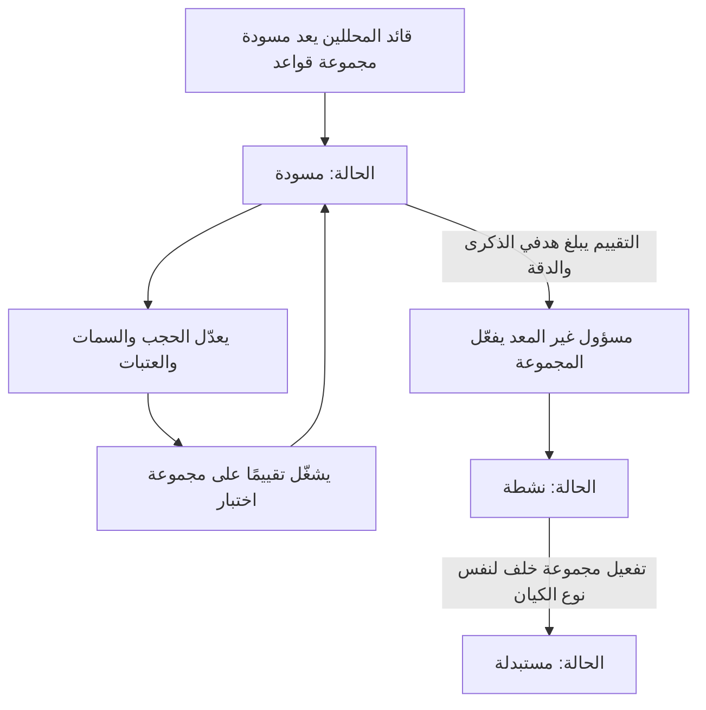
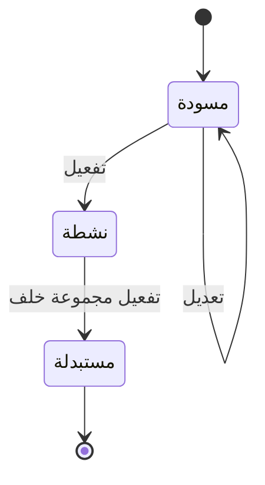

# قواعد المطابقة

<!-- BEGIN GENERATED: doc -->
| البند | القيمة |
|---|---|
| المعرّف | FEAT-INF-MATCH-RULES |
| الإصدار | 0.1 |
| الحالة | مسودة |
| القدرة | CAP-03 إدارة المعلومات |
| القدرة الفرعية | CAP-03.05 مطابقة الكيانات (R1) |
| الأدوار | قائد المحللين؛ مسؤول الإدارة؛ النظام |
| الشاشات | SCR-26 التعارض ومطابقة الكيانات |
| حالات الاستخدام | UC-007 |
| القصص | 8: 5 من المواصفة، و3 جديدة |
<!-- END GENERATED: doc -->

## 1. نظرة عامة

### 1.1 القيمة

يضبط قائد المحللين قواعد اكتشاف التطابق ويقيس دقتها قبل أن يفعّلها مسؤول آخر.

### 1.2 النطاق

| البند | القيمة |
|---|---|
| المستخدمون | قائد المحللين يعد مجموعة قواعد المطابقة ويعدّلها ويشغّل تقييمها؛ مسؤول الإدارة غير معدّها يفعّلها؛ النظام يستبدل تلقائيًا المجموعة النشطة السابقة لنفس نوع الكيان |
| الشاشات | شاشة التعارض ومطابقة الكيانات (تقرير تقييم القواعد قبل تفعيلها) |
| حالات الاستخدام (بالكلمات) | إعداد مسودة مجموعة قواعد لنوع كيان، وتعديل حجبها وسماتها وأوزانها وعتباتها، وتشغيل تقييمها على مجموعة اختبار مُعنوَنة، وتفعيلها بعد بلوغ الهدف، وجلب المجموعة مع تقرير تقييمها |
| المتطلبات (بالكلمات) | لا تفعيل مجموعة قواعد دون تقييم يبلغ هدف الذكرى والدقة؛ كل اقتراح تطابق يسجِّل إصدار المجموعة التي أنتجته |
| خارج النطاق | مراجعة حالات المطابقة نفسها والحكم فيها (ميزة «مراجعة تطابق الكيانات»)؛ فصل حالة مدموجة خطأً (ميزة «فصل الكيانات المدموجة خطأً») |

### 1.3 خريطة الميزة

**الشكل 1: مسار ضبط قواعد المطابقة**



**الشكل 2: دورة حالات مجموعة قواعد المطابقة**



## 2. القواعد المشتركة

تنطبق على كل قصص الميزة، فلا تتكرر داخل القصص. وكل قصة تذكر ما يخصها فقط.

### 2.1 السياق المشترك

كل قصة تبدأ من ثلاثة شروط: مستأجر نشط، وحزمة السياسات الأساسية مفعّلة، ومستخدم مسجّل الدخول ومخوَّل. وتشير إليها القصص بخطوة واحدة: «بفرض السياق المشترك للميزة».

### 2.2 الصلاحية وعدم الإفصاح

- من لا يحق له رؤية العنصر يتلقى ردًا بشكل «غير متاح» تمامًا، فلا يعرف أنه موجود.
- من يرى العنصر ولا يحق له الإجراء يتلقى «لا تملك صلاحية هذا الإجراء».

### 2.3 أوامر تغيير الحالة

- **منع التكرار:** يُرسل كل أمر بمفتاح فريد، فإعادة الطلب نفسه لا تُنفَّذ مرتين.
- **حماية التعديل المتزامن:** يُرسل كل أمر بإصدار البيانات الذي يراه المستخدم. فإن عدّلها غيره في الأثناء، يُرفض الأمر.
- **السجل:** إن نجح الأمر، يُكتب حدثه وسجل التدقيق في المعاملة نفسها.

### 2.4 الرفض المشترك

```gherkin
# language: ar
خاصية: الرفض المشترك لأوامر الميزة

  سيناريو مخطط: رفض مشترك لكل أمر في الميزة
    بفرض السياق المشترك للميزة
    و <الحالة>
    عندما يُرسل المستخدم أي أمر من أوامر الميزة
    اذاً يُرفض برمز <الرمز> ويرى "<الرسالة>"
    و لا يتغير شيء

    امثلة:
      | الحالة                                  | الرمز                  | الرسالة                                                 |
      | العنصر خارج صلاحياته                    | NOT_FOUND              | غير متاح                                                |
      | العنصر مرئي له ولا يحق له الإجراء       | AUTHZ_DENIED           | لا تملك صلاحية هذا الإجراء                              |
      | غيره عدّل العنصر بعد أن فتحه            | VERSION_CONFLICT       | تغيّرت البيانات منذ فتحتها. راجع التغييرات ثم أعد المحاولة |
      | أعاد مفتاح منع التكرار بمحتوى مختلف     | IDEMPOTENCY_KEY_REUSED | طلب مكرر بمحتوى مختلف                                   |
      | البيانات ناقصة أو غير صحيحة             | VALIDATION_FAILED      | بعض البيانات ناقصة أو غير صحيحة. راجع الحقول المعلَّمة      |

  سيناريو: إعادة الطلب نفسه لا تُنفَّذ مرتين
    بفرض السياق المشترك للميزة
    و أمر نجح بمفتاح منع تكرار
    عندما يُعاد الطلب نفسه بالمفتاح نفسه
    اذاً تُعاد النتيجة الأولى ولا يُكتب حدث ثانٍ
```

## 3. الجودة وتعريف الاكتمال

### 3.1 متطلبات الجودة

<!-- BEGIN GENERATED: quality -->
| المرجع | الموقف | المطلوب |
|---|---|---|
| QAS-ER-001 | candidate recall on labelled AR/EN test set | ≥ 95 % of true matches proposed |
| QAS-ER-002 | precision of proposals in review queue | ≥ 60 % of proposals are true matches |
<!-- END GENERATED: quality -->

### 3.2 تعريف الاكتمال

القصة مكتملة حين تتحقق الشروط الخمسة:

1. سيناريوهاتها والقواعد المشتركة تمر في الاختبار الآلي.
2. فحوص البنية المعمارية تمر.
3. نصوص الواجهة والرسائل موجودة بالعربية والإنجليزية.
4. مراجعة الكود مكتملة.
5. ما تضيفه القصة نفسها في قسم «القواعد» تحقق.

## 4. فهرس القصص

<!-- BEGIN GENERATED: story-index -->
| المعرّف | القصة | النوع | الحالة |
|---|---|---|---|
| `US-BC02-MRS-ACTIVATE` | تفعيل مجموعة قواعد المطابقة | أمر | مسودة |
| `US-BC02-MRS-DRAFT` | إعداد مسودة مجموعة قواعد المطابقة | أمر | مسودة |
| `US-BC02-MRS-EDIT` | تعديل مجموعة قواعد المطابقة | أمر | مسودة |
| `US-DOM-MRS-EVALUATE` | تشغيل تقييم قواعد المطابقة على مجموعة الاختبار | أمر | مسودة |
| `US-BC02-Q-MRS-GET` | جلب: Ruleset with evaluation report | جلب | مسودة |
| `US-BC02-S-MATCH-RULESET-01` | تلقائي: successor activated (مجموعة قواعد المطابقة) | نظام | مسودة |
| `US-UI-SCR26-RULESET-EVAL` | عرض تقرير تقييم القواعد قبل تفعيلها | واجهة | مسودة |
| `US-OPS-ER-SPLIT-RATE` | تنبيه لمراجعة القواعد عند كثرة الفصل | تشغيل | مسودة |
<!-- END GENERATED: story-index -->

## 5. القصص

### 5.1 US-BC02-MRS-ACTIVATE — تفعيل مجموعة قواعد المطابقة

| النوع | الإصدار | الأولوية | دون اتصال | الحالة |
|---|---|---|---|---|
| أمر | R1 | Must | لا | مسودة |

> **كـ** مسؤول الإدارة، **أريد** أن أفعّل مجموعة قواعد مطابقة اجتازت التقييم، **حتى** يستخدمها مولّد المرشحات بدلًا من المجموعة السابقة.

**باختصار:** من «مسودة»، وبعد تقييم يبلغ هدفي الذكرى والدقة، يفعّل مسؤولٌ غير معدِّها المجموعة، فتصبح «نشطة»، وتتحول المجموعة النشطة السابقة لنفس نوع الكيان تلقائيًا إلى «مستبدلة» (القصة 5.6).

#### القواعد

- **متى يُسمح:** الحالة الحالية «مسودة»، والتقييم يبلغ هدف الذكرى 95 % على الأقل (QAS-ER-001) وهدف الدقة (QAS-ER-002).
- **من يُسمح له:** مسؤول الإدارة، بشرط ألا يكون هو من أعدَّ المجموعة أو عدَّلها.
- **الأثر:** الحالة ← «نشطة»؛ يُسجَّل حدث «فُعِّلت مجموعة قواعد المطابقة» يصل إلى مولّد المرشحات ليعيد تحميل القواعد.

#### معايير القبول

```gherkin
# language: ar
خاصية: تفعيل مجموعة قواعد المطابقة

  سيناريو: مسؤول غير المعد يفعّل المجموعة
    بفرض السياق المشترك للميزة
    و مجموعة قواعد مطابقة في حالة "مسودة" وتقييمها يبلغ هدفي الذكرى والدقة
    عندما يفعّلها مسؤول الإدارة غير معدِّها
    اذاً تصبح حالتها "نشطة"
    و يُسجَّل حدث "فُعِّلت مجموعة قواعد المطابقة"

  سيناريو مخطط: رفض خاص بالتفعيل
    بفرض السياق المشترك للميزة
    و <الحالة>
    عندما يحاول تفعيل المجموعة
    اذاً يُرفض برمز <الرمز> ويرى "<الرسالة>"
    و لا يتغير شيء

    امثلة:
      | الحالة                                             | الرمز                  | الرسالة                                        |
      | التقييم لا يبلغ هدف الذكرى أو الدقة                | RULESET_BELOW_TARGET   | نتائج تقييم قواعد المطابقة دون الهدف           |
      | المسؤول نفسه هو من أعدَّ المجموعة أو عدَّلها        | SEGREGATION_OF_DUTIES  | لا يجوز أن يعتمد الشخص نفسه ما قدّمه أو طلبه    |
```

<details><summary>المراجع التقنية والتتبع</summary>

<!-- BEGIN GENERATED: refs US-BC02-MRS-ACTIVATE -->
| البند | المعرّف | المعنى |
|---|---|---|
| الواجهة البرمجية | `POST /api/v1/information/match-rulesets/{id}/actions/activate` | — |
| الأمر | `CMD-MRS-ACTIVATE` | تفعيل مجموعة قواعد المطابقة |
| السياسة | `POL-MRS-ACTIVATE` | Analyst lead (draft, edit) · Administrator ≠ author (activate)؛ tenant match; object visible |
| الحدث | `EVT-MRS-ACTIVATED` | يصل إلى: Candidate generator (reloads ruleset) |
| الكيان | `AGG-MATCH-RULESET` | مجموعة قواعد المطابقة |
| الجدول | `information.match_rulesets` | الجدول الرئيسي لمجموعة قواعد المطابقة |
| وحدة النشر | DU-04 | — |
| المتطلب | REQ-INF-032 | When an entity-resolution candidate is detected, the system shall create a resolution case with candidates, m… |
| حالة الاستخدام | UC-007 | Resolve Entity |
| الاختبار | TST-MATCH-RULESET-SM، TST-SLC04-INVARIANTS | دورة حالات مجموعة قواعد المطابقة، وثوابت الشريحة SLC-04 |
<!-- END GENERATED: refs US-BC02-MRS-ACTIVATE -->

</details>

### 5.2 US-BC02-MRS-DRAFT — إعداد مسودة مجموعة قواعد مطابقة

| النوع | الإصدار | الأولوية | دون اتصال | الحالة |
|---|---|---|---|---|
| أمر | R1 | Must | لا | مسودة |

> **كـ** قائد المحللين، **أريد** أن أعد مسودة مجموعة قواعد مطابقة لنوع كيان، **حتى** أضبط حجبها وسماتها قبل اقتراح أي تفعيل.

**باختصار:** يختار قائد المحللين نوع الكيان، وقد يبدأ من مجموعة سابقة، فتنشأ مجموعة قواعد جديدة في «مسودة».

#### القواعد

- **متى يُسمح:** نوع الكيان المحدد موجود (الحالة الحالية ∅).
- **من يُسمح له:** قائد المحللين.
- **البيانات:** نوع الكيان (إلزامي)، ومجموعة سابقة يُبنى عليها (اختياري).
- **الأثر:** تنشأ مجموعة قواعد مطابقة في «مسودة»؛ يُسجَّل حدث «أُعدَّت مسودة مجموعة قواعد المطابقة».

#### معايير القبول

```gherkin
# language: ar
خاصية: إعداد مسودة مجموعة قواعد مطابقة

  سيناريو: قائد المحللين يعد مسودة لنوع كيان
    بفرض السياق المشترك للميزة
    و نوع كيان موجود ليس له مسودة مفتوحة بالضرورة
    عندما يعد قائد المحللين مسودة مجموعة قواعد لهذا النوع
    اذاً تنشأ مجموعة قواعد مطابقة في حالة "مسودة"
    و يُسجَّل حدث "أُعدَّت مسودة مجموعة قواعد المطابقة"

  سيناريو مخطط: رفض خاص بالإعداد
    بفرض السياق المشترك للميزة
    و <الحالة>
    عندما يحاول إعداد المسودة
    اذاً يُرفض برمز <الرمز> ويرى "<الرسالة>"
    و لا يتغير شيء

    امثلة:
      | الحالة               | الرمز              | الرسالة          |
      | لم يُذكر نوع الكيان  | VALIDATION_FAILED  | نوع الكيان مطلوب  |
```

<details><summary>المراجع التقنية والتتبع</summary>

<!-- BEGIN GENERATED: refs US-BC02-MRS-DRAFT -->
| البند | المعرّف | المعنى |
|---|---|---|
| الواجهة البرمجية | `POST /api/v1/information/match-rulesets` | — |
| الأمر | `CMD-MRS-DRAFT` | إعداد مسودة مجموعة قواعد المطابقة |
| السياسة | `POL-MRS-DRAFT` | Analyst lead (draft, edit) · Administrator ≠ author (activate)؛ tenant match; object visible |
| الحدث | `EVT-MRS-DRAFTED` | يصل إلى: Candidate generator (reloads ruleset) |
| الكيان | `AGG-MATCH-RULESET` | مجموعة قواعد المطابقة |
| الجدول | `information.match_rulesets` | الجدول الرئيسي لمجموعة قواعد المطابقة |
| وحدة النشر | DU-04 | — |
| المتطلب | REQ-INF-032 | When an entity-resolution candidate is detected, the system shall create a resolution case with candidates, m… |
| حالة الاستخدام | UC-007 | Resolve Entity |
| الاختبار | TST-MATCH-RULESET-SM، TST-SLC04-INVARIANTS | دورة حالات مجموعة قواعد المطابقة، وثوابت الشريحة SLC-04 |
<!-- END GENERATED: refs US-BC02-MRS-DRAFT -->

</details>

### 5.3 US-BC02-MRS-EDIT — تعديل مجموعة قواعد مطابقة قيد الإعداد

| النوع | الإصدار | الأولوية | دون اتصال | الحالة |
|---|---|---|---|---|
| أمر | R1 | Must | لا | مسودة |

> **كـ** قائد المحللين، **أريد** أن أعدّل حجب مجموعة القواعد وسماتها وأوزانها وعتباتها، **حتى** أحسِّن نتيجة تقييمها قبل اقتراح تفعيلها.

**باختصار:** مجموعة القواعد في «مسودة» تبقى في «مسودة» بعد كل تعديل، بشرط أن يُرفَق تقييم جديد على مجموعة اختبار مع كل تعديل.

#### القواعد

- **متى يُسمح:** الحالة الحالية «مسودة».
- **من يُسمح له:** قائد المحللين.
- **البيانات:** مفاتيح الحجب، والسمات، والعتبات، ومرفق التقييم الذي أُجري على مجموعة اختبار مُعنوَنة (جميعها إلزامية).
- **الأثر:** الحالة بلا تغيير («مسودة»)؛ يُسجَّل حدث «عُدِّلت مجموعة قواعد المطابقة» يصل إلى مولّد المرشحات.

#### معايير القبول

```gherkin
# language: ar
خاصية: تعديل مجموعة قواعد مطابقة قيد الإعداد

  سيناريو: قائد المحللين يعدّل مسودة بتقييم جديد
    بفرض السياق المشترك للميزة
    و مجموعة قواعد مطابقة في حالة "مسودة"
    عندما يعدّل قائد المحللين الحجب والسمات والعتبات ويرفق تقييمًا جديدًا
    اذاً تبقى حالتها "مسودة"
    و يُسجَّل حدث "عُدِّلت مجموعة قواعد المطابقة"

  سيناريو مخطط: رفض خاص بالتعديل
    بفرض السياق المشترك للميزة
    و <الحالة>
    عندما يحاول تعديل المجموعة
    اذاً يُرفض برمز <الرمز> ويرى "<الرسالة>"
    و لا يتغير شيء

    امثلة:
      | الحالة                                                    | الرمز           | الرسالة                     |
      | مفاتيح الحجب أو السمات أو العتبات غير صحيحة، أو لا تقييم مرفق | RULESET_INVALID | قواعد المطابقة غير صحيحة    |
```

<details><summary>المراجع التقنية والتتبع</summary>

<!-- BEGIN GENERATED: refs US-BC02-MRS-EDIT -->
| البند | المعرّف | المعنى |
|---|---|---|
| الواجهة البرمجية | `POST /api/v1/information/match-rulesets/{id}/actions/edit` | — |
| الأمر | `CMD-MRS-EDIT` | تعديل مجموعة قواعد المطابقة |
| السياسة | `POL-MRS-EDIT` | Analyst lead (draft, edit) · Administrator ≠ author (activate)؛ tenant match; object visible |
| الحدث | `EVT-MRS-EDITED` | يصل إلى: Candidate generator (reloads ruleset) |
| الكيان | `AGG-MATCH-RULESET` | مجموعة قواعد المطابقة |
| الجدول | `information.match_rulesets` | الجدول الرئيسي لمجموعة قواعد المطابقة |
| وحدة النشر | DU-04 | — |
| المتطلب | REQ-INF-032 | When an entity-resolution candidate is detected, the system shall create a resolution case with candidates, m… |
| حالة الاستخدام | UC-007 | Resolve Entity |
| الاختبار | TST-MATCH-RULESET-SM، TST-SLC04-INVARIANTS | دورة حالات مجموعة قواعد المطابقة، وثوابت الشريحة SLC-04 |
<!-- END GENERATED: refs US-BC02-MRS-EDIT -->

</details>

### 5.4 US-DOM-MRS-EVALUATE — تشغيل تقييم قواعد المطابقة على مجموعة الاختبار

| النوع | الإصدار | الأولوية | دون اتصال | الحالة |
|---|---|---|---|---|
| أمر | R1 | Must | لا | مسودة |

> **كـ** قائد المحللين، **أريد** أن أشغّل تقييم مجموعة قواعد المطابقة على مجموعة اختبار عربية/إنجليزية مُعنوَنة، **حتى** أعرف ذكرها ودقتها قبل تعديلها أو اقتراح تفعيلها.

**باختصار:** يشغّل قائد المحللين تقييمًا لمجموعة قواعد على مجموعة اختبار مُعنوَنة، فيُنتج تقرير ذكرى ودقة يُرفق لاحقًا عند التعديل أو التفعيل. **[Derived]** — لا تذكر المواصفة أمرًا صريحًا لهذا التشغيل، بل تستنتج وجوده من شرطي التعديل والتفعيل اللذين يطلبان تقييمًا مرفقًا (REQ-INF-032؛ QAS-ER-001، QAS-ER-002).

#### القواعد

- **متى يُسمح:** مجموعة القواعد في «مسودة»، وتتوفر مجموعة اختبار مُعنوَنة لنوع كيانها. **[Derived]**
- **من يُسمح له:** قائد المحللين. **[Derived]**
- **البيانات:** مجموعة القواعد المراد تقييمها، ومجموعة الاختبار المُعنوَنة. **[Derived]**
- **الأثر:** يُنتج تقرير بالذكرى والدقة يُحفظ كمرفق تقييم يُستشهد به عند التعديل (القصة 5.3) والتفعيل (القصة 5.1)؛ لا يغيّر حالة المجموعة. **[Derived]**

#### معايير القبول

```gherkin
# language: ar
خاصية: تشغيل تقييم قواعد المطابقة على مجموعة الاختبار

  سيناريو: تشغيل تقييم على مجموعة اختبار متاحة
    بفرض السياق المشترك للميزة
    و مجموعة قواعد مطابقة في حالة "مسودة" ومجموعة اختبار مُعنوَنة لنوع كيانها
    عندما يشغّل قائد المحللين التقييم
    اذاً يُنتج تقرير بالذكرى والدقة يُحفظ كمرفق تقييم

  سيناريو مخطط: رفض خاص بالتشغيل
    بفرض السياق المشترك للميزة
    و <الحالة>
    عندما يحاول قائد المحللين تشغيل التقييم
    اذاً يُرفض برمز <الرمز> ويرى "<الرسالة>"
    و لا يتغير شيء

    امثلة:
      | الحالة                              | الرمز              | الرسالة                 |
      | لا تتوفر مجموعة اختبار لنوع الكيان  | VALIDATION_FAILED  | مجموعة الاختبار مطلوبة  |
```

<details><summary>المراجع التقنية والتتبع</summary>

<!-- BEGIN GENERATED: refs US-DOM-MRS-EVALUATE -->
| البند | المعرّف | المعنى |
|---|---|---|
| الجودة | QAS-ER-001 | candidate recall on labelled AR/EN test set → ≥ 95 % of true matches proposed |
| الجودة | QAS-ER-002 | precision of proposals in review queue → ≥ 60 % of proposals are true matches |
| المصدر | `[Derived]` | — |
| المتطلب | REQ-INF-032 | When an entity-resolution candidate is detected, the system shall create a resolution case with candidates, m… |
| حالة الاستخدام | UC-007 | Resolve Entity |
<!-- END GENERATED: refs US-DOM-MRS-EVALUATE -->

</details>

### 5.5 US-BC02-Q-MRS-GET — جلب مجموعة قواعد مطابقة مع تقرير تقييمها

| النوع | الإصدار | الأولوية | دون اتصال | الحالة |
|---|---|---|---|---|
| جلب | R1 | Must | لا | مسودة |

> **كـ** قائد المحللين، **أريد** أن أجلب مجموعة قواعد مطابقة مع تقرير تقييمها، **حتى** أقرر تعديلها أو اقتراح تفعيلها.

**باختصار:** تُعاد مجموعة القواعد بحجبها وسماتها وعتباتها، مع آخر تقرير تقييم مرفق بها.

#### القواعد

- **من يُسمح له:** قائد المحللين ومسؤول الإدارة.

#### معايير القبول

```gherkin
# language: ar
خاصية: جلب مجموعة قواعد مطابقة مع تقرير تقييمها

  سيناريو: جلب مجموعة قواعد مع تقريرها
    بفرض السياق المشترك للميزة
    و مجموعة قواعد مطابقة لها تقرير تقييم مرفق
    عندما يطلب قائد المحللين المجموعة
    اذاً تُعاد المجموعة مع تقرير تقييمها
```

<details><summary>المراجع التقنية والتتبع</summary>

<!-- BEGIN GENERATED: refs US-BC02-Q-MRS-GET -->
| البند | المعرّف | المعنى |
|---|---|---|
| الواجهة البرمجية | `GET /api/v1/information/match-rulesets/{ruleset_id}` | — |
| الاستعلام | `QRY-MRS-GET` | Ruleset with evaluation report |
| السياسة | `POL-MRS-GET` | Analyst lead, Administrator |
| الكيان | `AGG-MATCH-RULESET` | مجموعة قواعد المطابقة |
| الجدول | `information.match_rulesets` | الجدول الرئيسي لمجموعة قواعد المطابقة |
| وحدة النشر | DU-04 | — |
| المتطلب | REQ-INF-032 | When an entity-resolution candidate is detected, the system shall create a resolution case with candidates, m… |
| حالة الاستخدام | UC-007 | Resolve Entity |
| الاختبار | TST-MATCH-RULESET-SM، TST-SLC04-INVARIANTS | دورة حالات مجموعة قواعد المطابقة، وثوابت الشريحة SLC-04 |
<!-- END GENERATED: refs US-BC02-Q-MRS-GET -->

</details>

### 5.6 US-BC02-S-MATCH-RULESET-01 — استبدال تلقائي للمجموعة النشطة السابقة

| النوع | الإصدار | الأولوية | دون اتصال | الحالة |
|---|---|---|---|---|
| نظام | R1 | Must | لا ينطبق | مسودة |

> **كـ** النظام، **أريد** أن أنقل المجموعة النشطة السابقة إلى «مستبدلة» حين تُفعَّل مجموعة خلف لها، **حتى** تبقى مجموعة واحدة فقط نشطة لكل نوع كيان (INV-MRS-01).

**باختصار:** حين يفعِّل المسؤول مجموعة قواعد جديدة لنوع كيان له مجموعة نشطة سابقة، تتحول تلك المجموعة السابقة تلقائيًا إلى «مستبدلة» في المعاملة نفسها.

#### القواعد

- **متى يحدث:** تفعيل مجموعة قواعد جديدة (القصة 5.1) لنوع كيان له مجموعة نشطة سابقة.
- **الأثر:** حالة المجموعة السابقة ← «مستبدلة» (حالة نهائية)؛ يُسجَّل حدث «استُبدلت مجموعة قواعد المطابقة» بهوية النظام وسجل تدقيق.

#### معايير القبول

```gherkin
# language: ar
خاصية: استبدال تلقائي للمجموعة النشطة السابقة

  سيناريو: تفعيل مجموعة جديدة يستبدل القديمة
    بفرض مجموعة قواعد نشطة لنوع كيان، وأخرى اجتازت التقييم بانتظار التفعيل لنفس النوع
    عندما يفعّل المسؤول المجموعة الجديدة
    اذاً تصبح المجموعة السابقة "مستبدلة"
    و يُسجَّل حدث "استُبدلت مجموعة قواعد المطابقة" بهوية النظام

  سيناريو: لا نوع كيان له مجموعة نشطة سابقة
    بفرض نوع كيان ليس له مجموعة قواعد نشطة من قبل
    عندما تُفعَّل أول مجموعة قواعد له
    اذاً لا تُستبدل أي مجموعة أخرى
```

<details><summary>المراجع التقنية والتتبع</summary>

<!-- BEGIN GENERATED: refs US-BC02-S-MATCH-RULESET-01 -->
| البند | المعرّف | المعنى |
|---|---|---|
| المحفِّز | `SYS:successor activated` | system |
| الانتقال | ACTIVE ← SUPERSEDED | — |
| الحدث | `EVT-MRS-SUPERSEDED` | يصل إلى: Candidate generator (reloads ruleset) |
| الكيان | `AGG-MATCH-RULESET` | مجموعة قواعد المطابقة |
| الجدول | `information.match_rulesets` | الجدول الرئيسي لمجموعة قواعد المطابقة |
| وحدة النشر | DU-04 | — |
| المتطلب | REQ-INF-032 | When an entity-resolution candidate is detected, the system shall create a resolution case with candidates, m… |
| حالة الاستخدام | UC-007 | Resolve Entity |
| الاختبار | TST-MATCH-RULESET-SM، TST-SLC04-INVARIANTS | دورة حالات مجموعة قواعد المطابقة، وثوابت الشريحة SLC-04 |
<!-- END GENERATED: refs US-BC02-S-MATCH-RULESET-01 -->

</details>

### 5.7 US-UI-SCR26-RULESET-EVAL — عرض تقرير تقييم القواعد قبل تفعيلها

| النوع | الإصدار | الأولوية | دون اتصال | الحالة |
|---|---|---|---|---|
| واجهة | R1 | Should | لا | مسودة |

> **كـ** **[للكتابة]**، **أريد** **[للكتابة]**، **حتى** **[للكتابة]**.

**باختصار:** **[للكتابة]**

#### القواعد

**[للكتابة]**

#### معايير القبول

**[للكتابة]**

<details><summary>المراجع التقنية والتتبع</summary>

<!-- BEGIN GENERATED: refs US-UI-SCR26-RULESET-EVAL -->
| البند | المعرّف | المعنى |
|---|---|---|
| الشاشة | SCR-26 | شاشة التعارض ومطابقة الكيانات |
| الجودة | QAS-ER-001 | candidate recall on labelled AR/EN test set → ≥ 95 % of true matches proposed |
| الجودة | QAS-ER-002 | precision of proposals in review queue → ≥ 60 % of proposals are true matches |
| المصدر | `THR-S04-05` | — |
<!-- END GENERATED: refs US-UI-SCR26-RULESET-EVAL -->

</details>

### 5.8 US-OPS-ER-SPLIT-RATE — تنبيه لمراجعة القواعد عند كثرة الفصل

| النوع | الإصدار | الأولوية | دون اتصال | الحالة |
|---|---|---|---|---|
| تشغيل | R1 | Should | لا ينطبق | مسودة |

> **كـ** **[للكتابة]**، **أريد** **[للكتابة]**، **حتى** **[للكتابة]**.

**باختصار:** **[للكتابة]**

#### القواعد

**[للكتابة]**

#### معايير القبول

**[للكتابة]**

<details><summary>المراجع التقنية والتتبع</summary>

<!-- BEGIN GENERATED: refs US-OPS-ER-SPLIT-RATE -->
| البند | المعرّف | المعنى |
|---|---|---|
| المصدر | `observability-slc04.md` | — |
| المصدر | `THR-S04-01` | — |
<!-- END GENERATED: refs US-OPS-ER-SPLIT-RATE -->

</details>

## 6. التتبع

<!-- BEGIN GENERATED: trace -->
| المتطلب | المعنى | القصص | الاختبار |
|---|---|---|---|
| REQ-INF-032 | When an entity-resolution candidate is detected, the system shall create a resolution case with candidates, m… | `US-BC02-MRS-ACTIVATE`، `US-BC02-MRS-DRAFT`، `US-BC02-MRS-EDIT`، `US-BC02-Q-MRS-GET`، `US-BC02-S-MATCH-RULESET-01`، `US-DOM-MRS-EVALUATE` | TST-ER-CASE-SM، TST-MATCH-RULESET-SM، TST-SLC04-INVARIANTS |
<!-- END GENERATED: trace -->

## 7. سجل التغييرات

| الإصدار | التاريخ | التغيير |
|---|---|---|
| 0.1 | — | هيكل مولَّد من خريطة الميزات |
