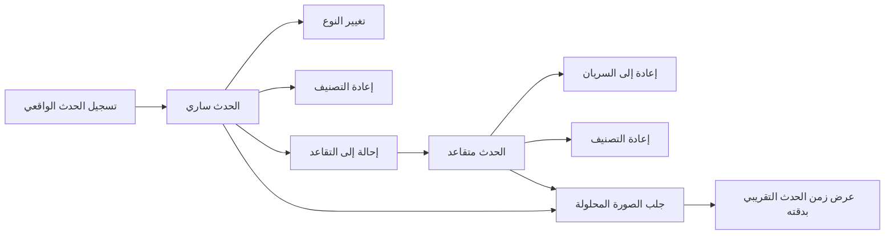
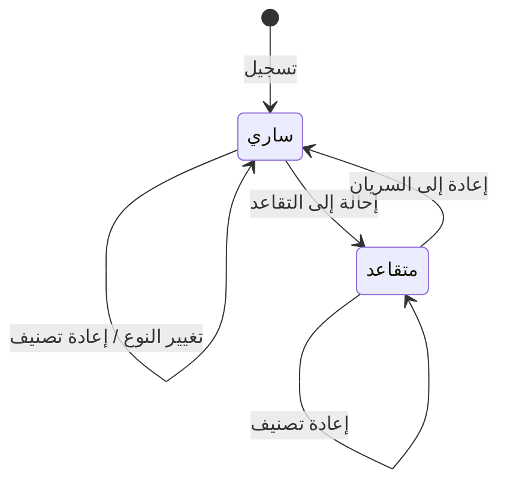

# تسجيل الأحداث الواقعية

<!-- BEGIN GENERATED: doc -->
| البند | القيمة |
|---|---|
| المعرّف | FEAT-INF-REAL-EVENTS |
| الإصدار | 0.2 |
| الحالة | مسودة |
| القدرة | CAP-03 إدارة المعلومات |
| القدرة الفرعية | CAP-03.01 الكيانات والعلاقات (R1) |
| الأدوار | المحلل؛ النظام؛ أي مستخدم مخوَّل |
| الشاشات | SCR-21 الكيانات والأحداث: العرض المحلول |
| حالات الاستخدام | UC-002 |
| القصص | 8: 6 من المواصفة، و2 جديدة |
<!-- END GENERATED: doc -->

## 1. نظرة عامة

### 1.1 القيمة

يوثّق المحلل الأحداث التي وقعت في الواقع ويصنّفها ويعرض صورتها الموحّدة.

### 1.2 النطاق

| البند | القيمة |
|---|---|
| المستخدمون | المحلل، وخدمة المحوّلات بصفتها هوية خدمة؛ وأي مستخدم مخوَّل يرى الحدث |
| الشاشات | شاشة الكيانات والأحداث: العرض المحلول (SCR-21) |
| حالات الاستخدام | تسجيل حدث واقعي، وتغيير نوعه، وإعادة تصنيفه، وإحالته إلى التقاعد وإعادته إلى السريان، وجلب صورته المحلولة، وإدخال زمنه التقريبي وعرضه بدقته |
| المتطلبات | تمثيل الحدث الواقعي كنوع كائن مستقل له خصائص وأدلة ومصدر (REQ-INF-020) |
| خارج النطاق | مشاركو الحدث: يُمثَّلون بعلاقات موجّهة لا بقائمة مضمَّنة في الحدث (ميزة إدارة العلاقات)؛ حذف الحدث نهائيًا، فلا توجد له إلا الإحالة إلى التقاعد |

### 1.3 خريطة الميزة

**الشكل 1: مسار تسجيل الحدث الواقعي وعرضه**



**الشكل 2: دورة حالات الحدث الواقعي**



## 2. القواعد المشتركة

تنطبق على كل قصص الميزة، فلا تتكرر داخل القصص. وكل قصة تذكر ما يخصها فقط.

### 2.1 السياق المشترك

كل قصة تبدأ من ثلاثة شروط: مستأجر نشط، وحزمة السياسات الأساسية مفعّلة، ومستخدم مسجّل الدخول ومخوَّل. وتشير إليها القصص بخطوة واحدة: «بفرض السياق المشترك للميزة».

### 2.2 الصلاحية وعدم الإفصاح

- من لا يحق له رؤية العنصر يتلقى ردًا بشكل «غير متاح» تمامًا، فلا يعرف أنه موجود.
- من يرى العنصر ولا يحق له الإجراء يتلقى «لا تملك صلاحية هذا الإجراء».

### 2.3 أوامر تغيير الحالة

- **منع التكرار:** يُرسل كل أمر بمفتاح فريد، فإعادة الطلب نفسه لا تُنفَّذ مرتين.
- **حماية التعديل المتزامن:** يُرسل كل أمر بإصدار البيانات الذي يراه المستخدم. فإن عدّلها غيره في الأثناء، يُرفض الأمر.
- **السجل:** إن نجح الأمر، يُكتب حدثه وسجل التدقيق في المعاملة نفسها.

### 2.4 الرفض المشترك

```gherkin
# language: ar
خاصية: الرفض المشترك لأوامر الميزة

  سيناريو مخطط: رفض مشترك لكل أمر في الميزة
    بفرض السياق المشترك للميزة
    و <الحالة>
    عندما يُرسل المستخدم أي أمر من أوامر الميزة
    اذاً يُرفض برمز <الرمز> ويرى "<الرسالة>"
    و لا يتغير شيء

    امثلة:
      | الحالة                                  | الرمز                  | الرسالة                                                 |
      | العنصر خارج صلاحياته                    | NOT_FOUND              | غير متاح                                                |
      | العنصر مرئي له ولا يحق له الإجراء       | AUTHZ_DENIED           | لا تملك صلاحية هذا الإجراء                              |
      | غيره عدّل العنصر بعد أن فتحه            | VERSION_CONFLICT       | تغيّرت البيانات منذ فتحتها. راجع التغييرات ثم أعد المحاولة |
      | أعاد مفتاح منع التكرار بمحتوى مختلف     | IDEMPOTENCY_KEY_REUSED | طلب مكرر بمحتوى مختلف                                   |
      | البيانات ناقصة أو غير صحيحة             | VALIDATION_FAILED      | بعض البيانات ناقصة أو غير صحيحة. راجع الحقول المعلَّمة      |

  سيناريو: إعادة الطلب نفسه لا تُنفَّذ مرتين
    بفرض السياق المشترك للميزة
    و أمر نجح بمفتاح منع تكرار
    عندما يُعاد الطلب نفسه بالمفتاح نفسه
    اذاً تُعاد النتيجة الأولى ولا يُكتب حدث ثانٍ
```

## 3. الجودة وتعريف الاكتمال

### 3.1 متطلبات الجودة

<!-- BEGIN GENERATED: quality -->
لا متطلبات جودة مرتبطة بمتطلبات هذه الميزة مباشرة. تنطبق متطلبات المنصة العامة (`FEAT-PLT-*`).
<!-- END GENERATED: quality -->

### 3.2 تعريف الاكتمال

القصة مكتملة حين تتحقق الشروط الخمسة:

1. سيناريوهاتها والقواعد المشتركة تمر في الاختبار الآلي.
2. فحوص البنية المعمارية تمر.
3. نصوص الواجهة والرسائل موجودة بالعربية والإنجليزية.
4. مراجعة الكود مكتملة.
5. ما تضيفه القصة نفسها في قسم «القواعد» تحقق.

## 4. فهرس القصص

<!-- BEGIN GENERATED: story-index -->
| المعرّف | القصة | النوع | الحالة |
|---|---|---|---|
| `US-BC02-RWE-CHANGE-TYPE` | تغيير نوع الحدث الواقعي | أمر | مسودة |
| `US-BC02-RWE-RECLASSIFY` | إعادة تصنيف الحدث الواقعي | أمر | مسودة |
| `US-BC02-RWE-REGISTER` | تسجيل الحدث الواقعي | أمر | مسودة |
| `US-BC02-RWE-REINSTATE` | إعادة الحدث الواقعي إلى السريان | أمر | مسودة |
| `US-BC02-RWE-RETIRE` | إحالة الحدث الواقعي إلى التقاعد | أمر | مسودة |
| `US-BC02-Q-RWE-GET` | جلب الحدث الواقعي المحلول | جلب | مسودة |
| `US-UI-SCR21-EVENT-FUZZY-TIME` | إدخال زمن الحدث التقريبي وعرضه بدقته | واجهة | مسودة |
| `US-PLT-EVENTS-FUZZY-OVERLAP` | مطابقة الأزمنة التقريبية بثلاث نتائج | منصة | مسودة |
<!-- END GENERATED: story-index -->

## 5. القصص

### 5.1 US-BC02-RWE-CHANGE-TYPE — تغيير نوع الحدث الواقعي

| النوع | الإصدار | الأولوية | دون اتصال | الحالة |
|---|---|---|---|---|
| أمر | R1 | Must | لا | مسودة |

> **كـ** المحلل، **أريد** تغيير نوع الحدث الواقعي المسجَّل، **حتى** يعكس تصنيفه الموضوعي ما تبيّن من ادعاءات جديدة.

**باختصار:** يغيّر المحلل نوع الحدث الساري إلى نوع متوافق مع سبب، دون أن تتغيّر حالته.

#### القواعد

- **متى يُسمح:** الحدث «ساري»، والنوع الجديد متوافق مع طبيعة الحدث الحالية.
- **من يُسمح له:** المحلل.
- **البيانات:** النوع الجديد، والسبب.
- **الأثر:** يصل حدث «غُيِّر نوع الحدث الواقعي» إلى عرضي البحث والرسم البياني.

#### معايير القبول

```gherkin
# language: ar
خاصية: تغيير نوع الحدث الواقعي

  سيناريو: تغيير نوع حدث ساري إلى نوع متوافق
    بفرض السياق المشترك للميزة
    و حدث واقعي "ساري"
    عندما يغيّر المحلل نوعه إلى نوع متوافق مع سبب
    اذاً يبقى الحدث "ساريًا" بنوعه الجديد
    و يُسجَّل حدث "غُيِّر نوع الحدث الواقعي"

  سيناريو مخطط: رفض خاص بتغيير النوع
    بفرض السياق المشترك للميزة
    و <الحالة>
    عندما يحاول المحلل تغيير نوع الحدث
    اذاً يُرفض برمز <الرمز> ويرى "<الرسالة>"
    و لا يتغير شيء

    امثلة:
      | الحالة                              | الرمز                              | الرسالة                                                 |
      | النوع الجديد غير متوافق مع الحالي  | EVENT_TYPE_INCOMPATIBLE            | النوع الجديد غير متوافق مع نوع الحدث                    |
      | الحدث "متقاعد"                      | REALWORLD_EVENT_INVALID_STATE_TRANSITION | الوضع الحالي للحدث الواقعي لا يسمح بهذا الإجراء |
```

<details><summary>المراجع التقنية والتتبع</summary>

<!-- BEGIN GENERATED: refs US-BC02-RWE-CHANGE-TYPE -->
| البند | المعرّف | المعنى |
|---|---|---|
| الواجهة البرمجية | `POST /api/v1/information/events/{id}/actions/change-type` | — |
| الأمر | `CMD-RWE-CHANGE-TYPE` | تغيير نوع الحدث الواقعي |
| السياسة | `POL-RWE-CHANGE-TYPE` | Analyst · adapter service account؛ tenant match; object visible to subject (label ≤ clearance); write permiss… |
| الحدث | `EVT-RWE-TYPE-CHANGED` | يصل إلى: Search/Graph projections (SLC-05) |
| الكيان | `AGG-REALWORLD-EVENT` | الحدث الواقعي |
| الجدول | `information.realworld_events` | الجدول الرئيسي للحدث الواقعي |
| وحدة النشر | DU-04 | — |
| المتطلب | REQ-INF-020 | The system shall represent Entity, Event, Relationship, Claim, Evidence, Source and Observation as distinct o… |
| حالة الاستخدام | UC-002 | Manage Event |
| الاختبار | TST-REALWORLD-EVENT-SM، TST-SLC02-INVARIANTS | دورة حالات الحدث الواقعي، وثوابت الشريحة SLC-02 |
<!-- END GENERATED: refs US-BC02-RWE-CHANGE-TYPE -->

</details>

### 5.2 US-BC02-RWE-RECLASSIFY — إعادة تصنيف الحدث الواقعي

| النوع | الإصدار | الأولوية | دون اتصال | الحالة |
|---|---|---|---|---|
| أمر | R1 | Must | لا | مسودة |

> **كـ** المحلل، **أريد** إعادة تصنيف الحدث الواقعي أمنيًا، **حتى** يطابق تصنيفه حساسية ما تحتويه ادعاءاته.

**باختصار:** يغيّر المحلل الذي يملك سلطة التصنيف تصنيف الحدث مع سبب، في أي حالة من حالتيه، دون أن تتغيّر.

#### القواعد

- **متى يُسمح:** يملك المحلل سلطة تغيير التصنيف حسب سياسة المستأجر (REQ-GOV-004).
- **من يُسمح له:** المحلل صاحب سلطة التصنيف.
- **البيانات:** التصنيف الجديد، والسبب.
- **الأثر:** يرفع إصدار الأمان للحدث، ويصل حدث «أُعيد تصنيف الحدث الواقعي» إلى خدمة إصدار الأمان ومخابئ قرار الصلاحية وعرضي البحث والرسم البياني.

#### معايير القبول

```gherkin
# language: ar
خاصية: إعادة تصنيف الحدث الواقعي

  سيناريو: إعادة تصنيف حدث بسلطة كافية
    بفرض السياق المشترك للميزة
    و حدث واقعي "ساري" أو "متقاعد"
    عندما يعيد المحلل تصنيفه إلى تصنيف أعلى مع سبب
    اذاً يبقى على حالته ويرتفع إصدار أمانه
    و يُسجَّل حدث "أُعيد تصنيف الحدث الواقعي"

  سيناريو مخطط: رفض خاص بإعادة التصنيف
    بفرض السياق المشترك للميزة
    و <الحالة>
    عندما يحاول إعادة تصنيف الحدث
    اذاً يُرفض برمز <الرمز> ويرى "<الرسالة>"
    و لا يتغير شيء

    امثلة:
      | الحالة                                      | الرمز                                  | الرسالة                       |
      | لا يملك سلطة تغيير التصنيف حسب سياسة المستأجر | CLASSIFICATION_CHANGE_NOT_AUTHORIZED | لا تملك صلاحية تغيير التصنيف |
```

<details><summary>المراجع التقنية والتتبع</summary>

<!-- BEGIN GENERATED: refs US-BC02-RWE-RECLASSIFY -->
| البند | المعرّف | المعنى |
|---|---|---|
| الواجهة البرمجية | `POST /api/v1/information/events/{id}/actions/reclassify` | — |
| الأمر | `CMD-RWE-RECLASSIFY` | إعادة تصنيف الحدث الواقعي |
| السياسة | `POL-RWE-RECLASSIFY` | Analyst · adapter service account؛ tenant match; object visible to subject (label ≤ clearance); write permiss… |
| الحدث | `EVT-RWE-RECLASSIFIED` | يصل إلى: Security-version service (EVT-SEC-VERSION-INCREMENTED); PEP decision caches; Projection security-ver… |
| الكيان | `AGG-REALWORLD-EVENT` | الحدث الواقعي |
| الجدول | `information.realworld_events` | الجدول الرئيسي للحدث الواقعي |
| وحدة النشر | DU-04 | — |
| المتطلب | REQ-INF-020 | The system shall represent Entity, Event, Relationship, Claim, Evidence, Source and Observation as distinct o… |
| حالة الاستخدام | UC-002 | Manage Event |
| الاختبار | TST-REALWORLD-EVENT-SM، TST-SLC02-INVARIANTS | دورة حالات الحدث الواقعي، وثوابت الشريحة SLC-02 |
<!-- END GENERATED: refs US-BC02-RWE-RECLASSIFY -->

</details>

### 5.3 US-BC02-RWE-REGISTER — تسجيل الحدث الواقعي

| النوع | الإصدار | الأولوية | دون اتصال | الحالة |
|---|---|---|---|---|
| أمر | R1 | Must | لا | مسودة |

> **كـ** المحلل، **أريد** تسجيل حدث واقعي جديد بنوعه وزمنه التقريبي وموقعه، **حتى** يصبح مرجعًا موحَّدًا يُربط به ما يخصّه.

**باختصار:** يسجّل المحلل حدثًا واقعيًا من نوع معروف مع ادعاءاته الأولية، فيصير «ساريًا».

#### القواعد

- **متى يُسمح:** نوع الحدث من الأنواع المعرّفة، وادعاءاته الأولية تشمل زمن الحدث (تقريبيًا) وموقعه.
- **من يُسمح له:** المحلل.
- **البيانات:** نوع الحدث، وتصنيفه الأمني، وادعاءاته الأولية (زمن الحدث التقريبي والموقع).
- **الأثر:** يصل حدث «سُجِّل الحدث الواقعي» إلى عرضي البحث والرسم البياني.

#### معايير القبول

```gherkin
# language: ar
خاصية: تسجيل الحدث الواقعي

  سيناريو: تسجيل حدث واقعي جديد
    بفرض السياق المشترك للميزة
    و نوع الحدث من الأنواع المعرّفة
    عندما يسجّل المحلل الحدث بادعاءاته الأولية (زمن الحدث التقريبي وموقعه)
    اذاً يصبح الحدث الواقعي "ساريًا"
    و يُسجَّل حدث "سُجِّل الحدث الواقعي"

  سيناريو مخطط: رفض خاص بالتسجيل
    بفرض السياق المشترك للميزة
    و <الحالة>
    عندما يحاول المحلل تسجيل الحدث
    اذاً يُرفض برمز <الرمز> ويرى "<الرسالة>"
    و لا يتغير شيء

    امثلة:
      | الحالة                                                        | الرمز         | الرسالة                                             |
      | نوع الحدث خارج الأنواع المعرّفة أو الادعاءات الأولية ناقصة  | EVENT_INVALID | بيانات الحدث غير مكتملة: الوقت والموقع مطلوبان     |
```

<details><summary>المراجع التقنية والتتبع</summary>

<!-- BEGIN GENERATED: refs US-BC02-RWE-REGISTER -->
| البند | المعرّف | المعنى |
|---|---|---|
| الواجهة البرمجية | `POST /api/v1/information/events` | — |
| الأمر | `CMD-RWE-REGISTER` | تسجيل الحدث الواقعي |
| السياسة | `POL-RWE-REGISTER` | Analyst · adapter service account؛ tenant match; object visible to subject (label ≤ clearance); write permiss… |
| الحدث | `EVT-RWE-REGISTERED` | يصل إلى: Search/Graph projections (SLC-05) |
| الكيان | `AGG-REALWORLD-EVENT` | الحدث الواقعي |
| الجدول | `information.realworld_events` | الجدول الرئيسي للحدث الواقعي |
| وحدة النشر | DU-04 | — |
| المتطلب | REQ-INF-020 | The system shall represent Entity, Event, Relationship, Claim, Evidence, Source and Observation as distinct o… |
| حالة الاستخدام | UC-002 | Manage Event |
| الاختبار | TST-REALWORLD-EVENT-SM، TST-SLC02-INVARIANTS | دورة حالات الحدث الواقعي، وثوابت الشريحة SLC-02 |
<!-- END GENERATED: refs US-BC02-RWE-REGISTER -->

</details>

### 5.4 US-BC02-RWE-REINSTATE — إعادة الحدث الواقعي إلى السريان

| النوع | الإصدار | الأولوية | دون اتصال | الحالة |
|---|---|---|---|---|
| أمر | R1 | Must | لا | مسودة |

> **كـ** المحلل، **أريد** إعادة حدث واقعي متقاعد إلى السريان، **حتى** أصحّح إحالته إلى التقاعد بالخطأ أو أعيد استخدامه.

**باختصار:** يعيد المحلل الحدث المتقاعد إلى «ساري» بسبب يذكره.

#### القواعد

- **متى يُسمح:** الحدث «متقاعد».
- **من يُسمح له:** المحلل.
- **البيانات:** السبب.
- **الأثر:** يصل حدث «أُعيد الحدث الواقعي إلى السريان» إلى عرضي البحث والرسم البياني.

#### معايير القبول

```gherkin
# language: ar
خاصية: إعادة الحدث الواقعي إلى السريان

  سيناريو: إعادة حدث متقاعد إلى السريان
    بفرض السياق المشترك للميزة
    و حدث واقعي "متقاعد"
    عندما يعيده المحلل إلى السريان مع سبب
    اذاً تصبح حالته "ساريًا"
    و يُسجَّل حدث "أُعيد الحدث الواقعي إلى السريان"

  سيناريو مخطط: رفض خاص بإعادة السريان
    بفرض السياق المشترك للميزة
    و <الحالة>
    عندما يحاول إعادته إلى السريان
    اذاً يُرفض برمز <الرمز> ويرى "<الرسالة>"
    و لا يتغير شيء

    امثلة:
      | الحالة               | الرمز                                      | الرسالة                                            |
      | لم يُذكر السبب       | REASON_REQUIRED                            | اذكر السبب                                         |
      | الحدث "ساري" أصلًا   | REALWORLD_EVENT_INVALID_STATE_TRANSITION   | الوضع الحالي للحدث الواقعي لا يسمح بهذا الإجراء    |
```

<details><summary>المراجع التقنية والتتبع</summary>

<!-- BEGIN GENERATED: refs US-BC02-RWE-REINSTATE -->
| البند | المعرّف | المعنى |
|---|---|---|
| الواجهة البرمجية | `POST /api/v1/information/events/{id}/actions/reinstate` | — |
| الأمر | `CMD-RWE-REINSTATE` | إعادة الحدث الواقعي إلى السريان |
| السياسة | `POL-RWE-REINSTATE` | Analyst · adapter service account؛ tenant match; object visible to subject (label ≤ clearance); write permiss… |
| الحدث | `EVT-RWE-REINSTATED` | يصل إلى: Search/Graph projections (SLC-05) |
| الكيان | `AGG-REALWORLD-EVENT` | الحدث الواقعي |
| الجدول | `information.realworld_events` | الجدول الرئيسي للحدث الواقعي |
| وحدة النشر | DU-04 | — |
| المتطلب | REQ-INF-020 | The system shall represent Entity, Event, Relationship, Claim, Evidence, Source and Observation as distinct o… |
| حالة الاستخدام | UC-002 | Manage Event |
| الاختبار | TST-REALWORLD-EVENT-SM، TST-SLC02-INVARIANTS | دورة حالات الحدث الواقعي، وثوابت الشريحة SLC-02 |
<!-- END GENERATED: refs US-BC02-RWE-REINSTATE -->

</details>

### 5.5 US-BC02-RWE-RETIRE — إحالة الحدث الواقعي إلى التقاعد

| النوع | الإصدار | الأولوية | دون اتصال | الحالة |
|---|---|---|---|---|
| أمر | R1 | Must | لا | مسودة |

> **كـ** المحلل، **أريد** إحالة حدث واقعي إلى التقاعد، **حتى** لا يظهر الحدث الخاطئ أو المنتهي أثره بين الأحداث السارية.

**باختصار:** يحيل المحلل الحدث الساري إلى التقاعد بسبب يذكره، فتصبح حالته «متقاعد».

#### القواعد

- **متى يُسمح:** الحدث «ساري».
- **من يُسمح له:** المحلل.
- **البيانات:** السبب.
- **الأثر:** يصل حدث «أُحيل الحدث الواقعي إلى التقاعد» إلى عرضي البحث والرسم البياني.

#### معايير القبول

```gherkin
# language: ar
خاصية: إحالة الحدث الواقعي إلى التقاعد

  سيناريو: إحالة حدث ساري إلى التقاعد
    بفرض السياق المشترك للميزة
    و حدث واقعي "ساري"
    عندما يحيله المحلل إلى التقاعد مع سبب
    اذاً تصبح حالته "متقاعدًا"
    و يُسجَّل حدث "أُحيل الحدث الواقعي إلى التقاعد"

  سيناريو مخطط: رفض خاص بالإحالة إلى التقاعد
    بفرض السياق المشترك للميزة
    و <الحالة>
    عندما يحاول إحالة الحدث إلى التقاعد
    اذاً يُرفض برمز <الرمز> ويرى "<الرسالة>"
    و لا يتغير شيء

    امثلة:
      | الحالة               | الرمز                                      | الرسالة                                            |
      | لم يُذكر السبب       | REASON_REQUIRED                            | اذكر السبب                                         |
      | الحدث "متقاعد" أصلًا | REALWORLD_EVENT_INVALID_STATE_TRANSITION   | الوضع الحالي للحدث الواقعي لا يسمح بهذا الإجراء    |
```

<details><summary>المراجع التقنية والتتبع</summary>

<!-- BEGIN GENERATED: refs US-BC02-RWE-RETIRE -->
| البند | المعرّف | المعنى |
|---|---|---|
| الواجهة البرمجية | `POST /api/v1/information/events/{id}/actions/retire` | — |
| الأمر | `CMD-RWE-RETIRE` | إحالة الحدث الواقعي إلى التقاعد |
| السياسة | `POL-RWE-RETIRE` | Analyst · adapter service account؛ tenant match; object visible to subject (label ≤ clearance); write permiss… |
| الحدث | `EVT-RWE-RETIRED` | يصل إلى: Search/Graph projections (SLC-05) |
| الكيان | `AGG-REALWORLD-EVENT` | الحدث الواقعي |
| الجدول | `information.realworld_events` | الجدول الرئيسي للحدث الواقعي |
| وحدة النشر | DU-04 | — |
| المتطلب | REQ-INF-020 | The system shall represent Entity, Event, Relationship, Claim, Evidence, Source and Observation as distinct o… |
| حالة الاستخدام | UC-002 | Manage Event |
| الاختبار | TST-REALWORLD-EVENT-SM، TST-SLC02-INVARIANTS | دورة حالات الحدث الواقعي، وثوابت الشريحة SLC-02 |
<!-- END GENERATED: refs US-BC02-RWE-RETIRE -->

</details>

### 5.6 US-BC02-Q-RWE-GET — جلب الحدث الواقعي المحلول

| النوع | الإصدار | الأولوية | دون اتصال | الحالة |
|---|---|---|---|---|
| جلب | R1 | Must | لا | مسودة |

> **كـ** أي مستخدم مخوَّل، **أريد** جلب الصورة المحلولة لحدث واقعي عند وقت صحة ومعرفة أختارهما، **حتى** أعرف ما كان صحيحًا عنه في ذلك الوقت.

**باختصار:** تُعاد صورة الحدث الواقعي كما كانت صحيحة في وقت الصحة المطلوب، وكما كانت معروفة في وقت المعرفة المطلوب، والافتراضي الآن لكليهما.

#### القواعد

- **من يرى ماذا:** أي مستخدم مخوَّل يرى الحدث ضمن نطاقه وتصنيفه الأمني؛ وادعاءاته تُصفَّى حسب تصنيف كل منها.
- **البيانات:** وقت الصحة ووقت المعرفة، وكلاهما اختياري.

#### معايير القبول

```gherkin
# language: ar
خاصية: جلب الحدث الواقعي المحلول

  سيناريو: عرض الحدث كما كان صحيحًا في وقت سابق
    بفرض السياق المشترك للميزة
    و حدث واقعي ضمن نطاقه
    عندما يطلب المستخدم الحدث بوقت صحة محدد
    اذاً تُعاد صورته المحلولة كما كانت في ذلك الوقت

  سيناريو: الافتراضي الآن
    بفرض السياق المشترك للميزة
    و حدث واقعي ضمن نطاقه
    عندما يطلب المستخدم الحدث دون تحديد وقت
    اذاً تُعاد صورته المحلولة الحالية
```

<details><summary>المراجع التقنية والتتبع</summary>

<!-- BEGIN GENERATED: refs US-BC02-Q-RWE-GET -->
| البند | المعرّف | المعنى |
|---|---|---|
| الواجهة البرمجية | `GET /api/v1/information/events/{event_id}` | — |
| الاستعلام | `QRY-RWE-GET` | Resolved real-world event |
| السياسة | `POL-RWE-GET` | org scope ∩ classification rule; claims filtered by label |
| الكيان | `AGG-REALWORLD-EVENT` | الحدث الواقعي |
| الجدول | `information.realworld_events` | الجدول الرئيسي للحدث الواقعي |
| وحدة النشر | DU-04 | — |
| المتطلب | REQ-INF-020 | The system shall represent Entity, Event, Relationship, Claim, Evidence, Source and Observation as distinct o… |
| حالة الاستخدام | UC-002 | Manage Event |
| الاختبار | TST-REALWORLD-EVENT-SM، TST-SLC02-INVARIANTS | دورة حالات الحدث الواقعي، وثوابت الشريحة SLC-02 |
<!-- END GENERATED: refs US-BC02-Q-RWE-GET -->

</details>

### 5.7 US-UI-SCR21-EVENT-FUZZY-TIME — إدخال زمن الحدث التقريبي وعرضه بدقته

| النوع | الإصدار | الأولوية | دون اتصال | الحالة |
|---|---|---|---|---|
| واجهة | R1 | Must | لا | مسودة |

> **كـ** المحلل، **أريد** إدخال زمن الحدث بدقته التقريبية الحقيقية (سنة أو فصل أو شهر أو يوم) وأن أراه معروضًا بنفس الدقة، **حتى** لا أسجّل زمنًا أدق مما أعرفه فعلًا.

**باختصار:** تعرض الشاشة حقل زمن الحدث بأربع درجات دقة ممكنة، وتحسب بداية ونهاية الفترة الغامضة تلقائيًا من الدقة المختارة، وتعرض نتيجة مطابقة فترتين غامضتين بثلاث حالات.

#### القواعد

- يختار المحلل دقة زمن الحدث من أربع درجات: سنة، فصل، شهر، يوم.
- تُحسب بداية ونهاية الفترة الغامضة تلقائيًا من الدقة المختارة، ولا تُعرض الفترة بدقة أدق مما أُدخل بها (temporal-model.md §7). **[Derived]**
- مقارنة فترتين غامضتين تعيد واحدة من ثلاث نتائج: تطابق متأكد، أو تطابق محتمل، أو لا تطابق.

#### معايير القبول

```gherkin
# language: ar
خاصية: إدخال زمن الحدث التقريبي وعرضه بدقته

  سيناريو: تسجيل حدث بزمن تقريبي بدقة الفصل
    بفرض السياق المشترك للميزة
    عندما يسجّل المحلل زمن الحدث بدقة "فصل" لعام محدد
    اذاً تُحسب بداية ونهاية الفترة الغامضة تلقائيًا بهذه الدقة
    و يُعرض زمن الحدث بدقة "فصل" لا بزمن دقيق وهمي

  سيناريو مخطط: نتيجة مطابقة فترتين غامضتين
    بفرض السياق المشترك للميزة
    و فترتان غامضتان لحدثين
    عندما يطابق المحلل بينهما زمنيًا
    اذاً تُعاد النتيجة <النتيجة>

    امثلة:
      | الفترتان                                   | النتيجة        |
      | تتداخلان في كل التفسيرات الممكنة للدقة      | تطابق متأكد    |
      | قد تتداخلان حسب تفسير واحد للدقة فقط         | تطابق محتمل    |
      | لا تتداخلان بأي تفسير للدقة                 | لا تطابق       |
```

<details><summary>المراجع التقنية والتتبع</summary>

<!-- BEGIN GENERATED: refs US-UI-SCR21-EVENT-FUZZY-TIME -->
| البند | المعرّف | المعنى |
|---|---|---|
| الشاشة | SCR-21 | شاشة الكيانات والأحداث: العرض المحلول |
| المصدر | `temporal-model.md §7` | — |
| المصدر | `[Derived]` | — |
| المتطلب | REQ-INF-020 | The system shall represent Entity, Event, Relationship, Claim, Evidence, Source and Observation as distinct o… |
| حالة الاستخدام | UC-002 | Manage Event |
<!-- END GENERATED: refs US-UI-SCR21-EVENT-FUZZY-TIME -->

</details>

### 5.8 US-PLT-EVENTS-FUZZY-OVERLAP — مطابقة الأزمنة التقريبية بثلاث نتائج

| النوع | الإصدار | الأولوية | دون اتصال | الحالة |
|---|---|---|---|---|
| منصة | R1 | Should | لا ينطبق | مسودة |

> **كـ** فريق المنصة، **أريد** خدمة مشتركة تطابق بين فترتين زمنيتين غامضتين، **حتى** تستخدمها كل الشاشات والمحركات التي تقارن أزمنة تقريبية بنتيجة واحدة متفقة.

**باختصار:** تقارن الخدمة المجالين الممكنين لفترتين غامضتين وتعيد تطابقًا متأكدًا أو محتملًا أو عدم تطابق، بما يطابق مرجع الاختبار الزمني كاملًا.

#### القواعد

- تُحسب المقارنة من المدى الممكن لكل فترة غامضة حسب دقتها (سنة، فصل، شهر، يوم)، لا من نقطة واحدة. **[Derived]**
- النتيجة الواحدة من ثلاث: تطابق متأكد (تتداخل كل التفسيرات الممكنة)، أو تطابق محتمل (يتداخل بعضها)، أو لا تطابق.

#### معايير القبول

```gherkin
# language: ar
خاصية: مطابقة الأزمنة التقريبية

  سيناريو مخطط: نتائج المطابقة الثلاث
    بفرض فترتان غامضتان بدقتين معلومتين
    عندما تطابق الخدمة بينهما
    اذاً تُعاد نتيجة <النتيجة> متفقة مع مرجع الاختبار الزمني

    امثلة:
      | الحالة                                    | النتيجة        |
      | تتداخل المجالات الممكنة في كل التفسيرات   | تطابق متأكد    |
      | تتداخل المجالات الممكنة في بعض التفسيرات  | تطابق محتمل    |
      | لا تتداخل المجالات الممكنة في أي تفسير    | لا تطابق       |
```

<details><summary>المراجع التقنية والتتبع</summary>

<!-- BEGIN GENERATED: refs US-PLT-EVENTS-FUZZY-OVERLAP -->
| البند | المعرّف | المعنى |
|---|---|---|
| المصدر | `temporal-model.md §7` | — |
| المصدر | `23-crosscutting.md §4` | — |
<!-- END GENERATED: refs US-PLT-EVENTS-FUZZY-OVERLAP -->

</details>

## 6. التتبع

<!-- BEGIN GENERATED: trace -->
| المتطلب | المعنى | القصص | الاختبار |
|---|---|---|---|
| REQ-INF-020 | The system shall represent Entity, Event, Relationship, Claim, Evidence, Source and Observation as distinct o… | `US-BC02-Q-RWE-GET`، `US-BC02-RWE-CHANGE-TYPE`، `US-BC02-RWE-RECLASSIFY`، `US-BC02-RWE-REGISTER`، `US-BC02-RWE-REINSTATE`، `US-BC02-RWE-RETIRE`، `US-UI-SCR21-EVENT-FUZZY-TIME` | TST-ENTITY-SM، TST-REALWORLD-EVENT-SM، TST-SLC02-INVARIANTS |
<!-- END GENERATED: trace -->

## 7. سجل التغييرات

| الإصدار | التاريخ | التغيير |
|---|---|---|
| 0.1 | — | هيكل مولَّد من خريطة الميزات |
| 0.2 | 2026-10-03 | كتابة القصص كاملة بمعيار القصص |
