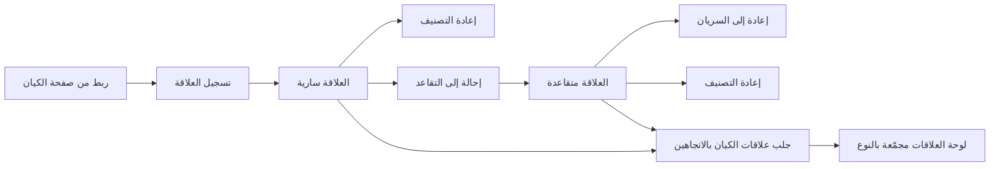
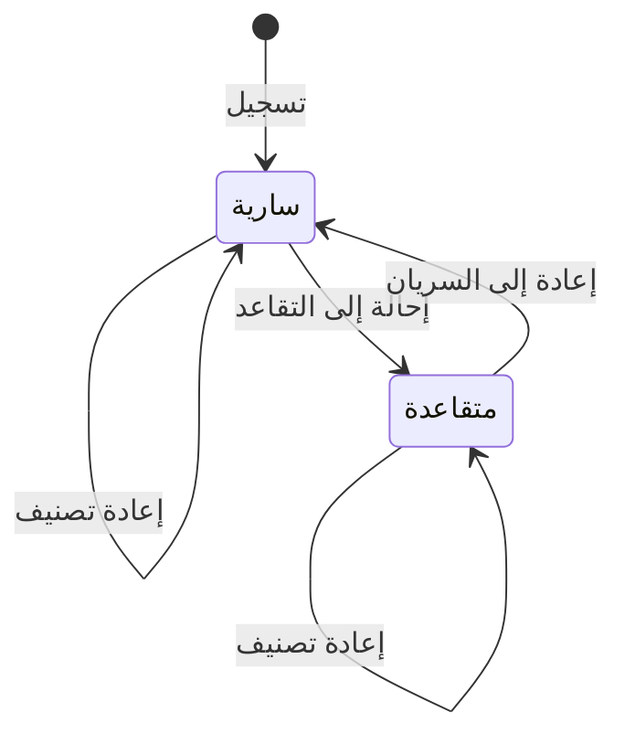

# إدارة العلاقات بين الكيانات

<!-- BEGIN GENERATED: doc -->
| البند | القيمة |
|---|---|
| المعرّف | FEAT-INF-RELATIONSHIPS |
| الإصدار | 0.1 |
| الحالة | مسودة |
| القدرة | CAP-03 إدارة المعلومات |
| القدرة الفرعية | CAP-03.01 الكيانات والعلاقات (R1) |
| الأدوار | المحلل؛ النظام؛ أي مستخدم مخوَّل |
| الشاشات | SCR-21 الكيانات والأحداث: العرض المحلول |
| حالات الاستخدام | UC-003 |
| القصص | 8: 5 من المواصفة، و3 جديدة |
<!-- END GENERATED: doc -->

## 1. نظرة عامة

### 1.1 القيمة

يربط المحلل الكيانات بعلاقات موثقة ومؤرخة ويرى كل علاقات الكيان في الاتجاهين.

### 1.2 النطاق

| البند | القيمة |
|---|---|
| المستخدمون | المحلل؛ وأي مستخدم مخوَّل يرى العلاقة |
| الشاشات | شاشة الكيانات والأحداث: العرض المحلول (SCR-21) |
| حالات الاستخدام | تسجيل علاقة بين كيانين، وإعادة تصنيفها، وإحالتها إلى التقاعد وإعادتها إلى السريان، وجلب علاقات الكيان في الاتجاهين، وربطها من صفحة الكيان، وعرضها مجمَّعة حسب النوع |
| المتطلبات | تمثيل العلاقة كنوع كائن له طرفان وفترة صحة ودليل ومصدر وثقة وتصنيف (REQ-INF-027) |
| خارج النطاق | إنهاء العلاقة في الواقع: يُسجَّل بتغيير في ادعاء وجودها لا بالإحالة إلى التقاعد؛ حذف العلاقة نهائيًا |

### 1.3 خريطة الميزة

**الشكل 1: مسار تسجيل العلاقة وعرضها**



**الشكل 2: دورة حالات العلاقة**



## 2. القواعد المشتركة

تنطبق على كل قصص الميزة، فلا تتكرر داخل القصص. وكل قصة تذكر ما يخصها فقط.

### 2.1 السياق المشترك

كل قصة تبدأ من ثلاثة شروط: مستأجر نشط، وحزمة السياسات الأساسية مفعّلة، ومستخدم مسجّل الدخول ومخوَّل. وتشير إليها القصص بخطوة واحدة: «بفرض السياق المشترك للميزة».

### 2.2 الصلاحية وعدم الإفصاح

- من لا يحق له رؤية العنصر يتلقى ردًا بشكل «غير متاح» تمامًا، فلا يعرف أنه موجود.
- من يرى العنصر ولا يحق له الإجراء يتلقى «لا تملك صلاحية هذا الإجراء».

### 2.3 أوامر تغيير الحالة

- **منع التكرار:** يُرسل كل أمر بمفتاح فريد، فإعادة الطلب نفسه لا تُنفَّذ مرتين.
- **حماية التعديل المتزامن:** يُرسل كل أمر بإصدار البيانات الذي يراه المستخدم. فإن عدّلها غيره في الأثناء، يُرفض الأمر.
- **السجل:** إن نجح الأمر، يُكتب حدثه وسجل التدقيق في المعاملة نفسها.

### 2.4 الرفض المشترك

```gherkin
# language: ar
خاصية: الرفض المشترك لأوامر الميزة

  سيناريو مخطط: رفض مشترك لكل أمر في الميزة
    بفرض السياق المشترك للميزة
    و <الحالة>
    عندما يُرسل المستخدم أي أمر من أوامر الميزة
    اذاً يُرفض برمز <الرمز> ويرى "<الرسالة>"
    و لا يتغير شيء

    امثلة:
      | الحالة                                  | الرمز                  | الرسالة                                                 |
      | العنصر خارج صلاحياته                    | NOT_FOUND              | غير متاح                                                |
      | العنصر مرئي له ولا يحق له الإجراء       | AUTHZ_DENIED           | لا تملك صلاحية هذا الإجراء                              |
      | غيره عدّل العنصر بعد أن فتحه            | VERSION_CONFLICT       | تغيّرت البيانات منذ فتحتها. راجع التغييرات ثم أعد المحاولة |
      | أعاد مفتاح منع التكرار بمحتوى مختلف     | IDEMPOTENCY_KEY_REUSED | طلب مكرر بمحتوى مختلف                                   |
      | البيانات ناقصة أو غير صحيحة             | VALIDATION_FAILED      | بعض البيانات ناقصة أو غير صحيحة. راجع الحقول المعلَّمة      |

  سيناريو: إعادة الطلب نفسه لا تُنفَّذ مرتين
    بفرض السياق المشترك للميزة
    و أمر نجح بمفتاح منع تكرار
    عندما يُعاد الطلب نفسه بالمفتاح نفسه
    اذاً تُعاد النتيجة الأولى ولا يُكتب حدث ثانٍ
```

### 2.5 عدم الإفصاح عن العلاقة الأعلى تصنيفًا

تنطبق هذه القاعدة على كل قصص الميزة التي تعرض علاقة أو تشير إلى وجودها: علاقة مصنَّفة أعلى من تصنيف أحد طرفيها أو كليهما تختفي تمامًا من كل سطح يصل إليه من لا يحمل التصريح الكافي لتصنيفها، ولو كان يرى الطرفين. التفصيل في القصة US-PLT-REL-HIGHER-LABEL.

## 3. الجودة وتعريف الاكتمال

### 3.1 متطلبات الجودة

<!-- BEGIN GENERATED: quality -->
| المرجع | الموقف | المطلوب |
|---|---|---|
| QAS-SEC-011 | inference test suite on search, suggestions, facets, graph and paths | 0 disclosures of hidden objects, hidden facts, hidden nodes/edges |
<!-- END GENERATED: quality -->

### 3.2 تعريف الاكتمال

القصة مكتملة حين تتحقق الشروط الخمسة:

1. سيناريوهاتها والقواعد المشتركة تمر في الاختبار الآلي.
2. فحوص البنية المعمارية تمر.
3. نصوص الواجهة والرسائل موجودة بالعربية والإنجليزية.
4. مراجعة الكود مكتملة.
5. ما تضيفه القصة نفسها في قسم «القواعد» تحقق.

## 4. فهرس القصص

<!-- BEGIN GENERATED: story-index -->
| المعرّف | القصة | النوع | الحالة |
|---|---|---|---|
| `US-BC02-REL-RECLASSIFY` | إعادة تصنيف العلاقة | أمر | مسودة |
| `US-BC02-REL-REGISTER` | تسجيل العلاقة | أمر | مسودة |
| `US-BC02-REL-REINSTATE` | إعادة العلاقة إلى السريان | أمر | مسودة |
| `US-BC02-REL-RETIRE` | إحالة العلاقة إلى التقاعد | أمر | مسودة |
| `US-BC02-Q-REL-LIST` | جلب: Relationships valid_at/known_at, both directions | جلب | مسودة |
| `US-UI-SCR21-RELATION-FORM` | ربط كيانين بعلاقة مؤرخة من صفحة الكيان | واجهة | مسودة |
| `US-UI-SCR21-RELATIONS-PANEL` | عرض علاقات الكيان في الاتجاهين مجمعة بالنوع | واجهة | مسودة |
| `US-PLT-REL-HIGHER-LABEL` | إخفاء العلاقة الأعلى تصنيفًا من طرفيها | منصة | مسودة |
<!-- END GENERATED: story-index -->

## 5. القصص

### 5.1 US-BC02-REL-RECLASSIFY — إعادة تصنيف العلاقة

| النوع | الإصدار | الأولوية | دون اتصال | الحالة |
|---|---|---|---|---|
| أمر | R1 | Must | لا | مسودة |

> **كـ** المحلل، **أريد** إعادة تصنيف العلاقة أمنيًا، **حتى** يطابق تصنيفها حساسية ما تدل عليه من ارتباط بين الطرفين.

**باختصار:** يغيّر المحلل صاحب سلطة التصنيف تصنيف العلاقة مع سبب، في أي حالة من حالتيها، دون أن تتغيّر.

#### القواعد

- **متى يُسمح:** يملك المحلل سلطة تغيير التصنيف حسب سياسة المستأجر (REQ-GOV-004).
- **من يُسمح له:** المحلل صاحب سلطة التصنيف.
- **البيانات:** التصنيف الجديد، والسبب.
- **الأثر:** يرفع إصدار الأمان للعلاقة، ويصل حدث «أُعيدت تصنيف العلاقة» إلى خدمة إصدار الأمان ومخابئ قرار الصلاحية وعرضي البحث والرسم البياني.

#### معايير القبول

```gherkin
# language: ar
خاصية: إعادة تصنيف العلاقة

  سيناريو: إعادة تصنيف علاقة بسلطة كافية
    بفرض السياق المشترك للميزة
    و علاقة "سارية" أو "متقاعدة"
    عندما يعيد المحلل تصنيفها إلى تصنيف أعلى مع سبب
    اذاً تبقى على حالتها ويرتفع إصدار أمانها
    و يُسجَّل حدث "أُعيدت تصنيف العلاقة"

  سيناريو مخطط: رفض خاص بإعادة التصنيف
    بفرض السياق المشترك للميزة
    و <الحالة>
    عندما يحاول إعادة تصنيف العلاقة
    اذاً يُرفض برمز <الرمز> ويرى "<الرسالة>"
    و لا يتغير شيء

    امثلة:
      | الحالة                                      | الرمز                                  | الرسالة                       |
      | لا يملك سلطة تغيير التصنيف حسب سياسة المستأجر | CLASSIFICATION_CHANGE_NOT_AUTHORIZED | لا تملك صلاحية تغيير التصنيف |
```

<details><summary>المراجع التقنية والتتبع</summary>

<!-- BEGIN GENERATED: refs US-BC02-REL-RECLASSIFY -->
| البند | المعرّف | المعنى |
|---|---|---|
| الواجهة البرمجية | `POST /api/v1/information/relationships/{id}/actions/reclassify` | — |
| الأمر | `CMD-REL-RECLASSIFY` | إعادة تصنيف العلاقة |
| السياسة | `POL-REL-RECLASSIFY` | Analyst · adapter service account؛ tenant match; object visible to subject (label ≤ clearance); write permiss… |
| الحدث | `EVT-REL-RECLASSIFIED` | يصل إلى: Security-version service (EVT-SEC-VERSION-INCREMENTED); PEP decision caches; Projection security-ver… |
| الكيان | `AGG-RELATIONSHIP` | العلاقة |
| الجدول | `information.relationships` | الجدول الرئيسي للعلاقة |
| وحدة النشر | DU-04 | — |
| المتطلب | REQ-INF-027 | The system shall represent relationships as objects with type, source, target, validity period, evidence, pro… |
| حالة الاستخدام | UC-003 | Manage Relationship |
| الاختبار | TST-RELATIONSHIP-SM، TST-SLC02-INVARIANTS | دورة حالات العلاقة، وثوابت الشريحة SLC-02 |
<!-- END GENERATED: refs US-BC02-REL-RECLASSIFY -->

</details>

### 5.2 US-BC02-REL-REGISTER — تسجيل العلاقة

| النوع | الإصدار | الأولوية | دون اتصال | الحالة |
|---|---|---|---|---|
| أمر | R1 | Must | لا | مسودة |

> **كـ** المحلل، **أريد** تسجيل علاقة موجّهة مؤرخة بين كيانين، **حتى** يُوثَّق الارتباط بينهما بفترة صحة ومصدر.

**باختصار:** يسجّل المحلل علاقة من نوع معروف بين طرفين بفترة صحة ومصدر واحد على الأقل، فتصير «سارية».

#### القواعد

- **متى يُسمح:** نوع العلاقة من الأنواع المعرّفة، وأنواع الطرفين مسموحة لهذا النوع.
- **من يُسمح له:** المحلل.
- **البيانات:** نوع العلاقة، والطرف المصدر والطرف الهدف، وفترة الصحة، ومصادرها (مصدر واحد على الأقل)، وتصنيفها.
- **الأثر:** يصل حدث «سُجِّلت العلاقة» إلى عرضي البحث والرسم البياني.

#### معايير القبول

```gherkin
# language: ar
خاصية: تسجيل العلاقة

  سيناريو: تسجيل علاقة جديدة بين كيانين
    بفرض السياق المشترك للميزة
    و نوع العلاقة من الأنواع المعرّفة وطرفاها مسموحان له
    عندما يسجّل المحلل العلاقة بفترة صحتها ومصدرها
    اذاً تصبح العلاقة "سارية"
    و يُسجَّل حدث "سُجِّلت العلاقة"

  سيناريو مخطط: رفض خاص بالتسجيل
    بفرض السياق المشترك للميزة
    و <الحالة>
    عندما يحاول المحلل تسجيل العلاقة
    اذاً يُرفض برمز <الرمز> ويرى "<الرسالة>"
    و لا يتغير شيء

    امثلة:
      | الحالة                                             | الرمز                | الرسالة                       |
      | نوع العلاقة خارج الأنواع المعرّفة أو طرفاها غير مسموحين | RELATIONSHIP_INVALID | بيانات العلاقة غير صحيحة     |
```

<details><summary>المراجع التقنية والتتبع</summary>

<!-- BEGIN GENERATED: refs US-BC02-REL-REGISTER -->
| البند | المعرّف | المعنى |
|---|---|---|
| الواجهة البرمجية | `POST /api/v1/information/relationships` | — |
| الأمر | `CMD-REL-REGISTER` | تسجيل العلاقة |
| السياسة | `POL-REL-REGISTER` | Analyst · adapter service account؛ tenant match; object visible to subject (label ≤ clearance); write permiss… |
| الحدث | `EVT-REL-REGISTERED` | يصل إلى: Search/Graph projections (SLC-05) |
| الكيان | `AGG-RELATIONSHIP` | العلاقة |
| الجدول | `information.relationships` | الجدول الرئيسي للعلاقة |
| وحدة النشر | DU-04 | — |
| المتطلب | REQ-INF-027 | The system shall represent relationships as objects with type, source, target, validity period, evidence, pro… |
| حالة الاستخدام | UC-003 | Manage Relationship |
| الاختبار | TST-RELATIONSHIP-SM، TST-SLC02-INVARIANTS | دورة حالات العلاقة، وثوابت الشريحة SLC-02 |
<!-- END GENERATED: refs US-BC02-REL-REGISTER -->

</details>

### 5.3 US-BC02-REL-REINSTATE — إعادة العلاقة إلى السريان

| النوع | الإصدار | الأولوية | دون اتصال | الحالة |
|---|---|---|---|---|
| أمر | R1 | Must | لا | مسودة |

> **كـ** المحلل، **أريد** إعادة علاقة متقاعدة إلى السريان، **حتى** أصحّح إحالتها إلى التقاعد بالخطأ.

**باختصار:** يعيد المحلل العلاقة المتقاعدة إلى «سارية» بسبب يذكره.

#### القواعد

- **متى يُسمح:** العلاقة «متقاعدة».
- **من يُسمح له:** المحلل.
- **البيانات:** السبب.
- **الأثر:** يصل حدث «أُعيدت العلاقة إلى السريان» إلى عرضي البحث والرسم البياني.

#### معايير القبول

```gherkin
# language: ar
خاصية: إعادة العلاقة إلى السريان

  سيناريو: إعادة علاقة متقاعدة إلى السريان
    بفرض السياق المشترك للميزة
    و علاقة "متقاعدة"
    عندما يعيدها المحلل إلى السريان مع سبب
    اذاً تصبح حالتها "سارية"
    و يُسجَّل حدث "أُعيدت العلاقة إلى السريان"

  سيناريو مخطط: رفض خاص بإعادة السريان
    بفرض السياق المشترك للميزة
    و <الحالة>
    عندما يحاول إعادتها إلى السريان
    اذاً يُرفض برمز <الرمز> ويرى "<الرسالة>"
    و لا يتغير شيء

    امثلة:
      | الحالة                | الرمز                                | الرسالة                                       |
      | لم يُذكر السبب        | REASON_REQUIRED                     | اذكر السبب                                    |
      | العلاقة "سارية" أصلًا | RELATIONSHIP_INVALID_STATE_TRANSITION | الوضع الحالي للعلاقة لا يسمح بهذا الإجراء    |
```

<details><summary>المراجع التقنية والتتبع</summary>

<!-- BEGIN GENERATED: refs US-BC02-REL-REINSTATE -->
| البند | المعرّف | المعنى |
|---|---|---|
| الواجهة البرمجية | `POST /api/v1/information/relationships/{id}/actions/reinstate` | — |
| الأمر | `CMD-REL-REINSTATE` | إعادة العلاقة إلى السريان |
| السياسة | `POL-REL-REINSTATE` | Analyst · adapter service account؛ tenant match; object visible to subject (label ≤ clearance); write permiss… |
| الحدث | `EVT-REL-REINSTATED` | يصل إلى: Search/Graph projections (SLC-05) |
| الكيان | `AGG-RELATIONSHIP` | العلاقة |
| الجدول | `information.relationships` | الجدول الرئيسي للعلاقة |
| وحدة النشر | DU-04 | — |
| المتطلب | REQ-INF-027 | The system shall represent relationships as objects with type, source, target, validity period, evidence, pro… |
| حالة الاستخدام | UC-003 | Manage Relationship |
| الاختبار | TST-RELATIONSHIP-SM، TST-SLC02-INVARIANTS | دورة حالات العلاقة، وثوابت الشريحة SLC-02 |
<!-- END GENERATED: refs US-BC02-REL-REINSTATE -->

</details>

### 5.4 US-BC02-REL-RETIRE — إحالة العلاقة إلى التقاعد

| النوع | الإصدار | الأولوية | دون اتصال | الحالة |
|---|---|---|---|---|
| أمر | R1 | Must | لا | مسودة |

> **كـ** المحلل، **أريد** إحالة علاقة أُنشئت بالخطأ إلى التقاعد، **حتى** لا تظهر بين العلاقات السارية.

**باختصار:** يحيل المحلل العلاقة الخاطئة إلى التقاعد بسبب يذكره، فتصبح حالتها «متقاعدة».

#### القواعد

- **متى يُسمح:** العلاقة «سارية»، والإحالة إلى التقاعد للعلاقة التي أُنشئت بالخطأ فقط. انتهاء علاقة صحيحة في الواقع يُسجَّل بتسجيل تغيير في ادعاء وجودها (ميزة تاريخ المعلومة عبر الزمن)، لا بالإحالة إلى التقاعد.
- **من يُسمح له:** المحلل.
- **البيانات:** السبب.
- **الأثر:** يصل حدث «أُحيلت العلاقة إلى التقاعد» إلى عرضي البحث والرسم البياني.

#### معايير القبول

```gherkin
# language: ar
خاصية: إحالة العلاقة إلى التقاعد

  سيناريو: إحالة علاقة أُنشئت بالخطأ إلى التقاعد
    بفرض السياق المشترك للميزة
    و علاقة "سارية" أُنشئت بالخطأ
    عندما يحيلها المحلل إلى التقاعد مع سبب
    اذاً تصبح حالتها "متقاعدة"
    و يُسجَّل حدث "أُحيلت العلاقة إلى التقاعد"

  سيناريو مخطط: رفض خاص بالإحالة إلى التقاعد
    بفرض السياق المشترك للميزة
    و <الحالة>
    عندما يحاول إحالة العلاقة إلى التقاعد
    اذاً يُرفض برمز <الرمز> ويرى "<الرسالة>"
    و لا يتغير شيء

    امثلة:
      | الحالة                  | الرمز                                | الرسالة                                       |
      | لم يُذكر السبب          | REASON_REQUIRED                     | اذكر السبب                                    |
      | العلاقة "متقاعدة" أصلًا | RELATIONSHIP_INVALID_STATE_TRANSITION | الوضع الحالي للعلاقة لا يسمح بهذا الإجراء    |
```

<details><summary>المراجع التقنية والتتبع</summary>

<!-- BEGIN GENERATED: refs US-BC02-REL-RETIRE -->
| البند | المعرّف | المعنى |
|---|---|---|
| الواجهة البرمجية | `POST /api/v1/information/relationships/{id}/actions/retire` | — |
| الأمر | `CMD-REL-RETIRE` | إحالة العلاقة إلى التقاعد |
| السياسة | `POL-REL-RETIRE` | Analyst · adapter service account؛ tenant match; object visible to subject (label ≤ clearance); write permiss… |
| الحدث | `EVT-REL-RETIRED` | يصل إلى: Search/Graph projections (SLC-05) |
| الكيان | `AGG-RELATIONSHIP` | العلاقة |
| الجدول | `information.relationships` | الجدول الرئيسي للعلاقة |
| وحدة النشر | DU-04 | — |
| المتطلب | REQ-INF-027 | The system shall represent relationships as objects with type, source, target, validity period, evidence, pro… |
| حالة الاستخدام | UC-003 | Manage Relationship |
| الاختبار | TST-RELATIONSHIP-SM، TST-SLC02-INVARIANTS | دورة حالات العلاقة، وثوابت الشريحة SLC-02 |
<!-- END GENERATED: refs US-BC02-REL-RETIRE -->

</details>

### 5.5 US-BC02-Q-REL-LIST — جلب علاقات الكيان في الاتجاهين

| النوع | الإصدار | الأولوية | دون اتصال | الحالة |
|---|---|---|---|---|
| جلب | R1 | Must | لا | مسودة |

> **كـ** أي مستخدم مخوَّل، **أريد** جلب علاقات كيان في الاتجاهين عند وقت صحة ومعرفة أختارهما، **حتى** أرى شبكة ارتباطاته كاملة.

**باختصار:** تُعاد علاقات الكيان الصادرة والواردة معًا، صفحةً بعد صفحة، وتُحذف العلاقات المحجوبة وطرفها الآخر تمامًا من النتيجة.

#### القواعد

- **من يرى ماذا:** أي مستخدم مخوَّل يرى علاقات الكيان ضمن نطاقه؛ العلاقة المحجوبة وطرفها الآخر يُحذفان من النتيجة تمامًا، لا يظهر عددهما ولا أي إشارة إليهما.
- **البيانات:** وقت الصحة ووقت المعرفة، والمؤشر والحد.

#### معايير القبول

```gherkin
# language: ar
خاصية: جلب علاقات الكيان في الاتجاهين

  سيناريو: عرض علاقات الكيان الصادرة والواردة
    بفرض السياق المشترك للميزة
    و لكيان علاقات صادرة وواردة، بعضها ضمن نطاق المستخدم وبعضها خارجه
    عندما يطلب المستخدم علاقات الكيان
    اذاً تُعاد العلاقات التي يحق له رؤيتها من الاتجاهين معًا
    و لا تظهر العلاقات المحجوبة ولا طرفها الآخر ولا عددها

  سيناريو: الصفحة التالية
    بفرض السياق المشترك للميزة
    و علاقات الكيان أكثر من صفحة
    عندما يطلب المستخدم الصفحة التالية بالمؤشر
    اذاً تُعاد العلاقات التالية دون تكرار ولا فجوة
```

<details><summary>المراجع التقنية والتتبع</summary>

<!-- BEGIN GENERATED: refs US-BC02-Q-REL-LIST -->
| البند | المعرّف | المعنى |
|---|---|---|
| الواجهة البرمجية | `GET /api/v1/information/entities/{entity_id}/relationships` | — |
| الاستعلام | `QRY-REL-LIST` | Relationships valid_at/known_at, both directions |
| السياسة | `POL-REL-LIST` | org scope ∩ classification rule; claims filtered by label |
| الكيان | `AGG-ENTITY` | الكيان |
| الجدول | `information.entities` | الجدول الرئيسي للكيان |
| وحدة النشر | DU-04 | — |
| المتطلب | REQ-INF-027 | The system shall represent relationships as objects with type, source, target, validity period, evidence, pro… |
| حالة الاستخدام | UC-003 | Manage Relationship |
| الاختبار | TST-ENTITY-SM، TST-SLC02-INVARIANTS | دورة حالات الكيان، وثوابت الشريحة SLC-02 |
<!-- END GENERATED: refs US-BC02-Q-REL-LIST -->

</details>

### 5.6 US-UI-SCR21-RELATION-FORM — ربط كيانين بعلاقة مؤرخة من صفحة الكيان

| النوع | الإصدار | الأولوية | دون اتصال | الحالة |
|---|---|---|---|---|
| واجهة | R1 | Must | لا | مسودة |

> **كـ** المحلل، **أريد** ربط الكيان المفتوح بكيان آخر بعلاقة موجّهة مؤرخة من داخل صفحته، **حتى** أسجّل العلاقة دون مغادرة سياق الكيان.

**باختصار:** يفتح المحلل نموذج علاقة من صفحة الكيان، وأحد الطرفين هو الكيان المفتوح مسبقًا، فيختار النوع والطرف الآخر وفترة الصحة والمصدر، وتُسجَّل العلاقة.

#### القواعد

- الطرف الأول في النموذج هو الكيان المفتوح، ولا يُعاد اختياره. **[Derived]**
- اتجاه العلاقة (الكيان المفتوح مصدرًا أو هدفًا) يُختار صريحًا قبل الحفظ. **[Derived]**

#### معايير القبول

```gherkin
# language: ar
خاصية: ربط كيانين بعلاقة مؤرخة من صفحة الكيان

  سيناريو: ربط علاقة جديدة من صفحة الكيان
    بفرض السياق المشترك للميزة
    و المحلل في صفحة كيان مفتوح
    عندما يختار نوع العلاقة والطرف الآخر واتجاهها وفترة صحتها ومصدرها ويحفظ
    اذاً تُسجَّل العلاقة بين الكيانين
    و تظهر في لوحة علاقات الكيان المفتوح فورًا
```

<details><summary>المراجع التقنية والتتبع</summary>

<!-- BEGIN GENERATED: refs US-UI-SCR21-RELATION-FORM -->
| البند | المعرّف | المعنى |
|---|---|---|
| الشاشة | SCR-21 | شاشة الكيانات والأحداث: العرض المحلول |
| حالة الاستخدام | UC-003 | Manage Relationship |
| المصدر | `[Derived]` | — |
| المتطلب | REQ-INF-027 | The system shall represent relationships as objects with type, source, target, validity period, evidence, pro… |
| حالة الاستخدام | UC-003 | Manage Relationship |
<!-- END GENERATED: refs US-UI-SCR21-RELATION-FORM -->

</details>

### 5.7 US-UI-SCR21-RELATIONS-PANEL — عرض علاقات الكيان في الاتجاهين مجمعة بالنوع

| النوع | الإصدار | الأولوية | دون اتصال | الحالة |
|---|---|---|---|---|
| واجهة | R1 | Must | لا | مسودة |

> **كـ** أي مستخدم مخوَّل، **أريد** رؤية علاقات الكيان الصادرة والواردة مجمَّعة حسب نوعها في لوحة واحدة، **حتى** أفهم شبكة ارتباطاته دفعة واحدة.

**باختصار:** تعرض لوحة الكيان علاقاته في الاتجاهين، مجمَّعة في مجموعات بنوع العلاقة، وتُسقط العلاقة المحجوبة وطرفها الآخر من اللوحة تمامًا.

#### القواعد

- تُجمَّع العلاقات في مجموعة لكل نوع، وداخل كل مجموعة تُميَّز الصادرة من الواردة. **[Derived]**
- العلاقة المحجوبة وطرفها الآخر لا يظهران في اللوحة ولا في عدد أي مجموعة.

#### معايير القبول

```gherkin
# language: ar
خاصية: عرض علاقات الكيان مجمعة بالنوع

  سيناريو: عرض اللوحة مجمَّعة حسب النوع
    بفرض السياق المشترك للميزة
    و لكيان علاقات من أنواع مختلفة في الاتجاهين، بعضها محجوب عن المستخدم
    عندما يفتح المستخدم لوحة علاقات الكيان
    اذاً تُعرض العلاقات المرئية مجمَّعة في مجموعة لكل نوع
    و لا تظهر العلاقة المحجوبة ولا طرفها الآخر ولا ضمن أي عدد
```

<details><summary>المراجع التقنية والتتبع</summary>

<!-- BEGIN GENERATED: refs US-UI-SCR21-RELATIONS-PANEL -->
| البند | المعرّف | المعنى |
|---|---|---|
| الشاشة | SCR-21 | شاشة الكيانات والأحداث: العرض المحلول |
| حالة الاستخدام | UC-003 | Manage Relationship |
| المتطلب | REQ-INF-027 | The system shall represent relationships as objects with type, source, target, validity period, evidence, pro… |
| حالة الاستخدام | UC-003 | Manage Relationship |
<!-- END GENERATED: refs US-UI-SCR21-RELATIONS-PANEL -->

</details>

### 5.8 US-PLT-REL-HIGHER-LABEL — إخفاء العلاقة الأعلى تصنيفًا من طرفيها

| النوع | الإصدار | الأولوية | دون اتصال | الحالة |
|---|---|---|---|---|
| منصة | R1 | Must | لا ينطبق | مسودة |

> **كـ** فريق المنصة، **أريد** أن تُخفى العلاقة المصنَّفة أعلى من تصنيف طرفيها عن من لا يحمل التصريح الكافي لها، **حتى** لا يُستدل من وجودها على معلومة أعلى حساسية مما يملك.

**باختصار:** تختفي العلاقة الأعلى تصنيفًا من طرفيها، وكل إشارة إلى وجودها، من البحث والاقتراحات والأوجه والرسم البياني والمسارات لمن لا يحمل تصريحها، دون أن يظل الطرفان مرئيين له بصفتهما مرتبطين.

#### القواعد

- علاقة قد تُصنَّف أعلى من كليهما؛ فتصير غير مرئية دون التصريح المطابق (INV-REL-02).
- الحجب يشمل كل سطح يُستنتج منه وجود العلاقة: نتائج البحث، اقتراحاته، الأوجه، جوار الرسم البياني ومساراته (QAS-SEC-011).

#### معايير القبول

```gherkin
# language: ar
خاصية: إخفاء العلاقة الأعلى تصنيفًا من طرفيها

  سيناريو مخطط: عدم إفصاح عن العلاقة المحجوبة
    بفرض علاقة مصنَّفة أعلى من تصنيف طرفيها ومستخدم بلا تصريح لها
    عندما يفحص اختبار الاستدلال <السطح>
    اذاً لا يظهر أي كشف عن كائن محجوب أو حقيقة محجوبة أو عقدة أو ضلع محجوب

    امثلة:
      | السطح                     |
      | نتائج البحث                |
      | الاقتراحات                 |
      | الأوجه                     |
      | جوار الرسم البياني ومساراته |
```

<details><summary>المراجع التقنية والتتبع</summary>

<!-- BEGIN GENERATED: refs US-PLT-REL-HIGHER-LABEL -->
| البند | المعرّف | المعنى |
|---|---|---|
| الجودة | QAS-SEC-011 | inference test suite on search, suggestions, facets, graph and paths → 0 disclosures of hidden objects, hidde… |
| المتطلب | REQ-INF-027 | The system shall represent relationships as objects with type, source, target, validity period, evidence, pro… |
| حالة الاستخدام | UC-003 | Manage Relationship |
<!-- END GENERATED: refs US-PLT-REL-HIGHER-LABEL -->

</details>

## 6. التتبع

<!-- BEGIN GENERATED: trace -->
| المتطلب | المعنى | القصص | الاختبار |
|---|---|---|---|
| REQ-INF-027 | The system shall represent relationships as objects with type, source, target, validity period, evidence, pro… | `US-BC02-Q-REL-LIST`، `US-BC02-REL-RECLASSIFY`، `US-BC02-REL-REGISTER`، `US-BC02-REL-REINSTATE`، `US-BC02-REL-RETIRE`، `US-PLT-REL-HIGHER-LABEL`، `US-UI-SCR21-RELATION-FORM`، `US-UI-SCR21-RELATIONS-PANEL` | TST-RELATIONSHIP-SM، TST-SLC02-INVARIANTS، TST-SLC05-INVARIANTS |
<!-- END GENERATED: trace -->

## 7. سجل التغييرات

| الإصدار | التاريخ | التغيير |
|---|---|---|
| 0.1 | — | هيكل مولَّد من خريطة الميزات |
| 0.2 | 2026-10-03 | كتابة القصص كاملة بمعيار القصص |
