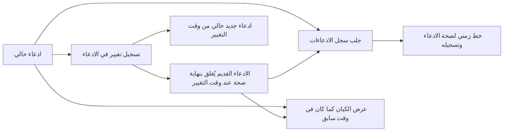
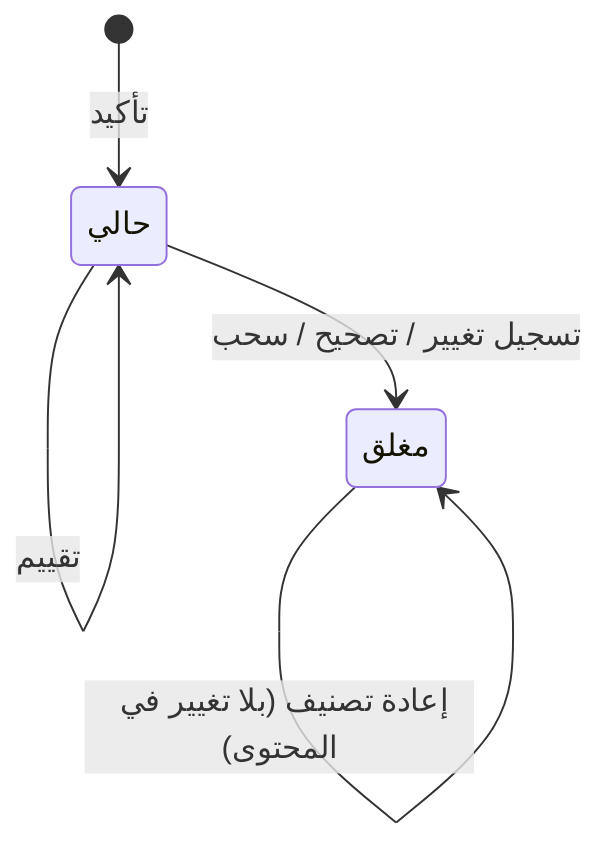

# تاريخ المعلومة عبر الزمن

<!-- BEGIN GENERATED: doc -->
| البند | القيمة |
|---|---|
| المعرّف | FEAT-INF-TIME-HISTORY |
| الإصدار | 0.2 |
| الحالة | مسودة |
| القدرة | CAP-03 إدارة المعلومات |
| القدرة الفرعية | CAP-03.04 الزمن والتاريخ (R1) |
| الأدوار | المحلل؛ أي مستخدم مخوَّل |
| الشاشات | SCR-21 الكيانات والأحداث: العرض المحلول، SCR-22 الادعاء والدليل والمصدر |
| حالات الاستخدام | UC-096 |
| القصص | 6: 2 من المواصفة، و4 جديدة |
<!-- END GENERATED: doc -->

## 1. نظرة عامة

### 1.1 القيمة

يعرف المستخدم ما كان صحيحًا في أي وقت وما كان معروفًا عنه حينها ويسجّل المحلل تغيّر القيم بمرور الزمن.

### 1.2 النطاق

| البند | القيمة |
|---|---|
| المستخدمون | المحلل؛ وأي مستخدم مخوَّل |
| الشاشات | شاشة الكيانات والأحداث: العرض المحلول (SCR-21)؛ شاشة الادعاء والدليل والمصدر (SCR-22) |
| حالات الاستخدام | تسجيل أن قيمة ادعاء تغيّرت في الواقع عند وقت محدد، وجلب سجل ادعاءات الكيان، وعرض الكيان كما كان في وقت سابق، وعرض خط زمني لصحة الادعاء وتسجيله وتصحيحاته |
| المتطلبات | تسجيل فترة صحة وفترة تسجيل لكل ادعاء من الفئة T1 (REQ-INF-022)؛ إعادة الحالة الصحيحة عند وقت صحة ووقت معرفة محددين (REQ-INF-023) |
| خارج النطاق | تصحيح قيمة كانت مسجَّلة بالخطأ من أصلها، وسحب الادعاء بلا بديل: أمران آخران على الادعاء خارج هذه الميزة |

### 1.3 خريطة الميزة

**الشكل 1: مسار تسجيل تغيّر الادعاء وعرضه عبر الزمن**



**الشكل 2: دورة حالات الادعاء**



## 2. القواعد المشتركة

تنطبق على كل قصص الميزة، فلا تتكرر داخل القصص. وكل قصة تذكر ما يخصها فقط.

### 2.1 السياق المشترك

كل قصة تبدأ من ثلاثة شروط: مستأجر نشط، وحزمة السياسات الأساسية مفعّلة، ومستخدم مسجّل الدخول ومخوَّل. وتشير إليها القصص بخطوة واحدة: «بفرض السياق المشترك للميزة».

### 2.2 الصلاحية وعدم الإفصاح

- من لا يحق له رؤية العنصر يتلقى ردًا بشكل «غير متاح» تمامًا، فلا يعرف أنه موجود.
- من يرى العنصر ولا يحق له الإجراء يتلقى «لا تملك صلاحية هذا الإجراء».

### 2.3 أوامر تغيير الحالة

- **منع التكرار:** يُرسل كل أمر بمفتاح فريد، فإعادة الطلب نفسه لا تُنفَّذ مرتين.
- **حماية التعديل المتزامن:** يُرسل كل أمر بإصدار البيانات الذي يراه المستخدم. فإن عدّلها غيره في الأثناء، يُرفض الأمر.
- **السجل:** إن نجح الأمر، يُكتب حدثه وسجل التدقيق في المعاملة نفسها.

### 2.4 الرفض المشترك

```gherkin
# language: ar
خاصية: الرفض المشترك لأوامر الميزة

  سيناريو مخطط: رفض مشترك لكل أمر في الميزة
    بفرض السياق المشترك للميزة
    و <الحالة>
    عندما يُرسل المستخدم أي أمر من أوامر الميزة
    اذاً يُرفض برمز <الرمز> ويرى "<الرسالة>"
    و لا يتغير شيء

    امثلة:
      | الحالة                                  | الرمز                  | الرسالة                                                 |
      | العنصر خارج صلاحياته                    | NOT_FOUND              | غير متاح                                                |
      | العنصر مرئي له ولا يحق له الإجراء       | AUTHZ_DENIED           | لا تملك صلاحية هذا الإجراء                              |
      | غيره عدّل العنصر بعد أن فتحه            | VERSION_CONFLICT       | تغيّرت البيانات منذ فتحتها. راجع التغييرات ثم أعد المحاولة |
      | أعاد مفتاح منع التكرار بمحتوى مختلف     | IDEMPOTENCY_KEY_REUSED | طلب مكرر بمحتوى مختلف                                   |
      | البيانات ناقصة أو غير صحيحة             | VALIDATION_FAILED      | بعض البيانات ناقصة أو غير صحيحة. راجع الحقول المعلَّمة      |

  سيناريو: إعادة الطلب نفسه لا تُنفَّذ مرتين
    بفرض السياق المشترك للميزة
    و أمر نجح بمفتاح منع تكرار
    عندما يُعاد الطلب نفسه بالمفتاح نفسه
    اذاً تُعاد النتيجة الأولى ولا يُكتب حدث ثانٍ
```

## 3. الجودة وتعريف الاكتمال

### 3.1 متطلبات الجودة

<!-- BEGIN GENERATED: quality -->
| المرجع | الموقف | المطلوب |
|---|---|---|
| QAS-TMP-001 | asks for state as of valid time T known at record time K | 100 % agreement with temporal oracle corpus |
<!-- END GENERATED: quality -->

### 3.2 تعريف الاكتمال

القصة مكتملة حين تتحقق الشروط الخمسة:

1. سيناريوهاتها والقواعد المشتركة تمر في الاختبار الآلي.
2. فحوص البنية المعمارية تمر.
3. نصوص الواجهة والرسائل موجودة بالعربية والإنجليزية.
4. مراجعة الكود مكتملة.
5. ما تضيفه القصة نفسها في قسم «القواعد» تحقق.

## 4. فهرس القصص

<!-- BEGIN GENERATED: story-index -->
| المعرّف | القصة | النوع | الحالة |
|---|---|---|---|
| `US-BC02-CLM-RECORD-CHANGE` | تسجيل تغيير في الادعاء | أمر | مسودة |
| `US-BC02-Q-ENT-CLAIMS` | جلب سجل ادعاءات الكيان | جلب | مسودة |
| `US-UI-SCR21-AS-OF` | عرض الكيان كما كان في وقت سابق | واجهة | مسودة |
| `US-UI-SCR22-CLAIM-TIMELINE` | خط زمني لصحة الادعاء وتسجيله وتصحيحاته | واجهة | مسودة |
| `US-PLT-TIME-INTERVALS` | فترتا الصحة والتسجيل لكل ادعاء دون تداخل | منصة | مسودة |
| `US-PLT-TIME-ORACLE` | مطابقة استعلامات الزمن لمرجع الاختبار كاملًا | منصة | مسودة |
<!-- END GENERATED: story-index -->

## 5. القصص

### 5.1 US-BC02-CLM-RECORD-CHANGE — تسجيل تغيير في الادعاء

| النوع | الإصدار | الأولوية | دون اتصال | الحالة |
|---|---|---|---|---|
| أمر | R1 | Must | لا | مسودة |

> **كـ** المحلل، **أريد** أن أسجّل أن قيمة ادعاء تغيّرت فعلًا في الواقع عند وقت محدد، **حتى** يحتفظ النظام بالقيمة القديمة في فترة صحتها الصحيحة ويبدأ القيمة الجديدة من وقت التغيّر.

**باختصار:** يغلق المحلل الادعاء الحالي عند وقت التغيير، فتُسجَّل القيمة القديمة بنهاية صحة عند ذلك الوقت، ويُؤكَّد ادعاء جديد بالقيمة الجديدة من ذلك الوقت.

#### القواعد

- **متى يُسمح:** الادعاء «حالي»، ووقت التغيير بين بداية صحته ونهايتها.
- **من يُسمح له:** المحلل.
- **البيانات:** وقت التغيير، والقيمة الجديدة، ومصادرها، ودرجة الثقة بها.
- **الأثر:** يصل حدث «تغيّر الادعاء» إلى محدِّث الصورة الحالية، وكاشف التعارض، وعضوية الموقف، وعرضي البحث والرسم البياني.

#### معايير القبول

```gherkin
# language: ar
خاصية: تسجيل تغيير في الادعاء

  سيناريو: تسجيل تغيّر قيمة ادعاء حالي
    بفرض السياق المشترك للميزة
    و ادعاء "حالي" بفترة صحة تشمل وقت التغيير
    عندما يسجّل المحلل القيمة الجديدة من وقت التغيير مع مصادرها ودرجة الثقة بها
    اذاً يُغلق الادعاء القديم بنهاية صحة عند وقت التغيير
    و يُؤكَّد ادعاء جديد بالقيمة الجديدة من وقت التغيير
    و يُسجَّل حدث "تغيّر الادعاء"

  سيناريو مخطط: رفض خاص بتسجيل التغيير
    بفرض السياق المشترك للميزة
    و <الحالة>
    عندما يحاول المحلل تسجيل التغيير
    اذاً يُرفض برمز <الرمز> ويرى "<الرسالة>"
    و لا يتغير شيء

    امثلة:
      | الحالة                                        | الرمز                         | الرسالة                                            |
      | وقت التغيير خارج فترة صحة الادعاء الحالية     | CHANGE_TIME_INVALID           | وقت التغيير يجب أن يقع داخل فترة صلاحية السجل     |
      | الادعاء "مغلق"                                 | CLAIM_INVALID_STATE_TRANSITION | الوضع الحالي للادعاء لا يسمح بهذا الإجراء          |
```

<details><summary>المراجع التقنية والتتبع</summary>

<!-- BEGIN GENERATED: refs US-BC02-CLM-RECORD-CHANGE -->
| البند | المعرّف | المعنى |
|---|---|---|
| الواجهة البرمجية | `POST /api/v1/information/claims/{id}/actions/record-change` | — |
| الأمر | `CMD-CLM-RECORD-CHANGE` | تسجيل تغيير في الادعاء |
| السياسة | `POL-CLM-RECORD-CHANGE` | Analyst · adapter service account · analysis-run identity (assert) · Analyst or verification re-evaluator sys… |
| الحدث | `EVT-CLM-CHANGED` | يصل إلى: Current-view maintainer (async materialized resolved views); Conflict detector (SLC-04); Situation m… |
| الكيان | `AGG-CLAIM` | الادعاء |
| الجدول | `information.claims` | الجدول الرئيسي للادعاء |
| وحدة النشر | DU-04 | — |
| المتطلب | REQ-INF-022 | The system shall record a valid-time interval and a record-time interval for every T1 claim. |
| الاختبار | TST-CLAIM-SM، TST-SLC02-INVARIANTS | دورة حالات الادعاء، وثوابت الشريحة SLC-02 |
<!-- END GENERATED: refs US-BC02-CLM-RECORD-CHANGE -->

</details>

### 5.2 US-BC02-Q-ENT-CLAIMS — جلب سجل ادعاءات الكيان

| النوع | الإصدار | الأولوية | دون اتصال | الحالة |
|---|---|---|---|---|
| جلب | R1 | Must | لا | مسودة |

> **كـ** أي مستخدم مخوَّل، **أريد** جلب سجل ادعاءات الكيان لسمة محددة عند وقتي صحة ومعرفة أختارهما، **حتى** أعرف ما كان معروفًا عنه وما تغيّر عبر الزمن.

**باختصار:** تُعاد ادعاءات الكيان لسمة محددة، شاملة المغلقة إن طُلب ذلك، صفحةً بعد صفحة.

#### القواعد

- **من يرى ماذا:** أي مستخدم مخوَّل يرى ادعاءات الكيان ضمن نطاقه وتصنيف كل ادعاء.
- **البيانات:** السمة، ووقت الصحة، ووقت المعرفة، وشمول الادعاءات المغلقة، والمؤشر والحد.

#### معايير القبول

```gherkin
# language: ar
خاصية: جلب سجل ادعاءات الكيان

  سيناريو: عرض سجل ادعاءات سمة محددة
    بفرض السياق المشترك للميزة
    و لكيان عدة ادعاءات متتالية على سمة واحدة
    عندما يطلب المستخدم سجلها بوقتي صحة ومعرفة محددين
    اذاً تُعاد الادعاءات الحالية عند ذلك الوقت كما كانت معروفة حينها

  سيناريو: شمول الادعاءات المغلقة
    بفرض السياق المشترك للميزة
    و لكيان ادعاء مغلق على سمة محددة
    عندما يطلب المستخدم السجل مع شمول المغلقة
    اذاً يظهر الادعاء المغلق ضمن النتيجة
```

<details><summary>المراجع التقنية والتتبع</summary>

<!-- BEGIN GENERATED: refs US-BC02-Q-ENT-CLAIMS -->
| البند | المعرّف | المعنى |
|---|---|---|
| الواجهة البرمجية | `GET /api/v1/information/entities/{entity_id}/claims` | — |
| الاستعلام | `QRY-ENT-CLAIMS` | Claim history (predicate, valid_at, known_at, include_closed) |
| السياسة | `POL-ENT-CLAIMS` | org scope ∩ classification rule; claims filtered by label |
| الكيان | `AGG-ENTITY` | الكيان |
| الجدول | `information.entities` | الجدول الرئيسي للكيان |
| وحدة النشر | DU-04 | — |
| المتطلب | REQ-INF-022 | The system shall record a valid-time interval and a record-time interval for every T1 claim. |
| الاختبار | TST-ENTITY-SM، TST-SLC02-INVARIANTS | دورة حالات الكيان، وثوابت الشريحة SLC-02 |
<!-- END GENERATED: refs US-BC02-Q-ENT-CLAIMS -->

</details>

### 5.3 US-UI-SCR21-AS-OF — عرض الكيان كما كان في وقت سابق

| النوع | الإصدار | الأولوية | دون اتصال | الحالة |
|---|---|---|---|---|
| واجهة | R1 | Must | لا | مسودة |

> **كـ** أي مستخدم مخوَّل، **أريد** عرض الكيان كما كان صحيحًا في وقت سابق أو كما كان معروفًا عنه في لحظة سابقة، **حتى** أفهم ما تغيّر وما عرفناه حينها.

**باختصار:** تتيح صفحة الكيان اختيار وقت صحة أو وقت معرفة أو كليهما، فتعرض صورته المحلولة عند ذلك الوقت، وتُعلِم المستخدم بوضوح أنه يرى حالة سابقة لا الحالية.

#### القواعد

- عند اختيار وقت سابق، تُعلَّم الصفحة بوضوح أنها تعرض حالة تاريخية لا الحالية. **[Derived]**
- ترك الوقتين دون تحديد يعرض الحالة الحالية كما تُعرف الآن.

#### معايير القبول

```gherkin
# language: ar
خاصية: عرض الكيان كما كان في وقت سابق

  سيناريو: عرض الحالة الحالية دون تحديد وقت
    بفرض السياق المشترك للميزة
    و كيان ضمن نطاق المستخدم
    عندما يفتح المستخدم صفحة الكيان دون تحديد وقت
    اذاً تُعرض حالته الحالية كما تُعرف الآن

  سيناريو: عرض الكيان كما كان صحيحًا وكما كان معروفًا في وقت سابق
    بفرض السياق المشترك للميزة
    و كيان ضمن نطاق المستخدم تغيّرت إحدى ادعاءاته منذ ذلك الوقت
    عندما يحدد المستخدم وقت صحة سابقًا، ووقت معرفة سابقًا مستقلًا عنه
    اذاً تُعرض حالة الكيان كما كانت صحيحة في وقت الصحة وكما كانت معروفة في وقت المعرفة
    و تُعلَّم الصفحة بوضوح أنها تعرض حالة تاريخية لا الحالية
```

<details><summary>المراجع التقنية والتتبع</summary>

<!-- BEGIN GENERATED: refs US-UI-SCR21-AS-OF -->
| البند | المعرّف | المعنى |
|---|---|---|
| حالة الاستخدام | UC-096 | Query State As-Of / As-Known-At |
| الشاشة | SCR-21 | شاشة الكيانات والأحداث: العرض المحلول |
| المصدر | `21-ui-design.md §3` | — |
| المتطلب | REQ-INF-023 | When a query specifies a valid time T, a record time K, or both, the system shall return the state valid at T… |
| حالة الاستخدام | UC-096 | Query State As-Of / As-Known-At |
<!-- END GENERATED: refs US-UI-SCR21-AS-OF -->

</details>

### 5.4 US-UI-SCR22-CLAIM-TIMELINE — خط زمني لصحة الادعاء وتسجيله وتصحيحاته

| النوع | الإصدار | الأولوية | دون اتصال | الحالة |
|---|---|---|---|---|
| واجهة | R1 | Must | لا | مسودة |

> **كـ** المحلل، **أريد** خطًا زمنيًا يعرض فترة صحة كل ادعاء وفترة تسجيله وسلسلة ما سبقه وما خلفه، **حتى** أتتبع كيف تغيّرت معرفتنا بالقيمة عبر الزمن.

**باختصار:** يعرض خط الادعاء فترتيه (الصحة والتسجيل) مرتبتين زمنيًا، وسلسلة الادعاءات التي خلفها وخلّفته، ويميّز بين تصحيح قيمة كانت خاطئة وبين تغيّر القيمة فعلًا في الواقع.

#### القواعد

- يميّز الخط بين «تصحيح» (يغيّر ما نعرفه عن الماضي) و«تغيّر في الواقع» (يضيف حقيقة جديدة من وقت التغيير)، بتسمية مختلفة لكل منهما. **[Derived]**
- يرتب الخط الادعاءات بفترة تسجيلها، ويصل كل ادعاء بسابقه في سلسلة الاستبدال عند وجوده.

#### معايير القبول

```gherkin
# language: ar
خاصية: خط زمني لصحة الادعاء وتسجيله وتصحيحاته

  سيناريو: عرض خط ادعاء له تغيّر سابق
    بفرض السياق المشترك للميزة
    و ادعاء حالي خلف ادعاءً مغلقًا بتسجيل تغيير سابق
    عندما يفتح المحلل الخط الزمني للادعاء
    اذاً يُعرض الادعاءان مرتبين بفترة تسجيل كل منهما
    و يُميَّز سبب الإغلاق: تصحيح أو تغيّر في الواقع
```

<details><summary>المراجع التقنية والتتبع</summary>

<!-- BEGIN GENERATED: refs US-UI-SCR22-CLAIM-TIMELINE -->
| البند | المعرّف | المعنى |
|---|---|---|
| الشاشة | SCR-22 | شاشة الادعاء والدليل والمصدر |
| المصدر | `temporal-model.md §3` | — |
| المصدر | `[Derived]` | — |
| المتطلب | REQ-INF-022 | The system shall record a valid-time interval and a record-time interval for every T1 claim. |
<!-- END GENERATED: refs US-UI-SCR22-CLAIM-TIMELINE -->

</details>

### 5.5 US-PLT-TIME-INTERVALS — فترتا الصحة والتسجيل لكل ادعاء دون تداخل

| النوع | الإصدار | الأولوية | دون اتصال | الحالة |
|---|---|---|---|---|
| منصة | R1 | Must | لا ينطبق | مسودة |

> **كـ** فريق المنصة، **أريد** أن تمنع البنية استخدام `created_at`/`updated_at` كزمن أعمال، وأن تمنع قاعدة البيانات تداخل فترتي تسجيل لادعاء منطقي واحد، **حتى** تبقى الأزمنة الخمسة مفصولة وصحيحة.

**باختصار:** فحص بنيوي يرفض أي كود يقرأ `created_at` أو `updated_at` بصفته زمن صحة أو تسجيل أو فعالية، وقيد في قاعدة البيانات يرفض أي فترتي تسجيل متداخلتين لنفس الادعاء المنطقي.

#### القواعد

- الفحص البنيوي (FIT-09) يرفض أي استخدام لـ`created_at`/`updated_at` كزمن أعمال.
- لا تداخل لفترتي تسجيل لنفس الادعاء المنطقي.

#### معايير القبول

```gherkin
# language: ar
خاصية: فترتا الصحة والتسجيل دون تداخل

  سيناريو: الفحص البنيوي يرفض زمن الأعمال الوهمي
    بفرض كود يستخدم created_at أو updated_at كزمن صحة أو تسجيل أو فعالية
    عندما يُشغَّل الفحص البنيوي FIT-09
    اذاً يفشل الفحص ويحدد موضع الاستخدام

  سيناريو: قاعدة البيانات ترفض تداخل فترتي تسجيل
    بفرض ادعاء منطقي له فترة تسجيل مفتوحة
    عندما يُحاول تسجيل فترة تسجيل أخرى متداخلة معها لنفس الادعاء المنطقي
    اذاً يُرفض الإدراج ولا تتغير الفترة القائمة
```

<details><summary>المراجع التقنية والتتبع</summary>

<!-- BEGIN GENERATED: refs US-PLT-TIME-INTERVALS -->
| البند | المعرّف | المعنى |
|---|---|---|
| فحص البنية | FIT-09 | No created_at/updated_at used as business time |
| المصدر | `temporal-model.md §2` | — |
| المتطلب | REQ-INF-022 | The system shall record a valid-time interval and a record-time interval for every T1 claim. |
<!-- END GENERATED: refs US-PLT-TIME-INTERVALS -->

</details>

### 5.6 US-PLT-TIME-ORACLE — مطابقة استعلامات الزمن لمرجع الاختبار كاملًا

| النوع | الإصدار | الأولوية | دون اتصال | الحالة |
|---|---|---|---|---|
| منصة | R1 | Must | لا ينطبق | مسودة |

> **كـ** فريق المنصة، **أريد** أن تطابق نتائج استعلامات وقت الصحة ووقت المعرفة مرجع اختبار زمني كاملًا، **حتى** نثق بدلالات الاستعلام الزمني قبل كل إصدار.

**باختصار:** تُشغَّل كل حالات مرجع الاختبار الزمني (As-Of-Valid وAs-Known-At) على البيئة، وتُقارن نتائجها بالمتوقع؛ أي اختلاف واحد يمنع الإصدار.

#### القواعد

- مرجع الاختبار يغطي الاستعلام بوقت صحة فقط، وبوقت معرفة فقط، وبكليهما معًا، والافتراضي الآن لكل منهما غير المحدد.
- التوافق المطلوب 100 % من حالات المرجع (QAS-TMP-001).

#### معايير القبول

```gherkin
# language: ar
خاصية: مطابقة استعلامات الزمن لمرجع الاختبار

  سيناريو: تشغيل مرجع الاختبار الزمني كاملًا
    بفرض مرجع اختبار زمني بحالاته الكاملة
    عندما تُشغَّل كل حالاته على البيئة
    اذاً تطابق كل النتائج المتوقع بنسبة 100 %

  سيناريو: اختلاف واحد يمنع الإصدار
    بفرض نتيجة واحدة من مرجع الاختبار الزمني تخالف المتوقع
    عندما يُشغَّل خط الإصدار
    اذاً يتوقف الإصدار ولا يُنشر
```

<details><summary>المراجع التقنية والتتبع</summary>

<!-- BEGIN GENERATED: refs US-PLT-TIME-ORACLE -->
| البند | المعرّف | المعنى |
|---|---|---|
| الجودة | QAS-TMP-001 | asks for state as of valid time T known at record time K → 100 % agreement with temporal oracle corpus |
| حالة الاستخدام | UC-096 | Query State As-Of / As-Known-At |
| المتطلب | REQ-INF-023 | When a query specifies a valid time T, a record time K, or both, the system shall return the state valid at T… |
| حالة الاستخدام | UC-096 | Query State As-Of / As-Known-At |
<!-- END GENERATED: refs US-PLT-TIME-ORACLE -->

</details>

## 6. التتبع

<!-- BEGIN GENERATED: trace -->
| المتطلب | المعنى | القصص | الاختبار |
|---|---|---|---|
| REQ-INF-022 | The system shall record a valid-time interval and a record-time interval for every T1 claim. | `US-BC02-CLM-RECORD-CHANGE`، `US-BC02-Q-ENT-CLAIMS`، `US-PLT-TIME-INTERVALS`، `US-UI-SCR22-CLAIM-TIMELINE` | TST-CLAIM-SM، TST-SLC02-INVARIANTS |
| REQ-INF-023 | When a query specifies a valid time T, a record time K, or both, the system shall return the state valid at T… | `US-PLT-TIME-ORACLE`، `US-UI-SCR21-AS-OF` | TST-SLC02-INVARIANTS |
<!-- END GENERATED: trace -->

## 7. سجل التغييرات

| الإصدار | التاريخ | التغيير |
|---|---|---|
| 0.1 | — | هيكل مولَّد من خريطة الميزات |
| 0.2 | 2026-10-03 | كتابة القصص كاملة بمعيار القصص |
