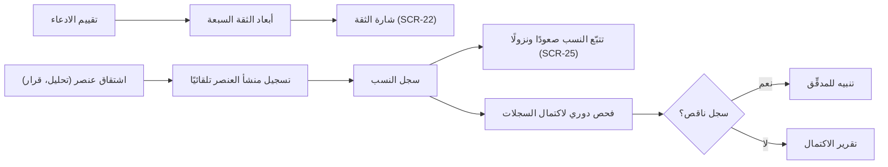

# الثقة بالمعلومة ومنشؤها

<!-- BEGIN GENERATED: doc -->
| البند | القيمة |
|---|---|
| المعرّف | FEAT-INF-TRUST-LINEAGE |
| الإصدار | 0.1 |
| الحالة | مسودة |
| القدرة | CAP-03 إدارة المعلومات |
| القدرة الفرعية | CAP-03.07 المنشأ والثقة (R1) |
| الأدوار | المحلل؛ المدقِّق؛ النظام |
| الشاشات | SCR-25 النسب (lineage)، SCR-22 الادعاء والدليل والمصدر |
| حالات الاستخدام | — |
| القصص | 8: 2 من المواصفة، و6 جديدة |
<!-- END GENERATED: doc -->

## 1. نظرة عامة

### 1.1 القيمة

يقيّم المحلل درجة الثقة بالمعلومة وحالة التحقق منها ويتتبّع من أين جاءت وكيف اشتُقّت.

### 1.2 النطاق

| البند | القيمة |
|---|---|
| المستخدمون | المحلل الذي يقيّم الادعاءات ويتتبّع نسبها؛ المدقِّق الذي يتحقق من وصول الاستدلال إلى مصادره؛ النظام الذي يسجّل النسب تلقائيًا ويعيد تقييم الادعاء عند انسحاب دليل |
| الشاشات | SCR-22 الادعاء والدليل والمصدر؛ SCR-25 النسب (lineage) |
| حالات الاستخدام | تقييم ثقة الادعاء وحالة التحقق منه دون تغيير قيمته؛ تتبّع نسب أي عنصر مشتق صعودًا إلى مصادره ونزولًا إلى ما اشتُق منه؛ فحص اكتمال سجلات النسب دوريًا |
| المتطلبات | عرض الثقة بأبعادها السبعة منفصلة دون درجة مجمعة إلزامية (REQ-INF-026)؛ تسجيل نسب كل عنصر مشتق: مدخلاته وإصداراتها، والتحويل وإصداره، والفاعل، ووقت التنفيذ (REQ-INF-035)؛ رفض أي عنصر من المستوى T1 يُقدَّم بلا مصدر (REQ-INF-037) |
| خارج النطاق | حساب درجة ثقة مجمعة واحدة بديلة عن الأبعاد السبعة؛ تعديل قيمة الادعاء أو تصحيحه أو إعادة تصنيفه — تغطيها قصص أخرى من إدارة الادعاءات؛ عرض رسم العلاقات الكامل بين الكيانات — تغطيه ميزة الرسم والجوار |

### 1.3 خريطة الميزة

**الشكل 1: من تقييم الادعاء إلى تتبّع نسبه**



## 2. القواعد المشتركة

تنطبق على كل قصص الميزة، فلا تتكرر داخل القصص. وكل قصة تذكر ما يخصها فقط.

### 2.1 السياق المشترك

كل قصة تبدأ من ثلاثة شروط: مستأجر نشط، وحزمة السياسات الأساسية مفعّلة، ومستخدم مسجّل الدخول ومخوَّل. وتشير إليها القصص بخطوة واحدة: «بفرض السياق المشترك للميزة».

### 2.2 الصلاحية وعدم الإفصاح

- من لا يحق له رؤية العنصر يتلقى ردًا بشكل «غير متاح» تمامًا، فلا يعرف أنه موجود.
- من يرى العنصر ولا يحق له الإجراء يتلقى «لا تملك صلاحية هذا الإجراء».

### 2.3 أوامر تغيير الحالة

- **منع التكرار:** يُرسل كل أمر بمفتاح فريد، فإعادة الطلب نفسه لا تُنفَّذ مرتين.
- **حماية التعديل المتزامن:** يُرسل كل أمر بإصدار البيانات الذي يراه المستخدم. فإن عدّلها غيره في الأثناء، يُرفض الأمر.
- **السجل:** إن نجح الأمر، يُكتب حدثه وسجل التدقيق في المعاملة نفسها.

### 2.4 الرفض المشترك

```gherkin
# language: ar
خاصية: الرفض المشترك لأوامر الميزة

  سيناريو مخطط: رفض مشترك لكل أمر في الميزة
    بفرض السياق المشترك للميزة
    و <الحالة>
    عندما يُرسل المستخدم أي أمر من أوامر الميزة
    اذاً يُرفض برمز <الرمز> ويرى "<الرسالة>"
    و لا يتغير شيء

    امثلة:
      | الحالة                                  | الرمز                  | الرسالة                                                 |
      | العنصر خارج صلاحياته                    | NOT_FOUND              | غير متاح                                                |
      | العنصر مرئي له ولا يحق له الإجراء       | AUTHZ_DENIED           | لا تملك صلاحية هذا الإجراء                              |
      | غيره عدّل العنصر بعد أن فتحه            | VERSION_CONFLICT       | تغيّرت البيانات منذ فتحتها. راجع التغييرات ثم أعد المحاولة |
      | أعاد مفتاح منع التكرار بمحتوى مختلف     | IDEMPOTENCY_KEY_REUSED | طلب مكرر بمحتوى مختلف                                   |
      | البيانات ناقصة أو غير صحيحة             | VALIDATION_FAILED      | بعض البيانات ناقصة أو غير صحيحة. راجع الحقول المعلَّمة      |

  سيناريو: إعادة الطلب نفسه لا تُنفَّذ مرتين
    بفرض السياق المشترك للميزة
    و أمر نجح بمفتاح منع تكرار
    عندما يُعاد الطلب نفسه بالمفتاح نفسه
    اذاً تُعاد النتيجة الأولى ولا يُكتب حدث ثانٍ
```

## 3. الجودة وتعريف الاكتمال

### 3.1 متطلبات الجودة

<!-- BEGIN GENERATED: quality -->
| المرجع | الموقف | المطلوب |
|---|---|---|
| QAS-PERF-014 | lineage trace depth 5 | p95 ≤ 2 s |
| QAS-TRC-001 | follows a decision back to its sources | 100 % of decisions and T1 derived objects traceable to sources |
<!-- END GENERATED: quality -->

### 3.2 تعريف الاكتمال

القصة مكتملة حين تتحقق الشروط الخمسة:

1. سيناريوهاتها والقواعد المشتركة تمر في الاختبار الآلي.
2. فحوص البنية المعمارية تمر.
3. نصوص الواجهة والرسائل موجودة بالعربية والإنجليزية.
4. مراجعة الكود مكتملة.
5. ما تضيفه القصة نفسها في قسم «القواعد» تحقق.

## 4. فهرس القصص

<!-- BEGIN GENERATED: story-index -->
| المعرّف | القصة | النوع | الحالة |
|---|---|---|---|
| `US-BC02-CLM-ASSESS` | تقييم الادعاء | أمر | مسودة |
| `US-BC02-Q-LIN-TRACE` | جلب: Upstream/downstream lineage, depth ≤ 10; hidden nodes cut per policy | جلب | مسودة |
| `US-UI-SCR22-CONFIDENCE-BADGE` | شارة ثقة تفتح على أبعادها السبعة | واجهة | مسودة |
| `US-UI-SCR25-LINEAGE-GRAPH` | تتبع منشأ المعلومة صعودًا ونزولًا | واجهة | مسودة |
| `US-PLT-CONFIDENCE-DIMENSIONS` | إرجاع أبعاد الثقة منفصلة دون درجة إلزامية | منصة | مسودة |
| `US-PLT-LINEAGE-RECORD` | تسجيل منشأ كل عنصر مشتق تلقائيًا | منصة | مسودة |
| `US-PLT-LINEAGE-TRACE-PERF` | تتبع المنشأ بعمق خمسة خلال ثانيتين | منصة | مسودة |
| `US-OPS-LINEAGE-COMPLETENESS` | فحص دوري لاكتمال سجلات المنشأ | تشغيل | مسودة |
<!-- END GENERATED: story-index -->

## 5. القصص

### 5.1 US-BC02-CLM-ASSESS — تقييم الادعاء

| النوع | الإصدار | الأولوية | دون اتصال | الحالة |
|---|---|---|---|---|
| أمر | R1 | Must | لا | مسودة |

> **كـ** المحلل، **أريد** أن أقيّم ثقة الادعاء وحالة التحقق منه، **حتى** تعكس المعلومة ما تأكد منه فعليًا دون تغيير قيمتها.

**باختصار:** يحدّث المحلل بُعدي ثقة المعلومة وحالة التحقق لادعاء "حالي" بسبب يوضّح التقييم، دون أن تتغير قيمته أو فترته أو مصادره. ويصدر النظام الأمر نفسه بهوية إعادة التحقق تلقائيًا حين ينسحب دليل يدعم الادعاء.

#### القواعد

- **متى يُسمح:** الادعاء في حالة "حالي"، والتحديث يقتصر على ثقة المعلومة وحالة التحقق دون تغيير القيمة أو الفترة أو المصادر. وينفّذه المحلل الذي يحق له الكتابة في نطاق الادعاء، وقد يصدره النظام تلقائيًا بهوية إعادة التحقق عند انسحاب دليل يدعم الادعاء.
- **البيانات:** ثقة المعلومة (من 1 "مؤكدة من مصادر مستقلة" إلى 6 "لا يمكن الحكم")، وحالة التحقق (غير متحقَق، متحقَق جزئيًا، متحقَق، متنازع عليه، مرفوض)، والسبب (إلزامي).
- **الأثر:** يُسجَّل حدث "قُيِّم الادعاء"، ويصل إلى العرض الموحَّد للكيان، وكاشف التعارض، وعضوية الموقف، والبحث الموحد.

#### معايير القبول

```gherkin
# language: ar
خاصية: تقييم الادعاء

  سيناريو: المحلل يحدّث ثقة ادعاء حالي
    بفرض السياق المشترك للميزة
    و ادعاء "حالي" يحق للمحلل الكتابة فيه
    عندما يقيّمه بثقة معلومة جديدة وحالة تحقق جديدة وسبب
    اذاً يبقى الادعاء "حالي" بقيمته وفترته ومصادره دون تغيير
    و يُسجَّل حدث "قُيِّم الادعاء"

  سيناريو مخطط: رفض خاص بتقييم الادعاء
    بفرض السياق المشترك للميزة
    و <الحالة>
    عندما يحاول تقييم الادعاء
    اذاً يُرفض برمز <الرمز> ويرى "<الرسالة>"
    و لا يتغير شيء

    امثلة:
      | الحالة                                          | الرمز                          | الرسالة                                              |
      | الادعاء "مغلق"                                  | CLAIM_INVALID_STATE_TRANSITION | الوضع الحالي للادعاء لا يسمح بهذا الإجراء            |
      | السبب فارغ                                      | VALIDATION_FAILED              | السبب مطلوب                                          |
      | التعديل يمس القيمة أو الفترة أو المصادر         | ASSESSMENT_INVALID             | التعديل المطلوب غير مسموح أو غير صحيح في هذا التقييم |
```

<details><summary>المراجع التقنية والتتبع</summary>

<!-- BEGIN GENERATED: refs US-BC02-CLM-ASSESS -->
| البند | المعرّف | المعنى |
|---|---|---|
| الواجهة البرمجية | `POST /api/v1/information/claims/{id}/actions/assess` | — |
| الأمر | `CMD-CLM-ASSESS` | تقييم الادعاء |
| السياسة | `POL-CLM-ASSESS` | Analyst · adapter service account · analysis-run identity (assert) · Analyst or verification re-evaluator sys… |
| الحدث | `EVT-CLM-ASSESSED` | يصل إلى: Current-view maintainer (async materialized resolved views); Conflict detector (SLC-04); Situation m… |
| الكيان | `AGG-CLAIM` | الادعاء |
| الجدول | `information.claims` | الجدول الرئيسي للادعاء |
| وحدة النشر | DU-04 | — |
| المتطلبات | REQ-INF-026، REQ-INF-037 | معانيها في القسم 6. التتبع |
| الاختبار | TST-CLAIM-SM، TST-SLC02-INVARIANTS | دورة حالات الادعاء، وثوابت الشريحة SLC-02 |
<!-- END GENERATED: refs US-BC02-CLM-ASSESS -->

</details>

### 5.2 US-BC02-Q-LIN-TRACE — تتبّع نسب الكائن

| النوع | الإصدار | الأولوية | دون اتصال | الحالة |
|---|---|---|---|---|
| جلب | R1 | Must | لا | مسودة |

> **كـ** أي مستخدم مخوَّل، **أريد** تتبّع نسب الكائن المشتق صعودًا إلى مصادره ونزولًا إلى ما اشتُق منه، **حتى** أعرف من أين جاءت المعلومة وكيف.

**باختصار:** يعيد الاستعلام مدخلات الكائن ومخرجاته حتى عمق عشر خطوات صعودًا أو نزولًا، بأثر رجعي عبر وقت الحدوث أو وقت العلم، ويقطع كل عقدة لا يحق للمستخدم رؤيتها وما خلفها دون أن تظهر.

#### القواعد

- **من يُسمح له:** أي مستخدم مخوَّل ضمن نطاقه المسموح؛ يُعاد فحص صلاحية كل عنصر في مسار النسب على حدة.
- **البيانات (المرشحات):** وقت الحدوث ووقت العلم بأثر رجعي، والعمق حتى عشر خطوات.

#### معايير القبول

```gherkin
# language: ar
خاصية: تتبّع نسب الكائن

  سيناريو: تتبّع النسب صعودًا ونزولًا
    بفرض السياق المشترك للميزة
    و كائن مشتق له مدخلات وما اشتُق منه، كلها مرئية للمستخدم
    عندما يطلب نسبه بعمق عشر خطوات
    اذاً تُعاد المدخلات والمخرجات حتى العمق المطلوب، وكل عنصر بعد إعادة فحص صلاحيته

  سيناريو: عقدة محجوبة تقطع ما خلفها
    بفرض السياق المشترك للميزة
    و في مسار النسب عقدة لا يحق للمستخدم رؤيتها
    عندما يطلب نسب الكائن
    اذاً تُقطع تلك العقدة وكل ما خلفها دون أن تظهر أو يُشار إلى وجودها
```

<details><summary>المراجع التقنية والتتبع</summary>

<!-- BEGIN GENERATED: refs US-BC02-Q-LIN-TRACE -->
| البند | المعرّف | المعنى |
|---|---|---|
| الواجهة البرمجية | `GET /api/v1/information/lineage/{object_urn}` | — |
| الاستعلام | `QRY-LIN-TRACE` | Upstream/downstream lineage, depth ≤ 10; hidden nodes cut per policy |
| السياسة | `POL-LIN-TRACE` | org scope ∩ classification rule; claims filtered by label |
| المتطلب | REQ-INF-035 | The system shall record lineage for every derived object: inputs and their versions, the transformation and i… |
<!-- END GENERATED: refs US-BC02-Q-LIN-TRACE -->

</details>

### 5.3 US-UI-SCR22-CONFIDENCE-BADGE — شارة ثقة تفتح على أبعادها السبعة

| النوع | الإصدار | الأولوية | دون اتصال | الحالة |
|---|---|---|---|---|
| واجهة | R1 | Must | لا | مسودة |

> **كـ** المستخدم، **أريد** أن أرى شارة ثقة مجمَّعة تتفتّح على أبعادها السبعة، **حتى** أفهم أساس الثقة بالمعلومة لا رقمًا واحدًا بلا تفسير.

**باختصار:** تعرض شاشة الادعاء والدليل والمصدر شارة ثقة مشتقَّة، وفتحها يُظهر الأبعاد السبعة: موثوقية المصدر، ثقة المعلومة، جودة البيانات، حالة التحقق، الحداثة، الاكتمال، وعدم اليقين، دون أي درجة مجمّعة إلزامية.

#### معايير القبول

```gherkin
# language: ar
خاصية: شارة الثقة بأبعادها السبعة

  سيناريو: فتح الشارة يعرض الأبعاد السبعة
    بفرض السياق المشترك للميزة
    و ادعاء له كل أبعاد الثقة السبعة مسجَّلة
    عندما يفتح المستخدم شارة الثقة
    اذاً تُعرض الأبعاد السبعة منفصلة دون درجة مجمعة إلزامية

  سيناريو: ادعاء متنازع عليه
    بفرض السياق المشترك للميزة
    و حالة التحقق للادعاء "متنازع عليه"
    عندما يفتح المستخدم شارة الثقة
    اذاً يظهر بُعد حالة التحقق موسومًا "متنازع عليه"
```

<details><summary>المراجع التقنية والتتبع</summary>

<!-- BEGIN GENERATED: refs US-UI-SCR22-CONFIDENCE-BADGE -->
| البند | المعرّف | المعنى |
|---|---|---|
| الشاشة | SCR-22 | شاشة الادعاء والدليل والمصدر |
| المصدر | `21-ui-design.md §12` | — |
| المتطلب | REQ-INF-026 | The system shall expose confidence as separate dimensions: source reliability, information confidence, data q… |
<!-- END GENERATED: refs US-UI-SCR22-CONFIDENCE-BADGE -->

</details>

### 5.4 US-UI-SCR25-LINEAGE-GRAPH — تتبع منشأ المعلومة صعودًا ونزولًا

| النوع | الإصدار | الأولوية | دون اتصال | الحالة |
|---|---|---|---|---|
| واجهة | R1 | Must | لا | مسودة |

> **كـ** المحلل، **أريد** تتبّع منشأ المعلومة صعودًا ونزولًا في رسم تفاعلي، **حتى** أفهم من أين جاءت المعلومة وكيف اشتُقَّت.

**باختصار:** تعرض الشاشة رسم النسب حول الكائن المحدَّد، وتسمح بالتوسُّع صعودًا نحو مصادره ونزولًا نحو ما اشتُق منه حتى عمق عشر خطوات، وتقطع كل عقدة محجوبة ما خلفها دون أن تظهر.

#### معايير القبول

```gherkin
# language: ar
خاصية: رسم تتبّع النسب

  سيناريو: عرض نسب كائن
    بفرض السياق المشترك للميزة
    و كائن مشتق له مدخلات ومخرجات مرئية للمحلل
    عندما يفتح المحلل شاشة النسب لهذا الكائن
    اذاً يُعرض رسم يصل مدخلاته الأصلية بمخرجاته المشتقة، وكل عقدة بنوعها ووقتها وفاعلها

  سيناريو: التوسُّع صعودًا حتى حد العمق
    بفرض السياق المشترك للميزة
    و رسم نسب مفتوح على عمق أقل من الحد الأقصى
    عندما يطلب المحلل توسيع المسار صعودًا
    اذاً تُضاف العقدة التالية ما لم يتجاوز العمق عشر خطوات
```

<details><summary>المراجع التقنية والتتبع</summary>

<!-- BEGIN GENERATED: refs US-UI-SCR25-LINEAGE-GRAPH -->
| البند | المعرّف | المعنى |
|---|---|---|
| الشاشة | SCR-25 | شاشة النسب (lineage) |
| الجودة | QAS-TRC-001 | follows a decision back to its sources → 100 % of decisions and T1 derived objects traceable to sources |
| المتطلب | REQ-INF-035 | The system shall record lineage for every derived object: inputs and their versions, the transformation and i… |
<!-- END GENERATED: refs US-UI-SCR25-LINEAGE-GRAPH -->

</details>

### 5.5 US-PLT-CONFIDENCE-DIMENSIONS — إرجاع أبعاد الثقة منفصلة دون درجة إلزامية

| النوع | الإصدار | الأولوية | دون اتصال | الحالة |
|---|---|---|---|---|
| منصة | R1 | Must | لا ينطبق | مسودة |

> **كـ** فريق المنصة، **أريد** أن أعيد كل بُعد من أبعاد الثقة السبعة منفصلًا دون حساب درجة مجمَّعة إلزامية، **حتى** تبني الشاشات والتقارير شارتها الخاصة دون افتراض رقم واحد.

**باختصار:** كل استجابة تحمل كائنًا من النوع T1 تُرجع الأبعاد السبعة كحقول منفصلة، والحداثة تُحسب عند القراءة من فرق الوقت الحالي عن وقت الملاحظة أو بداية الصلاحية، بعتبة تختلف حسب نوع العبارة، دون أن تُخزَّن.

#### معايير القبول

```gherkin
# language: ar
خاصية: أبعاد الثقة السبعة منفصلة

  سيناريو: إرجاع الأبعاد السبعة لادعاء
    بفرض ادعاء مسجَّل بكل أبعاد الثقة
    عندما تُطلب بياناته
    اذاً تُعاد الأبعاد السبعة كحقول منفصلة دون درجة مجمعة إلزامية

  سيناريو: الحداثة تُحسب عند كل قراءة
    بفرض ادعاء بوقت ملاحظة يتجاوز عتبة التقادم لعبارته
    عندما تُطلب بياناته
    اذاً يُحسب بُعد الحداثة "متقادمة" في تلك اللحظة دون أن يُخزَّن
```

<details><summary>المراجع التقنية والتتبع</summary>

<!-- BEGIN GENERATED: refs US-PLT-CONFIDENCE-DIMENSIONS -->
| البند | المعرّف | المعنى |
|---|---|---|
| المصدر | `confidence-model.md` | — |
| المتطلب | REQ-INF-026 | The system shall expose confidence as separate dimensions: source reliability, information confidence, data q… |
<!-- END GENERATED: refs US-PLT-CONFIDENCE-DIMENSIONS -->

</details>

### 5.6 US-PLT-LINEAGE-RECORD — تسجيل منشأ كل عنصر مشتق تلقائيًا

| النوع | الإصدار | الأولوية | دون اتصال | الحالة |
|---|---|---|---|---|
| منصة | R1 | Must | لا ينطبق | مسودة |

> **كـ** فريق المنصة، **أريد** أن أسجّل منشأ كل عنصر مشتق تلقائيًا، **حتى** يتبع المحلل والمدقِّق أي نتيجة إلى مصادرها دون تدخّل يدوي.

**باختصار:** عند كل اشتقاق (تحليل، تحويل، قرار) يُسجَّل سجل نسب يحمل مدخلاته وإصداراتها، والتحويل وإصداره، والفاعل، ووقت التنفيذ، في المعاملة نفسها التي أنشأت العنصر المشتق.

#### معايير القبول

```gherkin
# language: ar
خاصية: تسجيل منشأ العنصر المشتق تلقائيًا

  سيناريو: اشتقاق عنصر جديد
    بفرض عملية اشتقاق تنتج عنصرًا جديدًا من مدخلات معروفة
    عندما تكتمل العملية
    اذاً يُسجَّل سجل نسب يحمل المدخلات وإصداراتها والتحويل وإصداره والفاعل ووقت التنفيذ
```

<details><summary>المراجع التقنية والتتبع</summary>

<!-- BEGIN GENERATED: refs US-PLT-LINEAGE-RECORD -->
| البند | المعرّف | المعنى |
|---|---|---|
| الجودة | QAS-TRC-001 | follows a decision back to its sources → 100 % of decisions and T1 derived objects traceable to sources |
| المتطلب | REQ-INF-035 | The system shall record lineage for every derived object: inputs and their versions, the transformation and i… |
<!-- END GENERATED: refs US-PLT-LINEAGE-RECORD -->

</details>

### 5.7 US-PLT-LINEAGE-TRACE-PERF — تتبع المنشأ بعمق خمسة خلال ثانيتين

| النوع | الإصدار | الأولوية | دون اتصال | الحالة |
|---|---|---|---|---|
| منصة | R1 | Should | لا ينطبق | مسودة |

> **كـ** فريق المنصة، **أريد** أن يُنجَز تتبّع النسب بعمق خمس خطوات خلال ثانيتين عند المئين 95، **حتى** تبقى شاشة النسب سريعة تحت حمل التصميم.

**باختصار:** يُبنى مخطط النسب ببنية تسمح بتتبّعه رجوعًا دون المرور بكل الأحداث التاريخية، فيصل تتبّع خمس خطوات إلى هدفه الزمني تحت حمل التصميم.

#### معايير القبول

```gherkin
# language: ar
خاصية: أداء تتبّع النسب

  سيناريو: الهدف تحت حمل التصميم
    بفرض حمل بمزيج استعلامات تتبّع نسب بعمق خمس خطوات بحجم بيانات التصميم
    عندما يُنفَّذ تتبّع النسب
    اذاً يكون زمن الاستجابة ثانيتين أو أقل عند المئين 95
```

<details><summary>المراجع التقنية والتتبع</summary>

<!-- BEGIN GENERATED: refs US-PLT-LINEAGE-TRACE-PERF -->
| البند | المعرّف | المعنى |
|---|---|---|
| الجودة | QAS-PERF-014 | lineage trace depth 5 → p95 ≤ 2 s |
<!-- END GENERATED: refs US-PLT-LINEAGE-TRACE-PERF -->

</details>

### 5.8 US-OPS-LINEAGE-COMPLETENESS — فحص دوري لاكتمال سجلات المنشأ

| النوع | الإصدار | الأولوية | دون اتصال | الحالة |
|---|---|---|---|---|
| تشغيل | R1 | Must | لا ينطبق | مسودة |

> **كـ** فريق التشغيل، **أريد** فحصًا دوريًا لاكتمال سجلات النسب، **حتى** أكتشف عنصرًا مشتقًا بلا سجل نسب قبل أن يعتمد عليه قرار.

**باختصار:** يفحص النظام دوريًا أن كل عنصر مشتق من المستوى T1 له سجل نسب كامل، ويرفع تنبيهًا لفريق التشغيل عند وجود عنصر ناقص. **[Derived]** إذ لا يذكر المصدر جدول الفحص الدوري صريحًا، واستُنتج من هدف REQ-INF-035 أن 100٪ من الكائنات المشتقة قابلة للتتبّع.

#### معايير القبول

```gherkin
# language: ar
خاصية: فحص اكتمال سجلات النسب

  سيناريو: اكتمال كل السجلات
    بفرض أن كل عنصر مشتق من المستوى T1 له سجل نسب كامل
    عندما يحين وقت الفحص الدوري
    اذاً تُسجَّل نتيجة الفحص، ولا يصل أي تنبيه

  سيناريو: عنصر مشتق بلا سجل نسب
    بفرض عنصرًا مشتقًا من المستوى T1 بلا سجل نسب
    عندما يحين وقت الفحص الدوري
    اذاً يصل تنبيه لفريق التشغيل يحدد العنصر الناقص
```

<details><summary>المراجع التقنية والتتبع</summary>

<!-- BEGIN GENERATED: refs US-OPS-LINEAGE-COMPLETENESS -->
| البند | المعرّف | المعنى |
|---|---|---|
| الجودة | QAS-TRC-001 | follows a decision back to its sources → 100 % of decisions and T1 derived objects traceable to sources |
| المصدر | `[Derived]` | — |
| المتطلب | REQ-INF-035 | The system shall record lineage for every derived object: inputs and their versions, the transformation and i… |
<!-- END GENERATED: refs US-OPS-LINEAGE-COMPLETENESS -->

</details>

## 6. التتبع

<!-- BEGIN GENERATED: trace -->
| المتطلب | المعنى | القصص | الاختبار |
|---|---|---|---|
| REQ-INF-026 | The system shall expose confidence as separate dimensions: source reliability, information confidence, data q… | `US-BC02-CLM-ASSESS`، `US-PLT-CONFIDENCE-DIMENSIONS`، `US-UI-SCR22-CONFIDENCE-BADGE` | TST-CLAIM-SM، TST-SLC02-INVARIANTS |
| REQ-INF-035 | The system shall record lineage for every derived object: inputs and their versions, the transformation and i… | `US-BC02-Q-LIN-TRACE`، `US-OPS-LINEAGE-COMPLETENESS`، `US-PLT-LINEAGE-RECORD`، `US-UI-SCR25-LINEAGE-GRAPH` | TST-ANALYSIS-RUN-SM، TST-FINDING-SM، TST-SLC02-INVARIANTS، TST-SLC07-INVARIANTS |
| REQ-INF-037 | If a T1 object is submitted without a source reference, then the system shall reject it. | `US-BC02-CLM-ASSESS` | TST-CLAIM-SM، TST-SLC02-INVARIANTS |
<!-- END GENERATED: trace -->

## 7. سجل التغييرات

| الإصدار | التاريخ | التغيير |
|---|---|---|
| 0.1 | — | هيكل مولَّد من خريطة الميزات |
| 0.2 | 2026-10-03 | كتابة القصص كاملة بمعيار القصص |
