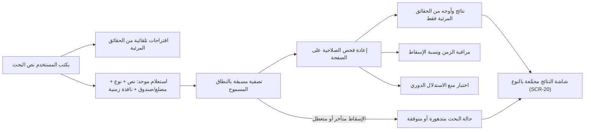

# البحث الموحد

<!-- BEGIN GENERATED: doc -->
| البند | القيمة |
|---|---|
| المعرّف | FEAT-INF-UNIFIED-SEARCH |
| الإصدار | 0.2 |
| الحالة | مسودة |
| القدرة | CAP-03 إدارة المعلومات |
| القدرة الفرعية | CAP-03.01 الكيانات والعلاقات (R1) |
| الأدوار | أي مستخدم مخوَّل |
| الشاشات | SCR-20 البحث الموحد |
| حالات الاستخدام | UC-097 |
| القصص | 12: 2 من المواصفة، و10 جديدة |
<!-- END GENERATED: doc -->

## 1. نظرة عامة

### 1.1 القيمة

يجد المستخدم ما يبحث عنه من كيانات وملاحظات ووثائق وخطط بالنص والمكان والزمن وبالعربية والإنجليزية دون كشف ما لا يحق له.

### 1.2 النطاق

| البند | القيمة |
|---|---|
| المستخدمون | أي مستخدم مخوَّل يبحث ضمن نطاقه المسموح؛ فريق التشغيل الذي يراقب صحة البحث ويشغّل اختبار منع الاستدلال |
| الشاشات | SCR-20 البحث الموحد |
| حالات الاستخدام | بحث موحَّد بالنص والمكان والزمن عبر الكيانات والملاحظات والوثائق والتقييمات والخطط والمهام؛ اقتراح إكمال تلقائي أثناء الكتابة؛ مراقبة صحة البحث واختبار منع الاستدلال الدوري |
| المتطلبات | بحث موحد يجمع مرشحات نصية ومكانية وزمنية في طلب واحد عبر كل الأنواع (REQ-SRC-001)؛ ألا يكشف البحث وجود عنصر محجوب بالعدد أو الأوجه أو الترتيب أو الأخطاء أو زمن الاستجابة (REQ-SRC-002)؛ مطابقة الاسم العربي بصيغه ونقحرته اللاتينية (REQ-SRC-003) |
| خارج النطاق | استكشاف الرسم بالجوار والمسارات بين الكيانات — تغطيه ميزة استكشاف الرسم؛ إعادة بناء الفهرس الكاملة — عملية تشغيل نظامية لا بحث مستخدم |

### 1.3 خريطة الميزة

**الشكل 1: من كتابة البحث إلى النتيجة الآمنة**



## 2. القواعد المشتركة

تنطبق على كل قصص الميزة، فلا تتكرر داخل القصص. وكل قصة تذكر ما يخصها فقط.

### 2.1 السياق المشترك

كل قصة تبدأ من ثلاثة شروط: مستأجر نشط، وحزمة السياسات الأساسية مفعّلة، ومستخدم مسجّل الدخول ومخوَّل. وتشير إليها القصص بخطوة واحدة: «بفرض السياق المشترك للميزة».

### 2.2 الصلاحية وعدم الإفصاح

- من لا يحق له رؤية العنصر يتلقى ردًا بشكل «غير متاح» تمامًا، فلا يعرف أنه موجود.
- من يرى العنصر ولا يحق له الإجراء يتلقى «لا تملك صلاحية هذا الإجراء».

### 2.3 نتائج القراءة وعدم الإفصاح

> **ملاحظة:** هذه الميزة قراءة بالكامل — استعلامات وواجهة ومنصة وتشغيل، بلا أمر واحد يغيّر حالة. فلا تنطبق عليها قواعد منع التكرار أو حماية التعديل المتزامن، ويستبدل بها القسمان 2.3 و2.4 قاعدة عدم إفصاح مختصرة لنتائج القراءة.

- كل استعلام يُصفَّى مسبقًا بنطاق المستخدم المسموح، ثم يُعاد فحص صلاحية كل عنصر في الصفحة المعادة.
- لا يكشف عدد ولا وجه ولا ترتيب ولا رسالة خطأ ولا زمن استجابة وجود عنصر محجوب؛ تفصيلها في قصص المنصة أدناه (القصة 5.9).

### 2.4 الرفض المشترك

```gherkin
# language: ar
خاصية: عدم الإفصاح في نتائج القراءة

  سيناريو مخطط: رفض مشترك لكل استعلام في الميزة
    بفرض السياق المشترك للميزة
    و <الحالة>
    عندما يطلب المستخدم أي استعلام من استعلامات الميزة
    اذاً يُرفض برمز <الرمز> ويرى "<الرسالة>"
    و لا يتغير شيء

    امثلة:
      | الحالة                                      | الرمز             | الرسالة                                                 |
      | العنصر خارج صلاحياته                        | NOT_FOUND         | غير متاح                                                |
      | العنصر مرئي له ولا يحق له الإجراء           | AUTHZ_DENIED      | لا تملك صلاحية هذا الإجراء                              |
      | مرشحات الطلب ناقصة أو غير صحيحة             | VALIDATION_FAILED | بعض البيانات ناقصة أو غير صحيحة. راجع الحقول المعلَّمة      |
```

## 3. الجودة وتعريف الاكتمال

### 3.1 متطلبات الجودة

<!-- BEGIN GENERATED: quality -->
| المرجع | الموقف | المطلوب |
|---|---|---|
| QAS-PERF-003 | runs a combined text + spatial + temporal search | p95 ≤ 1 s |
| QAS-REL-002 | search projection unavailable | critical tier unaffected; index rebuilt without data loss |
| QAS-SEC-002 | searches, lists, maps or receives alerts touching objects above clearance | 0 leakage in inference suite (counts, facets, ordering, timing, errors) |
| QAS-SEC-003 | removes a user's compartment | effective on next request in every path, independent of index lag |
| QAS-SEC-011 | inference test suite on search, suggestions, facets, graph and paths | 0 disclosures of hidden objects, hidden facts, hidden nodes/edges |
| QAS-USA-002 | searches a name with Arabic spelling variants or Latin transliteration | recall ≥ 95 % on the Arabic name test set |
<!-- END GENERATED: quality -->

### 3.2 تعريف الاكتمال

القصة مكتملة حين تتحقق الشروط الخمسة:

1. سيناريوهاتها والقواعد المشتركة تمر في الاختبار الآلي.
2. فحوص البنية المعمارية تمر.
3. نصوص الواجهة والرسائل موجودة بالعربية والإنجليزية.
4. مراجعة الكود مكتملة.
5. ما تضيفه القصة نفسها في قسم «القواعد» تحقق.

## 4. فهرس القصص

<!-- BEGIN GENERATED: story-index -->
| المعرّف | القصة | النوع | الحالة |
|---|---|---|---|
| `US-BC07-Q-SRCH-QUERY` | البحث الموحَّد بالنص والمكان والزمن | جلب | مسودة |
| `US-BC07-Q-SRCH-SUGGEST` | اقتراحات الإكمال التلقائي | جلب | مسودة |
| `US-UI-SCR20-SEARCH-DEGRADED` | إبلاغ المستخدم حين يكون البحث جزئيًا أو متوقفًا | واجهة | مسودة |
| `US-UI-SCR20-SEARCH-GEO-TIME` | تقييد البحث بمضلع على الخريطة ونافذة زمنية | واجهة | مسودة |
| `US-UI-SCR20-SEARCH-RESULTS` | عرض نتائج البحث مجمعة بالنوع مع الأوجه | واجهة | مسودة |
| `US-PLT-SEARCH-ALL-TYPES` | شمول البحث الخطط والتقييمات والوثائق | منصة | مسودة |
| `US-PLT-SEARCH-ARABIC-MATCH` | مطابقة الأسماء العربية بصيغها ونقحرتها | منصة | مسودة |
| `US-PLT-SEARCH-COMBINED-PERF` | بحث مركب بالنص والمكان والزمن خلال ثانية | منصة | مسودة |
| `US-PLT-SEARCH-NO-INFERENCE` | ألا يكشف البحث المحجوب بالعدد أو التوقيت | منصة | مسودة |
| `US-PLT-SEARCH-REVOCATION-RECHECK` | نفاذ سحب الصلاحية في البحث رغم تأخر الفهرس | منصة | مسودة |
| `US-OPS-SEARCH-HEALTH-WATCH` | مراقبة زمن البحث ونسبة النتائج المسقطة | تشغيل | مسودة |
| `US-OPS-SEARCH-INFERENCE-SUITE` | تشغيل اختبار منع الاستدلال دوريًا مع تنبيه فوري | تشغيل | مسودة |
<!-- END GENERATED: story-index -->

## 5. القصص

### 5.1 US-BC07-Q-SRCH-QUERY — البحث الموحَّد بالنص والمكان والزمن

| النوع | الإصدار | الأولوية | دون اتصال | الحالة |
|---|---|---|---|---|
| جلب | R1 | Must | لا | مسودة |

> **كـ** أي مستخدم مخوَّل، **أريد** أن أبحث بطلب واحد يجمع الكلمات والمكان والزمن عبر كل أنواع المعلومات، **حتى** أجد ما يخصني دون تنقّل بين شاشات متعددة.

**باختصار:** يعيد البحث الكيانات والملاحظات والوثائق والتقييمات والخطط والمهام معًا، مصفّاة مسبقًا بما يحق للمستخدم رؤيته، صفحة بعد صفحة بمؤشر لا بعدد، دون أن يكشف عدد أو وجه أو ترتيب وجود عنصر محجوب.

#### القواعد

- **من يُسمح له:** أي مستخدم مخوَّل؛ يُصفَّى الطلب مسبقًا بنطاقه المسموح، وتُعاد الصفحة بعد إعادة فحص صلاحية كل عنصر فيها.
- **البيانات (المرشحات):** النص، الأنواع، مضلع أو صندوق على الخريطة، نافذة زمنية، مرشحات إضافية، الأوجه، الترتيب، المؤشر والحد.

#### معايير القبول

```gherkin
# language: ar
خاصية: البحث الموحد

  سيناريو: نتائج داخل نطاق المستخدم فقط
    بفرض السياق المشترك للميزة
    و عناصر داخل نطاق المستخدم وأخرى خارجه تطابق نص البحث
    عندما يبحث بنص ونافذة زمنية ومضلع على الخريطة
    اذاً تُعاد العناصر داخل نطاقه فقط، وكل عنصر يُعاد فحص صلاحيته
    و لا يكشف العدد أو الأوجه أو الترتيب وجود أي عنصر محجوب

  سيناريو: الصفحة التالية بالمؤشر
    بفرض السياق المشترك للميزة
    و نتائج البحث أكثر من صفحة
    عندما يطلب الصفحة التالية بالمؤشر
    اذاً تُعاد النتائج التالية دون تكرار ولا فجوة
```

<details><summary>المراجع التقنية والتتبع</summary>

<!-- BEGIN GENERATED: refs US-BC07-Q-SRCH-QUERY -->
| البند | المعرّف | المعنى |
|---|---|---|
| الواجهة البرمجية | `POST /api/v1/discovery/search-queries` | — |
| الاستعلام | `QRY-SRCH-QUERY` | Unified search: text + types + polygon/bbox + time window + filters + facets; cursor paging; results and face… |
| السياسة | `POL-SRCH-QUERY` | PDP allowed_scope → pre-filter on doc and fact labels; LabelCheck re-check on page |
| المتطلب | REQ-SRC-001 | The system shall provide unified search across entities, observations, documents, assessments, plans and task… |
| حالة الاستخدام | UC-097 | Search Authorized Information |
<!-- END GENERATED: refs US-BC07-Q-SRCH-QUERY -->

</details>

### 5.2 US-BC07-Q-SRCH-SUGGEST — اقتراحات الإكمال التلقائي

| النوع | الإصدار | الأولوية | دون اتصال | الحالة |
|---|---|---|---|---|
| جلب | R1 | Must | لا | مسودة |

> **كـ** أي مستخدم مخوَّل، **أريد** اقتراحات إكمال تلقائي وأنا أكتب نص البحث، **حتى** أصل إلى ما أبحث عنه بسرعة دون أخطاء إملائية.

**باختصار:** تُبنى الاقتراحات من الحقائق المرئية للمستخدم فقط، وتطابق صيغ الاسم العربي المختلفة ونقحرته اللاتينية.

#### القواعد

- **من يُسمح له:** أي مستخدم مخوَّل، بنفس تصفية البحث الموحد (القصة 5.1).
- **البيانات (المرشحات):** نص الاقتراح، المؤشر والحد.

#### معايير القبول

```gherkin
# language: ar
خاصية: اقتراحات الإكمال التلقائي

  سيناريو: اقتراحات من الحقائق المرئية فقط
    بفرض السياق المشترك للميزة
    و حقائق مرئية للمستخدم وأخرى محجوبة تطابق بداية النص
    عندما يكتب بداية اسم
    اذاً تُعاد اقتراحات من الحقائق المرئية فقط

  سيناريو: مطابقة صيغ الاسم العربي
    بفرض السياق المشترك للميزة
    و اسم مسجَّل بصيغة إملائية مختلفة عن ما يكتبه المستخدم
    عندما يكتب صيغة أخرى للاسم نفسه أو نقحرته
    اذاً يظهر الاسم نفسه ضمن الاقتراحات
```

<details><summary>المراجع التقنية والتتبع</summary>

<!-- BEGIN GENERATED: refs US-BC07-Q-SRCH-SUGGEST -->
| البند | المعرّف | المعنى |
|---|---|---|
| الواجهة البرمجية | `GET /api/v1/discovery/suggestions` | — |
| الاستعلام | `QRY-SRCH-SUGGEST` | Autocomplete from visible facts only |
| السياسة | `POL-SRCH-SUGGEST` | PDP allowed_scope → pre-filter on doc and fact labels; LabelCheck re-check on page |
| المتطلب | REQ-SRC-003 | The system shall match Arabic text regardless of hamza forms, alef maqsura, taa marbuta, diacritics and tatwe… |
| حالة الاستخدام | UC-097 | Search Authorized Information |
<!-- END GENERATED: refs US-BC07-Q-SRCH-SUGGEST -->

</details>

### 5.3 US-UI-SCR20-SEARCH-DEGRADED — إبلاغ المستخدم حين يكون البحث جزئيًا أو متوقفًا

| النوع | الإصدار | الأولوية | دون اتصال | الحالة |
|---|---|---|---|---|
| واجهة | R1 | Should | لا | مسودة |

> **كـ** المستخدم، **أريد** أن أعرف إن كان البحث جزئيًا أو متوقفًا، **حتى** أفهم أن غياب نتيجة قد يكون بسبب تعطل لا لعدم وجودها.

**باختصار:** حين يتأخر إسقاط البحث أو يتعطل محرك البحث، تعرض الشاشة حالة "نتائج جزئية" أو "البحث متوقف مؤقتًا" بدل نتائج فارغة بصمت، بينما تستمر القراءات المباشرة من الأنظمة المصدر والأوامر والخرائط.

#### معايير القبول

```gherkin
# language: ar
خاصية: إبلاغ المستخدم عن تدهور البحث

  سيناريو: نتائج جزئية بسبب تأخر الإسقاط
    بفرض السياق المشترك للميزة
    و إسقاط البحث متأخرًا عن أحد الأنظمة المصدر
    عندما يبحث المستخدم
    اذاً تُعرض النتائج المتاحة مع علامة "نتائج جزئية"

  سيناريو: البحث متوقف مؤقتًا
    بفرض السياق المشترك للميزة
    و محرك البحث غير متاح
    عندما يبحث المستخدم
    اذاً تُعرض رسالة "البحث متوقف مؤقتًا" دون نتائج فارغة بصمت
    لكن القراءات المباشرة والخرائط والأوامر تستمر بالعمل
```

<details><summary>المراجع التقنية والتتبع</summary>

<!-- BEGIN GENERATED: refs US-UI-SCR20-SEARCH-DEGRADED -->
| البند | المعرّف | المعنى |
|---|---|---|
| الشاشة | SCR-20 | شاشة البحث الموحد |
| الجودة | QAS-REL-002 | search projection unavailable → critical tier unaffected; index rebuilt without data loss |
| المصدر | `FM-S05-02` | — |
| المصدر | `FM-S05-03` | — |
| المصدر | `discovery-architecture.md §7` | — |
<!-- END GENERATED: refs US-UI-SCR20-SEARCH-DEGRADED -->

</details>

### 5.4 US-UI-SCR20-SEARCH-GEO-TIME — تقييد البحث بمضلع على الخريطة ونافذة زمنية

| النوع | الإصدار | الأولوية | دون اتصال | الحالة |
|---|---|---|---|---|
| واجهة | R1 | Must | لا | مسودة |

> **كـ** المستخدم، **أريد** أن أحدّ البحث بمضلع أرسمه على الخريطة ونافذة زمنية، **حتى** أقصر النتائج على مكان وزمن يهمّاني.

**باختصار:** يرسم المستخدم مضلعًا أو يحدد صندوقًا على الخريطة ويختار نافذة زمنية، فيُطبَّق الحدّان على البحث معًا مع النص والمرشحات الأخرى.

#### معايير القبول

```gherkin
# language: ar
خاصية: تقييد البحث بمكان وزمن

  سيناريو: بحث بمضلع ونافذة زمنية
    بفرض السياق المشترك للميزة
    و عناصر داخل المضلع والنافذة الزمنية وأخرى خارجهما
    عندما يرسم المستخدم مضلعًا ويحدد نافذة زمنية ويبحث
    اذاً تُعاد العناصر داخل المضلع والنافذة الزمنية فقط

  سيناريو: تعديل المضلع يحدّث النتائج
    بفرض السياق المشترك للميزة
    و بحث جارٍ بمضلع محدد
    عندما يعدّل المستخدم حدود المضلع
    اذاً تُعاد نتائج مطابقة للحدود الجديدة فقط
```

<details><summary>المراجع التقنية والتتبع</summary>

<!-- BEGIN GENERATED: refs US-UI-SCR20-SEARCH-GEO-TIME -->
| البند | المعرّف | المعنى |
|---|---|---|
| الشاشة | SCR-20 | شاشة البحث الموحد |
| المتطلب | REQ-SRC-001 | The system shall provide unified search across entities, observations, documents, assessments, plans and task… |
| حالة الاستخدام | UC-097 | Search Authorized Information |
<!-- END GENERATED: refs US-UI-SCR20-SEARCH-GEO-TIME -->

</details>

### 5.5 US-UI-SCR20-SEARCH-RESULTS — عرض نتائج البحث مجمعة بالنوع مع الأوجه

| النوع | الإصدار | الأولوية | دون اتصال | الحالة |
|---|---|---|---|---|
| واجهة | R1 | Should | لا | مسودة |

> **كـ** المستخدم، **أريد** أن تُعرض نتائج البحث مجمَّعة حسب نوعها مع أوجه تصفية، **حتى** أتنقّل بين الكيانات والملاحظات والوثائق بسهولة.

**باختصار:** تعرض الشاشة النتائج في مجموعات حسب النوع (كيانات، ملاحظات، وثائق، تقييمات، خطط، مهام)، مع أوجه تصفية محسوبة من النتائج المرئية فقط، ولا يظهر وجه بعدد صفري.

#### معايير القبول

```gherkin
# language: ar
خاصية: عرض نتائج البحث مجمَّعة

  سيناريو: تجميع النتائج حسب النوع
    بفرض السياق المشترك للميزة
    و نتائج بحث من أنواع مختلفة
    عندما تُعرض النتائج
    اذاً تُجمَّع في قسم لكل نوع، ويظهر عدد كل قسم من المجموعة المرئية فقط

  سيناريو: وجه بعدد صفري لا يظهر
    بفرض السياق المشترك للميزة
    و وجه تصفية لا تطابقه أي نتيجة مرئية
    عندما تُعرض الأوجه
    اذاً لا يظهر ذلك الوجه
```

<details><summary>المراجع التقنية والتتبع</summary>

<!-- BEGIN GENERATED: refs US-UI-SCR20-SEARCH-RESULTS -->
| البند | المعرّف | المعنى |
|---|---|---|
| الشاشة | SCR-20 | شاشة البحث الموحد |
| حالة الاستخدام | UC-097 | Search Authorized Information |
| المصدر | `discovery-architecture.md §4.1` | — |
| المصدر | `21-ui-design.md §6.1` | — |
<!-- END GENERATED: refs US-UI-SCR20-SEARCH-RESULTS -->

</details>

### 5.6 US-PLT-SEARCH-ALL-TYPES — شمول البحث الخطط والتقييمات والوثائق

| النوع | الإصدار | الأولوية | دون اتصال | الحالة |
|---|---|---|---|---|
| منصة | R1 | Must | لا ينطبق | مسودة |

> **كـ** فريق المنصة، **أريد** أن يشمل البحث الموحد الخطط والتقييمات والوثائق إلى جانب الكيانات والملاحظات والمهام، **حتى** لا يحتاج المستخدم أكثر من شاشة بحث واحدة.

**باختصار:** لكل نوع من الأنواع الستة وثيقة بحث بقواعد التصنيف نفسها، فتُفلتر جميعها بالتصنيف والنطاق قبل ظهورها معًا في نتيجة واحدة موحَّدة.

#### معايير القبول

```gherkin
# language: ar
خاصية: شمول البحث لكل الأنواع

  سيناريو: نتيجة موحدة من أنواع مختلفة
    بفرض مرشح بحث يطابق كيانًا وخطة ووثيقة معًا، كلها مرئية للمستخدم
    عندما يُنفَّذ البحث
    اذاً تظهر نتائج الأنواع الثلاثة في نفس الاستجابة
```

> **ملاحظة:** شمول الخطط والتقييمات والوثائق في وثائق البحث نفسها **[Derived]**؛ المصدر يذكر هذه الأنواع في نموذج الوثائق دون تفصيل كامل لكل نوع لاحق بها.

<details><summary>المراجع التقنية والتتبع</summary>

<!-- BEGIN GENERATED: refs US-PLT-SEARCH-ALL-TYPES -->
| البند | المعرّف | المعنى |
|---|---|---|
| المصدر | `discovery-architecture.md §3.1` | — |
| المصدر | `[Derived]` | — |
| المتطلب | REQ-SRC-001 | The system shall provide unified search across entities, observations, documents, assessments, plans and task… |
| حالة الاستخدام | UC-097 | Search Authorized Information |
<!-- END GENERATED: refs US-PLT-SEARCH-ALL-TYPES -->

</details>

### 5.7 US-PLT-SEARCH-ARABIC-MATCH — مطابقة الأسماء العربية بصيغها ونقحرتها

| النوع | الإصدار | الأولوية | دون اتصال | الحالة |
|---|---|---|---|---|
| منصة | R1 | Must | لا ينطبق | مسودة |

> **كـ** فريق المنصة، **أريد** أن تُطابَق الأسماء العربية بصيغها المختلفة وبنقحرتها اللاتينية، **حتى** يجد المستخدم العنصر نفسه بأي صيغة يكتبها.

**باختصار:** تُطبَّق قواعد تطبيع العربية (حذف التشكيل والتطويل، وتوحيد صور الألف والياء والتاء المربوطة) على الفهرسة والاستعلام معًا، ويبحث النظام في الصيغة المطبَّعة والنقحرة والمفتاح الصوتي معًا بترتيب يفضّل التطابق الأدق.

#### معايير القبول

```gherkin
# language: ar
خاصية: مطابقة الأسماء العربية

  سيناريو: مطابقة صيغ مختلفة لاسم واحد
    بفرض اسم مسجَّل بتشكيل أو تطويل أو صورة مختلفة لحرف
    عندما يبحث المستخدم بصيغة أخرى للاسم نفسه
    اذاً يُعاد العنصر نفسه

  سيناريو: مطابقة النقحرة اللاتينية
    بفرض اسم عربي له نقحرة لاتينية مسجَّلة
    عندما يبحث المستخدم بالنقحرة اللاتينية
    اذاً يُعاد العنصر نفسه
```

<details><summary>المراجع التقنية والتتبع</summary>

<!-- BEGIN GENERATED: refs US-PLT-SEARCH-ARABIC-MATCH -->
| البند | المعرّف | المعنى |
|---|---|---|
| الجودة | QAS-USA-002 | searches a name with Arabic spelling variants or Latin transliteration → recall ≥ 95 % on the Arabic name tes… |
| المصدر | `language-model.md §4` | — |
| المصدر | `discovery-architecture.md §5` | — |
| المتطلب | REQ-SRC-003 | The system shall match Arabic text regardless of hamza forms, alef maqsura, taa marbuta, diacritics and tatwe… |
| حالة الاستخدام | UC-097 | Search Authorized Information |
<!-- END GENERATED: refs US-PLT-SEARCH-ARABIC-MATCH -->

</details>

### 5.8 US-PLT-SEARCH-COMBINED-PERF — بحث مركب بالنص والمكان والزمن خلال ثانية

| النوع | الإصدار | الأولوية | دون اتصال | الحالة |
|---|---|---|---|---|
| منصة | R1 | Must | لا ينطبق | مسودة |

> **كـ** فريق المنصة، **أريد** أن يُنفَّذ البحث المركب بالنص والمكان والزمن خلال ثانية واحدة عند المئين 95، **حتى** يبقى البحث سريعًا تحت حمل التصميم.

**باختصار:** فهرسة متداخلة على مستوى الحقيقة الواحدة، بمحللات عربية ونقحرة ومفاتيح صوتية وفهرسة جغرافية وزمنية، تتحمّل 500 استعلام مركب في الثانية على مئة مليون حقيقة.

#### معايير القبول

```gherkin
# language: ar
خاصية: أداء البحث المركب

  سيناريو: الهدف تحت حمل التصميم
    بفرض حمل بمزيج استعلامات نصية ومكانية وزمنية بحجم بيانات التصميم
    عندما يُنفَّذ البحث المركب
    اذاً يكون زمن الاستجابة ثانية واحدة أو أقل عند المئين 95
```

<details><summary>المراجع التقنية والتتبع</summary>

<!-- BEGIN GENERATED: refs US-PLT-SEARCH-COMBINED-PERF -->
| البند | المعرّف | المعنى |
|---|---|---|
| الجودة | QAS-PERF-003 | runs a combined text + spatial + temporal search → p95 ≤ 1 s |
| القرار التقني | TD-02 | OpenSearch (Apache 2.0) — nested fact documents, Arabic analyzer + custom char filters (N1–N8), geo, index al… |
| المصدر | `discovery-architecture.md §8` | — |
| المتطلب | REQ-SRC-001 | The system shall provide unified search across entities, observations, documents, assessments, plans and task… |
| حالة الاستخدام | UC-097 | Search Authorized Information |
<!-- END GENERATED: refs US-PLT-SEARCH-COMBINED-PERF -->

</details>

### 5.9 US-PLT-SEARCH-NO-INFERENCE — ألا يكشف البحث المحجوب بالعدد أو التوقيت

| النوع | الإصدار | الأولوية | دون اتصال | الحالة |
|---|---|---|---|---|
| منصة | R1 | Must | لا ينطبق | مسودة |

> **كـ** فريق المنصة، **أريد** ألا يكشف البحث وجود عنصر محجوب بالعدد أو الأوجه أو الترتيب أو الأخطاء أو زمن الاستجابة، **حتى** لا يستنتج المستخدم ما لا يحق له رؤيته.

**باختصار:** تُطبَّق التصفية بالنطاق المسموح قبل الحساب والعدّ والترتيب والتجميع دائمًا، فالعدّ والأوجه من المجموعة المصفَّاة فقط، ولا عمل إضافي يتوقف على وجود عناصر محجوبة فيؤثر في التوقيت.

#### معايير القبول

```gherkin
# language: ar
خاصية: منع الاستدلال في البحث

  سيناريو: العدد والأوجه من المرئي فقط
    بفرض نتائج مرئية للمستخدم وأخرى محجوبة تطابق البحث
    عندما تُحسب الأوجه والعدد
    اذاً يُحسبان من النتائج المرئية فقط، دون أي إشارة إلى وجود نتائج محجوبة

  سيناريو: لا فرق في زمن الاستجابة بسبب عناصر محجوبة
    بفرض بحثين متطابقين، أحدهما له نتائج محجوبة والآخر بلا نتائج محجوبة
    عندما يُنفَّذ البحثان
    اذاً لا يرتبط وقت الاستجابة بوجود النتائج المحجوبة بما يتجاوز الأثر المتبقي المقبول
```

<details><summary>المراجع التقنية والتتبع</summary>

<!-- BEGIN GENERATED: refs US-PLT-SEARCH-NO-INFERENCE -->
| البند | المعرّف | المعنى |
|---|---|---|
| الجودة | QAS-SEC-002 | searches, lists, maps or receives alerts touching objects above clearance → 0 leakage in inference suite (cou… |
| الجودة | QAS-SEC-011 | inference test suite on search, suggestions, facets, graph and paths → 0 disclosures of hidden objects, hidde… |
| المصدر | `THR-S05-02` | — |
| المصدر | `THR-S05-03` | — |
| المصدر | `THR-S05-06` | — |
| المصدر | `THR-S05-08` | — |
| المتطلب | REQ-SRC-002 | The system shall not reveal the existence of unauthorized objects through search results, counts, facets, sug… |
| حالة الاستخدام | UC-097 | Search Authorized Information |
<!-- END GENERATED: refs US-PLT-SEARCH-NO-INFERENCE -->

</details>

### 5.10 US-PLT-SEARCH-REVOCATION-RECHECK — نفاذ سحب الصلاحية في البحث رغم تأخر الفهرس

| النوع | الإصدار | الأولوية | دون اتصال | الحالة |
|---|---|---|---|---|
| منصة | R1 | Should | لا ينطبق | مسودة |

> **كـ** فريق المنصة، **أريد** أن ينفذ سحب الصلاحية فورًا في كل مسار بحث رغم تأخر الفهرس، **حتى** لا يستمر ظهور عنصر لمن سُحبت صلاحيته عليه.

**باختصار:** تُطبَّق إعادة الفحص السلطوي من النظام المالك على كل صفحة نتائج قبل إعادتها، بصرف النظر عن مدى تأخر الفهرس عن حالة المالك.

#### معايير القبول

```gherkin
# language: ar
خاصية: نفاذ سحب الصلاحية رغم تأخر الفهرس

  سيناريو: سحب صلاحية مستخدم عن عنصر
    بفرض أن المستخدم كان يرى عنصرًا ثم سُحبت صلاحيته عليه، والفهرس لم يتحدَّث بعد
    عندما يبحث المستخدم مرة أخرى
    اذاً لا يظهر له العنصر في الطلب التالي
```

<details><summary>المراجع التقنية والتتبع</summary>

<!-- BEGIN GENERATED: refs US-PLT-SEARCH-REVOCATION-RECHECK -->
| البند | المعرّف | المعنى |
|---|---|---|
| الجودة | QAS-SEC-003 | removes a user's compartment → effective on next request in every path, independent of index lag |
| المصدر | `THR-S05-05` | — |
| المصدر | `discovery-architecture.md §4.1` | — |
<!-- END GENERATED: refs US-PLT-SEARCH-REVOCATION-RECHECK -->

</details>

### 5.11 US-OPS-SEARCH-HEALTH-WATCH — مراقبة زمن البحث ونسبة النتائج المسقطة

| النوع | الإصدار | الأولوية | دون اتصال | الحالة |
|---|---|---|---|---|
| تشغيل | R1 | Should | لا ينطبق | مسودة |

> **كـ** فريق التشغيل، **أريد** مراقبة زمن استجابة البحث ونسبة النتائج المسقطة بسبب تعطل نظام مالك، **حتى** أتدخَّل قبل أن يشعر المستخدمون بالأثر.

**باختصار:** تُرصد مؤشرات تأخر الإسقاط، وزمن استجابة البحث، ونسبة إسقاط نتائج نظام مالك متعطل، ويصل تنبيه عند تجاوزها حدودها.

#### معايير القبول

```gherkin
# language: ar
خاصية: مراقبة صحة البحث

  سيناريو: تنبيه عند تجاوز زمن الاستجابة
    بفرض أن زمن استجابة البحث عند المئين 95 تجاوز ثانية واحدة
    عندما يفحص النظام المؤشر
    اذاً يصل تنبيه لفريق التشغيل

  سيناريو: لا تنبيه ضمن الحدود الطبيعية
    بفرض أن كل المؤشرات ضمن حدودها
    عندما يفحص النظام المؤشرات
    اذاً لا يُرسل أي تنبيه
```

<details><summary>المراجع التقنية والتتبع</summary>

<!-- BEGIN GENERATED: refs US-OPS-SEARCH-HEALTH-WATCH -->
| البند | المعرّف | المعنى |
|---|---|---|
| المصدر | `observability-slc05.md` | — |
| المصدر | `FM-S05-03` | — |
<!-- END GENERATED: refs US-OPS-SEARCH-HEALTH-WATCH -->

</details>

### 5.12 US-OPS-SEARCH-INFERENCE-SUITE — تشغيل اختبار منع الاستدلال دوريًا مع تنبيه فوري

| النوع | الإصدار | الأولوية | دون اتصال | الحالة |
|---|---|---|---|---|
| تشغيل | R1 | Must | لا ينطبق | مسودة |

> **كـ** فريق التشغيل، **أريد** تشغيل حزمة اختبار منع الاستدلال دوريًا على البحث والاقتراحات والأوجه والرسم، **حتى** أكتشف أي تسرّب معلومة فور وقوعه.

**باختصار:** تُشغَّل الحزمة بجدول دوري، وأي فشل فيها يُعامَل كحادثة من أعلى درجة أولوية وتنبيه فوري.

#### معايير القبول

```gherkin
# language: ar
خاصية: اختبار منع الاستدلال الدوري

  سيناريو: نجاح الحزمة الدوري
    بفرض حان وقت التشغيل الدوري لحزمة اختبار منع الاستدلال
    عندما تُشغَّل الحزمة
    اذاً تُسجَّل نتيجتها، ولا يصل تنبيه إن لم تكشف أي تسرّب

  سيناريو: فشل الحزمة يصعّد فورًا
    بفرض أن الحزمة كشفت تسرّب معلومة واحدًا
    عندما تنتهي الحزمة
    اذاً يصل تنبيه فوري بأعلى درجة أولوية لفريق التشغيل
```

<details><summary>المراجع التقنية والتتبع</summary>

<!-- BEGIN GENERATED: refs US-OPS-SEARCH-INFERENCE-SUITE -->
| البند | المعرّف | المعنى |
|---|---|---|
| المصدر | `observability-slc05.md` | — |
| الجودة | QAS-SEC-011 | inference test suite on search, suggestions, facets, graph and paths → 0 disclosures of hidden objects, hidde… |
| المتطلب | REQ-SRC-002 | The system shall not reveal the existence of unauthorized objects through search results, counts, facets, sug… |
| حالة الاستخدام | UC-097 | Search Authorized Information |
<!-- END GENERATED: refs US-OPS-SEARCH-INFERENCE-SUITE -->

</details>

## 6. التتبع

<!-- BEGIN GENERATED: trace -->
| المتطلب | المعنى | القصص | الاختبار |
|---|---|---|---|
| REQ-SRC-001 | The system shall provide unified search across entities, observations, documents, assessments, plans and task… | `US-BC07-Q-SRCH-QUERY`، `US-PLT-SEARCH-ALL-TYPES`، `US-PLT-SEARCH-COMBINED-PERF`، `US-UI-SCR20-SEARCH-GEO-TIME` | TST-SLC05-INVARIANTS |
| REQ-SRC-002 | The system shall not reveal the existence of unauthorized objects through search results, counts, facets, sug… | `US-OPS-SEARCH-INFERENCE-SUITE`، `US-PLT-SEARCH-NO-INFERENCE` | TST-SLC05-INVARIANTS |
| REQ-SRC-003 | The system shall match Arabic text regardless of hamza forms, alef maqsura, taa marbuta, diacritics and tatwe… | `US-BC07-Q-SRCH-SUGGEST`، `US-PLT-SEARCH-ARABIC-MATCH` | TST-MATCH-RULESET-SM، TST-SLC04-INVARIANTS، TST-SLC05-INVARIANTS |
<!-- END GENERATED: trace -->

## 7. سجل التغييرات

| الإصدار | التاريخ | التغيير |
|---|---|---|
| 0.1 | — | هيكل مولَّد من خريطة الميزات |
| 0.2 | 2026-10-03 | كتابة القصص كاملة بمعيار القصص |
