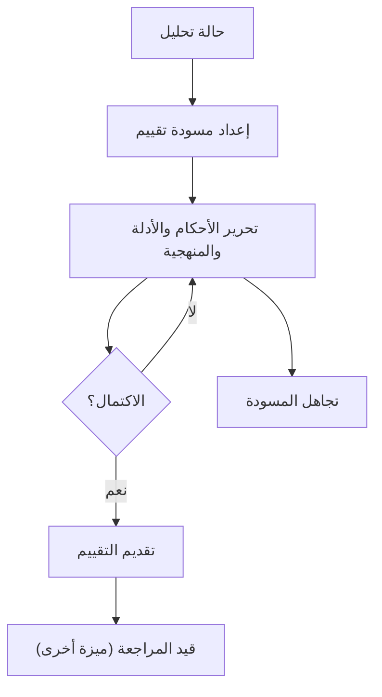
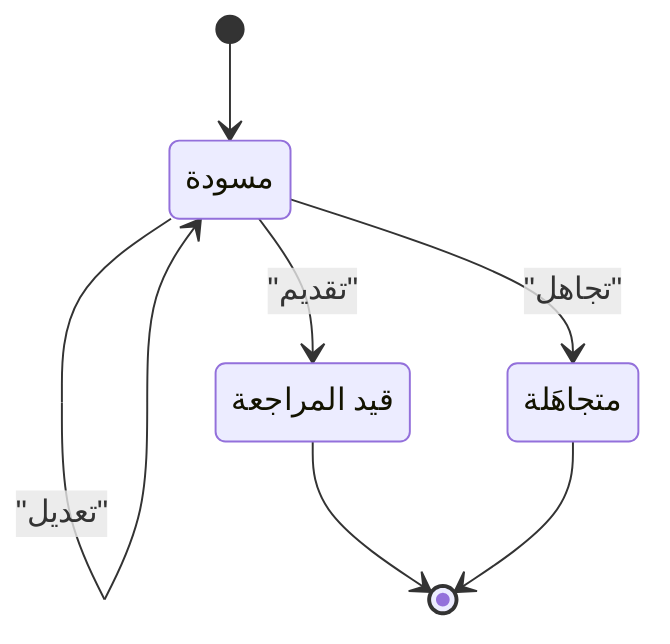

# إعداد التقييم

<!-- BEGIN GENERATED: doc -->
| البند | القيمة |
|---|---|
| المعرّف | FEAT-ANL-ASSESSMENT-DRAFT |
| الإصدار | 0.1 |
| الحالة | مسودة |
| القدرة | CAP-04 التحليل والتقييم |
| القدرة الفرعية | CAP-04.03 إنتاج التقييم (R1) |
| الأدوار | المحلل |
| الشاشات | SCR-31 التقييم ونسخه |
| حالات الاستخدام | UC-014، UC-015 |
| القصص | 6: 4 من المواصفة، و2 جديدة |
<!-- END GENERATED: doc -->

## 1. نظرة عامة

### 1.1 القيمة

يكتب المحلل تقييمه بالاستنتاجات والأدلة ودرجة الثقة وحدودها، ثم يقدمه للمراجعة.

### 1.2 النطاق

| البند | القيمة |
|---|---|
| المستخدمون | المحلل |
| الشاشات | SCR-31 التقييم ونسخه |
| حالات الاستخدام | UC-014 تقييم عدم اليقين؛ UC-015 إنتاج التقييم |
| المتطلبات | REQ-ANL-005 عناصر التقييم الإلزامية؛ REQ-ANL-006 ثبات الإصدار المنشور (كحدٍّ يمنع تعديل المنشور)؛ REQ-ANL-008 حجب الاستشهادات غير المصرح بها |
| خارج النطاق | مراجعة التقييم ونشره وإعادته وسحبه (ميزة: مراجعة التقييم ونشره)؛ قراءة التقييم المنشور وتاريخ إصداراته (ميزة: الاطلاع على التقييمات وإصداراتها) |

### 1.3 خريطة الميزة

**الشكل 1: من حالة التحليل إلى تقديم التقييم**



**الشكل 2: حالات التقييم التي تغطيها هذه الميزة**



## 2. القواعد المشتركة

تنطبق على كل قصص الميزة، فلا تتكرر داخل القصص. وكل قصة تذكر ما يخصها فقط.

### 2.1 السياق المشترك

كل قصة تبدأ من ثلاثة شروط: مستأجر نشط، وحزمة السياسات الأساسية مفعّلة، ومستخدم مسجّل الدخول ومخوَّل. وتشير إليها القصص بخطوة واحدة: «بفرض السياق المشترك للميزة».

### 2.2 الصلاحية وعدم الإفصاح

- من لا يحق له رؤية العنصر يتلقى ردًا بشكل «غير متاح» تمامًا، فلا يعرف أنه موجود.
- من يرى العنصر ولا يحق له الإجراء يتلقى «لا تملك صلاحية هذا الإجراء».

### 2.3 أوامر تغيير الحالة

- **منع التكرار:** يُرسل كل أمر بمفتاح فريد، فإعادة الطلب نفسه لا تُنفَّذ مرتين.
- **حماية التعديل المتزامن:** يُرسل كل أمر بإصدار البيانات الذي يراه المستخدم. فإن عدّلها غيره في الأثناء، يُرفض الأمر.
- **السجل:** إن نجح الأمر، يُكتب حدثه وسجل التدقيق في المعاملة نفسها.

### 2.4 الرفض المشترك

```gherkin
# language: ar
خاصية: الرفض المشترك لأوامر الميزة

  سيناريو مخطط: رفض مشترك لكل أمر في الميزة
    بفرض السياق المشترك للميزة
    و <الحالة>
    عندما يُرسل المستخدم أي أمر من أوامر الميزة
    اذاً يُرفض برمز <الرمز> ويرى "<الرسالة>"
    و لا يتغير شيء

    امثلة:
      | الحالة                                  | الرمز                  | الرسالة                                                 |
      | العنصر خارج صلاحياته                    | NOT_FOUND              | غير متاح                                                |
      | العنصر مرئي له ولا يحق له الإجراء       | AUTHZ_DENIED           | لا تملك صلاحية هذا الإجراء                              |
      | غيره عدّل العنصر بعد أن فتحه            | VERSION_CONFLICT       | تغيّرت البيانات منذ فتحتها. راجع التغييرات ثم أعد المحاولة |
      | أعاد مفتاح منع التكرار بمحتوى مختلف     | IDEMPOTENCY_KEY_REUSED | طلب مكرر بمحتوى مختلف                                   |
      | البيانات ناقصة أو غير صحيحة             | VALIDATION_FAILED      | بعض البيانات ناقصة أو غير صحيحة. راجع الحقول المعلَّمة      |

  سيناريو: إعادة الطلب نفسه لا تُنفَّذ مرتين
    بفرض السياق المشترك للميزة
    و أمر نجح بمفتاح منع تكرار
    عندما يُعاد الطلب نفسه بالمفتاح نفسه
    اذاً تُعاد النتيجة الأولى ولا يُكتب حدث ثانٍ
```

## 3. الجودة وتعريف الاكتمال

### 3.1 متطلبات الجودة

<!-- BEGIN GENERATED: quality -->
| المرجع | الموقف | المطلوب |
|---|---|---|
| QAS-SEC-002 | searches, lists, maps or receives alerts touching objects above clearance | 0 leakage in inference suite (counts, facets, ordering, timing, errors) |
<!-- END GENERATED: quality -->

### 3.2 تعريف الاكتمال

القصة مكتملة حين تتحقق الشروط الخمسة:

1. سيناريوهاتها والقواعد المشتركة تمر في الاختبار الآلي.
2. فحوص البنية المعمارية تمر.
3. نصوص الواجهة والرسائل موجودة بالعربية والإنجليزية.
4. مراجعة الكود مكتملة.
5. ما تضيفه القصة نفسها في قسم «القواعد» تحقق.

## 4. فهرس القصص

<!-- BEGIN GENERATED: story-index -->
| المعرّف | القصة | النوع | الحالة |
|---|---|---|---|
| `US-BC03-ASM-DISCARD` | تجاهل مسودة التقييم | أمر | مسودة |
| `US-BC03-ASM-DRAFT` | إعداد مسودة التقييم | أمر | مسودة |
| `US-BC03-ASM-EDIT` | تعديل التقييم | أمر | مسودة |
| `US-BC03-ASM-SUBMIT` | تقديم التقييم | أمر | مسودة |
| `US-UI-SCR31-COMPLETENESS` | قائمة اكتمال التقييم قبل تقديمه | واجهة | مسودة |
| `US-UI-SCR31-EDITOR` | كتابة الأحكام بمصطلح الاحتمال ودرجة الثقة | واجهة | مسودة |
<!-- END GENERATED: story-index -->

## 5. القصص

### 5.1 US-BC03-ASM-DISCARD — تجاهل مسودة التقييم

| النوع | الإصدار | الأولوية | دون اتصال | الحالة |
|---|---|---|---|---|
| أمر | R1 | Must | لا | مسودة |

> **كـ** المحلل الذي أعدّ مسودة التقييم، **أريد** أن أتجاهلها بسبب، **حتى** لا تبقى مسودة لا أنوي إكمالها.

**باختصار:** يتجاهل المحلل مسودة تقييمه بسبب، فتصبح «متجاهَلة» نهائيًا ولا تعود قابلة للتعديل.

#### القواعد

- **متى يُسمح:** التقييم «مسودة».
- **من يُسمح له:** المحلل الذي أعدّ المسودة.
- **البيانات:** سبب التجاهل (إلزامي).
- **الأثر:** تصبح حالة التقييم «متجاهَلة» نهائيًا؛ يُسجَّل حدث «تُجوهلت مسودة التقييم».

#### معايير القبول

```gherkin
# language: ar
خاصية: تجاهل مسودة التقييم

  سيناريو: تجاهل مسودة
    بفرض السياق المشترك للميزة
    و تقييم "مسودة" أعدّه المحلل
    عندما يتجاهلها بسبب
    اذاً تصبح حالتها "متجاهَلة"
    و يُسجَّل حدث "تُجوهلت مسودة التقييم"

  سيناريو مخطط: رفض خاص بتجاهل المسودة
    بفرض السياق المشترك للميزة
    و <الحالة>
    عندما يحاول تجاهل التقييم
    اذاً يُرفض برمز <الرمز> ويرى "<الرسالة>"
    و لا يتغير شيء

    امثلة:
      | الحالة                     | الرمز                             | الرسالة                                     |
      | التقييم ليس "مسودة"        | ASSESSMENT_INVALID_STATE_TRANSITION | الوضع الحالي للتقييم لا يسمح بهذا الإجراء |
      | السبب غير مذكور            | REASON_REQUIRED                   | اذكر السبب                                   |
      | السبب فارغ                 | VALIDATION_FAILED                 | السبب مطلوب                                  |
```

<details><summary>المراجع التقنية والتتبع</summary>

<!-- BEGIN GENERATED: refs US-BC03-ASM-DISCARD -->
| البند | المعرّف | المعنى |
|---|---|---|
| الواجهة البرمجية | `POST /api/v1/intelligence/assessments/{id}/actions/discard` | — |
| الأمر | `CMD-ASM-DISCARD` | تجاهل مسودة التقييم |
| السياسة | `POL-ASM-DISCARD` | Analyst (draft, edit, submit, discard) · reviewer / Analysis lead (return, publish, withdraw)؛ tenant match;… |
| الحدث | `EVT-ASM-DISCARDED` | يصل إلى: Decision requests (SLC-08: pinned references); Situation membership (assessment layer); Search proje… |
| الكيان | `AGG-ASSESSMENT` | التقييم |
| الجدول | `intelligence.assessment_versions` | الجدول الرئيسي للتقييم |
| وحدة النشر | DU-06 | — |
| المتطلبات | REQ-ANL-005، REQ-ANL-006، REQ-ANL-008 | معانيها في القسم 6. التتبع |
| حالات الاستخدام | UC-014، UC-015 | Assess Uncertainty؛ Produce Assessment |
| الاختبار | TST-ASSESSMENT-SM، TST-SLC07-INVARIANTS | دورة حالات التقييم، وثوابت الشريحة SLC-07 |
<!-- END GENERATED: refs US-BC03-ASM-DISCARD -->

</details>

### 5.2 US-BC03-ASM-DRAFT — إعداد مسودة التقييم

| النوع | الإصدار | الأولوية | دون اتصال | الحالة |
|---|---|---|---|---|
| أمر | R1 | Must | لا | مسودة |

> **كـ** المحلل، **أريد** أن أعدّ مسودة تقييم لحالة تحليل، **حتى** أبدأ كتابة أحكامها واستنتاجاتها.

**باختصار:** ينشئ المحلل مسودة تقييم جديدة لحالة تحليل، أو نسخة منقّحة من تقييم منشور تُنسخ محتوياته، بعنوان وتصنيف، فتصبح «مسودة».

#### القواعد

- **متى يُسمح:** لا توجد مسودة أو تقييم قيد المراجعة لهذا التقييم من قبل.
- **من يُسمح له:** المحلل.
- **البيانات:** حالة التحليل المرجعية، وعنوان التقييم، وتصنيفه؛ وقد يُشار إلى تقييم منشور لتُنسخ محتوياته.
- **الأثر:** تُنشأ مسودة تقييم جديدة بحالة «مسودة»؛ يُسجَّل حدث «أُعدت مسودة التقييم».

#### معايير القبول

```gherkin
# language: ar
خاصية: إعداد مسودة التقييم

  سيناريو: إعداد مسودة لحالة تحليل
    بفرض السياق المشترك للميزة
    و حالة تحليل يملكها المحلل، ولا مسودة قائمة لها
    عندما يعدّ مسودة تقييم بعنوان وتصنيف
    اذاً تُنشأ مسودة بحالة "مسودة"
    و يُسجَّل حدث "أُعدت مسودة التقييم"

  سيناريو مخطط: رفض خاص بإعداد المسودة
    بفرض السياق المشترك للميزة
    و <الحالة>
    عندما يحاول إعداد مسودة تقييم
    اذاً يُرفض برمز <الرمز> ويرى "<الرسالة>"
    و لا يتغير شيء

    امثلة:
      | الحالة                                      | الرمز        | الرسالة                                  |
      | توجد مسودة أو تقييم قيد المراجعة له من قبل  | DRAFT_EXISTS | توجد مسودة قائمة لم تُحسم بعد            |
      | العنوان فارغ                                 | VALIDATION_FAILED | العنوان مطلوب                       |
```

<details><summary>المراجع التقنية والتتبع</summary>

<!-- BEGIN GENERATED: refs US-BC03-ASM-DRAFT -->
| البند | المعرّف | المعنى |
|---|---|---|
| الواجهة البرمجية | `POST /api/v1/intelligence/assessments` | — |
| الأمر | `CMD-ASM-DRAFT` | إعداد مسودة التقييم |
| السياسة | `POL-ASM-DRAFT` | Analyst (draft, edit, submit, discard) · reviewer / Analysis lead (return, publish, withdraw)؛ tenant match;… |
| الحدث | `EVT-ASM-DRAFTED` | يصل إلى: Decision requests (SLC-08: pinned references); Situation membership (assessment layer); Search proje… |
| الكيان | `AGG-ASSESSMENT` | التقييم |
| الجدول | `intelligence.assessment_versions` | الجدول الرئيسي للتقييم |
| وحدة النشر | DU-06 | — |
| المتطلبات | REQ-ANL-005، REQ-ANL-006، REQ-ANL-008 | معانيها في القسم 6. التتبع |
| حالات الاستخدام | UC-014، UC-015 | Assess Uncertainty؛ Produce Assessment |
| الاختبار | TST-ASSESSMENT-SM، TST-SLC07-INVARIANTS | دورة حالات التقييم، وثوابت الشريحة SLC-07 |
<!-- END GENERATED: refs US-BC03-ASM-DRAFT -->

</details>

### 5.3 US-BC03-ASM-EDIT — تعديل التقييم

| النوع | الإصدار | الأولوية | دون اتصال | الحالة |
|---|---|---|---|---|
| أمر | R1 | Must | لا | مسودة |

> **كـ** المحلل، **أريد** أن أحرر أحكام مسودة التقييم الرئيسية وأدلتها وافتراضاتها ودرجة عدم يقينها وثقتها ومنهجيتها وحدودها، **حتى** أكتب حجة تحليلية كاملة قبل تقديمها.

**باختصار:** يحرر المحلل مسودة التقييم بأحكامه الرئيسية، كل حكم بمصطلح احتمال تقديري ودرجة ثقة تحليلية منفصلة عنه، مع الاستشهادات والافتراضات والمنهجية وحدودها.

#### القواعد

- **متى يُسمح:** التقييم «مسودة».
- **من يُسمح له:** المحلل الذي أعدّ المسودة.
- **البيانات:** الأحكام الرئيسية (كل حكم بمصطلح احتمال تقديري ودرجة ثقة: منخفضة أو متوسطة أو عالية)، والاستشهادات، والافتراضات، ودرجة عدم اليقين، والمنهجية، وحدودها.
- **الأثر:** يزيد إصدار التقييم واحدًا دون تغيير حالته؛ يُسجَّل حدث «عُدِّل التقييم».

#### معايير القبول

```gherkin
# language: ar
خاصية: تعديل التقييم

  سيناريو: تحرير أحكام مسودة
    بفرض السياق المشترك للميزة
    و تقييم "مسودة" يحرره المحلل
    عندما يسجّل أحكامه الرئيسية بمصطلح احتمال ودرجة ثقة، مع استشهاداتها وافتراضاتها ومنهجيتها وحدودها
    اذاً يزيد إصدار التقييم واحدًا دون تغيير حالته
    و يُسجَّل حدث "عُدِّل التقييم"

  سيناريو مخطط: رفض خاص بتعديل التقييم
    بفرض السياق المشترك للميزة
    و <الحالة>
    عندما يحاول تعديل التقييم
    اذاً يُرفض برمز <الرمز> ويرى "<الرسالة>"
    و لا يتغير شيء

    امثلة:
      | الحالة                                           | الرمز                                | الرسالة                                     |
      | التقييم ليس "مسودة"                              | ASSESSMENT_INVALID_STATE_TRANSITION  | الوضع الحالي للتقييم لا يسمح بهذا الإجراء |
      | حكم رئيسي بلا مصطلح احتمال أو درجة ثقة صحيحة     | ASSESSMENT_INVALID                   | التعديل المطلوب غير مسموح أو غير صحيح في هذا التقييم |
      | الأحكام الرئيسية فارغة                            | VALIDATION_FAILED                    | الأحكام الرئيسية مطلوبة                     |
```

<details><summary>المراجع التقنية والتتبع</summary>

<!-- BEGIN GENERATED: refs US-BC03-ASM-EDIT -->
| البند | المعرّف | المعنى |
|---|---|---|
| الواجهة البرمجية | `POST /api/v1/intelligence/assessments/{id}/actions/edit` | — |
| الأمر | `CMD-ASM-EDIT` | تعديل التقييم |
| السياسة | `POL-ASM-EDIT` | Analyst (draft, edit, submit, discard) · reviewer / Analysis lead (return, publish, withdraw)؛ tenant match;… |
| الحدث | `EVT-ASM-EDITED` | يصل إلى: Decision requests (SLC-08: pinned references); Situation membership (assessment layer); Search proje… |
| الكيان | `AGG-ASSESSMENT` | التقييم |
| الجدول | `intelligence.assessment_versions` | الجدول الرئيسي للتقييم |
| وحدة النشر | DU-06 | — |
| المتطلبات | REQ-ANL-005، REQ-ANL-006، REQ-ANL-008 | معانيها في القسم 6. التتبع |
| حالات الاستخدام | UC-014، UC-015 | Assess Uncertainty؛ Produce Assessment |
| الاختبار | TST-ASSESSMENT-SM، TST-SLC07-INVARIANTS | دورة حالات التقييم، وثوابت الشريحة SLC-07 |
<!-- END GENERATED: refs US-BC03-ASM-EDIT -->

</details>

### 5.4 US-BC03-ASM-SUBMIT — تقديم التقييم

| النوع | الإصدار | الأولوية | دون اتصال | الحالة |
|---|---|---|---|---|
| أمر | R1 | Must | لا | مسودة |

> **كـ** المحلل، **أريد** أن أقدّم تقييمي المكتمل للمراجعة، **حتى** يراجعه قائد المحللين قبل نشره.

**باختصار:** بعد استيفاء عناصر التقييم كاملة يقدّمه المحلل، فتصبح حالته «قيد المراجعة».

#### القواعد

- **متى يُسمح:** التقييم «مسودة»، وفيه نتيجة تحليلية مقبولة واحدة على الأقل، وأدلته وافتراضاته ودرجة عدم يقينه وثقته ومنهجيته وحدوده مكتملة.
- **من يُسمح له:** المحلل الذي أعدّ المسودة.
- **الأثر:** تصبح حالة التقييم «قيد المراجعة»؛ يُسجَّل حدث «قُدِّم التقييم». النشر الفعلي يحتاج مراجعًا غير المحلل نفسه (ميزة مراجعة التقييم ونشره، القصة US-BC03-ASM-PUBLISH).

#### معايير القبول

```gherkin
# language: ar
خاصية: تقديم التقييم

  سيناريو: تقديم مسودة مكتملة
    بفرض السياق المشترك للميزة
    و تقييم "مسودة" فيه نتيجة مقبولة وأدلة وافتراضات ودرجة ثقة ومنهجية وحدود كاملة
    عندما يقدّمه المحلل
    اذاً تصبح حالته "قيد المراجعة"
    و يُسجَّل حدث "قُدِّم التقييم"

  سيناريو مخطط: رفض خاص بتقديم التقييم
    بفرض السياق المشترك للميزة
    و <الحالة>
    عندما يحاول تقديم التقييم
    اذاً يُرفض برمز <الرمز> ويرى "<الرسالة>"
    و لا يتغير شيء

    امثلة:
      | الحالة                                                           | الرمز                                | الرسالة                                     |
      | التقييم ليس "مسودة"                                              | ASSESSMENT_INVALID_STATE_TRANSITION  | الوضع الحالي للتقييم لا يسمح بهذا الإجراء |
      | عنصر من عناصر الاكتمال ناقص                                      | ASSESSMENT_INCOMPLETE                | التقييم غير مكتمل: يلزم نتيجة مقبولة وأدلة وافتراضات ودرجة ثقة ومنهجية وحدود |
```

<details><summary>المراجع التقنية والتتبع</summary>

<!-- BEGIN GENERATED: refs US-BC03-ASM-SUBMIT -->
| البند | المعرّف | المعنى |
|---|---|---|
| الواجهة البرمجية | `POST /api/v1/intelligence/assessments/{id}/actions/submit` | — |
| الأمر | `CMD-ASM-SUBMIT` | تقديم التقييم |
| السياسة | `POL-ASM-SUBMIT` | Analyst (draft, edit, submit, discard) · reviewer / Analysis lead (return, publish, withdraw)؛ tenant match;… |
| الحدث | `EVT-ASM-SUBMITTED` | يصل إلى: Decision requests (SLC-08: pinned references); Situation membership (assessment layer); Search proje… |
| الكيان | `AGG-ASSESSMENT` | التقييم |
| الجدول | `intelligence.assessment_versions` | الجدول الرئيسي للتقييم |
| وحدة النشر | DU-06 | — |
| المتطلبات | REQ-ANL-005، REQ-ANL-006، REQ-ANL-008 | معانيها في القسم 6. التتبع |
| حالات الاستخدام | UC-014، UC-015 | Assess Uncertainty؛ Produce Assessment |
| الاختبار | TST-ASSESSMENT-SM، TST-SLC07-INVARIANTS | دورة حالات التقييم، وثوابت الشريحة SLC-07 |
<!-- END GENERATED: refs US-BC03-ASM-SUBMIT -->

</details>

### 5.5 US-UI-SCR31-COMPLETENESS — قائمة اكتمال التقييم قبل تقديمه

| النوع | الإصدار | الأولوية | دون اتصال | الحالة |
|---|---|---|---|---|
| واجهة | R1 | Must | لا | مسودة |

> **كـ** المحلل، **أريد** أن أرى قائمة ما يكتمل به التقييم قبل تقديمه، **حتى** أصلح الناقص قبل أن يُرفض التقديم.

**باختصار:** تعرض شاشة التقييم قائمة اكتمال (نتيجة مقبولة، أدلة، افتراضات، درجة عدم يقين، ثقة، منهجية، حدود) وتعطّل زر التقديم حتى تستوفيها كلها. **[Derived]**

#### القواعد

- **البيانات:** حالة كل بند من بنود الاكتمال السبعة.
- **الأثر:** عرض وتعطيل فقط؛ التقديم الفعلي بأمر القصة 5.4.

#### معايير القبول

```gherkin
# language: ar
خاصية: قائمة اكتمال التقييم قبل تقديمه

  سيناريو: عناصر ناقصة تعطّل التقديم
    بفرض السياق المشترك للميزة
    و مسودة تقييم بلا نتيجة مقبولة
    عندما يفتح المحلل شاشة التقييم
    اذاً تظهر قائمة الاكتمال وبها بند النتيجة غير مستوفى
    و يكون زر التقديم معطَّلًا

  سيناريو: اكتمال كل البنود يفعّل التقديم
    بفرض السياق المشترك للميزة
    و مسودة تقييم استوفت بنود الاكتمال السبعة
    عندما يفتح المحلل شاشة التقييم
    اذاً تظهر كل البنود مستوفاة
    و يكون زر التقديم مفعَّلًا
```

<details><summary>المراجع التقنية والتتبع</summary>

<!-- BEGIN GENERATED: refs US-UI-SCR31-COMPLETENESS -->
| البند | المعرّف | المعنى |
|---|---|---|
| الشاشة | SCR-31 | شاشة التقييم ونسخه |
| المصدر | `[Derived]` | — |
| المتطلب | REQ-ANL-005 | The system shall record for each assessment its findings, evidence, assumptions, uncertainty, confidence, met… |
| حالات الاستخدام | UC-014، UC-015 | Assess Uncertainty؛ Produce Assessment |
<!-- END GENERATED: refs US-UI-SCR31-COMPLETENESS -->

</details>

### 5.6 US-UI-SCR31-EDITOR — كتابة الأحكام بمصطلح الاحتمال ودرجة الثقة

| النوع | الإصدار | الأولوية | دون اتصال | الحالة |
|---|---|---|---|---|
| واجهة | R1 | Must | لا | مسودة |

> **كـ** المحلل، **أريد** أن تساعدني الشاشة على كتابة كل حكم بمصطلح احتمال تقديري ودرجة ثقة منفصلة عنه، **حتى** لا أخلط بين احتمال الحدث وجودة أدلتي.

**باختصار:** محرّر الحكم يفرض اختيار مصطلح احتمال من القائمة المعتمدة، يعرض المصطلح ونطاقه الرقمي معًا، ودرجة ثقة (منخفضة أو متوسطة أو عالية) منفصلة عنه، فلا يُحفظ حكم بلا الاثنين.

#### القواعد

- **البيانات:** نص الحكم، ومصطلح الاحتمال من القائمة المعتمدة، ودرجة الثقة.
- **الأثر:** الحفظ الفعلي بأمر تعديل التقييم (القصة 5.3)؛ المحرر لا يحفظ بمعزل عنه.

#### معايير القبول

```gherkin
# language: ar
خاصية: كتابة الأحكام بمصطلح الاحتمال ودرجة الثقة

  سيناريو: اختيار مصطلح الاحتمال ودرجة الثقة
    بفرض السياق المشترك للميزة
    و مسودة تقييم يحررها المحلل
    عندما يكتب حكمًا رئيسيًا ويختار مصطلح احتمال ودرجة ثقة
    اذاً يظهر المصطلح مع نطاقه الرقمي، وتُحفظ درجة الثقة منفصلة عن الاحتمال

  سيناريو: لا يُحفظ حكم بلا مصطلح احتمال
    بفرض السياق المشترك للميزة
    و حكمًا بلا مصطلح احتمال مختار
    عندما يحاول المحلل حفظ المحرر
    اذاً يُمنع الحفظ ويظهر أن مصطلح الاحتمال مطلوب
```

<details><summary>المراجع التقنية والتتبع</summary>

<!-- BEGIN GENERATED: refs US-UI-SCR31-EDITOR -->
| البند | المعرّف | المعنى |
|---|---|---|
| الشاشة | SCR-31 | شاشة التقييم ونسخه |
| المصدر | `analysis-reproducibility-spec.md §4` | — |
| المصدر | `21-ui-design.md §12` | — |
| المتطلب | REQ-ANL-005 | The system shall record for each assessment its findings, evidence, assumptions, uncertainty, confidence, met… |
| حالات الاستخدام | UC-014، UC-015 | Assess Uncertainty؛ Produce Assessment |
<!-- END GENERATED: refs US-UI-SCR31-EDITOR -->

</details>

## 6. التتبع

<!-- BEGIN GENERATED: trace -->
| المتطلب | المعنى | القصص | الاختبار |
|---|---|---|---|
| REQ-ANL-005 | The system shall record for each assessment its findings, evidence, assumptions, uncertainty, confidence, met… | `US-BC03-ASM-DISCARD`، `US-BC03-ASM-DRAFT`، `US-BC03-ASM-EDIT`، `US-BC03-ASM-SUBMIT`، `US-UI-SCR31-COMPLETENESS`، `US-UI-SCR31-EDITOR` | TST-ASSESSMENT-SM، TST-FINDING-SM، TST-SLC07-INVARIANTS |
| REQ-ANL-006 | When an assessment is published, the system shall make that version immutable; later changes shall create a n… | كل قصص الميزة المأخوذة من المواصفة (4) | TST-ASSESSMENT-SM، TST-SLC07-INVARIANTS |
| REQ-ANL-008 | If an assessment references evidence the reader is not authorized to view, then the system shall withhold tha… | كل قصص الميزة المأخوذة من المواصفة (4) | TST-ASSESSMENT-SM، TST-SLC07-INVARIANTS |
<!-- END GENERATED: trace -->

## 7. سجل التغييرات

| الإصدار | التاريخ | التغيير |
|---|---|---|
| 0.1 | — | هيكل مولَّد من خريطة الميزات |
| 0.2 | 2026-10-03 | كتابة القصص كاملة بمعيار القصص |
