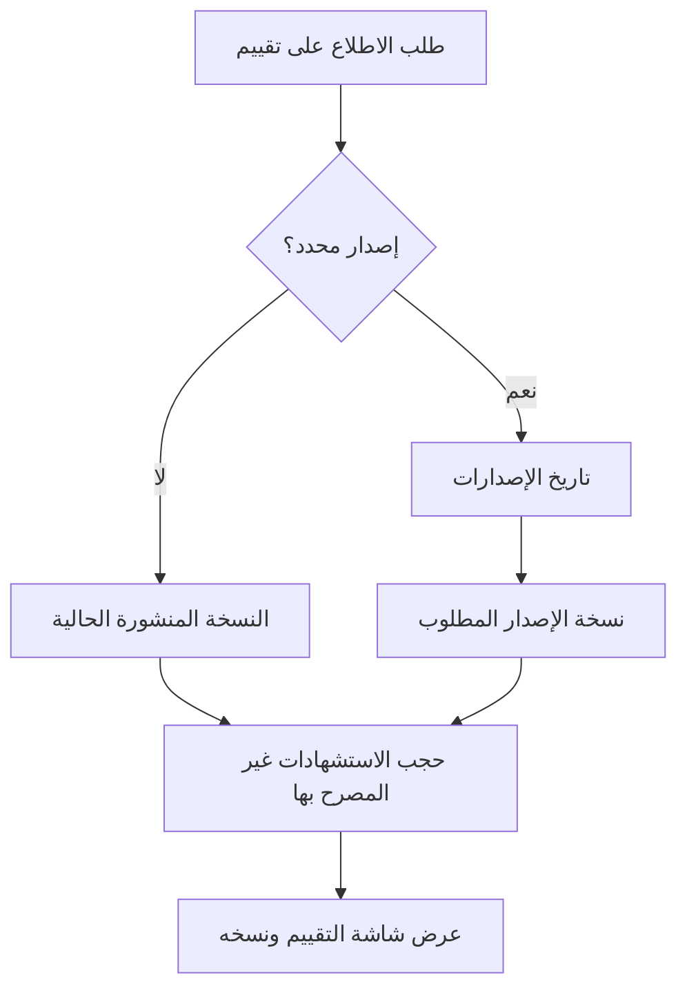

# الاطلاع على التقييمات وإصداراتها

<!-- BEGIN GENERATED: doc -->
| البند | القيمة |
|---|---|
| المعرّف | FEAT-ANL-ASSESSMENT-READ |
| الإصدار | 0.1 |
| الحالة | مسودة |
| القدرة | CAP-04 التحليل والتقييم |
| القدرة الفرعية | CAP-04.03 إنتاج التقييم (R1) |
| الأدوار | المدير؛ المحلل؛ أي مستخدم مخوَّل |
| الشاشات | SCR-31 التقييم ونسخه |
| حالات الاستخدام | UC-015 |
| القصص | 4: 2 من المواصفة، و2 جديدة |
<!-- END GENERATED: doc -->

## 1. نظرة عامة

### 1.1 القيمة

يقرأ المدير ومتخذ القرار التقييم المنشور أو نسخة سابقة منه، مع حجب ما لا يحق له رؤيته من الأدلة.

### 1.2 النطاق

| البند | القيمة |
|---|---|
| المستخدمون | المدير؛ المحلل؛ أي مستخدم مخوَّل ضمن نطاقه |
| الشاشات | SCR-31 التقييم ونسخه |
| حالات الاستخدام | UC-015 إنتاج التقييم |
| المتطلبات | REQ-ANL-006 ثبات الإصدار المنشور وتاريخ الإصدارات؛ REQ-ANL-008 حجب الاستشهادات غير المصرح بها |
| خارج النطاق | إعداد التقييم وتحريره وتقديمه (ميزة: إعداد التقييم)؛ مراجعته ونشره وإعادته وسحبه (ميزة: مراجعة التقييم ونشره) |

### 1.3 خريطة الميزة

**الشكل 1: قراءة التقييم ونسخه**

## 2. القواعد المشتركة

تنطبق على كل قصص الميزة، فلا تتكرر داخل القصص. وكل قصة تذكر ما يخصها فقط. هذه ميزة قراءة فقط: لا أمر فيها يغيّر حالة، فلا تنطبق قواعد منع التكرار ولا حماية التعديل المتزامن ولا الرفض المشترك للأوامر؛ بدلًا منها قاعدة عدم إفصاح واحدة تُطبَّق على كل استعلام وشاشة.

### 2.1 السياق المشترك

كل قصة تبدأ من ثلاثة شروط: مستأجر نشط، وحزمة السياسات الأساسية مفعّلة، ومستخدم مسجّل الدخول ومخوَّل. وتشير إليها القصص بخطوة واحدة: «بفرض السياق المشترك للميزة».

### 2.2 الصلاحية وعدم الإفصاح

- من لا يحق له رؤية التقييم أو إصدارًا منه يتلقى ردًا بشكل «غير متاح» تمامًا، فلا يعرف أنه موجود.
- لا عدد ولا ترتيب ولا توقيت في أي استجابة يكشف وجود تقييم أو إصدار لا يحق للمستخدم رؤيته.

### 2.3 قراءة الاستشهادات المحجوبة

قراءة التقييم لا تُخفي التقييم كله لأن بعض استشهاداته أعلى من تصريح القارئ؛ تُحجب تلك الاستشهادات فقط (معرفاتها ومحتواها)، والإشارة إلى وجود حجب من عدمه قرار سياسة المستأجر (الافتراضي: لا تظهر الإشارة). القصة 5.4 تفصّل هذا السلوك في الشاشة.

## 3. الجودة وتعريف الاكتمال

### 3.1 متطلبات الجودة

<!-- BEGIN GENERATED: quality -->
| المرجع | الموقف | المطلوب |
|---|---|---|
| QAS-SEC-002 | searches, lists, maps or receives alerts touching objects above clearance | 0 leakage in inference suite (counts, facets, ordering, timing, errors) |
<!-- END GENERATED: quality -->

### 3.2 تعريف الاكتمال

القصة مكتملة حين تتحقق الشروط الخمسة:

1. سيناريوهاتها والقواعد المشتركة تمر في الاختبار الآلي.
2. فحوص البنية المعمارية تمر.
3. نصوص الواجهة والرسائل موجودة بالعربية والإنجليزية.
4. مراجعة الكود مكتملة.
5. ما تضيفه القصة نفسها في قسم «القواعد» تحقق.

## 4. فهرس القصص

<!-- BEGIN GENERATED: story-index -->
| المعرّف | القصة | النوع | الحالة |
|---|---|---|---|
| `US-BC03-Q-ASM-GET` | جلب: Assessment version (default: current PUBLISHED; or version / known_at) | جلب | مسودة |
| `US-BC03-Q-ASM-VERSIONS` | جلب: Version history with states and times | جلب | مسودة |
| `US-UI-SCR31-VERSIONS` | التنقل بين نسخ التقييم المنشورة | واجهة | مسودة |
| `US-UI-SCR31-WITHHELD` | حجب الأدلة غير المصرح بها في التقييم | واجهة | مسودة |
<!-- END GENERATED: story-index -->

## 5. القصص

### 5.1 US-BC03-Q-ASM-GET — جلب نسخة من التقييم

| النوع | الإصدار | الأولوية | دون اتصال | الحالة |
|---|---|---|---|---|
| جلب | R1 | Must | لا | مسودة |

> **كـ** **[للكتابة]**، **أريد** **[للكتابة]**، **حتى** **[للكتابة]**.

**باختصار:** **[للكتابة]**

#### القواعد

**[للكتابة]**

#### معايير القبول

**[للكتابة]**

المراجع التقنية والتتبع

<!-- BEGIN GENERATED: refs US-BC03-Q-ASM-GET -->
| البند | المعرّف | المعنى |
|---|---|---|
| الواجهة البرمجية | `GET /api/v1/intelligence/assessments/{assessment_id}` | — |
| الاستعلام | `QRY-ASM-GET` | Assessment version (default: current PUBLISHED; or version / known_at) |
| السياسة | `POL-ASM-GET` | label rule; REDACT obligation for uncleared citations |
| الكيان | `AGG-ASSESSMENT` | التقييم |
| الجدول | `intelligence.assessment_versions` | الجدول الرئيسي للتقييم |
| وحدة النشر | DU-06 | — |
| المتطلب | REQ-ANL-008 | If an assessment references evidence the reader is not authorized to view, then the system shall withhold tha… |
| الاختبار | TST-ASSESSMENT-SM، TST-SLC07-INVARIANTS | دورة حالات التقييم، وثوابت الشريحة SLC-07 |
<!-- END GENERATED: refs US-BC03-Q-ASM-GET -->

### 5.2 US-BC03-Q-ASM-VERSIONS — جلب: Version history with states and times

| النوع | الإصدار | الأولوية | دون اتصال | الحالة |
|---|---|---|---|---|
| جلب | R1 | Must | لا | مسودة |

> **كـ** **[للكتابة]**، **أريد** **[للكتابة]**، **حتى** **[للكتابة]**.

**باختصار:** **[للكتابة]**

#### القواعد

**[للكتابة]**

#### معايير القبول

**[للكتابة]**

المراجع التقنية والتتبع

<!-- BEGIN GENERATED: refs US-BC03-Q-ASM-VERSIONS -->
| البند | المعرّف | المعنى |
|---|---|---|
| الواجهة البرمجية | `GET /api/v1/intelligence/assessments/{assessment_id}/versions` | — |
| الاستعلام | `QRY-ASM-VERSIONS` | Version history with states and times |
| السياسة | `POL-ASM-VERSIONS` | label rule |
| الكيان | `AGG-ASSESSMENT` | التقييم |
| الجدول | `intelligence.assessment_versions` | الجدول الرئيسي للتقييم |
| وحدة النشر | DU-06 | — |
| المتطلب | REQ-ANL-006 | When an assessment is published, the system shall make that version immutable; later changes shall create a n… |
| حالة الاستخدام | UC-015 | Produce Assessment |
| الاختبار | TST-ASSESSMENT-SM، TST-SLC07-INVARIANTS | دورة حالات التقييم، وثوابت الشريحة SLC-07 |
<!-- END GENERATED: refs US-BC03-Q-ASM-VERSIONS -->

### 5.3 US-UI-SCR31-VERSIONS — التنقل بين نسخ التقييم المنشورة

| النوع | الإصدار | الأولوية | دون اتصال | الحالة |
|---|---|---|---|---|
| واجهة | R1 | Must | لا | مسودة |

> **كـ** **[للكتابة]**، **أريد** **[للكتابة]**، **حتى** **[للكتابة]**.

**باختصار:** **[للكتابة]**

#### القواعد

**[للكتابة]**

#### معايير القبول

**[للكتابة]**

المراجع التقنية والتتبع

<!-- BEGIN GENERATED: refs US-UI-SCR31-VERSIONS -->
| البند | المعرّف | المعنى |
|---|---|---|
| الشاشة | SCR-31 | شاشة التقييم ونسخه |
| المصدر | `QRY-ASM-VERSIONS` | — |
| المصدر | `[Derived]` | — |
| المتطلب | REQ-ANL-006 | When an assessment is published, the system shall make that version immutable; later changes shall create a n… |
| حالة الاستخدام | UC-015 | Produce Assessment |
<!-- END GENERATED: refs US-UI-SCR31-VERSIONS -->

### 5.4 US-UI-SCR31-WITHHELD — حجب الأدلة غير المصرح بها في التقييم

| النوع | الإصدار | الأولوية | دون اتصال | الحالة |
|---|---|---|---|---|
| واجهة | R1 | Must | لا | مسودة |

> **كـ** **[للكتابة]**، **أريد** **[للكتابة]**، **حتى** **[للكتابة]**.

**باختصار:** **[للكتابة]**

#### القواعد

**[للكتابة]**

#### معايير القبول

**[للكتابة]**

المراجع التقنية والتتبع

<!-- BEGIN GENERATED: refs US-UI-SCR31-WITHHELD -->
| البند | المعرّف | المعنى |
|---|---|---|
| الشاشة | SCR-31 | شاشة التقييم ونسخه |
| المصدر | `THR-S07-05` | — |
| المصدر | `21-ui-design.md §11` | — |
| المتطلب | REQ-ANL-008 | If an assessment references evidence the reader is not authorized to view, then the system shall withhold tha… |
<!-- END GENERATED: refs US-UI-SCR31-WITHHELD -->

## 6. التتبع

<!-- BEGIN GENERATED: trace -->
| المتطلب | المعنى | القصص | الاختبار |
|---|---|---|---|
| REQ-ANL-006 | When an assessment is published, the system shall make that version immutable; later changes shall create a n… | `US-BC03-Q-ASM-VERSIONS`، `US-UI-SCR31-VERSIONS` | TST-ASSESSMENT-SM، TST-SLC07-INVARIANTS |
| REQ-ANL-008 | If an assessment references evidence the reader is not authorized to view, then the system shall withhold tha… | `US-BC03-Q-ASM-GET`، `US-UI-SCR31-WITHHELD` | TST-ASSESSMENT-SM، TST-SLC07-INVARIANTS |
<!-- END GENERATED: trace -->

## 7. سجل التغييرات

| الإصدار | التاريخ | التغيير |
|---|---|---|
| 0.1 | — | هيكل مولَّد من خريطة الميزات |
