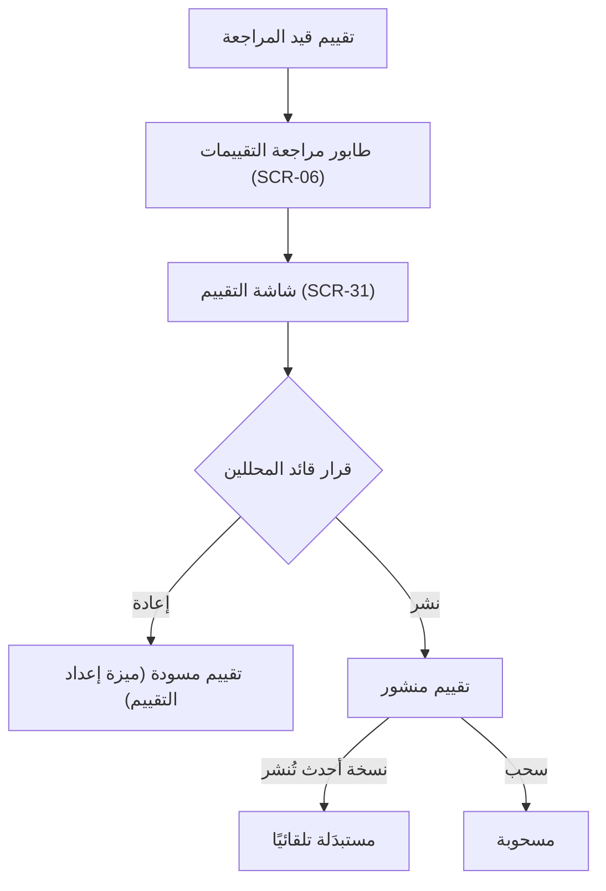
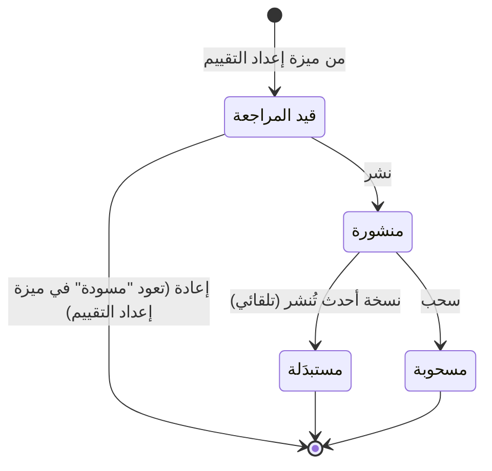

# مراجعة التقييم ونشره

<!-- BEGIN GENERATED: doc -->
| البند | القيمة |
|---|---|
| المعرّف | FEAT-ANL-ASSESSMENT-REVIEW |
| الإصدار | 0.1 |
| الحالة | مسودة |
| القدرة | CAP-04 التحليل والتقييم |
| القدرة الفرعية | CAP-04.03 إنتاج التقييم (R1) |
| الأدوار | المراجع؛ قائد المحللين؛ النظام |
| الشاشات | SCR-31 التقييم ونسخه، SCR-06 قوائم المراجعة |
| حالات الاستخدام | UC-015 |
| القصص | 7: 4 من المواصفة، و3 جديدة |
<!-- END GENERATED: doc -->

## 1. نظرة عامة

### 1.1 القيمة

يراجع قائد التحليل التقييم فيعيده للتحسين أو ينشره نسخة ثابتة لا تتغير، أو يسحبه إن لزم.

### 1.2 النطاق

| البند | القيمة |
|---|---|
| المستخدمون | قائد المحللين؛ النظام |
| الشاشات | SCR-31 التقييم ونسخه؛ SCR-06 قوائم المراجعة |
| حالات الاستخدام | UC-015 إنتاج التقييم |
| المتطلبات | REQ-ANL-006 ثبات الإصدار المنشور؛ REQ-ANL-005 عناصر التقييم الإلزامية (شرط يسبق النشر)؛ REQ-ANL-008 حجب الاستشهادات غير المصرح بها عند القراءة |
| خارج النطاق | إعداد التقييم وتحريره وتقديمه وتجاهله (ميزة: إعداد التقييم)؛ قراءة التقييم المنشور وتاريخ إصداراته (ميزة: الاطلاع على التقييمات وإصداراتها) |

### 1.3 خريطة الميزة

**الشكل 1: من تقديم التقييم إلى نشره أو إعادته أو سحبه**



**الشكل 2: حالات التقييم التي تغطيها هذه الميزة**



## 2. القواعد المشتركة

تنطبق على كل قصص الميزة، فلا تتكرر داخل القصص. وكل قصة تذكر ما يخصها فقط.

### 2.1 السياق المشترك

كل قصة تبدأ من ثلاثة شروط: مستأجر نشط، وحزمة السياسات الأساسية مفعّلة، ومستخدم مسجّل الدخول ومخوَّل. وتشير إليها القصص بخطوة واحدة: «بفرض السياق المشترك للميزة».

### 2.2 الصلاحية وعدم الإفصاح

- من لا يحق له رؤية العنصر يتلقى ردًا بشكل «غير متاح» تمامًا، فلا يعرف أنه موجود.
- من يرى العنصر ولا يحق له الإجراء يتلقى «لا تملك صلاحية هذا الإجراء».

### 2.3 أوامر تغيير الحالة

- **منع التكرار:** يُرسل كل أمر بمفتاح فريد، فإعادة الطلب نفسه لا تُنفَّذ مرتين.
- **حماية التعديل المتزامن:** يُرسل كل أمر بإصدار البيانات الذي يراه المستخدم. فإن عدّلها غيره في الأثناء، يُرفض الأمر.
- **السجل:** إن نجح الأمر، يُكتب حدثه وسجل التدقيق في المعاملة نفسها.

### 2.4 الرفض المشترك

```gherkin
# language: ar
خاصية: الرفض المشترك لأوامر الميزة

  سيناريو مخطط: رفض مشترك لكل أمر في الميزة
    بفرض السياق المشترك للميزة
    و <الحالة>
    عندما يُرسل المستخدم أي أمر من أوامر الميزة
    اذاً يُرفض برمز <الرمز> ويرى "<الرسالة>"
    و لا يتغير شيء

    امثلة:
      | الحالة                                  | الرمز                  | الرسالة                                                 |
      | العنصر خارج صلاحياته                    | NOT_FOUND              | غير متاح                                                |
      | العنصر مرئي له ولا يحق له الإجراء       | AUTHZ_DENIED           | لا تملك صلاحية هذا الإجراء                              |
      | غيره عدّل العنصر بعد أن فتحه            | VERSION_CONFLICT       | تغيّرت البيانات منذ فتحتها. راجع التغييرات ثم أعد المحاولة |
      | أعاد مفتاح منع التكرار بمحتوى مختلف     | IDEMPOTENCY_KEY_REUSED | طلب مكرر بمحتوى مختلف                                   |
      | البيانات ناقصة أو غير صحيحة             | VALIDATION_FAILED      | بعض البيانات ناقصة أو غير صحيحة. راجع الحقول المعلَّمة      |

  سيناريو: إعادة الطلب نفسه لا تُنفَّذ مرتين
    بفرض السياق المشترك للميزة
    و أمر نجح بمفتاح منع تكرار
    عندما يُعاد الطلب نفسه بالمفتاح نفسه
    اذاً تُعاد النتيجة الأولى ولا يُكتب حدث ثانٍ
```

## 3. الجودة وتعريف الاكتمال

### 3.1 متطلبات الجودة

<!-- BEGIN GENERATED: quality -->
| المرجع | الموقف | المطلوب |
|---|---|---|
| QAS-SEC-002 | searches, lists, maps or receives alerts touching objects above clearance | 0 leakage in inference suite (counts, facets, ordering, timing, errors) |
<!-- END GENERATED: quality -->

### 3.2 تعريف الاكتمال

القصة مكتملة حين تتحقق الشروط الخمسة:

1. سيناريوهاتها والقواعد المشتركة تمر في الاختبار الآلي.
2. فحوص البنية المعمارية تمر.
3. نصوص الواجهة والرسائل موجودة بالعربية والإنجليزية.
4. مراجعة الكود مكتملة.
5. ما تضيفه القصة نفسها في قسم «القواعد» تحقق.

## 4. فهرس القصص

<!-- BEGIN GENERATED: story-index -->
| المعرّف | القصة | النوع | الحالة |
|---|---|---|---|
| `US-BC03-ASM-PUBLISH` | نشر التقييم | أمر | مسودة |
| `US-BC03-ASM-RETURN` | إعادة التقييم للمراجعة | أمر | مسودة |
| `US-BC03-ASM-WITHDRAW` | سحب التقييم | أمر | مسودة |
| `US-DOM-ANL-ASM-REVIEW-QUEUE` | تقييمات مقدَّمة تنتظر مراجعتي | جلب | مسودة |
| `US-BC03-S-ASSESSMENT-01` | تلقائي: newer version published (التقييم) | نظام | مسودة |
| `US-UI-SCR06-ASSESSMENT-REVIEWS` | طابور مراجعة التقييمات في قوائم المراجعة | واجهة | مسودة |
| `US-UI-SCR31-REVIEW-ACTIONS` | أفعال المراجعة حسب الحالة وفصل المهام | واجهة | مسودة |
<!-- END GENERATED: story-index -->

## 5. القصص

### 5.1 US-BC03-ASM-PUBLISH — نشر التقييم

| النوع | الإصدار | الأولوية | دون اتصال | الحالة |
|---|---|---|---|---|
| أمر | R1 | Must | لا | مسودة |

> **كـ** قائد المحللين، **أريد** أن أنشر تقييمًا قدَّمه المحلل وراجعته، **حتى** يصبح نسخة ثابتة يستند إليها القرار والمنتجات.

**باختصار:** ينشر قائد المحللين تقييمًا «قيد المراجعة» لم يعدّه هو نفسه، فيصبح «منشورة»، وأي نسخة منشورة سابقة لنفس التقييم تصبح «مستبدَلة» في المعاملة نفسها.

#### القواعد

- **متى يُسمح:** التقييم «قيد المراجعة».
- **من يُسمح له:** قائد المحللين، بشرط ألا يكون هو من أعدّ التقييم (فصل المهام).
- **البيانات:** ملاحظة مراجعة (اختيارية).
- **الأثر:** تصبح حالة التقييم «منشورة»؛ إن كانت له نسخة منشورة سابقة، تصبح «مستبدَلة» في المعاملة نفسها؛ يُسجَّل حدث «نُشر التقييم».

#### معايير القبول

```gherkin
# language: ar
خاصية: نشر التقييم

  سيناريو: نشر تقييم قيد المراجعة
    بفرض السياق المشترك للميزة
    و تقييم "قيد المراجعة" أعدّه المحلل وراجعه قائد المحللين، وهو غير من أعدّه
    عندما ينشره قائد المحللين
    اذاً تصبح حالته "منشورة"
    و يُسجَّل حدث "نُشر التقييم"

  سيناريو: نشر نسخة جديدة يستبدل المنشورة السابقة
    بفرض السياق المشترك للميزة
    و تقييم "قيد المراجعة" لتقييم له نسخة "منشورة" سابقة
    عندما ينشره قائد المحللين
    اذاً تصبح النسخة الجديدة "منشورة"
    و تصبح النسخة السابقة "مستبدَلة" في المعاملة نفسها

  سيناريو مخطط: رفض خاص بنشر التقييم
    بفرض السياق المشترك للميزة
    و <الحالة>
    عندما يحاول قائد المحللين نشر التقييم
    اذاً يُرفض برمز <الرمز> ويرى "<الرسالة>"
    و لا يتغير شيء

    امثلة:
      | الحالة                           | الرمز                                | الرسالة                                                 |
      | التقييم ليس "قيد المراجعة"       | ASSESSMENT_INVALID_STATE_TRANSITION  | الوضع الحالي للتقييم لا يسمح بهذا الإجراء               |
      | قائد المحللين هو من أعدّ التقييم | SEGREGATION_OF_DUTIES                | لا يجوز أن يعتمد الشخص نفسه ما قدّمه أو طلبه            |
```

<details><summary>المراجع التقنية والتتبع</summary>

<!-- BEGIN GENERATED: refs US-BC03-ASM-PUBLISH -->
| البند | المعرّف | المعنى |
|---|---|---|
| الواجهة البرمجية | `POST /api/v1/intelligence/assessments/{id}/actions/publish` | — |
| الأمر | `CMD-ASM-PUBLISH` | نشر التقييم |
| السياسة | `POL-ASM-PUBLISH` | Analyst (draft, edit, submit, discard) · reviewer / Analysis lead (return, publish, withdraw)؛ tenant match;… |
| الحدث | `EVT-ASM-PUBLISHED` | يصل إلى: Decision requests (SLC-08: pinned references); Situation membership (assessment layer); Search proje… |
| الكيان | `AGG-ASSESSMENT` | التقييم |
| الجدول | `intelligence.assessment_versions` | الجدول الرئيسي للتقييم |
| وحدة النشر | DU-06 | — |
| المتطلبات | REQ-ANL-005، REQ-ANL-006، REQ-ANL-008 | معانيها في القسم 6. التتبع |
| حالة الاستخدام | UC-015 | Produce Assessment |
| الاختبار | TST-ASSESSMENT-SM، TST-SLC07-INVARIANTS | دورة حالات التقييم، وثوابت الشريحة SLC-07 |
<!-- END GENERATED: refs US-BC03-ASM-PUBLISH -->

</details>

### 5.2 US-BC03-ASM-RETURN — إعادة التقييم إلى المحلل للتحسين

| النوع | الإصدار | الأولوية | دون اتصال | الحالة |
|---|---|---|---|---|
| أمر | R1 | Must | لا | مسودة |

> **كـ** قائد المحللين، **أريد** أن أعيد تقييمًا قيد المراجعة إلى المحلل بسبب، **حتى** يحسّنه قبل إعادة تقديمه للنشر.

**باختصار:** يعيد قائد المحللين تقييمًا «قيد المراجعة» بسبب، فيعود «مسودة» قابلة للتحرير من جديد في ميزة إعداد التقييم.

#### القواعد

- **متى يُسمح:** التقييم «قيد المراجعة».
- **من يُسمح له:** قائد المحللين.
- **البيانات:** سبب الإعادة (إلزامي).
- **الأثر:** تعود حالة التقييم «مسودة»؛ يُسجَّل حدث «أُعيد التقييم للمراجعة». التحرير اللاحق بأمر تعديل التقييم (ميزة إعداد التقييم).

#### معايير القبول

```gherkin
# language: ar
خاصية: إعادة التقييم إلى المحلل للتحسين

  سيناريو: إعادة تقييم قيد المراجعة
    بفرض السياق المشترك للميزة
    و تقييم "قيد المراجعة"
    عندما يعيده قائد المحللين بسبب
    اذاً تعود حالته "مسودة"
    و يُسجَّل حدث "أُعيد التقييم للمراجعة"

  سيناريو مخطط: رفض خاص بإعادة التقييم
    بفرض السياق المشترك للميزة
    و <الحالة>
    عندما يحاول قائد المحللين إعادة التقييم
    اذاً يُرفض برمز <الرمز> ويرى "<الرسالة>"
    و لا يتغير شيء

    امثلة:
      | الحالة                     | الرمز                                | الرسالة                                     |
      | التقييم ليس "قيد المراجعة" | ASSESSMENT_INVALID_STATE_TRANSITION  | الوضع الحالي للتقييم لا يسمح بهذا الإجراء |
      | السبب غير مذكور            | REASON_REQUIRED                      | اذكر السبب                                   |
```

<details><summary>المراجع التقنية والتتبع</summary>

<!-- BEGIN GENERATED: refs US-BC03-ASM-RETURN -->
| البند | المعرّف | المعنى |
|---|---|---|
| الواجهة البرمجية | `POST /api/v1/intelligence/assessments/{id}/actions/return` | — |
| الأمر | `CMD-ASM-RETURN` | إعادة التقييم للمراجعة |
| السياسة | `POL-ASM-RETURN` | Analyst (draft, edit, submit, discard) · reviewer / Analysis lead (return, publish, withdraw)؛ tenant match;… |
| الحدث | `EVT-ASM-RETURNED` | يصل إلى: Decision requests (SLC-08: pinned references); Situation membership (assessment layer); Search proje… |
| الكيان | `AGG-ASSESSMENT` | التقييم |
| الجدول | `intelligence.assessment_versions` | الجدول الرئيسي للتقييم |
| وحدة النشر | DU-06 | — |
| المتطلبات | REQ-ANL-005، REQ-ANL-006، REQ-ANL-008 | معانيها في القسم 6. التتبع |
| حالة الاستخدام | UC-015 | Produce Assessment |
| الاختبار | TST-ASSESSMENT-SM، TST-SLC07-INVARIANTS | دورة حالات التقييم، وثوابت الشريحة SLC-07 |
<!-- END GENERATED: refs US-BC03-ASM-RETURN -->

</details>

### 5.3 US-BC03-ASM-WITHDRAW — سحب التقييم

| النوع | الإصدار | الأولوية | دون اتصال | الحالة |
|---|---|---|---|---|
| أمر | R1 | Must | لا | مسودة |

> **كـ** قائد المحللين، **أريد** أن أسحب تقييمًا منشورًا بسبب، **حتى** يُعلَم من استند إليه في قرار أو منتج أنه لم يعد معتمدًا.

**باختصار:** يسحب قائد المحللين تقييمًا «منشورة» بسبب، فيصبح «مسحوبة» نهائيًا، وتُعلَم طلبات القرار والمنتجات التي تستشهد به.

#### القواعد

- **متى يُسمح:** التقييم «منشورة».
- **من يُسمح له:** قائد المحللين.
- **البيانات:** سبب السحب (إلزامي).
- **الأثر:** تصبح حالة التقييم «مسحوبة» نهائيًا؛ تُعلَم طلبات القرار والمنتجات المرتبطة به (REQ-ANL-006)؛ يُسجَّل حدث «سُحب التقييم».

#### معايير القبول

```gherkin
# language: ar
خاصية: سحب التقييم

  سيناريو: سحب تقييم منشور
    بفرض السياق المشترك للميزة
    و تقييم "منشورة" تستشهد به طلبات قرار أو منتجات
    عندما يسحبه قائد المحللين بسبب
    اذاً تصبح حالته "مسحوبة"
    و تُعلَم طلبات القرار والمنتجات المستشهدة به
    و يُسجَّل حدث "سُحب التقييم"

  سيناريو مخطط: رفض خاص بسحب التقييم
    بفرض السياق المشترك للميزة
    و <الحالة>
    عندما يحاول قائد المحللين سحب التقييم
    اذاً يُرفض برمز <الرمز> ويرى "<الرسالة>"
    و لا يتغير شيء

    امثلة:
      | الحالة                     | الرمز                                | الرسالة                                     |
      | التقييم ليس "منشورة"       | ASSESSMENT_INVALID_STATE_TRANSITION  | الوضع الحالي للتقييم لا يسمح بهذا الإجراء |
      | السبب غير مذكور            | REASON_REQUIRED                      | اذكر السبب                                   |
```

<details><summary>المراجع التقنية والتتبع</summary>

<!-- BEGIN GENERATED: refs US-BC03-ASM-WITHDRAW -->
| البند | المعرّف | المعنى |
|---|---|---|
| الواجهة البرمجية | `POST /api/v1/intelligence/assessments/{id}/actions/withdraw` | — |
| الأمر | `CMD-ASM-WITHDRAW` | سحب التقييم |
| السياسة | `POL-ASM-WITHDRAW` | Analyst (draft, edit, submit, discard) · reviewer / Analysis lead (return, publish, withdraw)؛ tenant match;… |
| الحدث | `EVT-ASM-WITHDRAWN` | يصل إلى: Decision requests (SLC-08: pinned references); Situation membership (assessment layer); Search proje… |
| الكيان | `AGG-ASSESSMENT` | التقييم |
| الجدول | `intelligence.assessment_versions` | الجدول الرئيسي للتقييم |
| وحدة النشر | DU-06 | — |
| المتطلبات | REQ-ANL-005، REQ-ANL-006، REQ-ANL-008 | معانيها في القسم 6. التتبع |
| حالة الاستخدام | UC-015 | Produce Assessment |
| الاختبار | TST-ASSESSMENT-SM، TST-SLC07-INVARIANTS | دورة حالات التقييم، وثوابت الشريحة SLC-07 |
<!-- END GENERATED: refs US-BC03-ASM-WITHDRAW -->

</details>

### 5.4 US-DOM-ANL-ASM-REVIEW-QUEUE — تقييمات مقدَّمة تنتظر مراجعتي

| النوع | الإصدار | الأولوية | دون اتصال | الحالة |
|---|---|---|---|---|
| جلب | R1 | Must | لا | مسودة |

> **كـ** قائد المحللين، **أريد** أن أرى قائمة التقييمات المقدَّمة التي تنتظر مراجعتي، **حتى** أراجعها وأنشرها أو أعيدها دون أن أفوّت واحدًا منها.

**باختصار:** تعيد القائمة كل تقييم «قيد المراجعة» ضمن نطاقي المسموح، مرتَّبة بوقت التقديم. **[Derived]**

#### القواعد

- **من يرى ماذا:** قائد المحللين يرى التقييمات «قيد المراجعة» ضمن نطاقه المسموح فقط.
- **البيانات:** مؤشر الصفحة وحجمها، والترتيب بوقت التقديم.

#### معايير القبول

```gherkin
# language: ar
خاصية: تقييمات مقدَّمة تنتظر مراجعتي

  سيناريو: عرض التقييمات قيد المراجعة ضمن النطاق المسموح
    بفرض السياق المشترك للميزة
    و تقييمات "قيد المراجعة" داخل نطاقي المسموح وخارجه
    عندما أطلب قائمة التقييمات التي تنتظر مراجعتي
    اذاً تُعاد التقييمات التي ضمن نطاقي المسموح فقط، مرتَّبة بوقت التقديم
    و لا يكشف العدد أو الترتيب عن تقييم خارج نطاقي

  سيناريو: لا تقييمات تنتظر المراجعة
    بفرض السياق المشترك للميزة
    و لا تقييم "قيد المراجعة" ضمن نطاقي المسموح
    عندما أطلب القائمة
    اذاً تُعاد قائمة فارغة
```

<details><summary>المراجع التقنية والتتبع</summary>

<!-- BEGIN GENERATED: refs US-DOM-ANL-ASM-REVIEW-QUEUE -->
| البند | المعرّف | المعنى |
|---|---|---|
| حالة الاستخدام | UC-015 | Produce Assessment |
| الشاشة | SCR-06 | شاشة قوائم المراجعة |
| المصدر | `[Derived]` | — |
| المتطلب | REQ-ANL-005 | The system shall record for each assessment its findings, evidence, assumptions, uncertainty, confidence, met… |
| حالة الاستخدام | UC-015 | Produce Assessment |
<!-- END GENERATED: refs US-DOM-ANL-ASM-REVIEW-QUEUE -->

</details>

### 5.5 US-BC03-S-ASSESSMENT-01 — استبدال النسخة المنشورة تلقائيًا عند نشر نسخة أحدث

| النوع | الإصدار | الأولوية | دون اتصال | الحالة |
|---|---|---|---|---|
| نظام | R1 | Must | لا ينطبق | مسودة |

> **كـ** النظام، عند نشر نسخة أحدث من تقييم، **أريد** نقل نسخته المنشورة السابقة إلى «مستبدَلة»، **حتى** يبقى لكل تقييم نسخة منشورة واحدة فقط في كل وقت (REQ-ANL-006).

**باختصار:** حين ينشر قائد المحللين نسخة جديدة من تقييم له نسخة منشورة سابقة (القصة 5.1)، ينقل النظام تلك النسخة السابقة إلى «مستبدَلة» في المعاملة نفسها.

#### القواعد

- **متى يحدث:** عند نشر نسخة أحدث من نفس التقييم (ضمن أمر نشر التقييم، القصة 5.1).
- **الأثر:** تصبح حالة النسخة المنشورة السابقة «مستبدَلة»؛ مرجعية القرارات والمنتجات لتلك النسخة تبقى مثبَّتة على إصدارها ولا تتغير (INV-ASM-03)؛ يُسجَّل حدث «استُبدلت نسخة التقييم» بهوية النظام.

#### معايير القبول

```gherkin
# language: ar
خاصية: استبدال النسخة المنشورة تلقائيًا

  سيناريو: نشر نسخة أحدث يستبدل المنشورة السابقة
    بفرض تقييم "منشورة" لتقييم ما
    عندما يُنشر لهذا التقييم نسخة أحدث
    اذاً تصبح النسخة السابقة "مستبدَلة"
    و يُسجَّل حدث "استُبدلت نسخة التقييم" بهوية النظام

  سيناريو: لا نسخة منشورة سابقة فلا يحدث استبدال
    بفرض تقييم لا نسخة "منشورة" سابقة له
    عندما يُنشر له أول نسخة
    اذاً لا يحدث استبدال
    و لا يتغير شيء آخر
```

<details><summary>المراجع التقنية والتتبع</summary>

<!-- BEGIN GENERATED: refs US-BC03-S-ASSESSMENT-01 -->
| البند | المعرّف | المعنى |
|---|---|---|
| المحفِّز | `SYS:newer version published` | system |
| الانتقال | PUBLISHED ← SUPERSEDED | — |
| الحدث | `EVT-ASM-SUPERSEDED` | يصل إلى: Decision requests (SLC-08: pinned references); Situation membership (assessment layer); Search proje… |
| الكيان | `AGG-ASSESSMENT` | التقييم |
| الجدول | `intelligence.assessment_versions` | الجدول الرئيسي للتقييم |
| وحدة النشر | DU-06 | — |
| المتطلبات | REQ-ANL-005، REQ-ANL-006، REQ-ANL-008 | معانيها في القسم 6. التتبع |
| حالة الاستخدام | UC-015 | Produce Assessment |
| الاختبار | TST-ASSESSMENT-SM، TST-SLC07-INVARIANTS | دورة حالات التقييم، وثوابت الشريحة SLC-07 |
<!-- END GENERATED: refs US-BC03-S-ASSESSMENT-01 -->

</details>

### 5.6 US-UI-SCR06-ASSESSMENT-REVIEWS — طابور مراجعة التقييمات في قوائم المراجعة

| النوع | الإصدار | الأولوية | دون اتصال | الحالة |
|---|---|---|---|---|
| واجهة | R1 | Should | لا | مسودة |

> **كـ** قائد المحللين، **أريد** أن أرى طابور التقييمات التي تنتظر مراجعتي ضمن شاشة قوائم المراجعة الموحدة، **حتى** أراجع كل ما يحتاج قراري من شاشة واحدة مع طوابير المراجعة الأخرى.

**باختصار:** تضيف شاشة قوائم المراجعة (SCR-06) تبويبًا للتقييمات التي تنتظر المراجعة، يفتح كل عنصر فيه شاشة التقييم (SCR-31) لاتخاذ القرار. **[Derived]**

#### القواعد

- **البيانات:** تبويب «تقييمات تنتظر مراجعتي» ضمن قوائم المراجعة، بعدد العناصر ضمن نطاقي المسموح.
- **الأثر:** عرض وفتح فقط؛ القرار (نشر أو إعادة) بأوامر القصتين 5.1 و5.2.

#### معايير القبول

```gherkin
# language: ar
خاصية: طابور مراجعة التقييمات في قوائم المراجعة

  سيناريو: فتح تبويب التقييمات من قوائم المراجعة
    بفرض السياق المشترك للميزة
    و تقييمات "قيد المراجعة" ضمن نطاقي المسموح
    عندما أفتح تبويب التقييمات في شاشة قوائم المراجعة
    اذاً تظهر التقييمات التي ضمن نطاقي المسموح فقط
    و يفتح كل عنصر شاشة التقييم لاتخاذ القرار
```

<details><summary>المراجع التقنية والتتبع</summary>

<!-- BEGIN GENERATED: refs US-UI-SCR06-ASSESSMENT-REVIEWS -->
| البند | المعرّف | المعنى |
|---|---|---|
| الشاشة | SCR-06 | شاشة قوائم المراجعة |
| حالة الاستخدام | UC-015 | Produce Assessment |
| المصدر | `[Derived]` | — |
<!-- END GENERATED: refs US-UI-SCR06-ASSESSMENT-REVIEWS -->

</details>

### 5.7 US-UI-SCR31-REVIEW-ACTIONS — أفعال المراجعة حسب الحالة وفصل المهام

| النوع | الإصدار | الأولوية | دون اتصال | الحالة |
|---|---|---|---|---|
| واجهة | R1 | Must | لا | مسودة |

> **كـ** قائد المحللين، **أريد** أن تعرض لي شاشة التقييم فقط الأفعال التي تسمح بها حالته الحالية وتستبعد النشر إن كنت من أعددته، **حتى** لا أحاول فعلًا سيرفضه الخادم.

**باختصار:** تعرض شاشة التقييم (SCR-31) أفعال النشر والإعادة والسحب حسب حالة التقييم الحالية، وتخفي فعل النشر عن من أعدّ التقييم نفسه؛ وقرار الخادم عند التنفيذ يبقى الحاكم (17-security-design.md §12.4). **[Derived]**

#### القواعد

- **البيانات:** حالة التقييم الحالية، وهوية من أعدّه، وصلاحيات المستخدم الظاهر له الشاشة.
- **الأثر:** عرض وإخفاء فقط؛ القرار الفعلي بأوامر القصص 5.1 و5.2 و5.3، والخادم يرفض أي فعل لا تسمح به حالته أو فصل مهامه حتى إن ظهر الزر (21-ui-design.md §6.3).

#### معايير القبول

```gherkin
# language: ar
خاصية: أفعال المراجعة حسب الحالة وفصل المهام

  سيناريو: إخفاء فعل النشر عن من أعدّ التقييم
    بفرض السياق المشترك للميزة
    و تقييم "قيد المراجعة" أعدّه قائد المحللين نفسه بصفته محللًا
    عندما يفتح شاشة التقييم
    اذاً يظهر فعل الإعادة فقط، ويُخفى فعل النشر

  سيناريو: عرض أفعال التقييم المنشور
    بفرض السياق المشترك للميزة
    و تقييم "منشورة"
    عندما يفتح قائد المحللين شاشة التقييم
    اذاً يظهر فعل السحب فقط، وتُخفى أفعال النشر والإعادة
```

<details><summary>المراجع التقنية والتتبع</summary>

<!-- BEGIN GENERATED: refs US-UI-SCR31-REVIEW-ACTIONS -->
| البند | المعرّف | المعنى |
|---|---|---|
| الشاشة | SCR-31 | شاشة التقييم ونسخه |
| المصدر | `17-security-design.md §12.4` | — |
| المصدر | `21-ui-design.md §6.3` | — |
| المصدر | `[Derived]` | — |
| المتطلب | REQ-ANL-006 | When an assessment is published, the system shall make that version immutable; later changes shall create a n… |
| حالة الاستخدام | UC-015 | Produce Assessment |
<!-- END GENERATED: refs US-UI-SCR31-REVIEW-ACTIONS -->

</details>

## 6. التتبع

<!-- BEGIN GENERATED: trace -->
| المتطلب | المعنى | القصص | الاختبار |
|---|---|---|---|
| REQ-ANL-005 | The system shall record for each assessment its findings, evidence, assumptions, uncertainty, confidence, met… | `US-BC03-ASM-PUBLISH`، `US-BC03-ASM-RETURN`، `US-BC03-ASM-WITHDRAW`، `US-BC03-S-ASSESSMENT-01`، `US-DOM-ANL-ASM-REVIEW-QUEUE` | TST-ASSESSMENT-SM، TST-FINDING-SM، TST-SLC07-INVARIANTS |
| REQ-ANL-006 | When an assessment is published, the system shall make that version immutable; later changes shall create a n… | `US-BC03-ASM-PUBLISH`، `US-BC03-ASM-RETURN`، `US-BC03-ASM-WITHDRAW`، `US-BC03-S-ASSESSMENT-01`، `US-UI-SCR31-REVIEW-ACTIONS` | TST-ASSESSMENT-SM، TST-SLC07-INVARIANTS |
| REQ-ANL-008 | If an assessment references evidence the reader is not authorized to view, then the system shall withhold tha… | كل قصص الميزة المأخوذة من المواصفة (4) | TST-ASSESSMENT-SM، TST-SLC07-INVARIANTS |
<!-- END GENERATED: trace -->

## 7. سجل التغييرات

| الإصدار | التاريخ | التغيير |
|---|---|---|
| 0.1 | — | هيكل مولَّد من خريطة الميزات |
| 0.2 | 2026-10-03 | كتابة القصص كاملة بمعيار القصص |
