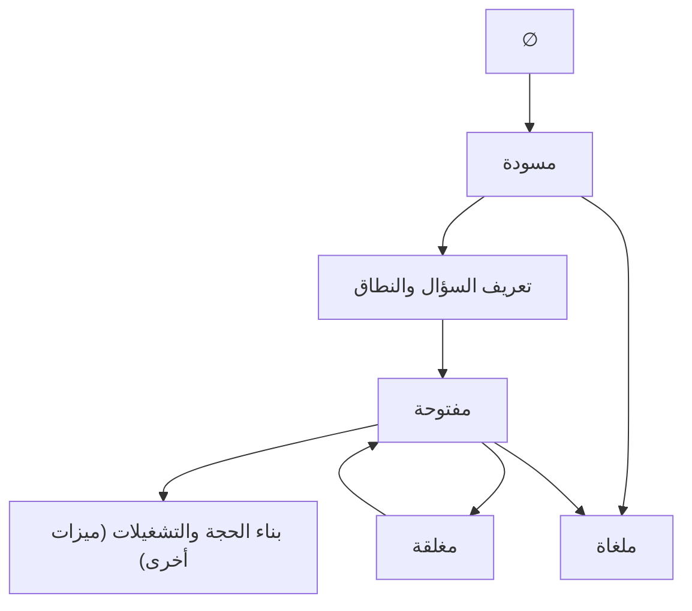
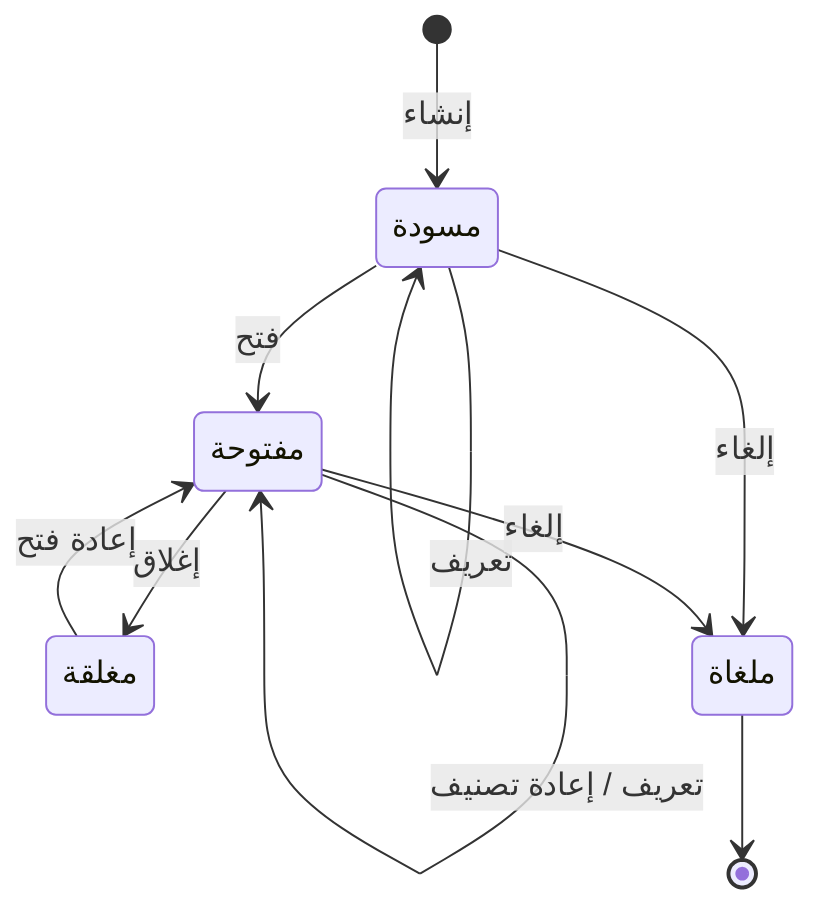

# فتح حالة تحليل وإدارتها

<!-- BEGIN GENERATED: doc -->
| البند | القيمة |
|---|---|
| المعرّف | FEAT-ANL-CASE-SETUP |
| الإصدار | 0.1 |
| الحالة | مسودة |
| القدرة | CAP-04 التحليل والتقييم |
| القدرة الفرعية | CAP-04.01 حالات التحليل (R1) |
| الأدوار | المحلل؛ مسؤول الأمن؛ أي مستخدم مخوَّل |
| الشاشات | SCR-30 الحالة التحليلية والتشغيلات |
| حالات الاستخدام | UC-010، UC-011 |
| القصص | 12: 9 من المواصفة، و3 جديدة |
<!-- END GENERATED: doc -->

## 1. نظرة عامة

### 1.1 القيمة

يبدأ المحلل عمله التحليلي من حالة واحدة تحدد السؤال والنطاق، ويتابعها حتى الإغلاق أو إعادة الفتح.

### 1.2 النطاق

| البند | القيمة |
|---|---|
| المستخدمون | المحلل؛ مسؤول الأمن |
| الشاشات | SCR-30 الحالة التحليلية والتشغيلات |
| حالات الاستخدام | UC-010 إنشاء حالة التحليل؛ UC-011 تعريف السؤال التحليلي |
| المتطلبات | REQ-ANL-001 سؤال حالة التحليل ونطاقها وفرضياتها وافتراضاتها وأدلتها؛ REQ-ANL-007 إبقاء الحالة قابلة لحمل سيناريوهات للمقارنة (المقارنة نفسها في ميزة أخرى) |
| خارج النطاق | الفرضيات والافتراضات والأدلة التفصيلية (ميزة: الفرضيات والافتراضات والأدلة)؛ تعريف السيناريوهات ومقارنتها (ميزة: السيناريوهات ومقارنة النتائج)؛ تشغيل التحليل (ميزة: تشغيل التحليل وإعادة إنتاجه)؛ إعداد التقييم ومراجعته (ميزتا إعداد التقييم ومراجعته) |

### 1.3 خريطة الميزة

**الشكل 1: دورة حياة حالة التحليل**



**الشكل 2: حالات حالة التحليل**



> **ملاحظة:** إعادة التصنيف (مسؤول الأمن) مسموحة في «مسودة» و«مفتوحة» و«مغلقة» دون تغيير الحالة نفسها، ولا تظهر في الشكل 2 لذلك.

## 2. القواعد المشتركة

تنطبق على كل قصص الميزة، فلا تتكرر داخل القصص. وكل قصة تذكر ما يخصها فقط.

### 2.1 السياق المشترك

كل قصة تبدأ من ثلاثة شروط: مستأجر نشط، وحزمة السياسات الأساسية مفعّلة، ومستخدم مسجّل الدخول ومخوَّل. وتشير إليها القصص بخطوة واحدة: «بفرض السياق المشترك للميزة».

### 2.2 الصلاحية وعدم الإفصاح

- من لا يحق له رؤية العنصر يتلقى ردًا بشكل «غير متاح» تمامًا، فلا يعرف أنه موجود.
- من يرى العنصر ولا يحق له الإجراء يتلقى «لا تملك صلاحية هذا الإجراء».

### 2.3 أوامر تغيير الحالة

- **منع التكرار:** يُرسل كل أمر بمفتاح فريد، فإعادة الطلب نفسه لا تُنفَّذ مرتين.
- **حماية التعديل المتزامن:** يُرسل كل أمر بإصدار البيانات الذي يراه المستخدم. فإن عدّلها غيره في الأثناء، يُرفض الأمر.
- **السجل:** إن نجح الأمر، يُكتب حدثه وسجل التدقيق في المعاملة نفسها.

### 2.4 الرفض المشترك

```gherkin
# language: ar
خاصية: الرفض المشترك لأوامر الميزة

  سيناريو مخطط: رفض مشترك لكل أمر في الميزة
    بفرض السياق المشترك للميزة
    و <الحالة>
    عندما يُرسل المستخدم أي أمر من أوامر الميزة
    اذاً يُرفض برمز <الرمز> ويرى "<الرسالة>"
    و لا يتغير شيء

    امثلة:
      | الحالة                                  | الرمز                  | الرسالة                                                 |
      | العنصر خارج صلاحياته                    | NOT_FOUND              | غير متاح                                                |
      | العنصر مرئي له ولا يحق له الإجراء       | AUTHZ_DENIED           | لا تملك صلاحية هذا الإجراء                              |
      | غيره عدّل العنصر بعد أن فتحه            | VERSION_CONFLICT       | تغيّرت البيانات منذ فتحتها. راجع التغييرات ثم أعد المحاولة |
      | أعاد مفتاح منع التكرار بمحتوى مختلف     | IDEMPOTENCY_KEY_REUSED | طلب مكرر بمحتوى مختلف                                   |
      | البيانات ناقصة أو غير صحيحة             | VALIDATION_FAILED      | بعض البيانات ناقصة أو غير صحيحة. راجع الحقول المعلَّمة      |

  سيناريو: إعادة الطلب نفسه لا تُنفَّذ مرتين
    بفرض السياق المشترك للميزة
    و أمر نجح بمفتاح منع تكرار
    عندما يُعاد الطلب نفسه بالمفتاح نفسه
    اذاً تُعاد النتيجة الأولى ولا يُكتب حدث ثانٍ
```

## 3. الجودة وتعريف الاكتمال

### 3.1 متطلبات الجودة

<!-- BEGIN GENERATED: quality -->
لا متطلبات جودة مرتبطة بمتطلبات هذه الميزة مباشرة. تنطبق متطلبات المنصة العامة (`FEAT-PLT-*`).
<!-- END GENERATED: quality -->

### 3.2 تعريف الاكتمال

القصة مكتملة حين تتحقق الشروط الخمسة:

1. سيناريوهاتها والقواعد المشتركة تمر في الاختبار الآلي.
2. فحوص البنية المعمارية تمر.
3. نصوص الواجهة والرسائل موجودة بالعربية والإنجليزية.
4. مراجعة الكود مكتملة.
5. ما تضيفه القصة نفسها في قسم «القواعد» تحقق.

## 4. فهرس القصص

<!-- BEGIN GENERATED: story-index -->
| المعرّف | القصة | النوع | الحالة |
|---|---|---|---|
| `US-BC03-ACS-CANCEL` | إلغاء حالة التحليل | أمر | مسودة |
| `US-BC03-ACS-CLOSE` | إغلاق حالة التحليل | أمر | مسودة |
| `US-BC03-ACS-CREATE` | إنشاء حالة التحليل | أمر | مسودة |
| `US-BC03-ACS-DEFINE` | تعريف حالة التحليل | أمر | مسودة |
| `US-BC03-ACS-OPEN` | فتح حالة التحليل | أمر | مسودة |
| `US-BC03-ACS-RECLASSIFY` | إعادة تصنيف حالة التحليل | أمر | مسودة |
| `US-BC03-ACS-REOPEN` | إعادة فتح حالة التحليل | أمر | مسودة |
| `US-BC03-Q-ACS-GET` | جلب: Case with question, scope, hypotheses, assumptions, visible selections, scenarios | جلب | مسودة |
| `US-BC03-Q-ACS-LIST` | جلب: Cases by owner, state, extent | جلب | مسودة |
| `US-UI-SCR30-CASE-ACTIONS` | أفعال الحالة المتاحة حسب وضعها | واجهة | مسودة |
| `US-UI-SCR30-CASE-LIST` | قائمة حالات التحليل حسب الحالة والنطاق | واجهة | مسودة |
| `US-UI-SCR30-SCOPE-MAP` | رسم النطاق المكاني والزمني للحالة على الخريطة | واجهة | مسودة |
<!-- END GENERATED: story-index -->

## 5. القصص

### 5.1 US-BC03-ACS-CANCEL — إلغاء حالة التحليل

| النوع | الإصدار | الأولوية | دون اتصال | الحالة |
|---|---|---|---|---|
| أمر | R1 | Must | لا | مسودة |

> **كـ** المحلل صاحب حالة التحليل، **أريد** أن ألغي حالة تحليل لم تعد مطلوبة بسبب، **حتى** لا تبقى مفتوحة أو مسودة دون غاية.

**باختصار:** يلغي المحلل حالة تحليل «مسودة» أو «مفتوحة» بسبب، بشرط ألا يستند إليها تقييم منشور، فتصبح «ملغاة» نهائيًا.

#### القواعد

- **متى يُسمح:** حالة التحليل «مسودة» أو «مفتوحة»، ولا تقييم منشور يستند إليها.
- **من يُسمح له:** المحلل مالك الحالة.
- **البيانات:** سبب الإلغاء (إلزامي).
- **الأثر:** تصبح حالة التحليل «ملغاة» نهائيًا؛ يُسجَّل حدث «أُلغيت حالة التحليل».

#### معايير القبول

```gherkin
# language: ar
خاصية: إلغاء حالة التحليل

  سيناريو: إلغاء حالة مفتوحة
    بفرض السياق المشترك للميزة
    و حالة تحليل "مفتوحة" يملكها المحلل، ولا تقييم منشور يستند إليها
    عندما يلغيها المحلل بسبب
    اذاً تصبح حالتها "ملغاة"
    و يُسجَّل حدث "أُلغيت حالة التحليل"

  سيناريو مخطط: رفض خاص بإلغاء حالة التحليل
    بفرض السياق المشترك للميزة
    و <الحالة>
    عندما يحاول المحلل إلغاء حالة التحليل
    اذاً يُرفض برمز <الرمز> ويرى "<الرسالة>"
    و لا يتغير شيء

    امثلة:
      | الحالة                           | الرمز                                   | الرسالة                                              |
      | حالة التحليل "مغلقة" أو "ملغاة"  | ANALYSIS_CASE_INVALID_STATE_TRANSITION  | الوضع الحالي لحالة التحليل لا يسمح بهذا الإجراء      |
      | تقييم منشور يستند إلى الحالة     | CASE_HAS_PUBLISHED_ASSESSMENT           | لا يمكن إلغاء الحالة لأن تقييمًا منشورًا يستند إليها |
      | السبب فارغ                        | VALIDATION_FAILED                       | السبب مطلوب                                           |
```

<details><summary>المراجع التقنية والتتبع</summary>

<!-- BEGIN GENERATED: refs US-BC03-ACS-CANCEL -->
| البند | المعرّف | المعنى |
|---|---|---|
| الواجهة البرمجية | `POST /api/v1/intelligence/analysis-cases/{id}/actions/cancel` | — |
| الأمر | `CMD-ACS-CANCEL` | إلغاء حالة التحليل |
| السياسة | `POL-ACS-CANCEL` | Analyst (owner) · Security Officer (reclassify)؛ tenant match; case visible; label rules |
| الحدث | `EVT-ACS-CANCELLED` | يصل إلى: Search projection (SLC-05) |
| الكيان | `AGG-ANALYSIS-CASE` | حالة التحليل |
| الجدول | `intelligence.analysis_cases` | الجدول الرئيسي لحالة التحليل |
| وحدة النشر | DU-06 | — |
| المتطلبات | REQ-ANL-001، REQ-ANL-007 | معانيها في القسم 6. التتبع |
| حالات الاستخدام | UC-010، UC-011 | Create Analysis Case؛ Define Analytical Question |
| الاختبار | TST-ANALYSIS-CASE-SM، TST-SLC07-INVARIANTS | دورة حالات حالة التحليل، وثوابت الشريحة SLC-07 |
<!-- END GENERATED: refs US-BC03-ACS-CANCEL -->

</details>

### 5.2 US-BC03-ACS-CLOSE — إغلاق حالة التحليل

| النوع | الإصدار | الأولوية | دون اتصال | الحالة |
|---|---|---|---|---|
| أمر | R1 | Must | لا | مسودة |

> **كـ** المحلل صاحب حالة التحليل، **أريد** أن أغلق حالة تحليل أنهيت العمل عليها بسبب، **حتى** تخرج من قائمة عملي النشطة وتبقى مرجعًا لما استنتجته.

**باختصار:** يغلق المحلل حالة تحليل «مفتوحة» بسبب، بشرط ألا يكون لها تشغيل تحليل قيد الانتظار أو جارٍ، فتصبح «مغلقة».

#### القواعد

- **متى يُسمح:** حالة التحليل «مفتوحة»، ولا تشغيل تحليل في حالة قيد الانتظار أو جارٍ تابع لها.
- **من يُسمح له:** المحلل مالك الحالة.
- **البيانات:** سبب الإغلاق (إلزامي).
- **الأثر:** تصبح حالة التحليل «مغلقة»؛ يُسجَّل حدث «أُغلقت حالة التحليل».

#### معايير القبول

```gherkin
# language: ar
خاصية: إغلاق حالة التحليل

  سيناريو: إغلاق حالة مفتوحة لا تشغيلات جارية لها
    بفرض السياق المشترك للميزة
    و حالة تحليل "مفتوحة" يملكها المحلل، ولا تشغيل تحليل قيد الانتظار أو جارٍ تابع لها
    عندما يغلقها المحلل بسبب
    اذاً تصبح حالتها "مغلقة"
    و يُسجَّل حدث "أُغلقت حالة التحليل"

  سيناريو مخطط: رفض خاص بإغلاق حالة التحليل
    بفرض السياق المشترك للميزة
    و <الحالة>
    عندما يحاول المحلل إغلاق حالة التحليل
    اذاً يُرفض برمز <الرمز> ويرى "<الرسالة>"
    و لا يتغير شيء

    امثلة:
      | الحالة                                     | الرمز                                   | الرسالة                                         |
      | حالة التحليل ليست "مفتوحة"                 | ANALYSIS_CASE_INVALID_STATE_TRANSITION  | الوضع الحالي لحالة التحليل لا يسمح بهذا الإجراء |
      | تشغيل تحليل قيد الانتظار أو جارٍ تابع لها  | RUNS_IN_PROGRESS                        | توجد تشغيلات جارية                              |
      | السبب فارغ                                  | VALIDATION_FAILED                       | السبب مطلوب                                      |
```

<details><summary>المراجع التقنية والتتبع</summary>

<!-- BEGIN GENERATED: refs US-BC03-ACS-CLOSE -->
| البند | المعرّف | المعنى |
|---|---|---|
| الواجهة البرمجية | `POST /api/v1/intelligence/analysis-cases/{id}/actions/close` | — |
| الأمر | `CMD-ACS-CLOSE` | إغلاق حالة التحليل |
| السياسة | `POL-ACS-CLOSE` | Analyst (owner) · Security Officer (reclassify)؛ tenant match; case visible; label rules |
| الحدث | `EVT-ACS-CLOSED` | يصل إلى: Search projection (SLC-05) |
| الكيان | `AGG-ANALYSIS-CASE` | حالة التحليل |
| الجدول | `intelligence.analysis_cases` | الجدول الرئيسي لحالة التحليل |
| وحدة النشر | DU-06 | — |
| المتطلبات | REQ-ANL-001، REQ-ANL-007 | معانيها في القسم 6. التتبع |
| حالات الاستخدام | UC-010، UC-011 | Create Analysis Case؛ Define Analytical Question |
| الاختبار | TST-ANALYSIS-CASE-SM، TST-SLC07-INVARIANTS | دورة حالات حالة التحليل، وثوابت الشريحة SLC-07 |
<!-- END GENERATED: refs US-BC03-ACS-CLOSE -->

</details>

### 5.3 US-BC03-ACS-CREATE — إنشاء حالة التحليل

| النوع | الإصدار | الأولوية | دون اتصال | الحالة |
|---|---|---|---|---|
| أمر | R1 | Must | لا | مسودة |

> **كـ** المحلل، **أريد** أن أنشئ حالة تحليل جديدة بعنوان ومالك وتصنيف، **حتى** أبدأ عملي التحليلي من نقطة واحدة موثقة.

**باختصار:** ينشئ المحلل حالة تحليل جديدة بعنوان ومالك وتصنيف، فتبدأ «مسودة».

#### القواعد

- **من يُسمح له:** المحلل.
- **البيانات:** العنوان، والمالك، والتصنيف (كلها إلزامية).
- **الأثر:** تُنشأ حالة تحليل جديدة بحالة «مسودة»؛ يُسجَّل حدث «أُنشئت حالة التحليل».

#### معايير القبول

```gherkin
# language: ar
خاصية: إنشاء حالة التحليل

  سيناريو: إنشاء حالة تحليل جديدة
    بفرض السياق المشترك للميزة
    و عنوان ومالك وتصنيف صحيحة
    عندما ينشئ المحلل حالة تحليل بها
    اذاً تُنشأ حالة تحليل جديدة بحالة "مسودة"
    و يُسجَّل حدث "أُنشئت حالة التحليل"

  سيناريو مخطط: رفض خاص بإنشاء حالة التحليل
    بفرض السياق المشترك للميزة
    و <الحالة>
    عندما يحاول المحلل إنشاء حالة تحليل
    اذاً يُرفض برمز <الرمز> ويرى "<الرسالة>"
    و لا يتغير شيء

    امثلة:
      | الحالة                          | الرمز         | الرسالة                                                    |
      | العنوان أو المالك أو التصنيف ناقص | CASE_INVALID | بيانات حالة التحليل أو عناصرها غير مكتملة أو غير صحيحة |
      | العنوان فارغ                     | VALIDATION_FAILED | العنوان مطلوب                                         |
```

<details><summary>المراجع التقنية والتتبع</summary>

<!-- BEGIN GENERATED: refs US-BC03-ACS-CREATE -->
| البند | المعرّف | المعنى |
|---|---|---|
| الواجهة البرمجية | `POST /api/v1/intelligence/analysis-cases` | — |
| الأمر | `CMD-ACS-CREATE` | إنشاء حالة التحليل |
| السياسة | `POL-ACS-CREATE` | Analyst (owner) · Security Officer (reclassify)؛ tenant match; case visible; label rules |
| الحدث | `EVT-ACS-CREATED` | يصل إلى: Search projection (SLC-05) |
| الكيان | `AGG-ANALYSIS-CASE` | حالة التحليل |
| الجدول | `intelligence.analysis_cases` | الجدول الرئيسي لحالة التحليل |
| وحدة النشر | DU-06 | — |
| المتطلبات | REQ-ANL-001، REQ-ANL-007 | معانيها في القسم 6. التتبع |
| حالات الاستخدام | UC-010، UC-011 | Create Analysis Case؛ Define Analytical Question |
| الاختبار | TST-ANALYSIS-CASE-SM، TST-SLC07-INVARIANTS | دورة حالات حالة التحليل، وثوابت الشريحة SLC-07 |
<!-- END GENERATED: refs US-BC03-ACS-CREATE -->

</details>

### 5.4 US-BC03-ACS-DEFINE — تعريف حالة التحليل

| النوع | الإصدار | الأولوية | دون اتصال | الحالة |
|---|---|---|---|---|
| أمر | R1 | Must | لا | مسودة |

> **كـ** المحلل صاحب حالة التحليل، **أريد** أن أعرّف أو أعدّل سؤالها التحليلي ونطاقها المكاني والزمني، **حتى** تتحدد غاية التحليل قبل فتحها أو أثناء العمل عليها.

**باختصار:** يسجّل المحلل سؤال حالة التحليل ونطاقها الزمني ونطاقها المكاني الاختياري، فيزيد إصدارها دون تغيير حالتها.

#### القواعد

- **متى يُسمح:** حالة التحليل «مسودة» أو «مفتوحة».
- **من يُسمح له:** المحلل مالك الحالة.
- **البيانات:** نص السؤال، والنطاق الزمني (إلزاميان)، والنطاق المكاني (اختياري، مضلع).
- **الأثر:** يزيد إصدار حالة التحليل واحدًا دون تغيير حالتها؛ يُسجَّل حدث «عُرِّفت حالة التحليل».

#### معايير القبول

```gherkin
# language: ar
خاصية: تعريف حالة التحليل

  سيناريو: تعريف سؤال وحالة مفتوحة
    بفرض السياق المشترك للميزة
    و حالة تحليل "مفتوحة" يملكها المحلل
    عندما يسجّل سؤالها ونطاقها الزمني ونطاقها المكاني
    اذاً يزيد إصدار حالة التحليل واحدًا دون تغيير حالتها
    و يُسجَّل حدث "عُرِّفت حالة التحليل"

  سيناريو مخطط: رفض خاص بتعريف حالة التحليل
    بفرض السياق المشترك للميزة
    و <الحالة>
    عندما يحاول المحلل تعريف حالة التحليل
    اذاً يُرفض برمز <الرمز> ويرى "<الرسالة>"
    و لا يتغير شيء

    امثلة:
      | الحالة                           | الرمز                                   | الرسالة                                              |
      | حالة التحليل "مغلقة" أو "ملغاة"  | ANALYSIS_CASE_INVALID_STATE_TRANSITION  | الوضع الحالي لحالة التحليل لا يسمح بهذا الإجراء    |
      | السؤال أو النطاق الزمني ناقص     | CASE_INVALID                            | بيانات حالة التحليل أو عناصرها غير مكتملة أو غير صحيحة |
      | السؤال فارغ                       | VALIDATION_FAILED                       | السؤال مطلوب                                         |
```

<details><summary>المراجع التقنية والتتبع</summary>

<!-- BEGIN GENERATED: refs US-BC03-ACS-DEFINE -->
| البند | المعرّف | المعنى |
|---|---|---|
| الواجهة البرمجية | `POST /api/v1/intelligence/analysis-cases/{id}/actions/define` | — |
| الأمر | `CMD-ACS-DEFINE` | تعريف حالة التحليل |
| السياسة | `POL-ACS-DEFINE` | Analyst (owner) · Security Officer (reclassify)؛ tenant match; case visible; label rules |
| الحدث | `EVT-ACS-DEFINED` | يصل إلى: Search projection (SLC-05) |
| الكيان | `AGG-ANALYSIS-CASE` | حالة التحليل |
| الجدول | `intelligence.analysis_cases` | الجدول الرئيسي لحالة التحليل |
| وحدة النشر | DU-06 | — |
| المتطلبات | REQ-ANL-001، REQ-ANL-007 | معانيها في القسم 6. التتبع |
| حالات الاستخدام | UC-010، UC-011 | Create Analysis Case؛ Define Analytical Question |
| الاختبار | TST-ANALYSIS-CASE-SM، TST-SLC07-INVARIANTS | دورة حالات حالة التحليل، وثوابت الشريحة SLC-07 |
<!-- END GENERATED: refs US-BC03-ACS-DEFINE -->

</details>

### 5.5 US-BC03-ACS-OPEN — فتح حالة التحليل

| النوع | الإصدار | الأولوية | دون اتصال | الحالة |
|---|---|---|---|---|
| أمر | R1 | Must | لا | مسودة |

> **كـ** المحلل صاحب حالة التحليل، **أريد** أن أفتح حالة تحليل عُرِّف سؤالها ونطاقها، **حتى** أبدأ بناء الفرضيات والأدلة والتشغيلات عليها.

**باختصار:** يفتح المحلل حالة تحليل «مسودة» عُرِّف سؤالها ونطاقها، فتصبح «مفتوحة».

#### القواعد

- **متى يُسمح:** حالة التحليل «مسودة»، وسؤالها ونطاقها معرَّفان.
- **من يُسمح له:** المحلل مالك الحالة.
- **الأثر:** تصبح حالة التحليل «مفتوحة»؛ يُسجَّل حدث «فُتحت حالة التحليل».

#### معايير القبول

```gherkin
# language: ar
خاصية: فتح حالة التحليل

  سيناريو: فتح مسودة معرَّفة
    بفرض السياق المشترك للميزة
    و حالة تحليل "مسودة" عُرِّف سؤالها ونطاقها
    عندما يفتحها المحلل
    اذاً تصبح حالتها "مفتوحة"
    و يُسجَّل حدث "فُتحت حالة التحليل"

  سيناريو مخطط: رفض خاص بفتح حالة التحليل
    بفرض السياق المشترك للميزة
    و <الحالة>
    عندما يحاول المحلل فتح حالة التحليل
    اذاً يُرفض برمز <الرمز> ويرى "<الرسالة>"
    و لا يتغير شيء

    امثلة:
      | الحالة                                       | الرمز                                   | الرسالة                                          |
      | حالة التحليل ليست "مسودة"                    | ANALYSIS_CASE_INVALID_STATE_TRANSITION  | الوضع الحالي لحالة التحليل لا يسمح بهذا الإجراء |
      | السؤال أو النطاق لم يُعرَّف بعد               | CASE_NOT_DEFINED                        | حدِّد سؤال التحليل ونطاقه أولًا                 |
```

<details><summary>المراجع التقنية والتتبع</summary>

<!-- BEGIN GENERATED: refs US-BC03-ACS-OPEN -->
| البند | المعرّف | المعنى |
|---|---|---|
| الواجهة البرمجية | `POST /api/v1/intelligence/analysis-cases/{id}/actions/open` | — |
| الأمر | `CMD-ACS-OPEN` | فتح حالة التحليل |
| السياسة | `POL-ACS-OPEN` | Analyst (owner) · Security Officer (reclassify)؛ tenant match; case visible; label rules |
| الحدث | `EVT-ACS-OPENED` | يصل إلى: Search projection (SLC-05) |
| الكيان | `AGG-ANALYSIS-CASE` | حالة التحليل |
| الجدول | `intelligence.analysis_cases` | الجدول الرئيسي لحالة التحليل |
| وحدة النشر | DU-06 | — |
| المتطلبات | REQ-ANL-001، REQ-ANL-007 | معانيها في القسم 6. التتبع |
| حالات الاستخدام | UC-010، UC-011 | Create Analysis Case؛ Define Analytical Question |
| الاختبار | TST-ANALYSIS-CASE-SM، TST-SLC07-INVARIANTS | دورة حالات حالة التحليل، وثوابت الشريحة SLC-07 |
<!-- END GENERATED: refs US-BC03-ACS-OPEN -->

</details>

### 5.6 US-BC03-ACS-RECLASSIFY — إعادة تصنيف حالة التحليل

| النوع | الإصدار | الأولوية | دون اتصال | الحالة |
|---|---|---|---|---|
| أمر | R1 | Must | لا | مسودة |

> **كـ** مسؤول الأمن، **أريد** أن أرفع تصنيف حالة تحليل بسبب، **حتى** يطابق تصنيفها أعلى تصنيف لما تحتويه من أدلة مختارة.

**باختصار:** يرفع مسؤول الأمن تصنيف حالة تحليل بسبب، بشرط أن تملك السلطة اللازمة لذلك التصنيف.

#### القواعد

- **متى يُسمح:** حالة التحليل «مسودة» أو «مفتوحة» أو «مغلقة».
- **من يُسمح له:** مسؤول الأمن، بسلطة إعادة التصنيف على هذا النطاق.
- **البيانات:** التصنيف الجديد، وسبب إعادة التصنيف (كلاهما إلزامي).
- **الأثر:** يزيد إصدار حالة التحليل واحدًا دون تغيير حالتها؛ تصنيفها الجديد لا يقل عن أعلى تصنيف لأدلتها المختارة؛ يُسجَّل حدث «أُعيد تصنيف حالة التحليل».

#### معايير القبول

```gherkin
# language: ar
خاصية: إعادة تصنيف حالة التحليل

  سيناريو: رفع تصنيف حالة مفتوحة
    بفرض السياق المشترك للميزة
    و حالة تحليل "مفتوحة"، ومسؤول أمن له سلطة إعادة التصنيف عليها
    عندما يرفع تصنيفها بسبب
    اذاً يزيد إصدار حالة التحليل واحدًا دون تغيير حالتها
    و يُسجَّل حدث "أُعيد تصنيف حالة التحليل"

  سيناريو مخطط: رفض خاص بإعادة التصنيف
    بفرض السياق المشترك للميزة
    و <الحالة>
    عندما يحاول مسؤول الأمن إعادة تصنيف حالة التحليل
    اذاً يُرفض برمز <الرمز> ويرى "<الرسالة>"
    و لا يتغير شيء

    امثلة:
      | الحالة                              | الرمز                                      | الرسالة                                   |
      | حالة التحليل "ملغاة"                | ANALYSIS_CASE_INVALID_STATE_TRANSITION     | الوضع الحالي لحالة التحليل لا يسمح بهذا الإجراء |
      | لا يملك سلطة التصنيف على هذا النطاق | CLASSIFICATION_CHANGE_NOT_AUTHORIZED       | لا تملك صلاحية تغيير التصنيف              |
      | التصنيف الجديد فارغ                 | VALIDATION_FAILED                          | التصنيف مطلوب                              |
```

<details><summary>المراجع التقنية والتتبع</summary>

<!-- BEGIN GENERATED: refs US-BC03-ACS-RECLASSIFY -->
| البند | المعرّف | المعنى |
|---|---|---|
| الواجهة البرمجية | `POST /api/v1/intelligence/analysis-cases/{id}/actions/reclassify` | — |
| الأمر | `CMD-ACS-RECLASSIFY` | إعادة تصنيف حالة التحليل |
| السياسة | `POL-ACS-RECLASSIFY` | Analyst (owner) · Security Officer (reclassify)؛ tenant match; case visible; label rules |
| الحدث | `EVT-ACS-RECLASSIFIED` | يصل إلى: Security-version service (EVT-SEC-VERSION-INCREMENTED); PEP decision caches; Projection security-ver… |
| الكيان | `AGG-ANALYSIS-CASE` | حالة التحليل |
| الجدول | `intelligence.analysis_cases` | الجدول الرئيسي لحالة التحليل |
| وحدة النشر | DU-06 | — |
| المتطلبات | REQ-ANL-001، REQ-ANL-007 | معانيها في القسم 6. التتبع |
| حالات الاستخدام | UC-010، UC-011 | Create Analysis Case؛ Define Analytical Question |
| الاختبار | TST-ANALYSIS-CASE-SM، TST-SLC07-INVARIANTS | دورة حالات حالة التحليل، وثوابت الشريحة SLC-07 |
<!-- END GENERATED: refs US-BC03-ACS-RECLASSIFY -->

</details>

### 5.7 US-BC03-ACS-REOPEN — إعادة فتح حالة التحليل

| النوع | الإصدار | الأولوية | دون اتصال | الحالة |
|---|---|---|---|---|
| أمر | R1 | Must | لا | مسودة |

> **كـ** المحلل صاحب حالة التحليل، **أريد** أن أعيد فتح حالة تحليل مغلقة بسبب، **حتى** أستكمل العمل عليها بعد ظهور معلومات جديدة.

**باختصار:** يعيد المحلل فتح حالة تحليل «مغلقة» بسبب، فتعود «مفتوحة».

#### القواعد

- **متى يُسمح:** حالة التحليل «مغلقة».
- **من يُسمح له:** المحلل مالك الحالة.
- **البيانات:** سبب إعادة الفتح (إلزامي).
- **الأثر:** تعود حالة التحليل «مفتوحة»؛ يُسجَّل حدث «أُعيد فتح حالة التحليل».

#### معايير القبول

```gherkin
# language: ar
خاصية: إعادة فتح حالة التحليل

  سيناريو: إعادة فتح حالة مغلقة
    بفرض السياق المشترك للميزة
    و حالة تحليل "مغلقة"
    عندما يعيد المحلل فتحها بسبب
    اذاً تعود حالتها "مفتوحة"
    و يُسجَّل حدث "أُعيد فتح حالة التحليل"

  سيناريو مخطط: رفض خاص بإعادة فتح حالة التحليل
    بفرض السياق المشترك للميزة
    و <الحالة>
    عندما يحاول المحلل إعادة فتح حالة التحليل
    اذاً يُرفض برمز <الرمز> ويرى "<الرسالة>"
    و لا يتغير شيء

    امثلة:
      | الحالة                    | الرمز                                   | الرسالة                                          |
      | حالة التحليل ليست "مغلقة" | ANALYSIS_CASE_INVALID_STATE_TRANSITION  | الوضع الحالي لحالة التحليل لا يسمح بهذا الإجراء |
      | السبب غير مذكور           | REASON_REQUIRED                         | اذكر السبب                                        |
```

<details><summary>المراجع التقنية والتتبع</summary>

<!-- BEGIN GENERATED: refs US-BC03-ACS-REOPEN -->
| البند | المعرّف | المعنى |
|---|---|---|
| الواجهة البرمجية | `POST /api/v1/intelligence/analysis-cases/{id}/actions/reopen` | — |
| الأمر | `CMD-ACS-REOPEN` | إعادة فتح حالة التحليل |
| السياسة | `POL-ACS-REOPEN` | Analyst (owner) · Security Officer (reclassify)؛ tenant match; case visible; label rules |
| الحدث | `EVT-ACS-REOPENED` | يصل إلى: Search projection (SLC-05) |
| الكيان | `AGG-ANALYSIS-CASE` | حالة التحليل |
| الجدول | `intelligence.analysis_cases` | الجدول الرئيسي لحالة التحليل |
| وحدة النشر | DU-06 | — |
| المتطلبات | REQ-ANL-001، REQ-ANL-007 | معانيها في القسم 6. التتبع |
| حالات الاستخدام | UC-010، UC-011 | Create Analysis Case؛ Define Analytical Question |
| الاختبار | TST-ANALYSIS-CASE-SM، TST-SLC07-INVARIANTS | دورة حالات حالة التحليل، وثوابت الشريحة SLC-07 |
<!-- END GENERATED: refs US-BC03-ACS-REOPEN -->

</details>

### 5.8 US-BC03-Q-ACS-GET — جلب حالة التحليل بتفاصيلها

| النوع | الإصدار | الأولوية | دون اتصال | الحالة |
|---|---|---|---|---|
| جلب | R1 | Must | لا | مسودة |

> **كـ** أي مستخدم مخوَّل ضمن نطاقه، **أريد** أن أجلب تفاصيل حالة تحليل بسؤالها ونطاقها وفرضياتها وافتراضاتها وأدلتها المرئية لي وسيناريوهاتها، **حتى** أتابع عملي التحليلي أو أراجعه.

**باختصار:** يعيد الاستعلام حالة التحليل كاملة، وتُستبعد منها اختيارات الأدلة التي لا يحق للقارئ رؤيتها.

#### القواعد

- **من يرى ماذا:** من يحق له رؤية حالة التحليل يراها بسؤالها ونطاقها وفرضياتها وافتراضاتها وسيناريوهاتها؛ اختيارات الأدلة تُصفَّى حسب ما يحق له رؤيته منها.
- **البيانات:** معرّف حالة التحليل.

#### معايير القبول

```gherkin
# language: ar
خاصية: جلب حالة التحليل بتفاصيلها

  سيناريو: جلب حالة مرئية للمستخدم
    بفرض السياق المشترك للميزة
    و حالة تحليل مرئية للمستخدم، بعض اختيارات أدلتها لا يحق له رؤيتها
    عندما يجلبها
    اذاً تُعاد حالة التحليل بسؤالها ونطاقها وفرضياتها وافتراضاتها وسيناريوهاتها
    و تُستبعد اختيارات الأدلة التي لا يحق له رؤيتها

  سيناريو: حالة التحليل غير مرئية للمستخدم
    بفرض السياق المشترك للميزة
    و حالة تحليل خارج صلاحيات المستخدم
    عندما يحاول جلبها
    اذاً يراه "غير متاح" تمامًا بلا تمييز بين محذوف ومحجوب
```

<details><summary>المراجع التقنية والتتبع</summary>

<!-- BEGIN GENERATED: refs US-BC03-Q-ACS-GET -->
| البند | المعرّف | المعنى |
|---|---|---|
| الواجهة البرمجية | `GET /api/v1/intelligence/analysis-cases/{case_id}` | — |
| الاستعلام | `QRY-ACS-GET` | Case with question, scope, hypotheses, assumptions, visible selections, scenarios |
| السياسة | `POL-ACS-GET` | case label rule; selections filtered |
| الكيان | `AGG-ANALYSIS-CASE` | حالة التحليل |
| الجدول | `intelligence.analysis_cases` | الجدول الرئيسي لحالة التحليل |
| وحدة النشر | DU-06 | — |
| المتطلب | REQ-ANL-001 | The system shall record for each analysis case its question, spatial and temporal scope, hypotheses, assumpti… |
| حالات الاستخدام | UC-010، UC-011 | Create Analysis Case؛ Define Analytical Question |
| الاختبار | TST-ANALYSIS-CASE-SM، TST-SLC07-INVARIANTS | دورة حالات حالة التحليل، وثوابت الشريحة SLC-07 |
<!-- END GENERATED: refs US-BC03-Q-ACS-GET -->

</details>

### 5.9 US-BC03-Q-ACS-LIST — جلب قائمة حالات التحليل

| النوع | الإصدار | الأولوية | دون اتصال | الحالة |
|---|---|---|---|---|
| جلب | R1 | Must | لا | مسودة |

> **كـ** أي مستخدم مخوَّل ضمن نطاقه، **أريد** أن أجلب قائمة حالات التحليل مرشَّحة بالمالك أو الحالة أو النطاق، **حتى** أجد ما يخصني أو ما أحتاج متابعته منها.

**باختصار:** يعيد الاستعلام حالات التحليل ضمن النطاق المسموح للمستخدم فقط، مرشَّحة بالمالك أو الحالة أو النطاق، مرقَّمة بالمؤشر.

#### القواعد

- **من يرى ماذا:** كل مستخدم يرى حالات التحليل ضمن نطاقه المسموح فقط.
- **البيانات:** مرشحات المالك والحالة والنطاق المكاني والزمني؛ مؤشر الصفحة وحجمها.

#### معايير القبول

```gherkin
# language: ar
خاصية: جلب قائمة حالات التحليل

  سيناريو: عرض الحالات ضمن النطاق المسموح
    بفرض السياق المشترك للميزة
    و حالات تحليل داخل نطاقي المسموح وخارجه
    عندما أطلب قائمة حالات التحليل بمرشح
    اذاً تُعاد الحالات التي ضمن نطاقي المسموح فقط
    و لا يكشف العدد أو الترتيب عن حالة خارج نطاقي
```

<details><summary>المراجع التقنية والتتبع</summary>

<!-- BEGIN GENERATED: refs US-BC03-Q-ACS-LIST -->
| البند | المعرّف | المعنى |
|---|---|---|
| الواجهة البرمجية | `GET /api/v1/intelligence/analysis-cases` | — |
| الاستعلام | `QRY-ACS-LIST` | Cases by owner, state, extent |
| السياسة | `POL-ACS-LIST` | allowed_scope |
| الكيان | `AGG-ANALYSIS-CASE` | حالة التحليل |
| الجدول | `intelligence.analysis_cases` | الجدول الرئيسي لحالة التحليل |
| وحدة النشر | DU-06 | — |
| المتطلب | REQ-ANL-001 | The system shall record for each analysis case its question, spatial and temporal scope, hypotheses, assumpti… |
| حالات الاستخدام | UC-010، UC-011 | Create Analysis Case؛ Define Analytical Question |
| الاختبار | TST-ANALYSIS-CASE-SM، TST-SLC07-INVARIANTS | دورة حالات حالة التحليل، وثوابت الشريحة SLC-07 |
<!-- END GENERATED: refs US-BC03-Q-ACS-LIST -->

</details>

### 5.10 US-UI-SCR30-CASE-ACTIONS — أفعال الحالة المتاحة حسب وضعها

| النوع | الإصدار | الأولوية | دون اتصال | الحالة |
|---|---|---|---|---|
| واجهة | R1 | Must | لا | مسودة |

> **كـ** المحلل، **أريد** أن تظهر لي شاشة حالة التحليل فقط الأفعال التي تسمح بها حالتها الحالية، **حتى** لا أحاول فعلًا سيرفضه الخادم.

**باختصار:** تعرض شاشة الحالة التحليلية (SCR-30) أفعال الفتح والتعريف والإغلاق وإعادة الفتح والإلغاء وإعادة التصنيف حسب حالة الحالة الحالية وصلاحيات المستخدم؛ وقرار الخادم عند التنفيذ يبقى الحاكم (21-ui-design.md §6.3). **[Derived]**

#### القواعد

- **البيانات:** حالة حالة التحليل الحالية، وصلاحيات المستخدم الظاهر له الشاشة.
- **الأثر:** عرض وإخفاء فقط؛ القرار الفعلي بأوامر القصص 5.1 إلى 5.7، والخادم يرفض أي فعل لا تسمح به حالتها حتى إن ظهر الزر.

#### معايير القبول

```gherkin
# language: ar
خاصية: أفعال الحالة المتاحة حسب وضعها

  سيناريو: أفعال حالة مفتوحة
    بفرض السياق المشترك للميزة
    و حالة تحليل "مفتوحة"
    عندما يفتح المحلل شاشتها
    اذاً تظهر أفعال التعريف والإغلاق والإلغاء، ويُخفى فعل الفتح وإعادة الفتح

  سيناريو: أفعال حالة مغلقة
    بفرض السياق المشترك للميزة
    و حالة تحليل "مغلقة"
    عندما يفتح المحلل شاشتها
    اذاً يظهر فعل إعادة الفتح فقط من أفعال سير العمل
```

<details><summary>المراجع التقنية والتتبع</summary>

<!-- BEGIN GENERATED: refs US-UI-SCR30-CASE-ACTIONS -->
| البند | المعرّف | المعنى |
|---|---|---|
| الشاشة | SCR-30 | شاشة الحالة التحليلية والتشغيلات |
| المصدر | `21-ui-design.md §6.3` | — |
| المصدر | `[Derived]` | — |
| المتطلب | REQ-ANL-001 | The system shall record for each analysis case its question, spatial and temporal scope, hypotheses, assumpti… |
| حالات الاستخدام | UC-010، UC-011 | Create Analysis Case؛ Define Analytical Question |
<!-- END GENERATED: refs US-UI-SCR30-CASE-ACTIONS -->

</details>

### 5.11 US-UI-SCR30-CASE-LIST — قائمة حالات التحليل حسب الحالة والنطاق

| النوع | الإصدار | الأولوية | دون اتصال | الحالة |
|---|---|---|---|---|
| واجهة | R1 | Must | لا | مسودة |

> **كـ** المحلل، **أريد** أن أصفّي قائمة حالات التحليل في شاشتها بالحالة والمالك والنطاق، **حتى** أجد حالتي بسرعة بين حالات كثيرة.

**باختصار:** تعرض شاشة الحالة التحليلية قائمة حالات التحليل مع مرشحات الحالة والمالك والنطاق المكاني والزمني، منعكسة في عنوان الرابط. **[Derived]**

#### القواعد

- **البيانات:** مرشحات الحالة والمالك والنطاق.
- **الأثر:** عرض فقط؛ الجلب الفعلي باستعلام القصة 5.9.

#### معايير القبول

```gherkin
# language: ar
خاصية: قائمة حالات التحليل حسب الحالة والنطاق

  سيناريو: تصفية القائمة بالحالة
    بفرض السياق المشترك للميزة
    و حالات تحليل بحالات مختلفة ضمن نطاقي المسموح
    عندما أصفّي القائمة بحالة "مفتوحة"
    اذاً تظهر الحالات "المفتوحة" ضمن نطاقي المسموح فقط
    و يُعكس المرشح في عنوان الرابط
```

<details><summary>المراجع التقنية والتتبع</summary>

<!-- BEGIN GENERATED: refs US-UI-SCR30-CASE-LIST -->
| البند | المعرّف | المعنى |
|---|---|---|
| الشاشة | SCR-30 | شاشة الحالة التحليلية والتشغيلات |
| المصدر | `21-ui-design.md §6.1` | — |
| المصدر | `[Derived]` | — |
| المتطلب | REQ-ANL-001 | The system shall record for each analysis case its question, spatial and temporal scope, hypotheses, assumpti… |
| حالات الاستخدام | UC-010، UC-011 | Create Analysis Case؛ Define Analytical Question |
<!-- END GENERATED: refs US-UI-SCR30-CASE-LIST -->

</details>

### 5.12 US-UI-SCR30-SCOPE-MAP — رسم النطاق المكاني والزمني للحالة على الخريطة

| النوع | الإصدار | الأولوية | دون اتصال | الحالة |
|---|---|---|---|---|
| واجهة | R1 | Must | لا | مسودة |

> **كـ** **[للكتابة]**، **أريد** **[للكتابة]**، **حتى** **[للكتابة]**.

**باختصار:** **[للكتابة]**

#### القواعد

**[للكتابة]**

#### معايير القبول

**[للكتابة]**

<details><summary>المراجع التقنية والتتبع</summary>

<!-- BEGIN GENERATED: refs US-UI-SCR30-SCOPE-MAP -->
| البند | المعرّف | المعنى |
|---|---|---|
| الشاشة | SCR-30 | شاشة الحالة التحليلية والتشغيلات |
| المصدر | `21-ui-design.md §7` | — |
| المصدر | `[Derived]` | — |
| المتطلب | REQ-ANL-001 | The system shall record for each analysis case its question, spatial and temporal scope, hypotheses, assumpti… |
| حالات الاستخدام | UC-010، UC-011 | Create Analysis Case؛ Define Analytical Question |
<!-- END GENERATED: refs US-UI-SCR30-SCOPE-MAP -->

</details>

## 6. التتبع

<!-- BEGIN GENERATED: trace -->
| المتطلب | المعنى | القصص | الاختبار |
|---|---|---|---|
| REQ-ANL-001 | The system shall record for each analysis case its question, spatial and temporal scope, hypotheses, assumpti… | `US-BC03-ACS-CANCEL`، `US-BC03-ACS-CLOSE`، `US-BC03-ACS-CREATE`، `US-BC03-ACS-DEFINE`، `US-BC03-ACS-OPEN`، `US-BC03-ACS-RECLASSIFY`، `US-BC03-ACS-REOPEN`، `US-BC03-Q-ACS-GET`، `US-BC03-Q-ACS-LIST`، `US-UI-SCR30-CASE-ACTIONS`، `US-UI-SCR30-CASE-LIST`، `US-UI-SCR30-SCOPE-MAP` | TST-ANALYSIS-CASE-SM، TST-SLC07-INVARIANTS |
| REQ-ANL-007 | The system shall allow comparison of alternative scenarios within an analysis case. | كل قصص الأوامر والنظام في الميزة (7) | TST-ANALYSIS-CASE-SM، TST-SLC07-INVARIANTS |
<!-- END GENERATED: trace -->

## 7. سجل التغييرات

| الإصدار | التاريخ | التغيير |
|---|---|---|
| 0.1 | — | هيكل مولَّد من خريطة الميزات |
