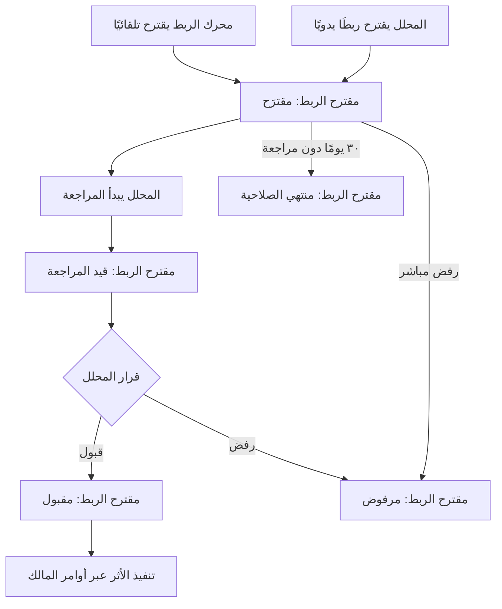
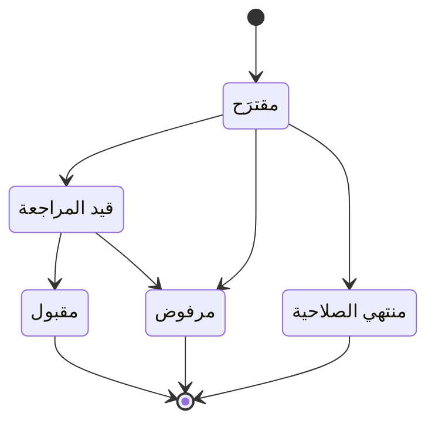

# مراجعة مقترحات الربط

<!-- BEGIN GENERATED: doc -->
| البند | القيمة |
|---|---|
| المعرّف | FEAT-ANL-CORRELATION-REVIEW |
| الإصدار | 0.1 |
| الحالة | مسودة |
| القدرة | CAP-04 التحليل والتقييم |
| القدرة الفرعية | CAP-04.04 الدمج والربط (R2) |
| الأدوار | المحلل؛ النظام |
| الشاشات | SCR-06 قوائم المراجعة |
| حالات الاستخدام | UC-132 |
| القصص | 11: 8 من المواصفة، و3 جديدة |
<!-- END GENERATED: doc -->

## 1. نظرة عامة

### 1.1 القيمة

يراجع المحلل ما يقترحه النظام من ربط بين ملاحظات ومصادر مختلفة فيقبله أو يرفضه بناءً على الأدلة والدرجة.

### 1.2 النطاق

| البند | القيمة |
|---|---|
| المستخدمون | المحلل (يقترح الربط ويراجعه)؛ النظام (يقترحه آليًا وينهي ما لم يُراجَع) |
| الشاشات | SCR-06 قوائم المراجعة |
| حالات الاستخدام | مراجعة مقترح ربط: عرض قائمة المقترحات، فتح تفصيل مقترح واحد، بدء مراجعته، قبوله أو رفضه (UC-132) |
| المتطلبات | ربط الملاحظات والادعاءات من مصادر مختلفة في المكان والزمان في مقترحات بمنهج ودرجة وأدلة (REQ-FUS-001)؛ تسجيل مصادر كل نتيجة مدمجة وموثوقيتها (REQ-FUS-002) |
| خارج النطاق | تعريف قواعد الربط واعتمادها (ميزة «قواعد الربط الآلي»)؛ تنفيذ أثر القبول نفسه — إنشاء الحدث الواقعي أو العلاقة أو حالة مطابقة الكيانات — فهذا عمل أوامر بنى أخرى يستدعيها القبول |

### 1.3 خريطة الميزة

**الشكل 1: مسار مراجعة مقترح الربط**



**الشكل 2: حالات مقترح الربط**



## 2. القواعد المشتركة

تنطبق على كل قصص الميزة، فلا تتكرر داخل القصص. وكل قصة تذكر ما يخصها فقط.

### 2.1 السياق المشترك

كل قصة تبدأ من ثلاثة شروط: مستأجر نشط، وحزمة السياسات الأساسية مفعّلة، ومستخدم مسجّل الدخول ومخوَّل. وتشير إليها القصص بخطوة واحدة: «بفرض السياق المشترك للميزة».

### 2.2 الصلاحية وعدم الإفصاح

- من لا يحق له رؤية العنصر يتلقى ردًا بشكل «غير متاح» تمامًا، فلا يعرف أنه موجود.
- من يرى العنصر ولا يحق له الإجراء يتلقى «لا تملك صلاحية هذا الإجراء».

### 2.3 أوامر تغيير الحالة

- **منع التكرار:** يُرسل كل أمر بمفتاح فريد، فإعادة الطلب نفسه لا تُنفَّذ مرتين.
- **حماية التعديل المتزامن:** يُرسل كل أمر بإصدار البيانات الذي يراه المستخدم. فإن عدّلها غيره في الأثناء، يُرفض الأمر.
- **السجل:** إن نجح الأمر، يُكتب حدثه وسجل التدقيق في المعاملة نفسها.

### 2.4 الرفض المشترك

```gherkin
# language: ar
خاصية: الرفض المشترك لأوامر الميزة

  سيناريو مخطط: رفض مشترك لكل أمر في الميزة
    بفرض السياق المشترك للميزة
    و <الحالة>
    عندما يُرسل المستخدم أي أمر من أوامر الميزة
    اذاً يُرفض برمز <الرمز> ويرى "<الرسالة>"
    و لا يتغير شيء

    امثلة:
      | الحالة                                  | الرمز                  | الرسالة                                                 |
      | العنصر خارج صلاحياته                    | NOT_FOUND              | غير متاح                                                |
      | العنصر مرئي له ولا يحق له الإجراء       | AUTHZ_DENIED           | لا تملك صلاحية هذا الإجراء                              |
      | غيره عدّل العنصر بعد أن فتحه            | VERSION_CONFLICT       | تغيّرت البيانات منذ فتحتها. راجع التغييرات ثم أعد المحاولة |
      | أعاد مفتاح منع التكرار بمحتوى مختلف     | IDEMPOTENCY_KEY_REUSED | طلب مكرر بمحتوى مختلف                                   |
      | البيانات ناقصة أو غير صحيحة             | VALIDATION_FAILED      | بعض البيانات ناقصة أو غير صحيحة. راجع الحقول المعلَّمة      |

  سيناريو: إعادة الطلب نفسه لا تُنفَّذ مرتين
    بفرض السياق المشترك للميزة
    و أمر نجح بمفتاح منع تكرار
    عندما يُعاد الطلب نفسه بالمفتاح نفسه
    اذاً تُعاد النتيجة الأولى ولا يُكتب حدث ثانٍ
```

## 3. الجودة وتعريف الاكتمال

### 3.1 متطلبات الجودة

<!-- BEGIN GENERATED: quality -->
| المرجع | الموقف | المطلوب |
|---|---|---|
| QAS-PERF-012 | batch of 1,000 observations | batch commit p95 ≤ 1 s; 0 duplicates on retry |
<!-- END GENERATED: quality -->

### 3.2 تعريف الاكتمال

القصة مكتملة حين تتحقق الشروط الخمسة:

1. سيناريوهاتها والقواعد المشتركة تمر في الاختبار الآلي.
2. فحوص البنية المعمارية تمر.
3. نصوص الواجهة والرسائل موجودة بالعربية والإنجليزية.
4. مراجعة الكود مكتملة.
5. ما تضيفه القصة نفسها في قسم «القواعد» تحقق.

## 4. فهرس القصص

<!-- BEGIN GENERATED: story-index -->
| المعرّف | القصة | النوع | الحالة |
|---|---|---|---|
| `US-BC02-CRP-ACCEPT` | قبول مقترح الربط | أمر | مسودة |
| `US-BC02-CRP-PROPOSE` | اقتراح مقترح الربط | أمر | مسودة |
| `US-BC02-CRP-REJECT` | رفض مقترح الربط | أمر | مسودة |
| `US-BC02-CRP-START-REVIEW` | بدء مراجعة مقترح الربط | أمر | مسودة |
| `US-BC02-Q-CRP-GET` | جلب: Proposal with inputs, sources, reliabilities, score breakdown | جلب | مسودة |
| `US-BC02-Q-CRP-QUEUE` | جلب: Proposals by kind, state, area, score (inputs all visible to caller) | جلب | مسودة |
| `US-BC02-S-CORRELATION-PROPOSAL-01` | تلقائي: correlation rule score ≥ threshold (مقترح الربط) | نظام | مسودة |
| `US-BC02-S-CORRELATION-PROPOSAL-02` | تلقائي: not reviewed within 30 days (مقترح الربط) | نظام | مسودة |
| `US-UI-SCR06-CORRELATION-DETAIL` | تفصيل درجة الربط ومصادره وموثوقيتها | واجهة | مسودة |
| `US-UI-SCR06-CORRELATION-MAP` | عرض عناصر مقترح الربط على الخريطة والزمن | واجهة | مسودة |
| `US-PLT-ANL-CORRELATION-BUCKETS` | فهرسة مكانية زمنية لمرشحي الربط | منصة | مسودة |
<!-- END GENERATED: story-index -->

## 5. القصص

### 5.1 US-BC02-CRP-ACCEPT — قبول مقترح الربط

| النوع | الإصدار | الأولوية | دون اتصال | الحالة |
|---|---|---|---|---|
| أمر | R2 | Must | لا | مسودة |

> **كـ** المحلل، **أريد** قبول مقترح ربط راجعته، **حتى** تُنفَّذ آثاره المعتمدة على الادعاءات والملاحظات والكيانات.

**باختصار:** يقبل المحلل مقترحًا «قيد المراجعة» فيصبح «مقبولًا»، وتُنفَّذ آثاره بأوامر البنى الأخرى حسب نوع الربط، لا بتعديل مباشر من المقترح نفسه.

#### القواعد

- **متى يُسمح:** المقترح في حالة «قيد المراجعة».
- **من يُسمح له:** المحلل المصرَّح له برؤية كل مدخلات المقترح.
- **البيانات:** ملاحظة اختيارية على القبول.
- **الأثر:** الحالة تصبح «مقبول». تُنفَّذ آثاره عبر أوامر بنى أخرى حسب نوع الربط: نفس الحدث ← حدث واقعي وعلاقات مشاركة وادعاءات مدمجة؛ التجاور المكاني ← علاقة؛ نفس الكيان ← حالة مطابقة كيانات. ويُسجَّل لكل نتيجة مدمجة مصادرها المساهمة وموثوقيتها وقت الدمج (correlation-fusion-spec.md §3).

#### معايير القبول

```gherkin
# language: ar
خاصية: قبول مقترح الربط

  سيناريو: المحلل يقبل مقترحًا قيد المراجعة
    بفرض السياق المشترك للميزة
    و مقترح ربط في حالة "قيد المراجعة" يرى المحلل كل مدخلاته
    عندما يقبله المحلل مع ملاحظة
    اذاً تصبح حالته "مقبول"
    و تُنفَّذ آثاره عبر أوامر بنى أخرى حسب نوع الربط
    و يُسجَّل حدث "قُبل مقترح الربط"

  سيناريو مخطط: رفض خاص بقبول المقترح
    بفرض السياق المشترك للميزة
    و <الحالة>
    عندما يحاول المحلل قبول المقترح
    اذاً يُرفض برمز <الرمز> ويرى "<الرسالة>"

    امثلة:
      | الحالة                                           | الرمز                                          | الرسالة                                                |
      | المقترح ليس في حالة "قيد المراجعة"              | CORRELATION_PROPOSAL_INVALID_STATE_TRANSITION | الوضع الحالي لمقترح الربط لا يسمح بهذا الإجراء          |
      | شرط تنفيذ أثر القبول عبر أوامر البنى الأخرى لم يتحقق | OWNER_REJECTED                             | رُفض تطبيق التغيير لأن العنصر المستهدف لا يستوفي شروطه |
```

<details><summary>المراجع التقنية والتتبع</summary>

<!-- BEGIN GENERATED: refs US-BC02-CRP-ACCEPT -->
| البند | المعرّف | المعنى |
|---|---|---|
| الواجهة البرمجية | `POST /api/v1/information/correlation-proposals/{id}/actions/accept` | — |
| الأمر | `CMD-CRP-ACCEPT` | قبول مقترح الربط |
| السياسة | `POL-CRP-ACCEPT` | Analyst (propose, review, accept, reject)؛ tenant match; inputs visible |
| الحدث | `EVT-CRP-ACCEPTED` | يصل إلى: Owner commands on acceptance (BC02 events/relationships, SLC-04 ER); Rule evaluation feedback |
| الكيان | `AGG-CORRELATION-PROPOSAL` | مقترح الربط |
| الجدول | `information.correlation_proposals` | الجدول الرئيسي لمقترح الربط |
| وحدة النشر | DU-04 | — |
| المتطلبات | REQ-FUS-001، REQ-FUS-002 | معانيها في القسم 6. التتبع |
| حالة الاستخدام | UC-132 | Review Correlation Proposal |
| الاختبار | TST-CORRELATION-PROPOSAL-SM، TST-SLC15-INVARIANTS | دورة حالات مقترح الربط، وثوابت الشريحة SLC-15 |
<!-- END GENERATED: refs US-BC02-CRP-ACCEPT -->

</details>

### 5.2 US-BC02-CRP-PROPOSE — اقتراح مقترح الربط

| النوع | الإصدار | الأولوية | دون اتصال | الحالة |
|---|---|---|---|---|
| أمر | R2 | Must | لا | مسودة |

> **كـ** المحلل، **أريد** اقتراح ربط يدوي بين مدخلين رأيتهما أو أكثر، **حتى** يبدأ مراجعته رسميًا دون انتظار المحرك الآلي.

**باختصار:** يقترح المحلل ربطًا بنوعه ومدخليه ومبرره، فيُنشأ مقترح جديد في حالة «مقترَح» تسميته الأمنية أعلى تسميات مدخلاته.

#### القواعد

- **متى يُسمح:** لا قيد على حالة سابقة؛ المقترح يُنشأ من جديد.
- **من يُسمح له:** المحلل الذي يرى كل المدخلات المذكورة.
- **البيانات:** نوع الربط (نفس الحدث، التجاور المكاني، ربط المسار، احتمال نفس الكيان) — إلزامي؛ مدخلان مرئيان على الأقل من مصدرين مستقلين — إلزامي؛ المبرر — إلزامي.
- **الأثر:** يُنشأ المقترح في حالة «مقترَح»، وتسميته الأمنية = أعلى تسمية بين مدخلاته. مدخلان من مصدر واحد، أو أحدهما مشتق من الآخر، يُعدّان مصدرًا واحدًا لحساب الاستقلال.

#### معايير القبول

```gherkin
# language: ar
خاصية: اقتراح مقترح الربط

  سيناريو: المحلل يقترح ربطًا جديدًا
    بفرض السياق المشترك للميزة
    و مدخلان مرئيان له من مصدرين مستقلين
    عندما يقترح الربط بنوعه ومدخليه ومبرره
    اذاً يُنشأ مقترح في حالة "مقترَح"
    و يُسجَّل حدث "اقتُرح مقترح ربط"

  سيناريو مخطط: رفض خاص باقتراح الربط
    بفرض السياق المشترك للميزة
    و <الحالة>
    عندما يحاول المحلل اقتراح الربط
    اذاً يُرفض برمز <الرمز> ويرى "<الرسالة>"

    امثلة:
      | الحالة                                          | الرمز              | الرسالة                                                |
      | أقل من مدخلين مستقلين، أو النوع أو المبرر غائب | CORRELATION_INVALID | الربط يحتاج مدخلين مرئيين على الأقل ومبررًا            |
      | نوع الربط غير مذكور                             | VALIDATION_FAILED   | نوع الربط مطلوب                                         |
```

<details><summary>المراجع التقنية والتتبع</summary>

<!-- BEGIN GENERATED: refs US-BC02-CRP-PROPOSE -->
| البند | المعرّف | المعنى |
|---|---|---|
| الواجهة البرمجية | `POST /api/v1/information/correlation-proposals` | — |
| الأمر | `CMD-CRP-PROPOSE` | اقتراح مقترح الربط |
| السياسة | `POL-CRP-PROPOSE` | Analyst (propose, review, accept, reject)؛ tenant match; inputs visible |
| الحدث | `EVT-CRP-PROPOSED` | يصل إلى: Owner commands on acceptance (BC02 events/relationships, SLC-04 ER); Rule evaluation feedback |
| الكيان | `AGG-CORRELATION-PROPOSAL` | مقترح الربط |
| الجدول | `information.correlation_proposals` | الجدول الرئيسي لمقترح الربط |
| وحدة النشر | DU-04 | — |
| المتطلبات | REQ-FUS-001، REQ-FUS-002 | معانيها في القسم 6. التتبع |
| حالة الاستخدام | UC-132 | Review Correlation Proposal |
| الاختبار | TST-CORRELATION-PROPOSAL-SM، TST-SLC15-INVARIANTS | دورة حالات مقترح الربط، وثوابت الشريحة SLC-15 |
<!-- END GENERATED: refs US-BC02-CRP-PROPOSE -->

</details>

### 5.3 US-BC02-CRP-REJECT — رفض مقترح الربط

| النوع | الإصدار | الأولوية | دون اتصال | الحالة |
|---|---|---|---|---|
| أمر | R2 | Must | لا | مسودة |

> **كـ** المحلل، **أريد** رفض مقترح ربط لا تدعمه الأدلة، **حتى** لا يُطبَّق ويستفيد تقييم القاعدة من سبب الرفض.

**باختصار:** يرفض المحلل مقترحًا «مقترَح» أو «قيد المراجعة» بذكر السبب، فيصبح «مرفوضًا» ولا يُطبَّق أثره.

#### القواعد

- **متى يُسمح:** المقترح في حالة «مقترَح» أو «قيد المراجعة».
- **من يُسمح له:** المحلل المصرَّح له برؤية كل مدخلات المقترح.
- **البيانات:** السبب — إلزامي، ويُستخدم لاحقًا في تقييم قاعدة الربط.
- **الأثر:** الحالة تصبح «مرفوض»، حالة نهائية. لا يُطبَّق أي أثر على الادعاءات أو الملاحظات أو الكيانات.

#### معايير القبول

```gherkin
# language: ar
خاصية: رفض مقترح الربط

  سيناريو: المحلل يرفض مقترحًا بسبب
    بفرض السياق المشترك للميزة
    و مقترح ربط في حالة "مقترَح" أو "قيد المراجعة"
    عندما يرفضه المحلل مع ذكر السبب
    اذاً تصبح حالته "مرفوض"
    و يُسجَّل حدث "رُفض مقترح الربط" بسببه

  سيناريو مخطط: رفض خاص برفض المقترح
    بفرض السياق المشترك للميزة
    و <الحالة>
    عندما يحاول المحلل رفض المقترح
    اذاً يُرفض برمز <الرمز> ويرى "<الرسالة>"

    امثلة:
      | الحالة                                  | الرمز                                          | الرسالة                                                |
      | المقترح ليس "مقترَح" ولا "قيد المراجعة" | CORRELATION_PROPOSAL_INVALID_STATE_TRANSITION | الوضع الحالي لمقترح الربط لا يسمح بهذا الإجراء          |
      | لم يُذكر السبب                          | REASON_REQUIRED                                | اذكر السبب                                             |
      | السبب فارغ                              | VALIDATION_FAILED                              | السبب مطلوب                                             |
```

<details><summary>المراجع التقنية والتتبع</summary>

<!-- BEGIN GENERATED: refs US-BC02-CRP-REJECT -->
| البند | المعرّف | المعنى |
|---|---|---|
| الواجهة البرمجية | `POST /api/v1/information/correlation-proposals/{id}/actions/reject` | — |
| الأمر | `CMD-CRP-REJECT` | رفض مقترح الربط |
| السياسة | `POL-CRP-REJECT` | Analyst (propose, review, accept, reject)؛ tenant match; inputs visible |
| الحدث | `EVT-CRP-REJECTED` | يصل إلى: Owner commands on acceptance (BC02 events/relationships, SLC-04 ER); Rule evaluation feedback |
| الكيان | `AGG-CORRELATION-PROPOSAL` | مقترح الربط |
| الجدول | `information.correlation_proposals` | الجدول الرئيسي لمقترح الربط |
| وحدة النشر | DU-04 | — |
| المتطلبات | REQ-FUS-001، REQ-FUS-002 | معانيها في القسم 6. التتبع |
| حالة الاستخدام | UC-132 | Review Correlation Proposal |
| الاختبار | TST-CORRELATION-PROPOSAL-SM، TST-SLC15-INVARIANTS | دورة حالات مقترح الربط، وثوابت الشريحة SLC-15 |
<!-- END GENERATED: refs US-BC02-CRP-REJECT -->

</details>

### 5.4 US-BC02-CRP-START-REVIEW — بدء مراجعة مقترح الربط

| النوع | الإصدار | الأولوية | دون اتصال | الحالة |
|---|---|---|---|---|
| أمر | R2 | Must | لا | مسودة |

> **كـ** المحلل، **أريد** بدء مراجعة مقترح ربط «مقترَح»، **حتى** يصبح لي حق قبوله أو رفضه.

**باختصار:** يبدأ المحلل المصرَّح له بتصنيف كل مدخلات المقترح مراجعته، فيصبح «قيد المراجعة».

#### القواعد

- **متى يُسمح:** المقترح في حالة «مقترَح».
- **من يُسمح له:** المحلل المصرَّح له بمستوى التصنيف الأمني لكل مدخل من مدخلات المقترح، لا بمجرد رؤيتها.
- **الأثر:** الحالة تصبح «قيد المراجعة»، ولا يبدأها غيره حتى تُحسم.

#### معايير القبول

```gherkin
# language: ar
خاصية: بدء مراجعة مقترح الربط

  سيناريو: المحلل المصرَّح له يبدأ المراجعة
    بفرض السياق المشترك للميزة
    و مقترح ربط في حالة "مقترَح" ومحلل مصرَّح له بتصنيف كل مدخلاته
    عندما يبدأ المراجعة
    اذاً تصبح حالته "قيد المراجعة"
    و يُسجَّل حدث "بدأت مراجعة مقترح الربط"

  سيناريو مخطط: رفض خاص ببدء المراجعة
    بفرض السياق المشترك للميزة
    و <الحالة>
    عندما يحاول بدء المراجعة
    اذاً يُرفض برمز <الرمز> ويرى "<الرسالة>"

    امثلة:
      | الحالة                                      | الرمز                                          | الرسالة                                                      |
      | المقترح ليس في حالة "مقترَح"               | CORRELATION_PROPOSAL_INVALID_STATE_TRANSITION | الوضع الحالي لمقترح الربط لا يسمح بهذا الإجراء                |
      | المحلل غير مصرَّح له بتصنيف أحد المدخلات    | REVIEWER_NOT_CLEARED                           | المراجع غير مصرَّح له بمستوى تصنيف هذه المواد                 |
```

<details><summary>المراجع التقنية والتتبع</summary>

<!-- BEGIN GENERATED: refs US-BC02-CRP-START-REVIEW -->
| البند | المعرّف | المعنى |
|---|---|---|
| الواجهة البرمجية | `POST /api/v1/information/correlation-proposals/{id}/actions/start-review` | — |
| الأمر | `CMD-CRP-START-REVIEW` | بدء مراجعة مقترح الربط |
| السياسة | `POL-CRP-START-REVIEW` | Analyst (propose, review, accept, reject)؛ tenant match; inputs visible |
| الحدث | `EVT-CRP-REVIEW-STARTED` | يصل إلى: Owner commands on acceptance (BC02 events/relationships, SLC-04 ER); Rule evaluation feedback |
| الكيان | `AGG-CORRELATION-PROPOSAL` | مقترح الربط |
| الجدول | `information.correlation_proposals` | الجدول الرئيسي لمقترح الربط |
| وحدة النشر | DU-04 | — |
| المتطلبات | REQ-FUS-001، REQ-FUS-002 | معانيها في القسم 6. التتبع |
| حالة الاستخدام | UC-132 | Review Correlation Proposal |
| الاختبار | TST-CORRELATION-PROPOSAL-SM، TST-SLC15-INVARIANTS | دورة حالات مقترح الربط، وثوابت الشريحة SLC-15 |
<!-- END GENERATED: refs US-BC02-CRP-START-REVIEW -->

</details>

### 5.5 US-BC02-Q-CRP-GET — جلب: Proposal with inputs, sources, reliabilities, score breakdown

| النوع | الإصدار | الأولوية | دون اتصال | الحالة |
|---|---|---|---|---|
| جلب | R2 | Must | لا | مسودة |

> **كـ** أي مستخدم مخوَّل مصرَّح له بتصنيف كل مدخلاته، **أريد** جلب تفاصيل مقترح ربط واحد مع مدخلاته ومصادرها وموثوقيتها وتفصيل درجته، **حتى** أراجعه بأدلة كاملة.

**باختصار:** تُعاد بيانات المقترح كاملة لمن يحق له رؤية كل مدخل فيه، ولا شيء لمن لا يحق له.

#### القواعد

- **من يرى ماذا:** من هو مصرَّح له بتصنيف كل مدخل من مدخلات المقترح يرى المقترح كاملًا بمدخلاته ومصادرها وموثوقيتها وتفصيل درجته. من ينقصه تصريح مدخل واحد لا يرى المقترح.

#### معايير القبول

```gherkin
# language: ar
خاصية: جلب تفصيل مقترح الربط

  سيناريو: جلب مقترح يرى المستخدم كل مدخلاته
    بفرض السياق المشترك للميزة
    و مقترح ربط مصرَّح للمستخدم بتصنيف كل مدخلاته
    عندما يطلب تفصيله
    اذاً تُعاد مدخلاته ومصادرها وموثوقيتها وتفصيل درجته

  سيناريو: مقترح لا يصرَّح له بأحد مدخلاته
    بفرض السياق المشترك للميزة
    و مقترح ربط لا يصرَّح للمستخدم بتصنيف أحد مدخلاته
    عندما يطلب تفصيله
    اذاً يراه "غير متاح" تمامًا
```

<details><summary>المراجع التقنية والتتبع</summary>

<!-- BEGIN GENERATED: refs US-BC02-Q-CRP-GET -->
| البند | المعرّف | المعنى |
|---|---|---|
| الواجهة البرمجية | `GET /api/v1/information/correlation-proposals/{proposal_id}` | — |
| الاستعلام | `QRY-CRP-GET` | Proposal with inputs, sources, reliabilities, score breakdown |
| السياسة | `POL-CRP-GET` | reviewer cleared for all inputs |
| الكيان | `AGG-CORRELATION-PROPOSAL` | مقترح الربط |
| الجدول | `information.correlation_proposals` | الجدول الرئيسي لمقترح الربط |
| وحدة النشر | DU-04 | — |
| المتطلب | REQ-FUS-002 | The system shall record for each fused result the contributing sources and their reliabilities. |
| حالة الاستخدام | UC-132 | Review Correlation Proposal |
| الاختبار | TST-CORRELATION-PROPOSAL-SM، TST-SLC15-INVARIANTS | دورة حالات مقترح الربط، وثوابت الشريحة SLC-15 |
<!-- END GENERATED: refs US-BC02-Q-CRP-GET -->

</details>

### 5.6 US-BC02-Q-CRP-QUEUE — جلب: Proposals by kind, state, area, score (inputs all visible to caller)

| النوع | الإصدار | الأولوية | دون اتصال | الحالة |
|---|---|---|---|---|
| جلب | R2 | Must | لا | مسودة |

> **كـ** المحلل، **أريد** قائمة مقترحات الربط حسب النوع والحالة والمنطقة والدرجة، **حتى** أرتّب عملي وأبدأ بالأهم.

**باختصار:** تُعاد المقترحات التي يرى المحلل كل مدخلاتها فقط، صفحةً بعد صفحة بمؤشر، مع المرشحات المطلوبة.

#### القواعد

- **من يرى ماذا:** المحلل يرى المقترح الذي يُصرَّح له بتصنيف كل مدخلاته فقط. ما عداه لا يُحسب في العدّ ولا يُقترح.
- **البيانات:** المرشحات: النوع، الحالة، المنطقة، الدرجة؛ والترقيم بمؤشر لا بإزاحة.

#### معايير القبول

```gherkin
# language: ar
خاصية: قائمة مقترحات الربط

  سيناريو: يرى المحلل المقترحات المصرَّح له بها فقط
    بفرض السياق المشترك للميزة
    و مقترحات داخل تصريحه وأخرى خارجه
    عندما يطلب القائمة بمرشحات النوع والحالة والمنطقة والدرجة
    اذاً تُعاد المقترحات المصرَّح له بكل مدخلاتها فقط
    و لا يكشف أي عدد أو اقتراح وجود مقترح محجوب

  سيناريو: الصفحة التالية
    بفرض السياق المشترك للميزة
    و مقترحاته أكثر من صفحة
    عندما يطلب الصفحة التالية بالمؤشر
    اذاً تُعاد المقترحات التالية دون تكرار ولا فجوة
```

<details><summary>المراجع التقنية والتتبع</summary>

<!-- BEGIN GENERATED: refs US-BC02-Q-CRP-QUEUE -->
| البند | المعرّف | المعنى |
|---|---|---|
| الواجهة البرمجية | `GET /api/v1/information/correlation-proposals` | — |
| الاستعلام | `QRY-CRP-QUEUE` | Proposals by kind, state, area, score (inputs all visible to caller) |
| السياسة | `POL-CRP-QUEUE` | Analyst |
| الكيان | `AGG-CORRELATION-PROPOSAL` | مقترح الربط |
| الجدول | `information.correlation_proposals` | الجدول الرئيسي لمقترح الربط |
| وحدة النشر | DU-04 | — |
| المتطلب | REQ-FUS-001 | The system shall correlate observations and claims across sources in space and time into correlation proposal… |
| حالة الاستخدام | UC-132 | Review Correlation Proposal |
| الاختبار | TST-CORRELATION-PROPOSAL-SM، TST-SLC15-INVARIANTS | دورة حالات مقترح الربط، وثوابت الشريحة SLC-15 |
<!-- END GENERATED: refs US-BC02-Q-CRP-QUEUE -->

</details>

### 5.7 US-BC02-S-CORRELATION-PROPOSAL-01 — تلقائي: correlation rule score ≥ threshold (مقترح الربط)

| النوع | الإصدار | الأولوية | دون اتصال | الحالة |
|---|---|---|---|---|
| نظام | R2 | Must | لا ينطبق | مسودة |

> **كـ** النظام، **أريد** اقتراح مقترح ربط حين تبلغ درجة قاعدة ربط نشطة عتبتها، **حتى** يراجع المحلل المرشحين دون أن ينتظر اقتراحًا يدويًا.

**باختصار:** محرك الربط يحسب درجة كل قاعدة نشطة على مرشحيها من المجموعات المكانية الزمانية، فإذا بلغت العتبة ولم يوجد مقترح غير نهائي مطابق، يُنشئ مقترحًا جديدًا في حالة «مقترَح».

#### القواعد

- **متى يحدث:** درجة قاعدة ربط نشطة على مرشحين من مصدرين مستقلين فأكثر بلغت عتبتها، ولا يوجد مقترح غير نهائي بنفس المجموعة والنوع.
- **الأثر:** يُنشأ مقترح في حالة «مقترَح»، وتسميته الأمنية = أعلى تسمية بين مدخلاته.

#### معايير القبول

```gherkin
# language: ar
خاصية: اقتراح الربط التلقائي عند بلوغ العتبة

  سيناريو: درجة القاعدة بلغت العتبة لمرشحين جديدين
    بفرض مرشحين من مصدرين مستقلين فأكثر ولا مقترح غير نهائي مطابق لهما
    عندما تبلغ درجة قاعدة ربط نشطة عليهما عتبتها
    اذاً يُنشأ مقترح ربط في حالة "مقترَح"
    و يُسجَّل حدث "اقتُرح مقترح ربط" وسجل تدقيق بهوية النظام

  سيناريو: يوجد مقترح غير نهائي مطابق من قبل
    بفرض مقترح ربط غير نهائي بنفس المجموعة والنوع
    عندما تبلغ درجة القاعدة عتبتها على المجموعة نفسها
    اذاً لا يُنشأ مقترح جديد
```

<details><summary>المراجع التقنية والتتبع</summary>

<!-- BEGIN GENERATED: refs US-BC02-S-CORRELATION-PROPOSAL-01 -->
| البند | المعرّف | المعنى |
|---|---|---|
| المحفِّز | `SYS:correlation rule score ≥ threshold` | inputs from ≥ 2 distinct sources; no identical non-terminal proposal; label = max(input labels) |
| الانتقال | ∅ ← PROPOSED | — |
| الحدث | `EVT-CRP-PROPOSED` | يصل إلى: Owner commands on acceptance (BC02 events/relationships, SLC-04 ER); Rule evaluation feedback |
| الكيان | `AGG-CORRELATION-PROPOSAL` | مقترح الربط |
| الجدول | `information.correlation_proposals` | الجدول الرئيسي لمقترح الربط |
| وحدة النشر | DU-04 | — |
| المتطلبات | REQ-FUS-001، REQ-FUS-002 | معانيها في القسم 6. التتبع |
| حالة الاستخدام | UC-132 | Review Correlation Proposal |
| الاختبار | TST-CORRELATION-PROPOSAL-SM، TST-SLC15-INVARIANTS | دورة حالات مقترح الربط، وثوابت الشريحة SLC-15 |
<!-- END GENERATED: refs US-BC02-S-CORRELATION-PROPOSAL-01 -->

</details>

### 5.8 US-BC02-S-CORRELATION-PROPOSAL-02 — تلقائي: not reviewed within 30 days (مقترح الربط)

| النوع | الإصدار | الأولوية | دون اتصال | الحالة |
|---|---|---|---|---|
| نظام | R2 | Must | لا ينطبق | مسودة |

> **كـ** النظام، **أريد** إنهاء صلاحية مقترح لم يُراجَع خلال ٣٠ يومًا، **حتى** لا تتراكم مقترحات معلَّقة بلا حسم.

**باختصار:** المجدول يفحص المقترحات «مقترَح» دوريًا، فما تجاوز ٣٠ يومًا دون بدء مراجعة يصبح «منتهي الصلاحية».

#### القواعد

- **متى يحدث:** المقترح في حالة «مقترَح» منذ ٣٠ يومًا فأكثر دون بدء مراجعة.
- **الأثر:** الحالة تصبح «منتهي الصلاحية»، حالة نهائية.

#### معايير القبول

```gherkin
# language: ar
خاصية: إنهاء صلاحية مقترح الربط غير المراجَع

  سيناريو: مقترح تجاوز ٣٠ يومًا دون مراجعة
    بفرض مقترح ربط في حالة "مقترَح" منذ أكثر من ٣٠ يومًا
    عندما يحين وقت فحص المجدول
    اذاً تصبح حالته "منتهي الصلاحية"
    و يُسجَّل حدث "انتهت صلاحية مقترح الربط" وسجل تدقيق بهوية النظام

  سيناريو: مقترح بدأت مراجعته في الوقت
    بفرض مقترح ربط بدأت مراجعته قبل بلوغ ٣٠ يومًا
    عندما يحين وقت فحص المجدول
    اذاً لا تتغير حالته
```

<details><summary>المراجع التقنية والتتبع</summary>

<!-- BEGIN GENERATED: refs US-BC02-S-CORRELATION-PROPOSAL-02 -->
| البند | المعرّف | المعنى |
|---|---|---|
| المحفِّز | `SYS:not reviewed within 30 days` | scheduler |
| الانتقال | PROPOSED ← EXPIRED | — |
| الحدث | `EVT-CRP-EXPIRED` | يصل إلى: Owner commands on acceptance (BC02 events/relationships, SLC-04 ER); Rule evaluation feedback |
| الكيان | `AGG-CORRELATION-PROPOSAL` | مقترح الربط |
| الجدول | `information.correlation_proposals` | الجدول الرئيسي لمقترح الربط |
| وحدة النشر | DU-04 | — |
| المتطلبات | REQ-FUS-001، REQ-FUS-002 | معانيها في القسم 6. التتبع |
| حالة الاستخدام | UC-132 | Review Correlation Proposal |
| الاختبار | TST-CORRELATION-PROPOSAL-SM، TST-SLC15-INVARIANTS | دورة حالات مقترح الربط، وثوابت الشريحة SLC-15 |
<!-- END GENERATED: refs US-BC02-S-CORRELATION-PROPOSAL-02 -->

</details>

### 5.9 US-UI-SCR06-CORRELATION-DETAIL — تفصيل درجة الربط ومصادره وموثوقيتها

| النوع | الإصدار | الأولوية | دون اتصال | الحالة |
|---|---|---|---|---|
| واجهة | R2 | Must | لا | مسودة |

> **كـ** المستخدم، **أريد** أن أرى تفصيل درجة مقترح الربط ومصادره وموثوقية كل مصدر، **حتى** أقرر قبوله أو رفضه على أساس الأدلة لا الدرجة وحدها.

**باختصار:** تعرض شاشة قوائم المراجعة (SCR-06) تفصيل المقترح: مدخلاته، مصدر كل مدخل وموثوقيته، وتحليل الدرجة إلى عناصرها (المسافة، الفارق الزمني، تشابه السمات). **[Derived]**

#### القواعد

- **من يرى ماذا:** من هو مصرَّح له بتصنيف كل مدخل من مدخلات المقترح يرى التفصيل كاملًا؛ من ينقصه تصريح مدخل واحد لا يرى المقترح أصلًا.

#### معايير القبول

```gherkin
# language: ar
خاصية: تفصيل درجة الربط ومصادره

  سيناريو: عرض تفصيل مقترح مصرَّح للمستخدم بكل مدخلاته
    بفرض السياق المشترك للميزة
    و مقترح ربط مصرَّح للمستخدم بتصنيف كل مدخلاته
    عندما يفتح تفصيله من شاشة قوائم المراجعة
    اذاً تُعرض مدخلاته ومصادرها وموثوقية كل مصدر وتحليل الدرجة إلى عناصرها
```

<details><summary>المراجع التقنية والتتبع</summary>

<!-- BEGIN GENERATED: refs US-UI-SCR06-CORRELATION-DETAIL -->
| البند | المعرّف | المعنى |
|---|---|---|
| الشاشة | SCR-06 | شاشة قوائم المراجعة |
| المصدر | `correlation-fusion-spec.md §2` | — |
| المصدر | `[Derived]` | — |
| المتطلبات | REQ-FUS-001، REQ-FUS-002 | معانيها في القسم 6. التتبع |
| حالة الاستخدام | UC-132 | Review Correlation Proposal |
<!-- END GENERATED: refs US-UI-SCR06-CORRELATION-DETAIL -->

</details>

### 5.10 US-UI-SCR06-CORRELATION-MAP — عرض عناصر مقترح الربط على الخريطة والزمن

| النوع | الإصدار | الأولوية | دون اتصال | الحالة |
|---|---|---|---|---|
| واجهة | R2 | Must | لا | مسودة |

> **كـ** المستخدم، **أريد** أن أرى عناصر مقترح الربط على الخريطة وعلى خط الزمن، **حتى** أحكم على التقارب المكاني والزماني بنفسي بدل الاعتماد على الدرجة فقط.

**باختصار:** تعرض شاشة قوائم المراجعة (SCR-06) مدخلات المقترح على طبقة الخريطة بدقة كل مدخل، ومنزلقًا زمنيًا يوضح تقاربها أو تباعدها. **[Derived]**

#### القواعد

- **من يرى ماذا:** من يرى تفصيل المقترح (القصة 5.9) يرى عرضه على الخريطة والزمن.
- **البيانات:** موقع كل مدخل ودقته (`accuracy_m`)، ووقته.

#### معايير القبول

```gherkin
# language: ar
خاصية: عرض عناصر مقترح الربط على الخريطة والزمن

  سيناريو: عرض المدخلات على الخريطة بدقتها
    بفرض السياق المشترك للميزة
    و مقترح ربط مصرَّح للمستخدم بتصنيف كل مدخلاته
    عندما يفتح عرضه على الخريطة
    اذاً يُرسم كل مدخل في موقعه مع دائرة دقته
    و يعرض المنزلق الزمني وقت كل مدخل
```

<details><summary>المراجع التقنية والتتبع</summary>

<!-- BEGIN GENERATED: refs US-UI-SCR06-CORRELATION-MAP -->
| البند | المعرّف | المعنى |
|---|---|---|
| الشاشة | SCR-06 | شاشة قوائم المراجعة |
| المصدر | `21-ui-design.md §7` | — |
| المصدر | `[Derived]` | — |
| المتطلب | REQ-FUS-001 | The system shall correlate observations and claims across sources in space and time into correlation proposal… |
| حالة الاستخدام | UC-132 | Review Correlation Proposal |
<!-- END GENERATED: refs US-UI-SCR06-CORRELATION-MAP -->

</details>

### 5.11 US-PLT-ANL-CORRELATION-BUCKETS — فهرسة مكانية زمنية لمرشحي الربط

| النوع | الإصدار | الأولوية | دون اتصال | الحالة |
|---|---|---|---|---|
| منصة | R2 | Must | لا ينطبق | مسودة |

> **كـ** فريق المنصة، **أريد** فهرسًا مكانيًا زمنيًا يجمّع الملاحظات والادعاءات في خلايا متقاربة، **حتى** يحسب محرك الربط الدرجة على دفعة 1,000 ملاحظة خلال ثانية واحدة عند المئين 95، دون تكرار عند إعادة المحاولة.

**باختصار:** كل ملاحظة أو ادعاء موقع جديد يُصنَّف في خلية مكانية زمانية (شبكة جغرافية بدقة سادسة وفترة عشر دقائق)، فيحسب المحرك الدرجة على مرشحي الخلية وجاراتها الثماني والفترات المتاخمة فقط.

#### القواعد

- **البيانات:** الخلية = (geohash6 للموقع، الفترة العشرية للوقت).
- **الأثر:** المرشحون لحساب الدرجة محصورون بخلية العنصر الجديد وجاراتها الثماني والفترات المتاخمة، لا كل البيانات.

#### معايير القبول

```gherkin
# language: ar
خاصية: فهرسة مكانية زمنية لمرشحي الربط

  سيناريو: الهدف تحت دفعة بحجم التصميم
    بفرض دفعة من 1,000 ملاحظة بمزيج استراتيجية اختبار الأداء
    عندما تُحفظ الدفعة ويحسب المحرك درجاتها
    اذاً يكون زمن التزام الدفعة 1 ثانية أو أقل عند المئين 95 (QAS-PERF-012)
    و لا يتكرر أي مقترح عند إعادة محاولة الحفظ

  سيناريو: المرشحون محصورون بالخلية وجاراتها
    بفرض ملاحظة جديدة في خلية مكانية زمانية معيّنة
    عندما يبحث المحرك عن مرشحيها
    اذاً يقتصر البحث على الخلية وجاراتها الثماني والفترات المتاخمة
```

<details><summary>المراجع التقنية والتتبع</summary>

<!-- BEGIN GENERATED: refs US-PLT-ANL-CORRELATION-BUCKETS -->
| البند | المعرّف | المعنى |
|---|---|---|
| المصدر | `correlation-fusion-spec.md §2` | — |
| الجودة | QAS-PERF-012 | batch of 1,000 observations → batch commit p95 ≤ 1 s; 0 duplicates on retry |
| المصدر | `[Derived]` | — |
| المتطلب | REQ-FUS-001 | The system shall correlate observations and claims across sources in space and time into correlation proposal… |
| حالة الاستخدام | UC-132 | Review Correlation Proposal |
<!-- END GENERATED: refs US-PLT-ANL-CORRELATION-BUCKETS -->

</details>

## 6. التتبع

<!-- BEGIN GENERATED: trace -->
| المتطلب | المعنى | القصص | الاختبار |
|---|---|---|---|
| REQ-FUS-001 | The system shall correlate observations and claims across sources in space and time into correlation proposal… | `US-BC02-CRP-ACCEPT`، `US-BC02-CRP-PROPOSE`، `US-BC02-CRP-REJECT`، `US-BC02-CRP-START-REVIEW`، `US-BC02-Q-CRP-QUEUE`، `US-BC02-S-CORRELATION-PROPOSAL-01`، `US-BC02-S-CORRELATION-PROPOSAL-02`، `US-PLT-ANL-CORRELATION-BUCKETS`، `US-UI-SCR06-CORRELATION-DETAIL`، `US-UI-SCR06-CORRELATION-MAP` | TST-CORRELATION-PROPOSAL-SM، TST-CORRELATION-RULE-SM، TST-SLC15-INVARIANTS |
| REQ-FUS-002 | The system shall record for each fused result the contributing sources and their reliabilities. | `US-BC02-CRP-ACCEPT`، `US-BC02-CRP-PROPOSE`، `US-BC02-CRP-REJECT`، `US-BC02-CRP-START-REVIEW`، `US-BC02-Q-CRP-GET`، `US-BC02-S-CORRELATION-PROPOSAL-01`، `US-BC02-S-CORRELATION-PROPOSAL-02`، `US-UI-SCR06-CORRELATION-DETAIL` | TST-CORRELATION-PROPOSAL-SM، TST-SLC15-INVARIANTS |
<!-- END GENERATED: trace -->

## 7. سجل التغييرات

| الإصدار | التاريخ | التغيير |
|---|---|---|
| 0.1 | — | هيكل مولَّد من خريطة الميزات |
| 0.2 | 2026-10-03 | كتابة القصص كاملة بمعيار القصص |
