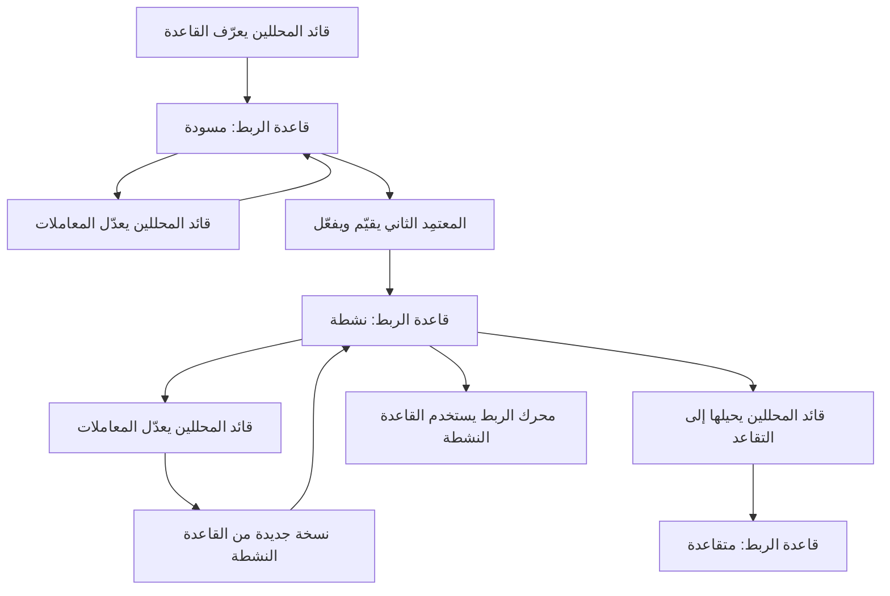
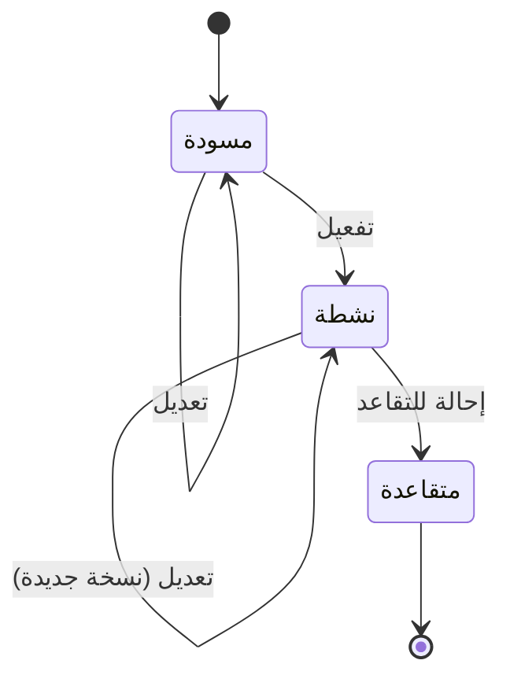

# قواعد الربط الآلي

<!-- BEGIN GENERATED: doc -->
| البند | القيمة |
|---|---|
| المعرّف | FEAT-ANL-CORRELATION-RULES |
| الإصدار | 0.3 |
| الحالة | مسودة |
| القدرة | CAP-04 التحليل والتقييم |
| القدرة الفرعية | CAP-04.04 الدمج والربط (R2) |
| الأدوار | قائد المحللين؛ صاحب السلطة أو المعتمِد الثاني |
| الشاشات | — |
| حالات الاستخدام | UC-132 |
| القصص | 8: 4 من المواصفة، و4 جديدة |
<!-- END GENERATED: doc -->

## 1. نظرة عامة

### 1.1 القيمة

يضبط قائد التحليل قواعد الربط الآلي ويعتمدها بموافقة ثانية، فلا تُولَّد مقترحات من قواعد غير معتمدة.

### 1.2 النطاق

| البند | القيمة |
|---|---|
| المستخدمون | قائد المحللين (يعرّف قاعدة الربط ويعدّلها ويحيلها إلى التقاعد)؛ صاحب السلطة أو المعتمِد الثاني (يفعّلها) |
| الشاشات | لا شاشة مخصّصة في مصادر التصميم؛ الافتراض وضعها بجوار قواعد المطابقة في شاشة التعارض ومطابقة الكيانات (SCR-26) |
| حالات الاستخدام | ضبط قاعدة ربط زماني-مكاني بمعاملاتها وعتبتها، واعتمادها بتقييم وموافقة ثانية، قبل أن يستخدمها محرك الربط (UC-132) |
| المتطلبات | ربط الملاحظات والادعاءات من مصادر مختلفة في مقترحات بمنهج ودرجة وأدلة (REQ-FUS-001) |
| خارج النطاق | مراجعة مقترحات الربط نفسها وقبولها أو رفضها (ميزة «مراجعة مقترحات الربط»)؛ معايير المطابقة بين الكيانات (قواعد المطابقة منفصلة عن قواعد الربط) |

### 1.3 خريطة الميزة

**الشكل 1: دورة إعداد قاعدة الربط واعتمادها**



**الشكل 2: حالات قاعدة الربط**



## 2. القواعد المشتركة

تنطبق على كل قصص الميزة، فلا تتكرر داخل القصص. وكل قصة تذكر ما يخصها فقط.

### 2.1 السياق المشترك

كل قصة تبدأ من ثلاثة شروط: مستأجر نشط، وحزمة السياسات الأساسية مفعّلة، ومستخدم مسجّل الدخول ومخوَّل. وتشير إليها القصص بخطوة واحدة: «بفرض السياق المشترك للميزة».

### 2.2 الصلاحية وعدم الإفصاح

- من لا يحق له رؤية العنصر يتلقى ردًا بشكل «غير متاح» تمامًا، فلا يعرف أنه موجود.
- من يرى العنصر ولا يحق له الإجراء يتلقى «لا تملك صلاحية هذا الإجراء».

### 2.3 أوامر تغيير الحالة

- **منع التكرار:** يُرسل كل أمر بمفتاح فريد، فإعادة الطلب نفسه لا تُنفَّذ مرتين.
- **حماية التعديل المتزامن:** يُرسل كل أمر بإصدار البيانات الذي يراه المستخدم. فإن عدّلها غيره في الأثناء، يُرفض الأمر.
- **السجل:** إن نجح الأمر، يُكتب حدثه وسجل التدقيق في المعاملة نفسها.

### 2.4 الرفض المشترك

```gherkin
# language: ar
خاصية: الرفض المشترك لأوامر الميزة

  سيناريو مخطط: رفض مشترك لكل أمر في الميزة
    بفرض السياق المشترك للميزة
    و <الحالة>
    عندما يُرسل المستخدم أي أمر من أوامر الميزة
    اذاً يُرفض برمز <الرمز> ويرى "<الرسالة>"
    و لا يتغير شيء

    امثلة:
      | الحالة                                  | الرمز                  | الرسالة                                                 |
      | العنصر خارج صلاحياته                    | NOT_FOUND              | غير متاح                                                |
      | العنصر مرئي له ولا يحق له الإجراء       | AUTHZ_DENIED           | لا تملك صلاحية هذا الإجراء                              |
      | غيره عدّل العنصر بعد أن فتحه            | VERSION_CONFLICT       | تغيّرت البيانات منذ فتحتها. راجع التغييرات ثم أعد المحاولة |
      | أعاد مفتاح منع التكرار بمحتوى مختلف     | IDEMPOTENCY_KEY_REUSED | طلب مكرر بمحتوى مختلف                                   |
      | البيانات ناقصة أو غير صحيحة             | VALIDATION_FAILED      | بعض البيانات ناقصة أو غير صحيحة. راجع الحقول المعلَّمة      |

  سيناريو: إعادة الطلب نفسه لا تُنفَّذ مرتين
    بفرض السياق المشترك للميزة
    و أمر نجح بمفتاح منع تكرار
    عندما يُعاد الطلب نفسه بالمفتاح نفسه
    اذاً تُعاد النتيجة الأولى ولا يُكتب حدث ثانٍ
```

## 3. الجودة وتعريف الاكتمال

### 3.1 متطلبات الجودة

<!-- BEGIN GENERATED: quality -->
لا متطلبات جودة مرتبطة بمتطلبات هذه الميزة مباشرة. تنطبق متطلبات المنصة العامة (`FEAT-PLT-*`).
<!-- END GENERATED: quality -->

### 3.2 تعريف الاكتمال

القصة مكتملة حين تتحقق الشروط الخمسة:

1. سيناريوهاتها والقواعد المشتركة تمر في الاختبار الآلي.
2. فحوص البنية المعمارية تمر.
3. نصوص الواجهة والرسائل موجودة بالعربية والإنجليزية.
4. مراجعة الكود مكتملة.
5. ما تضيفه القصة نفسها في قسم «القواعد» تحقق.

## 4. فهرس القصص

<!-- BEGIN GENERATED: story-index -->
| المعرّف | القصة | النوع | الحالة |
|---|---|---|---|
| `US-BC02-CRR-ACTIVATE` | تفعيل قاعدة الربط | أمر | مسودة |
| `US-BC02-CRR-DEFINE` | تعريف قاعدة الربط | أمر | مسودة |
| `US-BC02-CRR-EDIT` | تعديل قاعدة الربط | أمر | مسودة |
| `US-BC02-CRR-RETIRE` | إحالة قاعدة الربط إلى التقاعد | أمر | مسودة |
| `US-DOM-ANL-CRR-LIST` | عرض قواعد الربط وإصداراتها | جلب | مسودة |
| `US-UI-SCR26-CORRELATION-RULES` | إدارة قواعد الربط بجوار قواعد المطابقة | واجهة | مسودة |
| `US-UI-SCR26-CRR-APPROVAL` | مراجعة القاعدة واعتمادها من شخص ثانٍ | واجهة | مسودة |
| `US-OPS-ANL-CORRELATION-CALIBRATE` | إعادة معايرة عتبات الربط بعد التجربة | تشغيل | مسودة |
<!-- END GENERATED: story-index -->

## 5. القصص

### 5.1 US-BC02-CRR-ACTIVATE — تفعيل قاعدة الربط

| النوع | الإصدار | الأولوية | دون اتصال | الحالة |
|---|---|---|---|---|
| أمر | R2 | Must | لا | مسودة |

> **كـ** صاحب السلطة أو المعتمِد الثاني، **أريد** تفعيل قاعدة ربط بعد تقييمها، **حتى** لا يستخدم محرك الربط إلا قواعد اعتمدها شخص غير من عرّفها.

**باختصار:** يفعّل المعتمِد الثاني قاعدة ربط «مسودة» بعد تقرير تقييم يثبت دقتها، فتصبح «نشطة» ويبدأ محرك الربط باستخدامها.

#### القواعد

- **متى يُسمح:** القاعدة في حالة «مسودة».
- **من يُسمح له:** صاحب سلطة التفعيل، على ألا يكون هو من عرّف القاعدة (فصل المهام).
- **البيانات:** تقرير التقييم — إلزامي.
- **الأثر:** الحالة تصبح «نشطة»، ويبدأ محرك الربط استخدامها على المرشحين الجدد.

#### معايير القبول

```gherkin
# language: ar
خاصية: تفعيل قاعدة الربط

  سيناريو: المعتمِد الثاني يفعّل قاعدة بتقييم كافٍ
    بفرض السياق المشترك للميزة
    و قاعدة ربط في حالة "مسودة" وتقرير تقييمها يثبت دقة ٧٠٪ أو أكثر على مجموعة موسومة
    عندما يفعّلها معتمِد غير من عرّفها، مرفقًا بتقرير التقييم
    اذاً تصبح حالتها "نشطة"
    و يُسجَّل حدث "فُعِّلت قاعدة الربط"

  سيناريو مخطط: رفض خاص بالتفعيل
    بفرض السياق المشترك للميزة
    و <الحالة>
    عندما يحاول المعتمِد تفعيل القاعدة
    اذاً يُرفض برمز <الرمز> ويرى "<الرسالة>"
    و لا يتغير شيء

    امثلة:
      | الحالة                                          | الرمز                                      | الرسالة                                               |
      | القاعدة ليست في حالة "مسودة"                   | CORRELATION_RULE_INVALID_STATE_TRANSITION | الوضع الحالي لقاعدة الربط لا يسمح بهذا الإجراء          |
      | دقة التقييم دون ٧٠٪                             | RULE_BELOW_TARGET                          | دقة قاعدة الربط دون الهدف                              |
      | المعتمِد هو من عرّف القاعدة                     | SEGREGATION_OF_DUTIES                      | لا يجوز أن يعتمد الشخص نفسه ما قدّمه أو طلبه            |
      | تقرير التقييم غائب                              | VALIDATION_FAILED                          | تقرير التقييم مطلوب                                    |
```

<details><summary>المراجع التقنية والتتبع</summary>

<!-- BEGIN GENERATED: refs US-BC02-CRR-ACTIVATE -->
| البند | المعرّف | المعنى |
|---|---|---|
| الواجهة البرمجية | `POST /api/v1/information/correlation-rules/{id}/actions/activate` | — |
| الأمر | `CMD-CRR-ACTIVATE` | تفعيل قاعدة الربط |
| السياسة | `POL-CRR-ACTIVATE` | Analyst lead (define, edit) · second approver (activate)؛ tenant match; inputs visible |
| الحدث | `EVT-CRR-ACTIVATED` | يصل إلى: Correlation engine |
| الكيان | `AGG-CORRELATION-RULE` | قاعدة الربط |
| الجدول | `information.correlation_rules` | الجدول الرئيسي لقاعدة الربط |
| وحدة النشر | DU-04 | — |
| المتطلب | REQ-FUS-001 | The system shall correlate observations and claims across sources in space and time into correlation proposal… |
| حالة الاستخدام | UC-132 | Review Correlation Proposal |
| الاختبار | TST-CORRELATION-RULE-SM، TST-SLC15-INVARIANTS | دورة حالات قاعدة الربط، وثوابت الشريحة SLC-15 |
<!-- END GENERATED: refs US-BC02-CRR-ACTIVATE -->

</details>

### 5.2 US-BC02-CRR-DEFINE — تعريف قاعدة الربط

| النوع | الإصدار | الأولوية | دون اتصال | الحالة |
|---|---|---|---|---|
| أمر | R2 | Must | لا | مسودة |

> **كـ** قائد المحللين، **أريد** تعريف قاعدة ربط جديدة بنوعها واسمها، **حتى** أضبط معاملاتها قبل اعتمادها.

**باختصار:** يعرّف قائد المحللين قاعدة ربط جديدة باسمها ونوعها، فتُنشأ في حالة «مسودة» بلا أثر على المقترحات حتى تُفعَّل.

#### القواعد

- **متى يُسمح:** لا قيد على حالة سابقة؛ القاعدة تُنشأ من جديد.
- **من يُسمح له:** قائد المحللين.
- **البيانات:** الاسم — إلزامي؛ النوع (نفس الحدث، التجاور المكاني، ربط المسار، احتمال نفس الكيان) — إلزامي.
- **الأثر:** تُنشأ القاعدة في حالة «مسودة»، ولا يستخدمها محرك الربط قبل تفعيلها.

#### معايير القبول

```gherkin
# language: ar
خاصية: تعريف قاعدة الربط

  سيناريو: قائد المحللين يعرّف قاعدة جديدة
    بفرض السياق المشترك للميزة
    عندما يعرّف قاعدة ربط باسمها ونوعها
    اذاً تُنشأ في حالة "مسودة"
    و يُسجَّل حدث "عُرِّفت قاعدة الربط"

  سيناريو مخطط: رفض خاص بتعريف القاعدة
    بفرض السياق المشترك للميزة
    و <الحالة>
    عندما يحاول تعريف القاعدة
    اذاً يُرفض برمز <الرمز> ويرى "<الرسالة>"
    و لا يتغير شيء

    امثلة:
      | الحالة                          | الرمز        | الرسالة                     |
      | النوع ليس من الأنواع المعروفة  | RULE_INVALID | نوع قاعدة الربط غير صحيح    |
      | الاسم غائب                      | VALIDATION_FAILED | الاسم مطلوب            |
```

<details><summary>المراجع التقنية والتتبع</summary>

<!-- BEGIN GENERATED: refs US-BC02-CRR-DEFINE -->
| البند | المعرّف | المعنى |
|---|---|---|
| الواجهة البرمجية | `POST /api/v1/information/correlation-rules` | — |
| الأمر | `CMD-CRR-DEFINE` | تعريف قاعدة الربط |
| السياسة | `POL-CRR-DEFINE` | Analyst lead (define, edit) · second approver (activate)؛ tenant match; inputs visible |
| الحدث | `EVT-CRR-DEFINED` | يصل إلى: Correlation engine |
| الكيان | `AGG-CORRELATION-RULE` | قاعدة الربط |
| الجدول | `information.correlation_rules` | الجدول الرئيسي لقاعدة الربط |
| وحدة النشر | DU-04 | — |
| المتطلب | REQ-FUS-001 | The system shall correlate observations and claims across sources in space and time into correlation proposal… |
| حالة الاستخدام | UC-132 | Review Correlation Proposal |
| الاختبار | TST-CORRELATION-RULE-SM، TST-SLC15-INVARIANTS | دورة حالات قاعدة الربط، وثوابت الشريحة SLC-15 |
<!-- END GENERATED: refs US-BC02-CRR-DEFINE -->

</details>

### 5.3 US-BC02-CRR-EDIT — تعديل قاعدة الربط

| النوع | الإصدار | الأولوية | دون اتصال | الحالة |
|---|---|---|---|---|
| أمر | R2 | Must | لا | مسودة |

> **كـ** قائد المحللين، **أريد** تعديل معاملات قاعدة ربط، **حتى** أضبط دقتها قبل التفعيل أو بعده.

**باختصار:** يعدّل قائد المحللين المعاملات (المسافة القصوى، النافذة الزمنية، تشابه السمات، أدنى عدد مصادر مستقلة، العتبة). تعديل قاعدة «مسودة» يبقيها «مسودة»، وتعديل قاعدة «نشطة» يرفع إصدارها فقط دون تغيير حالتها.

#### القواعد

- **متى يُسمح:** القاعدة في حالة «مسودة» أو «نشطة».
- **من يُسمح له:** قائد المحللين.
- **البيانات:** المعاملات — إلزامي: المسافة القصوى (بالمتر، مع مراعاة الدقة)، النافذة الزمنية، تشابه السمات، أدنى عدد مصادر مستقلة، العتبة.
- **الأثر:** الحالة لا تتغير، ويزداد الإصدار بواحد. المقترحات التي تُنشأ بعد التعديل تسجّل إصدار القاعدة الذي أنتجها.

#### معايير القبول

```gherkin
# language: ar
خاصية: تعديل قاعدة الربط

  سيناريو: قائد المحللين يعدّل المعاملات
    بفرض السياق المشترك للميزة
    و قاعدة ربط في حالة "مسودة" أو "نشطة"
    عندما يعدّل معاملاتها
    اذاً تبقى حالتها كما هي ويزداد إصدارها بواحد
    و يُسجَّل حدث "عُدِّلت قاعدة الربط"

  سيناريو مخطط: رفض خاص بالتعديل
    بفرض السياق المشترك للميزة
    و <الحالة>
    عندما يحاول تعديل القاعدة
    اذاً يُرفض برمز <الرمز> ويرى "<الرسالة>"
    و لا يتغير شيء

    امثلة:
      | الحالة                          | الرمز                                      | الرسالة                                              |
      | القاعدة في حالة "متقاعدة"      | CORRELATION_RULE_INVALID_STATE_TRANSITION | الوضع الحالي لقاعدة الربط لا يسمح بهذا الإجراء         |
      | أحد المعاملات غائب أو غير صحيح | VALIDATION_FAILED                          | المعاملات غير صحيحة                                   |
```

<details><summary>المراجع التقنية والتتبع</summary>

<!-- BEGIN GENERATED: refs US-BC02-CRR-EDIT -->
| البند | المعرّف | المعنى |
|---|---|---|
| الواجهة البرمجية | `POST /api/v1/information/correlation-rules/{id}/actions/edit` | — |
| الأمر | `CMD-CRR-EDIT` | تعديل قاعدة الربط |
| السياسة | `POL-CRR-EDIT` | Analyst lead (define, edit) · second approver (activate)؛ tenant match; inputs visible |
| الحدث | `EVT-CRR-EDITED` | يصل إلى: Correlation engine |
| الكيان | `AGG-CORRELATION-RULE` | قاعدة الربط |
| الجدول | `information.correlation_rules` | الجدول الرئيسي لقاعدة الربط |
| وحدة النشر | DU-04 | — |
| المتطلب | REQ-FUS-001 | The system shall correlate observations and claims across sources in space and time into correlation proposal… |
| حالة الاستخدام | UC-132 | Review Correlation Proposal |
| الاختبار | TST-CORRELATION-RULE-SM، TST-SLC15-INVARIANTS | دورة حالات قاعدة الربط، وثوابت الشريحة SLC-15 |
<!-- END GENERATED: refs US-BC02-CRR-EDIT -->

</details>

### 5.4 US-BC02-CRR-RETIRE — إحالة قاعدة الربط إلى التقاعد

| النوع | الإصدار | الأولوية | دون اتصال | الحالة |
|---|---|---|---|---|
| أمر | R2 | Must | لا | مسودة |

> **كـ** قائد المحللين، **أريد** إحالة قاعدة ربط نشطة إلى التقاعد بسبب، **حتى** يتوقف محرك الربط عن استخدامها.

**باختصار:** يحيل قائد المحللين قاعدة «نشطة» إلى التقاعد بذكر السبب، فتصبح «متقاعدة» ولا يستخدمها المحرك بعدها، ولا تعود القاعدة.

#### القواعد

- **متى يُسمح:** القاعدة في حالة «نشطة».
- **من يُسمح له:** قائد المحللين.
- **البيانات:** السبب — إلزامي.
- **الأثر:** الحالة تصبح «متقاعدة»، حالة نهائية. محرك الربط يتوقف عن استخدامها على المرشحين الجدد، ولا يؤثر ذلك في المقترحات التي أنتجتها سابقًا.

#### معايير القبول

```gherkin
# language: ar
خاصية: إحالة قاعدة الربط إلى التقاعد

  سيناريو: قائد المحللين يحيل قاعدة نشطة إلى التقاعد
    بفرض السياق المشترك للميزة
    و قاعدة ربط في حالة "نشطة"
    عندما يحيلها إلى التقاعد مع ذكر السبب
    اذاً تصبح حالتها "متقاعدة"
    و يُسجَّل حدث "أُحيلت قاعدة الربط إلى التقاعد"

  سيناريو مخطط: رفض خاص بالإحالة إلى التقاعد
    بفرض السياق المشترك للميزة
    و <الحالة>
    عندما يحاول إحالة القاعدة إلى التقاعد
    اذاً يُرفض برمز <الرمز> ويرى "<الرسالة>"
    و لا يتغير شيء

    امثلة:
      | الحالة                                | الرمز                                      | الرسالة                                               |
      | القاعدة ليست في حالة "نشطة"          | CORRELATION_RULE_INVALID_STATE_TRANSITION | الوضع الحالي لقاعدة الربط لا يسمح بهذا الإجراء          |
      | لم يُذكر السبب                        | REASON_REQUIRED                            | اذكر السبب                                            |
```

<details><summary>المراجع التقنية والتتبع</summary>

<!-- BEGIN GENERATED: refs US-BC02-CRR-RETIRE -->
| البند | المعرّف | المعنى |
|---|---|---|
| الواجهة البرمجية | `POST /api/v1/information/correlation-rules/{id}/actions/retire` | — |
| الأمر | `CMD-CRR-RETIRE` | إحالة قاعدة الربط إلى التقاعد |
| السياسة | `POL-CRR-RETIRE` | Analyst lead (retire)؛ tenant match; inputs visible |
| الحدث | `EVT-CRR-RETIRED` | يصل إلى: Correlation engine |
| الكيان | `AGG-CORRELATION-RULE` | قاعدة الربط |
| الجدول | `information.correlation_rules` | الجدول الرئيسي لقاعدة الربط |
| وحدة النشر | DU-04 | — |
| المتطلب | REQ-FUS-001 | The system shall correlate observations and claims across sources in space and time into correlation proposal… |
| حالة الاستخدام | UC-132 | Review Correlation Proposal |
| الاختبار | TST-CORRELATION-RULE-SM، TST-SLC15-INVARIANTS | دورة حالات قاعدة الربط، وثوابت الشريحة SLC-15 |
<!-- END GENERATED: refs US-BC02-CRR-RETIRE -->

</details>

### 5.5 US-DOM-ANL-CRR-LIST — عرض قواعد الربط وإصداراتها

| النوع | الإصدار | الأولوية | دون اتصال | الحالة |
|---|---|---|---|---|
| جلب | R2 | Must | لا | مسودة |

> **كـ** قائد المحللين، **أريد** قائمة قواعد الربط بحالاتها وإصداراتها، **حتى** أتابع ما هو نشط منها وما يحتاج مراجعة أو تفعيلًا. **[Derived]**

**باختصار:** تُعاد قواعد الربط التي يحق للمستخدم رؤيتها، مع حالة كل قاعدة وإصدارها الحالي، لأن المواصفة لا تذكر استعلامًا صريحًا لهذا العرض.

#### القواعد

- **من يرى ماذا:** قائد المحللين والمعتمِد الثاني يريان كل قواعد المستأجر.
- **البيانات:** المرشحات: الحالة (مسودة، نشطة، متقاعدة)، النوع.

#### معايير القبول

```gherkin
# language: ar
خاصية: عرض قواعد الربط وإصداراتها

  سيناريو: عرض قواعد المستأجر بحالاتها
    بفرض السياق المشترك للميزة
    و قواعد ربط بحالات مختلفة ضمن المستأجر
    عندما يطلب قائمة قواعد الربط
    اذاً تُعاد القواعد كلها مع حالة كل منها وإصدارها الحالي
```

<details><summary>المراجع التقنية والتتبع</summary>

<!-- BEGIN GENERATED: refs US-DOM-ANL-CRR-LIST -->
| البند | المعرّف | المعنى |
|---|---|---|
| حالة الاستخدام | UC-132 | Review Correlation Proposal |
| المصدر | `00-open-questions.md §4` | — |
| المصدر | `[Derived]` | — |
| المتطلب | REQ-FUS-001 | The system shall correlate observations and claims across sources in space and time into correlation proposal… |
| حالة الاستخدام | UC-132 | Review Correlation Proposal |
<!-- END GENERATED: refs US-DOM-ANL-CRR-LIST -->

</details>

### 5.6 US-UI-SCR26-CORRELATION-RULES — إدارة قواعد الربط بجوار قواعد المطابقة

| النوع | الإصدار | الأولوية | دون اتصال | الحالة |
|---|---|---|---|---|
| واجهة | R2 | Must | لا | مسودة |

> **كـ** قائد المحللين، **أريد** إدارة قواعد الربط من الشاشة نفسها التي أدير فيها قواعد المطابقة، **حتى** لا أتنقل بين شاشات متفرقة لإعداد قواعد التحليل. **[Derived]**

**باختصار:** تضيف شاشة التعارض ومطابقة الكيانات (SCR-26) تبويبًا لقواعد الربط بجوار قواعد المطابقة القائمة، يعرض القائمة ونموذج التعريف والتعديل.

> **ملاحظة:** لا تذكر مصادر التصميم شاشة لقواعد الربط (الفجوة GAP-UI-004)؛ وضعها هنا افتراض **[Derived]** يحتاج تأكيد المالك، لا تصميم معتمد.

#### القواعد

- **من يُسمح له:** قائد المحللين يرى التبويب ويستخدمه؛ غيره لا يراه.

#### معايير القبول

```gherkin
# language: ar
خاصية: إدارة قواعد الربط بجوار قواعد المطابقة

  سيناريو: قائد المحللين يفتح تبويب قواعد الربط
    بفرض السياق المشترك للميزة
    عندما يفتح شاشة التعارض ومطابقة الكيانات
    اذاً يرى تبويب قواعد الربط بجوار تبويب قواعد المطابقة
    و يستطيع منه تعريف قاعدة جديدة أو تعديل قاعدة قائمة
```

<details><summary>المراجع التقنية والتتبع</summary>

<!-- BEGIN GENERATED: refs US-UI-SCR26-CORRELATION-RULES -->
| البند | المعرّف | المعنى |
|---|---|---|
| الشاشة | SCR-26 | شاشة التعارض ومطابقة الكيانات |
| المصدر | `00-open-questions.md §4` | — |
| المصدر | `[Derived]` | — |
| المتطلب | REQ-FUS-001 | The system shall correlate observations and claims across sources in space and time into correlation proposal… |
| حالة الاستخدام | UC-132 | Review Correlation Proposal |
<!-- END GENERATED: refs US-UI-SCR26-CORRELATION-RULES -->

</details>

### 5.7 US-UI-SCR26-CRR-APPROVAL — مراجعة القاعدة واعتمادها من شخص ثانٍ

| النوع | الإصدار | الأولوية | دون اتصال | الحالة |
|---|---|---|---|---|
| واجهة | R2 | Should | لا | مسودة |

> **كـ** صاحب السلطة أو المعتمِد الثاني، **أريد** مراجعة قاعدة ربط وتقرير تقييمها من الشاشة واعتمادها منها مباشرة، **حتى** لا أعتمد قاعدة دون رؤية تقريرها كاملًا. **[Derived]**

**باختصار:** يعرض تبويب قواعد الربط (القصة 5.6) للمعتمِد الثاني قاعدة «مسودة» وتقرير تقييمها، وزر تفعيل يُعطَّل إن كان هو من عرّفها.

> **ملاحظة:** افتراض **[Derived]** ضمن الفجوة GAP-UI-004؛ يعتمد على القصة 5.6 (00-open-questions.md §4، 17-security-design.md §12.4).

#### القواعد

- **من يُسمح له:** صاحب السلطة أو المعتمِد الثاني؛ لا يُعطَّل زر التفعيل إلا حين يكون هو من عرّف القاعدة.

#### معايير القبول

```gherkin
# language: ar
خاصية: مراجعة القاعدة واعتمادها من شخص ثانٍ

  سيناريو: المعتمِد يرى تقرير التقييم قبل التفعيل
    بفرض السياق المشترك للميزة
    و قاعدة ربط في حالة "مسودة" لها تقرير تقييم
    عندما يفتح المعتمِد الثاني بطاقتها
    اذاً يرى تقرير التقييم كاملًا وزر التفعيل

  سيناريو: زر التفعيل يُعطَّل لمن عرّف القاعدة
    بفرض السياق المشترك للميزة
    و قاعدة ربط عرّفها المستخدم نفسه
    عندما يفتح بطاقتها
    اذاً يرى زر التفعيل معطَّلًا
```

<details><summary>المراجع التقنية والتتبع</summary>

<!-- BEGIN GENERATED: refs US-UI-SCR26-CRR-APPROVAL -->
| البند | المعرّف | المعنى |
|---|---|---|
| الشاشة | SCR-26 | شاشة التعارض ومطابقة الكيانات |
| المصدر | `17-security-design.md §12.4` | — |
| المصدر | `00-open-questions.md §4` | — |
| المصدر | `[Derived]` | — |
<!-- END GENERATED: refs US-UI-SCR26-CRR-APPROVAL -->

</details>

### 5.8 US-OPS-ANL-CORRELATION-CALIBRATE — إعادة معايرة عتبات الربط بعد التجربة

| النوع | الإصدار | الأولوية | دون اتصال | الحالة |
|---|---|---|---|---|
| تشغيل | R2 | Must | لا ينطبق | مسودة |

> **كـ** فريق التشغيل أو الأمن، **أريد** إعادة معايرة عتبات قواعد الربط بعد التجربة التمهيدية (Pilot)، **حتى** تظل الدقة المستهدفة قائمة مع تغيّر بيانات المستأجر الحقيقية. **[Derived]**

**باختصار:** بعد تجربة تمهيدية يراجع الفريق أداء كل قاعدة نشطة على بياناتها الفعلية، ويعيد ضبط عتبتها بتعديل عادي (القصة 5.3) إن لزم، بالتنسيق مع قائد المحللين.

#### القواعد

- **متى يحدث:** بعد انتهاء تجربة تمهيدية مقررة لمستأجر، كما تذكره correlation-fusion-spec.md (`recalibrate_after_pilot`).
- **الأثر:** تعديل عتبة قاعدة واحدة أو أكثر عبر أمر التعديل العادي (القصة 5.3)، لا أثر مباشر آخر.

#### معايير القبول

```gherkin
# language: ar
خاصية: إعادة معايرة عتبات الربط بعد التجربة

  سيناريو: معايرة بعد انتهاء التجربة التمهيدية
    بفرض انتهاء تجربة تمهيدية لمستأجر وقواعد ربط نشطة عليه
    عندما يراجع الفريق أداءها على بياناتها الفعلية
    اذاً يعدَّل ما يلزم من العتبات بأمر تعديل القاعدة
    و لا تتغير حالة أي قاعدة لم يلزم تعديلها
```

<details><summary>المراجع التقنية والتتبع</summary>

<!-- BEGIN GENERATED: refs US-OPS-ANL-CORRELATION-CALIBRATE -->
| البند | المعرّف | المعنى |
|---|---|---|
| المصدر | `correlation-fusion-spec.md (recalibrate_after_pilot)` | — |
| المصدر | `[Derived]` | — |
| المتطلب | REQ-FUS-001 | The system shall correlate observations and claims across sources in space and time into correlation proposal… |
| حالة الاستخدام | UC-132 | Review Correlation Proposal |
<!-- END GENERATED: refs US-OPS-ANL-CORRELATION-CALIBRATE -->

</details>

## 6. التتبع

<!-- BEGIN GENERATED: trace -->
| المتطلب | المعنى | القصص | الاختبار |
|---|---|---|---|
| REQ-FUS-001 | The system shall correlate observations and claims across sources in space and time into correlation proposal… | `US-BC02-CRR-ACTIVATE`، `US-BC02-CRR-DEFINE`، `US-BC02-CRR-EDIT`، `US-BC02-CRR-RETIRE`، `US-DOM-ANL-CRR-LIST`، `US-OPS-ANL-CORRELATION-CALIBRATE`، `US-UI-SCR26-CORRELATION-RULES` | TST-CORRELATION-PROPOSAL-SM، TST-CORRELATION-RULE-SM، TST-SLC15-INVARIANTS |
<!-- END GENERATED: trace -->

## 7. سجل التغييرات

| الإصدار | التاريخ | التغيير |
|---|---|---|
| 0.1 | — | هيكل مولَّد من خريطة الميزات |
| 0.2 | 2026-10-03 | كتابة القصص كاملة بمعيار القصص |
| 0.3 | 2026-10-11 | تصحيحات المراجعة المستقلة (الدفعة الأولى) |
