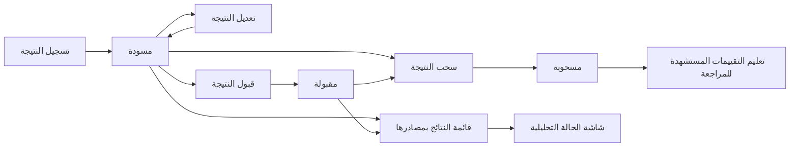
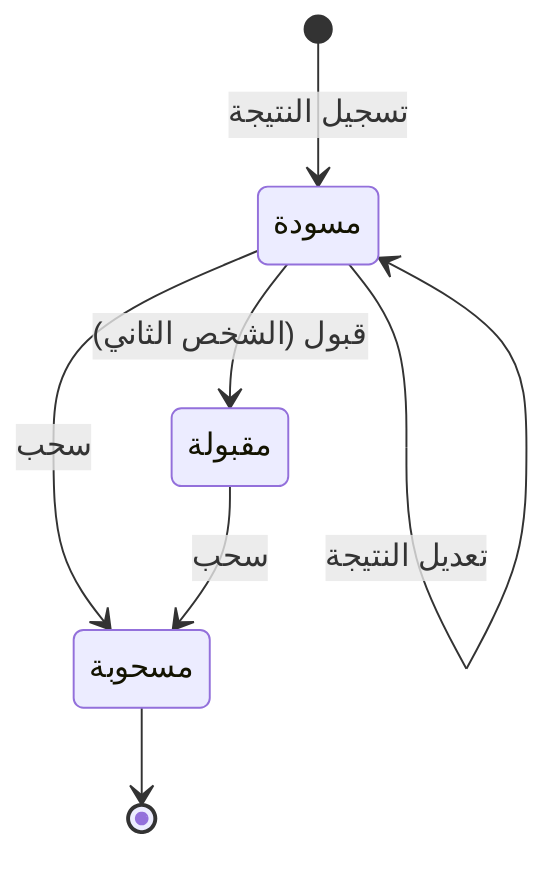

# النتائج التحليلية

<!-- BEGIN GENERATED: doc -->
| البند | القيمة |
|---|---|
| المعرّف | FEAT-ANL-FINDINGS |
| الإصدار | 0.1 |
| الحالة | مسودة |
| القدرة | CAP-04 التحليل والتقييم |
| القدرة الفرعية | CAP-04.03 إنتاج التقييم (R1) |
| الأدوار | المحلل؛ الشخص الثاني |
| الشاشات | SCR-30 الحالة التحليلية والتشغيلات |
| حالات الاستخدام | UC-014، UC-015 |
| القصص | 7: 5 من المواصفة، و2 جديدة |
<!-- END GENERATED: doc -->

## 1. نظرة عامة

### 1.1 القيمة

يسجّل المحلل كل نتيجة بمصادرها ودرجة عدم اليقين فيها، ويراجعها زميل قبل أن يُبنى عليها تقييم.

### 1.2 النطاق

| البند | القيمة |
|---|---|
| المستخدمون | المحلل (يسجّل النتيجة ويعدّلها ويسحبها)؛ الشخص الثاني (يقبل نتيجة سجّلها غيره) |
| الشاشات | SCR-30 الحالة التحليلية والتشغيلات |
| حالات الاستخدام | تقييم عدم اليقين في النتائج؛ إصدار التقييم المستند إليها |
| المتطلبات | تسجيل كل نتيجة تحليلية بمصادرها (تشغيلات ناجحة أو أدلة) ودرجة عدم يقينها، ومراجعة زميل لها قبل الاعتماد عليها |
| خارج النطاق | إعداد التقييم نفسه وحالاته ومراجعته (ميزة أخرى)؛ تشغيل التحليل وطرقه (ميزة أخرى)؛ سجل حالة النتيجة التاريخي كشاشة منفصلة |

### 1.3 خريطة الميزة

**الشكل 1: من تسجيل النتيجة إلى سحبها**



**الشكل 2: رحلة النتيجة التحليلية**



## 2. القواعد المشتركة

تنطبق على كل قصص الميزة، فلا تتكرر داخل القصص. وكل قصة تذكر ما يخصها فقط.

### 2.1 السياق المشترك

كل قصة تبدأ من ثلاثة شروط: مستأجر نشط، وحزمة السياسات الأساسية مفعّلة، ومستخدم مسجّل الدخول ومخوَّل. وتشير إليها القصص بخطوة واحدة: «بفرض السياق المشترك للميزة».

### 2.2 الصلاحية وعدم الإفصاح

- من لا يحق له رؤية العنصر يتلقى ردًا بشكل «غير متاح» تمامًا، فلا يعرف أنه موجود.
- من يرى العنصر ولا يحق له الإجراء يتلقى «لا تملك صلاحية هذا الإجراء».

### 2.3 أوامر تغيير الحالة

- **منع التكرار:** يُرسل كل أمر بمفتاح فريد، فإعادة الطلب نفسه لا تُنفَّذ مرتين.
- **حماية التعديل المتزامن:** يُرسل كل أمر بإصدار البيانات الذي يراه المستخدم. فإن عدّلها غيره في الأثناء، يُرفض الأمر.
- **السجل:** إن نجح الأمر، يُكتب حدثه وسجل التدقيق في المعاملة نفسها.

### 2.4 الرفض المشترك

```gherkin
# language: ar
خاصية: الرفض المشترك لأوامر الميزة

  سيناريو مخطط: رفض مشترك لكل أمر في الميزة
    بفرض السياق المشترك للميزة
    و <الحالة>
    عندما يُرسل المستخدم أي أمر من أوامر الميزة
    اذاً يُرفض برمز <الرمز> ويرى "<الرسالة>"
    و لا يتغير شيء

    امثلة:
      | الحالة                                  | الرمز                  | الرسالة                                                 |
      | العنصر خارج صلاحياته                    | NOT_FOUND              | غير متاح                                                |
      | العنصر مرئي له ولا يحق له الإجراء       | AUTHZ_DENIED           | لا تملك صلاحية هذا الإجراء                              |
      | غيره عدّل العنصر بعد أن فتحه            | VERSION_CONFLICT       | تغيّرت البيانات منذ فتحتها. راجع التغييرات ثم أعد المحاولة |
      | أعاد مفتاح منع التكرار بمحتوى مختلف     | IDEMPOTENCY_KEY_REUSED | طلب مكرر بمحتوى مختلف                                   |
      | البيانات ناقصة أو غير صحيحة             | VALIDATION_FAILED      | بعض البيانات ناقصة أو غير صحيحة. راجع الحقول المعلَّمة      |

  سيناريو: إعادة الطلب نفسه لا تُنفَّذ مرتين
    بفرض السياق المشترك للميزة
    و أمر نجح بمفتاح منع تكرار
    عندما يُعاد الطلب نفسه بالمفتاح نفسه
    اذاً تُعاد النتيجة الأولى ولا يُكتب حدث ثانٍ
```

## 3. الجودة وتعريف الاكتمال

### 3.1 متطلبات الجودة

<!-- BEGIN GENERATED: quality -->
لا متطلبات جودة مرتبطة بمتطلبات هذه الميزة مباشرة. تنطبق متطلبات المنصة العامة (`FEAT-PLT-*`).
<!-- END GENERATED: quality -->

### 3.2 تعريف الاكتمال

القصة مكتملة حين تتحقق الشروط الخمسة:

1. سيناريوهاتها والقواعد المشتركة تمر في الاختبار الآلي.
2. فحوص البنية المعمارية تمر.
3. نصوص الواجهة والرسائل موجودة بالعربية والإنجليزية.
4. مراجعة الكود مكتملة.
5. ما تضيفه القصة نفسها في قسم «القواعد» تحقق.

## 4. فهرس القصص

<!-- BEGIN GENERATED: story-index -->
| المعرّف | القصة | النوع | الحالة |
|---|---|---|---|
| `US-BC03-FND-ACCEPT` | قبول النتيجة التحليلية | أمر | مسودة |
| `US-BC03-FND-EDIT` | تعديل النتيجة التحليلية | أمر | مسودة |
| `US-BC03-FND-RECORD` | تسجيل النتيجة التحليلية | أمر | مسودة |
| `US-BC03-FND-WITHDRAW` | سحب النتيجة التحليلية | أمر | مسودة |
| `US-BC03-Q-FND-LIST` | جلب: Findings with sources | جلب | مسودة |
| `US-DOM-ANL-FND-WITHDRAW-FLAG` | تعليم التقييمات المستشهدة بنتيجة مسحوبة للمراجعة | نظام | مسودة |
| `US-UI-SCR30-FINDINGS` | قائمة النتائج بمصادرها وعدم اليقين وحالة القبول | واجهة | مسودة |
<!-- END GENERATED: story-index -->

## 5. القصص

### 5.1 US-BC03-FND-ACCEPT — قبول النتيجة التحليلية

| النوع | الإصدار | الأولوية | دون اتصال | الحالة |
|---|---|---|---|---|
| أمر | R1 | Must | لا | مسودة |

> **كـ** الشخص الثاني (محلل غير مُسجِّل النتيجة)، **أريد** أن أقبل النتيجة التحليلية التي سجّلها زميلي، **حتى** لا يُبنى تقييم إلا على نتيجة راجعها غير من استخلصها.

**باختصار:** النتيجة «مسودة» يقبلها محلل آخر غير من سجّلها، فتصبح «مقبولة» ولا تُعدَّل بعد ذلك.

#### القواعد

- **متى يُسمح:** النتيجة في حالة «مسودة».
- **من يُسمح له:** أي محلل غير من سجّل النتيجة (فصل المهام: المراجع لا يكون المؤلف نفسه).
- **الأثر:** النتيجة تصبح غير قابلة للتعديل بعد القبول، ويُسجَّل حدث «قُبلت النتيجة» يصل إلى مراجعة التقييمات المستندة إليها.

#### معايير القبول

```gherkin
# language: ar
خاصية: قبول النتيجة التحليلية

  سيناريو: محلل آخر يقبل نتيجة مسودة
    بفرض السياق المشترك للميزة
    و نتيجة في حالة "مسودة" سجّلها محلل آخر
    عندما يقبلها المحلل الحالي
    اذاً تصبح حالتها "مقبولة"
    و يُسجَّل حدث "قُبلت النتيجة"

  سيناريو مخطط: رفض خاص بالقبول
    بفرض السياق المشترك للميزة
    و <الحالة>
    عندما يحاول قبول النتيجة
    اذاً يُرفض برمز <الرمز> ويرى <الرسالة>
    و لا يتغير شيء

    امثلة:
      | الحالة                              | الرمز                           | الرسالة                                               |
      | النتيجة ليست في حالة "مسودة"        | FINDING_INVALID_STATE_TRANSITION | الوضع الحالي للنتيجة التحليلية لا يسمح بهذا الإجراء    |
      | من يقبل هو من سجّل النتيجة نفسها     | SEGREGATION_OF_DUTIES            | لا يجوز أن يعتمد الشخص نفسه ما قدّمه أو طلبه          |
```

<details><summary>المراجع التقنية والتتبع</summary>

<!-- BEGIN GENERATED: refs US-BC03-FND-ACCEPT -->
| البند | المعرّف | المعنى |
|---|---|---|
| الواجهة البرمجية | `POST /api/v1/intelligence/findings/{id}/actions/accept` | — |
| الأمر | `CMD-FND-ACCEPT` | قبول النتيجة التحليلية |
| السياسة | `POL-FND-ACCEPT` | Analyst (record, edit, withdraw) · peer Analyst (accept)؛ tenant match; case visible; label rules |
| الحدث | `EVT-FND-ACCEPTED` | يصل إلى: Assessment review flags |
| الكيان | `AGG-FINDING` | النتيجة التحليلية |
| الجدول | `intelligence.findings` | الجدول الرئيسي للنتيجة التحليلية |
| وحدة النشر | DU-06 | — |
| المتطلب | REQ-ANL-005 | The system shall record for each assessment its findings, evidence, assumptions, uncertainty, confidence, met… |
| حالات الاستخدام | UC-014، UC-015 | Assess Uncertainty؛ Produce Assessment |
| الاختبار | TST-FINDING-SM، TST-SLC07-INVARIANTS | دورة حالات النتيجة التحليلية، وثوابت الشريحة SLC-07 |
<!-- END GENERATED: refs US-BC03-FND-ACCEPT -->

</details>

### 5.2 US-BC03-FND-EDIT — تعديل النتيجة التحليلية

| النوع | الإصدار | الأولوية | دون اتصال | الحالة |
|---|---|---|---|---|
| أمر | R1 | Must | لا | مسودة |

> **كـ** المحلل، **أريد** أن أعدّل نتيجتي قبل أن تُقبل، **حتى** أصحح العبارة أو المصادر أو درجة عدم اليقين فيها.

**باختصار:** النتيجة «مسودة» يعدّلها محلّلها نفسه، فترتفع نسختها دون أن تتغير حالتها.

#### القواعد

- **متى يُسمح:** النتيجة في حالة «مسودة».
- **البيانات:** العبارة، والمصادر (تشغيل ناجح واحد على الأقل من الحالة أو دليل محدَّد)، ودرجة عدم اليقين — وكلها تتبع قواعد التسجيل نفسها (القصة 5.3).
- **الأثر:** يُسجَّل حدث «عُدِّلت النتيجة»، ولا تتغير حالة النتيجة.

#### معايير القبول

```gherkin
# language: ar
خاصية: تعديل النتيجة التحليلية

  سيناريو: تعديل نتيجة مسودة
    بفرض السياق المشترك للميزة
    و نتيجة في حالة "مسودة"
    عندما يعدّل محلّلها العبارة أو المصادر أو درجة عدم اليقين
    اذاً تبقى حالتها "مسودة" وترتفع نسختها
    و يُسجَّل حدث "عُدِّلت النتيجة"

  سيناريو مخطط: رفض خاص بالتعديل
    بفرض السياق المشترك للميزة
    و <الحالة>
    عندما يحاول تعديل النتيجة
    اذاً يُرفض برمز <الرمز> ويرى <الرسالة>
    و لا يتغير شيء

    امثلة:
      | الحالة                                          | الرمز                           | الرسالة                                            |
      | النتيجة ليست في حالة "مسودة"                    | FINDING_INVALID_STATE_TRANSITION | الوضع الحالي للنتيجة التحليلية لا يسمح بهذا الإجراء |
      | بلا عبارة أو بلا مصدر واحد على الأقل أو بلا درجة عدم يقين | FINDING_INVALID                 | النتيجة تحتاج نصًا ومصدرًا واحدًا على الأقل ودرجة عدم يقين |
```

<details><summary>المراجع التقنية والتتبع</summary>

<!-- BEGIN GENERATED: refs US-BC03-FND-EDIT -->
| البند | المعرّف | المعنى |
|---|---|---|
| الواجهة البرمجية | `POST /api/v1/intelligence/findings/{id}/actions/edit` | — |
| الأمر | `CMD-FND-EDIT` | تعديل النتيجة التحليلية |
| السياسة | `POL-FND-EDIT` | Analyst (record, edit, withdraw) · peer Analyst (accept)؛ tenant match; case visible; label rules |
| الحدث | `EVT-FND-EDITED` | يصل إلى: Assessment review flags |
| الكيان | `AGG-FINDING` | النتيجة التحليلية |
| الجدول | `intelligence.findings` | الجدول الرئيسي للنتيجة التحليلية |
| وحدة النشر | DU-06 | — |
| المتطلب | REQ-ANL-005 | The system shall record for each assessment its findings, evidence, assumptions, uncertainty, confidence, met… |
| حالات الاستخدام | UC-014، UC-015 | Assess Uncertainty؛ Produce Assessment |
| الاختبار | TST-FINDING-SM، TST-SLC07-INVARIANTS | دورة حالات النتيجة التحليلية، وثوابت الشريحة SLC-07 |
<!-- END GENERATED: refs US-BC03-FND-EDIT -->

</details>

### 5.3 US-BC03-FND-RECORD — تسجيل النتيجة التحليلية

| النوع | الإصدار | الأولوية | دون اتصال | الحالة |
|---|---|---|---|---|
| أمر | R1 | Must | لا | مسودة |

> **كـ** المحلل، **أريد** أن أسجّل نتيجة تحليلية بمصادرها ودرجة عدم اليقين فيها، **حتى** يُبنى عليها تقييم بعد مراجعتها.

**باختصار:** يسجّل المحلل عبارة النتيجة مع تسمية أمنية ومصدر واحد على الأقل (تشغيل ناجح من حالة التحليل أو دليل مُختار) ودرجة عدم يقين، فتُنشأ النتيجة في حالة «مسودة».

#### القواعد

- **البيانات:** حالة التحليل المرجعية، وعبارة النتيجة، ومصدر واحد على الأقل من تشغيلات ناجحة للحالة أو أدلة محدَّدة، ودرجة عدم اليقين، والتسمية الأمنية (لا تقل عن تسمية مصادرها).
- **الأثر:** تُنشأ النتيجة في حالة «مسودة»، ويُسجَّل حدث «سُجِّلت النتيجة».

#### معايير القبول

```gherkin
# language: ar
خاصية: تسجيل النتيجة التحليلية

  سيناريو: تسجيل نتيجة بمصدر ودرجة عدم يقين
    بفرض السياق المشترك للميزة
    و حالة تحليل فيها تشغيل ناجح واحد على الأقل
    عندما يسجّل المحلل نتيجة بعبارة ومصدر ودرجة عدم يقين وتسمية
    اذاً تُنشأ النتيجة في حالة "مسودة"
    و يُسجَّل حدث "سُجِّلت النتيجة"

  سيناريو مخطط: رفض خاص بالتسجيل
    بفرض السياق المشترك للميزة
    و <الحالة>
    عندما يحاول تسجيل النتيجة
    اذاً يُرفض برمز <الرمز> ويرى <الرسالة>
    و لا يتغير شيء

    امثلة:
      | الحالة                                  | الرمز              | الرسالة                                                        |
      | بلا عبارة أو بلا مصدر أو بلا درجة عدم يقين أو تسمية غير كافية | FINDING_INVALID    | النتيجة تحتاج نصًا ومصدرًا واحدًا على الأقل ودرجة عدم يقين     |
      | حقل حالة التحليل مفقود                  | VALIDATION_FAILED  | حالة التحليل مطلوبة                                             |
```

<details><summary>المراجع التقنية والتتبع</summary>

<!-- BEGIN GENERATED: refs US-BC03-FND-RECORD -->
| البند | المعرّف | المعنى |
|---|---|---|
| الواجهة البرمجية | `POST /api/v1/intelligence/findings` | — |
| الأمر | `CMD-FND-RECORD` | تسجيل النتيجة التحليلية |
| السياسة | `POL-FND-RECORD` | Analyst (record, edit, withdraw) · peer Analyst (accept)؛ tenant match; case visible; label rules |
| الحدث | `EVT-FND-RECORDED` | يصل إلى: Assessment review flags |
| الكيان | `AGG-FINDING` | النتيجة التحليلية |
| الجدول | `intelligence.findings` | الجدول الرئيسي للنتيجة التحليلية |
| وحدة النشر | DU-06 | — |
| المتطلب | REQ-ANL-005 | The system shall record for each assessment its findings, evidence, assumptions, uncertainty, confidence, met… |
| حالات الاستخدام | UC-014، UC-015 | Assess Uncertainty؛ Produce Assessment |
| الاختبار | TST-FINDING-SM، TST-SLC07-INVARIANTS | دورة حالات النتيجة التحليلية، وثوابت الشريحة SLC-07 |
<!-- END GENERATED: refs US-BC03-FND-RECORD -->

</details>

### 5.4 US-BC03-FND-WITHDRAW — سحب النتيجة التحليلية

| النوع | الإصدار | الأولوية | دون اتصال | الحالة |
|---|---|---|---|---|
| أمر | R1 | Must | لا | مسودة |

> **كـ** المحلل، **أريد** أن أسحب نتيجة ثبت خطؤها أو عدم صلاحيتها، **حتى** لا يُستند إليها بعد ذلك دون تنبيه من يعتمد عليها.

**باختصار:** يسحب المحلل نتيجته (مسودة أو مقبولة) بسبب، فتصبح «مسحوبة» نهائيًا، وتُعلَّم التقييمات التي استشهدت بها للمراجعة دون أن تتغير تلقائيًا (القصة 5.6).

#### القواعد

- **متى يُسمح:** النتيجة في حالة «مسودة» أو «مقبولة».
- **البيانات:** سبب السحب (إلزامي).
- **الأثر:** النتيجة تصير «مسحوبة» نهائيًا ولا رجوع عنها، ويُسجَّل حدث «سُحبت النتيجة» يصل إلى تعليم التقييمات المستشهدة بها (القصة 5.6).

#### معايير القبول

```gherkin
# language: ar
خاصية: سحب النتيجة التحليلية

  سيناريو: سحب نتيجة مقبولة
    بفرض السياق المشترك للميزة
    و نتيجة في حالة "مقبولة"
    عندما يسحبها محلّلها بسبب
    اذاً تصبح حالتها "مسحوبة"
    و يُسجَّل حدث "سُحبت النتيجة"

  سيناريو مخطط: رفض خاص بالسحب
    بفرض السياق المشترك للميزة
    و <الحالة>
    عندما يحاول سحب النتيجة
    اذاً يُرفض برمز <الرمز> ويرى <الرسالة>
    و لا يتغير شيء

    امثلة:
      | الحالة                           | الرمز                           | الرسالة                                               |
      | النتيجة في حالة "مسحوبة" من قبل  | FINDING_INVALID_STATE_TRANSITION | الوضع الحالي للنتيجة التحليلية لا يسمح بهذا الإجراء    |
      | بلا سبب                          | REASON_REQUIRED                  | اذكر السبب                                             |
```

<details><summary>المراجع التقنية والتتبع</summary>

<!-- BEGIN GENERATED: refs US-BC03-FND-WITHDRAW -->
| البند | المعرّف | المعنى |
|---|---|---|
| الواجهة البرمجية | `POST /api/v1/intelligence/findings/{id}/actions/withdraw` | — |
| الأمر | `CMD-FND-WITHDRAW` | سحب النتيجة التحليلية |
| السياسة | `POL-FND-WITHDRAW` | Analyst (record, edit, withdraw) · peer Analyst (accept)؛ tenant match; case visible; label rules |
| الحدث | `EVT-FND-WITHDRAWN` | يصل إلى: Assessment review flags |
| الكيان | `AGG-FINDING` | النتيجة التحليلية |
| الجدول | `intelligence.findings` | الجدول الرئيسي للنتيجة التحليلية |
| وحدة النشر | DU-06 | — |
| المتطلب | REQ-ANL-005 | The system shall record for each assessment its findings, evidence, assumptions, uncertainty, confidence, met… |
| حالات الاستخدام | UC-014، UC-015 | Assess Uncertainty؛ Produce Assessment |
| الاختبار | TST-FINDING-SM، TST-SLC07-INVARIANTS | دورة حالات النتيجة التحليلية، وثوابت الشريحة SLC-07 |
<!-- END GENERATED: refs US-BC03-FND-WITHDRAW -->

</details>

### 5.5 US-BC03-Q-FND-LIST — جلب: Findings with sources

| النوع | الإصدار | الأولوية | دون اتصال | الحالة |
|---|---|---|---|---|
| جلب | R1 | Must | لا | مسودة |

> **كـ** أي مستخدم مخوَّل على حالة التحليل، **أريد** قائمة نتائجها بمصادرها، **حتى** أراجعها قبل أن أستشهد بها في تقييم.

**باختصار:** تُعاد نتائج حالة التحليل مع مصادرها، صفحةً بعد صفحة، ولا يكشف شيء وجود نتيجة محجوبة.

**المرشحات:** المؤشر والحد.

#### القواعد

- **من يرى ماذا:** من يحق له رؤية حالة التحليل يرى نتائجها، وتُحجب كل نتيجة تجاوز تسميتها تصريحه دون أن يظهر عددها.

#### معايير القبول

```gherkin
# language: ar
خاصية: قائمة النتائج بمصادرها

  سيناريو: يرى المستخدم ما يحق له فقط
    بفرض السياق المشترك للميزة
    و لحالة التحليل نتائج داخل نطاقه وأخرى خارجه
    عندما يطلب قائمة النتائج
    اذاً تُعاد النتائج داخل نطاقه فقط مع مصادرها
    و لا يكشف أي عدد أو اقتراح وجود نتيجة محجوبة

  سيناريو: الصفحة التالية
    بفرض السياق المشترك للميزة
    و نتائج حالة التحليل أكثر من صفحة
    عندما يطلب الصفحة التالية بالمؤشر
    اذاً تُعاد النتائج التالية دون تكرار ولا فجوة
```

<details><summary>المراجع التقنية والتتبع</summary>

<!-- BEGIN GENERATED: refs US-BC03-Q-FND-LIST -->
| البند | المعرّف | المعنى |
|---|---|---|
| الواجهة البرمجية | `GET /api/v1/intelligence/analysis-cases/{case_id}/findings` | — |
| الاستعلام | `QRY-FND-LIST` | Findings with sources |
| السياسة | `POL-FND-LIST` | label rule |
| الكيان | `AGG-ANALYSIS-CASE` | حالة التحليل |
| الجدول | `intelligence.analysis_cases` | الجدول الرئيسي لحالة التحليل |
| وحدة النشر | DU-06 | — |
| المتطلب | REQ-ANL-005 | The system shall record for each assessment its findings, evidence, assumptions, uncertainty, confidence, met… |
| حالات الاستخدام | UC-014، UC-015 | Assess Uncertainty؛ Produce Assessment |
| الاختبار | TST-ANALYSIS-CASE-SM، TST-SLC07-INVARIANTS | دورة حالات حالة التحليل، وثوابت الشريحة SLC-07 |
<!-- END GENERATED: refs US-BC03-Q-FND-LIST -->

</details>

### 5.6 US-DOM-ANL-FND-WITHDRAW-FLAG — تعليم التقييمات المستشهدة بنتيجة مسحوبة للمراجعة

| النوع | الإصدار | الأولوية | دون اتصال | الحالة |
|---|---|---|---|---|
| نظام | R1 | Must | لا ينطبق | مسودة |

> **كـ** النظام، **أريد** أن أعلّم كل تقييم استشهد بنتيجة سُحبت، **حتى** يراجعه المحلل بدل أن يبقى مستندًا إلى ما سُحب دون أن يعرف أحد.

**باختصار:** حين تُسحب نتيجة، يُعلَّم كل تقييم استشهد بها «بحاجة مراجعة» دون أن تتغير حالته تلقائيًا؛ القرار يبقى على المحلل. **[Derived]** (المصدر لا يذكر رمزًا أو اسمًا للعلامة، واستُنتج السلوك من القاعدة العامة).

#### القواعد

- **متى يحدث:** عند سحب نتيجة تحليلية (القصة 5.4) يستشهد بها تقييم واحد أو أكثر.
- **الأثر:** يُعلَّم كل تقييم مستشهد «بحاجة مراجعة»، دون أن يُسحب أو يُعدَّل تلقائيًا. **[Derived]**

#### معايير القبول

```gherkin
# language: ar
خاصية: تعليم التقييمات المستشهدة بنتيجة مسحوبة

  سيناريو: تقييم يستشهد بنتيجة سُحبت
    بفرض تقييم يستشهد بنتيجة في حالة "مقبولة" أو "مسودة"
    عندما تُسحب النتيجة
    اذاً يُعلَّم التقييم "بحاجة مراجعة"
    و يُسجَّل حدث "عُلِّم التقييم للمراجعة"
    و لا تتغير حالة التقييم نفسها

  سيناريو: لا تقييم يستشهد بالنتيجة المسحوبة
    بفرض نتيجة لا يستشهد بها أي تقييم
    عندما تُسحب النتيجة
    اذاً لا يُعلَّم أي تقييم ولا يتغير شيء آخر
```

<details><summary>المراجع التقنية والتتبع</summary>

<!-- BEGIN GENERATED: refs US-DOM-ANL-FND-WITHDRAW-FLAG -->
| البند | المعرّف | المعنى |
|---|---|---|
| المصدر | `analysis-reproducibility-spec.md §6` | — |
| المصدر | `[Derived]` | — |
| المتطلب | REQ-ANL-005 | The system shall record for each assessment its findings, evidence, assumptions, uncertainty, confidence, met… |
| حالات الاستخدام | UC-014، UC-015 | Assess Uncertainty؛ Produce Assessment |
<!-- END GENERATED: refs US-DOM-ANL-FND-WITHDRAW-FLAG -->

</details>

### 5.7 US-UI-SCR30-FINDINGS — قائمة النتائج بمصادرها وعدم اليقين وحالة القبول

| النوع | الإصدار | الأولوية | دون اتصال | الحالة |
|---|---|---|---|---|
| واجهة | R1 | Must | لا | مسودة |

> **كـ** المحلل، **أريد** أن أرى في شاشة الحالة التحليلية نتائجها مع مصادرها ودرجة عدم اليقين وحالة القبول، **حتى** أختار ما يصلح للاستشهاد به في تقييم.

**باختصار:** تعرض شاشة الحالة التحليلية (SCR-30) قائمة النتائج مع مصادرها (تشغيلات أو أدلة) ودرجة عدم اليقين وحالتها («مسودة»، «مقبولة»، «مسحوبة»)، وتميّز النتيجة المسحوبة بوضوح.

#### القواعد

- **العرض:** كل نتيجة تظهر مع عبارتها، ومصادرها، ودرجة عدم اليقين فيها، وحالتها. **[Derived]** (التفصيل البصري لم يذكره المصدر صريحًا).
- **التمييز:** النتيجة المسحوبة تُميَّز بصريًا عن غيرها، وتُعرض كل تقييماتها المُعلَّمة «بحاجة مراجعة» (القصة 5.6) بإشارة إلى سبب التعليم. **[Derived]**

#### معايير القبول

```gherkin
# language: ar
خاصية: قائمة النتائج بمصادرها وعدم اليقين وحالة القبول

  سيناريو: عرض نتائج حالة التحليل
    بفرض السياق المشترك للميزة
    و لحالة التحليل نتائج بحالات مختلفة
    عندما يفتح المحلل شاشة الحالة التحليلية
    اذاً تظهر كل نتيجة بعبارتها ومصادرها ودرجة عدم اليقين وحالتها

  سيناريو: تمييز نتيجة مسحوبة
    بفرض السياق المشترك للميزة
    و نتيجة في حالة "مسحوبة"
    عندما تظهر في القائمة
    اذاً تُميَّز بصريًا عن النتائج الأخرى
```

<details><summary>المراجع التقنية والتتبع</summary>

<!-- BEGIN GENERATED: refs US-UI-SCR30-FINDINGS -->
| البند | المعرّف | المعنى |
|---|---|---|
| الشاشة | SCR-30 | شاشة الحالة التحليلية والتشغيلات |
| المصدر | `QRY-FND-LIST` | — |
| المصدر | `[Derived]` | — |
| المتطلب | REQ-ANL-005 | The system shall record for each assessment its findings, evidence, assumptions, uncertainty, confidence, met… |
| حالات الاستخدام | UC-014، UC-015 | Assess Uncertainty؛ Produce Assessment |
<!-- END GENERATED: refs US-UI-SCR30-FINDINGS -->

</details>

## 6. التتبع

<!-- BEGIN GENERATED: trace -->
| المتطلب | المعنى | القصص | الاختبار |
|---|---|---|---|
| REQ-ANL-005 | The system shall record for each assessment its findings, evidence, assumptions, uncertainty, confidence, met… | `US-BC03-FND-ACCEPT`، `US-BC03-FND-EDIT`، `US-BC03-FND-RECORD`، `US-BC03-FND-WITHDRAW`، `US-BC03-Q-FND-LIST`، `US-DOM-ANL-FND-WITHDRAW-FLAG`، `US-UI-SCR30-FINDINGS` | TST-ASSESSMENT-SM، TST-FINDING-SM، TST-SLC07-INVARIANTS |
<!-- END GENERATED: trace -->

## 7. سجل التغييرات

| الإصدار | التاريخ | التغيير |
|---|---|---|
| 0.1 | — | هيكل مولَّد من خريطة الميزات |
| 0.2 | 2026-10-03 | كتابة القصص كاملة بمعيار القصص |
