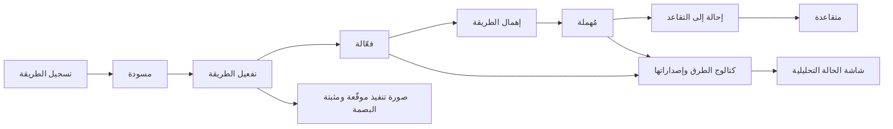
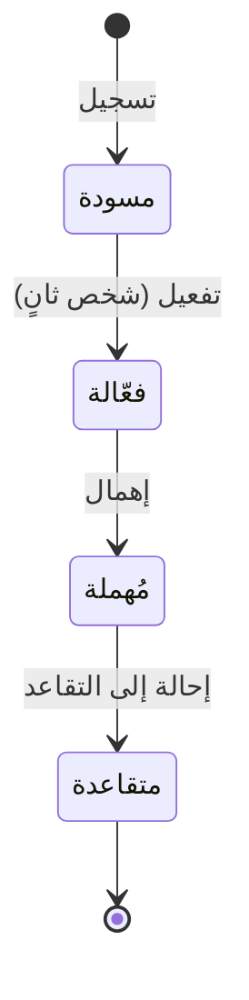

# إدارة طرق التحليل

<!-- BEGIN GENERATED: doc -->
| البند | القيمة |
|---|---|
| المعرّف | FEAT-ANL-METHODS |
| الإصدار | 0.1 |
| الحالة | مسودة |
| القدرة | CAP-04 التحليل والتقييم |
| القدرة الفرعية | CAP-04.02 التنفيذ وإعادة الإنتاج (R1) |
| الأدوار | قائد المحللين؛ مسؤول الإدارة؛ المحلل |
| الشاشات | SCR-30 الحالة التحليلية والتشغيلات |
| حالات الاستخدام | UC-013 |
| القصص | 7: 5 من المواصفة، و2 جديدة |
<!-- END GENERATED: doc -->

## 1. نظرة عامة

### 1.1 القيمة

يعتمد قائد التحليل الطرق المسموح بها وإصداراتها، فلا يُستخدم إلا ما رُوجع واعتُمد.

### 1.2 النطاق

| البند | القيمة |
|---|---|
| المستخدمون | قائد المحللين (يسجّل الطريقة ويهملها ويحيلها للتقاعد)؛ الشخص الثاني من قادة المحللين أو مسؤول الإدارة (يفعّلها)؛ المحلل (يستعرض الكتالوج) |
| الشاشات | SCR-30 الحالة التحليلية والتشغيلات |
| حالات الاستخدام | تنفيذ التحليل بطريقة معتمدة قابلة لإعادة الإنتاج |
| المتطلبات | تثبيت إصدار الطريقة وبيئة تنفيذها، وإمكان إعادة إنتاج نتيجة التشغيل بالمدخلات المسجَّلة نفسها |
| خارج النطاق | تشغيل التحليل نفسه وتسجيل نتائجه (ميزة أخرى)؛ تقرير إعادة الإنتاج وفحص المطابقة (ميزة أخرى) |

### 1.3 خريطة الميزة

**الشكل 1: من تسجيل طريقة التحليل إلى تقاعدها**



**الشكل 2: رحلة طريقة التحليل**



## 2. القواعد المشتركة

تنطبق على كل قصص الميزة، فلا تتكرر داخل القصص. وكل قصة تذكر ما يخصها فقط.

### 2.1 السياق المشترك

كل قصة تبدأ من ثلاثة شروط: مستأجر نشط، وحزمة السياسات الأساسية مفعّلة، ومستخدم مسجّل الدخول ومخوَّل. وتشير إليها القصص بخطوة واحدة: «بفرض السياق المشترك للميزة».

### 2.2 الصلاحية وعدم الإفصاح

- من لا يحق له رؤية العنصر يتلقى ردًا بشكل «غير متاح» تمامًا، فلا يعرف أنه موجود.
- من يرى العنصر ولا يحق له الإجراء يتلقى «لا تملك صلاحية هذا الإجراء».

### 2.3 أوامر تغيير الحالة

- **منع التكرار:** يُرسل كل أمر بمفتاح فريد، فإعادة الطلب نفسه لا تُنفَّذ مرتين.
- **حماية التعديل المتزامن:** يُرسل كل أمر بإصدار البيانات الذي يراه المستخدم. فإن عدّلها غيره في الأثناء، يُرفض الأمر.
- **السجل:** إن نجح الأمر، يُكتب حدثه وسجل التدقيق في المعاملة نفسها.

### 2.4 الرفض المشترك

```gherkin
# language: ar
خاصية: الرفض المشترك لأوامر الميزة

  سيناريو مخطط: رفض مشترك لكل أمر في الميزة
    بفرض السياق المشترك للميزة
    و <الحالة>
    عندما يُرسل المستخدم أي أمر من أوامر الميزة
    اذاً يُرفض برمز <الرمز> ويرى "<الرسالة>"
    و لا يتغير شيء

    امثلة:
      | الحالة                                  | الرمز                  | الرسالة                                                 |
      | العنصر خارج صلاحياته                    | NOT_FOUND              | غير متاح                                                |
      | العنصر مرئي له ولا يحق له الإجراء       | AUTHZ_DENIED           | لا تملك صلاحية هذا الإجراء                              |
      | غيره عدّل العنصر بعد أن فتحه            | VERSION_CONFLICT       | تغيّرت البيانات منذ فتحتها. راجع التغييرات ثم أعد المحاولة |
      | أعاد مفتاح منع التكرار بمحتوى مختلف     | IDEMPOTENCY_KEY_REUSED | طلب مكرر بمحتوى مختلف                                   |
      | البيانات ناقصة أو غير صحيحة             | VALIDATION_FAILED      | بعض البيانات ناقصة أو غير صحيحة. راجع الحقول المعلَّمة      |

  سيناريو: إعادة الطلب نفسه لا تُنفَّذ مرتين
    بفرض السياق المشترك للميزة
    و أمر نجح بمفتاح منع تكرار
    عندما يُعاد الطلب نفسه بالمفتاح نفسه
    اذاً تُعاد النتيجة الأولى ولا يُكتب حدث ثانٍ
```

## 3. الجودة وتعريف الاكتمال

### 3.1 متطلبات الجودة

<!-- BEGIN GENERATED: quality -->
| المرجع | الموقف | المطلوب |
|---|---|---|
| QAS-TRC-002 | re-executes a recorded deterministic analysis run | 100 % |
<!-- END GENERATED: quality -->

### 3.2 تعريف الاكتمال

القصة مكتملة حين تتحقق الشروط الخمسة:

1. سيناريوهاتها والقواعد المشتركة تمر في الاختبار الآلي.
2. فحوص البنية المعمارية تمر.
3. نصوص الواجهة والرسائل موجودة بالعربية والإنجليزية.
4. مراجعة الكود مكتملة.
5. ما تضيفه القصة نفسها في قسم «القواعد» تحقق.

## 4. فهرس القصص

<!-- BEGIN GENERATED: story-index -->
| المعرّف | القصة | النوع | الحالة |
|---|---|---|---|
| `US-BC03-AMT-ACTIVATE` | تفعيل طريقة التحليل | أمر | مسودة |
| `US-BC03-AMT-DEPRECATE` | إهمال طريقة التحليل (إيقاف الاستخدام الجديد) | أمر | مسودة |
| `US-BC03-AMT-REGISTER` | تسجيل طريقة التحليل | أمر | مسودة |
| `US-BC03-AMT-RETIRE` | إحالة طريقة التحليل إلى التقاعد | أمر | مسودة |
| `US-BC03-Q-AMT-LIST` | جلب: Methods and versions | جلب | مسودة |
| `US-UI-SCR30-METHODS` | كتالوج طرق التحليل وإصداراتها وحالتها | واجهة | مسودة |
| `US-OPS-ANL-METHOD-IMAGES` | صور طرق التحليل موقعة ومثبتة البصمة | تشغيل | مسودة |
<!-- END GENERATED: story-index -->

## 5. القصص

### 5.1 US-BC03-AMT-ACTIVATE — تفعيل طريقة التحليل

| النوع | الإصدار | الأولوية | دون اتصال | الحالة |
|---|---|---|---|---|
| أمر | R1 | Must | لا | مسودة |

> **كـ** شخص ثانٍ من قادة المحللين، أو مسؤول الإدارة، **أريد** أن أفعّل طريقة تحليل سجّلها غيري بعد التحقق منها، **حتى** لا تُستخدم طريقة لم يراجعها أحد سوى من سجّلها.

**باختصار:** طريقة «مسودة» معها تقرير تحقق ناجح يفعّلها شخص غير من سجّلها، فتصبح «فعّالة» ويمكن تنفيذ تشغيلات بها.

#### القواعد

- **متى يُسمح:** الطريقة في حالة «مسودة»، ومعها تقرير تحقق ناجح.
- **من يُسمح له:** شخص غير من سجّل الطريقة (فصل المهام: المفعِّل لا يكون المسجِّل نفسه).
- **البيانات:** مرجع تقرير التحقق (إلزامي).
- **الأثر:** يُسجَّل حدث «فُعِّلت الطريقة» يصل إلى مجدول التشغيلات (قائمة الصور المسموحة).

#### معايير القبول

```gherkin
# language: ar
خاصية: تفعيل طريقة التحليل

  سيناريو: شخص ثانٍ يفعّل طريقة سُجِّلت
    بفرض السياق المشترك للميزة
    و طريقة في حالة "مسودة" معها تقرير تحقق ناجح
    عندما يفعّلها شخص غير من سجّلها بمرجع التقرير
    اذاً تصبح حالتها "فعّالة"
    و يُسجَّل حدث "فُعِّلت الطريقة"

  سيناريو مخطط: رفض خاص بالتفعيل
    بفرض السياق المشترك للميزة
    و <الحالة>
    عندما يحاول تفعيل الطريقة
    اذاً يُرفض برمز <الرمز> ويرى <الرسالة>
    و لا يتغير شيء

    امثلة:
      | الحالة                                | الرمز                                  | الرسالة                                               |
      | الطريقة ليست في حالة "مسودة"          | ANALYSIS_METHOD_INVALID_STATE_TRANSITION | الوضع الحالي لطريقة التحليل لا يسمح بهذا الإجراء      |
      | من يفعّل هو من سجّل الطريقة نفسها      | SEGREGATION_OF_DUTIES                  | لا يجوز أن يعتمد الشخص نفسه ما قدّمه أو طلبه          |
      | مرجع تقرير التحقق مفقود                | VALIDATION_FAILED                      | تقرير التحقق مطلوب                                    |
```

<details><summary>المراجع التقنية والتتبع</summary>

<!-- BEGIN GENERATED: refs US-BC03-AMT-ACTIVATE -->
| البند | المعرّف | المعنى |
|---|---|---|
| الواجهة البرمجية | `POST /api/v1/intelligence/analysis-methods/{id}/actions/activate` | — |
| الأمر | `CMD-AMT-ACTIVATE` | تفعيل طريقة التحليل |
| السياسة | `POL-AMT-ACTIVATE` | Analysis lead (register) · second lead or Administrator (activate)؛ tenant match; case visible; label rules |
| الحدث | `EVT-AMT-ACTIVATED` | يصل إلى: Job scheduler (image allow-list) |
| الكيان | `AGG-ANALYSIS-METHOD` | طريقة التحليل |
| الجدول | `intelligence.analysis_methods` | الجدول الرئيسي لطريقة التحليل |
| وحدة النشر | DU-06 | — |
| المتطلبات | REQ-ANL-002، REQ-ANL-003 | معانيها في القسم 6. التتبع |
| حالة الاستخدام | UC-013 | Execute Analysis |
| الاختبار | TST-ANALYSIS-METHOD-SM، TST-SLC07-INVARIANTS | دورة حالات طريقة التحليل، وثوابت الشريحة SLC-07 |
<!-- END GENERATED: refs US-BC03-AMT-ACTIVATE -->

</details>

### 5.2 US-BC03-AMT-DEPRECATE — إهمال طريقة التحليل (إيقاف الاستخدام الجديد)

| النوع | الإصدار | الأولوية | دون اتصال | الحالة |
|---|---|---|---|---|
| أمر | R1 | Must | لا | مسودة |

> **كـ** قائد المحللين، **أريد** أن أهمل طريقة تحليل فعّالة لم تعد تصلح للاستخدام الجديد، **حتى** يُوقَف الاعتماد عليها دون أن تفقد التشغيلات القديمة قابلية إعادة إنتاجها.

**باختصار:** طريقة «فعّالة» يهملها قائد المحللين بسبب، فتصبح «مُهملة»: لا تشغيلات جديدة بها، وتبقى إعادة إنتاج تشغيلاتها السابقة ممكنة.

#### القواعد

- **متى يُسمح:** الطريقة في حالة «فعّالة».
- **البيانات:** سبب الإهمال (إلزامي).
- **الأثر:** لا يُقبل تشغيل جديد بهذه الطريقة بعد الإهمال، وتبقى تشغيلاتها السابقة قابلة لإعادة الإنتاج. يُسجَّل حدث «أُهملت الطريقة» يصل إلى مجدول التشغيلات.

#### معايير القبول

```gherkin
# language: ar
خاصية: إهمال طريقة التحليل

  سيناريو: إهمال طريقة فعّالة بسبب
    بفرض السياق المشترك للميزة
    و طريقة في حالة "فعّالة"
    عندما يهملها قائد المحللين بسبب
    اذاً تصبح حالتها "مُهملة"
    و يُسجَّل حدث "أُهملت الطريقة"

  سيناريو مخطط: رفض خاص بالإهمال
    بفرض السياق المشترك للميزة
    و <الحالة>
    عندما يحاول إهمال الطريقة
    اذاً يُرفض برمز <الرمز> ويرى <الرسالة>
    و لا يتغير شيء

    امثلة:
      | الحالة                        | الرمز                                  | الرسالة                                           |
      | الطريقة ليست في حالة "فعّالة" | ANALYSIS_METHOD_INVALID_STATE_TRANSITION | الوضع الحالي لطريقة التحليل لا يسمح بهذا الإجراء  |
      | بلا سبب                       | REASON_REQUIRED                        | اذكر السبب                                         |
```

<details><summary>المراجع التقنية والتتبع</summary>

<!-- BEGIN GENERATED: refs US-BC03-AMT-DEPRECATE -->
| البند | المعرّف | المعنى |
|---|---|---|
| الواجهة البرمجية | `POST /api/v1/intelligence/analysis-methods/{id}/actions/deprecate` | — |
| الأمر | `CMD-AMT-DEPRECATE` | إهمال طريقة التحليل (إيقاف الاستخدام الجديد) |
| السياسة | `POL-AMT-DEPRECATE` | Analysis lead (deprecate)؛ tenant match; case visible; label rules |
| الحدث | `EVT-AMT-DEPRECATED` | يصل إلى: Job scheduler (image allow-list) |
| الكيان | `AGG-ANALYSIS-METHOD` | طريقة التحليل |
| الجدول | `intelligence.analysis_methods` | الجدول الرئيسي لطريقة التحليل |
| وحدة النشر | DU-06 | — |
| المتطلبات | REQ-ANL-002، REQ-ANL-003 | معانيها في القسم 6. التتبع |
| حالة الاستخدام | UC-013 | Execute Analysis |
| الاختبار | TST-ANALYSIS-METHOD-SM، TST-SLC07-INVARIANTS | دورة حالات طريقة التحليل، وثوابت الشريحة SLC-07 |
<!-- END GENERATED: refs US-BC03-AMT-DEPRECATE -->

</details>

### 5.3 US-BC03-AMT-REGISTER — تسجيل طريقة التحليل

| النوع | الإصدار | الأولوية | دون اتصال | الحالة |
|---|---|---|---|---|
| أمر | R1 | Must | لا | مسودة |

> **كـ** قائد المحللين، **أريد** أن أسجّل إصدارًا جديدًا من طريقة تحليل برمزه ومخطط معاملاته وبصمة صورة تنفيذه، **حتى** تصبح متاحة للتحقق منها ثم تفعيلها.

**باختصار:** يسجّل قائد المحللين طريقة بكود وإصدار فريدين، ومخطط معاملات، وبصمة صورة تنفيذ من السجل الداخلي، وعلامة الحتمية، فتُنشأ الطريقة في حالة «مسودة».

#### القواعد

- **البيانات:** الرمز والإصدار (فريدان معًا)، ومخطط المعاملات، وبصمة صورة التنفيذ من السجل الداخلي، وعلامة الحتمية (هل تُعيد نفس النتيجة بالبايت)، والوصف.
- **الأثر:** تُنشأ الطريقة في حالة «مسودة»، ويُسجَّل حدث «سُجِّلت الطريقة».

#### معايير القبول

```gherkin
# language: ar
خاصية: تسجيل طريقة التحليل

  سيناريو: تسجيل إصدار جديد من طريقة
    بفرض السياق المشترك للميزة
    و رمز وإصدار غير مستخدمين من قبل
    عندما يسجّل قائد المحللين الطريقة ببصمة صورة تنفيذ من السجل الداخلي
    اذاً تُنشأ الطريقة في حالة "مسودة"
    و يُسجَّل حدث "سُجِّلت الطريقة"

  سيناريو مخطط: رفض خاص بالتسجيل
    بفرض السياق المشترك للميزة
    و <الحالة>
    عندما يحاول تسجيل الطريقة
    اذاً يُرفض برمز <الرمز> ويرى <الرسالة>
    و لا يتغير شيء

    امثلة:
      | الحالة                                                                  | الرمز          | الرسالة                                                          |
      | الرمز والإصدار مستخدمان من قبل، أو مخطط المعاملات غير صحيح، أو بصمة الصورة ليست من السجل الداخلي، أو علامة الحتمية مفقودة | METHOD_INVALID | بيانات طريقة التحليل غير صحيحة                                    |
```

<details><summary>المراجع التقنية والتتبع</summary>

<!-- BEGIN GENERATED: refs US-BC03-AMT-REGISTER -->
| البند | المعرّف | المعنى |
|---|---|---|
| الواجهة البرمجية | `POST /api/v1/intelligence/analysis-methods` | — |
| الأمر | `CMD-AMT-REGISTER` | تسجيل طريقة التحليل |
| السياسة | `POL-AMT-REGISTER` | Analysis lead (register) · second lead or Administrator (activate)؛ tenant match; case visible; label rules |
| الحدث | `EVT-AMT-REGISTERED` | يصل إلى: Job scheduler (image allow-list) |
| الكيان | `AGG-ANALYSIS-METHOD` | طريقة التحليل |
| الجدول | `intelligence.analysis_methods` | الجدول الرئيسي لطريقة التحليل |
| وحدة النشر | DU-06 | — |
| المتطلبات | REQ-ANL-002، REQ-ANL-003 | معانيها في القسم 6. التتبع |
| حالة الاستخدام | UC-013 | Execute Analysis |
| الاختبار | TST-ANALYSIS-METHOD-SM، TST-SLC07-INVARIANTS | دورة حالات طريقة التحليل، وثوابت الشريحة SLC-07 |
<!-- END GENERATED: refs US-BC03-AMT-REGISTER -->

</details>

### 5.4 US-BC03-AMT-RETIRE — إحالة طريقة التحليل إلى التقاعد

| النوع | الإصدار | الأولوية | دون اتصال | الحالة |
|---|---|---|---|---|
| أمر | R1 | Must | لا | مسودة |

> **كـ** قائد المحللين، **أريد** أن أحيل طريقة مُهملة إلى التقاعد النهائي حين لا يستند إليها عمل منشور، **حتى** يُغلق ملفها دون أن يفقد عمل سابق قابلية إعادة إنتاجه.

**باختصار:** طريقة «مُهملة» لا يستند إلى أي تشغيل بها تقييم منشور أو مُستبدَل يحيلها قائد المحللين إلى «متقاعدة» نهائيًا بسبب.

#### القواعد

- **متى يُسمح:** الطريقة في حالة «مُهملة»، ولا تشغيل بها يستند إليه تقييم «منشور» أو «مُستبدَل».
- **البيانات:** سبب الإحالة إلى التقاعد (إلزامي).
- **الأثر:** الطريقة تصير «متقاعدة» نهائيًا ولا رجوع عنها، ويُسجَّل حدث «أُحيلت الطريقة إلى التقاعد» يصل إلى مجدول التشغيلات.

#### معايير القبول

```gherkin
# language: ar
خاصية: إحالة طريقة التحليل إلى التقاعد

  سيناريو: إحالة طريقة مُهملة إلى التقاعد
    بفرض السياق المشترك للميزة
    و طريقة في حالة "مُهملة" لا يستند إلى تشغيلاتها تقييم منشور أو مستبدَل
    عندما يحيلها قائد المحللين إلى التقاعد بسبب
    اذاً تصبح حالتها "متقاعدة"
    و يُسجَّل حدث "أُحيلت الطريقة إلى التقاعد"

  سيناريو مخطط: رفض خاص بالإحالة إلى التقاعد
    بفرض السياق المشترك للميزة
    و <الحالة>
    عندما يحاول إحالة الطريقة إلى التقاعد
    اذاً يُرفض برمز <الرمز> ويرى <الرسالة>
    و لا يتغير شيء

    امثلة:
      | الحالة                                                    | الرمز                          | الرسالة                                            |
      | الطريقة ليست في حالة "مُهملة"                              | ANALYSIS_METHOD_INVALID_STATE_TRANSITION | الوضع الحالي لطريقة التحليل لا يسمح بهذا الإجراء |
      | يستند إلى تشغيل بها تقييم منشور أو مستبدَل                | METHOD_BACKS_PUBLISHED_WORK    | لا يمكن إيقاف هذه الطريقة لأن عملًا منشورًا يستند إليها |
      | بلا سبب                                                   | REASON_REQUIRED                | اذكر السبب                                          |
```

<details><summary>المراجع التقنية والتتبع</summary>

<!-- BEGIN GENERATED: refs US-BC03-AMT-RETIRE -->
| البند | المعرّف | المعنى |
|---|---|---|
| الواجهة البرمجية | `POST /api/v1/intelligence/analysis-methods/{id}/actions/retire` | — |
| الأمر | `CMD-AMT-RETIRE` | إحالة طريقة التحليل إلى التقاعد |
| السياسة | `POL-AMT-RETIRE` | Analysis lead (retire)؛ tenant match; case visible; label rules |
| الحدث | `EVT-AMT-RETIRED` | يصل إلى: Job scheduler (image allow-list) |
| الكيان | `AGG-ANALYSIS-METHOD` | طريقة التحليل |
| الجدول | `intelligence.analysis_methods` | الجدول الرئيسي لطريقة التحليل |
| وحدة النشر | DU-06 | — |
| المتطلبات | REQ-ANL-002، REQ-ANL-003 | معانيها في القسم 6. التتبع |
| حالة الاستخدام | UC-013 | Execute Analysis |
| الاختبار | TST-ANALYSIS-METHOD-SM، TST-SLC07-INVARIANTS | دورة حالات طريقة التحليل، وثوابت الشريحة SLC-07 |
<!-- END GENERATED: refs US-BC03-AMT-RETIRE -->

</details>

### 5.5 US-BC03-Q-AMT-LIST — جلب: Methods and versions

| النوع | الإصدار | الأولوية | دون اتصال | الحالة |
|---|---|---|---|---|
| جلب | R1 | Must | لا | مسودة |

> **كـ** المحلل، **أريد** قائمة طرق التحليل وإصداراتها، **حتى** أختار طريقة فعّالة عند تشغيل تحليل جديد.

**باختصار:** تُعاد كل طرق التحليل وإصداراتها وحالاتها، صفحةً بعد صفحة.

**المرشحات:** المؤشر والحد.

#### القواعد

- **من يرى ماذا:** أي محلل في المستأجر يرى كتالوج الطرق كاملًا بحالاتها.

#### معايير القبول

```gherkin
# language: ar
خاصية: قائمة طرق التحليل وإصداراتها

  سيناريو: محلل يستعرض كتالوج الطرق
    بفرض السياق المشترك للميزة
    و توجد طرق بحالات مختلفة
    عندما يطلب المحلل قائمة طرق التحليل
    اذاً تُعاد كل الطرق بإصداراتها وحالاتها

  سيناريو: الصفحة التالية
    بفرض السياق المشترك للميزة
    و الطرق أكثر من صفحة
    عندما يطلب الصفحة التالية بالمؤشر
    اذاً تُعاد الطرق التالية دون تكرار ولا فجوة
```

<details><summary>المراجع التقنية والتتبع</summary>

<!-- BEGIN GENERATED: refs US-BC03-Q-AMT-LIST -->
| البند | المعرّف | المعنى |
|---|---|---|
| الواجهة البرمجية | `GET /api/v1/intelligence/analysis-methods` | — |
| الاستعلام | `QRY-AMT-LIST` | Methods and versions |
| السياسة | `POL-AMT-LIST` | any analyst |
| الكيان | `AGG-ANALYSIS-METHOD` | طريقة التحليل |
| الجدول | `intelligence.analysis_methods` | الجدول الرئيسي لطريقة التحليل |
| وحدة النشر | DU-06 | — |
| المتطلب | REQ-ANL-002 | When an analysis run is executed, the system shall record the dataset versions, parameters, algorithm and ver… |
| حالة الاستخدام | UC-013 | Execute Analysis |
| الاختبار | TST-ANALYSIS-METHOD-SM، TST-SLC07-INVARIANTS | دورة حالات طريقة التحليل، وثوابت الشريحة SLC-07 |
<!-- END GENERATED: refs US-BC03-Q-AMT-LIST -->

</details>

### 5.6 US-UI-SCR30-METHODS — كتالوج طرق التحليل وإصداراتها وحالتها

| النوع | الإصدار | الأولوية | دون اتصال | الحالة |
|---|---|---|---|---|
| واجهة | R1 | Should | لا | مسودة |

> **كـ** المحلل، **أريد** أن أرى في شاشة الحالة التحليلية كتالوج طرق التحليل وإصداراتها وحالتها، **حتى** أختار طريقة فعّالة لتشغيل جديد ولا أختار طريقة مُهملة أو متقاعدة بالخطأ.

**باختصار:** تعرض شاشة الحالة التحليلية (SCR-30) كتالوج طرق التحليل: الرمز والإصدار والحالة («مسودة»، «فعّالة»، «مُهملة»، «متقاعدة»)، وتمنع اختيار طريقة غير فعّالة عند بدء تشغيل جديد.

#### القواعد

- **العرض:** كل طريقة تظهر برمزها وإصدارها وحالتها، وتُرتَّب الفعّالة أولًا. **[Derived]**
- **الاختيار:** عند بدء تشغيل جديد لا تُعرض إلا الطرق «الفعّالة» قابلة للاختيار. **[Derived]**

#### معايير القبول

```gherkin
# language: ar
خاصية: كتالوج طرق التحليل وإصداراتها وحالتها

  سيناريو: عرض الكتالوج بحالاته
    بفرض السياق المشترك للميزة
    و توجد طرق بحالات مختلفة
    عندما يفتح المحلل شاشة الحالة التحليلية
    اذاً تظهر كل طريقة برمزها وإصدارها وحالتها

  سيناريو: اختيار طريقة لتشغيل جديد
    بفرض السياق المشترك للميزة
    و توجد طريقة "فعّالة" وطريقة "مُهملة"
    عندما يبدأ المحلل تشغيلًا جديدًا
    اذاً لا تظهر إلا الطريقة "الفعّالة" قابلة للاختيار
```

<details><summary>المراجع التقنية والتتبع</summary>

<!-- BEGIN GENERATED: refs US-UI-SCR30-METHODS -->
| البند | المعرّف | المعنى |
|---|---|---|
| الشاشة | SCR-30 | شاشة الحالة التحليلية والتشغيلات |
| المصدر | `QRY-AMT-LIST` | — |
| المصدر | `17-security-design.md §12.4` | — |
| المصدر | `[Derived]` | — |
<!-- END GENERATED: refs US-UI-SCR30-METHODS -->

</details>

### 5.7 US-OPS-ANL-METHOD-IMAGES — صور طرق التحليل موقعة ومثبتة البصمة

| النوع | الإصدار | الأولوية | دون اتصال | الحالة |
|---|---|---|---|---|
| تشغيل | R1 | Should | لا ينطبق | مسودة |

> **كـ** فريق التشغيل أو الأمن، **أريد** أن تُسجَّل صور تنفيذ طرق التحليل في سجل داخلي موقَّعة وبمعرَّف بصمة ثابت، **حتى** لا تُشغَّل صورة مُعدَّلة أو من مصدر غير موثوق (THR-S07-02).

**باختصار:** تُبنى صورة تنفيذ كل طريقة وتُوقَّع وتُنشر في السجل الداخلي، وتُثبَّت تشغيلاتها ببصمة الصورة لا باسمها، فلا يقبل المجدول إلا صورة موجودة في قائمة السماح ببصمتها.

#### القواعد

- **الأثر:** لا يُشغِّل المجدول إلا صورة موقَّعة وموجودة في قائمة السماح بسجل داخلي، مطابقة بصمتها لما سُجِّل عند تفعيل الطريقة (القصة 5.1).

#### معايير القبول

```gherkin
# language: ar
خاصية: صور طرق التحليل موقعة ومثبتة البصمة

  سيناريو: تشغيل بصورة موقَّعة من قائمة السماح
    بفرض السياق المشترك للميزة
    و طريقة فعّالة ببصمة صورة موقَّعة من السجل الداخلي
    عندما يبدأ تشغيل بهذه الطريقة
    اذاً يستخدم العامل الصورة بالبصمة المسجَّلة نفسها دون تحميل خارجي
```

<details><summary>المراجع التقنية والتتبع</summary>

<!-- BEGIN GENERATED: refs US-OPS-ANL-METHOD-IMAGES -->
| البند | المعرّف | المعنى |
|---|---|---|
| المصدر | `THR-S07-02` | — |
| القرار التقني | TD-12 | Kubernetes Jobs with Kueue (fair sharing, per-tenant quotas); images from internal Harbor registry, signed (c… |
| القرار التقني | TD-17 | Signed images (cosign) + SBOM (Syft); offline bundles with Zarf (air-gapped install/upgrade/rollback); GitOps… |
| المصدر | `analysis-reproducibility-spec.md §2` | — |
<!-- END GENERATED: refs US-OPS-ANL-METHOD-IMAGES -->

</details>

## 6. التتبع

<!-- BEGIN GENERATED: trace -->
| المتطلب | المعنى | القصص | الاختبار |
|---|---|---|---|
| REQ-ANL-002 | When an analysis run is executed, the system shall record the dataset versions, parameters, algorithm and ver… | كل قصص الميزة المأخوذة من المواصفة (5) | TST-ANALYSIS-METHOD-SM، TST-ANALYSIS-RUN-SM، TST-SLC07-INVARIANTS |
| REQ-ANL-003 | When a recorded analysis run is re-executed with the same recorded inputs, the system shall produce the same… | كل قصص الأوامر والنظام في الميزة (4) | TST-ANALYSIS-METHOD-SM، TST-ANALYSIS-RUN-SM، TST-SLC07-INVARIANTS |
<!-- END GENERATED: trace -->

## 7. سجل التغييرات

| الإصدار | التاريخ | التغيير |
|---|---|---|
| 0.1 | — | هيكل مولَّد من خريطة الميزات |
| 0.2 | 2026-10-03 | كتابة القصص كاملة بمعيار القصص |
