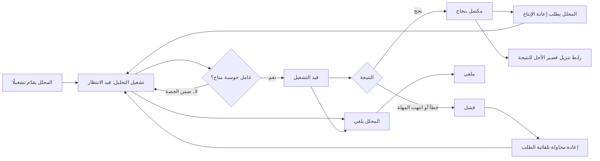
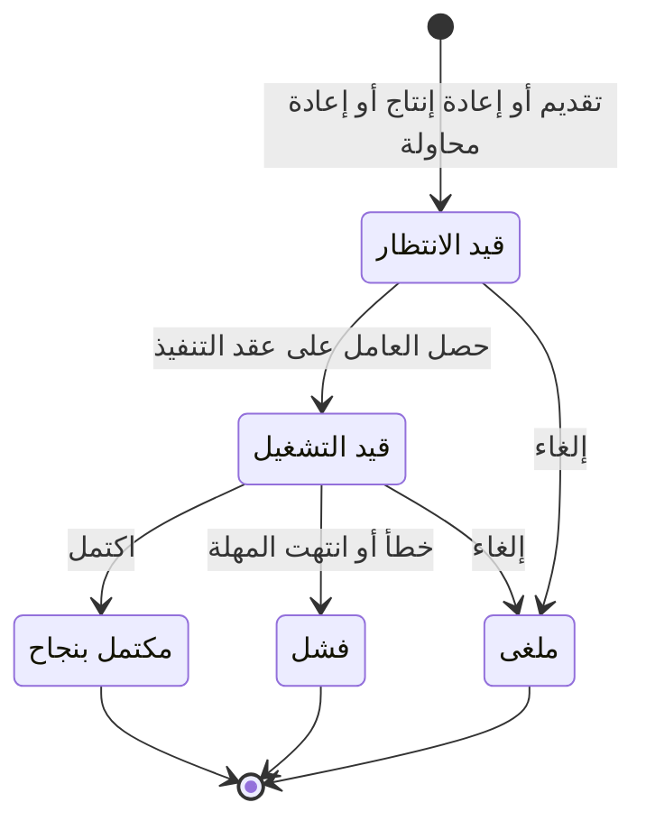

# تشغيل التحليل وإعادة إنتاجه

<!-- BEGIN GENERATED: doc -->
| البند | القيمة |
|---|---|
| المعرّف | FEAT-ANL-RUNS |
| الإصدار | 0.2 |
| الحالة | مسودة |
| القدرة | CAP-04 التحليل والتقييم |
| القدرة الفرعية | CAP-04.02 التنفيذ وإعادة الإنتاج (R1) |
| الأدوار | المحلل؛ النظام |
| الشاشات | SCR-30 الحالة التحليلية والتشغيلات |
| حالات الاستخدام | UC-013 |
| القصص | 15: 8 من المواصفة، و7 جديدة |
<!-- END GENERATED: doc -->

## 1. نظرة عامة

### 1.1 القيمة

يشغّل المحلل تحليلًا طويلًا دون انتظار، ويتابع تقدمه، ويعيد تشغيله لاحقًا ليحصل على النتيجة نفسها أو يعرف ما الذي اختلف.

### 1.2 النطاق

| البند | القيمة |
|---|---|
| المستخدمون | المحلل (يقدّم التشغيلات ويلغيها ويعيد إنتاجها ويعيد محاولتها)؛ أي مستخدم مخوَّل (يقرأ التشغيل ومرفقاته)؛ فريق المنصة (الأداء والعدالة بين المستأجرين والتفويض الأمني) |
| الشاشات | SCR-30 الحالة التحليلية والتشغيلات |
| حالات الاستخدام | تنفيذ التحليل: تقديم تشغيل تنفيذًا لطريقة على مدخلات مثبتة، ومتابعته، وإلغاؤه، وإعادة إنتاجه أو إعادة محاولته عند الفشل |
| المتطلبات | تسجيل كل عناصر التشغيل (نسخ البيانات والمعاملات والطريقة والنطاق والافتراضات والخطوات والنتائج)؛ إعادة إنتاج نفس النتيجة من نفس المدخلات أو بيان ما اختلف؛ تنفيذ التشغيلات الطويلة كمهام غير متزامنة بحالة وتقدم وإلغاء وإعادة محاولة |
| خارج النطاق | تعريف طريقة التحليل واعتمادها (ميزة أخرى)؛ حالة التحليل والسيناريوهات (ميزة «السيناريوهات ومقارنة النتائج»)؛ النتيجة التحليلية والتقييم (ميزات لاحقة) |

### 1.3 خريطة الميزة

**الشكل 1: من تقديم التشغيل إلى نتيجته**



**الشكل 2: دورة حالات تشغيل التحليل**



## 2. القواعد المشتركة

تنطبق على كل قصص الميزة، فلا تتكرر داخل القصص. وكل قصة تذكر ما يخصها فقط.

### 2.1 السياق المشترك

كل قصة تبدأ من ثلاثة شروط: مستأجر نشط، وحزمة السياسات الأساسية مفعّلة، ومستخدم مسجّل الدخول ومخوَّل. وتشير إليها القصص بخطوة واحدة: «بفرض السياق المشترك للميزة».

### 2.2 الصلاحية وعدم الإفصاح

- من لا يحق له رؤية العنصر يتلقى ردًا بشكل «غير متاح» تمامًا، فلا يعرف أنه موجود.
- من يرى العنصر ولا يحق له الإجراء يتلقى «لا تملك صلاحية هذا الإجراء».

### 2.3 أوامر تغيير الحالة

- **منع التكرار:** يُرسل كل أمر بمفتاح فريد، فإعادة الطلب نفسه لا تُنفَّذ مرتين.
- **حماية التعديل المتزامن:** يُرسل كل أمر بإصدار البيانات الذي يراه المستخدم. فإن عدّلها غيره في الأثناء، يُرفض الأمر.
- **السجل:** إن نجح الأمر، يُكتب حدثه وسجل التدقيق في المعاملة نفسها.

### 2.4 الرفض المشترك

```gherkin
# language: ar
خاصية: الرفض المشترك لأوامر الميزة

  سيناريو مخطط: رفض مشترك لكل أمر في الميزة
    بفرض السياق المشترك للميزة
    و <الحالة>
    عندما يُرسل المستخدم أي أمر من أوامر الميزة
    اذاً يُرفض برمز <الرمز> ويرى "<الرسالة>"
    و لا يتغير شيء

    امثلة:
      | الحالة                                  | الرمز                  | الرسالة                                                 |
      | العنصر خارج صلاحياته                    | NOT_FOUND              | غير متاح                                                |
      | العنصر مرئي له ولا يحق له الإجراء       | AUTHZ_DENIED           | لا تملك صلاحية هذا الإجراء                              |
      | غيره عدّل العنصر بعد أن فتحه            | VERSION_CONFLICT       | تغيّرت البيانات منذ فتحتها. راجع التغييرات ثم أعد المحاولة |
      | أعاد مفتاح منع التكرار بمحتوى مختلف     | IDEMPOTENCY_KEY_REUSED | طلب مكرر بمحتوى مختلف                                   |
      | البيانات ناقصة أو غير صحيحة             | VALIDATION_FAILED      | بعض البيانات ناقصة أو غير صحيحة. راجع الحقول المعلَّمة      |

  سيناريو: إعادة الطلب نفسه لا تُنفَّذ مرتين
    بفرض السياق المشترك للميزة
    و أمر نجح بمفتاح منع تكرار
    عندما يُعاد الطلب نفسه بالمفتاح نفسه
    اذاً تُعاد النتيجة الأولى ولا يُكتب حدث ثانٍ
```

## 3. الجودة وتعريف الاكتمال

### 3.1 متطلبات الجودة

<!-- BEGIN GENERATED: quality -->
| المرجع | الموقف | المطلوب |
|---|---|---|
| QAS-PERF-001 | submits a state-changing command | p95 ≤ 300 ms; p99 ≤ 1 s |
| QAS-PERF-020 | tenant submits 100 runs | no tenant exceeds its concurrent-job quota; other tenants' start latency ≤ 30 s |
| QAS-SEC-013 | run submitted by user U | run reads only data visible to U; results labelled ≥ max input label |
| QAS-TRC-002 | re-executes a recorded deterministic analysis run | 100 % |
<!-- END GENERATED: quality -->

### 3.2 تعريف الاكتمال

القصة مكتملة حين تتحقق الشروط الخمسة:

1. سيناريوهاتها والقواعد المشتركة تمر في الاختبار الآلي.
2. فحوص البنية المعمارية تمر.
3. نصوص الواجهة والرسائل موجودة بالعربية والإنجليزية.
4. مراجعة الكود مكتملة.
5. ما تضيفه القصة نفسها في قسم «القواعد» تحقق.

## 4. فهرس القصص

<!-- BEGIN GENERATED: story-index -->
| المعرّف | القصة | النوع | الحالة |
|---|---|---|---|
| `US-BC03-RUN-CANCEL` | إلغاء تشغيل التحليل | أمر | مسودة |
| `US-BC03-RUN-REPRODUCE` | إعادة إنتاج تشغيل التحليل | أمر | مسودة |
| `US-BC03-RUN-SUBMIT` | تقديم تشغيل التحليل | أمر | مسودة |
| `US-DOM-ANL-RUN-RETRY` | إعادة محاولة تشغيل تحليل فشل | أمر | مسودة |
| `US-BC03-Q-RUN-ARTIFACT` | رابط تنزيل قصير الأجل لنتيجة التشغيل | جلب | مسودة |
| `US-BC03-Q-RUN-GET` | جلب تفاصيل تشغيل التحليل | جلب | مسودة |
| `US-BC03-S-ANALYSIS-RUN-01` | بدء تنفيذ التشغيل عند توفر عامل حوسبة | نظام | مسودة |
| `US-BC03-S-ANALYSIS-RUN-02` | اكتمال التشغيل بنجاح | نظام | مسودة |
| `US-BC03-S-ANALYSIS-RUN-03` | فشل التشغيل بخطأ أو انتهاء المهلة | نظام | مسودة |
| `US-UI-SCR30-REPRODUCE-REPORT` | عرض تقرير إعادة الإنتاج وما اختلف | واجهة | مسودة |
| `US-UI-SCR30-RUN-PROGRESS` | عرض تقدم التشغيل وإلغاؤه وسبب فشله | واجهة | مسودة |
| `US-PLT-ANL-REPRO-CHECK` | فحص دوري لقابلية إعادة إنتاج التشغيلات | منصة | مسودة |
| `US-PLT-ANL-RUN-DELEGATION` | تشغيل التحليل بصلاحيات مقدّمه فقط | منصة | مسودة |
| `US-PLT-ANL-RUN-FAIRSHARE` | توزيع عادل للحوسبة بحصة لكل مستأجر | منصة | مسودة |
| `US-PLT-ANL-RUN-STATUS` | متابعة حالة التشغيل وتقدمه بالسحب والاشتراك | منصة | مسودة |
<!-- END GENERATED: story-index -->

## 5. القصص

### 5.1 US-BC03-RUN-CANCEL — إلغاء تشغيل التحليل

| النوع | الإصدار | الأولوية | دون اتصال | الحالة |
|---|---|---|---|---|
| أمر | R1 | Must | لا | مسودة |

> **كـ** المحلل، **أريد** أن ألغي تشغيلًا لم يكتمل بعد، **حتى** لا يستهلك حوسبة لا حاجة إليها.

**باختصار:** يلغي المحلل تشغيلًا «قيد الانتظار» أو «قيد التشغيل» بذكر السبب، فيصير «ملغى» فورًا.

#### القواعد

- **متى يُسمح:** التشغيل «قيد الانتظار» أو «قيد التشغيل».
- **من يُسمح له:** مَن قدّم التشغيل، أو مالك حالة التحليل.
- **البيانات:** السبب (إلزامي).
- **الأثر:** حدث «أُلغي التشغيل» يصل إلى مجدول المهام وعمال الحوسبة، وكاتب التتبع، وإشعار مالك حالة التحليل.

#### معايير القبول

```gherkin
# language: ar
خاصية: إلغاء تشغيل التحليل

  سيناريو: المحلل يلغي تشغيلًا قيد التشغيل
    بفرض السياق المشترك للميزة
    و تشغيل تحليل قدّمه المحلل في حالة "قيد التشغيل"
    عندما يلغيه بذكر السبب
    اذاً تصبح حالته "ملغى"
    و يُسجَّل حدث "أُلغي التشغيل"

  سيناريو مخطط: رفض خاص بالإلغاء
    بفرض السياق المشترك للميزة
    و <الحالة>
    عندما يحاول إلغاء التشغيل
    اذاً يُرفض برمز <الرمز> ويرى "<الرسالة>"
    و لا يتغير شيء

    امثلة:
      | الحالة                           | الرمز                            | الرسالة                                             |
      | التشغيل مكتمل أو فشل أو ملغى من قبل | ANALYSIS_RUN_INVALID_STATE_TRANSITION | الوضع الحالي لتشغيل التحليل لا يسمح بهذا الإجراء |
      | السبب غير مذكور                  | REASON_REQUIRED                  | اذكر السبب                                          |
```

<details><summary>المراجع التقنية والتتبع</summary>

<!-- BEGIN GENERATED: refs US-BC03-RUN-CANCEL -->
| البند | المعرّف | المعنى |
|---|---|---|
| الواجهة البرمجية | `POST /api/v1/intelligence/analysis-runs/{id}/actions/cancel` | — |
| الأمر | `CMD-RUN-CANCEL` | إلغاء تشغيل التحليل |
| السياسة | `POL-RUN-CANCEL` | Analyst (submit, reproduce, cancel)؛ tenant match; case visible; label rules |
| الحدث | `EVT-RUN-CANCELLED` | يصل إلى: Job scheduler / compute workers; Lineage writer (BC02 LineageRecord); Case owner notification |
| الكيان | `AGG-ANALYSIS-RUN` | تشغيل التحليل |
| الجدول | `intelligence.analysis_runs` | الجدول الرئيسي لتشغيل التحليل |
| وحدة النشر | DU-06 | — |
| المتطلبات | REQ-ANL-002، REQ-ANL-003، REQ-ANL-004 | معانيها في القسم 6. التتبع |
| حالة الاستخدام | UC-013 | Execute Analysis |
| الاختبار | TST-ANALYSIS-RUN-SM، TST-SLC07-INVARIANTS | دورة حالات تشغيل التحليل، وثوابت الشريحة SLC-07 |
<!-- END GENERATED: refs US-BC03-RUN-CANCEL -->

</details>

### 5.2 US-BC03-RUN-REPRODUCE — إعادة إنتاج تشغيل التحليل

| النوع | الإصدار | الأولوية | دون اتصال | الحالة |
|---|---|---|---|---|
| أمر | R1 | Must | لا | مسودة |

> **كـ** المحلل، **أريد** أن أعيد إنتاج تشغيل سابق نجح، **حتى** أتحقق من أنه يعطي النتيجة نفسها أو أعرف ما الذي اختلف.

**باختصار:** يطلب المحلل إعادة إنتاج تشغيل «مكتمل بنجاح»، فيُنشأ تشغيل جديد بنفس المدخلات والمعاملات والبذرة العشوائية، ويحمل تقرير مقارنة بنتيجته الأصلية عند اكتماله.

#### القواعد

- **متى يُسمح:** التشغيل المصدر «مكتمل بنجاح»، وطريقة التحليل المستخدمة لا تزال «نشطة» أو «متوقفة قديمة».
- **من يُسمح له:** محلل يملك تصريحًا أمنيًا يكفي لتصنيف التشغيل المصدر.
- **البيانات:** معرّف التشغيل المصدر (إلزامي).
- **الأثر:** حدث «أُدرج التشغيل في الانتظار» يصل إلى مجدول المهام وعمال الحوسبة، وكاتب التتبع، وإشعار مالك حالة التحليل. يتحقق التشغيل الجديد نفسه من قواعد §2.3، ويحمل عند اكتماله تقرير إعادة الإنتاج (القصة 5.10).

#### معايير القبول

```gherkin
# language: ar
خاصية: إعادة إنتاج تشغيل التحليل

  سيناريو: المحلل يعيد إنتاج تشغيل ناجح
    بفرض السياق المشترك للميزة
    و تشغيل تحليل سابق في حالة "مكتمل بنجاح" ومصرَّح للمحلل بتصنيفه
    عندما يطلب إعادة إنتاجه
    اذاً يُنشأ تشغيل جديد في حالة "قيد الانتظار" بنفس المدخلات والمعاملات والبذرة العشوائية
    و يُسجَّل حدث "أُدرج التشغيل في الانتظار"

  سيناريو مخطط: رفض خاص بإعادة الإنتاج
    بفرض السياق المشترك للميزة
    و <الحالة>
    عندما يطلب إعادة إنتاج التشغيل
    اذاً يُرفض برمز <الرمز> ويرى "<الرسالة>"
    و لا يتغير شيء

    امثلة:
      | الحالة                                          | الرمز                     | الرسالة                                 |
      | المحلل غير مصرَّح له بتصنيف التشغيل المصدر       | REPRODUCTION_NOT_ALLOWED  | لا يمكن إعادة إنتاج هذا التشغيل          |
      | معرّف التشغيل المصدر غير مذكور                   | VALIDATION_FAILED         | التشغيل المصدر مطلوب                    |
```

<details><summary>المراجع التقنية والتتبع</summary>

<!-- BEGIN GENERATED: refs US-BC03-RUN-REPRODUCE -->
| البند | المعرّف | المعنى |
|---|---|---|
| الواجهة البرمجية | `POST /api/v1/intelligence/analysis-runs/{id}/actions/reproduce` | — |
| الأمر | `CMD-RUN-REPRODUCE` | إعادة إنتاج تشغيل التحليل |
| السياسة | `POL-RUN-REPRODUCE` | Analyst (submit, reproduce, cancel)؛ tenant match; case visible; label rules |
| الحدث | `EVT-RUN-QUEUED` | يصل إلى: Job scheduler / compute workers; Lineage writer (BC02 LineageRecord); Case owner notification |
| الكيان | `AGG-ANALYSIS-RUN` | تشغيل التحليل |
| الجدول | `intelligence.analysis_runs` | الجدول الرئيسي لتشغيل التحليل |
| وحدة النشر | DU-06 | — |
| المتطلبات | REQ-ANL-002، REQ-ANL-003، REQ-ANL-004 | معانيها في القسم 6. التتبع |
| حالة الاستخدام | UC-013 | Execute Analysis |
| الاختبار | TST-ANALYSIS-RUN-SM، TST-SLC07-INVARIANTS | دورة حالات تشغيل التحليل، وثوابت الشريحة SLC-07 |
<!-- END GENERATED: refs US-BC03-RUN-REPRODUCE -->

</details>

### 5.3 US-BC03-RUN-SUBMIT — تقديم تشغيل التحليل

| النوع | الإصدار | الأولوية | دون اتصال | الحالة |
|---|---|---|---|---|
| أمر | R1 | Must | لا | مسودة |

> **كـ** المحلل، **أريد** أن أقدّم تشغيل طريقة تحليل على مدخلات محددة، **حتى** أحصل على نتيجة قابلة لإعادة الإنتاج دون انتظار اكتمالها.

**باختصار:** يقدّم المحلل تشغيلًا بتحديد حالة التحليل والطريقة والمعاملات والمدخلات، فيثبَّت كل مدخل بزمن معرفته، ويصير التشغيل «قيد الانتظار» حتى يتوفر له عامل حوسبة (REQ-ANL-002).

#### القواعد

- **متى يُسمح:** حالة التحليل «مفتوحة»، وطريقة التحليل «نشطة»، والمعاملات صحيحة وفق مخططها، وكل مدخل مثبَّت بزمن معرفته وقت التقديم (نطاقه الزماني والمكاني والطبقات والمرشحات والافتراضات)، وتصنيف التشغيل لا يقل عن أعلى تصنيف بين مدخلاته، وحصة المستأجر من التشغيلات المتزامنة لم تُستنفذ.
- **من يُسمح له:** المحلل.
- **البيانات:** حالة التحليل، الطريقة، المعاملات، المدخلات، التصنيف (إلزامية)؛ السيناريو، الافتراضات، البذرة العشوائية (اختيارية).
- **الأثر:** حدث «أُدرج التشغيل في الانتظار» يصل إلى مجدول المهام وعمال الحوسبة، وكاتب التتبع، وإشعار مالك حالة التحليل.

#### معايير القبول

```gherkin
# language: ar
خاصية: تقديم تشغيل التحليل

  سيناريو: المحلل يقدّم تشغيلًا صحيحًا
    بفرض السياق المشترك للميزة
    و حالة تحليل "مفتوحة" وطريقة تحليل "نشطة" ومدخلات مرئية للمحلل
    عندما يقدّم التشغيل بمعاملات صحيحة وتصنيف لا يقل عن تصنيف مدخلاته
    اذاً يصبح التشغيل في حالة "قيد الانتظار" وكل مدخل مثبَّت بزمن معرفته
    و يُسجَّل حدث "أُدرج التشغيل في الانتظار"

  سيناريو مخطط: رفض خاص بالتقديم
    بفرض السياق المشترك للميزة
    و <الحالة>
    عندما يقدّم التشغيل
    اذاً يُرفض برمز <الرمز> ويرى "<الرسالة>"
    و لا يتغير شيء

    امثلة:
      | الحالة                                                        | الرمز       | الرسالة                                                    |
      | حالة التحليل مغلقة، أو الطريقة غير نشطة، أو المعاملات غير صحيحة، أو حصة المستأجر مستنفذة | RUN_INVALID | لا يمكن بدء التشغيل: تحقق من الحالة والطريقة والمعاملات |
      | حالة التحليل أو الطريقة أو المدخلات غير مذكورة                | VALIDATION_FAILED | حالة التحليل مطلوبة |
```

<details><summary>المراجع التقنية والتتبع</summary>

<!-- BEGIN GENERATED: refs US-BC03-RUN-SUBMIT -->
| البند | المعرّف | المعنى |
|---|---|---|
| الواجهة البرمجية | `POST /api/v1/intelligence/analysis-runs` | — |
| الأمر | `CMD-RUN-SUBMIT` | تقديم تشغيل التحليل |
| السياسة | `POL-RUN-SUBMIT` | Analyst (submit, reproduce, cancel)؛ tenant match; case visible; label rules |
| الحدث | `EVT-RUN-QUEUED` | يصل إلى: Job scheduler / compute workers; Lineage writer (BC02 LineageRecord); Case owner notification |
| الكيان | `AGG-ANALYSIS-RUN` | تشغيل التحليل |
| الجدول | `intelligence.analysis_runs` | الجدول الرئيسي لتشغيل التحليل |
| وحدة النشر | DU-06 | — |
| المتطلبات | REQ-ANL-002، REQ-ANL-003، REQ-ANL-004 | معانيها في القسم 6. التتبع |
| حالة الاستخدام | UC-013 | Execute Analysis |
| الاختبار | TST-ANALYSIS-RUN-SM، TST-SLC07-INVARIANTS | دورة حالات تشغيل التحليل، وثوابت الشريحة SLC-07 |
<!-- END GENERATED: refs US-BC03-RUN-SUBMIT -->

</details>

### 5.4 US-DOM-ANL-RUN-RETRY — إعادة محاولة تشغيل تحليل فشل

| النوع | الإصدار | الأولوية | دون اتصال | الحالة |
|---|---|---|---|---|
| أمر | R1 | Must | لا | مسودة |

> **كـ** المحلل، **أريد** أن أعيد محاولة تشغيل فشل بخطأ عابر أو انتهاء مهلة، **حتى** أحصل على نتيجته دون إعادة تجميع مدخلاته من جديد.

**باختصار:** يطلب المحلل إعادة محاولة تشغيل «فشل»، فيُنشأ تشغيل جديد بنفس المدخلات والمعاملات والطريقة والبذرة العشوائية، ويصير «قيد الانتظار». **[Derived]**: المتطلب REQ-ANL-004 ينص على «إعادة المحاولة» للتشغيلات الطويلة دون أن تفصّل المواصفة إجراءها، فهذه القصة تستنتج الإجراء من آلية إعادة الإنتاج (`analysis-reproducibility-spec.md` §3) وتحتاج تأكيد المالك.

#### القواعد

- **متى يُسمح [Derived]:** التشغيل المصدر «فشل».
- **من يُسمح له:** مَن قدّم التشغيل المصدر، أو مالك حالة التحليل.
- **البيانات:** معرّف التشغيل المصدر (إلزامي).
- **الأثر:** حدث «أُدرج التشغيل في الانتظار» يصل إلى مجدول المهام وعمال الحوسبة، وكاتب التتبع. يخضع التشغيل الجديد لقواعد التقديم كاملة (القصة 5.3).

#### معايير القبول

```gherkin
# language: ar
خاصية: إعادة محاولة تشغيل تحليل فشل

  سيناريو: المحلل يعيد محاولة تشغيل فشل
    بفرض السياق المشترك للميزة
    و تشغيل تحليل في حالة "فشل" قدّمه المحلل
    عندما يطلب إعادة محاولته
    اذاً يُنشأ تشغيل جديد في حالة "قيد الانتظار" بنفس المدخلات والمعاملات والطريقة والبذرة العشوائية
    و يُسجَّل حدث "أُدرج التشغيل في الانتظار"

  سيناريو: رفض إعادة المحاولة لتشغيل لم يفشل
    بفرض السياق المشترك للميزة
    و تشغيل تحليل في حالة "قيد الانتظار" أو "قيد التشغيل" أو "مكتمل بنجاح" أو "ملغى"
    عندما يطلب المحلل إعادة محاولته
    اذاً يُرفض برمز ANALYSIS_RUN_INVALID_STATE_TRANSITION ويرى "الوضع الحالي لتشغيل التحليل لا يسمح بهذا الإجراء"
    و لا يتغير شيء
```

<details><summary>المراجع التقنية والتتبع</summary>

<!-- BEGIN GENERATED: refs US-DOM-ANL-RUN-RETRY -->
| البند | المعرّف | المعنى |
|---|---|---|
| المصدر | `analysis-reproducibility-spec.md §3` | — |
| المصدر | `[Derived]` | — |
| المتطلب | REQ-ANL-004 | The system shall execute long-running analysis runs as asynchronous jobs with status, progress, cancellation… |
| حالة الاستخدام | UC-013 | Execute Analysis |
<!-- END GENERATED: refs US-DOM-ANL-RUN-RETRY -->

</details>

### 5.5 US-BC03-Q-RUN-ARTIFACT — رابط تنزيل قصير الأجل لنتيجة التشغيل

| النوع | الإصدار | الأولوية | دون اتصال | الحالة |
|---|---|---|---|---|
| جلب | R1 | Must | لا | مسودة |

> **كـ** أي مستخدم مخوَّل، **أريد** رابط تنزيل قصير الأجل لنتيجة تشغيل أرى تصنيفها، **حتى** أحمّل الملف دون أن يبقى الرابط صالحًا إلى الأبد.

**باختصار:** يطلب المستخدم رابط تنزيل لنتيجة تشغيل يحق له رؤيتها، فيُصدر رابط ينتهي بعد مدة قصيرة، وتُسجَّل كل محاولة طلب في سجل التدقيق.

#### القواعد

- **من يُسمح له:** مَن يرى التشغيل وتصنيف نتيجته.
- **الأثر:** تُسجَّل محاولة الطلب في سجل التدقيق سواء نجحت أم رُفضت.

#### معايير القبول

```gherkin
# language: ar
خاصية: رابط تنزيل نتيجة التشغيل

  سيناريو: مستخدم مخوَّل يحصل على رابط التنزيل
    بفرض السياق المشترك للميزة
    و تشغيل تحليل مكتمل بنجاح يحق للمستخدم رؤية نتيجته
    عندما يطلب رابط تنزيل النتيجة
    اذاً يُعاد رابط ينتهي بعد مدة قصيرة
    و يُسجَّل الطلب في سجل التدقيق

  سيناريو: رفض الطلب لمستخدم لا يرى النتيجة
    بفرض السياق المشترك للميزة
    و تشغيل تحليل تصنيف نتيجته أعلى من تصريح المستخدم
    عندما يطلب رابط تنزيل النتيجة
    اذاً يُرد بردٍّ بشكل العنصر غير الموجود
    و يُسجَّل الطلب المرفوض في سجل التدقيق
```

<details><summary>المراجع التقنية والتتبع</summary>

<!-- BEGIN GENERATED: refs US-BC03-Q-RUN-ARTIFACT -->
| البند | المعرّف | المعنى |
|---|---|---|
| الواجهة البرمجية | `POST /api/v1/intelligence/analysis-runs/{run_id}/artifact-grants` | — |
| الاستعلام | `QRY-RUN-ARTIFACT` | Short-lived download target for a result artifact |
| السياسة | `POL-RUN-ARTIFACT` | run label rule; audited |
| الكيان | `AGG-ANALYSIS-RUN` | تشغيل التحليل |
| الجدول | `intelligence.analysis_runs` | الجدول الرئيسي لتشغيل التحليل |
| وحدة النشر | DU-06 | — |
| المتطلب | REQ-ANL-002 | When an analysis run is executed, the system shall record the dataset versions, parameters, algorithm and ver… |
| حالة الاستخدام | UC-013 | Execute Analysis |
| الاختبار | TST-ANALYSIS-RUN-SM، TST-SLC07-INVARIANTS | دورة حالات تشغيل التحليل، وثوابت الشريحة SLC-07 |
<!-- END GENERATED: refs US-BC03-Q-RUN-ARTIFACT -->

</details>

### 5.6 US-BC03-Q-RUN-GET — جلب تفاصيل تشغيل التحليل

| النوع | الإصدار | الأولوية | دون اتصال | الحالة |
|---|---|---|---|---|
| جلب | R1 | Must | لا | مسودة |

> **كـ** أي مستخدم مخوَّل، **أريد** تفاصيل تشغيل بمدخلاته ومعاملاته وخطواته وحالته ونتائجه وتقرير إعادة إنتاجه، **حتى** أفهم ما جرى فيه دون الرجوع إلى مصادر متفرقة.

**باختصار:** يعيد الاستعلام تشغيلًا واحدًا بكل عناصره المسجَّلة (REQ-ANL-002) لمن يحق له رؤيته فقط.

#### القواعد

- **من يرى ماذا:** مَن يحق له رؤية تصنيف التشغيل.

#### معايير القبول

```gherkin
# language: ar
خاصية: جلب تفاصيل تشغيل التحليل

  سيناريو: مستخدم مخوَّل يرى تفاصيل التشغيل
    بفرض السياق المشترك للميزة
    و تشغيل تحليل يحق للمستخدم رؤيته
    عندما يطلب تفاصيله
    اذاً تُعاد مدخلاته ومعاملاته وخطواته وحالته ونتائجه، وتقرير إعادة الإنتاج إن وُجد

  سيناريو: التشغيل غير متاح لمن لا يرى تصنيفه
    بفرض السياق المشترك للميزة
    و تشغيل تحليل تصنيفه أعلى من تصريح المستخدم
    عندما يطلب تفاصيله
    اذاً يُرد بردٍّ بشكل العنصر غير الموجود
```

<details><summary>المراجع التقنية والتتبع</summary>

<!-- BEGIN GENERATED: refs US-BC03-Q-RUN-GET -->
| البند | المعرّف | المعنى |
|---|---|---|
| الواجهة البرمجية | `GET /api/v1/intelligence/analysis-runs/{run_id}` | — |
| الاستعلام | `QRY-RUN-GET` | Run with pins, parameters, steps, status, artifacts, reproduction report |
| السياسة | `POL-RUN-GET` | run label rule |
| الكيان | `AGG-ANALYSIS-RUN` | تشغيل التحليل |
| الجدول | `intelligence.analysis_runs` | الجدول الرئيسي لتشغيل التحليل |
| وحدة النشر | DU-06 | — |
| المتطلب | REQ-ANL-002 | When an analysis run is executed, the system shall record the dataset versions, parameters, algorithm and ver… |
| حالة الاستخدام | UC-013 | Execute Analysis |
| الاختبار | TST-ANALYSIS-RUN-SM، TST-SLC07-INVARIANTS | دورة حالات تشغيل التحليل، وثوابت الشريحة SLC-07 |
<!-- END GENERATED: refs US-BC03-Q-RUN-GET -->

</details>

### 5.7 US-BC03-S-ANALYSIS-RUN-01 — بدء تنفيذ التشغيل عند توفر عامل حوسبة

| النوع | الإصدار | الأولوية | دون اتصال | الحالة |
|---|---|---|---|---|
| نظام | R1 | Must | لا ينطبق | مسودة |

> **كـ** النظام، **أريد** أن أنقل التشغيل إلى «قيد التشغيل» حين يحصل عامل حوسبة على عقد تنفيذه، **حتى** يبدأ تنفيذه فعليًا.

**باختصار:** حين يحصل عامل حوسبة على عقد تنفيذ تشغيل «قيد الانتظار»، يبدأ التنفيذ بصلاحيات مَن قدّم التشغيل لا بصلاحيات النظام (القصة 5.13)، ويصير «قيد التشغيل».

#### القواعد

- **متى يحدث:** عامل حوسبة يحصل على عقد تنفيذ تشغيل «قيد الانتظار».
- **الأثر:** حدث «بدأ تنفيذ التشغيل» مع سجل تدقيق بهوية النظام، يصل إلى مجدول المهام وكاتب التتبع.

#### معايير القبول

```gherkin
# language: ar
خاصية: بدء تنفيذ التشغيل

  سيناريو: عامل حوسبة يحصل على عقد تنفيذ
    بفرض تشغيل تحليل في حالة "قيد الانتظار"
    عندما يحصل عامل حوسبة على عقد تنفيذه
    اذاً تصبح حالته "قيد التشغيل"
    و يُسجَّل حدث "بدأ تنفيذ التشغيل" بسجل تدقيق بهوية النظام

  سيناريو: لا عقد متاح فلا يتغير شيء
    بفرض تشغيل تحليل في حالة "قيد الانتظار" وحصة المستأجر من التشغيلات المتزامنة مستنفذة
    عندما يبحث المجدول عن عامل حوسبة
    اذاً تبقى حالته "قيد الانتظار"
    و لا يُسجَّل أي حدث
```

<details><summary>المراجع التقنية والتتبع</summary>

<!-- BEGIN GENERATED: refs US-BC03-S-ANALYSIS-RUN-01 -->
| البند | المعرّف | المعنى |
|---|---|---|
| المحفِّز | `SYS:worker lease acquired` | executes with the submitter's authorization (visibility), never with system privileges |
| الانتقال | QUEUED ← RUNNING | — |
| الحدث | `EVT-RUN-STARTED` | يصل إلى: Job scheduler / compute workers; Lineage writer (BC02 LineageRecord); Case owner notification |
| الكيان | `AGG-ANALYSIS-RUN` | تشغيل التحليل |
| الجدول | `intelligence.analysis_runs` | الجدول الرئيسي لتشغيل التحليل |
| وحدة النشر | DU-06 | — |
| المتطلبات | REQ-ANL-002، REQ-ANL-003، REQ-ANL-004 | معانيها في القسم 6. التتبع |
| حالة الاستخدام | UC-013 | Execute Analysis |
| الاختبار | TST-ANALYSIS-RUN-SM، TST-SLC07-INVARIANTS | دورة حالات تشغيل التحليل، وثوابت الشريحة SLC-07 |
<!-- END GENERATED: refs US-BC03-S-ANALYSIS-RUN-01 -->

</details>

### 5.8 US-BC03-S-ANALYSIS-RUN-02 — اكتمال التشغيل بنجاح

| النوع | الإصدار | الأولوية | دون اتصال | الحالة |
|---|---|---|---|---|
| نظام | R1 | Must | لا ينطبق | مسودة |

> **كـ** النظام، **أريد** أن أنقل التشغيل إلى «مكتمل بنجاح» حين يكتمل تنفيذه، **حتى** تُحفظ نتيجته وسجل خطواته وسطر تتبعه.

**باختصار:** حين يكتمل تنفيذ تشغيل «قيد التشغيل»، تُحفظ نتائجه كأصول موقَّعة ببصمتها، وسجل خطواته، وسطر تتبع يثبت المدخلات وزمن معرفتها وإصدار الطريقة وبصمة البيئة والمعاملات والبذرة والمنفِّذ والأوقات (REQ-ANL-002)، ويصير «مكتمل بنجاح».

#### القواعد

- **متى يحدث:** اكتمل تنفيذ تشغيل «قيد التشغيل».
- **الأثر:** حدث «اكتمل التشغيل بنجاح» مع سجل تدقيق بهوية النظام، يصل إلى مجدول المهام وكاتب التتبع وإشعار مالك حالة التحليل. ونتيجته تصير غير قابلة للتعديل.

#### معايير القبول

```gherkin
# language: ar
خاصية: اكتمال التشغيل بنجاح

  سيناريو: اكتمل التنفيذ بنجاح
    بفرض تشغيل تحليل في حالة "قيد التشغيل"
    عندما يكتمل تنفيذه
    اذاً تصبح حالته "مكتمل بنجاح" ونتيجته غير قابلة للتعديل
    و يُسجَّل حدث "اكتمل التشغيل بنجاح" بسجل تدقيق بهوية النظام

  سيناريو: إشعار اكتمال متأخر لتشغيل أُلغي فلا يتغير شيء
    بفرض تشغيل تحليل في حالة "ملغى"
    عندما تصل إشارة اكتمال متأخرة من عامل الحوسبة
    اذاً تبقى حالته "ملغى"
    و لا يُسجَّل أي حدث
```

<details><summary>المراجع التقنية والتتبع</summary>

<!-- BEGIN GENERATED: refs US-BC03-S-ANALYSIS-RUN-02 -->
| البند | المعرّف | المعنى |
|---|---|---|
| المحفِّز | `SYS:completed` | results stored as hashed artifacts; steps log; lineage record written (inputs+known_at, method version, image… |
| الانتقال | RUNNING ← SUCCEEDED | — |
| الحدث | `EVT-RUN-SUCCEEDED` | يصل إلى: Job scheduler / compute workers; Lineage writer (BC02 LineageRecord); Case owner notification |
| الكيان | `AGG-ANALYSIS-RUN` | تشغيل التحليل |
| الجدول | `intelligence.analysis_runs` | الجدول الرئيسي لتشغيل التحليل |
| وحدة النشر | DU-06 | — |
| المتطلبات | REQ-ANL-002، REQ-ANL-003، REQ-ANL-004 | معانيها في القسم 6. التتبع |
| حالة الاستخدام | UC-013 | Execute Analysis |
| الاختبار | TST-ANALYSIS-RUN-SM، TST-SLC07-INVARIANTS | دورة حالات تشغيل التحليل، وثوابت الشريحة SLC-07 |
<!-- END GENERATED: refs US-BC03-S-ANALYSIS-RUN-02 -->

</details>

### 5.9 US-BC03-S-ANALYSIS-RUN-03 — فشل التشغيل بخطأ أو انتهاء المهلة

| النوع | الإصدار | الأولوية | دون اتصال | الحالة |
|---|---|---|---|---|
| نظام | R1 | Must | لا ينطبق | مسودة |

> **كـ** النظام، **أريد** أن أنقل التشغيل إلى «فشل» حين يتعطل تنفيذه أو تنتهي مهلته، **حتى** يعرف المحلل أنه فشل ويتخلص النظام من نتائجه الناقصة.

**باختصار:** حين يتعطل تنفيذ تشغيل «قيد التشغيل» أو تنتهي مهلته (6 ساعات افتراضيًا)، يُسجَّل الخطأ وتُحذف أي نتائج جزئية، ويصير «فشل».

#### القواعد

- **متى يحدث:** تعطل تنفيذ تشغيل «قيد التشغيل»، أو انتهت مهلته.
- **الأثر:** حدث «فشل التشغيل» مع سجل تدقيق بهوية النظام، يصل إلى مجدول المهام وكاتب التتبع وإشعار مالك حالة التحليل. يحق للمحلل بعدها إعادة محاولته (القصة 5.4).

#### معايير القبول

```gherkin
# language: ar
خاصية: فشل التشغيل

  سيناريو: تعطل التنفيذ
    بفرض تشغيل تحليل في حالة "قيد التشغيل"
    عندما يتعطل تنفيذه أو تنتهي مهلته
    اذاً تصبح حالته "فشل" وتُحذف أي نتائج جزئية
    و يُسجَّل حدث "فشل التشغيل" بسجل تدقيق بهوية النظام

  سيناريو: إشارة خطأ متأخرة لتشغيل انتهى بالفعل فلا يتغير شيء
    بفرض تشغيل تحليل في حالة "مكتمل بنجاح" أو "ملغى"
    عندما تصل إشارة خطأ متأخرة من عامل الحوسبة
    اذاً تبقى حالته كما هي
    و لا يُسجَّل أي حدث
```

<details><summary>المراجع التقنية والتتبع</summary>

<!-- BEGIN GENERATED: refs US-BC03-S-ANALYSIS-RUN-03 -->
| البند | المعرّف | المعنى |
|---|---|---|
| المحفِّز | `SYS:error or timeout` | error recorded; partial artifacts discarded |
| الانتقال | RUNNING ← FAILED | — |
| الحدث | `EVT-RUN-FAILED` | يصل إلى: Job scheduler / compute workers; Lineage writer (BC02 LineageRecord); Case owner notification |
| الكيان | `AGG-ANALYSIS-RUN` | تشغيل التحليل |
| الجدول | `intelligence.analysis_runs` | الجدول الرئيسي لتشغيل التحليل |
| وحدة النشر | DU-06 | — |
| المتطلبات | REQ-ANL-002، REQ-ANL-003، REQ-ANL-004 | معانيها في القسم 6. التتبع |
| حالة الاستخدام | UC-013 | Execute Analysis |
| الاختبار | TST-ANALYSIS-RUN-SM، TST-SLC07-INVARIANTS | دورة حالات تشغيل التحليل، وثوابت الشريحة SLC-07 |
<!-- END GENERATED: refs US-BC03-S-ANALYSIS-RUN-03 -->

</details>

### 5.10 US-UI-SCR30-REPRODUCE-REPORT — عرض تقرير إعادة الإنتاج وما اختلف

| النوع | الإصدار | الأولوية | دون اتصال | الحالة |
|---|---|---|---|---|
| واجهة | R1 | Must | لا | مسودة |

> **كـ** المحلل، **أريد** أن أرى عند اكتمال تشغيل أُعيد إنتاجه ما إن كانت نتيجته مطابقة للأصل أو مختلفة، **حتى** أعرف أين يقع الخلل إن وُجد.

**باختصار:** تعرض شاشة الحالة التحليلية والتشغيلات (SCR-30) تقرير إعادة الإنتاج: مطابق للأصل، أو مختلف مع قائمة ما اختلف من مدخل أو إصدار طريقة أو بيئة تنفيذ (REQ-ANL-003).

#### القواعد

- **البيانات:** نتيجة المقارنة (مطابق أو مختلف)، وقائمة ما اختلف عند الاختلاف.

#### معايير القبول

```gherkin
# language: ar
خاصية: عرض تقرير إعادة الإنتاج

  سيناريو: التشغيل المُعاد إنتاجه مطابق للأصل
    بفرض السياق المشترك للميزة
    و تشغيل أُعيد إنتاجه واكتمل بنفس نتيجة الأصل
    عندما يفتح المحلل تفاصيله في شاشة الحالة التحليلية والتشغيلات
    اذاً يرى تقرير إعادة الإنتاج بنتيجة "مطابق للأصل"

  سيناريو: التشغيل المُعاد إنتاجه مختلف عن الأصل
    بفرض السياق المشترك للميزة
    و تشغيل أُعيد إنتاجه واكتمل بنتيجة تختلف عن الأصل في إصدار الطريقة
    عندما يفتح المحلل تفاصيله
    اذاً يرى تقرير إعادة الإنتاج بنتيجة "مختلف" مع إصدار الطريقة ضمن ما اختلف
```

<details><summary>المراجع التقنية والتتبع</summary>

<!-- BEGIN GENERATED: refs US-UI-SCR30-REPRODUCE-REPORT -->
| البند | المعرّف | المعنى |
|---|---|---|
| الشاشة | SCR-30 | شاشة الحالة التحليلية والتشغيلات |
| المصدر | `analysis-reproducibility-spec.md §2` | — |
| المتطلب | REQ-ANL-003 | When a recorded analysis run is re-executed with the same recorded inputs, the system shall produce the same… |
| حالة الاستخدام | UC-013 | Execute Analysis |
<!-- END GENERATED: refs US-UI-SCR30-REPRODUCE-REPORT -->

</details>

### 5.11 US-UI-SCR30-RUN-PROGRESS — عرض تقدم التشغيل وإلغاؤه وسبب فشله

| النوع | الإصدار | الأولوية | دون اتصال | الحالة |
|---|---|---|---|---|
| واجهة | R1 | Must | لا | مسودة |

> **كـ** المحلل، **أريد** أن أرى حالة تشغيلي وتقدمه دون إعادة فتح الصفحة، وأن أزر الإلغاء يظهر وأنا أحتاجه فقط، **حتى** أتابعه دون انتظار ولا أضيع وقتًا في إلغاء ما لا يمكن إلغاؤه.

**باختصار:** تعرض الشاشة حالة التشغيل («قيد الانتظار»، «قيد التشغيل»، «مكتمل بنجاح»، «فشل»، «ملغى») وتتحدث دون تحديث يدوي عبر السحب أو الاشتراك (القصة 5.15)، وزر الإلغاء يظهر فقط ما دام التشغيل غير منتهٍ، وسبب الفشل يظهر نصًا مفهومًا حين تنتهي المهلة أو يحدث خطأ. **[Derived]**: تفصيل السحب والاشتراك في واجهة واحدة لا تذكره المصادر حرفيًا، واستُنتج من `23-crosscutting.md` §6 ومن REQ-ANL-004.

#### القواعد

- **البيانات:** الحالة الحالية، نسبة التقدم أو الخطوة الجارية، سبب الفشل عند وجوده.

#### معايير القبول

```gherkin
# language: ar
خاصية: عرض تقدم التشغيل

  سيناريو: تشغيل قيد التشغيل يعرض تقدمه وزر الإلغاء
    بفرض السياق المشترك للميزة
    و تشغيل في حالة "قيد التشغيل"
    عندما يفتح المحلل تفاصيله
    اذاً يرى حالته وتقدمه، وزر الإلغاء متاحًا

  سيناريو: تشغيل فشل يعرض سبب الفشل بلا زر إلغاء
    بفرض السياق المشترك للميزة
    و تشغيل في حالة "فشل" بسبب انتهاء المهلة
    عندما يفتح المحلل تفاصيله
    اذاً يرى سبب الفشل نصًا مفهومًا
    و لا يظهر زر الإلغاء
```

<details><summary>المراجع التقنية والتتبع</summary>

<!-- BEGIN GENERATED: refs US-UI-SCR30-RUN-PROGRESS -->
| البند | المعرّف | المعنى |
|---|---|---|
| الشاشة | SCR-30 | شاشة الحالة التحليلية والتشغيلات |
| المصدر | `23-crosscutting.md §6` | — |
| المصدر | `[Derived]` | — |
| المتطلب | REQ-ANL-004 | The system shall execute long-running analysis runs as asynchronous jobs with status, progress, cancellation… |
| حالة الاستخدام | UC-013 | Execute Analysis |
<!-- END GENERATED: refs US-UI-SCR30-RUN-PROGRESS -->

</details>

### 5.12 US-PLT-ANL-REPRO-CHECK — فحص دوري لقابلية إعادة إنتاج التشغيلات

| النوع | الإصدار | الأولوية | دون اتصال | الحالة |
|---|---|---|---|---|
| منصة | R1 | Must | لا ينطبق | مسودة |

> **كـ** فريق المنصة، **أريد** فحصًا دوريًا يعيد إنتاج عيّنة من التشغيلات الحتمية المسجَّلة، **حتى** أتأكد أن كل إعادة إنتاج تعطي نفس النتيجة بنسبة 100 بالمئة (QAS-TRC-002).

#### معايير القبول

```gherkin
# language: ar
خاصية: فحص قابلية إعادة الإنتاج

  سيناريو: الفحص الدوري يعيد إنتاج العيّنة بنجاح
    بفرض عيّنة من التشغيلات الحتمية المسجَّلة
    عندما يُشغَّل الفحص الدوري
    اذاً تُعاد نفس النتيجة لكل تشغيل في العيّنة

  سيناريو: اختلاف نتيجة يوقف الاعتماد على الفحص
    بفرض عيّنة من التشغيلات الحتمية المسجَّلة
    عندما يُشغَّل الفحص الدوري ويختلف تشغيل واحد عن نتيجته الأصلية
    اذاً يُسجَّل التشغيل المختلف وسبب الاختلاف للمراجعة
```

<details><summary>المراجع التقنية والتتبع</summary>

<!-- BEGIN GENERATED: refs US-PLT-ANL-REPRO-CHECK -->
| البند | المعرّف | المعنى |
|---|---|---|
| الجودة | QAS-TRC-002 | re-executes a recorded deterministic analysis run → 100 % |
| المصدر | `analysis-reproducibility-spec.md §2` | — |
| المتطلب | REQ-ANL-003 | When a recorded analysis run is re-executed with the same recorded inputs, the system shall produce the same… |
| حالة الاستخدام | UC-013 | Execute Analysis |
<!-- END GENERATED: refs US-PLT-ANL-REPRO-CHECK -->

</details>

### 5.13 US-PLT-ANL-RUN-DELEGATION — تشغيل التحليل بصلاحيات مقدّمه فقط

| النوع | الإصدار | الأولوية | دون اتصال | الحالة |
|---|---|---|---|---|
| منصة | R1 | Should | لا ينطبق | مسودة |

> **كـ** فريق المنصة، **أريد** أن ينفَّذ كل تشغيل بصلاحيات مَن قدّمه لا بصلاحيات النظام، **حتى** لا يقرأ تشغيل بيانات تتجاوز تصريح مقدّمه عبر امتيازات عامل الحوسبة.

**باختصار:** يحمل عامل الحوسبة سياق أمان مقدّم التشغيل محدودًا بمدة التشغيل (24 ساعة على الأكثر)، وكل قراءة بيانات أثناء التنفيذ تمر بنقطة فرض الصلاحية، فلا يرى التشغيل إلا ما يرى مقدّمه (INV-RUN-02، QAS-SEC-013، THR-S07-01).

#### معايير القبول

```gherkin
# language: ar
خاصية: تنفيذ التشغيل بصلاحيات مقدّمه

  سيناريو: قراءة أثناء التنفيذ تُقاس بتصريح المقدّم
    بفرض تشغيل تحليل قدّمه محلل U، وبيانات داخل نطاقه وأخرى خارجه
    عندما يقرأ عامل الحوسبة البيانات أثناء التنفيذ
    اذاً يُعاد ما يحق للمحلل U رؤيته فقط
    و تُسجَّل تسمية النتيجة بأعلى تصنيف بين مدخلاته
```

<details><summary>المراجع التقنية والتتبع</summary>

<!-- BEGIN GENERATED: refs US-PLT-ANL-RUN-DELEGATION -->
| البند | المعرّف | المعنى |
|---|---|---|
| الجودة | QAS-SEC-013 | run submitted by user U → run reads only data visible to U; results labelled ≥ max input label |
| المصدر | `THR-S07-01` | — |
| المصدر | `analysis-reproducibility-spec.md §3` | — |
<!-- END GENERATED: refs US-PLT-ANL-RUN-DELEGATION -->

</details>

### 5.14 US-PLT-ANL-RUN-FAIRSHARE — توزيع عادل للحوسبة بحصة لكل مستأجر

| النوع | الإصدار | الأولوية | دون اتصال | الحالة |
|---|---|---|---|---|
| منصة | R1 | Should | لا ينطبق | مسودة |

> **كـ** فريق المنصة، **أريد** حصة تشغيلات متزامنة لكل مستأجر مع جدولة عادلة بينها، **حتى** لا يستنفذ مستأجر واحد حوسبة المستأجرين الآخرين (THR-S07-06).

**باختصار:** تُجدوَل التشغيلات بحصص لكل مستأجر، فإذا قدّم مستأجر 100 تشغيل في وقت واحد لا يتجاوز حصته، وتبقى مهلة بدء تشغيلات المستأجرين الآخرين 30 ثانية أو أقل (QAS-PERF-020، TD-12).

#### معايير القبول

```gherkin
# language: ar
خاصية: التوزيع العادل للحوسبة

  سيناريو: مستأجر يقدّم حمولة كبيرة لا يؤثر على غيره
    بفرض مستأجر قدّم 100 تشغيل دفعة واحدة، ومستأجر آخر يقدّم تشغيلًا واحدًا
    عندما يبدأ المجدول تنفيذ التشغيلات
    اذاً لا يتجاوز عدد تشغيلات المستأجر الأول حصته المتزامنة
    و يبدأ تشغيل المستأجر الآخر خلال 30 ثانية أو أقل
```

<details><summary>المراجع التقنية والتتبع</summary>

<!-- BEGIN GENERATED: refs US-PLT-ANL-RUN-FAIRSHARE -->
| البند | المعرّف | المعنى |
|---|---|---|
| الجودة | QAS-PERF-020 | tenant submits 100 runs → no tenant exceeds its concurrent-job quota; other tenants' start latency ≤ 30 s |
| القرار التقني | TD-12 | Kubernetes Jobs with Kueue (fair sharing, per-tenant quotas); images from internal Harbor registry, signed (c… |
| المصدر | `THR-S07-06` | — |
| المصدر | `22-deployment-design.md §3` | — |
<!-- END GENERATED: refs US-PLT-ANL-RUN-FAIRSHARE -->

</details>

### 5.15 US-PLT-ANL-RUN-STATUS — متابعة حالة التشغيل وتقدمه بالسحب والاشتراك

| النوع | الإصدار | الأولوية | دون اتصال | الحالة |
|---|---|---|---|---|
| منصة | R1 | Must | لا ينطبق | مسودة |

> **كـ** فريق المنصة، **أريد** أن تكون حالة التشغيل وتقدمه قابلين للسحب الدوري أو الاشتراك الفوري، **حتى** تعرض الشاشة (القصة 5.11) أحدث حالة دون انتظار طويل، وتبقى أوامر تغيير الحالة سريعة (REQ-ANL-004، QAS-PERF-001).

**باختصار:** يعيد النظام تشغيلات طويلة كمهام غير متزامنة فورًا بمرجع للمهمة، وتبقى حالتها وتقدمها قابلين للسحب أو الاشتراك، بينما تنتهي استجابة أي أمر تغيير حالة خلال 300 ms عند المئين 95 و1 ثانية عند المئين 99.

#### معايير القبول

```gherkin
# language: ar
خاصية: متابعة حالة التشغيل

  سيناريو: تشغيل طويل يعيد مرجعًا فوريًا
    بفرض السياق المشترك للميزة
    و تشغيل تحليل يتوقع أن يتجاوز تنفيذه 10 ثوانٍ
    عندما يقدَّم
    اذاً يُعاد مرجعه فورًا، وحالته قابلة للسحب أو الاشتراك دون انتظار اكتماله
```

<details><summary>المراجع التقنية والتتبع</summary>

<!-- BEGIN GENERATED: refs US-PLT-ANL-RUN-STATUS -->
| البند | المعرّف | المعنى |
|---|---|---|
| الجودة | QAS-PERF-001 | submits a state-changing command → p95 ≤ 300 ms; p99 ≤ 1 s |
| المتطلب | REQ-ANL-004 | The system shall execute long-running analysis runs as asynchronous jobs with status, progress, cancellation… |
| حالة الاستخدام | UC-013 | Execute Analysis |
<!-- END GENERATED: refs US-PLT-ANL-RUN-STATUS -->

</details>

## 6. التتبع

<!-- BEGIN GENERATED: trace -->
| المتطلب | المعنى | القصص | الاختبار |
|---|---|---|---|
| REQ-ANL-002 | When an analysis run is executed, the system shall record the dataset versions, parameters, algorithm and ver… | كل قصص الميزة المأخوذة من المواصفة (8) | TST-ANALYSIS-METHOD-SM، TST-ANALYSIS-RUN-SM، TST-SLC07-INVARIANTS |
| REQ-ANL-003 | When a recorded analysis run is re-executed with the same recorded inputs, the system shall produce the same… | `US-BC03-RUN-CANCEL`، `US-BC03-RUN-REPRODUCE`، `US-BC03-RUN-SUBMIT`، `US-BC03-S-ANALYSIS-RUN-01`، `US-BC03-S-ANALYSIS-RUN-02`، `US-BC03-S-ANALYSIS-RUN-03`، `US-PLT-ANL-REPRO-CHECK`، `US-UI-SCR30-REPRODUCE-REPORT` | TST-ANALYSIS-METHOD-SM، TST-ANALYSIS-RUN-SM، TST-SLC07-INVARIANTS |
| REQ-ANL-004 | The system shall execute long-running analysis runs as asynchronous jobs with status, progress, cancellation… | `US-BC03-RUN-CANCEL`، `US-BC03-RUN-REPRODUCE`، `US-BC03-RUN-SUBMIT`، `US-BC03-S-ANALYSIS-RUN-01`، `US-BC03-S-ANALYSIS-RUN-02`، `US-BC03-S-ANALYSIS-RUN-03`، `US-DOM-ANL-RUN-RETRY`، `US-PLT-ANL-RUN-STATUS`، `US-UI-SCR30-RUN-PROGRESS` | TST-ANALYSIS-RUN-SM، TST-SLC07-INVARIANTS |
<!-- END GENERATED: trace -->

## 7. سجل التغييرات

| الإصدار | التاريخ | التغيير |
|---|---|---|
| 0.1 | — | هيكل مولَّد من خريطة الميزات |
| 0.2 | 2026-10-03 | كتابة القصص كاملة بمعيار القصص |
