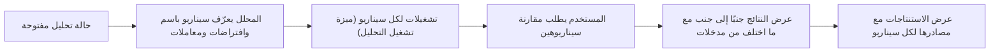

# السيناريوهات ومقارنة النتائج

<!-- BEGIN GENERATED: doc -->
| البند | القيمة |
|---|---|
| المعرّف | FEAT-ANL-SCENARIOS |
| الإصدار | 0.2 |
| الحالة | مسودة |
| القدرة | CAP-04 التحليل والتقييم |
| القدرة الفرعية | CAP-04.01 حالات التحليل (R1) |
| الأدوار | المحلل؛ أي مستخدم مخوَّل |
| الشاشات | SCR-32 سيناريوهات الحالة التحليلية ومقارنتها |
| حالات الاستخدام | UC-016 |
| القصص | 4: 2 من المواصفة، و2 جديدة |
<!-- END GENERATED: doc -->

## 1. نظرة عامة

### 1.1 القيمة

يقارن المحلل نتائج سيناريوهات مختلفة جنبًا إلى جنب ويرى الاستنتاجات مع مصادرها.

### 1.2 النطاق

| البند | القيمة |
|---|---|
| المستخدمون | المحلل (يعرّف السيناريوهات ويقارنها)؛ أي مستخدم مخوَّل (يقرأ المقارنة والاستنتاجات) |
| الشاشات | SCR-32 سيناريوهات الحالة التحليلية ومقارنتها |
| حالات الاستخدام | مقارنة السيناريوهات: تعريف سيناريو بديل داخل حالة تحليل بافتراضات أو معاملات مختلفة، ومقارنة نتائج تشغيلاته بنتائج سيناريو آخر جنبًا إلى جنب |
| المتطلبات | السماح بمقارنة سيناريوهات بديلة داخل حالة التحليل نفسها |
| خارج النطاق | إنشاء حالة التحليل وتعريف سؤالها ونطاقها وفرضياتها (ميزة أخرى)؛ تقديم تشغيلات التحليل نفسها (ميزة «تشغيل التحليل وإعادة إنتاجه») |

### 1.3 خريطة الميزة

**الشكل 1: من تعريف السيناريو إلى مقارنته**



## 2. القواعد المشتركة

تنطبق على كل قصص الميزة، فلا تتكرر داخل القصص. وكل قصة تذكر ما يخصها فقط.

### 2.1 السياق المشترك

كل قصة تبدأ من ثلاثة شروط: مستأجر نشط، وحزمة السياسات الأساسية مفعّلة، ومستخدم مسجّل الدخول ومخوَّل. وتشير إليها القصص بخطوة واحدة: «بفرض السياق المشترك للميزة».

### 2.2 الصلاحية وعدم الإفصاح

- من لا يحق له رؤية العنصر يتلقى ردًا بشكل «غير متاح» تمامًا، فلا يعرف أنه موجود.
- من يرى العنصر ولا يحق له الإجراء يتلقى «لا تملك صلاحية هذا الإجراء».

### 2.3 أوامر تغيير الحالة

- **منع التكرار:** يُرسل كل أمر بمفتاح فريد، فإعادة الطلب نفسه لا تُنفَّذ مرتين.
- **حماية التعديل المتزامن:** يُرسل كل أمر بإصدار البيانات الذي يراه المستخدم. فإن عدّلها غيره في الأثناء، يُرفض الأمر.
- **السجل:** إن نجح الأمر، يُكتب حدثه وسجل التدقيق في المعاملة نفسها.

### 2.4 الرفض المشترك

```gherkin
# language: ar
خاصية: الرفض المشترك لأوامر الميزة

  سيناريو مخطط: رفض مشترك لكل أمر في الميزة
    بفرض السياق المشترك للميزة
    و <الحالة>
    عندما يُرسل المستخدم أي أمر من أوامر الميزة
    اذاً يُرفض برمز <الرمز> ويرى "<الرسالة>"
    و لا يتغير شيء

    امثلة:
      | الحالة                                  | الرمز                  | الرسالة                                                 |
      | العنصر خارج صلاحياته                    | NOT_FOUND              | غير متاح                                                |
      | العنصر مرئي له ولا يحق له الإجراء       | AUTHZ_DENIED           | لا تملك صلاحية هذا الإجراء                              |
      | غيره عدّل العنصر بعد أن فتحه            | VERSION_CONFLICT       | تغيّرت البيانات منذ فتحتها. راجع التغييرات ثم أعد المحاولة |
      | أعاد مفتاح منع التكرار بمحتوى مختلف     | IDEMPOTENCY_KEY_REUSED | طلب مكرر بمحتوى مختلف                                   |
      | البيانات ناقصة أو غير صحيحة             | VALIDATION_FAILED      | بعض البيانات ناقصة أو غير صحيحة. راجع الحقول المعلَّمة      |

  سيناريو: إعادة الطلب نفسه لا تُنفَّذ مرتين
    بفرض السياق المشترك للميزة
    و أمر نجح بمفتاح منع تكرار
    عندما يُعاد الطلب نفسه بالمفتاح نفسه
    اذاً تُعاد النتيجة الأولى ولا يُكتب حدث ثانٍ
```

## 3. الجودة وتعريف الاكتمال

### 3.1 متطلبات الجودة

<!-- BEGIN GENERATED: quality -->
لا متطلبات جودة مرتبطة بمتطلبات هذه الميزة مباشرة. تنطبق متطلبات المنصة العامة (`FEAT-PLT-*`).
<!-- END GENERATED: quality -->

### 3.2 تعريف الاكتمال

القصة مكتملة حين تتحقق الشروط الخمسة:

1. سيناريوهاتها والقواعد المشتركة تمر في الاختبار الآلي.
2. فحوص البنية المعمارية تمر.
3. نصوص الواجهة والرسائل موجودة بالعربية والإنجليزية.
4. مراجعة الكود مكتملة.
5. ما تضيفه القصة نفسها في قسم «القواعد» تحقق.

## 4. فهرس القصص

<!-- BEGIN GENERATED: story-index -->
| المعرّف | القصة | النوع | الحالة |
|---|---|---|---|
| `US-BC03-ACS-DEFINE-SCENARIO` | تعريف سيناريو ضمن حالة التحليل | أمر | مسودة |
| `US-BC03-Q-SCN-COMPARE` | مقارنة نتائج السيناريوهات جنبًا إلى جنب | جلب | مسودة |
| `US-UI-SCR32-COMPARE` | مقارنة سيناريوهين جنبًا إلى جنب | واجهة | مسودة |
| `US-UI-SCR32-FINDINGS-SOURCES` | عرض الاستنتاجات مع مصادرها في السيناريو | واجهة | مسودة |
<!-- END GENERATED: story-index -->

## 5. القصص

### 5.1 US-BC03-ACS-DEFINE-SCENARIO — تعريف سيناريو ضمن حالة التحليل

| النوع | الإصدار | الأولوية | دون اتصال | الحالة |
|---|---|---|---|---|
| أمر | R1 | Must | لا | مسودة |

> **كـ** المحلل، **أريد** أن أعرّف سيناريو باسم وافتراضات ومعاملات مختلفة ضمن حالة تحليل، **حتى** أشغّل عليه تشغيلات وأقارن نتائجه بسيناريو آخر.

**باختصار:** يضيف المحلل سيناريو إلى حالة تحليل «مفتوحة» باسم ومجموعة افتراضات وتجاوزات معاملات، فلا تتغير حالة حالة التحليل، ويصير السيناريو متاحًا لتقديم تشغيلات عليه.

#### القواعد

- **متى يُسمح:** حالة التحليل «مفتوحة».
- **من يُسمح له:** مالك حالة التحليل؛ ويعيد التصنيف مسؤول الأمن.
- **البيانات:** الاسم ومجموعة الافتراضات (إلزاميان)؛ تجاوزات المعاملات (اختيارية).
- **الأثر:** حدث «عُرِّف السيناريو» يصل إلى فهرس البحث.

#### معايير القبول

```gherkin
# language: ar
خاصية: تعريف سيناريو ضمن حالة التحليل

  سيناريو: المحلل يعرّف سيناريو جديدًا
    بفرض السياق المشترك للميزة
    و حالة تحليل "مفتوحة" يملكها المحلل
    عندما يعرّف سيناريو باسم ومجموعة افتراضات
    اذاً يُضاف السيناريو دون تغيّر حالة حالة التحليل
    و يُسجَّل حدث "عُرِّف السيناريو"

  سيناريو مخطط: رفض خاص بتعريف السيناريو
    بفرض السياق المشترك للميزة
    و <الحالة>
    عندما يحاول تعريف السيناريو
    اذاً يُرفض برمز <الرمز> ويرى "<الرسالة>"
    و لا يتغير شيء

    امثلة:
      | الحالة                                  | الرمز        | الرسالة                           |
      | حالة التحليل ليست "مفتوحة"             | ANALYSIS_CASE_INVALID_STATE_TRANSITION | الوضع الحالي لحالة التحليل لا يسمح بهذا الإجراء |
      | مجموعة الافتراضات أو تجاوزات المعاملات غير صحيحة | CASE_INVALID | بيانات حالة التحليل أو عناصرها غير مكتملة أو غير صحيحة |
      | الاسم غير مذكور                         | VALIDATION_FAILED | الاسم مطلوب                     |
```

<details><summary>المراجع التقنية والتتبع</summary>

<!-- BEGIN GENERATED: refs US-BC03-ACS-DEFINE-SCENARIO -->
| البند | المعرّف | المعنى |
|---|---|---|
| الواجهة البرمجية | `POST /api/v1/intelligence/analysis-cases/{id}/actions/define-scenario` | — |
| الأمر | `CMD-ACS-DEFINE-SCENARIO` | تعريف سيناريو ضمن حالة التحليل |
| السياسة | `POL-ACS-DEFINE-SCENARIO` | Analyst (owner) · Security Officer (reclassify)؛ tenant match; case visible; label rules |
| الحدث | `EVT-ACS-SCENARIO-DEFINED` | يصل إلى: Search projection (SLC-05) |
| الكيان | `AGG-ANALYSIS-CASE` | حالة التحليل |
| الجدول | `intelligence.analysis_cases` | الجدول الرئيسي لحالة التحليل |
| وحدة النشر | DU-06 | — |
| المتطلبات | REQ-ANL-001، REQ-ANL-007 | معانيها في القسم 6. التتبع |
| حالة الاستخدام | UC-016 | Compare Scenarios |
| الاختبار | TST-ANALYSIS-CASE-SM، TST-SLC07-INVARIANTS | دورة حالات حالة التحليل، وثوابت الشريحة SLC-07 |
<!-- END GENERATED: refs US-BC03-ACS-DEFINE-SCENARIO -->

</details>

### 5.2 US-BC03-Q-SCN-COMPARE — مقارنة نتائج السيناريوهات جنبًا إلى جنب

| النوع | الإصدار | الأولوية | دون اتصال | الحالة |
|---|---|---|---|---|
| جلب | R1 | Should | لا | مسودة |

> **كـ** أي مستخدم مخوَّل، **أريد** نتائج تشغيلات كل سيناريو في حالة تحليل جنبًا إلى جنب مع ما اختلف من مدخلات، **حتى** أفهم أثر كل افتراض على النتيجة (REQ-ANL-007).

**باختصار:** يعيد الاستعلام نتائج تشغيلات كل سيناريو في الحالة التحليلية مرتبة جنبًا إلى جنب، مع ما اختلف من المدخلات بينها.

#### القواعد

- **من يرى ماذا:** مَن يحق له رؤية تصنيف حالة التحليل.

#### معايير القبول

```gherkin
# language: ar
خاصية: مقارنة نتائج السيناريوهات

  سيناريو: مستخدم مخوَّل يقارن سيناريوهين
    بفرض السياق المشترك للميزة
    و حالة تحليل يحق للمستخدم رؤيتها، فيها سيناريوهان بافتراضات مختلفة ولكل منهما تشغيل مكتمل بنجاح
    عندما يطلب مقارنة نتائج سيناريوهاتها
    اذاً تُعاد نتائج كل سيناريو جنبًا إلى جنب مع قائمة ما اختلف من المدخلات

  سيناريو: حالة التحليل غير متاحة لمن لا يرى تصنيفها
    بفرض السياق المشترك للميزة
    و حالة تحليل تصنيفها أعلى من تصريح المستخدم
    عندما يطلب مقارنة نتائج سيناريوهاتها
    اذاً يُرد بردٍّ بشكل العنصر غير الموجود
```

<details><summary>المراجع التقنية والتتبع</summary>

<!-- BEGIN GENERATED: refs US-BC03-Q-SCN-COMPARE -->
| البند | المعرّف | المعنى |
|---|---|---|
| الواجهة البرمجية | `GET /api/v1/intelligence/analysis-cases/{case_id}/scenario-comparison` | — |
| الاستعلام | `QRY-SCN-COMPARE` | Side-by-side results of runs per scenario with differing inputs |
| السياسة | `POL-SCN-COMPARE` | case label rule |
| الكيان | `AGG-ANALYSIS-CASE` | حالة التحليل |
| الجدول | `intelligence.analysis_cases` | الجدول الرئيسي لحالة التحليل |
| وحدة النشر | DU-06 | — |
| المتطلب | REQ-ANL-007 | The system shall allow comparison of alternative scenarios within an analysis case. |
| حالة الاستخدام | UC-016 | Compare Scenarios |
| الاختبار | TST-ANALYSIS-CASE-SM، TST-SLC07-INVARIANTS | دورة حالات حالة التحليل، وثوابت الشريحة SLC-07 |
<!-- END GENERATED: refs US-BC03-Q-SCN-COMPARE -->

</details>

### 5.3 US-UI-SCR32-COMPARE — مقارنة سيناريوهين جنبًا إلى جنب

| النوع | الإصدار | الأولوية | دون اتصال | الحالة |
|---|---|---|---|---|
| واجهة | R1 | Should | لا | مسودة |

> **كـ** المحلل، **أريد** أن أختار سيناريوهين وأرى نتائجهما في عمودين متجاورين مع تمييز ما اختلف، **حتى** أقرأ أثر كل افتراض بسرعة دون إعادة حساب يدوي.

**باختصار:** تعرض شاشة سيناريوهات الحالة التحليلية ومقارنتها (SCR-32) نتائج سيناريوهين يختارهما المحلل في عمودين، مع تمييز الحقول التي اختلفت.

#### القواعد

- **البيانات:** السيناريوهان المختاران، ونتائجهما، وقائمة الحقول المختلفة.

#### معايير القبول

```gherkin
# language: ar
خاصية: مقارنة سيناريوهين

  سيناريو: المحلل يختار سيناريوهين للمقارنة
    بفرض السياق المشترك للميزة
    و حالة تحليل فيها سيناريوهان لكل منهما تشغيل مكتمل بنجاح
    عندما يختار المحلل السيناريوهين لمقارنتهما
    اذاً تُعرض نتائجهما في عمودين متجاورين مع تمييز ما اختلف
```

<details><summary>المراجع التقنية والتتبع</summary>

<!-- BEGIN GENERATED: refs US-UI-SCR32-COMPARE -->
| البند | المعرّف | المعنى |
|---|---|---|
| الشاشة | SCR-32 | شاشة سيناريوهات الحالة التحليلية ومقارنتها |
| المتطلب | REQ-ANL-007 | The system shall allow comparison of alternative scenarios within an analysis case. |
| حالة الاستخدام | UC-016 | Compare Scenarios |
<!-- END GENERATED: refs US-UI-SCR32-COMPARE -->

</details>

### 5.4 US-UI-SCR32-FINDINGS-SOURCES — عرض الاستنتاجات مع مصادرها في السيناريو

| النوع | الإصدار | الأولوية | دون اتصال | الحالة |
|---|---|---|---|---|
| واجهة | R1 | Should | لا | مسودة |

> **كـ** المحلل، **أريد** أن أرى استنتاجات كل سيناريو إلى جانب مصادرها من التشغيلات أو الأدلة، **حتى** أحكم على السيناريو بالاستناد إلى أساسه لا إلى نتيجته وحدها.

**باختصار:** تعرض شاشة سيناريوهات الحالة التحليلية ومقارنتها (SCR-32) النتيجة التحليلية لكل سيناريو مع مصادرها، وتحجب المصادر التي لا يحق للمحلل رؤية تصنيفها. **[Derived]**: عرض الاستنتاجات داخل شاشة المقارنة لا يذكره مصدر صريح، واستُنتج من قائمة استعلامات SCR-32 (`21-ui-design.md` §4.4) وسلسلة العمل في `analysis-reproducibility-spec.md` §1 (نتيجة تحليلية ← مصادرها).

#### القواعد

- **البيانات:** نص الاستنتاج، ومصادره من تشغيلات أو أدلة يحق للمحلل رؤيتها.

#### معايير القبول

```gherkin
# language: ar
خاصية: عرض الاستنتاجات مع مصادرها

  سيناريو: المحلل يرى استنتاج السيناريو ومصادره المرئية له
    بفرض السياق المشترك للميزة
    و سيناريو له استنتاج مصادره تشغيلات يحق للمحلل رؤيتها
    عندما يفتح المحلل تفاصيل السيناريو
    اذاً يرى نص الاستنتاج مع مصادره

  سيناريو: مصدر محجوب لا يظهر لمن لا يرى تصنيفه
    بفرض السياق المشترك للميزة
    و سيناريو له استنتاج أحد مصادره تصنيفه أعلى من تصريح المحلل
    عندما يفتح المحلل تفاصيل السيناريو
    اذاً يرى الاستنتاج دون ذلك المصدر المحجوب
```

<details><summary>المراجع التقنية والتتبع</summary>

<!-- BEGIN GENERATED: refs US-UI-SCR32-FINDINGS-SOURCES -->
| البند | المعرّف | المعنى |
|---|---|---|
| الشاشة | SCR-32 | شاشة سيناريوهات الحالة التحليلية ومقارنتها |
| المصدر | `QRY-FND-LIST` | — |
| المصدر | `21-ui-design.md §12` | — |
| المصدر | `[Derived]` | — |
<!-- END GENERATED: refs US-UI-SCR32-FINDINGS-SOURCES -->

</details>

## 6. التتبع

<!-- BEGIN GENERATED: trace -->
| المتطلب | المعنى | القصص | الاختبار |
|---|---|---|---|
| REQ-ANL-001 | The system shall record for each analysis case its question, spatial and temporal scope, hypotheses, assumpti… | `US-BC03-ACS-DEFINE-SCENARIO` | TST-ANALYSIS-CASE-SM، TST-SLC07-INVARIANTS |
| REQ-ANL-007 | The system shall allow comparison of alternative scenarios within an analysis case. | `US-BC03-ACS-DEFINE-SCENARIO`، `US-BC03-Q-SCN-COMPARE`، `US-UI-SCR32-COMPARE` | TST-ANALYSIS-CASE-SM، TST-SLC07-INVARIANTS |
<!-- END GENERATED: trace -->

## 7. سجل التغييرات

| الإصدار | التاريخ | التغيير |
|---|---|---|
| 0.1 | — | هيكل مولَّد من خريطة الميزات |
| 0.2 | 2026-10-03 | كتابة القصص كاملة بمعيار القصص |
