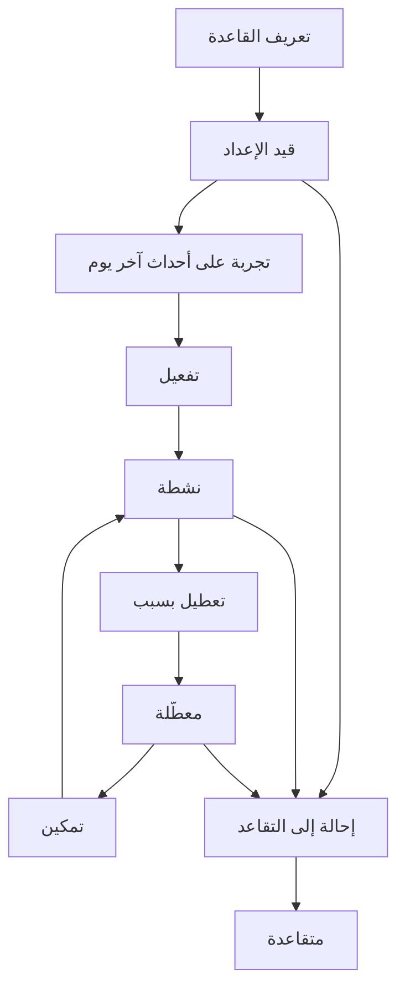
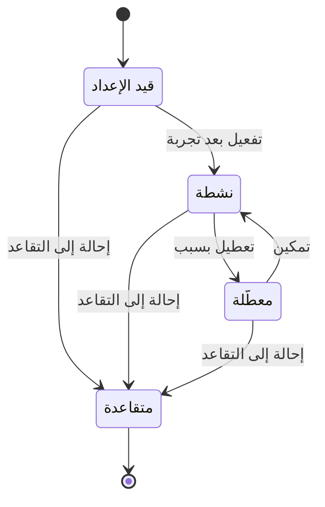

# قواعد التنبيه

<!-- BEGIN GENERATED: doc -->
| البند | القيمة |
|---|---|
| المعرّف | FEAT-SIT-ALERT-RULES |
| الإصدار | 0.1 |
| الحالة | مسودة |
| القدرة | CAP-05 الوعي بالموقف |
| القدرة الفرعية | CAP-05.02 المراقبة والتنبيه (R1) |
| الأدوار | قائد المحللين؛ المدير |
| الشاشات | SCR-12 إدارة الموقف وقواعد التنبيه |
| حالات الاستخدام | UC-023 |
| القصص | 9: 6 من المواصفة، و3 جديدة |
<!-- END GENERATED: doc -->

## 1. نظرة عامة

### 1.1 القيمة

يحدد قائد المحللين أو المدير متى يجب إطلاق تنبيه ولمن ويفعّل القاعدة أو يعطّلها.

### 1.2 النطاق

| البند | القيمة |
|---|---|
| المستخدمون | قائد المحللين، المدير |
| الشاشات | SCR-12 إدارة الموقف وقواعد التنبيه |
| حالات الاستخدام | تعريف قاعدة تنبيه، وتجربتها على أحداث آخر يوم، وتفعيلها، وتعديلها، وتعطيلها، وتمكينها، وإحالتها إلى التقاعد |
| المتطلبات | إطلاق تنبيه وتبليغ المشتركين المخوَّلين حين يتحقق شرط القاعدة (REQ-SIT-004) |
| خارج النطاق | إطلاق التنبيه نفسه ومتابعته وإقراره وحلّه (ميزة «تنبيهاتي»)، ومتابعة حجم التنبيهات بعد التفعيل في لوحات الرصد |

### 1.3 خريطة الميزة

**الشكل 1: مسار قاعدة التنبيه من التعريف إلى التقاعد**



**الشكل 2: حالات قاعدة التنبيه**



## 2. القواعد المشتركة

تنطبق على كل قصص الميزة، فلا تتكرر داخل القصص. وكل قصة تذكر ما يخصها فقط.

### 2.1 السياق المشترك

كل قصة تبدأ من ثلاثة شروط: مستأجر نشط، وحزمة السياسات الأساسية مفعّلة، ومستخدم مسجّل الدخول ومخوَّل. وتشير إليها القصص بخطوة واحدة: «بفرض السياق المشترك للميزة».

### 2.2 الصلاحية وعدم الإفصاح

- من لا يحق له رؤية العنصر يتلقى ردًا بشكل «غير متاح» تمامًا، فلا يعرف أنه موجود.
- من يرى العنصر ولا يحق له الإجراء يتلقى «لا تملك صلاحية هذا الإجراء».

### 2.3 أوامر تغيير الحالة

- **منع التكرار:** يُرسل كل أمر بمفتاح فريد، فإعادة الطلب نفسه لا تُنفَّذ مرتين.
- **حماية التعديل المتزامن:** يُرسل كل أمر بإصدار البيانات الذي يراه المستخدم. فإن عدّلها غيره في الأثناء، يُرفض الأمر.
- **السجل:** إن نجح الأمر، يُكتب حدثه وسجل التدقيق في المعاملة نفسها.

### 2.4 الرفض المشترك

```gherkin
# language: ar
خاصية: الرفض المشترك لأوامر الميزة

  سيناريو مخطط: رفض مشترك لكل أمر في الميزة
    بفرض السياق المشترك للميزة
    و <الحالة>
    عندما يُرسل المستخدم أي أمر من أوامر الميزة
    اذاً يُرفض برمز <الرمز> ويرى "<الرسالة>"
    و لا يتغير شيء

    امثلة:
      | الحالة                                  | الرمز                  | الرسالة                                                 |
      | العنصر خارج صلاحياته                    | NOT_FOUND              | غير متاح                                                |
      | العنصر مرئي له ولا يحق له الإجراء       | AUTHZ_DENIED           | لا تملك صلاحية هذا الإجراء                              |
      | غيره عدّل العنصر بعد أن فتحه            | VERSION_CONFLICT       | تغيّرت البيانات منذ فتحتها. راجع التغييرات ثم أعد المحاولة |
      | أعاد مفتاح منع التكرار بمحتوى مختلف     | IDEMPOTENCY_KEY_REUSED | طلب مكرر بمحتوى مختلف                                   |
      | البيانات ناقصة أو غير صحيحة             | VALIDATION_FAILED      | بعض البيانات ناقصة أو غير صحيحة. راجع الحقول المعلَّمة      |

  سيناريو: إعادة الطلب نفسه لا تُنفَّذ مرتين
    بفرض السياق المشترك للميزة
    و أمر نجح بمفتاح منع تكرار
    عندما يُعاد الطلب نفسه بالمفتاح نفسه
    اذاً تُعاد النتيجة الأولى ولا يُكتب حدث ثانٍ
```

## 3. الجودة وتعريف الاكتمال

### 3.1 متطلبات الجودة

<!-- BEGIN GENERATED: quality -->
| المرجع | الموقف | المطلوب |
|---|---|---|
| QAS-PERF-005 | reports a value that meets a critical alert rule | end-to-end p95 ≤ 5 s |
<!-- END GENERATED: quality -->

### 3.2 تعريف الاكتمال

القصة مكتملة حين تتحقق الشروط الخمسة:

1. سيناريوهاتها والقواعد المشتركة تمر في الاختبار الآلي.
2. فحوص البنية المعمارية تمر.
3. نصوص الواجهة والرسائل موجودة بالعربية والإنجليزية.
4. مراجعة الكود مكتملة.
5. ما تضيفه القصة نفسها في قسم «القواعد» تحقق.

## 4. فهرس القصص

<!-- BEGIN GENERATED: story-index -->
| المعرّف | القصة | النوع | الحالة |
|---|---|---|---|
| `US-BC03-ARL-ACTIVATE` | تفعيل قاعدة التنبيه | أمر | مسودة |
| `US-BC03-ARL-DEFINE` | تعريف قاعدة التنبيه | أمر | مسودة |
| `US-BC03-ARL-DISABLE` | تعطيل قاعدة التنبيه | أمر | مسودة |
| `US-BC03-ARL-EDIT` | تعديل قاعدة التنبيه | أمر | مسودة |
| `US-BC03-ARL-ENABLE` | تمكين قاعدة التنبيه | أمر | مسودة |
| `US-BC03-ARL-RETIRE` | إحالة قاعدة التنبيه إلى التقاعد | أمر | مسودة |
| `US-DOM-ARL-DRY-RUN` | تجربة قاعدة التنبيه على أحداث آخر يوم | جلب | مسودة |
| `US-UI-SCR12-ALERT-RULE-EDITOR` | تعريف شرط التنبيه ومعاينة حجمه قبل التفعيل | واجهة | مسودة |
| `US-OPS-ALERT-STORM-LIMIT` | حد معدل لكل قاعدة يمنع سيل التنبيهات | تشغيل | مسودة |
<!-- END GENERATED: story-index -->

## 5. القصص

### 5.1 US-BC03-ARL-ACTIVATE — تفعيل قاعدة التنبيه

| النوع | الإصدار | الأولوية | دون اتصال | الحالة |
|---|---|---|---|---|
| أمر | R1 | Must | لا | مسودة |

> **كـ** قائد المحللين أو المدير، **أريد** تفعيل قاعدة تنبيه بعد تجربتها، **حتى** تبدأ بإطلاق تنبيهات حقيقية دون مفاجأة في حجمها.

**باختصار:** بعد تجربة القاعدة على أحداث آخر يوم ومراجعة نتيجتها، يفعّلها قائد المحللين أو المدير فتصير نشطة وتبدأ تقييم الأحداث.

#### القواعد

- **متى يُسمح:** القاعدة «قيد الإعداد»، وتمت تجربتها على أحداث آخر يوم وراجع صاحب الصلاحية حجم التنبيهات المتوقع (القصة 5.7).
- **من يُسمح له:** قائد المحللين أو المدير.
- **الأثر:** تصبح القاعدة «نشطة» وتبدأ تقييم الأحداث الجديدة؛ يصل حدث التفعيل إلى مقيّم التنبيهات لإعادة تحميل القواعد.

#### معايير القبول

```gherkin
# language: ar
خاصية: تفعيل قاعدة التنبيه

  سيناريو: تفعيل قاعدة جُربت وروجعت
    بفرض السياق المشترك للميزة
    و قاعدة تنبيه «قيد الإعداد» جُربت على أحداث آخر يوم وروجعت نتيجتها
    عندما يفعّلها قائد المحللين
    اذاً تصبح حالتها «نشطة»
    و يُسجَّل حدث «فُعِّلت قاعدة التنبيه»

  سيناريو مخطط: رفض خاص بتفعيل قاعدة التنبيه
    بفرض السياق المشترك للميزة
    و <الحالة>
    عندما يحاول تفعيل القاعدة
    اذاً يُرفض برمز <الرمز> ويرى <الرسالة>
    و لا يتغير شيء

    امثلة:
      | الحالة                                           | الرمز                                | الرسالة                                           |
      | القاعدة ليست «قيد الإعداد»                       | ALERT_RULE_INVALID_STATE_TRANSITION  | الوضع الحالي لقاعدة التنبيه لا يسمح بهذا الإجراء   |
      | لم تُجرَّب القاعدة على أحداث آخر يوم أو لم تُراجع | DRY_RUN_REQUIRED                     | جرِّب القاعدة على بيانات آخر 24 ساعة قبل تفعيلها   |
```

<details><summary>المراجع التقنية والتتبع</summary>

<!-- BEGIN GENERATED: refs US-BC03-ARL-ACTIVATE -->
| البند | المعرّف | المعنى |
|---|---|---|
| الواجهة البرمجية | `POST /api/v1/intelligence/alert-rules/{id}/actions/activate` | — |
| الأمر | `CMD-ARL-ACTIVATE` | تفعيل قاعدة التنبيه |
| السياسة | `POL-ARL-ACTIVATE` | Analyst lead / Manager؛ tenant match; target visible to subject |
| الحدث | `EVT-ARL-ACTIVATED` | يصل إلى: Alert evaluator (reload rules) |
| الكيان | `AGG-ALERT-RULE` | قاعدة التنبيه |
| الجدول | `intelligence.alert_rules` | الجدول الرئيسي لقاعدة التنبيه |
| وحدة النشر | DU-06 | — |
| المتطلب | REQ-SIT-004 | When an alert rule condition is met, the system shall raise an alert and notify subscribed authorized users. |
| حالة الاستخدام | UC-023 | Manage Alert |
| الاختبار | TST-ALERT-RULE-SM، TST-SLC06-INVARIANTS | دورة حالات قاعدة التنبيه، وثوابت الشريحة SLC-06 |
<!-- END GENERATED: refs US-BC03-ARL-ACTIVATE -->

</details>

### 5.2 US-BC03-ARL-DEFINE — تعريف قاعدة التنبيه

| النوع | الإصدار | الأولوية | دون اتصال | الحالة |
|---|---|---|---|---|
| أمر | R1 | Must | لا | مسودة |

> **كـ** قائد المحللين أو المدير، **أريد** تعريف قاعدة تنبيه جديدة على موقف أو على نطاق المستأجر كله، **حتى** يصل تنبيه تلقائي حين يتحقق شرطها.

**باختصار:** يحدد قائد المحللين أو المدير نوع شرط القاعدة ومعاييره ونطاقه وخطورته ونافذة منع تكرار التنبيه، فتُنشأ القاعدة «قيد الإعداد» بانتظار التجربة والتفعيل.

#### القواعد

- **متى يُسمح:** لا شروط مسبقة؛ هذا أمر إنشاء قاعدة جديدة.
- **من يُسمح له:** قائد المحللين أو المدير.
- **البيانات:** الموقف الذي تنطبق عليه القاعدة (أو نطاق المستأجر كله)، ونوع الشرط من الأنواع المعتمدة، ومعاييره، والخطورة (معلومة، تحذير، حرجة)، ونافذة منع التكرار، والتصعيد (اختياري)، والحل التلقائي (نعم أو لا)، وتصنيف القاعدة.
- **الأثر:** تُنشأ القاعدة بحالة «قيد الإعداد»؛ يصل حدث التعريف إلى مقيّم التنبيهات لإعادة تحميل القواعد.

#### معايير القبول

```gherkin
# language: ar
خاصية: تعريف قاعدة التنبيه

  سيناريو: تعريف قاعدة بشرط صحيح
    بفرض السياق المشترك للميزة
    و موقف نشط أو قرار بقاعدة على نطاق المستأجر كله
    عندما يعرّف قائد المحللين قاعدة بنوع شرط معتمد ومعاييره كاملة
    اذاً تُنشأ القاعدة بحالة «قيد الإعداد»
    و يُسجَّل حدث «عُرِّفت قاعدة التنبيه»

  سيناريو مخطط: رفض خاص بتعريف قاعدة التنبيه
    بفرض السياق المشترك للميزة
    و <الحالة>
    عندما يحاول تعريف القاعدة
    اذاً يُرفض برمز <الرمز> ويرى <الرسالة>
    و لا يتغير شيء

    امثلة:
      | الحالة                                | الرمز              | الرسالة                        |
      | نوع شرط القاعدة ليس من الأنواع المعتمدة | ALERT_RULE_INVALID | إعداد قاعدة التنبيه غير صحيح    |
      | الخطورة غير محددة                     | VALIDATION_FAILED  | الخطورة مطلوبة                 |
```

<details><summary>المراجع التقنية والتتبع</summary>

<!-- BEGIN GENERATED: refs US-BC03-ARL-DEFINE -->
| البند | المعرّف | المعنى |
|---|---|---|
| الواجهة البرمجية | `POST /api/v1/intelligence/alert-rules` | — |
| الأمر | `CMD-ARL-DEFINE` | تعريف قاعدة التنبيه |
| السياسة | `POL-ARL-DEFINE` | Analyst lead / Manager؛ tenant match; target visible to subject |
| الحدث | `EVT-ARL-DEFINED` | يصل إلى: Alert evaluator (reload rules) |
| الكيان | `AGG-ALERT-RULE` | قاعدة التنبيه |
| الجدول | `intelligence.alert_rules` | الجدول الرئيسي لقاعدة التنبيه |
| وحدة النشر | DU-06 | — |
| المتطلب | REQ-SIT-004 | When an alert rule condition is met, the system shall raise an alert and notify subscribed authorized users. |
| حالة الاستخدام | UC-023 | Manage Alert |
| الاختبار | TST-ALERT-RULE-SM، TST-SLC06-INVARIANTS | دورة حالات قاعدة التنبيه، وثوابت الشريحة SLC-06 |
<!-- END GENERATED: refs US-BC03-ARL-DEFINE -->

</details>

### 5.3 US-BC03-ARL-DISABLE — تعطيل قاعدة التنبيه

| النوع | الإصدار | الأولوية | دون اتصال | الحالة |
|---|---|---|---|---|
| أمر | R1 | Must | لا | مسودة |

> **كـ** قائد المحللين أو المدير، **أريد** تعطيل قاعدة تنبيه نشطة بسبب، **حتى** تتوقف عن إطلاق تنبيهات جديدة دون أن أحذفها.

**باختصار:** يعطّل قائد المحللين أو المدير قاعدة «نشطة» بذكر السبب، فتصير «معطّلة» ولا تُقيَّم الأحداث الجديدة بعدها.

#### القواعد

- **متى يُسمح:** القاعدة «نشطة»، والسبب مذكور.
- **من يُسمح له:** قائد المحللين أو المدير.
- **البيانات:** السبب (إلزامي).
- **الأثر:** تصبح القاعدة «معطّلة»؛ تتوقف عن تقييم الأحداث الجديدة؛ يصل حدث التعطيل إلى مقيّم التنبيهات لإعادة تحميل القواعد.

#### معايير القبول

```gherkin
# language: ar
خاصية: تعطيل قاعدة التنبيه

  سيناريو: تعطيل قاعدة نشطة بسبب
    بفرض السياق المشترك للميزة
    و قاعدة تنبيه «نشطة»
    عندما يعطّلها قائد المحللين بسبب
    اذاً تصبح حالتها «معطّلة»
    و يُسجَّل حدث «عُطِّلت قاعدة التنبيه»

  سيناريو مخطط: رفض خاص بتعطيل قاعدة التنبيه
    بفرض السياق المشترك للميزة
    و <الحالة>
    عندما يحاول تعطيل القاعدة
    اذاً يُرفض برمز <الرمز> ويرى <الرسالة>
    و لا يتغير شيء

    امثلة:
      | الحالة                  | الرمز                               | الرسالة                                           |
      | القاعدة ليست «نشطة»     | ALERT_RULE_INVALID_STATE_TRANSITION | الوضع الحالي لقاعدة التنبيه لا يسمح بهذا الإجراء  |
      | السبب غير مذكور         | REASON_REQUIRED                     | اذكر السبب                                        |
```

<details><summary>المراجع التقنية والتتبع</summary>

<!-- BEGIN GENERATED: refs US-BC03-ARL-DISABLE -->
| البند | المعرّف | المعنى |
|---|---|---|
| الواجهة البرمجية | `POST /api/v1/intelligence/alert-rules/{id}/actions/disable` | — |
| الأمر | `CMD-ARL-DISABLE` | تعطيل قاعدة التنبيه |
| السياسة | `POL-ARL-DISABLE` | Analyst lead / Manager؛ tenant match; target visible to subject |
| الحدث | `EVT-ARL-DISABLED` | يصل إلى: Alert evaluator (reload rules) |
| الكيان | `AGG-ALERT-RULE` | قاعدة التنبيه |
| الجدول | `intelligence.alert_rules` | الجدول الرئيسي لقاعدة التنبيه |
| وحدة النشر | DU-06 | — |
| المتطلب | REQ-SIT-004 | When an alert rule condition is met, the system shall raise an alert and notify subscribed authorized users. |
| حالة الاستخدام | UC-023 | Manage Alert |
| الاختبار | TST-ALERT-RULE-SM، TST-SLC06-INVARIANTS | دورة حالات قاعدة التنبيه، وثوابت الشريحة SLC-06 |
<!-- END GENERATED: refs US-BC03-ARL-DISABLE -->

</details>

### 5.4 US-BC03-ARL-EDIT — تعديل قاعدة التنبيه

| النوع | الإصدار | الأولوية | دون اتصال | الحالة |
|---|---|---|---|---|
| أمر | R1 | Must | لا | مسودة |

> **كـ** قائد المحللين أو المدير، **أريد** تعديل معايير قاعدة تنبيه غير نشطة، **حتى** أصحح شرطها أو خطورتها قبل أن تعمل من جديد.

**باختصار:** تُعدَّل القاعدة «قيد الإعداد» أو «معطّلة» بمعايير جديدة، فيزداد إصدارها دون أن تتغير حالتها. القاعدة «نشطة» لا تُعدَّل مباشرة بل تُعطَّل أولًا (القصة 5.3)، فلا يتغير شرط التنبيه بصمت.

#### القواعد

- **متى يُسمح:** القاعدة «قيد الإعداد» أو «معطّلة».
- **من يُسمح له:** قائد المحللين أو المدير.
- **البيانات:** معايير الشرط (إلزامية)، والخطورة، ونافذة منع التكرار، والتصعيد.
- **الأثر:** يزداد إصدار القاعدة؛ تبقى حالتها كما هي؛ يصل حدث التعديل إلى مقيّم التنبيهات لإعادة تحميل القواعد.

#### معايير القبول

```gherkin
# language: ar
خاصية: تعديل قاعدة التنبيه

  سيناريو: تعديل قاعدة معطّلة
    بفرض السياق المشترك للميزة
    و قاعدة تنبيه «معطّلة»
    عندما يعدّل قائد المحللين معاييرها
    اذاً يزداد إصدار القاعدة وتبقى حالتها «معطّلة»
    و يُسجَّل حدث «عُدِّلت قاعدة التنبيه»

  سيناريو مخطط: رفض خاص بتعديل قاعدة التنبيه
    بفرض السياق المشترك للميزة
    و <الحالة>
    عندما يحاول تعديل القاعدة
    اذاً يُرفض برمز <الرمز> ويرى <الرسالة>
    و لا يتغير شيء

    امثلة:
      | الحالة                              | الرمز                                | الرسالة                                           |
      | المعايير الجديدة غير صحيحة          | ALERT_RULE_INVALID                   | إعداد قاعدة التنبيه غير صحيح                      |
      | القاعدة «نشطة» أو «متقاعدة»         | ALERT_RULE_INVALID_STATE_TRANSITION  | الوضع الحالي لقاعدة التنبيه لا يسمح بهذا الإجراء  |
```

<details><summary>المراجع التقنية والتتبع</summary>

<!-- BEGIN GENERATED: refs US-BC03-ARL-EDIT -->
| البند | المعرّف | المعنى |
|---|---|---|
| الواجهة البرمجية | `POST /api/v1/intelligence/alert-rules/{id}/actions/edit` | — |
| الأمر | `CMD-ARL-EDIT` | تعديل قاعدة التنبيه |
| السياسة | `POL-ARL-EDIT` | Analyst lead / Manager؛ tenant match; target visible to subject |
| الحدث | `EVT-ARL-EDITED` | يصل إلى: Alert evaluator (reload rules) |
| الكيان | `AGG-ALERT-RULE` | قاعدة التنبيه |
| الجدول | `intelligence.alert_rules` | الجدول الرئيسي لقاعدة التنبيه |
| وحدة النشر | DU-06 | — |
| المتطلب | REQ-SIT-004 | When an alert rule condition is met, the system shall raise an alert and notify subscribed authorized users. |
| حالة الاستخدام | UC-023 | Manage Alert |
| الاختبار | TST-ALERT-RULE-SM، TST-SLC06-INVARIANTS | دورة حالات قاعدة التنبيه، وثوابت الشريحة SLC-06 |
<!-- END GENERATED: refs US-BC03-ARL-EDIT -->

</details>

### 5.5 US-BC03-ARL-ENABLE — تمكين قاعدة التنبيه

| النوع | الإصدار | الأولوية | دون اتصال | الحالة |
|---|---|---|---|---|
| أمر | R1 | Must | لا | مسودة |

> **كـ** قائد المحللين أو المدير، **أريد** تمكين قاعدة معطّلة من جديد، **حتى** تعود إلى تقييم الأحداث دون إعادة تعريفها.

**باختصار:** يمكّن قائد المحللين أو المدير قاعدة «معطّلة» فتعود «نشطة» مباشرة دون تجربة جديدة، لأن شرطها لم يتغير منذ تعطيلها.

#### القواعد

- **متى يُسمح:** القاعدة «معطّلة».
- **من يُسمح له:** قائد المحللين أو المدير.
- **الأثر:** تصبح القاعدة «نشطة»؛ يصل حدث التمكين إلى مقيّم التنبيهات لإعادة تحميل القواعد.

#### معايير القبول

```gherkin
# language: ar
خاصية: تمكين قاعدة التنبيه

  سيناريو: تمكين قاعدة معطّلة
    بفرض السياق المشترك للميزة
    و قاعدة تنبيه «معطّلة»
    عندما يمكّنها قائد المحللين
    اذاً تصبح حالتها «نشطة»
    و يُسجَّل حدث «مُكِّنت قاعدة التنبيه»

  سيناريو مخطط: رفض خاص بتمكين قاعدة التنبيه
    بفرض السياق المشترك للميزة
    و <الحالة>
    عندما يحاول تمكين القاعدة
    اذاً يُرفض برمز <الرمز> ويرى <الرسالة>
    و لا يتغير شيء

    امثلة:
      | الحالة                      | الرمز                                | الرسالة                                           |
      | القاعدة ليست «معطّلة»       | ALERT_RULE_INVALID_STATE_TRANSITION  | الوضع الحالي لقاعدة التنبيه لا يسمح بهذا الإجراء  |
```

<details><summary>المراجع التقنية والتتبع</summary>

<!-- BEGIN GENERATED: refs US-BC03-ARL-ENABLE -->
| البند | المعرّف | المعنى |
|---|---|---|
| الواجهة البرمجية | `POST /api/v1/intelligence/alert-rules/{id}/actions/enable` | — |
| الأمر | `CMD-ARL-ENABLE` | تمكين قاعدة التنبيه |
| السياسة | `POL-ARL-ENABLE` | Analyst lead / Manager؛ tenant match; target visible to subject |
| الحدث | `EVT-ARL-ENABLED` | يصل إلى: Alert evaluator (reload rules) |
| الكيان | `AGG-ALERT-RULE` | قاعدة التنبيه |
| الجدول | `intelligence.alert_rules` | الجدول الرئيسي لقاعدة التنبيه |
| وحدة النشر | DU-06 | — |
| المتطلب | REQ-SIT-004 | When an alert rule condition is met, the system shall raise an alert and notify subscribed authorized users. |
| حالة الاستخدام | UC-023 | Manage Alert |
| الاختبار | TST-ALERT-RULE-SM، TST-SLC06-INVARIANTS | دورة حالات قاعدة التنبيه، وثوابت الشريحة SLC-06 |
<!-- END GENERATED: refs US-BC03-ARL-ENABLE -->

</details>

### 5.6 US-BC03-ARL-RETIRE — إحالة قاعدة التنبيه إلى التقاعد

| النوع | الإصدار | الأولوية | دون اتصال | الحالة |
|---|---|---|---|---|
| أمر | R1 | Must | لا | مسودة |

> **كـ** قائد المحللين أو المدير، **أريد** إحالة قاعدة تنبيه إلى التقاعد بسبب، **حتى** تتوقف نهائيًا ولا تُستخدم من جديد.

**باختصار:** تُحال القاعدة من أي حالة غير متقاعدة إلى «متقاعدة» بسبب، وهذه حالة نهائية لا رجوع منها.

#### القواعد

- **متى يُسمح:** القاعدة «قيد الإعداد» أو «نشطة» أو «معطّلة»، والسبب مذكور.
- **من يُسمح له:** قائد المحللين أو المدير.
- **البيانات:** السبب (إلزامي).
- **الأثر:** تصبح القاعدة «متقاعدة»، وهي حالة نهائية؛ يصل حدث الإحالة إلى التقاعد إلى مقيّم التنبيهات لإعادة تحميل القواعد.

#### معايير القبول

```gherkin
# language: ar
خاصية: إحالة قاعدة التنبيه إلى التقاعد

  سيناريو: إحالة قاعدة نشطة إلى التقاعد
    بفرض السياق المشترك للميزة
    و قاعدة تنبيه «نشطة»
    عندما يحيلها قائد المحللين إلى التقاعد بسبب
    اذاً تصبح حالتها «متقاعدة»
    و يُسجَّل حدث «أُحيلت قاعدة التنبيه إلى التقاعد»

  سيناريو مخطط: رفض خاص بإحالة قاعدة التنبيه إلى التقاعد
    بفرض السياق المشترك للميزة
    و <الحالة>
    عندما يحاول إحالة القاعدة إلى التقاعد
    اذاً يُرفض برمز <الرمز> ويرى <الرسالة>
    و لا يتغير شيء

    امثلة:
      | الحالة                   | الرمز                                | الرسالة                                           |
      | القاعدة «متقاعدة» من قبل | ALERT_RULE_INVALID_STATE_TRANSITION  | الوضع الحالي لقاعدة التنبيه لا يسمح بهذا الإجراء  |
      | السبب غير مذكور          | REASON_REQUIRED                      | اذكر السبب                                        |
```

<details><summary>المراجع التقنية والتتبع</summary>

<!-- BEGIN GENERATED: refs US-BC03-ARL-RETIRE -->
| البند | المعرّف | المعنى |
|---|---|---|
| الواجهة البرمجية | `POST /api/v1/intelligence/alert-rules/{id}/actions/retire` | — |
| الأمر | `CMD-ARL-RETIRE` | إحالة قاعدة التنبيه إلى التقاعد |
| السياسة | `POL-ARL-RETIRE` | Analyst lead / Manager؛ tenant match; target visible to subject |
| الحدث | `EVT-ARL-RETIRED` | يصل إلى: Alert evaluator (reload rules) |
| الكيان | `AGG-ALERT-RULE` | قاعدة التنبيه |
| الجدول | `intelligence.alert_rules` | الجدول الرئيسي لقاعدة التنبيه |
| وحدة النشر | DU-06 | — |
| المتطلب | REQ-SIT-004 | When an alert rule condition is met, the system shall raise an alert and notify subscribed authorized users. |
| حالة الاستخدام | UC-023 | Manage Alert |
| الاختبار | TST-ALERT-RULE-SM، TST-SLC06-INVARIANTS | دورة حالات قاعدة التنبيه، وثوابت الشريحة SLC-06 |
<!-- END GENERATED: refs US-BC03-ARL-RETIRE -->

</details>

### 5.7 US-DOM-ARL-DRY-RUN — تجربة قاعدة التنبيه على أحداث آخر يوم

| النوع | الإصدار | الأولوية | دون اتصال | الحالة |
|---|---|---|---|---|
| جلب | R1 | Must | لا | مسودة |

> **كـ** قائد المحللين أو المدير، **أريد** تجربة قاعدة التنبيه على أحداث آخر 24 ساعة قبل تفعيلها، **حتى** أعرف حجم التنبيهات المتوقع ولا أُفاجأ بسيل منها.

**باختصار:** تُشغَّل القاعدة «قيد الإعداد» أو «معطّلة» على أحداث آخر يوم فعليًا دون إطلاق تنبيهات حقيقية، وتُعاد الحالات التي كانت ستطلق تنبيهًا ومرجع التجربة، وهذا المرجع يلزم عند التفعيل (القصة 5.1). **[Derived]** لا يذكر المصدر عقدًا أو استعلامًا لهذه التجربة؛ وشرط «تمت تجربة القاعدة على آخر 24 ساعة من الأحداث وروجعت» في كيان قاعدة التنبيه يفترض وجودها.

#### القواعد

- **متى يحدث:** عند طلب قائد المحللين أو المدير تجربة قاعدة «قيد الإعداد» أو «معطّلة».
- **من يُسمح له:** قائد المحللين أو المدير، ممن يحق له رؤية القاعدة.
- **الأثر:** لا يتغير شيء في القاعدة ولا تُطلق تنبيهات حقيقية؛ تُعاد نتيجة التجربة ومرجعها ليُستخدم عند التفعيل. **[Derived]**

#### معايير القبول

```gherkin
# language: ar
خاصية: تجربة قاعدة التنبيه على أحداث آخر يوم

  سيناريو: تجربة قاعدة قيد الإعداد
    بفرض السياق المشترك للميزة
    و قاعدة تنبيه «قيد الإعداد» بشرط مكتمل
    عندما يطلب قائد المحللين تجربتها على أحداث آخر يوم
    اذاً تُعاد الحالات التي كانت ستطلق تنبيهًا ومرجع التجربة
    و لا تتغير حالة القاعدة ولا تُطلق تنبيهات حقيقية

  سيناريو: تجربة قاعدة متكررة
    بفرض السياق المشترك للميزة
    و قاعدة تنبيه سبق تجربتها
    عندما يطلب المستخدم تجربتها من جديد
    اذاً تُعاد نتيجة جديدة بمرجع جديد
```

<details><summary>المراجع التقنية والتتبع</summary>

<!-- BEGIN GENERATED: refs US-DOM-ARL-DRY-RUN -->
| البند | المعرّف | المعنى |
|---|---|---|
| المصدر | `THR-S06-05` | — |
| المصدر | `[Derived]` | — |
| المتطلب | REQ-SIT-004 | When an alert rule condition is met, the system shall raise an alert and notify subscribed authorized users. |
| حالة الاستخدام | UC-023 | Manage Alert |
<!-- END GENERATED: refs US-DOM-ARL-DRY-RUN -->

</details>

### 5.8 US-UI-SCR12-ALERT-RULE-EDITOR — تعريف شرط التنبيه ومعاينة حجمه قبل التفعيل

| النوع | الإصدار | الأولوية | دون اتصال | الحالة |
|---|---|---|---|---|
| واجهة | R1 | Must | لا | مسودة |

> **كـ** المستخدم (قائد المحللين أو المدير)، **أريد** أن أبني شرط التنبيه من نموذج موجَّه ثم أرى معاينة حجمه قبل أن أفعّله، **حتى** لا أطلق قاعدة تنتج سيل تنبيهات دون أن أعرف ذلك مسبقًا.

**باختصار:** محرر شاشة إدارة الموقف وقواعد التنبيه يبني شرط القاعدة من حقول تختلف حسب نوعها، ويعرض نتيجة تجربة آخر يوم (القصة 5.7) كعدد متوقع قبل تمكين زر التفعيل.

#### القواعد

- **العرض:** **[Derived]** الحقول تختلف حسب نوع الشرط المختار (عتبة قياس، دخول أو خروج نطاق، ملاحظة جديدة، تغيّر ادعاء، تعارض، تأخر مهمة)، وكل نوع يعرض حقوله الخاصة فقط.
- **القيد:** زر التفعيل لا يُفعَّل قبل أن تنجح تجربة القاعدة ويراجع المستخدم نتيجتها.

#### معايير القبول

```gherkin
# language: ar
خاصية: تعريف شرط التنبيه ومعاينة حجمه

  سيناريو: معاينة الحجم قبل التفعيل
    بفرض السياق المشترك للميزة
    و قاعدة تنبيه «قيد الإعداد» بشرط مكتمل
    عندما يطلب المستخدم تجربتها على أحداث آخر يوم
    اذاً تُعرض له الحالات المتوقعة
    و يُفعَّل زر التفعيل

  سيناريو: زر التفعيل معطَّل قبل التجربة
    بفرض السياق المشترك للميزة
    و قاعدة تنبيه «قيد الإعداد» لم تُجرَّب بعد
    عندما يفتح المستخدم محرر القاعدة
    اذاً يبقى زر التفعيل معطَّلًا
```

<details><summary>المراجع التقنية والتتبع</summary>

<!-- BEGIN GENERATED: refs US-UI-SCR12-ALERT-RULE-EDITOR -->
| البند | المعرّف | المعنى |
|---|---|---|
| الشاشة | SCR-12 | شاشة إدارة الموقف وقواعد التنبيه |
| المصدر | `THR-S06-05` | — |
| المصدر | `situation-alerting-spec.md §3` | — |
| المتطلب | REQ-SIT-004 | When an alert rule condition is met, the system shall raise an alert and notify subscribed authorized users. |
| حالة الاستخدام | UC-023 | Manage Alert |
<!-- END GENERATED: refs US-UI-SCR12-ALERT-RULE-EDITOR -->

</details>

### 5.9 US-OPS-ALERT-STORM-LIMIT — حد معدل لكل قاعدة يمنع سيل التنبيهات

| النوع | الإصدار | الأولوية | دون اتصال | الحالة |
|---|---|---|---|---|
| تشغيل | R1 | Should | لا ينطبق | مسودة |

> **كـ** فريق التشغيل، **أريد** حدًا لمعدل التنبيهات الصادرة عن كل قاعدة، **حتى** لا يغرق سيل تنبيهات من قاعدة واحدة المستلمين.

**باختصار:** يُرصد معدل تنبيهات كل قاعدة، وتجاوزه الحد المسموح يُنبّه فريق التشغيل ليراجع القاعدة ويعطّلها يدويًا إن لزم (القصة 5.3). **[Derived]** لا يذكر المصدر حدًا رقميًا بعينه.

#### القواعد

- **الأثر:** يصل تنبيه تشغيلي إلى فريق التشغيل يحمل معرّف القاعدة ومعدلها؛ حالة القاعدة نفسها لا تتغير تلقائيًا، وتعطيلها يبقى فعلًا يدويًا لقائد المحللين أو المدير. **[Derived]**

#### معايير القبول

```gherkin
# language: ar
خاصية: حد معدل التنبيهات لكل قاعدة

  سيناريو: تجاوز قاعدة لحد المعدل
    بفرض أن معدل تنبيهات قاعدة واحدة يرتفع
    عندما يتجاوز المعدل الحد المسموح
    اذاً يصل تنبيه تشغيلي لفريق التشغيل بمعرّف القاعدة ومعدلها

  سيناريو: المعدل ضمن الحد
    بفرض أن معدل تنبيهات القاعدة ضمن الحد المسموح
    عندما يُفحص المعدل دوريًا
    اذاً لا يصل أي تنبيه تشغيلي
```

<details><summary>المراجع التقنية والتتبع</summary>

<!-- BEGIN GENERATED: refs US-OPS-ALERT-STORM-LIMIT -->
| البند | المعرّف | المعنى |
|---|---|---|
| المصدر | `THR-S06-06` | — |
| المصدر | `observability-slc06.md` | — |
<!-- END GENERATED: refs US-OPS-ALERT-STORM-LIMIT -->

</details>

## 6. التتبع

<!-- BEGIN GENERATED: trace -->
| المتطلب | المعنى | القصص | الاختبار |
|---|---|---|---|
| REQ-SIT-004 | When an alert rule condition is met, the system shall raise an alert and notify subscribed authorized users. | `US-BC03-ARL-ACTIVATE`، `US-BC03-ARL-DEFINE`، `US-BC03-ARL-DISABLE`، `US-BC03-ARL-EDIT`، `US-BC03-ARL-ENABLE`، `US-BC03-ARL-RETIRE`، `US-DOM-ARL-DRY-RUN`، `US-UI-SCR12-ALERT-RULE-EDITOR` | TST-ALERT-RULE-SM، TST-ALERT-SM، TST-SLC06-INVARIANTS |
<!-- END GENERATED: trace -->

## 7. سجل التغييرات

| الإصدار | التاريخ | التغيير |
|---|---|---|
| 0.1 | — | هيكل مولَّد من خريطة الميزات |
| 0.2 | 2026-10-13 | كتابة القصص كاملة بمعيار القصص |
