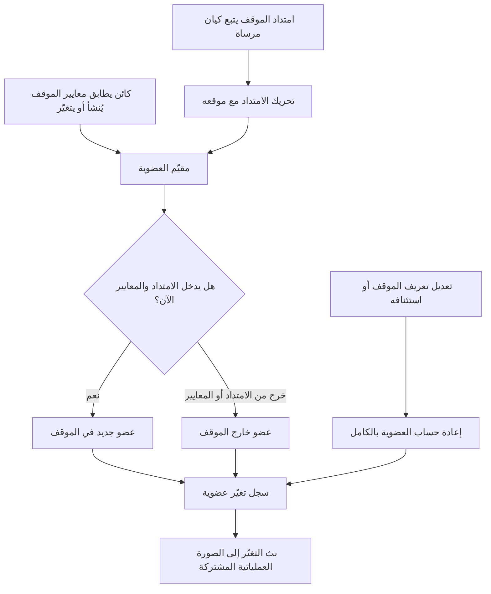

# متابعة تغيرات الموقف

<!-- BEGIN GENERATED: doc -->
| البند | القيمة |
|---|---|
| المعرّف | FEAT-SIT-CHANGES |
| الإصدار | 0.3 |
| الحالة | مسودة |
| القدرة | CAP-05 الوعي بالموقف |
| القدرة الفرعية | CAP-05.02 المراقبة والتنبيه (R1) |
| الأدوار | المحلل؛ المدير؛ النظام |
| الشاشات | SCR-11 الصورة العملياتية المشتركة (COP)، SCR-12 إدارة الموقف وقواعد التنبيه |
| حالات الاستخدام | UC-021، UC-022 |
| القصص | 8: 1 من المواصفة، و7 جديدة |
<!-- END GENERATED: doc -->

## 1. نظرة عامة

### 1.1 القيمة

يعرف المتابع ما دخل الموقف وما خرج منه أولًا بأول دون أن يراجع كل شيء يدويًا.

### 1.2 النطاق

| البند | القيمة |
|---|---|
| المستخدمون | المحلل، المدير، النظام |
| الشاشات | SCR-11 الصورة العملياتية المشتركة (COP)، SCR-12 إدارة الموقف وقواعد التنبيه |
| حالات الاستخدام | متابعة الموقف، ومراجعة تغيّر عضويته، وتحديثها تلقائيًا عند تغيّر الكائنات أو تعديل التعريف |
| المتطلبات | تحديث عضوية الموقف وتسجيل تغيّره حين يتغير كائن يطابق معاييره أو يكفّ عن مطابقتها (REQ-SIT-002) |
| خارج النطاق | إنشاء الموقف وتعديل تعريفه وتفعيله وإيقافه وإغلاقه (ميزة إدارة الموقف)، وعرض الصورة الكاملة للموقف وبلاطاتها |

### 1.3 خريطة الميزة

**الشكل 1: من تغيّر الكائن إلى سجل تغيّر الموقف**



## 2. القواعد المشتركة

تنطبق على كل قصص الميزة، فلا تتكرر داخل القصص. وكل قصة تذكر ما يخصها فقط.

### 2.1 السياق المشترك

كل قصة تبدأ من ثلاثة شروط: مستأجر نشط، وحزمة السياسات الأساسية مفعّلة، ومستخدم مسجّل الدخول ومخوَّل. وتشير إليها القصص بخطوة واحدة: «بفرض السياق المشترك للميزة».

### 2.2 الصلاحية وعدم الإفصاح

- من لا يحق له رؤية العنصر يتلقى ردًا بشكل «غير متاح» تمامًا، فلا يعرف أنه موجود.
- من يرى العنصر ولا يحق له الإجراء يتلقى «لا تملك صلاحية هذا الإجراء».

### 2.3 أوامر تغيير الحالة

- **منع التكرار:** يُرسل كل أمر بمفتاح فريد، فإعادة الطلب نفسه لا تُنفَّذ مرتين.
- **حماية التعديل المتزامن:** يُرسل كل أمر بإصدار البيانات الذي يراه المستخدم. فإن عدّلها غيره في الأثناء، يُرفض الأمر.
- **السجل:** إن نجح الأمر، يُكتب حدثه وسجل التدقيق في المعاملة نفسها.

### 2.4 الرفض المشترك

```gherkin
# language: ar
خاصية: الرفض المشترك لأوامر الميزة

  سيناريو مخطط: رفض مشترك لكل أمر في الميزة
    بفرض السياق المشترك للميزة
    و <الحالة>
    عندما يُرسل المستخدم أي أمر من أوامر الميزة
    اذاً يُرفض برمز <الرمز> ويرى "<الرسالة>"
    و لا يتغير شيء

    امثلة:
      | الحالة                                  | الرمز                  | الرسالة                                                 |
      | العنصر خارج صلاحياته                    | NOT_FOUND              | غير متاح                                                |
      | العنصر مرئي له ولا يحق له الإجراء       | AUTHZ_DENIED           | لا تملك صلاحية هذا الإجراء                              |
      | غيره عدّل العنصر بعد أن فتحه            | VERSION_CONFLICT       | تغيّرت البيانات منذ فتحتها. راجع التغييرات ثم أعد المحاولة |
      | أعاد مفتاح منع التكرار بمحتوى مختلف     | IDEMPOTENCY_KEY_REUSED | طلب مكرر بمحتوى مختلف                                   |
      | البيانات ناقصة أو غير صحيحة             | VALIDATION_FAILED      | بعض البيانات ناقصة أو غير صحيحة. راجع الحقول المعلَّمة      |

  سيناريو: إعادة الطلب نفسه لا تُنفَّذ مرتين
    بفرض السياق المشترك للميزة
    و أمر نجح بمفتاح منع تكرار
    عندما يُعاد الطلب نفسه بالمفتاح نفسه
    اذاً تُعاد النتيجة الأولى ولا يُكتب حدث ثانٍ
```

## 3. الجودة وتعريف الاكتمال

### 3.1 متطلبات الجودة

<!-- BEGIN GENERATED: quality -->
| المرجع | الموقف | المطلوب |
|---|---|---|
| QAS-PERF-006 | a situation member changes | p95 ≤ 10 s |
<!-- END GENERATED: quality -->

### 3.2 تعريف الاكتمال

القصة مكتملة حين تتحقق الشروط الخمسة:

1. سيناريوهاتها والقواعد المشتركة تمر في الاختبار الآلي.
2. فحوص البنية المعمارية تمر.
3. نصوص الواجهة والرسائل موجودة بالعربية والإنجليزية.
4. مراجعة الكود مكتملة.
5. ما تضيفه القصة نفسها في قسم «القواعد» تحقق.

## 4. فهرس القصص

<!-- BEGIN GENERATED: story-index -->
| المعرّف | القصة | النوع | الحالة |
|---|---|---|---|
| `US-BC03-Q-SIT-CHANGES` | جلب: Membership change log (visible members only) since cursor/time | جلب | مسودة |
| `US-DOM-SIT-BUFFER-FOLLOW` | تحريك منطقة الموقف مع الكيان المرجعي | نظام | مسودة |
| `US-DOM-SIT-MEMBERSHIP-RECOMPUTE` | إعادة حساب العضوية بعد تعديل التعريف أو الاستئناف | نظام | مسودة |
| `US-DOM-SIT-MEMBERSHIP-UPDATE` | تحديث أعضاء الموقف تلقائيًا عند تغير الكائنات | نظام | مسودة |
| `US-UI-SCR11-CHANGE-FEED` | متابعة ما دخل الموقف وما خرج منه مباشرة | واجهة | مسودة |
| `US-UI-SCR12-RECOMPUTE-STATUS` | إظهار تقدم إعادة حساب العضوية بعد التعديل | واجهة | مسودة |
| `US-PLT-SIT-MEMBERSHIP-LATENCY` | انعكاس تغير العضو في الموقف خلال عشر ثوان | منصة | مسودة |
| `US-PLT-SIT-MEMBERSHIP-RECOVERY` | استئناف تقييم العضوية من آخر نقطة بعد العطل | منصة | مسودة |
<!-- END GENERATED: story-index -->

## 5. القصص

### 5.1 US-BC03-Q-SIT-CHANGES — جلب: سجل تغيّرات العضوية (الأعضاء المرئيون فقط) منذ مؤشر أو وقت

| النوع | الإصدار | الأولوية | دون اتصال | الحالة |
|---|---|---|---|---|
| جلب | R1 | Must | لا | مسودة |

> **كـ** أي مستخدم مخوَّل على الموقف، **أريد** سجل ما دخل الموقف وما خرج منه منذ آخر مرة تابعته، **حتى** أعرف ما تغيّر دون أن أراجع كل الأعضاء من جديد.

**باختصار:** تُعاد تغيّرات عضوية الموقف — دخول عضو أو خروجه — منذ مؤشر أو وقت بعينه، والأعضاء الذين لا يحق للمستخدم رؤيتهم لا يظهرون في السجل.

#### القواعد

- **من يرى ماذا:** من يحق له رؤية الموقف يرى تغيّرات الأعضاء الذين يحق له رؤيتهم فقط؛ عضو دخل الموقف أو خرج منه دون أن يحق للمستخدم رؤيته لا يظهر في السجل، ولا عدده.
- **المرشحات:** المؤشر أو الوقت الذي تُطلب التغيّرات منذه، والحد الأقصى لعدد العناصر في الصفحة.

#### معايير القبول

```gherkin
# language: ar
خاصية: سجل تغيّرات عضوية الموقف

  سيناريو: يرى المستخدم تغيّرات أعضائه المرئيين فقط
    بفرض السياق المشترك للميزة
    و للموقف تغيّرات عضوية مرئية له وأخرى خارج رؤيته منذ مؤشره
    عندما يطلب سجل التغيّرات منذ ذلك المؤشر
    اذاً تُعاد التغيّرات المرئية له فقط، ويُعاد فحص صلاحية كل منها
    و لا يكشف أي عدد أو اقتراح وجود تغيّر محجوب

  سيناريو: الصفحة التالية من السجل
    بفرض السياق المشترك للميزة
    و تغيّرات الموقف أكثر من صفحة
    عندما يطلب المستخدم الصفحة التالية بالمؤشر
    اذاً تُعاد التغيّرات التالية دون تكرار ولا فجوة
```

<details><summary>المراجع التقنية والتتبع</summary>

<!-- BEGIN GENERATED: refs US-BC03-Q-SIT-CHANGES -->
| البند | المعرّف | المعنى |
|---|---|---|
| الواجهة البرمجية | `GET /api/v1/intelligence/situations/{situation_id}/changes` | — |
| الاستعلام | `QRY-SIT-CHANGES` | Membership change log (visible members only) since cursor/time |
| السياسة | `POL-SIT-CHANGES` | cleared for situation; per-member filtering |
| الكيان | `AGG-SITUATION` | الموقف |
| الجدول | `intelligence.situations` | الجدول الرئيسي للموقف |
| وحدة النشر | DU-06 | — |
| المتطلب | REQ-SIT-002 | When an object matching a situation's criteria is created or changed, the system shall update the situation m… |
| حالات الاستخدام | UC-021، UC-022 | Monitor Situation؛ Review Situation Change |
| الاختبار | TST-SITUATION-SM، TST-SLC06-INVARIANTS | دورة حالات الموقف، وثوابت الشريحة SLC-06 |
<!-- END GENERATED: refs US-BC03-Q-SIT-CHANGES -->

</details>

### 5.2 US-DOM-SIT-BUFFER-FOLLOW — تحريك منطقة الموقف مع كيان المرساة

| النوع | الإصدار | الأولوية | دون اتصال | الحالة |
|---|---|---|---|---|
| نظام | R1 | Must | لا ينطبق | مسودة |

> **كـ** النظام، عند تحرك كيان المرساة الذي يستند إليه امتداد الموقف، **أريد** تحريك امتداد الموقف معه، **حتى** يبقى الموقف متابعًا للكيان في موقعه الجديد.

**باختصار:** حين يكون امتداد الموقف حاجزًا حول كيان مرساة لا مضلعًا ثابتًا، يتحرك الامتداد مع كل تحديث لموقع الكيان، وتُعاد تقييم عضوية الموقف من الامتداد الجديد. **[Derived]** المصدر يذكر أن الامتداد يتبع كيان المرساة دون تفصيل آلية التحديث.

#### القواعد

- **متى يحدث:** الموقف معرَّف بامتداد «حاجز حول كيان مرساة» لا مضلعًا ثابتًا، وتغيّر موقع ذلك الكيان.
- **الأثر:** ينتقل امتداد الموقف إلى الموقع الجديد؛ تُعاد تقييم عضوية الموقف من الامتداد المحرَّك. **[Derived]**

#### معايير القبول

```gherkin
# language: ar
خاصية: تحريك امتداد الموقف مع كيان المرساة

  سيناريو: تحرك كيان المرساة
    بفرض موقف امتداده حاجز حول كيان مرساة في موقعه الحالي
    عندما يتغيّر موقع كيان المرساة
    اذاً ينتقل امتداد الموقف إلى الموقع الجديد
    و تُعاد تقييم عضوية الموقف من الامتداد الجديد

  سيناريو: موقف بامتداد ثابت لا يتحرك
    بفرض موقف امتداده مضلع ثابت لا كيان مرساة
    عندما يتغيّر موقع أي كيان قريب
    اذاً لا يتغيّر امتداد الموقف
```

<details><summary>المراجع التقنية والتتبع</summary>

<!-- BEGIN GENERATED: refs US-DOM-SIT-BUFFER-FOLLOW -->
| البند | المعرّف | المعنى |
|---|---|---|
| المصدر | `situation-alerting-spec.md §2` | — |
| المصدر | `[Derived]` | — |
| المتطلب | REQ-SIT-001 | The system shall define each situation by geographic extent, time window, inclusion criteria, owner and class… |
| حالة الاستخدام | UC-020 | Create Situation |
<!-- END GENERATED: refs US-DOM-SIT-BUFFER-FOLLOW -->

</details>

### 5.3 US-DOM-SIT-MEMBERSHIP-RECOMPUTE — إعادة حساب العضوية بعد تعديل التعريف أو الاستئناف

| النوع | الإصدار | الأولوية | دون اتصال | الحالة |
|---|---|---|---|---|
| نظام | R1 | Must | لا ينطبق | مسودة |

> **كـ** النظام، عند تعديل تعريف الموقف أو استئنافه بعد إيقافه مؤقتًا، **أريد** إعادة حساب عضويته بالكامل، **حتى** تعكس العضوية المعايير الجديدة أو الحالة الحالية لا المعايير القديمة.

**باختصار:** بعد تعديل تعريف الموقف أو استئنافه، تُعاد مطابقة كل الكائنات المحتملة مع المعايير الحالية كمهمة غير متزامنة، وتُنشر نتيجتها كتغيّرات عضوية عادية.

#### القواعد

- **متى يحدث:** نجح تعديل تعريف الموقف، أو استئنافه بعد الإيقاف المؤقت.
- **الأثر:** تُعاد مطابقة عضوية الموقف بالكامل من التعريف الجديد أو من الحالة الحالية؛ كل تغيّر ينتج عنها يُسجَّل في سجل تغيّرات الموقف كأي تغيّر آخر.

#### معايير القبول

```gherkin
# language: ar
خاصية: إعادة حساب عضوية الموقف بالكامل

  سيناريو: إعادة الحساب بعد تعديل التعريف
    بفرض موقف تغيّر تعريفه بمعايير أو امتداد جديد
    عندما تنجح إعادة حساب العضوية
    اذاً تصبح عضوية الموقف مطابقة للتعريف الجديد
    و يُسجَّل كل تغيّر ناتج في سجل تغيّرات الموقف

  سيناريو: الموقف الموقوف مؤقتًا لا تُعاد عضويته
    بفرض موقف موقوف مؤقتًا لم يُستأنف
    عندما يحين وقت إعادة حساب روتينية
    اذاً لا تتغيّر عضويته
```

<details><summary>المراجع التقنية والتتبع</summary>

<!-- BEGIN GENERATED: refs US-DOM-SIT-MEMBERSHIP-RECOMPUTE -->
| البند | المعرّف | المعنى |
|---|---|---|
| المصدر | `situation-alerting-spec.md §2` | — |
| المصدر | `[Derived]` | — |
| المتطلب | REQ-SIT-002 | When an object matching a situation's criteria is created or changed, the system shall update the situation m… |
| حالات الاستخدام | UC-021، UC-022 | Monitor Situation؛ Review Situation Change |
<!-- END GENERATED: refs US-DOM-SIT-MEMBERSHIP-RECOMPUTE -->

</details>

### 5.4 US-DOM-SIT-MEMBERSHIP-UPDATE — تحديث أعضاء الموقف تلقائيًا عند تغير الكائنات

| النوع | الإصدار | الأولوية | دون اتصال | الحالة |
|---|---|---|---|---|
| نظام | R1 | Must | لا ينطبق | مسودة |

> **كـ** النظام، عند إنشاء أو تغيّر كائن يطابق معايير موقف نشط، **أريد** تحديث عضوية الموقف تلقائيًا، **حتى** تعكس الصورة العملياتية المشتركة الموقف الحقيقي دون تدخل بشري.

**باختصار:** كل كائن يُنشأ أو يتغيّر يُطابَق فورًا مع مواقف المستأجر النشطة التي يتقاطع امتدادها مع موقعه؛ دخوله الموقف أو خروجه منه يُسجَّل تغيّرًا، خلال عشر ثوانٍ عند المئين 95 (QAS-PERF-006).

#### القواعد

- **متى يحدث:** كائن (كيان، حدث، ملاحظة، مهمة، تقييم) يُنشأ أو يتغيّر، والموقف «نشط» لا «موقوف مؤقتًا» ولا «مغلق».
- **الأثر:** يدخل الكائن الموقف أو يخرج منه بحسب مطابقته لمعايير الموقف الحالية؛ يُسجَّل التغيّر وسببه. عضوية الموقف الموقوف مؤقتًا مجمَّدة فلا تتغير.

#### معايير القبول

```gherkin
# language: ar
خاصية: تحديث عضوية الموقف تلقائيًا

  سيناريو: كائن جديد يطابق معايير موقف نشط
    بفرض موقف نشط وكائن جديد يطابق معاييره وامتداده
    عندما يُسجَّل الكائن
    اذاً يدخل عضوًا جديدًا في الموقف
    و يُسجَّل تغيّر عضوية بسببه

  سيناريو: الموقف الموقوف مؤقتًا لا تتغيّر عضويته
    بفرض موقف موقوف مؤقتًا وكائن جديد يطابق معاييره
    عندما يُسجَّل الكائن
    اذاً لا تتغيّر عضوية الموقف الموقوف مؤقتًا
```

<details><summary>المراجع التقنية والتتبع</summary>

<!-- BEGIN GENERATED: refs US-DOM-SIT-MEMBERSHIP-UPDATE -->
| البند | المعرّف | المعنى |
|---|---|---|
| الجودة | QAS-PERF-006 | a situation member changes → p95 ≤ 10 s |
| القرار المعماري | ADR-P07 | Nature of Situation |
| المصدر | `situation-alerting-spec.md §2` | — |
| المصدر | `[Derived]` | — |
| المتطلب | REQ-SIT-002 | When an object matching a situation's criteria is created or changed, the system shall update the situation m… |
| حالات الاستخدام | UC-021، UC-022 | Monitor Situation؛ Review Situation Change |
<!-- END GENERATED: refs US-DOM-SIT-MEMBERSHIP-UPDATE -->

</details>

### 5.5 US-UI-SCR11-CHANGE-FEED — متابعة ما دخل الموقف وما خرج منه مباشرة

| النوع | الإصدار | الأولوية | دون اتصال | الحالة |
|---|---|---|---|---|
| واجهة | R1 | Should | لا | مسودة |

> **كـ** المستخدم، **أريد** متابعة ما دخل الموقف وما خرج منه مباشرة على شاشة الصورة العملياتية المشتركة، **حتى** ألاحظ التغيّرات المهمة دون أن أعيد تحميل الخريطة باستمرار.

**باختصار:** تعرض شاشة الصورة العملياتية المشتركة تغيّرات الموقف الجديدة بتحديث تلقائي، وكل تغيّر يحمل سببه ووقته، خلال عشر ثوانٍ من وقوعه (القصة 5.4).

#### القواعد

- **العرض:** تعرض الشاشة التغيّرات الجديدة في قائمة مرتبة بالوقت، كل منها بسبب الدخول أو الخروج والكيان المسبب.
- **القيد:** التحديث لا يكشف وجود تغيّر على عضو لا يحق للمستخدم رؤيته (القصة 5.1).

#### معايير القبول

```gherkin
# language: ar
خاصية: متابعة تغيّرات الموقف مباشرة

  سيناريو: ظهور تغيّر جديد
    بفرض السياق المشترك للميزة
    و المستخدم يتابع صورة موقف نشط
    عندما يدخل عضو جديد الموقف
    اذاً يظهر التغيّر في القائمة خلال عشر ثوانٍ مع سببه ووقته

  سيناريو: لا تغيّر مرئي لعضو محجوب
    بفرض السياق المشترك للميزة
    و عضو دخل الموقف لا يحق للمستخدم رؤيته
    عندما يُحدَّث عرض التغيّرات
    اذاً لا يظهر أي أثر لهذا التغيّر
```

<details><summary>المراجع التقنية والتتبع</summary>

<!-- BEGIN GENERATED: refs US-UI-SCR11-CHANGE-FEED -->
| البند | المعرّف | المعنى |
|---|---|---|
| الشاشة | SCR-11 | شاشة الصورة العملياتية المشتركة (COP) |
| حالة الاستخدام | UC-021 | Monitor Situation |
| حالة الاستخدام | UC-022 | Review Situation Change |
| المصدر | `21-ui-design.md §7` | — |
<!-- END GENERATED: refs US-UI-SCR11-CHANGE-FEED -->

</details>

### 5.6 US-UI-SCR12-RECOMPUTE-STATUS — إظهار تقدم إعادة حساب العضوية بعد التعديل

| النوع | الإصدار | الأولوية | دون اتصال | الحالة |
|---|---|---|---|---|
| واجهة | R1 | Should | لا | مسودة |

> **كـ** المستخدم (المحلل أو المدير)، **أريد** أن أرى تقدم إعادة حساب عضوية الموقف بعد تعديل تعريفه، **حتى** أعرف متى تعكس الصورة الكائنات الجديدة بالكامل.

**باختصار:** بعد حفظ تعديل تعريف الموقف أو استئنافه، تعرض شاشة إدارة الموقف حالة إعادة الحساب (جارية أو مكتملة) بدل عرض عضوية قديمة بصمت. **[Derived]**

#### القواعد

- **العرض:** تعرض الشاشة حالة إعادة الحساب (جارية، مكتملة) بعد كل تعديل للتعريف أو استئناف. **[Derived]**

#### معايير القبول

```gherkin
# language: ar
خاصية: إظهار تقدم إعادة حساب العضوية

  سيناريو: إعادة حساب جارية
    بفرض السياق المشترك للميزة
    و موقف عُدِّل تعريفه وإعادة حساب عضويته جارية
    عندما يفتح المستخدم شاشة إدارة الموقف
    اذاً يرى أن إعادة الحساب جارية

  سيناريو: إعادة حساب مكتملة
    بفرض السياق المشترك للميزة
    و اكتملت إعادة حساب عضوية الموقف
    عندما يفتح المستخدم شاشة إدارة الموقف
    اذاً يرى أن العضوية مطابقة للتعريف الحالي
```

<details><summary>المراجع التقنية والتتبع</summary>

<!-- BEGIN GENERATED: refs US-UI-SCR12-RECOMPUTE-STATUS -->
| البند | المعرّف | المعنى |
|---|---|---|
| الشاشة | SCR-12 | شاشة إدارة الموقف وقواعد التنبيه |
| المصدر | `situation-alerting-spec.md §2` | — |
| المصدر | `[Derived]` | — |
<!-- END GENERATED: refs US-UI-SCR12-RECOMPUTE-STATUS -->

</details>

### 5.7 US-PLT-SIT-MEMBERSHIP-LATENCY — انعكاس تغير العضو في الموقف خلال عشر ثوان

| النوع | الإصدار | الأولوية | دون اتصال | الحالة |
|---|---|---|---|---|
| منصة | R1 | Should | لا ينطبق | مسودة |

> **كـ** فريق المنصة، **أريد** أن يعكس مقيّم العضوية تغيّر أي عضو في الموقف خلال عشر ثوانٍ، **حتى** تبقى الصورة العملياتية المشتركة موثوقة تحت حمل التصميم.

**باختصار:** يُقاس زمن انعكاس تغيّر العضوية من وقوع الحدث إلى ظهوره في سجل التغيّرات؛ الهدف عشر ثوانٍ عند المئين 95 (QAS-PERF-006)، وهو مُقيَّم منفصل عمدًا عن مُقيّم التنبيه الحرج فلا ينتظره.

#### القواعد

- **الأثر:** فهرس مكاني يحصر مطابقة كل كائن جديد أو متغيّر بمواقف المستأجر النشطة التي يتقاطع امتدادها مع موقعه، فلا تُفحص مواقف غير متقاطعة.

#### معايير القبول

```gherkin
# language: ar
خاصية: زمن انعكاس تغيّر عضوية الموقف

  سيناريو: الهدف تحت حمل التصميم
    بفرض حمل بمزيج استراتيجية اختبار الأداء وبيانات بحجم التصميم
    عندما يتغيّر عضو في موقف نشط
    اذاً يظهر التغيّر في سجل التغيّرات خلال عشر ثوانٍ أو أقل عند المئين 95

  سيناريو: مقيّم العضوية منفصل عن مقيّم التنبيهات
    بفرض حدث واحد يطابق قاعدة تنبيه حرجة وموقفًا نشطًا معًا
    عندما يُعالج الحدث
    اذاً يصل التنبيه الحرج دون انتظار اكتمال تحديث العضوية
```

<details><summary>المراجع التقنية والتتبع</summary>

<!-- BEGIN GENERATED: refs US-PLT-SIT-MEMBERSHIP-LATENCY -->
| البند | المعرّف | المعنى |
|---|---|---|
| الجودة | QAS-PERF-006 | a situation member changes → p95 ≤ 10 s |
| المصدر | `situation-alerting-spec.md §1` | — |
| المصدر | `situation-alerting-spec.md §2` | — |
<!-- END GENERATED: refs US-PLT-SIT-MEMBERSHIP-LATENCY -->

</details>

### 5.8 US-PLT-SIT-MEMBERSHIP-RECOVERY — استئناف تقييم العضوية من آخر نقطة بعد العطل

| النوع | الإصدار | الأولوية | دون اتصال | الحالة |
|---|---|---|---|---|
| منصة | R1 | Should | لا ينطبق | مسودة |

> **كـ** فريق المنصة، **أريد** أن يستأنف مقيّم العضوية عمله من آخر نقطة تتبع بعد عطله، **حتى** لا تبقى الصورة العملياتية المشتركة قديمة بعد استعادة الخدمة.

**باختصار:** عند عطل مقيّم العضوية تصبح الصورة قديمة؛ وعند استعادته يستأنف من آخر نقطة محفوظة بدل إعادة المطابقة من الصفر، فيلحق بالأحداث التي فاتته دون فقدها.

#### القواعد

- **الأثر:** مقيّم العضوية بلا حالة محلية (partitions عديمة الحالة)؛ عند استعادته بعد عطل يستأنف من آخر نقطة تتبع محفوظة ويعالج كل الأحداث المتراكمة دون فقدان أو تكرار.

#### معايير القبول

```gherkin
# language: ar
خاصية: استئناف تقييم العضوية بعد العطل

  سيناريو: استئناف من آخر نقطة بعد العطل
    بفرض أن مقيّم العضوية تعطّل وتراكمت أحداث لم تُقيَّم
    عندما يُستعاد المقيّم
    اذاً يستأنف المعالجة من آخر نقطة تتبع محفوظة
    و تُقيَّم كل الأحداث المتراكمة دون فقدان أو تكرار

  سيناريو: لا عطل فلا استئناف
    بفرض أن مقيّم العضوية يعمل دون عطل
    عندما يُفحص سجل نقاط التتبع
    اذاً لا تظهر أي نقطة استئناف من عطل
```

<details><summary>المراجع التقنية والتتبع</summary>

<!-- BEGIN GENERATED: refs US-PLT-SIT-MEMBERSHIP-RECOVERY -->
| البند | المعرّف | المعنى |
|---|---|---|
| المصدر | `FM-S06-02` | — |
| المصدر | `observability-slc06.md` | — |
<!-- END GENERATED: refs US-PLT-SIT-MEMBERSHIP-RECOVERY -->

</details>

## 6. التتبع

<!-- BEGIN GENERATED: trace -->
| المتطلب | المعنى | القصص | الاختبار |
|---|---|---|---|
| REQ-SIT-001 | The system shall define each situation by geographic extent, time window, inclusion criteria, owner and class… | `US-DOM-SIT-BUFFER-FOLLOW` | TST-SITUATION-SM، TST-SLC06-INVARIANTS |
| REQ-SIT-002 | When an object matching a situation's criteria is created or changed, the system shall update the situation m… | `US-BC03-Q-SIT-CHANGES`، `US-DOM-SIT-MEMBERSHIP-RECOMPUTE`، `US-DOM-SIT-MEMBERSHIP-UPDATE` | TST-SITUATION-SM، TST-SLC06-INVARIANTS |
<!-- END GENERATED: trace -->

## 7. سجل التغييرات

| الإصدار | التاريخ | التغيير |
|---|---|---|
| 0.1 | — | هيكل مولَّد من خريطة الميزات |
| 0.2 | 2026-10-13 | كتابة القصص كاملة بمعيار القصص |
| 0.3 | 2026-10-13 | تصحيحات المراجعة المستقلة (الدفعة الأولى) |
