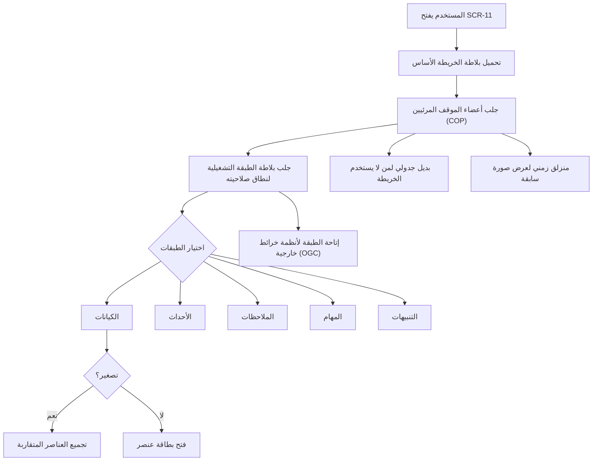

# الصورة العملياتية المشتركة

<!-- BEGIN GENERATED: doc -->
| البند | القيمة |
|---|---|
| المعرّف | FEAT-SIT-COP |
| الإصدار | 0.2 |
| الحالة | مسودة |
| القدرة | CAP-05 الوعي بالموقف |
| القدرة الفرعية | CAP-05.03 صورة العمليات المشتركة (الخرائط) (R1) |
| الأدوار | أي مستخدم مخوَّل؛ المستخدم الميداني |
| الشاشات | SCR-11 الصورة العملياتية المشتركة (COP) |
| حالات الاستخدام | UC-024، UC-098 |
| القصص | 13: 3 من المواصفة، و10 جديدة |
<!-- END GENERATED: doc -->

## 1. نظرة عامة

### 1.1 القيمة

يرى كل مخوَّل الموقف على خريطة واحدة تجمع الكيانات والأحداث والمهام والتنبيهات بحسب صلاحيته.

### 1.2 النطاق

| البند | القيمة |
|---|---|
| المستخدمون | أي مستخدم مخوَّل يحمل تصريح تصنيف الموقف؛ المستخدم الميداني (الحزم المحمَّلة مسبقًا) |
| الشاشات | SCR-11 الصورة العملياتية المشتركة (COP) |
| حالات الاستخدام بالكلمات | عرض صورة العمليات المشتركة لموقف على خريطة: الكيانات والأحداث والملاحظات والمهام والتنبيهات، بالطبقات والتجميع والبديل الجدولي والمنزلق الزمني؛ وخدمة بلاطات الخرائط الأساس والتشغيلية لكل نطاق صلاحية على حدة |
| المتطلبات بالكلمات | عرض كل موقف كصورة عمليات مشتركة قائمة على الخريطة (REQ-SIT-003)؛ خدمة طبقات الخريطة مصفّاة بصلاحية الطالب دون تشارك البلاطات بين نطاقات مختلفة (REQ-SIT-007) |
| خارج النطاق | تعريف الموقف وتفعيله وإيقافه وإغلاقه (ميزة «إنشاء المواقف وإدارتها»)؛ معيار الرموز الكارتوغرافية وعرض الإحداثيات، فلا معيار لهما في المصادر |

### 1.3 خريطة الميزة

**الشكل 1: استخدام الصورة العملياتية المشتركة**



## 2. القواعد المشتركة

تنطبق على كل قصص الميزة، فلا تتكرر داخل القصص. وكل قصة تذكر ما يخصها فقط. وهذه ميزة قراءة وعرض وقدرة منصّة فقط، فلا أوامر تغيّر حالة فيها، ولذا تستبدل الفقرتان 2.2 و2.3 عدم الإفصاح في القراءة بدل قواعد الأوامر.

### 2.1 السياق المشترك

كل قصة تبدأ من ثلاثة شروط: مستأجر نشط، وحزمة السياسات الأساسية مفعّلة، ومستخدم مسجّل الدخول ومخوَّل. وتشير إليها القصص بخطوة واحدة: «بفرض السياق المشترك للميزة».

### 2.2 عدم الإفصاح في القراءة

- من لا يحق له رؤية عنصر أو موقف يتلقى ردًا بشكل «غير متاح» تمامًا، فلا يعرف أنه موجود.
- كل استعلام يُعاد فحص صلاحيته على نتيجته بعد تحميلها (التصنيف وإصدار الأمن)، فلا يظهر عنصر فقد الطالب صلاحيته عليه بين طلب وآخر.
- لا عدد ولا تجميع ولا اقتراح يكشف وجود عنصر محجوب.

### 2.3 الرفض المشترك

```gherkin
# language: ar
خاصية: الرفض المشترك لاستعلامات الميزة

  سيناريو مخطط: رفض مشترك لكل استعلام في الميزة
    بفرض السياق المشترك للميزة
    و <الحالة>
    عندما يرسل المستخدم أي استعلام من استعلامات الميزة
    اذاً يُرفض برمز <الرمز> ويرى "<الرسالة>"

    امثلة:
      | الحالة                                  | الرمز              | الرسالة                                                |
      | العنصر أو الموقف خارج صلاحياته         | NOT_FOUND          | غير متاح                                               |
      | معاملات الطلب ناقصة أو غير صحيحة       | VALIDATION_FAILED  | بعض البيانات ناقصة أو غير صحيحة. راجع الحقول المعلَّمة |
```

## 3. الجودة وتعريف الاكتمال

### 3.1 متطلبات الجودة

<!-- BEGIN GENERATED: quality -->
| المرجع | الموقف | المطلوب |
|---|---|---|
| QAS-ACC-001 | uses R1 web screens | WCAG 2.2 level AA conformance (AR and EN) |
| QAS-PERF-006 | a situation member changes | p95 ≤ 10 s |
| QAS-PERF-007 | pans or zooms the operational map | tile p95 ≤ 500 ms |
| QAS-PERF-019 | situation picture read (≤ 2,000 visible members) | p95 ≤ 1 s |
| QAS-SEC-003 | removes a user's compartment | effective on next request in every path, independent of index lag |
| QAS-SEC-004 | request the same map tile | 0 cross-scope cache hits |
<!-- END GENERATED: quality -->

### 3.2 تعريف الاكتمال

القصة مكتملة حين تتحقق الشروط الخمسة:

1. سيناريوهاتها والقواعد المشتركة تمر في الاختبار الآلي.
2. فحوص البنية المعمارية تمر.
3. نصوص الواجهة والرسائل موجودة بالعربية والإنجليزية.
4. مراجعة الكود مكتملة.
5. ما تضيفه القصة نفسها في قسم «القواعد» تحقق.

## 4. فهرس القصص

<!-- BEGIN GENERATED: story-index -->
| المعرّف | القصة | النوع | الحالة |
|---|---|---|---|
| `US-BC03-Q-BASE-TILE` | جلب: بلاطة خريطة أساس (طبقات غير مصنَّفة فقط؛ ذاكرة مشتركة) | جلب | مسودة |
| `US-BC03-Q-SIT-COP` | جلب: الصورة العملياتية المشتركة للموقف | جلب | مسودة |
| `US-BC03-Q-SIT-TILE` | جلب: بلاطة متجهة لطبقة تشغيلية في نطاق صلاحية الطالب | جلب | مسودة |
| `US-UI-SCR11-FEATURE-CARD` | بطاقة العنصر بدقته وجودته وحالة تعميمه | واجهة | مسودة |
| `US-UI-SCR11-LAYERS` | تشغيل طبقات الخريطة وتجميع العناصر عند التصغير | واجهة | مسودة |
| `US-UI-SCR11-TABLE-VIEW` | بديل جدولي للخريطة لسهولة الوصول | واجهة | مسودة |
| `US-UI-SCR11-TIME-SLIDER` | منزلق زمني لعرض الصورة في وقت سابق | واجهة | مسودة |
| `US-PLT-COP-PICTURE-READ` | فتح صورة الموقف خلال ثانية | منصة | مسودة |
| `US-PLT-COP-TILE-INVALIDATE` | تحديث البلاطات فور تغير العضوية أو الموقع | منصة | مسودة |
| `US-PLT-COP-TILE-PERF` | بلاطات الخريطة خلال نصف ثانية عند التحريك | منصة | مسودة |
| `US-PLT-COP-TILE-SCOPE-CACHE` | عدم مشاركة البلاطات بين نطاقات صلاحية مختلفة | منصة | مسودة |
| `US-INT-COP-OGC-TILES` | إتاحة طبقات الموقف لأنظمة الخرائط الخارجية | تكامل | مسودة |
| `US-OPS-COP-TILE-WATCH` | مراقبة زمن البلاطات ونسبة إصابة الذاكرة | تشغيل | مسودة |
<!-- END GENERATED: story-index -->

## 5. القصص

### 5.1 US-BC03-Q-BASE-TILE — جلب: بلاطة خريطة أساس (طبقات غير مصنَّفة فقط؛ ذاكرة مشتركة)

| النوع | الإصدار | الأولوية | دون اتصال | الحالة |
|---|---|---|---|---|
| جلب | R1 | Must | لا | مسودة |

> **كـ** أي مستخدم من المستأجر، **أريد** جلب بلاطة الخريطة الأساس، **حتى** تظهر خلفية الخريطة تحت طبقات الموقف.

**باختصار:** تُخدَم بلاطة الخريطة الأساس من مسار منفصل عن طبقات الموقف، ولا تُشارك ذاكرتها المؤقتة بين مستأجرين إلا للطبقات الموسومة غير مصنَّفة.

#### القواعد

- **من يرى ماذا:** كل مستخدم من المستأجر يرى طبقات الخريطة الأساس الموسومة غير مصنَّفة فقط؛ وهذه فقط تُخزَّن في ذاكرة مؤقتة مشتركة بين المستخدمين.

#### معايير القبول

```gherkin
# language: ar
خاصية: جلب بلاطة الخريطة الأساس

  سيناريو: جلب بلاطة أساس غير مصنَّفة
    بفرض السياق المشترك للميزة
    و طبقة خريطة أساس موسومة غير مصنَّفة
    عندما يطلب المستخدم بلاطة منها بموقعها ومستوى تكبيرها
    اذاً تُعاد البلاطة، وقد خُدمت من ذاكرة مؤقتة مشتركة بين المستخدمين
```

<details><summary>المراجع التقنية والتتبع</summary>

<!-- BEGIN GENERATED: refs US-BC03-Q-BASE-TILE -->
| البند | المعرّف | المعنى |
|---|---|---|
| الواجهة البرمجية | `GET /api/v1/intelligence/base-maps/{layer}/{z}/{x}/{y}` | — |
| الاستعلام | `QRY-BASE-TILE` | Base-map tile (layers marked unclassified only; shared cache) |
| السياسة | `POL-BASE-TILE` | any user of tenant |
| المتطلب | REQ-SIT-007 | The system shall serve map layers filtered by the requesting user's authorization and shall not share cached… |
| حالة الاستخدام | UC-098 | View Common Operational Picture |
<!-- END GENERATED: refs US-BC03-Q-BASE-TILE -->

</details>

### 5.2 US-BC03-Q-SIT-COP — جلب: الصورة العملياتية المشتركة للموقف

| النوع | الإصدار | الأولوية | دون اتصال | الحالة |
|---|---|---|---|---|
| جلب | R1 | Must | لا | مسودة |

> **كـ** أي مستخدم مخوَّل، **أريد** صورة عملياتية مشتركة لموقف تجمع كل ما يخصه، **حتى** أرى الوضع كاملًا في مكان واحد.

**باختصار:** تُعاد الصورة العملياتية المشتركة للموقف: أعضاؤه المرئيون للطالب من الكيانات والأحداث والملاحظات والمهام والتقييمات والتنبيهات، كل منها بهندسته المحلولة، معمَّمة عند الحاجة.

#### القواعد

- **من يرى ماذا:** من يحمل تصريح تصنيف الموقف يرى أعضاءه المرئيين له فقط، وكل عدد معروض على هذه الأعضاء فقط.
- **البيانات (المرشحات):** معرّف الموقف، والمؤشر والحد.

#### معايير القبول

```gherkin
# language: ar
خاصية: جلب الصورة العملياتية المشتركة

  سيناريو: يرى المستخدم أعضاء الموقف المرئيين له فقط
    بفرض السياق المشترك للميزة
    و موقف أعضاؤه بعضها داخل نطاق المستخدم وبعضها خارجه
    عندما يطلب صورته العملياتية
    اذاً تُعاد الأعضاء داخل نطاقه فقط، كلٌّ بهندسته المحلولة
    و لا يكشف أي عدد أو اقتراح وجود عضو محجوب

  سيناريو: عضو موقعه معمَّم يظهر معلَّمًا
    بفرض السياق المشترك للميزة
    و عضو في الموقف خضع لالتزام تعميم موقعه
    عندما يطلب المستخدم صورة الموقف
    اذاً يظهر العضو عند مركز خليته الحتمية وعليه علامة "معمم"
```

<details><summary>المراجع التقنية والتتبع</summary>

<!-- BEGIN GENERATED: refs US-BC03-Q-SIT-COP -->
| البند | المعرّف | المعنى |
|---|---|---|
| الواجهة البرمجية | `GET /api/v1/intelligence/situations/{situation_id}/picture` | — |
| الاستعلام | `QRY-SIT-COP` | Common operational picture: visible members (entities, events, observations, tasks, assessments, alerts) with… |
| السياسة | `POL-SIT-COP` | cleared for situation; per-member filtering |
| الكيان | `AGG-SITUATION` | الموقف |
| الجدول | `intelligence.situations` | الجدول الرئيسي للموقف |
| وحدة النشر | DU-06 | — |
| المتطلب | REQ-SIT-003 | The system shall present each situation as a map-based common operational picture of its entities, events, ri… |
| حالات الاستخدام | UC-024، UC-098 | Produce Situation View؛ View Common Operational Picture |
| الاختبار | TST-SITUATION-SM، TST-SLC06-INVARIANTS | دورة حالات الموقف، وثوابت الشريحة SLC-06 |
<!-- END GENERATED: refs US-BC03-Q-SIT-COP -->

</details>

### 5.3 US-BC03-Q-SIT-TILE — جلب: بلاطة متجهة لطبقة تشغيلية في نطاق صلاحية الطالب

| النوع | الإصدار | الأولوية | دون اتصال | الحالة |
|---|---|---|---|---|
| جلب | R1 | Must | لا | مسودة |

> **كـ** أي مستخدم مخوَّل، **أريد** بلاطة متجهة من طبقة تشغيلية للموقف عند تحريك الخريطة أو تكبيرها، **حتى** تُرسم الطبقة بسرعة دون تحميل كل أعضاء الموقف دفعة واحدة.

**باختصار:** تُعاد بلاطة متجهة لطبقة تشغيلية من الموقف (كيانات، أحداث، ملاحظات، مهام، تنبيهات)، محسوبة من الأعضاء المرئيين لنطاق صلاحية الطالب فقط، ومفتاح ذاكرتها المؤقتة يخص هذا النطاق دون غيره.

#### القواعد

- **من يرى ماذا:** البلاطة تُبنى من أعضاء الموقف المرئيين لنطاق صلاحية الطالب فقط؛ مفتاح ذاكرتها المؤقتة يشمل النطاق، فمن له نطاق مختلف لا يتسلم بلاطة محفوظة لغيره.

#### معايير القبول

```gherkin
# language: ar
خاصية: جلب بلاطة طبقة تشغيلية

  سيناريو: جلب بلاطة طبقة من الموقف
    بفرض السياق المشترك للميزة
    و موقف فيه أعضاء مرئيون للطالب على طبقة الكيانات
    عندما يطلب بلاطتها بموقعها ومستوى تكبيرها
    اذاً تُعاد بلاطة محسوبة من أعضائه المرئيين لنطاق صلاحيته فقط

  سيناريو: نطاق صلاحية مختلف لا يتسلم بلاطة غيره
    بفرض السياق المشترك للميزة
    و مستخدمَين بنطاقي صلاحية مختلفَين طلبا البلاطة نفسها
    عندما يطلب كل منهما البلاطة
    اذاً تُحسب لكل منهما بلاطة مستقلة من أعضائه المرئيين هو فقط
```

<details><summary>المراجع التقنية والتتبع</summary>

<!-- BEGIN GENERATED: refs US-BC03-Q-SIT-TILE -->
| البند | المعرّف | المعنى |
|---|---|---|
| الواجهة البرمجية | `GET /api/v1/intelligence/situations/{situation_id}/tiles/{layer}/{z}/{x}/{y}` | — |
| الاستعلام | `QRY-SIT-TILE` | Vector tile of operational layer for the caller's security scope |
| السياسة | `POL-SIT-TILE` | cleared for situation; scope-keyed cache (ADR-P06 §6) |
| الكيان | `AGG-SITUATION` | الموقف |
| الجدول | `intelligence.situations` | الجدول الرئيسي للموقف |
| وحدة النشر | DU-06 | — |
| المتطلب | REQ-SIT-007 | The system shall serve map layers filtered by the requesting user's authorization and shall not share cached… |
| حالة الاستخدام | UC-098 | View Common Operational Picture |
| الاختبار | TST-SITUATION-SM، TST-SLC06-INVARIANTS | دورة حالات الموقف، وثوابت الشريحة SLC-06 |
<!-- END GENERATED: refs US-BC03-Q-SIT-TILE -->

</details>

### 5.4 US-UI-SCR11-FEATURE-CARD — بطاقة العنصر بدقته وجودته وحالة تعميمه

| النوع | الإصدار | الأولوية | دون اتصال | الحالة |
|---|---|---|---|---|
| واجهة | R1 | Should | لا | مسودة |

> **كـ** المستخدم، **أريد** بطاقة تلخص العنصر الذي أنقر عليه على الخريطة بدقة موقعه وجودته، **حتى** أعرف مدى الثقة بموقعه قبل أن أتصرف عليه.

**باختصار:** النقر على عنصر في الصورة العملياتية يفتح بطاقة تعرض نوعه ودقة موقعه (`accuracy_m` كدائرة حول النقطة)، وأعلام جودته المكانية، وعلامة «معمم» إن كان موقعه معممًا.

#### القواعد

- **البيانات المعروضة:** دقة الموقع كدائرة نصف قطرها `accuracy_m`؛ أعلام الجودة المكانية (دقة منخفضة، أو اشتباه بخلل GPS الجهاز)؛ وعلامة «معمم» إن كان العنصر عضوًا خضع لالتزام تعميم.

#### معايير القبول

```gherkin
# language: ar
خاصية: بطاقة العنصر

  سيناريو: فتح بطاقة عنصر بموقع دقيق
    بفرض السياق المشترك للميزة
    و عنصر على الخريطة بدقة موقع معروفة
    عندما ينقر المستخدم عليه
    اذاً تفتح بطاقته وتعرض دائرة الدقة حول موقعه

  سيناريو: بطاقة عنصر بموقع مشكوك في جودته
    بفرض السياق المشترك للميزة
    و عنصر وُسم بعلم جودة "اشتباه بخلل GPS الجهاز"
    عندما يفتح المستخدم بطاقته
    اذاً يظهر علم الجودة على البطاقة
```

<details><summary>المراجع التقنية والتتبع</summary>

<!-- BEGIN GENERATED: refs US-UI-SCR11-FEATURE-CARD -->
| البند | المعرّف | المعنى |
|---|---|---|
| الشاشة | SCR-11 | شاشة الصورة العملياتية المشتركة (COP) |
| المصدر | `21-ui-design.md §7` | — |
| المصدر | `spatial-model.md §7` | — |
<!-- END GENERATED: refs US-UI-SCR11-FEATURE-CARD -->

</details>

### 5.5 US-UI-SCR11-LAYERS — تشغيل طبقات الخريطة وتجميع العناصر عند التصغير

| النوع | الإصدار | الأولوية | دون اتصال | الحالة |
|---|---|---|---|---|
| واجهة | R1 | Must | لا | مسودة |

> **كـ** المستخدم، **أريد** أن أشغّل طبقة أو أكثر من طبقات الخريطة وأن تتجمع العناصر القريبة عند التصغير، **حتى** أرى ما يهمني فقط دون أن تتزاحم الخريطة بالعناصر.

**باختصار:** يشغّل المستخدم طبقة أو أكثر من طبقات الموقف (الكيانات، الأحداث، الملاحظات، المهام، التنبيهات)، وتتجمع العناصر القريبة في عنقود واحد عند التصغير عن مستوى معين.

#### القواعد

- **البيانات:** الطبقات المتاحة في الإصدار الأول هي الكيانات والأحداث والملاحظات والمهام والتنبيهات، وكل طبقة تُشغَّل أو تُطفأ على حدة.

#### معايير القبول

```gherkin
# language: ar
خاصية: طبقات الخريطة وتجميعها

  سيناريو: تشغيل طبقتين وإطفاء الباقي
    بفرض السياق المشترك للميزة
    و خريطة بكل طبقاتها مطفأة
    عندما يشغّل المستخدم طبقتي الكيانات والتنبيهات فقط
    اذاً تظهر عناصر هاتين الطبقتين فقط

  سيناريو: تجميع العناصر عند التصغير
    بفرض السياق المشترك للميزة
    و طبقة فيها عناصر متقاربة كثيرة
    عندما يصغّر المستخدم مستوى التكبير
    اذاً تظهر العناصر المتقاربة كعنقود واحد
```

<details><summary>المراجع التقنية والتتبع</summary>

<!-- BEGIN GENERATED: refs US-UI-SCR11-LAYERS -->
| البند | المعرّف | المعنى |
|---|---|---|
| الشاشة | SCR-11 | شاشة الصورة العملياتية المشتركة (COP) |
| المصدر | `21-ui-design.md §7` | — |
| المتطلب | REQ-SIT-003 | The system shall present each situation as a map-based common operational picture of its entities, events, ri… |
| حالات الاستخدام | UC-024، UC-098 | Produce Situation View؛ View Common Operational Picture |
<!-- END GENERATED: refs US-UI-SCR11-LAYERS -->

</details>

### 5.6 US-UI-SCR11-TABLE-VIEW — بديل جدولي للخريطة لسهولة الوصول

| النوع | الإصدار | الأولوية | دون اتصال | الحالة |
|---|---|---|---|---|
| واجهة | R1 | Should | لا | مسودة |

> **كـ** المستخدم، **أريد** بديلًا جدوليًا لعناصر الصورة العملياتية بدل الخريطة، **حتى** أصل إليها بلوحة المفاتيح وقارئ الشاشة بلا اعتماد على الخريطة.

**باختصار:** تعرض شاشة الصورة العملياتية (SCR-11) جدولًا بالعناصر المرئية نفسها التي تعرضها الخريطة، فيصل إليها من لا يستخدم الخريطة دون أن تفوته أي معلومة تحملها.

#### القواعد

- **البيانات:** الجدول يعرض عناصر الطبقات المشغَّلة نفسها المرئية للمستخدم على الخريطة، بلا زيادة ولا نقصان.

#### معايير القبول

```gherkin
# language: ar
خاصية: البديل الجدولي للخريطة

  سيناريو: التبديل إلى العرض الجدولي
    بفرض السياق المشترك للميزة
    و خريطة تعرض عناصر الموقف المرئية للمستخدم
    عندما يبدّل المستخدم إلى العرض الجدولي
    اذاً يعرض الجدول العناصر المرئية نفسها التي كانت على الخريطة
```

<details><summary>المراجع التقنية والتتبع</summary>

<!-- BEGIN GENERATED: refs US-UI-SCR11-TABLE-VIEW -->
| البند | المعرّف | المعنى |
|---|---|---|
| الشاشة | SCR-11 | شاشة الصورة العملياتية المشتركة (COP) |
| الجودة | QAS-ACC-001 | uses R1 web screens → WCAG 2.2 level AA conformance (AR and EN) |
| المصدر | `21-ui-design.md §10` | — |
<!-- END GENERATED: refs US-UI-SCR11-TABLE-VIEW -->

</details>

### 5.7 US-UI-SCR11-TIME-SLIDER — منزلق زمني لعرض الصورة في وقت سابق

| النوع | الإصدار | الأولوية | دون اتصال | الحالة |
|---|---|---|---|---|
| واجهة | R1 | Should | لا | مسودة |

> **كـ** المستخدم، **أريد** منزلقًا زمنيًا يعيد رسم صورة الموقف كما كانت في وقت سابق، **حتى** أفهم كيف تطور الموقف بدل أن أرى لحظته الحالية فقط.

**باختصار:** منزلق زمني على شاشة الصورة العملياتية يحرّك عرضها إلى وقت محدد في الماضي (as-of)، فتظهر العناصر وحالاتها كما كانت وقتها بدل الوقت الحالي.

#### القواعد

- **البيانات:** وقت محدد يختاره المستخدم (as-of)؛ العرض الافتراضي هو الوقت الحالي.

#### معايير القبول

```gherkin
# language: ar
خاصية: المنزلق الزمني للصورة العملياتية

  سيناريو: تحريك المنزلق إلى وقت سابق
    بفرض السياق المشترك للميزة
    و صورة عملياتية تعرض الوقت الحالي
    عندما يحرّك المستخدم المنزلق إلى وقت سابق
    اذاً تعرض الصورة أعضاء الموقف وحالاتهم كما كانت في ذلك الوقت
```

<details><summary>المراجع التقنية والتتبع</summary>

<!-- BEGIN GENERATED: refs US-UI-SCR11-TIME-SLIDER -->
| البند | المعرّف | المعنى |
|---|---|---|
| الشاشة | SCR-11 | شاشة الصورة العملياتية المشتركة (COP) |
| القرار المعماري | ADR-P01 | Temporal Model |
| المصدر | `21-ui-design.md §3` | — |
| المصدر | `21-ui-design.md §7` | — |
<!-- END GENERATED: refs US-UI-SCR11-TIME-SLIDER -->

</details>

### 5.8 US-PLT-COP-PICTURE-READ — فتح صورة الموقف خلال ثانية

| النوع | الإصدار | الأولوية | دون اتصال | الحالة |
|---|---|---|---|---|
| منصة | R1 | Should | لا ينطبق | مسودة |

> **كـ** فريق المنصة، **أريد** أن تُخدَم صورة الموقف العملياتية خلال ثانية واحدة، **حتى** تفتح شاشة الصورة العملياتية بسرعة تكفي للمتابعة الحية.

**باختصار:** قراءة صورة الموقف لحتى 2,000 عضو مرئي تستجيب خلال ثانية واحدة عند المئين 95 (QAS-PERF-019).

#### القواعد

- **الأثر:** استجابة قراءة الصورة العملياتية (حتى 2,000 عضو مرئي) خلال ثانية واحدة أو أقل عند المئين 95 (QAS-PERF-019).

#### معايير القبول

```gherkin
# language: ar
خاصية: أداء قراءة الصورة العملياتية

  سيناريو: الهدف تحت حمل التصميم
    بفرض موقف فيه حتى 2,000 عضو مرئي تحت حمل بمزيج استراتيجية اختبار الأداء
    عندما يطلب المستخدمون صورته العملياتية
    اذاً يكون زمن الاستجابة ثانية واحدة أو أقل عند المئين 95
```

<details><summary>المراجع التقنية والتتبع</summary>

<!-- BEGIN GENERATED: refs US-PLT-COP-PICTURE-READ -->
| البند | المعرّف | المعنى |
|---|---|---|
| الجودة | QAS-PERF-019 | situation picture read (≤ 2,000 visible members) → p95 ≤ 1 s |
<!-- END GENERATED: refs US-PLT-COP-PICTURE-READ -->

</details>

### 5.9 US-PLT-COP-TILE-INVALIDATE — تحديث البلاطات فور تغير العضوية أو الموقع

| النوع | الإصدار | الأولوية | دون اتصال | الحالة |
|---|---|---|---|---|
| منصة | R1 | Should | لا ينطبق | مسودة |

> **كـ** فريق المنصة، **أريد** أن يزداد إصدار بيانات البلاطة فور تغيّر عضوية الموقف أو هندسة أحد أعضائه، **حتى** تُستبعد البلاطات القديمة تلقائيًا بدل أن تُخدَّم بيانات تجاوزها الواقع.

**باختصار:** كل تغيّر في عضوية الموقف أو في هندسة أحد أعضائه يرفع إصدار بيانات البلاطة، فيختلف مفتاح الذاكرة المؤقتة ويتوقف خدم البلاطة القديمة، خلال 10 ثوانٍ من التغيير (QAS-PERF-006).

#### القواعد

- **متى يحدث:** فور تغيّر عضوية الموقف (دخول عضو أو خروجه) أو تغيّر هندسة أحد أعضائه.
- **الأثر:** إصدار بيانات البلاطة (`data_version`) يزداد، فيختلف مفتاح ذاكرتها المؤقتة ولا تُخدَّم البلاطة القديمة بعد ذلك، خلال 10 ثوانٍ من التغيير.

#### معايير القبول

```gherkin
# language: ar
خاصية: إبطال بلاطات الخريطة عند تغيّر العضوية

  سيناريو: دخول عضو جديد يرفع إصدار البلاطة
    بفرض موقف خُدمت بلاطة طبقته بإصدار بيانات معين
    عندما ينضم عضو جديد إلى الموقف أو تتغير هندسة أحد أعضائه
    اذاً يزداد إصدار بيانات البلاطة خلال 10 ثوانٍ
    و لا تُخدَّم البلاطة القديمة بعد ذلك

  سيناريو: لا تغيّر في العضوية فلا تغيّر في البلاطة
    بفرض موقف لم تتغير عضويته ولا هندسة أعضائه
    عندما يطلب مستخدم بلاطة طبقته
    اذاً تُخدَّم من الذاكرة المؤقتة بإصدار البيانات نفسه
```

<details><summary>المراجع التقنية والتتبع</summary>

<!-- BEGIN GENERATED: refs US-PLT-COP-TILE-INVALIDATE -->
| البند | المعرّف | المعنى |
|---|---|---|
| المصدر | `situation-alerting-spec.md §5` | — |
| الجودة | QAS-PERF-006 | a situation member changes → p95 ≤ 10 s |
<!-- END GENERATED: refs US-PLT-COP-TILE-INVALIDATE -->

</details>

### 5.10 US-PLT-COP-TILE-PERF — بلاطات الخريطة خلال نصف ثانية عند التحريك

| النوع | الإصدار | الأولوية | دون اتصال | الحالة |
|---|---|---|---|---|
| منصة | R1 | Should | لا ينطبق | مسودة |

> **كـ** فريق المنصة، **أريد** أن تُخدَم بلاطة الخريطة خلال نصف ثانية عند تحريكها أو تكبيرها، **حتى** يبقى تصفح الخريطة سلسًا حتى تحت الحمل.

**باختصار:** بلاطة الطبقة التشغيلية تستجيب خلال 500 مل ثانية عند المئين 95 (QAS-PERF-007)، بحد 5,000 عنصر لكل بلاطة مع تجميعها عند التصغير؛ وعند تشبّع عدد نطاقات الصلاحية المتزامنة يُخفَّض مستوى التكبير المخدوم بدل أن يتأخر الرد (FM-S06-04).

#### القواعد

- **الأثر:** زمن استجابة البلاطة 500 مل ثانية أو أقل عند المئين 95 (QAS-PERF-007)؛ عند تشبّع عدد النطاقات المتزامنة، يُخدَّم مستوى تكبير أقل تفصيلًا بدل تأخير الرد.

#### معايير القبول

```gherkin
# language: ar
خاصية: أداء بلاطات الخريطة التشغيلية

  سيناريو: الهدف تحت حمل التصميم
    بفرض حمل بمزيج استراتيجية اختبار الأداء على بلاطات طبقة تشغيلية
    عندما يحرّك المستخدمون الخريطة أو يكبّرونها
    اذاً يكون زمن استجابة البلاطة 500 مل ثانية أو أقل عند المئين 95

  سيناريو: تخفيف الحمل عند تشبّع النطاقات
    بفرض عدد كبير من نطاقات الصلاحية المتزامنة يتجاوز سعة مخدّم البلاطات
    عندما يطلب مستخدم بلاطة بمستوى تكبير دقيق
    اذاً يُخدَّم بمستوى تكبير أقل تفصيلًا بدل أن يتأخر الرد
```

<details><summary>المراجع التقنية والتتبع</summary>

<!-- BEGIN GENERATED: refs US-PLT-COP-TILE-PERF -->
| البند | المعرّف | المعنى |
|---|---|---|
| الجودة | QAS-PERF-007 | pans or zooms the operational map → tile p95 ≤ 500 ms |
| المصدر | `FM-S06-04` | — |
| المصدر | `situation-alerting-spec.md §5` | — |
<!-- END GENERATED: refs US-PLT-COP-TILE-PERF -->

</details>

### 5.11 US-PLT-COP-TILE-SCOPE-CACHE — عدم مشاركة البلاطات بين نطاقات صلاحية مختلفة

| النوع | الإصدار | الأولوية | دون اتصال | الحالة |
|---|---|---|---|---|
| منصة | R1 | Must | لا ينطبق | مسودة |

> **كـ** فريق المنصة، **أريد** أن يُبنى مفتاح ذاكرة البلاطة المؤقتة من نطاق صلاحية الطالب كاملًا، **حتى** لا تُخدَّم بلاطة محفوظة لمستخدم آخر بنطاق صلاحية مختلف.

**باختصار:** مفتاح ذاكرة البلاطة المؤقتة يُحسب من المستأجر والتصريح الأمني والمقصورات والنطاق التنظيمي ومعاملات التعميم معًا، فمستخدمون بالنطاق نفسه يتشاركون الذاكرة، ونطاقات مختلفة لا تتشارك أبدًا؛ وسحب صلاحية يغيّر مفتاح النطاق فورًا فلا تُخدَّم البلاطة القديمة بعده.

#### القواعد

- **الأثر:** صفر إصابات ذاكرة مؤقتة عابرة للنطاقات (QAS-SEC-004)؛ سحب تصريح أو مقصورة من مستخدم يصبح ساريًا في كل مسار عند طلبه التالي، بلا انتظار تحديث فهرس (QAS-SEC-003).

#### معايير القبول

```gherkin
# language: ar
خاصية: عزل ذاكرة بلاطات الخريطة بين نطاقات الصلاحية

  سيناريو: نطاقان مختلفان لا يتشاركان البلاطة
    بفرض مستخدمَين بنطاقي صلاحية مختلفَين يطلبان البلاطة نفسها (الموقف والطبقة والموقع والتكبير)
    عندما يطلب كل منهما البلاطة
    اذاً تُحسب لكل منهما بلاطة بمفتاح ذاكرة مختلف، ولا تخدَّم بلاطة أحدهما للآخر

  سيناريو: سحب الصلاحية يُبطل الذاكرة فورًا
    بفرض مستخدم خُدمت له بلاطة محفوظة في ذاكرته المؤقتة
    عندما تُسحب منه مقصورة أو يُخفَّض تصريحه الأمني
    اذاً يختلف مفتاح نطاقه في طلبه التالي، فلا تُخدَّم له البلاطة المحفوظة القديمة
```

<details><summary>المراجع التقنية والتتبع</summary>

<!-- BEGIN GENERATED: refs US-PLT-COP-TILE-SCOPE-CACHE -->
| البند | المعرّف | المعنى |
|---|---|---|
| الجودة | QAS-SEC-004 | request the same map tile → 0 cross-scope cache hits |
| الجودة | QAS-SEC-003 | removes a user's compartment → effective on next request in every path, independent of index lag |
| القرار المعماري | ADR-P12 | Map Serving & Tile Security |
| المصدر | `THR-S06-03` | — |
| المتطلب | REQ-SIT-007 | The system shall serve map layers filtered by the requesting user's authorization and shall not share cached… |
| حالة الاستخدام | UC-098 | View Common Operational Picture |
<!-- END GENERATED: refs US-PLT-COP-TILE-SCOPE-CACHE -->

</details>

### 5.12 US-INT-COP-OGC-TILES — إتاحة طبقات الموقف لأنظمة الخرائط الخارجية

| النوع | الإصدار | الأولوية | دون اتصال | الحالة |
|---|---|---|---|---|
| تكامل | R1 | Must | لا ينطبق | مسودة |

> **كـ** مهندس التكامل، **أريد** إتاحة طبقات الموقف كبلاطات متجهة بمعيار مفتوح، **حتى** تعرضها أنظمة خرائط خارجية دون تكامل خاص بها.

**باختصار:** تُبنى بلاطات الطبقات التشغيلية ديناميكيًا من قاعدة البيانات المكانية وتُخدَّم بمعيار بلاطات مفتوح، فتستهلكها أي عميلة خرائط تدعم المعيار؛ وتبقى محسوبة من نطاق صلاحية الطالب نفسه، فلا تتجاوز بلاطة خارجية ما يحق له رؤيته.

#### القواعد

- **متى يحدث:** عند طلب عميلة خرائط خارجية بلاطة طبقة تشغيلية بالمعيار المفتوح نفسه الذي تستخدمه شاشة الصورة العملياتية.
- **الأثر:** البلاطة المعادة محسوبة من الأعضاء المرئيين لنطاق صلاحية الطالب فقط، ولا تختلف قواعد الرؤية عن مسار الصورة العملياتية الداخلي.

#### معايير القبول

```gherkin
# language: ar
خاصية: إتاحة طبقات الموقف لأنظمة خرائط خارجية

  سيناريو: عميلة خرائط خارجية تعرض طبقة الموقف
    بفرض السياق المشترك للميزة
    و موقف فيه أعضاء مرئيون لمستخدم مخوَّل
    عندما تطلب عميلة خرائط خارجية بلاطة طبقته بالمعيار المفتوح
    اذاً تُعاد بلاطة محسوبة من الأعضاء المرئيين لنطاق صلاحية الطالب فقط
```

<details><summary>المراجع التقنية والتتبع</summary>

<!-- BEGIN GENERATED: refs US-INT-COP-OGC-TILES -->
| البند | المعرّف | المعنى |
|---|---|---|
| القرار المعماري | ADR-P12 | Map Serving & Tile Security |
| القرار التقني | TD-10 | Dynamic operational vector tiles from PostGIS (ST_AsMVT) via Martin tile server with scope-keyed cache; base… |
| المتطلب | REQ-SIT-007 | The system shall serve map layers filtered by the requesting user's authorization and shall not share cached… |
| حالة الاستخدام | UC-098 | View Common Operational Picture |
<!-- END GENERATED: refs US-INT-COP-OGC-TILES -->

</details>

### 5.13 US-OPS-COP-TILE-WATCH — مراقبة زمن البلاطات ونسبة إصابة الذاكرة

| النوع | الإصدار | الأولوية | دون اتصال | الحالة |
|---|---|---|---|---|
| تشغيل | R1 | Should | لا ينطبق | مسودة |

> **كـ** فريق التشغيل، **أريد** مراقبة زمن استجابة بلاطات الخريطة ونسبة إصابة ذاكرتها المؤقتة لكل نطاق صلاحية، **حتى** أُنبَّه قبل أن يشعر المستخدمون ببطء الخريطة.

**باختصار:** مؤشّران مرصودان باستمرار: زمن استجابة البلاطات، ونسبة إصابة الذاكرة المؤقتة لكل نطاق صلاحية؛ وتنبيه عند تجاوز الزمن 500 مل ثانية عند المئين 95، أو انخفاض نسبة الإصابة دون 50% باستمرار.

#### القواعد

- **متى يحدث:** عند تجاوز زمن استجابة البلاطات 500 مل ثانية عند المئين 95، أو عند بقاء نسبة إصابة الذاكرة المؤقتة لنطاق ما دون 50% لفترة مستمرة.
- **الأثر:** يُنبَّه فريق التشغيل، فيتابع سبب التشبع (عدد نطاقات الصلاحية المتزامنة) وتطبيق تخفيض مستوى التكبير المخدوم.

#### معايير القبول

```gherkin
# language: ar
خاصية: مراقبة أداء بلاطات الخريطة

  سيناريو: تنبيه عند تجاوز زمن الاستجابة
    بفرض أن زمن استجابة البلاطات عند المئين 95 تجاوز 500 مل ثانية
    عندما تُجمَّع مؤشرات المراقبة
    اذاً يصل تنبيه إلى فريق التشغيل

  سيناريو: تنبيه عند انخفاض نسبة إصابة الذاكرة
    بفرض أن نسبة إصابة الذاكرة المؤقتة لنطاق صلاحية بقيت دون 50% لفترة مستمرة
    عندما تُجمَّع مؤشرات المراقبة
    اذاً يصل تنبيه إلى فريق التشغيل

  سيناريو: لا تنبيه ضمن الحدود الطبيعية
    بفرض أن زمن الاستجابة ونسبة الإصابة ضمن حدودهما المقبولة
    عندما تُجمَّع مؤشرات المراقبة
    اذاً لا يصل أي تنبيه
```

<details><summary>المراجع التقنية والتتبع</summary>

<!-- BEGIN GENERATED: refs US-OPS-COP-TILE-WATCH -->
| البند | المعرّف | المعنى |
|---|---|---|
| المصدر | `observability-slc06.md` | — |
| المصدر | `FM-S06-04` | — |
<!-- END GENERATED: refs US-OPS-COP-TILE-WATCH -->

</details>

## 6. التتبع

<!-- BEGIN GENERATED: trace -->
| المتطلب | المعنى | القصص | الاختبار |
|---|---|---|---|
| REQ-SIT-003 | The system shall present each situation as a map-based common operational picture of its entities, events, ri… | `US-BC03-Q-SIT-COP`، `US-UI-SCR11-LAYERS` | TST-SITUATION-SM، TST-SLC06-INVARIANTS |
| REQ-SIT-007 | The system shall serve map layers filtered by the requesting user's authorization and shall not share cached… | `US-BC03-Q-BASE-TILE`، `US-BC03-Q-SIT-TILE`، `US-INT-COP-OGC-TILES`، `US-PLT-COP-TILE-SCOPE-CACHE` | TST-SLC06-INVARIANTS |
<!-- END GENERATED: trace -->

## 7. سجل التغييرات

| الإصدار | التاريخ | التغيير |
|---|---|---|
| 0.1 | — | هيكل مولَّد من خريطة الميزات |
| 0.2 | 2026-10-13 | كتابة القصص كاملة بمعيار القصص؛ استُبدلت قواعد الأوامر في القسم 2 بقاعدة عدم إفصاح للقراءة لأن الميزة قراءة ومنصّة فقط |
