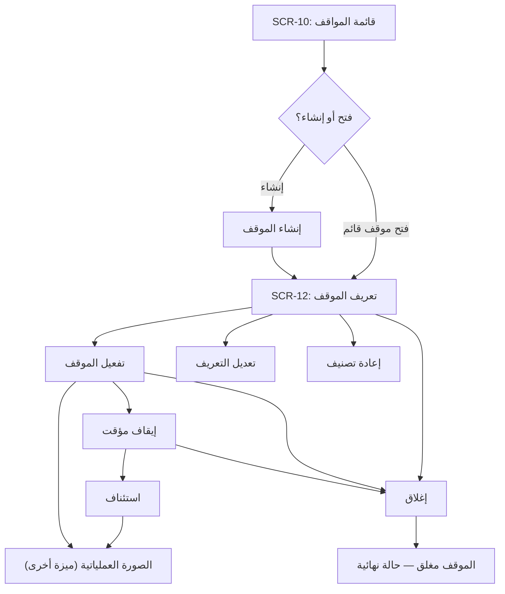
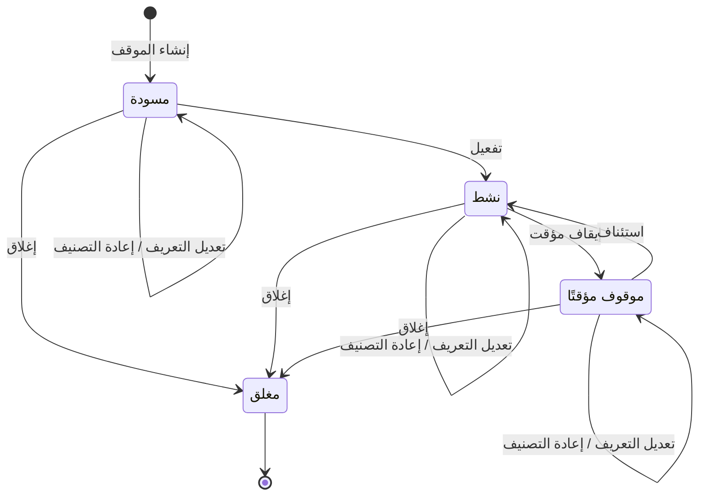

# إنشاء المواقف وإدارتها

<!-- BEGIN GENERATED: doc -->
| البند | القيمة |
|---|---|
| المعرّف | FEAT-SIT-MANAGE |
| الإصدار | 0.3 |
| الحالة | مسودة |
| القدرة | CAP-05 الوعي بالموقف |
| القدرة الفرعية | CAP-05.01 تعريف الموقف (R1) |
| الأدوار | المحلل؛ المدير؛ مسؤول الأمن؛ أي مستخدم مخوَّل |
| الشاشات | SCR-10 قائمة المواقف، SCR-12 إدارة الموقف وقواعد التنبيه |
| حالات الاستخدام | UC-020 |
| القصص | 12: 9 من المواصفة، و3 جديدة |
<!-- END GENERATED: doc -->

## 1. نظرة عامة

### 1.1 القيمة

يحدد المدير أو المحلل الموقف بمنطقته وفترته ومعاييره ويتحكم في تفعيله وإيقافه وإغلاقه.

### 1.2 النطاق

| البند | القيمة |
|---|---|
| المستخدمون | المحلل والمدير (تعريف الموقف وتفعيله وإيقافه وإغلاقه)؛ مسؤول الأمن (إعادة التصنيف)؛ أي مستخدم مخوَّل (تصفح القائمة وفتح التعريف) |
| الشاشات | SCR-10 قائمة المواقف؛ SCR-12 إدارة الموقف وقواعد التنبيه |
| حالات الاستخدام بالكلمات | إنشاء الموقف وإدارة دورة حياته: تعريفه، وتفعيله، وتعديل تعريفه، وإيقافه مؤقتًا، واستئنافه، وإعادة تصنيفه، وإغلاقه؛ واستعراض قائمة المواقف وتفاصيل كل موقف |
| المتطلبات بالكلمات | تعريف كل موقف بامتداد جغرافي وفترة زمنية ومعايير عضوية ومالك وتصنيف، والتحكم في حالته (REQ-SIT-001) |
| خارج النطاق | الصورة العملياتية المشتركة وبلاطات الخريطة (ميزة «الصورة العملياتية المشتركة»)؛ تعريف وتفعيل قواعد التنبيه على الموقف، رغم ظهورها في شاشة SCR-12 نفسها (ميزة أخرى) |

### 1.3 خريطة الميزة

**الشكل 1: مسار إدارة الموقف من القائمة إلى الإغلاق**



**الشكل 2: دورة حالات الموقف**



## 2. القواعد المشتركة

تنطبق على كل قصص الميزة، فلا تتكرر داخل القصص. وكل قصة تذكر ما يخصها فقط.

### 2.1 السياق المشترك

كل قصة تبدأ من ثلاثة شروط: مستأجر نشط، وحزمة السياسات الأساسية مفعّلة، ومستخدم مسجّل الدخول ومخوَّل. وتشير إليها القصص بخطوة واحدة: «بفرض السياق المشترك للميزة».

### 2.2 الصلاحية وعدم الإفصاح

- من لا يحق له رؤية العنصر يتلقى ردًا بشكل «غير متاح» تمامًا، فلا يعرف أنه موجود.
- من يرى العنصر ولا يحق له الإجراء يتلقى «لا تملك صلاحية هذا الإجراء».

### 2.3 أوامر تغيير الحالة

- **منع التكرار:** يُرسل كل أمر بمفتاح فريد، فإعادة الطلب نفسه لا تُنفَّذ مرتين.
- **حماية التعديل المتزامن:** يُرسل كل أمر بإصدار البيانات الذي يراه المستخدم. فإن عدّلها غيره في الأثناء، يُرفض الأمر.
- **السجل:** إن نجح الأمر، يُكتب حدثه وسجل التدقيق في المعاملة نفسها.

### 2.4 الرفض المشترك

```gherkin
# language: ar
خاصية: الرفض المشترك لأوامر الميزة

  سيناريو مخطط: رفض مشترك لكل أمر في الميزة
    بفرض السياق المشترك للميزة
    و <الحالة>
    عندما يُرسل المستخدم أي أمر من أوامر الميزة
    اذاً يُرفض برمز <الرمز> ويرى "<الرسالة>"
    و لا يتغير شيء

    امثلة:
      | الحالة                                  | الرمز                  | الرسالة                                                 |
      | العنصر خارج صلاحياته                    | NOT_FOUND              | غير متاح                                                |
      | العنصر مرئي له ولا يحق له الإجراء       | AUTHZ_DENIED           | لا تملك صلاحية هذا الإجراء                              |
      | غيره عدّل العنصر بعد أن فتحه            | VERSION_CONFLICT       | تغيّرت البيانات منذ فتحتها. راجع التغييرات ثم أعد المحاولة |
      | أعاد مفتاح منع التكرار بمحتوى مختلف     | IDEMPOTENCY_KEY_REUSED | طلب مكرر بمحتوى مختلف                                   |
      | البيانات ناقصة أو غير صحيحة             | VALIDATION_FAILED      | بعض البيانات ناقصة أو غير صحيحة. راجع الحقول المعلَّمة      |

  سيناريو: إعادة الطلب نفسه لا تُنفَّذ مرتين
    بفرض السياق المشترك للميزة
    و أمر نجح بمفتاح منع تكرار
    عندما يُعاد الطلب نفسه بالمفتاح نفسه
    اذاً تُعاد النتيجة الأولى ولا يُكتب حدث ثانٍ
```

## 3. الجودة وتعريف الاكتمال

### 3.1 متطلبات الجودة

<!-- BEGIN GENERATED: quality -->
لا متطلبات جودة مرتبطة بمتطلبات هذه الميزة مباشرة. تنطبق متطلبات المنصة العامة (`FEAT-PLT-*`).
<!-- END GENERATED: quality -->

### 3.2 تعريف الاكتمال

القصة مكتملة حين تتحقق الشروط الخمسة:

1. سيناريوهاتها والقواعد المشتركة تمر في الاختبار الآلي.
2. فحوص البنية المعمارية تمر.
3. نصوص الواجهة والرسائل موجودة بالعربية والإنجليزية.
4. مراجعة الكود مكتملة.
5. ما تضيفه القصة نفسها في قسم «القواعد» تحقق.

## 4. فهرس القصص

<!-- BEGIN GENERATED: story-index -->
| المعرّف | القصة | النوع | الحالة |
|---|---|---|---|
| `US-BC03-SIT-ACTIVATE` | تفعيل الموقف | أمر | مسودة |
| `US-BC03-SIT-CLOSE` | إغلاق الموقف | أمر | مسودة |
| `US-BC03-SIT-CREATE` | إنشاء الموقف | أمر | مسودة |
| `US-BC03-SIT-EDIT-DEFINITION` | تعديل تعريف الموقف | أمر | مسودة |
| `US-BC03-SIT-PAUSE` | إيقاف الموقف مؤقتًا | أمر | مسودة |
| `US-BC03-SIT-RECLASSIFY` | إعادة تصنيف الموقف | أمر | مسودة |
| `US-BC03-SIT-RESUME` | استئناف الموقف | أمر | مسودة |
| `US-BC03-Q-SIT-GET` | جلب: تعريف الموقف وعدد أعضائه المرئيين | جلب | مسودة |
| `US-BC03-Q-SIT-LIST` | جلب: المواقف بحالتها ومالكها وامتدادها | جلب | مسودة |
| `US-UI-SCR10-SITUATION-LIST` | تصفح المواقف بالحالة والمالك والمنطقة | واجهة | مسودة |
| `US-UI-SCR12-DEFINITION-EDITOR` | رسم منطقة الموقف وتحديد فترته ومعاييره | واجهة | مسودة |
| `US-UI-SCR12-SITUATION-ACTIONS` | إظهار أفعال الموقف المتاحة حسب حالته | واجهة | مسودة |
<!-- END GENERATED: story-index -->

## 5. القصص

### 5.1 US-BC03-SIT-ACTIVATE — تفعيل الموقف

| النوع | الإصدار | الأولوية | دون اتصال | الحالة |
|---|---|---|---|---|
| أمر | R1 | Must | لا | مسودة |

> **كـ** المحلل أو المدير، **أريد** تفعيل الموقف بعد اكتمال تعريفه، **حتى** تبدأ عليه الصورة العملياتية وتقييم العضوية والتنبيهات.

**باختصار:** يفعَّل الموقف فيصير «نشط»، فتبدأ عليه عملية حساب الأعضاء وتقييم التنبيهات وتُبنى بلاطات خريطته.

#### القواعد

- **متى يُسمح:** الموقف في حالة «مسودة»، وتعريفه مكتمل، وعدد المواقف النشطة لدى المستأجر دون الحد المسموح.
- **من يُسمح له:** المحلل أو المدير.
- **الأثر:** تصبح حالة الموقف «نشط»، ويُسجَّل حدث «فُعِّل الموقف». يصل الحدث إلى حساب عضوية الموقف (يحمّل تعريفه)، وتقييم قواعد التنبيه عليه، وإبطال بلاطات خريطته، وفهرسة البحث.

#### معايير القبول

```gherkin
# language: ar
خاصية: تفعيل الموقف

  سيناريو: تفعيل موقف مكتمل التعريف
    بفرض السياق المشترك للميزة
    و موقف في حالة "مسودة" وتعريفه مكتمل، ولم يبلغ المستأجر حد المواقف النشطة
    عندما يفعّله المحلل أو المدير
    اذاً تصبح حالته "نشط"
    و يُسجَّل حدث "فُعِّل الموقف"

  سيناريو مخطط: رفض خاص بتفعيل الموقف
    بفرض السياق المشترك للميزة
    و <الحالة>
    عندما يحاول تفعيل الموقف
    اذاً يُرفض برمز <الرمز> ويرى "<الرسالة>"
    و لا يتغير شيء

    امثلة:
      | الحالة                                           | الرمز                               | الرسالة                                            |
      | بلغ المستأجر الحد المسموح من المواقف النشطة     | QUOTA_EXCEEDED                      | بلغت الحد المسموح لجهتك                            |
      | الموقف ليس في حالة "مسودة"                       | SITUATION_INVALID_STATE_TRANSITION  | الوضع الحالي للموقف لا يسمح بهذا الإجراء           |
```

<details><summary>المراجع التقنية والتتبع</summary>

<!-- BEGIN GENERATED: refs US-BC03-SIT-ACTIVATE -->
| البند | المعرّف | المعنى |
|---|---|---|
| الواجهة البرمجية | `POST /api/v1/intelligence/situations/{id}/actions/activate` | — |
| الأمر | `CMD-SIT-ACTIVATE` | تفعيل الموقف |
| السياسة | `POL-SIT-ACTIVATE` | Analyst / Manager (create, edit, activate, pause, close) · Security Officer (reclassify)؛ tenant match; targe… |
| الحدث | `EVT-SIT-ACTIVATED` | يصل إلى: Membership evaluator (reload definition); Alert evaluator; Tile cache invalidation; Search projectio… |
| الكيان | `AGG-SITUATION` | الموقف |
| الجدول | `intelligence.situations` | الجدول الرئيسي للموقف |
| وحدة النشر | DU-06 | — |
| المتطلب | REQ-SIT-001 | The system shall define each situation by geographic extent, time window, inclusion criteria, owner and class… |
| حالة الاستخدام | UC-020 | Create Situation |
| الاختبار | TST-SITUATION-SM، TST-SLC06-INVARIANTS | دورة حالات الموقف، وثوابت الشريحة SLC-06 |
<!-- END GENERATED: refs US-BC03-SIT-ACTIVATE -->

</details>

### 5.2 US-BC03-SIT-CLOSE — إغلاق الموقف

| النوع | الإصدار | الأولوية | دون اتصال | الحالة |
|---|---|---|---|---|
| أمر | R1 | Must | لا | مسودة |

> **كـ** المحلل أو المدير، **أريد** إغلاق الموقف مع ذكر السبب، **حتى** تتوقف العضوية والتنبيهات عليه وتُحفظ صورته النهائية.

**باختصار:** يُغلق الموقف بسبب مذكور، فتصبح حالته «مغلق» وهي حالة نهائية، ويُحفظ آخر لقطة لأعضائه.

#### القواعد

- **متى يُسمح:** الموقف في حالة «مسودة» أو «نشط» أو «موقوف مؤقتًا»، أي ليس مغلقًا من قبل.
- **من يُسمح له:** المحلل أو المدير.
- **البيانات:** السبب (إلزامي).
- **الأثر:** تصبح حالة الموقف «مغلق» وهي حالة نهائية، ويُسجَّل حدث «أُغلق الموقف» مع لقطة العضوية الأخيرة.

#### معايير القبول

```gherkin
# language: ar
خاصية: إغلاق الموقف

  سيناريو: إغلاق موقف نشط بسبب مذكور
    بفرض السياق المشترك للميزة
    و موقف في حالة "نشط"
    عندما يغلقه المحلل أو المدير مع ذكر السبب
    اذاً تصبح حالته "مغلق"
    و يُسجَّل حدث "أُغلق الموقف" مع لقطة العضوية الأخيرة

  سيناريو مخطط: رفض خاص بإغلاق الموقف
    بفرض السياق المشترك للميزة
    و <الحالة>
    عندما يحاول إغلاق الموقف
    اذاً يُرفض برمز <الرمز> ويرى "<الرسالة>"
    و لا يتغير شيء

    امثلة:
      | الحالة                         | الرمز                               | الرسالة                                     |
      | السبب لم يُذكر                | REASON_REQUIRED                     | اذكر السبب                                  |
      | الموقف مغلق من قبل            | SITUATION_INVALID_STATE_TRANSITION  | الوضع الحالي للموقف لا يسمح بهذا الإجراء    |
```

<details><summary>المراجع التقنية والتتبع</summary>

<!-- BEGIN GENERATED: refs US-BC03-SIT-CLOSE -->
| البند | المعرّف | المعنى |
|---|---|---|
| الواجهة البرمجية | `POST /api/v1/intelligence/situations/{id}/actions/close` | — |
| الأمر | `CMD-SIT-CLOSE` | إغلاق الموقف |
| السياسة | `POL-SIT-CLOSE` | Analyst / Manager (create, edit, activate, pause, close) · Security Officer (reclassify)؛ tenant match; targe… |
| الحدث | `EVT-SIT-CLOSED` | يصل إلى: Membership evaluator (reload definition); Alert evaluator; Tile cache invalidation; Search projectio… |
| الكيان | `AGG-SITUATION` | الموقف |
| الجدول | `intelligence.situations` | الجدول الرئيسي للموقف |
| وحدة النشر | DU-06 | — |
| المتطلب | REQ-SIT-001 | The system shall define each situation by geographic extent, time window, inclusion criteria, owner and class… |
| حالة الاستخدام | UC-020 | Create Situation |
| الاختبار | TST-SITUATION-SM، TST-SLC06-INVARIANTS | دورة حالات الموقف، وثوابت الشريحة SLC-06 |
<!-- END GENERATED: refs US-BC03-SIT-CLOSE -->

</details>

### 5.3 US-BC03-SIT-CREATE — إنشاء الموقف

| النوع | الإصدار | الأولوية | دون اتصال | الحالة |
|---|---|---|---|---|
| أمر | R1 | Must | لا | مسودة |

> **كـ** المحلل أو المدير، **أريد** إنشاء موقف جديد بامتداده الجغرافي وفترته ومعايير عضويته، **حتى** يصير لدي سياق تشغيلي واحد يجمع ما يخصه.

**باختصار:** يُنشأ الموقف بالاسم والامتداد والفترة ومعايير العضوية والمالك والتصنيف، فيبدأ في حالة «مسودة» قبل تفعيله.

#### القواعد

- **من يُسمح له:** المحلل أو المدير.
- **البيانات:** الاسم، والامتداد الجغرافي (مضلع أو حاجز حول كيان مرساة)، والفترة الزمنية، ومعايير العضوية، والمالك، وتصنيف الموقف — كلها إلزامية.
- **الأثر:** يُنشأ الموقف بحالة «مسودة»، ويُسجَّل حدث «أُنشئ الموقف».

#### معايير القبول

```gherkin
# language: ar
خاصية: إنشاء الموقف

  سيناريو: إنشاء موقف ببيانات كاملة
    بفرض السياق المشترك للميزة
    عندما ينشئ المحلل أو المدير موقفًا بالاسم والامتداد والفترة ومعايير العضوية والمالك والتصنيف
    اذاً يُنشأ الموقف في حالة "مسودة"
    و يُسجَّل حدث "أُنشئ الموقف"

  سيناريو مخطط: رفض خاص بإنشاء الموقف
    بفرض السياق المشترك للميزة
    و <الحالة>
    عندما يحاول إنشاء الموقف
    اذاً يُرفض برمز <الرمز> ويرى "<الرسالة>"
    و لا يتغير شيء

    امثلة:
      | الحالة                                 | الرمز             | الرسالة                        |
      | معايير العضوية غير صالحة أو ناقصة     | SITUATION_INVALID | بيانات الموقف غير مكتملة       |
```

<details><summary>المراجع التقنية والتتبع</summary>

<!-- BEGIN GENERATED: refs US-BC03-SIT-CREATE -->
| البند | المعرّف | المعنى |
|---|---|---|
| الواجهة البرمجية | `POST /api/v1/intelligence/situations` | — |
| الأمر | `CMD-SIT-CREATE` | إنشاء الموقف |
| السياسة | `POL-SIT-CREATE` | Analyst / Manager (create, edit, activate, pause, close) · Security Officer (reclassify)؛ tenant match; targe… |
| الحدث | `EVT-SIT-CREATED` | يصل إلى: Membership evaluator (reload definition); Alert evaluator; Tile cache invalidation; Search projectio… |
| الكيان | `AGG-SITUATION` | الموقف |
| الجدول | `intelligence.situations` | الجدول الرئيسي للموقف |
| وحدة النشر | DU-06 | — |
| المتطلب | REQ-SIT-001 | The system shall define each situation by geographic extent, time window, inclusion criteria, owner and class… |
| حالة الاستخدام | UC-020 | Create Situation |
| الاختبار | TST-SITUATION-SM، TST-SLC06-INVARIANTS | دورة حالات الموقف، وثوابت الشريحة SLC-06 |
<!-- END GENERATED: refs US-BC03-SIT-CREATE -->

</details>

### 5.4 US-BC03-SIT-EDIT-DEFINITION — تعديل تعريف الموقف

| النوع | الإصدار | الأولوية | دون اتصال | الحالة |
|---|---|---|---|---|
| أمر | R1 | Must | لا | مسودة |

> **كـ** المحلل أو المدير، **أريد** تعديل امتداد الموقف أو فترته أو معايير عضويته، **حتى** يبقى الموقف منعكسًا على الواقع المتغيّر.

**باختصار:** يُعدَّل الامتداد أو الفترة أو معايير العضوية بسبب مذكور، فيرتفع إصدار الموقف ويعاد حساب عضويته كاملة من التعريف الجديد دون أن تتغير حالته.

#### القواعد

- **متى يُسمح:** الموقف في حالة «مسودة» أو «نشط» أو «موقوف مؤقتًا»، أي ليس مغلقًا.
- **من يُسمح له:** المحلل أو المدير.
- **البيانات:** الامتداد و/أو الفترة و/أو معايير العضوية (كل منها اختياري على حدة)، والسبب (إلزامي).
- **الأثر:** حالة الموقف لا تتغير ويرتفع إصداره، ويُسجَّل حدث «تغيّر تعريف الموقف»، وتُعاد حساب عضويته كاملة من التعريف الجديد.

#### معايير القبول

```gherkin
# language: ar
خاصية: تعديل تعريف الموقف

  سيناريو: تعديل معايير موقف نشط
    بفرض السياق المشترك للميزة
    و موقف في حالة "نشط"
    عندما يعدّل المحلل أو المدير معايير عضويته مع ذكر السبب
    اذاً لا تتغير حالته ويرتفع إصداره
    و يُسجَّل حدث "تغيّر تعريف الموقف"
    و تُعاد حساب عضويته كاملة من التعريف الجديد

  سيناريو مخطط: رفض خاص بتعديل التعريف
    بفرض السياق المشترك للميزة
    و <الحالة>
    عندما يحاول تعديل التعريف
    اذاً يُرفض برمز <الرمز> ويرى "<الرسالة>"
    و لا يتغير شيء

    امثلة:
      | الحالة                                  | الرمز                               | الرسالة                                     |
      | السبب لم يُذكر                         | VALIDATION_FAILED                   | السبب مطلوب                                 |
      | الامتداد أو الفترة أو المعايير غير صالحة | SITUATION_INVALID                 | بيانات الموقف غير مكتملة                    |
      | الموقف مغلق                            | SITUATION_INVALID_STATE_TRANSITION  | الوضع الحالي للموقف لا يسمح بهذا الإجراء    |
```

<details><summary>المراجع التقنية والتتبع</summary>

<!-- BEGIN GENERATED: refs US-BC03-SIT-EDIT-DEFINITION -->
| البند | المعرّف | المعنى |
|---|---|---|
| الواجهة البرمجية | `POST /api/v1/intelligence/situations/{id}/actions/edit-definition` | — |
| الأمر | `CMD-SIT-EDIT-DEFINITION` | تعديل تعريف الموقف |
| السياسة | `POL-SIT-EDIT-DEFINITION` | Analyst / Manager (create, edit, activate, pause, close) · Security Officer (reclassify)؛ tenant match; targe… |
| الحدث | `EVT-SIT-DEFINITION-CHANGED` | يصل إلى: Membership evaluator (reload definition); Alert evaluator; Tile cache invalidation; Search projectio… |
| الكيان | `AGG-SITUATION` | الموقف |
| الجدول | `intelligence.situations` | الجدول الرئيسي للموقف |
| وحدة النشر | DU-06 | — |
| المتطلب | REQ-SIT-001 | The system shall define each situation by geographic extent, time window, inclusion criteria, owner and class… |
| حالة الاستخدام | UC-020 | Create Situation |
| الاختبار | TST-SITUATION-SM، TST-SLC06-INVARIANTS | دورة حالات الموقف، وثوابت الشريحة SLC-06 |
<!-- END GENERATED: refs US-BC03-SIT-EDIT-DEFINITION -->

</details>

### 5.5 US-BC03-SIT-PAUSE — إيقاف الموقف مؤقتًا

| النوع | الإصدار | الأولوية | دون اتصال | الحالة |
|---|---|---|---|---|
| أمر | R1 | Must | لا | مسودة |

> **كـ** المحلل أو المدير، **أريد** إيقاف الموقف مؤقتًا بسبب مذكور، **حتى** تتجمد عضويته وتنبيهاته دون إغلاقه نهائيًا.

**باختصار:** يُوقف الموقف النشط مؤقتًا بسبب مذكور، فتتجمد عضويته وتُعلَّق تنبيهات قواعده دون إغلاق الموقف.

#### القواعد

- **متى يُسمح:** الموقف في حالة «نشط» فقط.
- **من يُسمح له:** المحلل أو المدير.
- **البيانات:** السبب (إلزامي).
- **الأثر:** تصبح حالة الموقف «موقوف مؤقتًا»، ويُسجَّل حدث «أُوقف الموقف مؤقتًا»، وتتجمد عضويته وتُعلَّق تنبيهات قواعده.

#### معايير القبول

```gherkin
# language: ar
خاصية: إيقاف الموقف مؤقتًا

  سيناريو: إيقاف موقف نشط مؤقتًا
    بفرض السياق المشترك للميزة
    و موقف في حالة "نشط"
    عندما يوقفه المحلل أو المدير مؤقتًا مع ذكر السبب
    اذاً تصبح حالته "موقوف مؤقتًا"
    و يُسجَّل حدث "أُوقف الموقف مؤقتًا"
    و تتجمد عضويته وتُعلَّق تنبيهات قواعده

  سيناريو مخطط: رفض خاص بالإيقاف المؤقت
    بفرض السياق المشترك للميزة
    و <الحالة>
    عندما يحاول إيقاف الموقف مؤقتًا
    اذاً يُرفض برمز <الرمز> ويرى "<الرسالة>"
    و لا يتغير شيء

    امثلة:
      | الحالة                         | الرمز                               | الرسالة                                     |
      | السبب لم يُذكر                | REASON_REQUIRED                     | اذكر السبب                                  |
      | الموقف ليس في حالة "نشط"       | SITUATION_INVALID_STATE_TRANSITION  | الوضع الحالي للموقف لا يسمح بهذا الإجراء    |
```

<details><summary>المراجع التقنية والتتبع</summary>

<!-- BEGIN GENERATED: refs US-BC03-SIT-PAUSE -->
| البند | المعرّف | المعنى |
|---|---|---|
| الواجهة البرمجية | `POST /api/v1/intelligence/situations/{id}/actions/pause` | — |
| الأمر | `CMD-SIT-PAUSE` | إيقاف الموقف مؤقتًا |
| السياسة | `POL-SIT-PAUSE` | Analyst / Manager (create, edit, activate, pause, close) · Security Officer (reclassify)؛ tenant match; targe… |
| الحدث | `EVT-SIT-PAUSED` | يصل إلى: Membership evaluator (reload definition); Alert evaluator; Tile cache invalidation; Search projectio… |
| الكيان | `AGG-SITUATION` | الموقف |
| الجدول | `intelligence.situations` | الجدول الرئيسي للموقف |
| وحدة النشر | DU-06 | — |
| المتطلب | REQ-SIT-001 | The system shall define each situation by geographic extent, time window, inclusion criteria, owner and class… |
| حالة الاستخدام | UC-020 | Create Situation |
| الاختبار | TST-SITUATION-SM، TST-SLC06-INVARIANTS | دورة حالات الموقف، وثوابت الشريحة SLC-06 |
<!-- END GENERATED: refs US-BC03-SIT-PAUSE -->

</details>

### 5.6 US-BC03-SIT-RECLASSIFY — إعادة تصنيف الموقف

| النوع | الإصدار | الأولوية | دون اتصال | الحالة |
|---|---|---|---|---|
| أمر | R1 | Must | لا | مسودة |

> **كـ** مسؤول الأمن، **أريد** إعادة تصنيف الموقف بسبب مذكور، **حتى** يطابق تصنيفه حساسية ما يحتويه فعلًا.

**باختصار:** يغيّر مسؤول الأمن تصنيف الموقف بسبب مذكور، فيرتفع إصداره، ويُلغى اشتراك من لا تصريح أمني له بالتصنيف الجديد.

#### القواعد

- **متى يُسمح:** الموقف في حالة «مسودة» أو «نشط» أو «موقوف مؤقتًا»، أي ليس مغلقًا.
- **من يُسمح له:** مسؤول الأمن فقط، وضمن السلطة التي تحددها سياسة المستأجر.
- **البيانات:** التصنيف الجديد، والسبب — كلاهما إلزامي.
- **الأثر:** حالة الموقف لا تتغير ويرتفع إصداره، ويُسجَّل حدث «أُعيد تصنيف الموقف»، ويُلغى اشتراك من لا تصريح أمني له بالتصنيف الجديد.

#### معايير القبول

```gherkin
# language: ar
خاصية: إعادة تصنيف الموقف

  سيناريو: إعادة تصنيف موقف نشط
    بفرض السياق المشترك للميزة
    و موقف في حالة "نشط"
    عندما يعيد مسؤول الأمن تصنيفه إلى مستوى أعلى مع ذكر السبب
    اذاً لا تتغير حالته ويرتفع إصداره
    و يُسجَّل حدث "أُعيد تصنيف الموقف"
    و يُلغى اشتراك من لا تصريح أمني له بالتصنيف الجديد

  سيناريو مخطط: رفض خاص بإعادة التصنيف
    بفرض السياق المشترك للميزة
    و <الحالة>
    عندما يحاول إعادة تصنيف الموقف
    اذاً يُرفض برمز <الرمز> ويرى "<الرسالة>"
    و لا يتغير شيء

    امثلة:
      | الحالة                                              | الرمز                                  | الرسالة                                     |
      | لا يملك السلطة اللازمة وفق سياسة المستأجر          | CLASSIFICATION_CHANGE_NOT_AUTHORIZED   | لا تملك صلاحية تغيير التصنيف                |
      | الموقف مغلق                                        | SITUATION_INVALID_STATE_TRANSITION     | الوضع الحالي للموقف لا يسمح بهذا الإجراء    |
```

<details><summary>المراجع التقنية والتتبع</summary>

<!-- BEGIN GENERATED: refs US-BC03-SIT-RECLASSIFY -->
| البند | المعرّف | المعنى |
|---|---|---|
| الواجهة البرمجية | `POST /api/v1/intelligence/situations/{id}/actions/reclassify` | — |
| الأمر | `CMD-SIT-RECLASSIFY` | إعادة تصنيف الموقف |
| السياسة | `POL-SIT-RECLASSIFY` | Analyst / Manager (create, edit, activate, pause, close) · Security Officer (reclassify)؛ tenant match; targe… |
| الحدث | `EVT-SIT-RECLASSIFIED` | يصل إلى: Security-version service (EVT-SEC-VERSION-INCREMENTED); PEP decision caches; Projection security-ver… |
| الكيان | `AGG-SITUATION` | الموقف |
| الجدول | `intelligence.situations` | الجدول الرئيسي للموقف |
| وحدة النشر | DU-06 | — |
| المتطلب | REQ-SIT-001 | The system shall define each situation by geographic extent, time window, inclusion criteria, owner and class… |
| حالة الاستخدام | UC-020 | Create Situation |
| الاختبار | TST-SITUATION-SM، TST-SLC06-INVARIANTS | دورة حالات الموقف، وثوابت الشريحة SLC-06 |
<!-- END GENERATED: refs US-BC03-SIT-RECLASSIFY -->

</details>

### 5.7 US-BC03-SIT-RESUME — استئناف الموقف

| النوع | الإصدار | الأولوية | دون اتصال | الحالة |
|---|---|---|---|---|
| أمر | R1 | Must | لا | مسودة |

> **كـ** المحلل أو المدير، **أريد** استئناف موقف موقوف مؤقتًا، **حتى** يعود إلى تتبع الواقع من جديد.

**باختصار:** يُستأنف الموقف الموقوف مؤقتًا فيصير «نشط» من جديد، وتُعاد تقييم عضويته من الحالة الراهنة.

#### القواعد

- **متى يُسمح:** الموقف في حالة «موقوف مؤقتًا» فقط.
- **من يُسمح له:** المحلل أو المدير.
- **الأثر:** تصبح حالة الموقف «نشط»، ويُسجَّل حدث «استُؤنف الموقف»، وتُعاد تقييم عضويته من الحالة الراهنة.

#### معايير القبول

```gherkin
# language: ar
خاصية: استئناف الموقف

  سيناريو: استئناف موقف موقوف مؤقتًا
    بفرض السياق المشترك للميزة
    و موقف في حالة "موقوف مؤقتًا"
    عندما يستأنفه المحلل أو المدير
    اذاً تصبح حالته "نشط"
    و يُسجَّل حدث "استُؤنف الموقف"
    و تُعاد تقييم عضويته من الحالة الراهنة

  سيناريو مخطط: رفض خاص باستئناف الموقف
    بفرض السياق المشترك للميزة
    و <الحالة>
    عندما يحاول استئناف الموقف
    اذاً يُرفض برمز <الرمز> ويرى "<الرسالة>"
    و لا يتغير شيء

    امثلة:
      | الحالة                                | الرمز                               | الرسالة                                     |
      | الموقف ليس في حالة "موقوف مؤقتًا"    | SITUATION_INVALID_STATE_TRANSITION  | الوضع الحالي للموقف لا يسمح بهذا الإجراء    |
```

<details><summary>المراجع التقنية والتتبع</summary>

<!-- BEGIN GENERATED: refs US-BC03-SIT-RESUME -->
| البند | المعرّف | المعنى |
|---|---|---|
| الواجهة البرمجية | `POST /api/v1/intelligence/situations/{id}/actions/resume` | — |
| الأمر | `CMD-SIT-RESUME` | استئناف الموقف |
| السياسة | `POL-SIT-RESUME` | Analyst / Manager (resume)؛ tenant match; target visible to subject |
| الحدث | `EVT-SIT-RESUMED` | يصل إلى: Membership evaluator (reload definition); Alert evaluator; Tile cache invalidation; Search projectio… |
| الكيان | `AGG-SITUATION` | الموقف |
| الجدول | `intelligence.situations` | الجدول الرئيسي للموقف |
| وحدة النشر | DU-06 | — |
| المتطلب | REQ-SIT-001 | The system shall define each situation by geographic extent, time window, inclusion criteria, owner and class… |
| حالة الاستخدام | UC-020 | Create Situation |
| الاختبار | TST-SITUATION-SM، TST-SLC06-INVARIANTS | دورة حالات الموقف، وثوابت الشريحة SLC-06 |
<!-- END GENERATED: refs US-BC03-SIT-RESUME -->

</details>

### 5.8 US-BC03-Q-SIT-GET — جلب: تعريف الموقف وعدد أعضائه المرئيين

| النوع | الإصدار | الأولوية | دون اتصال | الحالة |
|---|---|---|---|---|
| جلب | R1 | Must | لا | مسودة |

> **كـ** أي مستخدم مخوَّل، **أريد** فتح تعريف موقف وعدد أعضائه حسب نوعهم، **حتى** أعرف ما يغطيه هذا الموقف دون فتح خريطته.

**باختصار:** تُعاد تفاصيل تعريف الموقف (إصداره الساري في وقت محدد عند طلبه) وعدد أعضائه المرئيين للطالب مصنَّفين حسب نوعهم.

#### القواعد

- **من يرى ماذا:** من يحمل تصريح تصنيف الموقف يرى تعريفه، والأعداد المعروضة لأعضائه المرئيين له فقط.
- **البيانات:** معرّف الموقف، ووقت محدد اختياري لعرض الإصدار الذي كان ساريًا وقتها.

#### معايير القبول

```gherkin
# language: ar
خاصية: جلب تعريف الموقف

  سيناريو: فتح تعريف موقف حالي
    بفرض السياق المشترك للميزة
    و موقف يراه الطالب
    عندما يطلب تعريفه
    اذاً تُعاد بيانات التعريف الحالية، وعدد أعضائه المرئيين له مصنَّفًا حسب نوعهم

  سيناريو: فتح تعريف الموقف كما كان في وقت سابق
    بفرض السياق المشترك للميزة
    و موقف غيّر تعريفه أكثر من مرة
    عندما يطلب تعريفه عند وقت محدد في الماضي
    اذاً تُعاد نسخة التعريف التي كانت سارية في ذلك الوقت
```

<details><summary>المراجع التقنية والتتبع</summary>

<!-- BEGIN GENERATED: refs US-BC03-Q-SIT-GET -->
| البند | المعرّف | المعنى |
|---|---|---|
| الواجهة البرمجية | `GET /api/v1/intelligence/situations/{situation_id}` | — |
| الاستعلام | `QRY-SIT-GET` | Definition (version at valid_at), counts of visible members by type |
| السياسة | `POL-SIT-GET` | cleared for situation label |
| الكيان | `AGG-SITUATION` | الموقف |
| الجدول | `intelligence.situations` | الجدول الرئيسي للموقف |
| وحدة النشر | DU-06 | — |
| المتطلب | REQ-SIT-001 | The system shall define each situation by geographic extent, time window, inclusion criteria, owner and class… |
| حالة الاستخدام | UC-020 | Create Situation |
| الاختبار | TST-SITUATION-SM، TST-SLC06-INVARIANTS | دورة حالات الموقف، وثوابت الشريحة SLC-06 |
<!-- END GENERATED: refs US-BC03-Q-SIT-GET -->

</details>

### 5.9 US-BC03-Q-SIT-LIST — جلب: المواقف بحالتها ومالكها وامتدادها

| النوع | الإصدار | الأولوية | دون اتصال | الحالة |
|---|---|---|---|---|
| جلب | R1 | Must | لا | مسودة |

> **كـ** أي مستخدم مخوَّل، **أريد** قائمة المواقف مصفّاة بالحالة والمالك والمنطقة، **حتى** أجد الموقف الذي يهمني.

**باختصار:** تُعاد المواقف التي يحق للمستخدم رؤيتها فقط، صفحةً بعد صفحة، دون أي مؤشر على وجود مواقف محجوبة.

#### القواعد

- **من يرى ماذا:** كل مستخدم يرى المواقف ضمن نطاق صلاحيته فقط؛ غيرها لا يظهر في القائمة ولا في عددها.
- **البيانات (المرشحات):** الحالة، والمالك، والامتداد المتقاطع مع مستطيل جغرافي محدد، والمؤشر والحد.

#### معايير القبول

```gherkin
# language: ar
خاصية: جلب قائمة المواقف

  سيناريو: يرى المستخدم المواقف داخل نطاقه فقط
    بفرض السياق المشترك للميزة
    و مواقف داخل نطاق المستخدم وأخرى خارجه
    عندما يطلب قائمة المواقف
    اذاً تُعاد المواقف داخل نطاقه فقط
    و لا يكشف أي عدد أو اقتراح وجود موقف محجوب

  سيناريو: التصفية بالحالة والمالك والمنطقة
    بفرض السياق المشترك للميزة
    و مواقف بحالات ومالكين وامتدادات مختلفة
    عندما يطلبها مصفّاة بحالة ومالك ومستطيل جغرافي محدد
    اذاً تُعاد المواقف المطابقة للتصفية فقط
```

<details><summary>المراجع التقنية والتتبع</summary>

<!-- BEGIN GENERATED: refs US-BC03-Q-SIT-LIST -->
| البند | المعرّف | المعنى |
|---|---|---|
| الواجهة البرمجية | `GET /api/v1/intelligence/situations` | — |
| الاستعلام | `QRY-SIT-LIST` | Situations by state, owner, extent intersecting bbox |
| السياسة | `POL-SIT-LIST` | any user; situation label rule |
| الكيان | `AGG-SITUATION` | الموقف |
| الجدول | `intelligence.situations` | الجدول الرئيسي للموقف |
| وحدة النشر | DU-06 | — |
| المتطلب | REQ-SIT-001 | The system shall define each situation by geographic extent, time window, inclusion criteria, owner and class… |
| حالة الاستخدام | UC-020 | Create Situation |
| الاختبار | TST-SITUATION-SM، TST-SLC06-INVARIANTS | دورة حالات الموقف، وثوابت الشريحة SLC-06 |
<!-- END GENERATED: refs US-BC03-Q-SIT-LIST -->

</details>

### 5.10 US-UI-SCR10-SITUATION-LIST — تصفح المواقف بالحالة والمالك والمنطقة

| النوع | الإصدار | الأولوية | دون اتصال | الحالة |
|---|---|---|---|---|
| واجهة | R1 | Should | لا | مسودة |

> **كـ** المستخدم، **أريد** تصفح قائمة المواقف وتصفيتها بحالتها ومالكها والمنطقة التي تغطيها، **حتى** أصل إلى الموقف الذي يهمني بسرعة.

**باختصار:** تعرض شاشة قائمة المواقف (SCR-10) كل موقف مرئي للمستخدم مع حالته ومالكه، مع مرشحات للحالة والمالك والمنطقة، وفتح أي موقف منها ينقل إلى شاشة تعريفه.

#### القواعد

- **لا رفض خاص:** القائمة تتبع قواعد الصلاحية وعدم الإفصاح في القسم 2، ولا رفض إضافي يخصها.

#### معايير القبول

```gherkin
# language: ar
خاصية: تصفح قائمة المواقف

  سيناريو: تصفية القائمة بالحالة والمالك والمنطقة
    بفرض السياق المشترك للميزة
    و مواقف مرئية للمستخدم بحالات ومالكين ومناطق مختلفة
    عندما يختار حالة ومالكًا ومنطقة من المرشحات
    اذاً تعرض القائمة المواقف المطابقة فقط

  سيناريو: فتح موقف من القائمة
    بفرض السياق المشترك للميزة
    و موقف يراه المستخدم في القائمة
    عندما يفتحه
    اذاً تنتقل الشاشة إلى تعريف الموقف المختار
```

<details><summary>المراجع التقنية والتتبع</summary>

<!-- BEGIN GENERATED: refs US-UI-SCR10-SITUATION-LIST -->
| البند | المعرّف | المعنى |
|---|---|---|
| الشاشة | SCR-10 | شاشة قائمة المواقف |
| حالة الاستخدام | UC-020 | Create Situation |
<!-- END GENERATED: refs US-UI-SCR10-SITUATION-LIST -->

</details>

### 5.11 US-UI-SCR12-DEFINITION-EDITOR — رسم منطقة الموقف وتحديد فترته ومعاييره

| النوع | الإصدار | الأولوية | دون اتصال | الحالة |
|---|---|---|---|---|
| واجهة | R1 | Must | لا | مسودة |

> **كـ** المحلل أو المدير، **أريد** محررًا مرئيًا لرسم امتداد الموقف وتحديد فترته ومعايير عضويته، **حتى** أبني تعريف الموقف دون كتابة بياناته يدويًا.

**باختصار:** محرر على الخريطة (شاشة SCR-12) يرسم امتداد الموقف كمضلع أو كحاجز حول كيان مرساة، ويحدد فترته الزمنية، ويبني معايير عضويته (الأنواع والمرشحات والعتبات)، قبل إنشاء الموقف أو تعديل تعريفه.

#### القواعد

- **البيانات:** الامتداد (مضلع، أو حاجز مسافة حول كيان مرساة يتبع موقعه)، والفترة الزمنية، ومعايير العضوية: أنواع الكائنات، ومرشحات أنواعها الفرعية، وهل تُضم الكائنات المتنازع عليها أو غير المصدَّقة، وحد أدنى لموثوقية المصدر.

#### معايير القبول

```gherkin
# language: ar
خاصية: محرر تعريف الموقف

  سيناريو: رسم امتداد مضلع وتحديد الفترة والمعايير
    بفرض السياق المشترك للميزة
    عندما يرسم المحلل أو المدير امتدادًا مضلعًا ويحدد فترة زمنية ومعايير عضوية
    اذاً يظهر التعريف جاهزًا للإرسال بإنشاء الموقف أو تعديل تعريفه

  سيناريو: اختيار حاجز حول كيان مرساة بدل المضلع
    بفرض السياق المشترك للميزة
    عندما يختار كيانًا مرساة ومسافة حاجز حوله بدل رسم مضلع
    اذاً يتبع الامتداد موقع الكيان كل مرة يُعاد حسابه
```

<details><summary>المراجع التقنية والتتبع</summary>

<!-- BEGIN GENERATED: refs US-UI-SCR12-DEFINITION-EDITOR -->
| البند | المعرّف | المعنى |
|---|---|---|
| الشاشة | SCR-12 | شاشة إدارة الموقف وقواعد التنبيه |
| المصدر | `situation-alerting-spec.md §2` | — |
| المتطلب | REQ-SIT-001 | The system shall define each situation by geographic extent, time window, inclusion criteria, owner and class… |
| حالة الاستخدام | UC-020 | Create Situation |
<!-- END GENERATED: refs US-UI-SCR12-DEFINITION-EDITOR -->

</details>

### 5.12 US-UI-SCR12-SITUATION-ACTIONS — إظهار أفعال الموقف المتاحة حسب حالته

| النوع | الإصدار | الأولوية | دون اتصال | الحالة |
|---|---|---|---|---|
| واجهة | R1 | Must | لا | مسودة |

> **كـ** المستخدم، **أريد** أن أرى فقط الأفعال التي يُرجَّح أن تنجح على الموقف المفتوح، **حتى** لا أحاول فعلًا سترفضه حالته أو صلاحيتي.

**باختصار:** تعرض شاشة إدارة الموقف (SCR-12) أزرار الأفعال (تفعيل، تعديل، إيقاف مؤقت، استئناف، إعادة تصنيف، إغلاق) حسب حالة الموقف وصلاحية المستخدم المعروضة، كتلميح لا كقرار نهائي؛ والخادم هو من يحسم قبول الفعل أو رفضه عند تنفيذه.

#### القواعد

- **من يُسمح له:** يظهر الزر إذا سمحت صلاحية المستخدم بالفعل وسمحت حالة الموقف المعروضة به؛ وهذا تلميح فقط، ويبقى حكم القبول للخادم عند التنفيذ.

#### معايير القبول

```gherkin
# language: ar
خاصية: أفعال الموقف المتاحة حسب حالته

  سيناريو: تظهر أفعال الحالة "نشط" فقط
    بفرض السياق المشترك للميزة
    و موقف في حالة "نشط" يحق للمستخدم تعديله وإيقافه وإغلاقه
    عندما يفتح شاشة إدارة الموقف
    اذاً تظهر له أزرار تعديل التعريف والإيقاف المؤقت والإغلاق
    و لا يظهر زر التفعيل أو الاستئناف

  سيناريو: الخادم يرفض فعلًا ظهر زره
    بفرض السياق المشترك للميزة
    و زر فعل ظهر بناءً على حالة الموقف المعروضة عند فتح الشاشة
    و غيّر مستخدم آخر حالة الموقف في الأثناء
    عندما يضغط المستخدم الزر وتُرسل محاولة الفعل
    اذاً يُرفض الفعل برمز "تعارض الإصدار" ويُعاد تحميل حالة الموقف
```

<details><summary>المراجع التقنية والتتبع</summary>

<!-- BEGIN GENERATED: refs US-UI-SCR12-SITUATION-ACTIONS -->
| البند | المعرّف | المعنى |
|---|---|---|
| الشاشة | SCR-12 | شاشة إدارة الموقف وقواعد التنبيه |
| المصدر | `21-ui-design.md §6.3` | — |
| المتطلب | REQ-SIT-001 | The system shall define each situation by geographic extent, time window, inclusion criteria, owner and class… |
| حالة الاستخدام | UC-020 | Create Situation |
<!-- END GENERATED: refs US-UI-SCR12-SITUATION-ACTIONS -->

</details>

## 6. التتبع

<!-- BEGIN GENERATED: trace -->
| المتطلب | المعنى | القصص | الاختبار |
|---|---|---|---|
| REQ-SIT-001 | The system shall define each situation by geographic extent, time window, inclusion criteria, owner and class… | `US-BC03-Q-SIT-GET`، `US-BC03-Q-SIT-LIST`، `US-BC03-SIT-ACTIVATE`، `US-BC03-SIT-CLOSE`، `US-BC03-SIT-CREATE`، `US-BC03-SIT-EDIT-DEFINITION`، `US-BC03-SIT-PAUSE`، `US-BC03-SIT-RECLASSIFY`، `US-BC03-SIT-RESUME`، `US-UI-SCR12-DEFINITION-EDITOR`، `US-UI-SCR12-SITUATION-ACTIONS` | TST-SITUATION-SM، TST-SLC06-INVARIANTS |
<!-- END GENERATED: trace -->

## 7. سجل التغييرات

| الإصدار | التاريخ | التغيير |
|---|---|---|
| 0.1 | — | هيكل مولَّد من خريطة الميزات |
| 0.2 | 2026-10-13 | كتابة القصص كاملة بمعيار القصص |
| 0.3 | 2026-10-13 | تصحيحات المراجعة المستقلة (الدفعة الأولى) |
