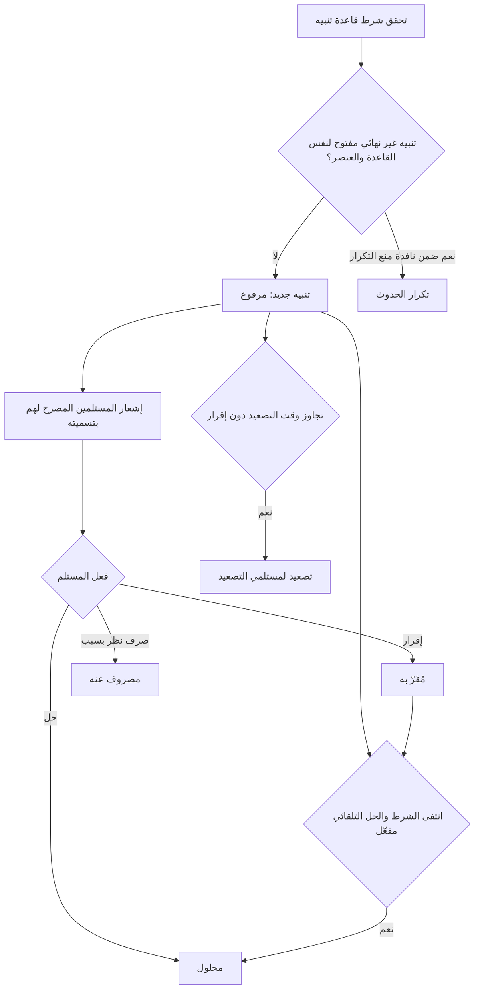
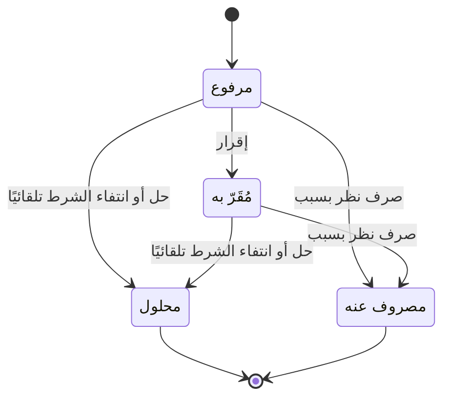

# تنبيهاتي

<!-- BEGIN GENERATED: doc -->
| البند | القيمة |
|---|---|
| المعرّف | FEAT-SIT-MY-ALERTS |
| الإصدار | 0.2 |
| الحالة | مسودة |
| القدرة | CAP-05 الوعي بالموقف |
| القدرة الفرعية | CAP-05.02 المراقبة والتنبيه (R1) |
| الأدوار | مستلم التنبيه؛ النظام |
| الشاشات | SCR-04 تنبيهاتي، SCR-03 صندوق الوارد |
| حالات الاستخدام | UC-023 |
| القصص | 13: 8 من المواصفة، و5 جديدة |
<!-- END GENERATED: doc -->

## 1. نظرة عامة

### 1.1 القيمة

يصل المستخدم تنبيه فوري حين يقع ما يهمه فيقرّ به أو يحله أو يصرفه بسبب ويُصعَّد إن أهمله.

### 1.2 النطاق

| البند | القيمة |
|---|---|
| المستخدمون | مستلم التنبيه، النظام |
| الشاشات | SCR-04 تنبيهاتي، SCR-03 صندوق الوارد |
| حالات الاستخدام | الإقرار بالتنبيه وحله وصرف النظر عنه، وجلب تنبيهاتي، وإطلاق التنبيه وتكراره وتصعيده وحله تلقائيًا |
| المتطلبات | إطلاق تنبيه وتبليغ المشتركين المخوَّلين عند تحقق شرط القاعدة (REQ-SIT-004)، وإدارة حالاته الأربع بسبب إلزامي للصرف (REQ-SIT-005)، وعدم كشف ما لا يحق للمستخدم رؤيته (REQ-SIT-006) |
| خارج النطاق | تعريف قواعد التنبيه وتجربتها وتفعيلها (ميزة قواعد التنبيه)، وإعدادات الاشتراك وقنواته |

### 1.3 خريطة الميزة

**الشكل 1: من تحقق شرط القاعدة إلى حسم التنبيه**



**الشكل 2: حالات التنبيه**



## 2. القواعد المشتركة

تنطبق على كل قصص الميزة، فلا تتكرر داخل القصص. وكل قصة تذكر ما يخصها فقط.

### 2.1 السياق المشترك

كل قصة تبدأ من ثلاثة شروط: مستأجر نشط، وحزمة السياسات الأساسية مفعّلة، ومستخدم مسجّل الدخول ومخوَّل. وتشير إليها القصص بخطوة واحدة: «بفرض السياق المشترك للميزة».

### 2.2 الصلاحية وعدم الإفصاح

- من لا يحق له رؤية العنصر يتلقى ردًا بشكل «غير متاح» تمامًا، فلا يعرف أنه موجود.
- من يرى العنصر ولا يحق له الإجراء يتلقى «لا تملك صلاحية هذا الإجراء».

### 2.3 أوامر تغيير الحالة

- **منع التكرار:** يُرسل كل أمر بمفتاح فريد، فإعادة الطلب نفسه لا تُنفَّذ مرتين.
- **حماية التعديل المتزامن:** يُرسل كل أمر بإصدار البيانات الذي يراه المستخدم. فإن عدّلها غيره في الأثناء، يُرفض الأمر.
- **السجل:** إن نجح الأمر، يُكتب حدثه وسجل التدقيق في المعاملة نفسها.

### 2.4 الرفض المشترك

```gherkin
# language: ar
خاصية: الرفض المشترك لأوامر الميزة

  سيناريو مخطط: رفض مشترك لكل أمر في الميزة
    بفرض السياق المشترك للميزة
    و <الحالة>
    عندما يُرسل المستخدم أي أمر من أوامر الميزة
    اذاً يُرفض برمز <الرمز> ويرى "<الرسالة>"
    و لا يتغير شيء

    امثلة:
      | الحالة                                  | الرمز                  | الرسالة                                                 |
      | العنصر خارج صلاحياته                    | NOT_FOUND              | غير متاح                                                |
      | العنصر مرئي له ولا يحق له الإجراء       | AUTHZ_DENIED           | لا تملك صلاحية هذا الإجراء                              |
      | غيره عدّل العنصر بعد أن فتحه            | VERSION_CONFLICT       | تغيّرت البيانات منذ فتحتها. راجع التغييرات ثم أعد المحاولة |
      | أعاد مفتاح منع التكرار بمحتوى مختلف     | IDEMPOTENCY_KEY_REUSED | طلب مكرر بمحتوى مختلف                                   |
      | البيانات ناقصة أو غير صحيحة             | VALIDATION_FAILED      | بعض البيانات ناقصة أو غير صحيحة. راجع الحقول المعلَّمة      |

  سيناريو: إعادة الطلب نفسه لا تُنفَّذ مرتين
    بفرض السياق المشترك للميزة
    و أمر نجح بمفتاح منع تكرار
    عندما يُعاد الطلب نفسه بالمفتاح نفسه
    اذاً تُعاد النتيجة الأولى ولا يُكتب حدث ثانٍ
```

## 3. الجودة وتعريف الاكتمال

### 3.1 متطلبات الجودة

<!-- BEGIN GENERATED: quality -->
| المرجع | الموقف | المطلوب |
|---|---|---|
| QAS-PERF-005 | reports a value that meets a critical alert rule | end-to-end p95 ≤ 5 s |
| QAS-SCAL-002 | event burst of 50,000/s for 60 s | 0 lost events; critical alert p95 ≤ 30 s during burst; back within QAS-PERF-005 ≤ 5 min after |
| QAS-SEC-002 | searches, lists, maps or receives alerts touching objects above clearance | 0 leakage in inference suite (counts, facets, ordering, timing, errors) |
| QAS-SEC-012 | user not cleared for an alert's label | receives no alert, notification, push or count change |
<!-- END GENERATED: quality -->

### 3.2 تعريف الاكتمال

القصة مكتملة حين تتحقق الشروط الخمسة:

1. سيناريوهاتها والقواعد المشتركة تمر في الاختبار الآلي.
2. فحوص البنية المعمارية تمر.
3. نصوص الواجهة والرسائل موجودة بالعربية والإنجليزية.
4. مراجعة الكود مكتملة.
5. ما تضيفه القصة نفسها في قسم «القواعد» تحقق.

## 4. فهرس القصص

<!-- BEGIN GENERATED: story-index -->
| المعرّف | القصة | النوع | الحالة |
|---|---|---|---|
| `US-BC03-ALR-ACKNOWLEDGE` | الإقرار باستلام التنبيه | أمر | مسودة |
| `US-BC03-ALR-DISMISS` | صرف النظر عن التنبيه | أمر | مسودة |
| `US-BC03-ALR-RESOLVE` | حل التنبيه | أمر | مسودة |
| `US-BC03-Q-ALR-LIST` | جلب: My alerts by state, severity, situation | جلب | مسودة |
| `US-BC03-S-ALERT-01` | تلقائي: rule condition met (التنبيه) | نظام | مسودة |
| `US-BC03-S-ALERT-02` | تلقائي: condition met again within dedupe window (التنبيه) | نظام | مسودة |
| `US-BC03-S-ALERT-03` | تلقائي: unacknowledged beyond escalation delay (التنبيه) | نظام | مسودة |
| `US-BC03-S-ALERT-04` | تلقائي: condition cleared and rule auto_resolve (التنبيه) | نظام | مسودة |
| `US-UI-SCR04-ALERT-ACTIONS` | أفعال التنبيه حسب حالته مع سبب الصرف | واجهة | مسودة |
| `US-UI-SCR04-ALERT-LIST` | تنبيهاتي مرتبة بالخطورة والحالة وتصل فورًا | واجهة | مسودة |
| `US-PLT-ALERT-CLEARED-ONLY` | وصول التنبيه للمصرح لهم فقط دون أي أثر | منصة | مسودة |
| `US-PLT-ALERT-LATENCY` | إطلاق التنبيه الحرج خلال خمس ثوان | منصة | مسودة |
| `US-OPS-ALERT-LATENCY-WATCH` | مراقبة تأخر التنبيهات الحرجة والتصعيد | تشغيل | مسودة |
<!-- END GENERATED: story-index -->

## 5. القصص

### 5.1 US-BC03-ALR-ACKNOWLEDGE — الإقرار باستلام التنبيه

| النوع | الإصدار | الأولوية | دون اتصال | الحالة |
|---|---|---|---|---|
| أمر | R1 | Must | لا | مسودة |

> **كـ** مستلم التنبيه، **أريد** الإقرار باستلامه، **حتى** يعرف الآخرون أنني رأيته قبل أن يُصعَّد.

**باختصار:** يقر مستلم التنبيه «المرفوع» باستلامه مع ملاحظة اختيارية، فيصير «مُقَرّا به» ويتوقف تصعيده.

#### القواعد

- **متى يُسمح:** التنبيه «مرفوع»، والمستخدم أحد مستلميه.
- **من يُسمح له:** مستلمو التنبيه فقط.
- **البيانات:** ملاحظة (اختيارية).
- **الأثر:** تصبح حالته «مُقَرّا به»؛ يصل حدث الإقرار إلى توزيع الإشعارات وطبقة التنبيهات في الصورة العملياتية المشتركة ومجدول التصعيد، فيتوقف تصعيده.

#### معايير القبول

```gherkin
# language: ar
خاصية: الإقرار باستلام التنبيه

  سيناريو: مستلم يقر بتنبيه مرفوع
    بفرض السياق المشترك للميزة
    و تنبيه «مرفوع» من مستلمي المستخدم
    عندما يقر المستخدم باستلامه
    اذاً تصبح حالته «مُقَرّا به»
    و يُسجَّل حدث «أُقرَّ بالتنبيه»

  سيناريو مخطط: رفض خاص بالإقرار
    بفرض السياق المشترك للميزة
    و <الحالة>
    عندما يحاول الإقرار بالتنبيه
    اذاً يُرفض برمز <الرمز> ويرى <الرسالة>
    و لا يتغير شيء

    امثلة:
      | الحالة                         | الرمز                           | الرسالة                                           |
      | التنبيه ليس «مرفوعًا»          | ALERT_INVALID_STATE_TRANSITION  | الوضع الحالي للتنبيه لا يسمح بهذا الإجراء          |
      | المستخدم ليس من مستلمي التنبيه | NOT_A_RECIPIENT                 | لست من مستلمي هذا التنبيه                          |
```

<details><summary>المراجع التقنية والتتبع</summary>

<!-- BEGIN GENERATED: refs US-BC03-ALR-ACKNOWLEDGE -->
| البند | المعرّف | المعنى |
|---|---|---|
| الواجهة البرمجية | `POST /api/v1/intelligence/alerts/{id}/actions/acknowledge` | — |
| الأمر | `CMD-ALR-ACKNOWLEDGE` | الإقرار باستلام التنبيه |
| السياسة | `POL-ALR-ACKNOWLEDGE` | recipient؛ tenant match; target visible to subject |
| الحدث | `EVT-ALR-ACKNOWLEDGED` | يصل إلى: Notification fan-out (recipients = cleared subscribers); COP (alerts layer); Escalation scheduler |
| الكيان | `AGG-ALERT` | التنبيه |
| الجدول | `intelligence.alerts` | الجدول الرئيسي للتنبيه |
| وحدة النشر | DU-06 | — |
| المتطلبات | REQ-SIT-004، REQ-SIT-005، REQ-SIT-006 | معانيها في القسم 6. التتبع |
| حالة الاستخدام | UC-023 | Manage Alert |
| الاختبار | TST-ALERT-SM، TST-SLC06-INVARIANTS | دورة حالات التنبيه، وثوابت الشريحة SLC-06 |
<!-- END GENERATED: refs US-BC03-ALR-ACKNOWLEDGE -->

</details>

### 5.2 US-BC03-ALR-DISMISS — صرف النظر عن التنبيه

| النوع | الإصدار | الأولوية | دون اتصال | الحالة |
|---|---|---|---|---|
| أمر | R1 | Must | لا | مسودة |

> **كـ** مستلم التنبيه، **أريد** صرف النظر عنه بسبب، **حتى** أغلقه حين لا يحتاج معالجة فعلية.

**باختصار:** يصرف مستلم التنبيه «المرفوع» أو «المُقَرّا به» النظر عنه بذكر السبب، فيصير «مصروفًا عنه»، وهي حالة نهائية.

#### القواعد

- **متى يُسمح:** التنبيه «مرفوع» أو «مُقَرّا به»، والسبب مذكور.
- **من يُسمح له:** مستلمو التنبيه.
- **البيانات:** السبب (إلزامي).
- **الأثر:** تصبح حالته «مصروفًا عنه» (حالة نهائية)؛ يصل حدث الصرف إلى توزيع الإشعارات وطبقة التنبيهات ومجدول التصعيد.

#### معايير القبول

```gherkin
# language: ar
خاصية: صرف النظر عن التنبيه

  سيناريو: صرف النظر عن تنبيه مرفوع بسبب
    بفرض السياق المشترك للميزة
    و تنبيه «مرفوع» من مستلمي المستخدم
    عندما يصرف المستخدم النظر عنه بسبب
    اذاً تصبح حالته «مصروفًا عنه»
    و يُسجَّل حدث «صُرف النظر عن التنبيه»

  سيناريو مخطط: رفض خاص بصرف النظر
    بفرض السياق المشترك للميزة
    و <الحالة>
    عندما يحاول صرف النظر عن التنبيه
    اذاً يُرفض برمز <الرمز> ويرى <الرسالة>
    و لا يتغير شيء

    امثلة:
      | الحالة                           | الرمز                           | الرسالة                                           |
      | التنبيه «محلول» أو «مصروف عنه»   | ALERT_INVALID_STATE_TRANSITION  | الوضع الحالي للتنبيه لا يسمح بهذا الإجراء          |
      | السبب غير مذكور                  | REASON_REQUIRED                 | اذكر السبب                                         |
```

<details><summary>المراجع التقنية والتتبع</summary>

<!-- BEGIN GENERATED: refs US-BC03-ALR-DISMISS -->
| البند | المعرّف | المعنى |
|---|---|---|
| الواجهة البرمجية | `POST /api/v1/intelligence/alerts/{id}/actions/dismiss` | — |
| الأمر | `CMD-ALR-DISMISS` | صرف النظر عن التنبيه |
| السياسة | `POL-ALR-DISMISS` | recipient؛ tenant match; target visible to subject |
| الحدث | `EVT-ALR-DISMISSED` | يصل إلى: Notification fan-out (recipients = cleared subscribers); COP (alerts layer); Escalation scheduler |
| الكيان | `AGG-ALERT` | التنبيه |
| الجدول | `intelligence.alerts` | الجدول الرئيسي للتنبيه |
| وحدة النشر | DU-06 | — |
| المتطلبات | REQ-SIT-004، REQ-SIT-005، REQ-SIT-006 | معانيها في القسم 6. التتبع |
| حالة الاستخدام | UC-023 | Manage Alert |
| الاختبار | TST-ALERT-SM، TST-SLC06-INVARIANTS | دورة حالات التنبيه، وثوابت الشريحة SLC-06 |
<!-- END GENERATED: refs US-BC03-ALR-DISMISS -->

</details>

### 5.3 US-BC03-ALR-RESOLVE — حل التنبيه

| النوع | الإصدار | الأولوية | دون اتصال | الحالة |
|---|---|---|---|---|
| أمر | R1 | Must | لا | مسودة |

> **كـ** مستلم التنبيه، **أريد** حله مع ملاحظة، **حتى** أسجل أن ما تسبب فيه عولج.

**باختصار:** يحل مستلم التنبيه «المرفوع» أو «المُقَرّا به» مع ملاحظة إلزامية، فيصير «محلولًا»، وهي حالة نهائية.

#### القواعد

- **متى يُسمح:** التنبيه «مرفوع» أو «مُقَرّا به»، والمستخدم أحد مستلميه.
- **من يُسمح له:** مستلمو التنبيه.
- **البيانات:** ملاحظة (إلزامية).
- **الأثر:** تصبح حالته «محلولًا» (حالة نهائية)؛ يصل حدث الحل إلى توزيع الإشعارات وطبقة التنبيهات ومجدول التصعيد.

#### معايير القبول

```gherkin
# language: ar
خاصية: حل التنبيه

  سيناريو: حل تنبيه مرفوع بملاحظة
    بفرض السياق المشترك للميزة
    و تنبيه «مرفوع» من مستلمي المستخدم
    عندما يحله المستخدم مع ملاحظة
    اذاً تصبح حالته «محلولًا»
    و يُسجَّل حدث «حُلَّ التنبيه»

  سيناريو مخطط: رفض خاص بحل التنبيه
    بفرض السياق المشترك للميزة
    و <الحالة>
    عندما يحاول حل التنبيه
    اذاً يُرفض برمز <الرمز> ويرى <الرسالة>
    و لا يتغير شيء

    امثلة:
      | الحالة                         | الرمز                           | الرسالة                                           |
      | التنبيه «محلول» أو «مصروف عنه» | ALERT_INVALID_STATE_TRANSITION  | الوضع الحالي للتنبيه لا يسمح بهذا الإجراء          |
      | المستخدم ليس من مستلمي التنبيه | NOT_A_RECIPIENT                 | لست من مستلمي هذا التنبيه                          |
```

<details><summary>المراجع التقنية والتتبع</summary>

<!-- BEGIN GENERATED: refs US-BC03-ALR-RESOLVE -->
| البند | المعرّف | المعنى |
|---|---|---|
| الواجهة البرمجية | `POST /api/v1/intelligence/alerts/{id}/actions/resolve` | — |
| الأمر | `CMD-ALR-RESOLVE` | حل التنبيه |
| السياسة | `POL-ALR-RESOLVE` | recipient؛ tenant match; target visible to subject |
| الحدث | `EVT-ALR-RESOLVED` | يصل إلى: Notification fan-out (recipients = cleared subscribers); COP (alerts layer); Escalation scheduler |
| الكيان | `AGG-ALERT` | التنبيه |
| الجدول | `intelligence.alerts` | الجدول الرئيسي للتنبيه |
| وحدة النشر | DU-06 | — |
| المتطلبات | REQ-SIT-004، REQ-SIT-005، REQ-SIT-006 | معانيها في القسم 6. التتبع |
| حالة الاستخدام | UC-023 | Manage Alert |
| الاختبار | TST-ALERT-SM، TST-SLC06-INVARIANTS | دورة حالات التنبيه، وثوابت الشريحة SLC-06 |
<!-- END GENERATED: refs US-BC03-ALR-RESOLVE -->

</details>

### 5.4 US-BC03-Q-ALR-LIST — جلب: My alerts by state, severity, situation

| النوع | الإصدار | الأولوية | دون اتصال | الحالة |
|---|---|---|---|---|
| جلب | R1 | Must | لا | مسودة |

> **كـ** مستلم التنبيه، **أريد** قائمة تنبيهاتي حسب الحالة والخطورة والموقف، **حتى** أعرف ما يحتاج ردي الآن.

**باختصار:** تُعاد التنبيهات التي يحق لمستلمها رؤيتها فقط، صفحة بعد صفحة، ولا يكشف عددها أو ترتيبها وجود تنبيهات محجوبة.

#### القواعد

- **من يرى ماذا:** مستلم التنبيه يرى تنبيهاته التي يحق له رؤية تسميتها فقط؛ تنبيه محجوب لا يظهر ولا يُحسب.
- **المرشحات:** الحالة، والخطورة، والموقف، والمؤشر والحد.

#### معايير القبول

```gherkin
# language: ar
خاصية: قائمة تنبيهاتي

  سيناريو: يرى المستخدم تنبيهاته فقط
    بفرض السياق المشترك للميزة
    و للمستخدم تنبيهات داخل نطاقه وأخرى خارجه
    عندما يطلب قائمة تنبيهاته
    اذاً تُعاد التنبيهات داخل نطاقه فقط، ويُعاد فحص صلاحية كل منها
    و لا يكشف أي عدد أو اقتراح وجود تنبيه محجوب

  سيناريو: الصفحة التالية
    بفرض السياق المشترك للميزة
    و تنبيهاته أكثر من صفحة
    عندما يطلب الصفحة التالية بالمؤشر
    اذاً تُعاد التنبيهات التالية دون تكرار ولا فجوة
```

<details><summary>المراجع التقنية والتتبع</summary>

<!-- BEGIN GENERATED: refs US-BC03-Q-ALR-LIST -->
| البند | المعرّف | المعنى |
|---|---|---|
| الواجهة البرمجية | `GET /api/v1/intelligence/alerts` | — |
| الاستعلام | `QRY-ALR-LIST` | My alerts by state, severity, situation |
| السياسة | `POL-ALR-LIST` | recipient; label rule |
| الكيان | `AGG-ALERT` | التنبيه |
| الجدول | `intelligence.alerts` | الجدول الرئيسي للتنبيه |
| وحدة النشر | DU-06 | — |
| المتطلب | REQ-SIT-005 | The system shall manage alerts through the states RAISED, ACKNOWLEDGED, RESOLVED and DISMISSED, requiring a r… |
| حالة الاستخدام | UC-023 | Manage Alert |
| الاختبار | TST-ALERT-SM، TST-SLC06-INVARIANTS | دورة حالات التنبيه، وثوابت الشريحة SLC-06 |
<!-- END GENERATED: refs US-BC03-Q-ALR-LIST -->

</details>

### 5.5 US-BC03-S-ALERT-01 — تلقائي: rule condition met (التنبيه)

| النوع | الإصدار | الأولوية | دون اتصال | الحالة |
|---|---|---|---|---|
| نظام | R1 | Must | لا ينطبق | مسودة |

> **كـ** النظام، عند تحقق شرط قاعدة تنبيه، **أريد** رفع تنبيه جديد، **حتى** يصل إلى المستلمين المصرح لهم دون انتظار.

**باختصار:** إذا لم يوجد تنبيه غير نهائي مفتوح لنفس القاعدة والعنصر داخل نافذة منع التكرار، يُرفع تنبيه جديد بتسمية هي الأعلى بين تسمية القاعدة وتسميات الكائنات المسببة.

#### القواعد

- **متى يحدث:** تحقق شرط قاعدة تنبيه نشطة، ولا يوجد تنبيه غير نهائي مفتوح لنفس (القاعدة والعنصر) داخل نافذة منع التكرار.
- **الأثر:** يُنشأ تنبيه جديد بحالة «مرفوع» بتسمية الأعلى بين تسمية القاعدة وتسميات الكائنات المسببة؛ يصل الحدث إلى توزيع الإشعارات (المستلمين المصرح لهم فقط) وطبقة التنبيهات في الصورة العملياتية المشتركة ومجدول التصعيد.

#### معايير القبول

```gherkin
# language: ar
خاصية: رفع تنبيه عند تحقق شرط القاعدة

  سيناريو: تحقق الشرط لأول مرة
    بفرض قاعدة تنبيه نشطة ولا تنبيه غير نهائي مفتوح لعنصرها
    عندما يتحقق شرط القاعدة
    اذاً يُرفع تنبيه جديد بحالة «مرفوع»
    و يُسجَّل حدث «رُفع التنبيه»

  سيناريو: تنبيه غير نهائي مفتوح من قبل فلا يُرفع تنبيه جديد
    بفرض تنبيه غير نهائي مفتوح لنفس القاعدة والعنصر داخل نافذة منع التكرار
    عندما يتحقق شرط القاعدة من جديد
    اذاً لا يُرفع تنبيه جديد (يُسجَّل تكرار الحدوث بدلًا من ذلك، القصة 5.6)
```

<details><summary>المراجع التقنية والتتبع</summary>

<!-- BEGIN GENERATED: refs US-BC03-S-ALERT-01 -->
| البند | المعرّف | المعنى |
|---|---|---|
| المحفِّز | `SYS:rule condition met` | no non-terminal alert for (rule, subject) inside dedupe window; label = max(rule label, triggering object lab… |
| الانتقال | ∅ ← RAISED | — |
| الحدث | `EVT-ALR-RAISED` | يصل إلى: Notification fan-out (recipients = cleared subscribers); COP (alerts layer); Escalation scheduler |
| الكيان | `AGG-ALERT` | التنبيه |
| الجدول | `intelligence.alerts` | الجدول الرئيسي للتنبيه |
| وحدة النشر | DU-06 | — |
| المتطلبات | REQ-SIT-004، REQ-SIT-005، REQ-SIT-006 | معانيها في القسم 6. التتبع |
| حالة الاستخدام | UC-023 | Manage Alert |
| الاختبار | TST-ALERT-SM، TST-SLC06-INVARIANTS | دورة حالات التنبيه، وثوابت الشريحة SLC-06 |
<!-- END GENERATED: refs US-BC03-S-ALERT-01 -->

</details>

### 5.6 US-BC03-S-ALERT-02 — تلقائي: condition met again within dedupe window (التنبيه)

| النوع | الإصدار | الأولوية | دون اتصال | الحالة |
|---|---|---|---|---|
| نظام | R1 | Must | لا ينطبق | مسودة |

> **كـ** النظام، عند تحقق شرط القاعدة من جديد ضمن نافذة منع التكرار لتنبيه قائم، **أريد** تحديث عداد تكراره دون رفع تنبيه جديد، **حتى** لا يغرق المستلمون بتنبيهات مكررة لنفس الحدث.

**باختصار:** لتنبيه «مرفوع» أو «مُقَرّا به»، يزيد عداد التكرار ويُحدَّث وقت آخر حدوث، دون تغيير حالة التنبيه.

#### القواعد

- **متى يحدث:** تحقق شرط القاعدة من جديد ضمن نافذة منع التكرار، والتنبيه القائم «مرفوع» أو «مُقَرّا به».
- **الأثر:** يزيد عداد الحدوث ويُحدَّث وقت آخر حدوث؛ تبقى حالة التنبيه كما هي؛ يصل الحدث إلى توزيع الإشعارات وطبقة التنبيهات ومجدول التصعيد.

#### معايير القبول

```gherkin
# language: ar
خاصية: تكرار حدوث التنبيه ضمن نافذة منع التكرار

  سيناريو: تكرار الشرط لتنبيه مفتوح
    بفرض تنبيه «مرفوع» وتحقق شرط قاعدته من جديد ضمن نافذة منع التكرار
    عندما يُعالج الحدث
    اذاً يزيد عداد حدوث التنبيه وتبقى حالته كما هي
    و يُسجَّل حدث «تكرر التنبيه»

  سيناريو: لا تنبيه مفتوح فلا تكرار
    بفرض لا تنبيه غير نهائي مفتوح لهذه القاعدة والعنصر
    عندما يتحقق شرط القاعدة
    اذاً لا يُسجَّل أي تكرار، ويُرفع تنبيه جديد بدلًا من ذلك (القصة 5.5)
```

<details><summary>المراجع التقنية والتتبع</summary>

<!-- BEGIN GENERATED: refs US-BC03-S-ALERT-02 -->
| البند | المعرّف | المعنى |
|---|---|---|
| المحفِّز | `SYS:condition met again within dedupe window` | occurrence counter + last_occurrence updated |
| الانتقال | RAISED, ACKNOWLEDGED ← (بلا تغيير) | — |
| الحدث | `EVT-ALR-REPEATED` | يصل إلى: Notification fan-out (recipients = cleared subscribers); COP (alerts layer); Escalation scheduler |
| الكيان | `AGG-ALERT` | التنبيه |
| الجدول | `intelligence.alerts` | الجدول الرئيسي للتنبيه |
| وحدة النشر | DU-06 | — |
| المتطلبات | REQ-SIT-004، REQ-SIT-005، REQ-SIT-006 | معانيها في القسم 6. التتبع |
| حالة الاستخدام | UC-023 | Manage Alert |
| الاختبار | TST-ALERT-SM، TST-SLC06-INVARIANTS | دورة حالات التنبيه، وثوابت الشريحة SLC-06 |
<!-- END GENERATED: refs US-BC03-S-ALERT-02 -->

</details>

### 5.7 US-BC03-S-ALERT-03 — تلقائي: unacknowledged beyond escalation delay (التنبيه)

| النوع | الإصدار | الأولوية | دون اتصال | الحالة |
|---|---|---|---|---|
| نظام | R1 | Must | لا ينطبق | مسودة |

> **كـ** النظام، عند تجاوز تنبيه «مرفوع» مهلة التصعيد دون إقرار، **أريد** تصعيده إلى مستلمي التصعيد في قاعدته، **حتى** لا يبقى تنبيه مهم دون رد.

**باختصار:** تنبيه «مرفوع» لم يُقَرّ به حتى انقضاء مهلة التصعيد المحددة في قاعدته، يُصعَّد إلى مستلمي التصعيد دون تغيير حالته.

#### القواعد

- **متى يحدث:** تنبيه «مرفوع» تجاوز مهلة التصعيد في قاعدته دون أن يُقَرّ به.
- **الأثر:** يُصعَّد التنبيه إلى مستلمي التصعيد في القاعدة؛ تبقى حالته «مرفوعًا»؛ يصل الحدث إلى توزيع الإشعارات وطبقة التنبيهات ومجدول التصعيد.

#### معايير القبول

```gherkin
# language: ar
خاصية: تصعيد التنبيه غير المُقَرّ به

  سيناريو: تجاوز مهلة التصعيد دون إقرار
    بفرض تنبيه «مرفوع» تجاوز مهلة التصعيد في قاعدته دون إقرار
    عندما يفحص مجدول التصعيد المهمة
    اذاً يُصعَّد التنبيه إلى مستلمي التصعيد
    و تبقى حالته «مرفوعًا»
    و يُسجَّل حدث «صُعِّد التنبيه»

  سيناريو: الإقرار قبل انقضاء المهلة يمنع التصعيد
    بفرض تنبيه «مرفوع» أُقرَّ به قبل انقضاء مهلة التصعيد
    عندما يحين وقت فحص المجدول
    اذاً لا يُصعَّد التنبيه
```

<details><summary>المراجع التقنية والتتبع</summary>

<!-- BEGIN GENERATED: refs US-BC03-S-ALERT-03 -->
| البند | المعرّف | المعنى |
|---|---|---|
| المحفِّز | `SYS:unacknowledged beyond escalation delay` | escalates to the rule's escalation recipients |
| الانتقال | RAISED ← (بلا تغيير) | — |
| الحدث | `EVT-ALR-ESCALATED` | يصل إلى: Notification fan-out (recipients = cleared subscribers); COP (alerts layer); Escalation scheduler |
| الكيان | `AGG-ALERT` | التنبيه |
| الجدول | `intelligence.alerts` | الجدول الرئيسي للتنبيه |
| وحدة النشر | DU-06 | — |
| المتطلبات | REQ-SIT-004، REQ-SIT-005، REQ-SIT-006 | معانيها في القسم 6. التتبع |
| حالة الاستخدام | UC-023 | Manage Alert |
| الاختبار | TST-ALERT-SM، TST-SLC06-INVARIANTS | دورة حالات التنبيه، وثوابت الشريحة SLC-06 |
<!-- END GENERATED: refs US-BC03-S-ALERT-03 -->

</details>

### 5.8 US-BC03-S-ALERT-04 — تلقائي: condition cleared and rule auto_resolve (التنبيه)

| النوع | الإصدار | الأولوية | دون اتصال | الحالة |
|---|---|---|---|---|
| نظام | R1 | Must | لا ينطبق | مسودة |

> **كـ** النظام، عند انتفاء شرط القاعدة وكان الحل التلقائي مفعّلًا فيها، **أريد** حل التنبيه تلقائيًا، **حتى** لا يبقى مفتوحًا بعد زوال سببه.

**باختصار:** تنبيه «مرفوع» أو «مُقَرّا به» ينتفي شرطه وقاعدته مضبوطة على الحل التلقائي، يُحل تلقائيًا دون تدخل المستلم.

#### القواعد

- **متى يحدث:** انتفى شرط قاعدة التنبيه، والقاعدة مضبوطة بالحل التلقائي.
- **الأثر:** تصبح حالة التنبيه «محلولًا» (حالة نهائية)؛ يصل الحدث إلى توزيع الإشعارات وطبقة التنبيهات ومجدول التصعيد.

#### معايير القبول

```gherkin
# language: ar
خاصية: الحل التلقائي للتنبيه عند انتفاء الشرط

  سيناريو: انتفاء الشرط مع تفعيل الحل التلقائي
    بفرض تنبيه «مرفوع» من قاعدة مضبوطة بالحل التلقائي
    عندما ينتفي شرط القاعدة
    اذاً تصبح حالة التنبيه «محلولًا»
    و يُسجَّل حدث «حُلَّ التنبيه»

  سيناريو: انتفاء الشرط دون تفعيل الحل التلقائي
    بفرض تنبيه «مرفوع» من قاعدة غير مضبوطة بالحل التلقائي
    عندما ينتفي شرط القاعدة
    اذاً لا تتغيّر حالة التنبيه تلقائيًا
```

<details><summary>المراجع التقنية والتتبع</summary>

<!-- BEGIN GENERATED: refs US-BC03-S-ALERT-04 -->
| البند | المعرّف | المعنى |
|---|---|---|
| المحفِّز | `SYS:condition cleared and rule auto_resolve` | system |
| الانتقال | RAISED, ACKNOWLEDGED ← RESOLVED | — |
| الحدث | `EVT-ALR-RESOLVED` | يصل إلى: Notification fan-out (recipients = cleared subscribers); COP (alerts layer); Escalation scheduler |
| الكيان | `AGG-ALERT` | التنبيه |
| الجدول | `intelligence.alerts` | الجدول الرئيسي للتنبيه |
| وحدة النشر | DU-06 | — |
| المتطلبات | REQ-SIT-004، REQ-SIT-005، REQ-SIT-006 | معانيها في القسم 6. التتبع |
| حالة الاستخدام | UC-023 | Manage Alert |
| الاختبار | TST-ALERT-SM، TST-SLC06-INVARIANTS | دورة حالات التنبيه، وثوابت الشريحة SLC-06 |
<!-- END GENERATED: refs US-BC03-S-ALERT-04 -->

</details>

### 5.9 US-UI-SCR04-ALERT-ACTIONS — أفعال التنبيه حسب حالته مع سبب الصرف

| النوع | الإصدار | الأولوية | دون اتصال | الحالة |
|---|---|---|---|---|
| واجهة | R1 | Must | لا | مسودة |

> **كـ** المستخدم (مستلم التنبيه)، **أريد** أن أرى أفعال التنبيه المتاحة بحسب حالته وأن يُطلب مني سبب عند صرف النظر عنه، **حتى** لا أحاول فعلًا يرفضه الخادم أو أنسى ذكر السبب.

**باختصار:** شاشة تنبيهاتي تعرض الإقرار والحل والصرف فقط حين تسمح بها حالة التنبيه، وتطلب سببًا إلزاميًا قبل إرسال أمر الصرف.

#### القواعد

- **العرض:** أفعال الإقرار والحل والصرف تظهر فقط للتنبيه «المرفوع» أو «المُقَرّا به»؛ التنبيه «المحلول» أو «المصروف عنه» يظهر بلا أفعال.
- **القيد:** صرف النظر يطلب حقل سبب نصيًا إلزاميًا قبل إرسال الأمر.

#### معايير القبول

```gherkin
# language: ar
خاصية: أفعال التنبيه حسب حالته

  سيناريو: أفعال تنبيه مرفوع
    بفرض السياق المشترك للميزة
    و تنبيه «مرفوع» من مستلمي المستخدم
    عندما يفتح المستخدم تفاصيله
    اذاً يرى أفعال الإقرار والحل والصرف

  سيناريو: لا أفعال لتنبيه محلول
    بفرض السياق المشترك للميزة
    و تنبيه «محلول» من مستلمي المستخدم
    عندما يفتح المستخدم تفاصيله
    اذاً لا يرى أي فعل متاح

  سيناريو: طلب سبب الصرف
    بفرض السياق المشترك للميزة
    و تنبيه «مرفوع» من مستلمي المستخدم
    عندما يختار المستخدم صرف النظر عنه دون كتابة سبب
    اذاً لا يُرسل الأمر ويُطلب منه ذكر السبب
```

<details><summary>المراجع التقنية والتتبع</summary>

<!-- BEGIN GENERATED: refs US-UI-SCR04-ALERT-ACTIONS -->
| البند | المعرّف | المعنى |
|---|---|---|
| الشاشة | SCR-04 | شاشة تنبيهاتي |
| المصدر | `21-ui-design.md §6.3` | — |
| المتطلب | REQ-SIT-005 | The system shall manage alerts through the states RAISED, ACKNOWLEDGED, RESOLVED and DISMISSED, requiring a r… |
| حالة الاستخدام | UC-023 | Manage Alert |
<!-- END GENERATED: refs US-UI-SCR04-ALERT-ACTIONS -->

</details>

### 5.10 US-UI-SCR04-ALERT-LIST — تنبيهاتي مرتبة بالخطورة والحالة وتصل فورًا

| النوع | الإصدار | الأولوية | دون اتصال | الحالة |
|---|---|---|---|---|
| واجهة | R1 | Should | لا | مسودة |

> **كـ** المستخدم (مستلم التنبيه)، **أريد** أن تصل تنبيهاتي فورًا مرتبة بالأشد خطورة أولًا، **حتى** ألاحظ الحرج منها قبل غيره دون تأخير.

**باختصار:** شاشة تنبيهاتي تتحدث بوصول تنبيه جديد خلال خمس ثوانٍ (القصة 5.12)، وترتب العناصر بالخطورة فالحالة فالوقت.

#### القواعد

- **العرض:** الترتيب الافتراضي بالخطورة (حرجة فتحذير فمعلومة)، ثم الحالة (المرفوع أولًا)، ثم الأحدث وقتًا.

#### معايير القبول

```gherkin
# language: ar
خاصية: تنبيهاتي مرتبة وتصل فورًا

  سيناريو: ترتيب التنبيهات بالخطورة
    بفرض السياق المشترك للميزة
    و تنبيهات بخطورات مختلفة لمستخدم واحد
    عندما يفتح شاشة تنبيهاتي
    اذاً يراها مرتبة من الأشد خطورة إلى الأقل

  سيناريو: وصول تنبيه جديد فورًا
    بفرض السياق المشترك للميزة
    و المستخدم يعرض شاشة تنبيهاتي
    عندما يُرفع له تنبيه جديد
    اذاً يظهر في القائمة خلال خمس ثوانٍ
```

<details><summary>المراجع التقنية والتتبع</summary>

<!-- BEGIN GENERATED: refs US-UI-SCR04-ALERT-LIST -->
| البند | المعرّف | المعنى |
|---|---|---|
| الشاشة | SCR-04 | شاشة تنبيهاتي |
| حالة الاستخدام | UC-023 | Manage Alert |
| الجودة | QAS-PERF-005 | reports a value that meets a critical alert rule → end-to-end p95 ≤ 5 s |
<!-- END GENERATED: refs US-UI-SCR04-ALERT-LIST -->

</details>

### 5.11 US-PLT-ALERT-CLEARED-ONLY — وصول التنبيه للمصرح لهم فقط دون أي أثر

| النوع | الإصدار | الأولوية | دون اتصال | الحالة |
|---|---|---|---|---|
| منصة | R1 | Must | لا ينطبق | مسودة |

> **كـ** فريق المنصة، **أريد** ألا يصل أي أثر للتنبيه إلى من لا يحمل تصريحًا لتسميته، **حتى** لا يعرف حتى أن «شيئًا ما» وقع.

**باختصار:** من لا يحمل تصريحًا كافيًا لتسمية التنبيه لا يستلم إشعارًا ولا رفعًا في أي عدد يراه، لا تنبيهًا منقوصًا.

#### القواعد

- **الأثر:** تسمية التنبيه هي الأعلى بين تسمية القاعدة وتسميات الكائنات المسببة؛ المستلمون المصرح لهم بهذه التسمية فقط يستلمون الإشعار والعدّ والتحديث؛ غيرهم لا يستلم شيئًا على الإطلاق.

#### معايير القبول

```gherkin
# language: ar
خاصية: وصول التنبيه للمصرح لهم فقط

  سيناريو: مستلم غير مصرَّح لا يستلم شيئًا
    بفرض مستلم مشترك في قاعدة تنبيه ولا يحمل تصريح تسميتها
    عندما يُرفع تنبيه بهذه التسمية
    اذاً لا يستلم أي إشعار ولا يتغيّر أي عدد يراه

  سيناريو: مستلم مصرَّح يستلم التنبيه
    بفرض مستلم مشترك في قاعدة تنبيه ويحمل تصريح تسميتها
    عندما يُرفع تنبيه بهذه التسمية
    اذاً يستلم الإشعار ويظهر التنبيه في قائمته
```

<details><summary>المراجع التقنية والتتبع</summary>

<!-- BEGIN GENERATED: refs US-PLT-ALERT-CLEARED-ONLY -->
| البند | المعرّف | المعنى |
|---|---|---|
| الجودة | QAS-SEC-012 | user not cleared for an alert's label → receives no alert, notification, push or count change |
| المصدر | `THR-S06-01` | — |
| المصدر | `situation-alerting-spec.md §3` | — |
| المتطلب | REQ-SIT-006 | If a user is not authorized for the object that triggered an alert, then the system shall not reveal that obj… |
<!-- END GENERATED: refs US-PLT-ALERT-CLEARED-ONLY -->

</details>

### 5.12 US-PLT-ALERT-LATENCY — إطلاق التنبيه الحرج خلال خمس ثوان

| النوع | الإصدار | الأولوية | دون اتصال | الحالة |
|---|---|---|---|---|
| منصة | R1 | Must | لا ينطبق | مسودة |

> **كـ** فريق المنصة، **أريد** أن يُطلق التنبيه الحرج ويبلَّغ به المستلمون خلال خمس ثوانٍ من وقوع سببه، **حتى** يُستجاب للحرج في وقته حتى تحت ضغط الأحداث.

**باختصار:** زمن الإطلاق من طرف إلى طرف للتنبيه الحرج يُقاس عند المئين 95؛ الهدف خمس ثوانٍ، ويبقى ضمن 30 ثانية حتى في دفعة 50,000 حدث/ث لمدة 60 ثانية، ويعود إلى هدفه الطبيعي خلال خمس دقائق بعدها (QAS-PERF-005، QAS-SCAL-002).

#### القواعد

- **الأثر:** مُقيّم التنبيهات يعالج القواعد الحرجة أولًا بطابور أولوية، وهو منفصل عمدًا عن مُقيّم العضوية فلا ينتظر تحديثها.

#### معايير القبول

```gherkin
# language: ar
خاصية: زمن إطلاق التنبيه الحرج

  سيناريو: الهدف تحت حمل التصميم
    بفرض حمل بمزيج استراتيجية اختبار الأداء وبيانات بحجم التصميم
    عندما يتحقق شرط قاعدة حرجة
    اذاً يُطلق التنبيه ويصل إشعار المستلمين خلال خمس ثوانٍ أو أقل عند المئين 95

  سيناريو: الصمود تحت دفعة أحداث
    بفرض دفعة 50,000 حدث في الثانية لمدة 60 ثانية
    عندما تتحقق شروط حرجة أثناء الدفعة
    اذاً يبقى زمن الإطلاق الحرج 30 ثانية أو أقل عند المئين 95 أثناء الدفعة
    و يعود الزمن إلى خمس ثوانٍ أو أقل خلال خمس دقائق من انتهائها
```

<details><summary>المراجع التقنية والتتبع</summary>

<!-- BEGIN GENERATED: refs US-PLT-ALERT-LATENCY -->
| البند | المعرّف | المعنى |
|---|---|---|
| الجودة | QAS-PERF-005 | reports a value that meets a critical alert rule → end-to-end p95 ≤ 5 s |
| الجودة | QAS-SCAL-002 | event burst of 50,000/s for 60 s → 0 lost events; critical alert p95 ≤ 30 s during burst; back within QAS-PER… |
| المصدر | `situation-alerting-spec.md §3` | — |
| المتطلب | REQ-SIT-004 | When an alert rule condition is met, the system shall raise an alert and notify subscribed authorized users. |
| حالة الاستخدام | UC-023 | Manage Alert |
<!-- END GENERATED: refs US-PLT-ALERT-LATENCY -->

</details>

### 5.13 US-OPS-ALERT-LATENCY-WATCH — مراقبة تأخر التنبيهات الحرجة والتصعيد

| النوع | الإصدار | الأولوية | دون اتصال | الحالة |
|---|---|---|---|---|
| تشغيل | R1 | Should | لا ينطبق | مسودة |

> **كـ** فريق التشغيل، **أريد** رصد تأخر التنبيهات الحرجة وتعطل مُقيّم التنبيهات أو مجدول التصعيد، **حتى** أتدخل قبل أن يفوت وقت الاستجابة.

**باختصار:** تُرصد مؤشرات زمن إطلاق التنبيه الحرج وتعطل مُقيّم التنبيهات أو مجدول التصعيد، وتنبيه فريق التشغيل عند تجاوز الحدود. **[Derived]** الحدود الدقيقة من `observability-slc06.md`، وتفاصيل تدخل فريق التشغيل غير مفصَّلة في المصدر.

#### القواعد

- **الأثر:** تجاوز زمن التنبيه الحرج عند المئين 95 خمس ثوانٍ، أو تعطل مُقيّم التنبيهات أو مجدول التصعيد، يصل تنبيهًا تشغيليًا إلى فريق التشغيل. **[Derived]**

#### معايير القبول

```gherkin
# language: ar
خاصية: مراقبة تأخر التنبيهات الحرجة

  سيناريو: تجاوز زمن التنبيه الحرج الحد المرصود
    بفرض أن زمن إطلاق التنبيهات الحرجة عند المئين 95 يرتفع
    عندما يتجاوز خمس ثوانٍ
    اذاً يصل تنبيه تشغيلي لفريق التشغيل

  سيناريو: عطل مجدول التصعيد
    بفرض أن مجدول التصعيد توقف عن الاستجابة
    عندما يفوت نبضه الدوري
    اذاً يصل تنبيه تشغيلي لفريق التشغيل بتأخر التصعيدات المتوقع
```

<details><summary>المراجع التقنية والتتبع</summary>

<!-- BEGIN GENERATED: refs US-OPS-ALERT-LATENCY-WATCH -->
| البند | المعرّف | المعنى |
|---|---|---|
| المصدر | `observability-slc06.md` | — |
| المصدر | `FM-S06-01` | — |
| المصدر | `FM-S06-05` | — |
<!-- END GENERATED: refs US-OPS-ALERT-LATENCY-WATCH -->

</details>

## 6. التتبع

<!-- BEGIN GENERATED: trace -->
| المتطلب | المعنى | القصص | الاختبار |
|---|---|---|---|
| REQ-SIT-004 | When an alert rule condition is met, the system shall raise an alert and notify subscribed authorized users. | `US-BC03-ALR-ACKNOWLEDGE`، `US-BC03-ALR-DISMISS`، `US-BC03-ALR-RESOLVE`، `US-BC03-S-ALERT-01`، `US-BC03-S-ALERT-02`، `US-BC03-S-ALERT-03`، `US-BC03-S-ALERT-04`، `US-PLT-ALERT-LATENCY` | TST-ALERT-RULE-SM، TST-ALERT-SM، TST-SLC06-INVARIANTS |
| REQ-SIT-005 | The system shall manage alerts through the states RAISED, ACKNOWLEDGED, RESOLVED and DISMISSED, requiring a r… | `US-BC03-ALR-ACKNOWLEDGE`، `US-BC03-ALR-DISMISS`، `US-BC03-ALR-RESOLVE`، `US-BC03-Q-ALR-LIST`، `US-BC03-S-ALERT-01`، `US-BC03-S-ALERT-02`، `US-BC03-S-ALERT-03`، `US-BC03-S-ALERT-04`، `US-UI-SCR04-ALERT-ACTIONS` | TST-ALERT-SM، TST-SLC06-INVARIANTS |
| REQ-SIT-006 | If a user is not authorized for the object that triggered an alert, then the system shall not reveal that obj… | `US-BC03-ALR-ACKNOWLEDGE`، `US-BC03-ALR-DISMISS`، `US-BC03-ALR-RESOLVE`، `US-BC03-S-ALERT-01`، `US-BC03-S-ALERT-02`، `US-BC03-S-ALERT-03`، `US-BC03-S-ALERT-04`، `US-PLT-ALERT-CLEARED-ONLY` | TST-ALERT-SM، TST-SLC06-INVARIANTS |
<!-- END GENERATED: trace -->

## 7. سجل التغييرات

| الإصدار | التاريخ | التغيير |
|---|---|---|
| 0.1 | — | هيكل مولَّد من خريطة الميزات |
| 0.2 | 2026-10-13 | كتابة القصص كاملة بمعيار القصص |
