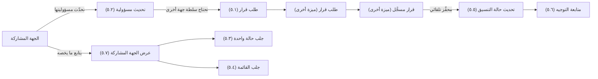

# المشاركة في التنسيق

<!-- BEGIN GENERATED: doc -->
| البند | القيمة |
|---|---|
| المعرّف | FEAT-DEC-COORD-PARTICIPATE |
| الإصدار | 0.1 |
| الحالة | مسودة |
| القدرة | CAP-06 إدارة القرار |
| القدرة الفرعية | CAP-06.03 التنسيق (R2) |
| الأدوار | الجهة المشاركة؛ مدير الجهة القائدة؛ النظام |
| الشاشات | SCR-36 حالات التنسيق |
| حالات الاستخدام | UC-130، UC-131 |
| القصص | 7: 5 من المواصفة، و2 جديدة |
<!-- END GENERATED: doc -->

## 1. نظرة عامة

### 1.1 القيمة

ترى الجهة المشاركة ما يخصها من حالة التنسيق، وتحدّث مسؤولياتها، وتطلب قرارًا من سلطة جهة أخرى.

### 1.2 النطاق

| البند | القيمة |
|---|---|
| المستخدمون | أعضاء الجهة المشاركة؛ مدير الجهة القائدة (للمتابعة فقط)؛ النظام |
| الشاشات | SCR-36 حالات التنسيق |
| حالات الاستخدام (بالكلمات) | طلب قرار من سلطة جهة أخرى عن مسؤولية مُسندة؛ تحديث حالة مسؤولية مشارك؛ عرض حالة التنسيق محدودة بنطاق المشاركة؛ تحديث حالة التنسيق تلقائيًا حين يُسجَّل القرار المطلوب |
| المتطلبات (بالكلمات) | إدارة حالات تنسيق تربط قرارات وخططًا ومؤسسات يجب أن تعمل معًا؛ توجيه الإجراء الذي يحتاج سلطة جهة أخرى لتلك السلطة |
| خارج النطاق | فتح حالة التنسيق، وإضافة أو إزالة المشاركين، وتفعيلها أو إغلاقها أو إلغاؤها (ميزة إدارة حالة التنسيق)؛ تسجيل القرار نفسه (ميزة قرارات تنتظرني) |

### 1.3 خريطة الميزة

**الشكل 1: مسار المشاركة في حالة التنسيق**



## 2. القواعد المشتركة

تنطبق على كل قصص الميزة، فلا تتكرر داخل القصص. وكل قصة تذكر ما يخصها فقط.

### 2.1 السياق المشترك

كل قصة تبدأ من ثلاثة شروط: مستأجر نشط، وحزمة السياسات الأساسية مفعّلة، ومستخدم مسجّل الدخول ومخوَّل. وتشير إليها القصص بخطوة واحدة: «بفرض السياق المشترك للميزة».

### 2.2 الصلاحية وعدم الإفصاح

- من لا يحق له رؤية العنصر يتلقى ردًا بشكل «غير متاح» تمامًا، فلا يعرف أنه موجود.
- من يرى العنصر ولا يحق له الإجراء يتلقى «لا تملك صلاحية هذا الإجراء».

### 2.3 أوامر تغيير الحالة

- **منع التكرار:** يُرسل كل أمر بمفتاح فريد، فإعادة الطلب نفسه لا تُنفَّذ مرتين.
- **حماية التعديل المتزامن:** يُرسل كل أمر بإصدار البيانات الذي يراه المستخدم. فإن عدّلها غيره في الأثناء، يُرفض الأمر.
- **السجل:** إن نجح الأمر، يُكتب حدثه وسجل التدقيق في المعاملة نفسها.

### 2.4 الرفض المشترك

```gherkin
# language: ar
خاصية: الرفض المشترك لأوامر الميزة

  سيناريو مخطط: رفض مشترك لكل أمر في الميزة
    بفرض السياق المشترك للميزة
    و <الحالة>
    عندما يُرسل المستخدم أي أمر من أوامر الميزة
    اذاً يُرفض برمز <الرمز> ويرى "<الرسالة>"
    و لا يتغير شيء

    امثلة:
      | الحالة                                  | الرمز                  | الرسالة                                                 |
      | العنصر خارج صلاحياته                    | NOT_FOUND              | غير متاح                                                |
      | العنصر مرئي له ولا يحق له الإجراء       | AUTHZ_DENIED           | لا تملك صلاحية هذا الإجراء                              |
      | غيره عدّل العنصر بعد أن فتحه            | VERSION_CONFLICT       | تغيّرت البيانات منذ فتحتها. راجع التغييرات ثم أعد المحاولة |
      | أعاد مفتاح منع التكرار بمحتوى مختلف     | IDEMPOTENCY_KEY_REUSED | طلب مكرر بمحتوى مختلف                                   |
      | البيانات ناقصة أو غير صحيحة             | VALIDATION_FAILED      | بعض البيانات ناقصة أو غير صحيحة. راجع الحقول المعلَّمة      |

  سيناريو: إعادة الطلب نفسه لا تُنفَّذ مرتين
    بفرض السياق المشترك للميزة
    و أمر نجح بمفتاح منع تكرار
    عندما يُعاد الطلب نفسه بالمفتاح نفسه
    اذاً تُعاد النتيجة الأولى ولا يُكتب حدث ثانٍ
```

## 3. الجودة وتعريف الاكتمال

### 3.1 متطلبات الجودة

<!-- BEGIN GENERATED: quality -->
لا متطلبات جودة مرتبطة بمتطلبات هذه الميزة مباشرة. تنطبق متطلبات المنصة العامة (`FEAT-PLT-*`).
<!-- END GENERATED: quality -->

### 3.2 تعريف الاكتمال

القصة مكتملة حين تتحقق الشروط الخمسة:

1. سيناريوهاتها والقواعد المشتركة تمر في الاختبار الآلي.
2. فحوص البنية المعمارية تمر.
3. نصوص الواجهة والرسائل موجودة بالعربية والإنجليزية.
4. مراجعة الكود مكتملة.
5. ما تضيفه القصة نفسها في قسم «القواعد» تحقق.

## 4. فهرس القصص

<!-- BEGIN GENERATED: story-index -->
| المعرّف | القصة | النوع | الحالة |
|---|---|---|---|
| `US-BC04-CRD-REQUEST-DECISION` | طلب قرار ضمن حالة التنسيق | أمر | مسودة |
| `US-BC04-CRD-UPDATE-RESPONSIBILITY` | تحديث مسؤولية ضمن حالة التنسيق | أمر | مسودة |
| `US-BC04-Q-CRD-GET` | جلب: Case filtered to the caller's participant scope | جلب | مسودة |
| `US-BC04-Q-CRD-LIST` | جلب: Cases where the caller's unit participates | جلب | مسودة |
| `US-BC04-S-COORDINATION-CASE-01` | تلقائي: linked decision recorded (حالة التنسيق) | نظام | مسودة |
| `US-UI-SCR36-DECISION-ROUTING` | متابعة مسؤولية تنتظر قرار جهة أخرى | واجهة | مسودة |
| `US-UI-SCR36-PARTICIPANT-VIEW` | عرض الجهة المشاركة لما يخصها فقط | واجهة | مسودة |
<!-- END GENERATED: story-index -->

## 5. القصص

### 5.1 US-BC04-CRD-REQUEST-DECISION — طلب قرار ضمن حالة التنسيق

| النوع | الإصدار | الأولوية | دون اتصال | الحالة |
|---|---|---|---|---|
| أمر | R2 | Must | لا | مسودة |

> **كـ** عضو الجهة المشاركة، **أريد** طلب قرار من سلطة جهة أخرى عن مسؤولية مُسندة إليّ ضمن حالة التنسيق، **حتى** يُتخذ القرار اللازم دون أن أملك سلطته بنفسي.

**باختصار:** إذا احتاجت مسؤولية مُسندة إلى مشارك سلطة جهة أخرى، يطلب المشارك قرارًا بسؤال وخيارات، فيُنشأ طلب قرار في نطاقه دون تغيير حالة حالة التنسيق.

#### القواعد

- **متى يُسمح:** حالة التنسيق «نشطة»، والمسؤولية مُعلَّمة بأنها تحتاج سلطة جهة أخرى.
- **من يُسمح له:** عضو الجهة المشاركة المسؤول عن ذلك العنصر فقط.
- **البيانات:** المسؤولية المرتبطة، والسؤال، والخيارات.
- **الأثر:** يُنشأ طلب قرار جديد في نطاق المشارك بنوع القرار المطلوب؛ حالة حالة التنسيق لا تتغير؛ يصل الحدث إلى طلبات القرار والإشعار والبحث.

#### معايير القبول

```gherkin
# language: ar
خاصية: طلب قرار ضمن حالة التنسيق

  سيناريو: الجهة المشاركة تطلب قرارًا لمسؤولية تحتاج سلطة أخرى
    بفرض السياق المشترك للميزة
    و حالة تنسيق "نشطة" فيها مسؤولية مُسندة إلى المشارك وتحتاج سلطة جهة أخرى
    عندما يطلب المشارك قرارًا بسؤال وخيارات لتلك المسؤولية
    اذاً يُنشأ طلب قرار جديد في نطاق المشارك
    و يُسجَّل حدث "طُلب قرار ضمن حالة التنسيق"
    و لا تتغير حالة حالة التنسيق

  سيناريو مخطط: رفض خاص بطلب القرار
    بفرض السياق المشترك للميزة
    و <الحالة>
    عندما يحاول المشارك طلب قرار
    اذاً يُرفض برمز <الرمز> ويرى "<الرسالة>"
    و لا يتغير شيء

    امثلة:
      | الحالة                                  | الرمز                                       | الرسالة                                          |
      | حالة التنسيق ليست "نشطة"                | COORDINATION_CASE_INVALID_STATE_TRANSITION  | الوضع الحالي لحالة التنسيق لا يسمح بهذا الإجراء |
      | المسؤولية لا تحتاج سلطة جهة أخرى        | RESPONSIBILITY_INVALID                      | بيانات المسؤولية غير مكتملة                      |
      | السؤال غير مذكور                        | VALIDATION_FAILED                           | السؤال مطلوب                                     |
```

<details><summary>المراجع التقنية والتتبع</summary>

<!-- BEGIN GENERATED: refs US-BC04-CRD-REQUEST-DECISION -->
| البند | المعرّف | المعنى |
|---|---|---|
| الواجهة البرمجية | `POST /api/v1/operations/coordination-cases/{id}/actions/request-decision` | — |
| الأمر | `CMD-CRD-REQUEST-DECISION` | طلب قرار ضمن حالة التنسيق |
| السياسة | `POL-CRD-REQUEST-DECISION` | lead organization Manager (open, participants, activate, assign, close, cancel) · participant members (update… |
| الحدث | `EVT-CRD-DECISION-REQUESTED` | يصل إلى: Decision requests (SLC-08); Notification (participants); Search projection (SLC-05) |
| الكيان | `AGG-COORDINATION-CASE` | حالة التنسيق |
| الجدول | `operations.coordination_cases` | الجدول الرئيسي لحالة التنسيق |
| وحدة النشر | DU-08 | — |
| المتطلبات | REQ-CRD-001، REQ-CRD-002 | معانيها في القسم 6. التتبع |
| حالات الاستخدام | UC-130، UC-131 | Manage Coordination Case؛ Request Cross-Organization Decision |
| الاختبار | TST-COORDINATION-CASE-SM، TST-SLC15-INVARIANTS | دورة حالات حالة التنسيق، وثوابت الشريحة SLC-15 |
<!-- END GENERATED: refs US-BC04-CRD-REQUEST-DECISION -->

</details>

### 5.2 US-BC04-CRD-UPDATE-RESPONSIBILITY — تحديث مسؤولية ضمن حالة التنسيق

| النوع | الإصدار | الأولوية | دون اتصال | الحالة |
|---|---|---|---|---|
| أمر | R2 | Must | لا | مسودة |

> **كـ** عضو الجهة المشاركة، **أريد** تحديث حالة مسؤوليتي ضمن حالة التنسيق، **حتى** يعرف الجميع ما أنجزته، أو ما تعذّر إنجازه وسببه.

**باختصار:** يحدّث المشارك حالة مسؤوليته إلى «قيد التنفيذ» أو «منجزة» أو «متنازل عنها» بسبب، ولا تُنجَز مسؤولية تحتاج قرارًا قبل تسجيل ذلك القرار.

#### القواعد

- **متى يُسمح:** حالة التنسيق «نشطة».
- **من يُسمح له:** عضو الجهة المشاركة المسؤول عن العنصر.
- **البيانات:** الحالة الجديدة (قيد التنفيذ، منجزة، متنازل عنها)، وملاحظة اختيارية.
- **الأثر:** حالة حالة التنسيق لا تتغير؛ عنصر يحتاج سلطة جهة أخرى لا يصبح «منجزًا» قبل تسجيل القرار المطلوب له (القصة 5.1).

#### معايير القبول

```gherkin
# language: ar
خاصية: تحديث مسؤولية ضمن حالة التنسيق

  سيناريو: المشارك يحدّث مسؤوليته
    بفرض السياق المشترك للميزة
    و حالة تنسيق "نشطة" فيها مسؤولية مُسندة إلى المشارك
    عندما يحدّث المشارك حالتها إلى "منجزة"
    اذاً تُحفظ الحالة الجديدة للمسؤولية
    و يُسجَّل حدث "حُدِّثت مسؤولية ضمن حالة التنسيق"
    و لا تتغير حالة حالة التنسيق

  سيناريو مخطط: رفض خاص بتحديث المسؤولية
    بفرض السياق المشترك للميزة
    و <الحالة>
    عندما يحاول المشارك تحديث مسؤوليته
    اذاً يُرفض برمز <الرمز> ويرى "<الرسالة>"
    و لا يتغير شيء

    امثلة:
      | الحالة                                                  | الرمز                                       | الرسالة                                              |
      | حالة التنسيق ليست "نشطة"                                | COORDINATION_CASE_INVALID_STATE_TRANSITION  | الوضع الحالي لحالة التنسيق لا يسمح بهذا الإجراء      |
      | محاولة إنجاز عنصر يحتاج قرارًا لم يُسجَّل بعد           | DECISION_PENDING                            | لا يمكن إكمال هذه المسؤولية قبل اتخاذ القرار المطلوب |
      | الحالة الجديدة غير صحيحة                                | VALIDATION_FAILED                           | الحالة غير صحيحة                                     |
```

<details><summary>المراجع التقنية والتتبع</summary>

<!-- BEGIN GENERATED: refs US-BC04-CRD-UPDATE-RESPONSIBILITY -->
| البند | المعرّف | المعنى |
|---|---|---|
| الواجهة البرمجية | `POST /api/v1/operations/coordination-cases/{id}/actions/update-responsibility` | — |
| الأمر | `CMD-CRD-UPDATE-RESPONSIBILITY` | تحديث مسؤولية ضمن حالة التنسيق |
| السياسة | `POL-CRD-UPDATE-RESPONSIBILITY` | lead organization Manager (open, participants, activate, assign, close, cancel) · participant members (update… |
| الحدث | `EVT-CRD-RESPONSIBILITY-UPDATED` | يصل إلى: Decision requests (SLC-08); Notification (participants); Search projection (SLC-05) |
| الكيان | `AGG-COORDINATION-CASE` | حالة التنسيق |
| الجدول | `operations.coordination_cases` | الجدول الرئيسي لحالة التنسيق |
| وحدة النشر | DU-08 | — |
| المتطلبات | REQ-CRD-001، REQ-CRD-002 | معانيها في القسم 6. التتبع |
| حالات الاستخدام | UC-130، UC-131 | Manage Coordination Case؛ Request Cross-Organization Decision |
| الاختبار | TST-COORDINATION-CASE-SM، TST-SLC15-INVARIANTS | دورة حالات حالة التنسيق، وثوابت الشريحة SLC-15 |
<!-- END GENERATED: refs US-BC04-CRD-UPDATE-RESPONSIBILITY -->

</details>

### 5.3 US-BC04-Q-CRD-GET — جلب: Case filtered to the caller's participant scope

| النوع | الإصدار | الأولوية | دون اتصال | الحالة |
|---|---|---|---|---|
| جلب | R2 | Must | لا | مسودة |

> **كـ** عضو الجهة المشاركة، **أريد** جلب تفاصيل حالة تنسيق واحدة ضمن نطاق مشاركتي، **حتى** أرى مسؤولياتي ومسؤولية المشاركين فيما يخصني.

**باختصار:** تُعاد حالة التنسيق محدودة بنطاق مشاركة طالبها، وتُفحص صلاحيته على النتيجة من جديد قبل إعادتها.

#### القواعد

- **من يرى ماذا:** عضو الجهة المشاركة يرى ما يقع ضمن نطاق مشاركته؛ ومدير الجهة القائدة يرى الحالة كاملة.

#### معايير القبول

```gherkin
# language: ar
خاصية: جلب حالة تنسيق واحدة ضمن نطاق المشاركة

  سيناريو: يرى المشارك حالة ضمن نطاقه
    بفرض السياق المشترك للميزة
    و حالة تنسيق ضمن نطاق مشاركة المستخدم
    عندما يطلب جلبها
    اذاً تُعاد الحالة بعد إعادة فحص صلاحيته عليها
```

<details><summary>المراجع التقنية والتتبع</summary>

<!-- BEGIN GENERATED: refs US-BC04-Q-CRD-GET -->
| البند | المعرّف | المعنى |
|---|---|---|
| الواجهة البرمجية | `GET /api/v1/operations/coordination-cases/{case_id}` | — |
| الاستعلام | `QRY-CRD-GET` | Case filtered to the caller's participant scope |
| السياسة | `POL-CRD-GET` | participants (scope-limited); lead |
| الكيان | `AGG-COORDINATION-CASE` | حالة التنسيق |
| الجدول | `operations.coordination_cases` | الجدول الرئيسي لحالة التنسيق |
| وحدة النشر | DU-08 | — |
| المتطلب | REQ-CRD-001 | The system shall manage coordination cases linking decisions, plans and organizations that must act together,… |
| حالة الاستخدام | UC-130 | Manage Coordination Case |
| الاختبار | TST-COORDINATION-CASE-SM، TST-SLC15-INVARIANTS | دورة حالات حالة التنسيق، وثوابت الشريحة SLC-15 |
<!-- END GENERATED: refs US-BC04-Q-CRD-GET -->

</details>

### 5.4 US-BC04-Q-CRD-LIST — جلب: Cases where the caller's unit participates

| النوع | الإصدار | الأولوية | دون اتصال | الحالة |
|---|---|---|---|---|
| جلب | R2 | Must | لا | مسودة |

> **كـ** عضو الجهة المشاركة، **أريد** قائمة حالات التنسيق التي تشارك فيها وحدتي، **حتى** أتابع كل التزاماتي من مكان واحد.

**باختصار:** تُعاد الحالات التي تشارك فيها وحدة المستخدم فقط، صفحةً بعد صفحة بالمؤشر، دون كشف وجود حالات أخرى محجوبة.

#### القواعد

- **المرشحات:** المؤشر والحد.

#### معايير القبول

```gherkin
# language: ar
خاصية: قائمة حالات التنسيق التي تشارك فيها وحدتي

  سيناريو: يرى المشارك حالات وحدته فقط
    بفرض السياق المشترك للميزة
    و حالات تنسيق تشارك فيها وحدة المستخدم وأخرى لا تشارك فيها
    عندما يطلب قائمة حالات التنسيق
    اذاً تُعاد الحالات التي تشارك فيها وحدته فقط، بعد إعادة فحص صلاحية كل منها
    و لا يكشف أي عدد أو اقتراح وجود حالة محجوبة
```

<details><summary>المراجع التقنية والتتبع</summary>

<!-- BEGIN GENERATED: refs US-BC04-Q-CRD-LIST -->
| البند | المعرّف | المعنى |
|---|---|---|
| الواجهة البرمجية | `GET /api/v1/operations/coordination-cases` | — |
| الاستعلام | `QRY-CRD-LIST` | Cases where the caller's unit participates |
| السياسة | `POL-CRD-LIST` | allowed_scope |
| الكيان | `AGG-COORDINATION-CASE` | حالة التنسيق |
| الجدول | `operations.coordination_cases` | الجدول الرئيسي لحالة التنسيق |
| وحدة النشر | DU-08 | — |
| المتطلب | REQ-CRD-001 | The system shall manage coordination cases linking decisions, plans and organizations that must act together,… |
| حالة الاستخدام | UC-130 | Manage Coordination Case |
| الاختبار | TST-COORDINATION-CASE-SM، TST-SLC15-INVARIANTS | دورة حالات حالة التنسيق، وثوابت الشريحة SLC-15 |
<!-- END GENERATED: refs US-BC04-Q-CRD-LIST -->

</details>

### 5.5 US-BC04-S-COORDINATION-CASE-01 — تلقائي: linked decision recorded (حالة التنسيق)

| النوع | الإصدار | الأولوية | دون اتصال | الحالة |
|---|---|---|---|---|
| نظام | R2 | Must | لا ينطبق | مسودة |

> **كـ** النظام، **أريد** تحديث حالة التنسيق حين يُسجَّل قرار استُشهد فيه بطلب القرار الذي أنشأته، **حتى** تنعكس نتيجة القرار على المسؤولية المرتبطة دون تغيير حالة حالة التنسيق نفسها.

**باختصار:** عندما يُسجَّل قرار يستشهد بطلب القرار الذي أنشأته حالة التنسيق، تُحفظ نتيجة القرار على المسؤولية المرتبطة.

#### القواعد

- **متى يحدث:** عند تسجيل قرار يشير إلى طلب القرار الذي أنشأته مسؤولية ضمن حالة التنسيق (القصة 5.1).
- **الأثر:** تُحفظ نتيجة القرار على المسؤولية المرتبطة؛ حالة حالة التنسيق لا تتغير.

#### معايير القبول

```gherkin
# language: ar
خاصية: تحديث حالة التنسيق بقرار مرتبط

  سيناريو: يُسجَّل القرار المطلوب لمسؤولية في حالة التنسيق
    بفرض حالة تنسيق "نشطة" فيها مسؤولية طلبت قرارًا من سلطة جهة أخرى
    عندما يُسجَّل القرار المطلوب لذلك الطلب
    اذاً تُحفظ نتيجة القرار على المسؤولية المرتبطة
    و يُسجَّل حدث "سُجِّل قرار مرتبط بحالة التنسيق" وسجل تدقيق بهوية النظام
    و لا تتغير حالة حالة التنسيق

  سيناريو: قرار لا يستشهد بأي طلب أنشأته حالة التنسيق
    بفرض حالة تنسيق "نشطة"
    عندما يُسجَّل قرار لا يشير إلى طلب أنشأته حالة التنسيق
    اذاً لا يتغير أي شيء فيها
```

<details><summary>المراجع التقنية والتتبع</summary>

<!-- BEGIN GENERATED: refs US-BC04-S-COORDINATION-CASE-01 -->
| البند | المعرّف | المعنى |
|---|---|---|
| المحفِّز | `SYS:linked decision recorded` | decision references the request created by the case; outcome stored on the responsibility |
| الانتقال | ACTIVE ← (بلا تغيير) | — |
| الحدث | `EVT-CRD-DECISION-RECORDED` | يصل إلى: Decision requests (SLC-08); Notification (participants); Search projection (SLC-05) |
| الكيان | `AGG-COORDINATION-CASE` | حالة التنسيق |
| الجدول | `operations.coordination_cases` | الجدول الرئيسي لحالة التنسيق |
| وحدة النشر | DU-08 | — |
| المتطلبات | REQ-CRD-001، REQ-CRD-002 | معانيها في القسم 6. التتبع |
| حالات الاستخدام | UC-130، UC-131 | Manage Coordination Case؛ Request Cross-Organization Decision |
| الاختبار | TST-COORDINATION-CASE-SM، TST-SLC15-INVARIANTS | دورة حالات حالة التنسيق، وثوابت الشريحة SLC-15 |
<!-- END GENERATED: refs US-BC04-S-COORDINATION-CASE-01 -->

</details>

### 5.6 US-UI-SCR36-DECISION-ROUTING — متابعة مسؤولية تنتظر قرار جهة أخرى

| النوع | الإصدار | الأولوية | دون اتصال | الحالة |
|---|---|---|---|---|
| واجهة | R2 | Must | لا | مسودة |

> **كـ** المستخدم (عضو الجهة المشاركة)، **أريد** أن أرى في شاشة حالات التنسيق أن مسؤوليتي تنتظر قرار جهة أخرى، **حتى** أعرف أن الانتظار متوقع على تلك الجهة لا عليّ.

**باختصار:** تُعرض المسؤولية التي تحتاج سلطة جهة أخرى ولم يُسجَّل قرارها بعلامة «تنتظر قرار جهة أخرى» مع رابط طلب القرار المرتبط، وتُستبدل العلامة بنتيجة القرار فور تسجيله.

#### القواعد

- **العرض:** المسؤولية التي تحتاج سلطة جهة أخرى ولم يُسجَّل قرارها تحمل علامة «تنتظر قرار جهة أخرى» مع رابط طلب القرار (REQ-CRD-002).
- **التحديث:** فور تسجيل القرار المرتبط (القصة 5.5) تُستبدل العلامة بنتيجة القرار.

#### معايير القبول

```gherkin
# language: ar
خاصية: متابعة مسؤولية تنتظر قرار جهة أخرى

  سيناريو: مسؤولية لم يُسجَّل قرارها بعد
    بفرض السياق المشترك للميزة
    و مسؤولية ضمن حالة تنسيق تحتاج سلطة جهة أخرى ولم يُسجَّل قرارها
    عندما يفتح المستخدم شاشة حالات التنسيق
    اذاً تُعرض المسؤولية بعلامة "تنتظر قرار جهة أخرى" مع رابط طلب القرار المرتبط

  سيناريو: صدر القرار المطلوب
    بفرض السياق المشترك للميزة
    و مسؤولية كانت تنتظر قرارًا وسُجِّل القرار المطلوب لها
    عندما يفتح المستخدم شاشة حالات التنسيق
    اذاً تُعرض نتيجة القرار على المسؤولية بدل علامة الانتظار
```

<details><summary>المراجع التقنية والتتبع</summary>

<!-- BEGIN GENERATED: refs US-UI-SCR36-DECISION-ROUTING -->
| البند | المعرّف | المعنى |
|---|---|---|
| الشاشة | SCR-36 | شاشة حالات التنسيق |
| حالة الاستخدام | UC-131 | Request Cross-Organization Decision |
| المصدر | `THR-S15-02` | — |
| المصدر | `[Derived]` | — |
| المتطلب | REQ-CRD-002 | When a coordination action requires another organization's authority, the system shall route it for that auth… |
| حالة الاستخدام | UC-131 | Request Cross-Organization Decision |
<!-- END GENERATED: refs US-UI-SCR36-DECISION-ROUTING -->

</details>

### 5.7 US-UI-SCR36-PARTICIPANT-VIEW — عرض الجهة المشاركة لما يخصها فقط

| النوع | الإصدار | الأولوية | دون اتصال | الحالة |
|---|---|---|---|---|
| واجهة | R2 | Must | لا | مسودة |

> **كـ** المستخدم (عضو الجهة المشاركة)، **أريد** أن أرى في شاشة حالات التنسيق مشاركتي ومسؤولياتي فقط، **حتى** لا أُثقَل بتفاصيل جهات أخرى لا تخصني.

**باختصار:** تعرض الشاشة للمشارك اسم الحالة وغرضها ومسؤولياته فقط، دون تفاصيل مسؤوليات المشاركين الآخرين؛ وعرض مدير الجهة القائدة يشمل الحالة كاملة.

#### القواعد

- **العرض:** عرض المشارك محدود بمسؤولياته داخل الحالة، لا بكل محتواها.
- **الاستثناء:** عرض مدير الجهة القائدة يشمل كل المشاركين والمسؤوليات (تُغطّيه ميزة إدارة حالة التنسيق).

#### معايير القبول

```gherkin
# language: ar
خاصية: عرض الجهة المشاركة لما يخصها فقط

  سيناريو: المشارك يرى مسؤولياته فقط
    بفرض السياق المشترك للميزة
    و حالة تنسيق فيها مسؤوليات لعدة مشاركين
    عندما يفتح أحد المشاركين شاشة حالات التنسيق
    اذاً يرى اسم الحالة وغرضها ومسؤولياته هو فقط
    و لا يرى تفاصيل مسؤوليات المشاركين الآخرين
```

<details><summary>المراجع التقنية والتتبع</summary>

<!-- BEGIN GENERATED: refs US-UI-SCR36-PARTICIPANT-VIEW -->
| البند | المعرّف | المعنى |
|---|---|---|
| الشاشة | SCR-36 | شاشة حالات التنسيق |
| المصدر | `THR-S15-01` | — |
| المصدر | `correlation-fusion-spec.md §1` | — |
| المتطلب | REQ-CRD-001 | The system shall manage coordination cases linking decisions, plans and organizations that must act together,… |
| حالة الاستخدام | UC-130 | Manage Coordination Case |
<!-- END GENERATED: refs US-UI-SCR36-PARTICIPANT-VIEW -->

</details>

## 6. التتبع

<!-- BEGIN GENERATED: trace -->
| المتطلب | المعنى | القصص | الاختبار |
|---|---|---|---|
| REQ-CRD-001 | The system shall manage coordination cases linking decisions, plans and organizations that must act together,… | `US-BC04-CRD-REQUEST-DECISION`، `US-BC04-CRD-UPDATE-RESPONSIBILITY`، `US-BC04-Q-CRD-GET`، `US-BC04-Q-CRD-LIST`، `US-BC04-S-COORDINATION-CASE-01`، `US-UI-SCR36-PARTICIPANT-VIEW` | TST-COORDINATION-CASE-SM، TST-SLC15-INVARIANTS |
| REQ-CRD-002 | When a coordination action requires another organization's authority, the system shall route it for that auth… | `US-BC04-CRD-REQUEST-DECISION`، `US-BC04-CRD-UPDATE-RESPONSIBILITY`، `US-BC04-S-COORDINATION-CASE-01`، `US-UI-SCR36-DECISION-ROUTING` | TST-COORDINATION-CASE-SM، TST-SLC15-INVARIANTS |
<!-- END GENERATED: trace -->

## 7. سجل التغييرات

| الإصدار | التاريخ | التغيير |
|---|---|---|
| 0.1 | — | هيكل مولَّد من خريطة الميزات |
| 0.2 | 2026-10-13 | كتابة القصص كاملة بمعيار القصص |
