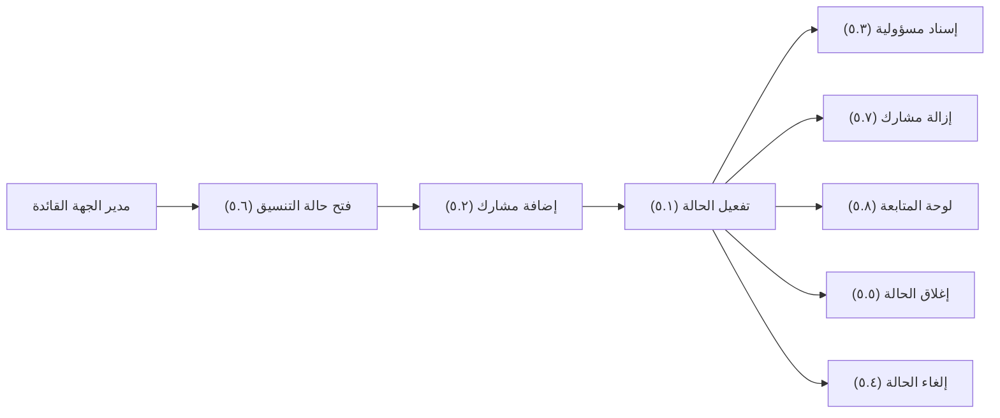
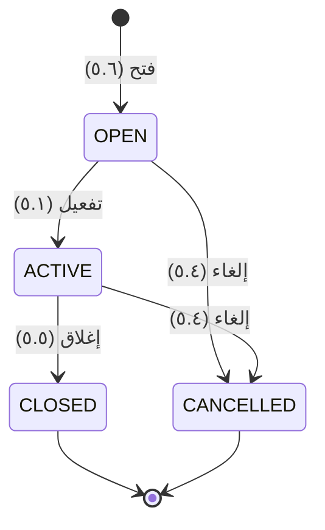

# إدارة حالة التنسيق

<!-- BEGIN GENERATED: doc -->
| البند | القيمة |
|---|---|
| المعرّف | FEAT-DEC-COORDINATION |
| الإصدار | 0.2 |
| الحالة | مسودة |
| القدرة | CAP-06 إدارة القرار |
| القدرة الفرعية | CAP-06.03 التنسيق (R2) |
| الأدوار | مدير الجهة القائدة |
| الشاشات | SCR-36 حالات التنسيق |
| حالات الاستخدام | UC-130 |
| القصص | 8: 7 من المواصفة، و1 جديدة |
<!-- END GENERATED: doc -->

## 1. نظرة عامة

### 1.1 القيمة

يجمع مدير الجهة القائدة الجهات التي يجب أن تعمل معًا، ويوزع المسؤوليات بينها ويتابع الحالة حتى إغلاقها.

### 1.2 النطاق

| البند | القيمة |
|---|---|
| المستخدمون | مدير الجهة القائدة |
| الشاشات | SCR-36 حالات التنسيق |
| حالات الاستخدام (بالكلمات) | فتح حالة تنسيق جديدة؛ إضافة وإزالة مشاركين؛ تفعيلها؛ إسناد مسؤوليات للمشاركين؛ إغلاقها بعد إنجاز مسؤولياتها أو إلغاؤها بسبب؛ متابعة لوحة المشاركين والمسؤوليات |
| المتطلبات (بالكلمات) | إدارة حالات تنسيق تربط قرارات وخططًا ومؤسسات يجب أن تعمل معًا، بمشاركين ومسؤوليات وحالة؛ توجيه الإجراء الذي يحتاج سلطة جهة أخرى لتلك السلطة |
| خارج النطاق | طلب القرار من سلطة جهة أخرى، وتحديث حالة مسؤولية مشارك (ميزة المشاركة في التنسيق)؛ تسجيل القرار نفسه (ميزة قرارات تنتظرني) |

### 1.3 خريطة الميزة

**الشكل 1: إدارة حالة التنسيق**



**الشكل 2: دورة حالات حالة التنسيق**



## 2. القواعد المشتركة

تنطبق على كل قصص الميزة، فلا تتكرر داخل القصص. وكل قصة تذكر ما يخصها فقط.

### 2.1 السياق المشترك

كل قصة تبدأ من ثلاثة شروط: مستأجر نشط، وحزمة السياسات الأساسية مفعّلة، ومستخدم مسجّل الدخول ومخوَّل. وتشير إليها القصص بخطوة واحدة: «بفرض السياق المشترك للميزة».

### 2.2 الصلاحية وعدم الإفصاح

- من لا يحق له رؤية العنصر يتلقى ردًا بشكل «غير متاح» تمامًا، فلا يعرف أنه موجود.
- من يرى العنصر ولا يحق له الإجراء يتلقى «لا تملك صلاحية هذا الإجراء».

### 2.3 أوامر تغيير الحالة

- **منع التكرار:** يُرسل كل أمر بمفتاح فريد، فإعادة الطلب نفسه لا تُنفَّذ مرتين.
- **حماية التعديل المتزامن:** يُرسل كل أمر بإصدار البيانات الذي يراه المستخدم. فإن عدّلها غيره في الأثناء، يُرفض الأمر.
- **السجل:** إن نجح الأمر، يُكتب حدثه وسجل التدقيق في المعاملة نفسها.

### 2.4 الرفض المشترك

```gherkin
# language: ar
خاصية: الرفض المشترك لأوامر الميزة

  سيناريو مخطط: رفض مشترك لكل أمر في الميزة
    بفرض السياق المشترك للميزة
    و <الحالة>
    عندما يُرسل المستخدم أي أمر من أوامر الميزة
    اذاً يُرفض برمز <الرمز> ويرى "<الرسالة>"
    و لا يتغير شيء

    امثلة:
      | الحالة                                  | الرمز                  | الرسالة                                                 |
      | العنصر خارج صلاحياته                    | NOT_FOUND              | غير متاح                                                |
      | العنصر مرئي له ولا يحق له الإجراء       | AUTHZ_DENIED           | لا تملك صلاحية هذا الإجراء                              |
      | غيره عدّل العنصر بعد أن فتحه            | VERSION_CONFLICT       | تغيّرت البيانات منذ فتحتها. راجع التغييرات ثم أعد المحاولة |
      | أعاد مفتاح منع التكرار بمحتوى مختلف     | IDEMPOTENCY_KEY_REUSED | طلب مكرر بمحتوى مختلف                                   |
      | البيانات ناقصة أو غير صحيحة             | VALIDATION_FAILED      | بعض البيانات ناقصة أو غير صحيحة. راجع الحقول المعلَّمة      |

  سيناريو: إعادة الطلب نفسه لا تُنفَّذ مرتين
    بفرض السياق المشترك للميزة
    و أمر نجح بمفتاح منع تكرار
    عندما يُعاد الطلب نفسه بالمفتاح نفسه
    اذاً تُعاد النتيجة الأولى ولا يُكتب حدث ثانٍ
```

## 3. الجودة وتعريف الاكتمال

### 3.1 متطلبات الجودة

<!-- BEGIN GENERATED: quality -->
لا متطلبات جودة مرتبطة بمتطلبات هذه الميزة مباشرة. تنطبق متطلبات المنصة العامة (`FEAT-PLT-*`).
<!-- END GENERATED: quality -->

### 3.2 تعريف الاكتمال

القصة مكتملة حين تتحقق الشروط الخمسة:

1. سيناريوهاتها والقواعد المشتركة تمر في الاختبار الآلي.
2. فحوص البنية المعمارية تمر.
3. نصوص الواجهة والرسائل موجودة بالعربية والإنجليزية.
4. مراجعة الكود مكتملة.
5. ما تضيفه القصة نفسها في قسم «القواعد» تحقق.

## 4. فهرس القصص

<!-- BEGIN GENERATED: story-index -->
| المعرّف | القصة | النوع | الحالة |
|---|---|---|---|
| `US-BC04-CRD-ACTIVATE` | تفعيل حالة التنسيق | أمر | مسودة |
| `US-BC04-CRD-ADD-PARTICIPANT` | إضافة مشارك إلى حالة التنسيق | أمر | مسودة |
| `US-BC04-CRD-ASSIGN-RESPONSIBILITY` | إسناد مسؤولية ضمن حالة التنسيق | أمر | مسودة |
| `US-BC04-CRD-CANCEL` | إلغاء حالة التنسيق | أمر | مسودة |
| `US-BC04-CRD-CLOSE` | إغلاق حالة التنسيق | أمر | مسودة |
| `US-BC04-CRD-OPEN` | فتح حالة التنسيق | أمر | مسودة |
| `US-BC04-CRD-REMOVE-PARTICIPANT` | إزالة مشارك من حالة التنسيق | أمر | مسودة |
| `US-UI-SCR36-COORD-BOARD` | لوحة المشاركين والمسؤوليات وحالة التنسيق | واجهة | مسودة |
<!-- END GENERATED: story-index -->

## 5. القصص

### 5.1 US-BC04-CRD-ACTIVATE — تفعيل حالة التنسيق

| النوع | الإصدار | الأولوية | دون اتصال | الحالة |
|---|---|---|---|---|
| أمر | R2 | Must | لا | مسودة |

> **كـ** مدير الجهة القائدة، **أريد** تفعيل حالة التنسيق، **حتى** يبدأ المشاركون تنفيذ مسؤولياتهم.

**باختصار:** يفعّل مدير الجهة القائدة حالة تنسيق مفتوحة فيها مشاركان على الأقل، فتصير «نشطة» ويمكن إسناد المسؤوليات فيها.

#### القواعد

- **متى يُسمح:** الحالة الحالية «مفتوحة»، وفيها مشاركان على الأقل.
- **من يُسمح له:** مدير الجهة القائدة فقط.
- **الأثر:** تصبح الحالة «نشطة»؛ يصل الحدث إلى طلبات القرار والإشعار والبحث.

#### معايير القبول

```gherkin
# language: ar
خاصية: تفعيل حالة التنسيق

  سيناريو: مدير الجهة القائدة يفعّل حالة فيها مشاركان
    بفرض السياق المشترك للميزة
    و حالة تنسيق "مفتوحة" فيها مشاركان على الأقل
    عندما يفعّلها مدير الجهة القائدة
    اذاً تصبح حالتها "نشطة"
    و يُسجَّل حدث "فُعِّلت حالة التنسيق"

  سيناريو مخطط: رفض خاص بالتفعيل
    بفرض السياق المشترك للميزة
    و <الحالة>
    عندما يحاول مدير الجهة القائدة تفعيل الحالة
    اذاً يُرفض برمز <الرمز> ويرى "<الرسالة>"
    و لا يتغير شيء

    امثلة:
      | الحالة                                         | الرمز                                       | الرسالة                                          |
      | الحالة ليست "مفتوحة"                           | COORDINATION_CASE_INVALID_STATE_TRANSITION  | الوضع الحالي لحالة التنسيق لا يسمح بهذا الإجراء |
      | أقل من مشاركين اثنين                           | PARTICIPANTS_REQUIRED                       | يلزم مشاركان على الأقل                          |
```

<details><summary>المراجع التقنية والتتبع</summary>

<!-- BEGIN GENERATED: refs US-BC04-CRD-ACTIVATE -->
| البند | المعرّف | المعنى |
|---|---|---|
| الواجهة البرمجية | `POST /api/v1/operations/coordination-cases/{id}/actions/activate` | — |
| الأمر | `CMD-CRD-ACTIVATE` | تفعيل حالة التنسيق |
| السياسة | `POL-CRD-ACTIVATE` | lead organization Manager (open, participants, activate, assign, close, cancel) · participant members (update… |
| الحدث | `EVT-CRD-ACTIVATED` | يصل إلى: Decision requests (SLC-08); Notification (participants); Search projection (SLC-05) |
| الكيان | `AGG-COORDINATION-CASE` | حالة التنسيق |
| الجدول | `operations.coordination_cases` | الجدول الرئيسي لحالة التنسيق |
| وحدة النشر | DU-08 | — |
| المتطلبات | REQ-CRD-001، REQ-CRD-002 | معانيها في القسم 6. التتبع |
| حالة الاستخدام | UC-130 | Manage Coordination Case |
| الاختبار | TST-COORDINATION-CASE-SM، TST-SLC15-INVARIANTS | دورة حالات حالة التنسيق، وثوابت الشريحة SLC-15 |
<!-- END GENERATED: refs US-BC04-CRD-ACTIVATE -->

</details>

### 5.2 US-BC04-CRD-ADD-PARTICIPANT — إضافة مشارك إلى حالة التنسيق

| النوع | الإصدار | الأولوية | دون اتصال | الحالة |
|---|---|---|---|---|
| أمر | R2 | Must | لا | مسودة |

> **كـ** مدير الجهة القائدة، **أريد** إضافة مشارك إلى حالة التنسيق، **حتى** تضم الحالة كل جهة يجب أن تعمل معنا.

**باختصار:** يضيف مدير الجهة القائدة وحدة تنظيمية من المستأجر كمشارك بدور ونطاق وصول، ما دامت الحالة مفتوحة أو نشطة.

#### القواعد

- **متى يُسمح:** الحالة الحالية «مفتوحة» أو «نشطة».
- **من يُسمح له:** مدير الجهة القائدة فقط.
- **البيانات:** الوحدة التنظيمية، ودورها، ونطاق وصولها.
- **الأثر:** يصير المشارك جزءًا من الحالة؛ يصل الحدث إلى طلبات القرار والإشعار والبحث.

#### معايير القبول

```gherkin
# language: ar
خاصية: إضافة مشارك إلى حالة التنسيق

  سيناريو: مدير الجهة القائدة يضيف مشاركًا
    بفرض السياق المشترك للميزة
    و حالة تنسيق "مفتوحة" أو "نشطة"
    عندما يضيف مدير الجهة القائدة وحدة تنظيمية بدور ونطاق وصول
    اذاً تُضاف الوحدة كمشارك في الحالة
    و يُسجَّل حدث "أُضيف مشارك إلى حالة التنسيق"

  سيناريو مخطط: رفض خاص بإضافة المشارك
    بفرض السياق المشترك للميزة
    و <الحالة>
    عندما يحاول مدير الجهة القائدة إضافة مشارك
    اذاً يُرفض برمز <الرمز> ويرى "<الرسالة>"
    و لا يتغير شيء

    امثلة:
      | الحالة                                        | الرمز                                       | الرسالة                                          |
      | الحالة "مغلقة" أو "ملغاة"                      | COORDINATION_CASE_INVALID_STATE_TRANSITION  | الوضع الحالي لحالة التنسيق لا يسمح بهذا الإجراء |
      | دور المشارك غير صحيح                          | PARTICIPANT_INVALID                         | بيانات المشارك غير صحيحة                         |
      | الوحدة التنظيمية غير مذكورة                   | VALIDATION_FAILED                           | الوحدة التنظيمية مطلوبة                          |
```

<details><summary>المراجع التقنية والتتبع</summary>

<!-- BEGIN GENERATED: refs US-BC04-CRD-ADD-PARTICIPANT -->
| البند | المعرّف | المعنى |
|---|---|---|
| الواجهة البرمجية | `POST /api/v1/operations/coordination-cases/{id}/actions/add-participant` | — |
| الأمر | `CMD-CRD-ADD-PARTICIPANT` | إضافة مشارك إلى حالة التنسيق |
| السياسة | `POL-CRD-ADD-PARTICIPANT` | lead organization Manager (open, participants, activate, assign, close, cancel) · participant members (update… |
| الحدث | `EVT-CRD-PARTICIPANT-ADDED` | يصل إلى: Decision requests (SLC-08); Notification (participants); Search projection (SLC-05) |
| الكيان | `AGG-COORDINATION-CASE` | حالة التنسيق |
| الجدول | `operations.coordination_cases` | الجدول الرئيسي لحالة التنسيق |
| وحدة النشر | DU-08 | — |
| المتطلبات | REQ-CRD-001، REQ-CRD-002 | معانيها في القسم 6. التتبع |
| حالة الاستخدام | UC-130 | Manage Coordination Case |
| الاختبار | TST-COORDINATION-CASE-SM، TST-SLC15-INVARIANTS | دورة حالات حالة التنسيق، وثوابت الشريحة SLC-15 |
<!-- END GENERATED: refs US-BC04-CRD-ADD-PARTICIPANT -->

</details>

### 5.3 US-BC04-CRD-ASSIGN-RESPONSIBILITY — إسناد مسؤولية ضمن حالة التنسيق

| النوع | الإصدار | الأولوية | دون اتصال | الحالة |
|---|---|---|---|---|
| أمر | R2 | Must | لا | مسودة |

> **كـ** مدير الجهة القائدة، **أريد** إسناد مسؤولية إلى مشارك ضمن حالة التنسيق، **حتى** يعرف كل مشارك ما عليه وبأي موعد.

**باختصار:** يسند مدير الجهة القائدة إلى مشارك نشط عنصرًا بموعد، ويُعلِّمه عند الحاجة بأنه يحتاج سلطة جهة أخرى.

#### القواعد

- **متى يُسمح:** الحالة الحالية «نشطة»، والمشارك موجود في الحالة.
- **من يُسمح له:** مدير الجهة القائدة فقط.
- **البيانات:** المشارك، والعنصر، والموعد، وعلم «يحتاج سلطة جهة أخرى» عند الحاجة.
- **الأثر:** تُسجَّل مسؤولية جديدة على المشارك؛ يصل الحدث إلى طلبات القرار والإشعار والبحث.

#### معايير القبول

```gherkin
# language: ar
خاصية: إسناد مسؤولية ضمن حالة التنسيق

  سيناريو: مدير الجهة القائدة يسند مسؤولية لمشارك
    بفرض السياق المشترك للميزة
    و حالة تنسيق "نشطة" فيها مشارك
    عندما يسند مدير الجهة القائدة عنصرًا بموعد لذلك المشارك
    اذاً تُسجَّل مسؤولية جديدة على المشارك
    و يُسجَّل حدث "أُسندت مسؤولية ضمن حالة التنسيق"

  سيناريو مخطط: رفض خاص بإسناد المسؤولية
    بفرض السياق المشترك للميزة
    و <الحالة>
    عندما يحاول مدير الجهة القائدة إسناد مسؤولية
    اذاً يُرفض برمز <الرمز> ويرى "<الرسالة>"
    و لا يتغير شيء

    امثلة:
      | الحالة                                        | الرمز                                       | الرسالة                                          |
      | الحالة ليست "نشطة"                             | COORDINATION_CASE_INVALID_STATE_TRANSITION  | الوضع الحالي لحالة التنسيق لا يسمح بهذا الإجراء |
      | المشارك المحدَّد غير موجود في الحالة           | RESPONSIBILITY_INVALID                      | بيانات المسؤولية غير مكتملة                      |
      | الموعد غير مذكور                               | VALIDATION_FAILED                           | الموعد مطلوب                                     |
```

<details><summary>المراجع التقنية والتتبع</summary>

<!-- BEGIN GENERATED: refs US-BC04-CRD-ASSIGN-RESPONSIBILITY -->
| البند | المعرّف | المعنى |
|---|---|---|
| الواجهة البرمجية | `POST /api/v1/operations/coordination-cases/{id}/actions/assign-responsibility` | — |
| الأمر | `CMD-CRD-ASSIGN-RESPONSIBILITY` | إسناد مسؤولية ضمن حالة التنسيق |
| السياسة | `POL-CRD-ASSIGN-RESPONSIBILITY` | lead organization Manager (open, participants, activate, assign, close, cancel) · participant members (update… |
| الحدث | `EVT-CRD-RESPONSIBILITY-ASSIGNED` | يصل إلى: Decision requests (SLC-08); Notification (participants); Search projection (SLC-05) |
| الكيان | `AGG-COORDINATION-CASE` | حالة التنسيق |
| الجدول | `operations.coordination_cases` | الجدول الرئيسي لحالة التنسيق |
| وحدة النشر | DU-08 | — |
| المتطلبات | REQ-CRD-001، REQ-CRD-002 | معانيها في القسم 6. التتبع |
| حالة الاستخدام | UC-130 | Manage Coordination Case |
| الاختبار | TST-COORDINATION-CASE-SM، TST-SLC15-INVARIANTS | دورة حالات حالة التنسيق، وثوابت الشريحة SLC-15 |
<!-- END GENERATED: refs US-BC04-CRD-ASSIGN-RESPONSIBILITY -->

</details>

### 5.4 US-BC04-CRD-CANCEL — إلغاء حالة التنسيق

| النوع | الإصدار | الأولوية | دون اتصال | الحالة |
|---|---|---|---|---|
| أمر | R2 | Must | لا | مسودة |

> **كـ** مدير الجهة القائدة، **أريد** إلغاء حالة التنسيق بسبب، **حتى** أوقف تنسيقًا لم يعد مطلوبًا.

**باختصار:** يلغي مدير الجهة القائدة حالة تنسيق مفتوحة أو نشطة بسبب، فتصير «ملغاة» ولا يُقبل عليها أي تغيير بعدها.

#### القواعد

- **متى يُسمح:** الحالة الحالية «مفتوحة» أو «نشطة».
- **من يُسمح له:** مدير الجهة القائدة فقط.
- **البيانات:** سبب الإلغاء.
- **الأثر:** تصبح الحالة «ملغاة» نهائيًا؛ يصل الحدث إلى طلبات القرار والإشعار والبحث.

#### معايير القبول

```gherkin
# language: ar
خاصية: إلغاء حالة التنسيق

  سيناريو: مدير الجهة القائدة يلغي الحالة بسبب
    بفرض السياق المشترك للميزة
    و حالة تنسيق "مفتوحة" أو "نشطة"
    عندما يلغيها مدير الجهة القائدة بسبب
    اذاً تصبح حالتها "ملغاة"
    و يُسجَّل حدث "أُلغيت حالة التنسيق"

  سيناريو مخطط: رفض خاص بالإلغاء
    بفرض السياق المشترك للميزة
    و <الحالة>
    عندما يحاول مدير الجهة القائدة إلغاء الحالة
    اذاً يُرفض برمز <الرمز> ويرى "<الرسالة>"
    و لا يتغير شيء

    امثلة:
      | الحالة                                | الرمز                                       | الرسالة                                          |
      | الحالة "مغلقة" أو "ملغاة" سلفًا        | COORDINATION_CASE_INVALID_STATE_TRANSITION  | الوضع الحالي لحالة التنسيق لا يسمح بهذا الإجراء |
      | السبب غير مذكور                        | REASON_REQUIRED                             | اذكر السبب                                       |
```

<details><summary>المراجع التقنية والتتبع</summary>

<!-- BEGIN GENERATED: refs US-BC04-CRD-CANCEL -->
| البند | المعرّف | المعنى |
|---|---|---|
| الواجهة البرمجية | `POST /api/v1/operations/coordination-cases/{id}/actions/cancel` | — |
| الأمر | `CMD-CRD-CANCEL` | إلغاء حالة التنسيق |
| السياسة | `POL-CRD-CANCEL` | lead organization Manager (open, participants, activate, assign, close, cancel) · participant members (update… |
| الحدث | `EVT-CRD-CANCELLED` | يصل إلى: Decision requests (SLC-08); Notification (participants); Search projection (SLC-05) |
| الكيان | `AGG-COORDINATION-CASE` | حالة التنسيق |
| الجدول | `operations.coordination_cases` | الجدول الرئيسي لحالة التنسيق |
| وحدة النشر | DU-08 | — |
| المتطلبات | REQ-CRD-001، REQ-CRD-002 | معانيها في القسم 6. التتبع |
| حالة الاستخدام | UC-130 | Manage Coordination Case |
| الاختبار | TST-COORDINATION-CASE-SM، TST-SLC15-INVARIANTS | دورة حالات حالة التنسيق، وثوابت الشريحة SLC-15 |
<!-- END GENERATED: refs US-BC04-CRD-CANCEL -->

</details>

### 5.5 US-BC04-CRD-CLOSE — إغلاق حالة التنسيق

| النوع | الإصدار | الأولوية | دون اتصال | الحالة |
|---|---|---|---|---|
| أمر | R2 | Must | لا | مسودة |

> **كـ** مدير الجهة القائدة، **أريد** إغلاق حالة التنسيق بعد إنجاز مسؤولياتها، **حتى** أوثّق أن التنسيق انتهى بنجاح.

**باختصار:** يغلق مدير الجهة القائدة حالة نشطة أُنجزت أو أُلغيت كل مسؤولياتها، بملاحظة إغلاق، فتصير «مغلقة» نهائيًا.

#### القواعد

- **متى يُسمح:** الحالة الحالية «نشطة»، وكل مسؤولياتها منجزة أو متنازل عنها.
- **من يُسمح له:** مدير الجهة القائدة فقط.
- **البيانات:** ملاحظة الإغلاق.
- **الأثر:** تصبح الحالة «مغلقة» نهائيًا؛ يصل الحدث إلى طلبات القرار والإشعار والبحث.

#### معايير القبول

```gherkin
# language: ar
خاصية: إغلاق حالة التنسيق

  سيناريو: مدير الجهة القائدة يغلق الحالة بعد إنجاز مسؤولياتها
    بفرض السياق المشترك للميزة
    و حالة تنسيق "نشطة" أُنجزت أو أُلغيت كل مسؤولياتها
    عندما يغلقها مدير الجهة القائدة بملاحظة
    اذاً تصبح حالتها "مغلقة"
    و يُسجَّل حدث "أُغلقت حالة التنسيق"

  سيناريو مخطط: رفض خاص بالإغلاق
    بفرض السياق المشترك للميزة
    و <الحالة>
    عندما يحاول مدير الجهة القائدة إغلاق الحالة
    اذاً يُرفض برمز <الرمز> ويرى "<الرسالة>"
    و لا يتغير شيء

    امثلة:
      | الحالة                                     | الرمز                                       | الرسالة                                          |
      | الحالة ليست "نشطة"                          | COORDINATION_CASE_INVALID_STATE_TRANSITION  | الوضع الحالي لحالة التنسيق لا يسمح بهذا الإجراء |
      | توجد مسؤوليات مفتوحة                        | OPEN_RESPONSIBILITIES                       | توجد مسؤوليات لم تُنجز                           |
      | ملاحظة الإغلاق غير مذكورة                   | VALIDATION_FAILED                           | ملاحظة الإغلاق مطلوبة                            |
```

<details><summary>المراجع التقنية والتتبع</summary>

<!-- BEGIN GENERATED: refs US-BC04-CRD-CLOSE -->
| البند | المعرّف | المعنى |
|---|---|---|
| الواجهة البرمجية | `POST /api/v1/operations/coordination-cases/{id}/actions/close` | — |
| الأمر | `CMD-CRD-CLOSE` | إغلاق حالة التنسيق |
| السياسة | `POL-CRD-CLOSE` | lead organization Manager (open, participants, activate, assign, close, cancel) · participant members (update… |
| الحدث | `EVT-CRD-CLOSED` | يصل إلى: Decision requests (SLC-08); Notification (participants); Search projection (SLC-05) |
| الكيان | `AGG-COORDINATION-CASE` | حالة التنسيق |
| الجدول | `operations.coordination_cases` | الجدول الرئيسي لحالة التنسيق |
| وحدة النشر | DU-08 | — |
| المتطلبات | REQ-CRD-001، REQ-CRD-002 | معانيها في القسم 6. التتبع |
| حالة الاستخدام | UC-130 | Manage Coordination Case |
| الاختبار | TST-COORDINATION-CASE-SM، TST-SLC15-INVARIANTS | دورة حالات حالة التنسيق، وثوابت الشريحة SLC-15 |
<!-- END GENERATED: refs US-BC04-CRD-CLOSE -->

</details>

### 5.6 US-BC04-CRD-OPEN — فتح حالة التنسيق

| النوع | الإصدار | الأولوية | دون اتصال | الحالة |
|---|---|---|---|---|
| أمر | R2 | Must | لا | مسودة |

> **كـ** مدير الجهة القائدة، **أريد** فتح حالة تنسيق جديدة، **حتى** أجمع الجهات التي يجب أن تعمل معًا حول قرار أو خطة أو موقف مشترك.

**باختصار:** يفتح مدير الجهة القائدة حالة تنسيق بعنوان وغرض وجهة قائدة وتصنيف، فتصير «مفتوحة» وجاهزة لإضافة المشاركين.

#### القواعد

- **متى يُسمح:** لا توجد الحالة من قبل.
- **من يُسمح له:** مدير الجهة القائدة فقط.
- **البيانات:** العنوان، والغرض، والجهة القائدة، وما تربطه من قرارات أو خطط أو مواقف، والتصنيف الأمني.
- **الأثر:** تُنشأ حالة تنسيق جديدة بحالة «مفتوحة»؛ يصل الحدث إلى طلبات القرار والإشعار والبحث.

#### معايير القبول

```gherkin
# language: ar
خاصية: فتح حالة التنسيق

  سيناريو: مدير الجهة القائدة يفتح حالة تنسيق جديدة
    بفرض السياق المشترك للميزة
    عندما يفتح مدير الجهة القائدة حالة تنسيق بعنوان وغرض وجهة قائدة وتصنيف
    اذاً تُنشأ حالة تنسيق جديدة بحالة "مفتوحة"
    و يُسجَّل حدث "فُتحت حالة التنسيق"

  سيناريو مخطط: رفض خاص بالفتح
    بفرض السياق المشترك للميزة
    و <الحالة>
    عندما يحاول مدير الجهة القائدة فتح حالة تنسيق
    اذاً يُرفض برمز <الرمز> ويرى "<الرسالة>"
    و لا يتغير شيء

    امثلة:
      | الحالة                                        | الرمز               | الرسالة                                 |
      | عنصر مرتبط غير مرئي لمدير الجهة القائدة       | COORDINATION_INVALID | بيانات حالة التنسيق غير مكتملة          |
      | العنوان غير مذكور                             | VALIDATION_FAILED   | العنوان مطلوب                           |
```

<details><summary>المراجع التقنية والتتبع</summary>

<!-- BEGIN GENERATED: refs US-BC04-CRD-OPEN -->
| البند | المعرّف | المعنى |
|---|---|---|
| الواجهة البرمجية | `POST /api/v1/operations/coordination-cases` | — |
| الأمر | `CMD-CRD-OPEN` | فتح حالة التنسيق |
| السياسة | `POL-CRD-OPEN` | lead organization Manager (open, participants, activate, assign, close, cancel) · participant members (update… |
| الحدث | `EVT-CRD-OPENED` | يصل إلى: Decision requests (SLC-08); Notification (participants); Search projection (SLC-05) |
| الكيان | `AGG-COORDINATION-CASE` | حالة التنسيق |
| الجدول | `operations.coordination_cases` | الجدول الرئيسي لحالة التنسيق |
| وحدة النشر | DU-08 | — |
| المتطلبات | REQ-CRD-001، REQ-CRD-002 | معانيها في القسم 6. التتبع |
| حالة الاستخدام | UC-130 | Manage Coordination Case |
| الاختبار | TST-COORDINATION-CASE-SM، TST-SLC15-INVARIANTS | دورة حالات حالة التنسيق، وثوابت الشريحة SLC-15 |
<!-- END GENERATED: refs US-BC04-CRD-OPEN -->

</details>

### 5.7 US-BC04-CRD-REMOVE-PARTICIPANT — إزالة مشارك من حالة التنسيق

| النوع | الإصدار | الأولوية | دون اتصال | الحالة |
|---|---|---|---|---|
| أمر | R2 | Must | لا | مسودة |

> **كـ** مدير الجهة القائدة، **أريد** إزالة مشارك من حالة التنسيق، **حتى** تبقى الحالة محصورة بمن يعمل فيها حقًّا.

**باختصار:** يزيل مدير الجهة القائدة مشاركًا بسبب، ما دام غير الجهة القائدة ولا توجد عليه مسؤوليات مفتوحة.

#### القواعد

- **متى يُسمح:** الحالة الحالية «مفتوحة» أو «نشطة»، ولا توجد مسؤوليات مفتوحة على المشارك.
- **من يُسمح له:** مدير الجهة القائدة فقط، ولا تجوز إزالة الجهة القائدة نفسها.
- **البيانات:** الوحدة التنظيمية، وسبب الإزالة.
- **الأثر:** يخرج المشارك من الحالة؛ يصل الحدث إلى طلبات القرار والإشعار والبحث.

#### معايير القبول

```gherkin
# language: ar
خاصية: إزالة مشارك من حالة التنسيق

  سيناريو: مدير الجهة القائدة يزيل مشاركًا بلا مسؤوليات مفتوحة
    بفرض السياق المشترك للميزة
    و حالة تنسيق "مفتوحة" أو "نشطة" فيها مشارك بلا مسؤوليات مفتوحة
    عندما يزيله مدير الجهة القائدة بسبب
    اذاً يخرج المشارك من الحالة
    و يُسجَّل حدث "أُزيل مشارك من حالة التنسيق"

  سيناريو مخطط: رفض خاص بإزالة المشارك
    بفرض السياق المشترك للميزة
    و <الحالة>
    عندما يحاول مدير الجهة القائدة إزالة مشارك
    اذاً يُرفض برمز <الرمز> ويرى "<الرسالة>"
    و لا يتغير شيء

    امثلة:
      | الحالة                                        | الرمز                                       | الرسالة                                          |
      | الحالة "مغلقة" أو "ملغاة"                      | COORDINATION_CASE_INVALID_STATE_TRANSITION  | الوضع الحالي لحالة التنسيق لا يسمح بهذا الإجراء |
      | على المشارك مسؤوليات مفتوحة                   | PARTICIPANT_HAS_RESPONSIBILITIES            | لا يمكن إزالة مشارك عليه مسؤوليات مفتوحة          |
      | سبب الإزالة غير مذكور                          | VALIDATION_FAILED                           | السبب مطلوب                                      |
```

<details><summary>المراجع التقنية والتتبع</summary>

<!-- BEGIN GENERATED: refs US-BC04-CRD-REMOVE-PARTICIPANT -->
| البند | المعرّف | المعنى |
|---|---|---|
| الواجهة البرمجية | `POST /api/v1/operations/coordination-cases/{id}/actions/remove-participant` | — |
| الأمر | `CMD-CRD-REMOVE-PARTICIPANT` | إزالة مشارك من حالة التنسيق |
| السياسة | `POL-CRD-REMOVE-PARTICIPANT` | lead organization Manager (open, participants, activate, assign, close, cancel) · participant members (update… |
| الحدث | `EVT-CRD-PARTICIPANT-REMOVED` | يصل إلى: Decision requests (SLC-08); Notification (participants); Search projection (SLC-05) |
| الكيان | `AGG-COORDINATION-CASE` | حالة التنسيق |
| الجدول | `operations.coordination_cases` | الجدول الرئيسي لحالة التنسيق |
| وحدة النشر | DU-08 | — |
| المتطلبات | REQ-CRD-001، REQ-CRD-002 | معانيها في القسم 6. التتبع |
| حالة الاستخدام | UC-130 | Manage Coordination Case |
| الاختبار | TST-COORDINATION-CASE-SM، TST-SLC15-INVARIANTS | دورة حالات حالة التنسيق، وثوابت الشريحة SLC-15 |
<!-- END GENERATED: refs US-BC04-CRD-REMOVE-PARTICIPANT -->

</details>

### 5.8 US-UI-SCR36-COORD-BOARD — لوحة المشاركين والمسؤوليات وحالة التنسيق

| النوع | الإصدار | الأولوية | دون اتصال | الحالة |
|---|---|---|---|---|
| واجهة | R2 | Must | لا | مسودة |

> **كـ** مدير الجهة القائدة، **أريد** لوحة واحدة تعرض المشاركين ومسؤولياتهم وحالة كل بند، **حتى** أتابع تقدم التنسيق كله دون فتح كل مسؤولية على حدة.

**باختصار:** تعرض شاشة حالات التنسيق للجهة القائدة كل المشاركين ومسؤولياتهم وحالة كل بند، وتُحدَّث اللوحة فور أي تحديث على الحالة.

#### القواعد

- **العرض:** تعرض اللوحة كل مشارك مع مسؤولياته وحالتها الحالية، وتميّز ما يحتاج سلطة جهة أخرى بعلامة واضحة (**[Derived]**).
- **النطاق:** هذا العرض الكامل لمدير الجهة القائدة فقط؛ عرض المشارك محدود بمسؤولياته (ميزة المشاركة في التنسيق).

#### معايير القبول

```gherkin
# language: ar
خاصية: لوحة المشاركين والمسؤوليات وحالة التنسيق

  سيناريو: مدير الجهة القائدة يفتح لوحة الحالة
    بفرض السياق المشترك للميزة
    و حالة تنسيق نشطة فيها مشاركون ومسؤوليات بحالات مختلفة
    عندما يفتح مدير الجهة القائدة شاشة حالات التنسيق
    اذاً تُعرض كل المشاركين ومسؤولياتهم وحالة كل بند في لوحة واحدة
```

<details><summary>المراجع التقنية والتتبع</summary>

<!-- BEGIN GENERATED: refs US-UI-SCR36-COORD-BOARD -->
| البند | المعرّف | المعنى |
|---|---|---|
| الشاشة | SCR-36 | شاشة حالات التنسيق |
| حالة الاستخدام | UC-130 | Manage Coordination Case |
| المصدر | `[Derived]` | — |
| المتطلب | REQ-CRD-001 | The system shall manage coordination cases linking decisions, plans and organizations that must act together,… |
| حالة الاستخدام | UC-130 | Manage Coordination Case |
<!-- END GENERATED: refs US-UI-SCR36-COORD-BOARD -->

</details>

## 6. التتبع

<!-- BEGIN GENERATED: trace -->
| المتطلب | المعنى | القصص | الاختبار |
|---|---|---|---|
| REQ-CRD-001 | The system shall manage coordination cases linking decisions, plans and organizations that must act together,… | `US-BC04-CRD-ACTIVATE`، `US-BC04-CRD-ADD-PARTICIPANT`، `US-BC04-CRD-ASSIGN-RESPONSIBILITY`، `US-BC04-CRD-CANCEL`، `US-BC04-CRD-CLOSE`، `US-BC04-CRD-OPEN`، `US-BC04-CRD-REMOVE-PARTICIPANT`، `US-UI-SCR36-COORD-BOARD` | TST-COORDINATION-CASE-SM، TST-SLC15-INVARIANTS |
| REQ-CRD-002 | When a coordination action requires another organization's authority, the system shall route it for that auth… | كل قصص الميزة المأخوذة من المواصفة (7) | TST-COORDINATION-CASE-SM، TST-SLC15-INVARIANTS |
<!-- END GENERATED: trace -->

## 7. سجل التغييرات

| الإصدار | التاريخ | التغيير |
|---|---|---|
| 0.1 | — | هيكل مولَّد من خريطة الميزات |
| 0.2 | 2026-10-13 | كتابة القصص كاملة بمعيار القصص |
