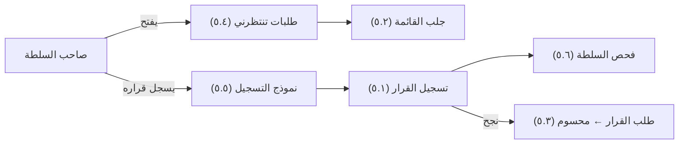

# قرارات تنتظرني

<!-- BEGIN GENERATED: doc -->
| البند | القيمة |
|---|---|
| المعرّف | FEAT-DEC-MY-PENDING |
| الإصدار | 0.2 |
| الحالة | مسودة |
| القدرة | CAP-06 إدارة القرار |
| القدرة الفرعية | CAP-06.02 تسجيل القرار والتحقق من السلطة (R1) |
| الأدوار | صاحب السلطة أو المعتمِد الثاني؛ النظام |
| الشاشات | SCR-05 طلبات قرار تنتظرني، SCR-33 القرار وأساسه |
| حالات الاستخدام | UC-032 |
| القصص | 6: 3 من المواصفة، و3 جديدة |
<!-- END GENERATED: doc -->

## 1. نظرة عامة

### 1.1 القيمة

يرى صاحب السلطة الطلبات التي تنتظر قراره مرتبة بالموعد، ويسجل قراره بعد التحقق من أنه يملك السلطة.

### 1.2 النطاق

| البند | القيمة |
|---|---|
| المستخدمون | صاحب السلطة أو المعتمِد الثاني؛ فريق المنصة؛ النظام |
| الشاشات | SCR-05 طلبات قرار تنتظرني، SCR-33 القرار وأساسه |
| حالات الاستخدام (بالكلمات) | عرض طلبات القرار التي تنتظر قراري مرتبة بالموعد؛ تسجيل القرار بعد التحقق من السلطة؛ حفظ القرار نهائيًا دون تعديل؛ تحديث طلب القرار تلقائيًا إلى «محسوم» عند تسجيل قراره |
| المتطلبات (بالكلمات) | تسجيل كل طلب قرار بسؤاله وخياراته ومراجع تقييمه وموعده ونوع السلطة المطلوبة؛ التحقق من أن صاحب القرار يملك السلطة اللازمة وقت اتخاذه؛ تسجيل الخيار والمبرر والسلطة والاعتماد وبدء السريان ومراجع الأساس لكل قرار؛ عدم تعديل القرار المسجَّل، بل تسجيل قرار جديد يستبدله |
| خارج النطاق | إنشاء طلب القرار وفتحه وإضافة خياراته والاستشهاد فيه وسحبه (ميزات أخرى من قدرة إدارة القرار)؛ إبطال القرار؛ طلب القرار ضمن حالة التنسيق (ميزة المشاركة في التنسيق) |

### 1.3 خريطة الميزة

**الشكل 1: من الطلب المنتظر إلى القرار المحسوم**



## 2. القواعد المشتركة

تنطبق على كل قصص الميزة، فلا تتكرر داخل القصص. وكل قصة تذكر ما يخصها فقط.

### 2.1 السياق المشترك

كل قصة تبدأ من ثلاثة شروط: مستأجر نشط، وحزمة السياسات الأساسية مفعّلة، ومستخدم مسجّل الدخول ومخوَّل. وتشير إليها القصص بخطوة واحدة: «بفرض السياق المشترك للميزة».

### 2.2 الصلاحية وعدم الإفصاح

- من لا يحق له رؤية العنصر يتلقى ردًا بشكل «غير متاح» تمامًا، فلا يعرف أنه موجود.
- من يرى العنصر ولا يحق له الإجراء يتلقى «لا تملك صلاحية هذا الإجراء».

### 2.3 أوامر تغيير الحالة

- **منع التكرار:** يُرسل كل أمر بمفتاح فريد، فإعادة الطلب نفسه لا تُنفَّذ مرتين.
- **حماية التعديل المتزامن:** يُرسل كل أمر بإصدار البيانات الذي يراه المستخدم. فإن عدّلها غيره في الأثناء، يُرفض الأمر.
- **السجل:** إن نجح الأمر، يُكتب حدثه وسجل التدقيق في المعاملة نفسها.

### 2.4 الرفض المشترك

```gherkin
# language: ar
خاصية: الرفض المشترك لأوامر الميزة

  سيناريو مخطط: رفض مشترك لكل أمر في الميزة
    بفرض السياق المشترك للميزة
    و <الحالة>
    عندما يُرسل المستخدم أي أمر من أوامر الميزة
    اذاً يُرفض برمز <الرمز> ويرى "<الرسالة>"
    و لا يتغير شيء

    امثلة:
      | الحالة                                  | الرمز                  | الرسالة                                                 |
      | العنصر خارج صلاحياته                    | NOT_FOUND              | غير متاح                                                |
      | العنصر مرئي له ولا يحق له الإجراء       | AUTHZ_DENIED           | لا تملك صلاحية هذا الإجراء                              |
      | غيره عدّل العنصر بعد أن فتحه            | VERSION_CONFLICT       | تغيّرت البيانات منذ فتحتها. راجع التغييرات ثم أعد المحاولة |
      | أعاد مفتاح منع التكرار بمحتوى مختلف     | IDEMPOTENCY_KEY_REUSED | طلب مكرر بمحتوى مختلف                                   |
      | البيانات ناقصة أو غير صحيحة             | VALIDATION_FAILED      | بعض البيانات ناقصة أو غير صحيحة. راجع الحقول المعلَّمة      |

  سيناريو: إعادة الطلب نفسه لا تُنفَّذ مرتين
    بفرض السياق المشترك للميزة
    و أمر نجح بمفتاح منع تكرار
    عندما يُعاد الطلب نفسه بالمفتاح نفسه
    اذاً تُعاد النتيجة الأولى ولا يُكتب حدث ثانٍ
```

## 3. الجودة وتعريف الاكتمال

### 3.1 متطلبات الجودة

<!-- BEGIN GENERATED: quality -->
| المرجع | الموقف | المطلوب |
|---|---|---|
| QAS-TRC-001 | follows a decision back to its sources | 100 % of decisions and T1 derived objects traceable to sources |
<!-- END GENERATED: quality -->

### 3.2 تعريف الاكتمال

القصة مكتملة حين تتحقق الشروط الخمسة:

1. سيناريوهاتها والقواعد المشتركة تمر في الاختبار الآلي.
2. فحوص البنية المعمارية تمر.
3. نصوص الواجهة والرسائل موجودة بالعربية والإنجليزية.
4. مراجعة الكود مكتملة.
5. ما تضيفه القصة نفسها في قسم «القواعد» تحقق.

## 4. فهرس القصص

<!-- BEGIN GENERATED: story-index -->
| المعرّف | القصة | النوع | الحالة |
|---|---|---|---|
| `US-BC04-DEC-RECORD` | تسجيل القرار | أمر | مسودة |
| `US-BC04-Q-DRQ-LIST` | جلب: My pending requests (as authority holder), by deadline | جلب | مسودة |
| `US-BC04-S-DECISION-REQUEST-02` | تلقائي: decision recorded for this request (طلب القرار) | نظام | مسودة |
| `US-UI-SCR05-PENDING-LIST` | طلبات تنتظر قراري مرتبة بالموعد | واجهة | مسودة |
| `US-UI-SCR05-RECORD-FORM` | تسجيل القرار دون فقد المدخلات | واجهة | مسودة |
| `US-PLT-DEC-AUTHORITY-CHECK` | فحص السلطة وقت القرار بإغلاق آمن | منصة | مسودة |
<!-- END GENERATED: story-index -->

## 5. القصص

### 5.1 US-BC04-DEC-RECORD — تسجيل القرار

| النوع | الإصدار | الأولوية | دون اتصال | الحالة |
|---|---|---|---|---|
| أمر | R1 | Must | لا | مسودة |

> **كـ** صاحب السلطة أو المعتمِد الثاني، **أريد** تسجيل قراري على طلب يعنيني، **حتى** يُنفَّذ الخيار المختار بمبرر موثّق وسلطة محققة.

**باختصار:** يسجل صاحب السلطة خياره على طلب قرار مفتوح، أو قرارًا مخصصًا بمبرر واستشهاد، بعد أن يؤكد فحص السلطة أنه يملكها الآن؛ فيصير القرار «مسجَّلًا» ولا يُعدَّل بعد ذلك.

#### القواعد

- **متى يُسمح:** فحص السلطة (القصة 5.6) يؤكد أن المسجِّل يملك السلطة لنوع القرار ونطاقه الآن؛ وطلب القرار «مفتوح»، أو القرار مخصص بمبرر واستشهاد واحد على الأقل.
- **من يُسمح له:** صاحب السلطة أو المعتمِد الثاني الذي تؤكد له السلطة الصلاحية.
- **البيانات:** الخيار المختار، والمبرر، وبدء السريان، والمراجع المستشهد بها، والتصنيف الأمني؛ وإن استبدل قرارًا سابقًا يذكره.
- **الأثر:** يُسجَّل القرار نهائيًا ولا يُعدَّل؛ يصل الحدث إلى طلب القرار المرتبط (يصبح «محسومًا»، القصة 5.3) والخطط المنفذة له والبحث؛ يحتاج تأكيد هوية معزز (ADR-P19).

#### معايير القبول

```gherkin
# language: ar
خاصية: تسجيل القرار

  سيناريو: صاحب السلطة يسجل قراره على طلب مفتوح
    بفرض السياق المشترك للميزة
    و طلب قرار "مفتوح" يملك المستخدم سلطته الآن
    عندما يسجل خياره مع مبرر وبدء سريان
    اذاً يُسجَّل القرار بحالة "مسجَّل"
    و يُسجَّل حدث "سُجِّل القرار"

  سيناريو مخطط: رفض خاص بتسجيل القرار
    بفرض السياق المشترك للميزة
    و <الحالة>
    عندما يحاول المستخدم تسجيل القرار
    اذاً يُرفض برمز <الرمز> ويرى "<الرسالة>"
    و لا يتغير شيء

    امثلة:
      | الحالة                                                   | الرمز                     | الرسالة                                             |
      | لا يملك المستخدم السلطة لنوع القرار ونطاقه الآن          | AUTHORITY_REQUIRED        | لا تملك السلطة اللازمة لهذا الإجراء                 |
      | قوة مصادقة الجلسة أقل من المطلوب                         | MFA_STEP_UP_REQUIRED      | هذا الإجراء يحتاج تأكيد هويتك مرة أخرى              |
      | المبرر غير مذكور                                         | VALIDATION_FAILED         | المبرر مطلوب                                        |
```

<details><summary>المراجع التقنية والتتبع</summary>

<!-- BEGIN GENERATED: refs US-BC04-DEC-RECORD -->
| البند | المعرّف | المعنى |
|---|---|---|
| الواجهة البرمجية | `POST /api/v1/operations/decisions` | — |
| الأمر | `CMD-DEC-RECORD` | تسجيل القرار |
| السياسة | `POL-DEC-RECORD` | authority holder (record) · higher authority (annul)؛ tenant match; object visible; org scope |
| الحدث | `EVT-DEC-RECORDED` | يصل إلى: Decision request (DECIDED); Plans implementing it (review flag on supersede/annul); Search projectio… |
| الكيان | `AGG-DECISION` | القرار |
| الجدول | `operations.decisions` | الجدول الرئيسي للقرار |
| وحدة النشر | DU-08 | — |
| المتطلبات | REQ-DEC-002، REQ-DEC-003، REQ-DEC-004 | معانيها في القسم 6. التتبع |
| حالة الاستخدام | UC-032 | Record Decision |
| الاختبار | TST-DECISION-SM، TST-SLC08-INVARIANTS | دورة حالات القرار، وثوابت الشريحة SLC-08 |
<!-- END GENERATED: refs US-BC04-DEC-RECORD -->

</details>

### 5.2 US-BC04-Q-DRQ-LIST — جلب: My pending requests (as authority holder), by deadline

| النوع | الإصدار | الأولوية | دون اتصال | الحالة |
|---|---|---|---|---|
| جلب | R1 | Must | لا | مسودة |

> **كـ** صاحب السلطة أو المعتمِد الثاني، **أريد** قائمة الطلبات التي تنتظر قراري مرتبة بالموعد، **حتى** أبدأ بالأقرب استحقاقًا.

**باختصار:** تُعاد الطلبات التي يحق للمستخدم اتخاذ قرارها فقط، مرتبة بالموعد، صفحةً بعد صفحة، دون كشف وجود طلبات محجوبة.

#### القواعد

- **المرشحات:** المؤشر والحد؛ والترتيب بالموعد تصاعديًا.

#### معايير القبول

```gherkin
# language: ar
خاصية: طلبات قرار تنتظرني

  سيناريو: يرى صاحب السلطة طلباته فقط مرتبة بالموعد
    بفرض السياق المشترك للميزة
    و طلبات قرار تنتظر سلطة المستخدم وأخرى خارج نطاقه
    عندما يطلب قائمة الطلبات التي تنتظره
    اذاً تُعاد الطلبات داخل نطاقه فقط، مرتبة بالموعد، بعد إعادة فحص صلاحية كل منها
    و لا يكشف أي عدد أو اقتراح وجود طلب محجوب
```

<details><summary>المراجع التقنية والتتبع</summary>

<!-- BEGIN GENERATED: refs US-BC04-Q-DRQ-LIST -->
| البند | المعرّف | المعنى |
|---|---|---|
| الواجهة البرمجية | `GET /api/v1/operations/decision-requests` | — |
| الاستعلام | `QRY-DRQ-LIST` | My pending requests (as authority holder), by deadline |
| السياسة | `POL-DRQ-LIST` | allowed_scope |
| الكيان | `AGG-DECISION-REQUEST` | طلب القرار |
| الجدول | `operations.decision_requests` | الجدول الرئيسي لطلب القرار |
| وحدة النشر | DU-08 | — |
| المتطلب | REQ-DEC-001 | The system shall record each decision request with its question, options, assessment references, deadline and… |
| حالات الاستخدام | UC-030، UC-031 | Create Decision Request؛ Evaluate Decision Options |
| الاختبار | TST-DECISION-REQUEST-SM، TST-SLC08-INVARIANTS | دورة حالات طلب القرار، وثوابت الشريحة SLC-08 |
<!-- END GENERATED: refs US-BC04-Q-DRQ-LIST -->

</details>

### 5.3 US-BC04-S-DECISION-REQUEST-02 — تلقائي: decision recorded for this request (طلب القرار)

| النوع | الإصدار | الأولوية | دون اتصال | الحالة |
|---|---|---|---|---|
| نظام | R1 | Must | لا ينطبق | مسودة |

> **كـ** النظام، **أريد** نقل طلب القرار إلى «محسوم» حين يُسجَّل قراره، **حتى** يعرف كل من يتابعه أن القرار صدر.

**باختصار:** حين يُسجَّل قرار يستشهد بطلب قرار مفتوح، تنتقل حالة الطلب من «مفتوح» إلى «محسوم».

#### القواعد

- **متى يحدث:** عند تسجيل قرار يشير إلى هذا الطلب (القصة 5.1).
- **الأثر:** تنتقل حالة الطلب إلى «محسوم»؛ يصل الحدث إلى البحث.

#### معايير القبول

```gherkin
# language: ar
خاصية: انتقال طلب القرار إلى محسوم

  سيناريو: يُسجَّل القرار المطلوب لطلب مفتوح
    بفرض طلب قرار "مفتوح"
    عندما يُسجَّل قرار يستشهد بهذا الطلب
    اذاً تنتقل حالة الطلب إلى "محسوم"
    و يُسجَّل حدث "حُسم طلب القرار" وسجل تدقيق بهوية النظام

  سيناريو: قرار لا يستشهد بهذا الطلب
    بفرض طلب قرار "مفتوح"
    عندما يُسجَّل قرار يستشهد بطلب آخر
    اذاً تبقى حالة الطلب "مفتوحة"
```

<details><summary>المراجع التقنية والتتبع</summary>

<!-- BEGIN GENERATED: refs US-BC04-S-DECISION-REQUEST-02 -->
| البند | المعرّف | المعنى |
|---|---|---|
| المحفِّز | `SYS:decision recorded for this request` | EVT-DEC-RECORDED references the request |
| الانتقال | OPEN ← DECIDED | — |
| الحدث | `EVT-DRQ-DECIDED` | يصل إلى: Search projection (SLC-05) |
| الكيان | `AGG-DECISION-REQUEST` | طلب القرار |
| الجدول | `operations.decision_requests` | الجدول الرئيسي لطلب القرار |
| وحدة النشر | DU-08 | — |
| المتطلب | REQ-DEC-001 | The system shall record each decision request with its question, options, assessment references, deadline and… |
| حالات الاستخدام | UC-030، UC-031 | Create Decision Request؛ Evaluate Decision Options |
| الاختبار | TST-DECISION-REQUEST-SM، TST-SLC08-INVARIANTS | دورة حالات طلب القرار، وثوابت الشريحة SLC-08 |
<!-- END GENERATED: refs US-BC04-S-DECISION-REQUEST-02 -->

</details>

### 5.4 US-UI-SCR05-PENDING-LIST — طلبات تنتظر قراري مرتبة بالموعد

| النوع | الإصدار | الأولوية | دون اتصال | الحالة |
|---|---|---|---|---|
| واجهة | R1 | Must | لا | مسودة |

> **كـ** المستخدم (صاحب السلطة أو المعتمِد الثاني)، **أريد** أن أرى طلبات القرار التي تنتظر قراري في شاشة واحدة مرتبة بالموعد، **حتى** أبدأ بالأقرب استحقاقًا ولا يفوتني شيء.

**باختصار:** تعرض الشاشة طلبات المستخدم المنتظرة مرتبة تصاعديًا بالموعد، وتميّز ما تجاوز موعده (**[Derived]**).

#### القواعد

- **العرض:** الطلبات مرتبة تصاعديًا بالموعد، والطلب الذي تجاوز موعده يحمل علامة واضحة.

#### معايير القبول

```gherkin
# language: ar
خاصية: طلبات تنتظر قراري مرتبة بالموعد

  سيناريو: صاحب السلطة يفتح شاشة الطلبات المنتظرة
    بفرض السياق المشترك للميزة
    و طلبات قرار تنتظر المستخدم بمواعيد مختلفة، بعضها تجاوز موعده
    عندما يفتح شاشة طلبات قرار تنتظرني
    اذاً تُعرض الطلبات مرتبة تصاعديًا بالموعد
    و الطلب الذي تجاوز موعده يحمل علامة تجاوز الموعد
```

<details><summary>المراجع التقنية والتتبع</summary>

<!-- BEGIN GENERATED: refs US-UI-SCR05-PENDING-LIST -->
| البند | المعرّف | المعنى |
|---|---|---|
| الشاشة | SCR-05 | شاشة طلبات قرار تنتظرني |
| المصدر | `QRY-DRQ-LIST` | — |
| المصدر | `[Derived]` | — |
| المتطلب | REQ-DEC-001 | The system shall record each decision request with its question, options, assessment references, deadline and… |
| حالات الاستخدام | UC-030، UC-031 | Create Decision Request؛ Evaluate Decision Options |
<!-- END GENERATED: refs US-UI-SCR05-PENDING-LIST -->

</details>

### 5.5 US-UI-SCR05-RECORD-FORM — تسجيل القرار دون فقد المدخلات

| النوع | الإصدار | الأولوية | دون اتصال | الحالة |
|---|---|---|---|---|
| واجهة | R1 | Must | لا | مسودة |

> **كـ** المستخدم (صاحب السلطة أو المعتمِد الثاني)، **أريد** ألا تضيع مدخلاتي في نموذج تسجيل القرار إن انقطع الاتصال أو أغلقت الشاشة سهوًا، **حتى** لا أعيد كتابة الخيار والمبرر من جديد.

**باختصار:** تحفظ شاشة التسجيل مدخلات المستخدم محليًا أثناء الكتابة، فإن انقطع الاتصال أو أُغلقت الشاشة سهوًا تبقى المدخلات عند الفتح من جديد حتى يُرسَل القرار بنجاح.

#### القواعد

- **الحفظ:** تُحفظ مدخلات النموذج (الخيار والمبرر وبدء السريان والمراجع) محليًا أثناء الكتابة، وتبقى حتى يُرسَل القرار بنجاح أو يتراجع المستخدم (**[Derived]**).

#### معايير القبول

```gherkin
# language: ar
خاصية: تسجيل القرار دون فقد المدخلات

  سيناريو: انقطاع الاتصال أثناء الكتابة
    بفرض السياق المشترك للميزة
    و المستخدم يكتب خيارًا ومبررًا في نموذج تسجيل القرار
    عندما ينقطع الاتصال قبل الإرسال
    اذاً تبقى المدخلات محفوظة في النموذج
    عندما يعود الاتصال ويرسل المستخدم القرار
    اذاً يُسجَّل القرار بالمدخلات نفسها
```

<details><summary>المراجع التقنية والتتبع</summary>

<!-- BEGIN GENERATED: refs US-UI-SCR05-RECORD-FORM -->
| البند | المعرّف | المعنى |
|---|---|---|
| الشاشة | SCR-05 | شاشة طلبات قرار تنتظرني |
| المصدر | `21-ui-design.md §6.2` | — |
| المصدر | `[Derived]` | — |
| المتطلبات | REQ-DEC-002، REQ-DEC-003 | معانيها في القسم 6. التتبع |
| حالة الاستخدام | UC-032 | Record Decision |
<!-- END GENERATED: refs US-UI-SCR05-RECORD-FORM -->

</details>

### 5.6 US-PLT-DEC-AUTHORITY-CHECK — فحص السلطة وقت القرار بإغلاق آمن

| النوع | الإصدار | الأولوية | دون اتصال | الحالة |
|---|---|---|---|---|
| منصة | R1 | Must | لا ينطبق | مسودة |

> **كـ** فريق المنصة، **أريد** فحص سلطة يحدد صراحة أن صاحب القرار يملكها الآن ويرفض بإغلاق آمن عند تعذر التحقق، **حتى** لا يُسجَّل قرار دون سلطة مؤكدة ولو تعطلت خدمة الفحص.

**باختصار:** فحص السلطة يؤكد أن المسجِّل يملك السلطة لنوع القرار ونطاقه في لحظة التسجيل، وتُحفظ سلسلة المنح كلقطة سلطة مع القرار؛ وإن تعذّر الفحص أو تجاوز مهلته يُرفض الأمر بدل تمريره.

#### القواعد

- **الفحص:** يُقيَّم «AuthorityCheck» على المسجِّل ونوع القرار ونطاقه في لحظة التسجيل، وتُحفظ سلسلة المنح كلقطة سلطة مع القرار (**[Derived]**).
- **الإغلاق الآمن:** تعذر خدمة الفحص أو تجاوز مهلتها يعني رفض الأمر، لا تمريره.

#### معايير القبول

```gherkin
# language: ar
خاصية: فحص السلطة وقت القرار بإغلاق آمن

  سيناريو: الفحص ينجح وتُحفظ لقطة السلطة
    بفرض أن المسجِّل يملك السلطة لنوع القرار ونطاقه الآن
    عندما يُرسل أمر تسجيل القرار
    اذاً يؤكد فحص السلطة الصلاحية
    و تُحفظ سلسلة المنح كلقطة سلطة مع القرار

  سيناريو: خدمة الفحص غير متاحة
    بفرض أن خدمة فحص السلطة متعطلة أو تجاوزت مهلتها
    عندما يُرسل أمر تسجيل القرار
    اذاً يُرفض الأمر
    و لا يُسجَّل قرار دون سلطة مؤكدة
```

<details><summary>المراجع التقنية والتتبع</summary>

<!-- BEGIN GENERATED: refs US-PLT-DEC-AUTHORITY-CHECK -->
| البند | المعرّف | المعنى |
|---|---|---|
| المصدر | `THR-S08-01` | — |
| المصدر | `decision-plan-spec.md §5` | — |
| المصدر | `23-crosscutting.md §6` | — |
| المتطلب | REQ-DEC-002 | When a decision is recorded, the system shall verify through the authority check that the decider holds the r… |
| حالة الاستخدام | UC-032 | Record Decision |
<!-- END GENERATED: refs US-PLT-DEC-AUTHORITY-CHECK -->

</details>

## 6. التتبع

<!-- BEGIN GENERATED: trace -->
| المتطلب | المعنى | القصص | الاختبار |
|---|---|---|---|
| REQ-DEC-001 | The system shall record each decision request with its question, options, assessment references, deadline and… | `US-BC04-Q-DRQ-LIST`، `US-BC04-S-DECISION-REQUEST-02`، `US-UI-SCR05-PENDING-LIST` | TST-DECISION-REQUEST-SM، TST-SLC08-INVARIANTS |
| REQ-DEC-002 | When a decision is recorded, the system shall verify through the authority check that the decider holds the r… | `US-BC04-DEC-RECORD`، `US-PLT-DEC-AUTHORITY-CHECK`، `US-UI-SCR05-RECORD-FORM` | TST-DECISION-SM، TST-SLC08-INVARIANTS |
| REQ-DEC-003 | The system shall record for each decision the selected option, rationale, authority, approval, effective time… | `US-BC04-DEC-RECORD`، `US-UI-SCR05-RECORD-FORM` | TST-DECISION-SM، TST-SLC08-INVARIANTS |
| REQ-DEC-004 | The system shall make a recorded decision immutable; a change shall be recorded as a new decision that supers… | `US-BC04-DEC-RECORD` | TST-DECISION-SM، TST-SLC08-INVARIANTS |
<!-- END GENERATED: trace -->

## 7. سجل التغييرات

| الإصدار | التاريخ | التغيير |
|---|---|---|
| 0.1 | — | هيكل مولَّد من خريطة الميزات |
| 0.2 | 2026-10-13 | كتابة القصص كاملة بمعيار القصص |
