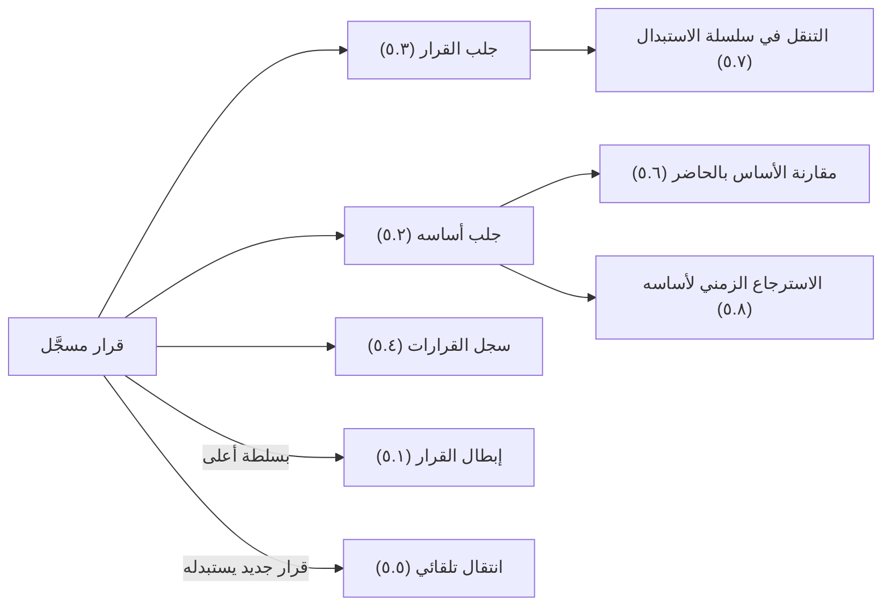
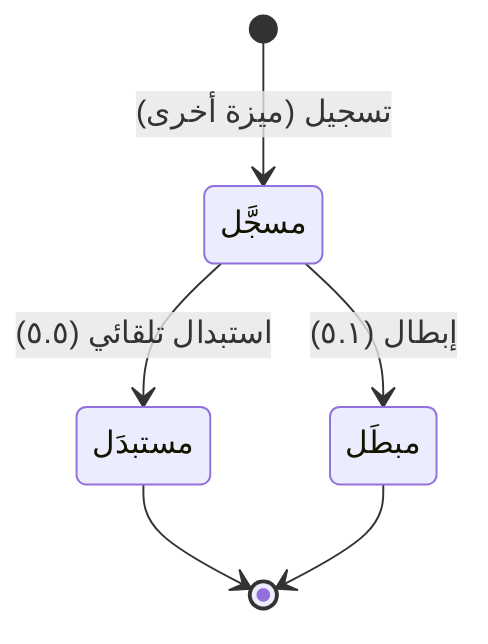

# سجل القرار وأساسه

<!-- BEGIN GENERATED: doc -->
| البند | القيمة |
|---|---|
| المعرّف | FEAT-DEC-RECORD-BASIS |
| الإصدار | 0.1 |
| الحالة | مسودة |
| القدرة | CAP-06 إدارة القرار |
| القدرة الفرعية | CAP-06.02 تسجيل القرار والتحقق من السلطة (R1) |
| الأدوار | المدير؛ المدقِّق؛ صاحب السلطة أو المعتمِد الثاني؛ النظام |
| الشاشات | SCR-33 القرار وأساسه |
| حالات الاستخدام | UC-032 |
| القصص | 8: 4 من المواصفة، و4 جديدة |
<!-- END GENERATED: doc -->

## 1. نظرة عامة

### 1.1 القيمة

يعرف المدير والمدقق ما الذي قُرر ولماذا وما كان معروفًا وقت القرار، ويُبطل صاحب السلطة الأعلى القرار عند الحاجة.

### 1.2 النطاق

| البند | القيمة |
|---|---|
| المستخدمون | صاحب السلطة أو المعتمِد الثاني (الإبطال)؛ المدير والمدقِّق (السجل والأساس)؛ أي مستخدم مخوَّل (القراءة ضمن نطاقه)؛ فريق المنصة؛ النظام |
| الشاشات | SCR-33 القرار وأساسه |
| حالات الاستخدام (بالكلمات) | إبطال قرار سُجِّل خطأً بسلطة أعلى لنوعه؛ جلب ما كان معروفًا وقت القرار من تقييمات وادعاءات؛ جلب القرار بلقطة سلطته واستشهاداته وسلسلة استبداله؛ سجل القرارات للمدير والمدقق؛ الانتقال التلقائي لقرار إلى «مستبدَل» حين يُسجَّل قرار جديد يستبدله؛ مقارنة ما عُرف وقت القرار بما يُعرف الآن؛ التنقل في سلسلة الاستبدال؛ الاسترجاع الزمني الدقيق لأساس القرار |
| المتطلبات (بالكلمات) | عدم تعديل القرار المسجَّل؛ كل تغيير عليه يُسجَّل قرارًا جديدًا يستبدله؛ ربط كل قرار بتقييم أو دليل واحد على الأقل مع لقطة السلطة وقت التسجيل؛ التحقق من سلطة أعلى لنوع القرار نفسه عند الإبطال |
| خارج النطاق | تسجيل القرار نفسه وفحص سلطته وقت التسجيل (ميزة قرارات تنتظرني)؛ إنشاء طلب القرار وفتحه وإضافة خياراته والاستشهاد فيه وسحبه (ميزة إعداد طلب القرار) |

### 1.3 خريطة الميزة

**الشكل 1: من القرار المسجَّل إلى أساسه وسلسلته**



**الشكل 2: دورة حالات القرار**



## 2. القواعد المشتركة

تنطبق على كل قصص الميزة، فلا تتكرر داخل القصص. وكل قصة تذكر ما يخصها فقط.

### 2.1 السياق المشترك

كل قصة تبدأ من ثلاثة شروط: مستأجر نشط، وحزمة السياسات الأساسية مفعّلة، ومستخدم مسجّل الدخول ومخوَّل. وتشير إليها القصص بخطوة واحدة: «بفرض السياق المشترك للميزة».

### 2.2 الصلاحية وعدم الإفصاح

- من لا يحق له رؤية العنصر يتلقى ردًا بشكل «غير متاح» تمامًا، فلا يعرف أنه موجود.
- من يرى العنصر ولا يحق له الإجراء يتلقى «لا تملك صلاحية هذا الإجراء».

### 2.3 أوامر تغيير الحالة

- **منع التكرار:** يُرسل كل أمر بمفتاح فريد، فإعادة الطلب نفسه لا تُنفَّذ مرتين.
- **حماية التعديل المتزامن:** يُرسل كل أمر بإصدار البيانات الذي يراه المستخدم. فإن عدّلها غيره في الأثناء، يُرفض الأمر.
- **السجل:** إن نجح الأمر، يُكتب حدثه وسجل التدقيق في المعاملة نفسها.

### 2.4 الرفض المشترك

```gherkin
# language: ar
خاصية: الرفض المشترك لأوامر الميزة

  سيناريو مخطط: رفض مشترك لكل أمر في الميزة
    بفرض السياق المشترك للميزة
    و <الحالة>
    عندما يُرسل المستخدم أي أمر من أوامر الميزة
    اذاً يُرفض برمز <الرمز> ويرى "<الرسالة>"
    و لا يتغير شيء

    امثلة:
      | الحالة                                  | الرمز                  | الرسالة                                                 |
      | العنصر خارج صلاحياته                    | NOT_FOUND              | غير متاح                                                |
      | العنصر مرئي له ولا يحق له الإجراء       | AUTHZ_DENIED           | لا تملك صلاحية هذا الإجراء                              |
      | غيره عدّل العنصر بعد أن فتحه            | VERSION_CONFLICT       | تغيّرت البيانات منذ فتحتها. راجع التغييرات ثم أعد المحاولة |
      | أعاد مفتاح منع التكرار بمحتوى مختلف     | IDEMPOTENCY_KEY_REUSED | طلب مكرر بمحتوى مختلف                                   |
      | البيانات ناقصة أو غير صحيحة             | VALIDATION_FAILED      | بعض البيانات ناقصة أو غير صحيحة. راجع الحقول المعلَّمة      |

  سيناريو: إعادة الطلب نفسه لا تُنفَّذ مرتين
    بفرض السياق المشترك للميزة
    و أمر نجح بمفتاح منع تكرار
    عندما يُعاد الطلب نفسه بالمفتاح نفسه
    اذاً تُعاد النتيجة الأولى ولا يُكتب حدث ثانٍ
```

## 3. الجودة وتعريف الاكتمال

### 3.1 متطلبات الجودة

<!-- BEGIN GENERATED: quality -->
| المرجع | الموقف | المطلوب |
|---|---|---|
| QAS-TMP-001 | asks for state as of valid time T known at record time K | 100 % agreement with temporal oracle corpus |
| QAS-TRC-001 | follows a decision back to its sources | 100 % of decisions and T1 derived objects traceable to sources |
| QAS-TRC-003 | auditor asks for a decision's basis | authority chain, pinned citations and claims as known at decision time returned; 100 % of decisions |
<!-- END GENERATED: quality -->

### 3.2 تعريف الاكتمال

القصة مكتملة حين تتحقق الشروط الخمسة:

1. سيناريوهاتها والقواعد المشتركة تمر في الاختبار الآلي.
2. فحوص البنية المعمارية تمر.
3. نصوص الواجهة والرسائل موجودة بالعربية والإنجليزية.
4. مراجعة الكود مكتملة.
5. ما تضيفه القصة نفسها في قسم «القواعد» تحقق.

## 4. فهرس القصص

<!-- BEGIN GENERATED: story-index -->
| المعرّف | القصة | النوع | الحالة |
|---|---|---|---|
| `US-BC04-DEC-ANNUL` | إبطال القرار | أمر | مسودة |
| `US-BC04-Q-DEC-BASIS` | جلب: What was known at decision time: cited assessments (pinned versions) and their key claims resolved known_at = decision.recorded_at | جلب | مسودة |
| `US-BC04-Q-DEC-GET` | جلب: Decision with authority snapshot, citations (pinned) and supersession chain | جلب | مسودة |
| `US-DOM-DEC-LIST` | سجل القرارات للمدير والمدقق | جلب | مسودة |
| `US-BC04-S-DECISION-01` | تلقائي: superseding decision recorded (القرار) | نظام | مسودة |
| `US-UI-SCR33-BASIS-COMPARE` | مقارنة ما عُرف وقت القرار بما يُعرف الآن | واجهة | مسودة |
| `US-UI-SCR33-SUPERSESSION` | التنقل في سلسلة القرارات المستبدلة | واجهة | مسودة |
| `US-PLT-DEC-BASIS-TEMPORAL` | استرجاع أساس القرار كما كان معروفًا | منصة | مسودة |
<!-- END GENERATED: story-index -->

## 5. القصص

### 5.1 US-BC04-DEC-ANNUL — إبطال القرار

| النوع | الإصدار | الأولوية | دون اتصال | الحالة |
|---|---|---|---|---|
| أمر | R1 | Must | لا | مسودة |

> **كـ** صاحب السلطة أو المعتمِد الثاني الذي يملك سلطة أعلى لنوع القرار نفسه، **أريد** إبطال قرار سُجِّل خطأً، **حتى** لا يُعمل بعد الآن بقرار غير صحيح.

**باختصار:** يبطل صاحب سلطة أعلى لنوع القرار نفسه قرارًا «مسجَّلًا» سُجِّل خطأً بسبب يذكره، فيصير «مبطَلًا» نهائيًا وتُعلَّم الخطط التي نفّذته للمراجعة.

#### القواعد

- **متى يُسمح:** القرار «مسجَّل» (لم يُستبدَل ولم يُبطَل من قبل)، وسُجِّل خطأً، والسبب مذكور.
- **من يُسمح له:** من يملك سلطة لنوع القرار نفسه في نطاق أعلى من نطاق القرار؛ لا يبطله صاحب السلطة نفسه في نطاقه.
- **البيانات:** سبب الإبطال.
- **الأثر:** يصير القرار «مبطَلًا» نهائيًا؛ تُعلَّم الخطط المنفذة له للمراجعة؛ يحتاج تأكيد هوية معزز لأن القرار حساس.

#### معايير القبول

```gherkin
# language: ar
خاصية: إبطال القرار

  سيناريو: صاحب سلطة أعلى يبطل قرارًا سُجِّل خطأً
    بفرض السياق المشترك للميزة
    و قرار "مسجَّل" يملك المستخدم سلطة أعلى لنوعه
    عندما يبطله بسبب أنه سُجِّل خطأً
    اذاً يصبح القرار "مبطَلًا"
    و يُسجَّل حدث "أُبطل القرار"

  سيناريو مخطط: رفض خاص بإبطال القرار
    بفرض السياق المشترك للميزة
    و <الحالة>
    عندما يحاول المستخدم إبطال القرار
    اذاً يُرفض برمز <الرمز> ويرى "<الرسالة>"
    و لا يتغير شيء

    امثلة:
      | الحالة                                        | الرمز                              | الرسالة                                           |
      | لا يملك المستخدم سلطة أعلى لنوع القرار نفسه   | AUTHORITY_REQUIRED                 | لا تملك السلطة اللازمة لهذا الإجراء               |
      | القرار "مستبدَل" أو "مبطَل" سلفًا              | DECISION_INVALID_STATE_TRANSITION  | الوضع الحالي للقرار لا يسمح بهذا الإجراء          |
      | السبب غير مذكور                                | VALIDATION_FAILED                  | السبب مطلوب                                       |
      | قوة مصادقة الجلسة أقل من المطلوب               | MFA_STEP_UP_REQUIRED               | هذا الإجراء يحتاج تأكيد هويتك مرة أخرى            |
```

<details><summary>المراجع التقنية والتتبع</summary>

<!-- BEGIN GENERATED: refs US-BC04-DEC-ANNUL -->
| البند | المعرّف | المعنى |
|---|---|---|
| الواجهة البرمجية | `POST /api/v1/operations/decisions/{id}/actions/annul` | — |
| الأمر | `CMD-DEC-ANNUL` | إبطال القرار |
| السياسة | `POL-DEC-ANNUL` | authority holder (record) · higher authority (annul)؛ tenant match; object visible; org scope |
| الحدث | `EVT-DEC-ANNULLED` | يصل إلى: Decision request (DECIDED); Plans implementing it (review flag on supersede/annul); Search projectio… |
| الكيان | `AGG-DECISION` | القرار |
| الجدول | `operations.decisions` | الجدول الرئيسي للقرار |
| وحدة النشر | DU-08 | — |
| المتطلبات | REQ-DEC-002، REQ-DEC-003، REQ-DEC-004 | معانيها في القسم 6. التتبع |
| حالة الاستخدام | UC-032 | Record Decision |
| الاختبار | TST-DECISION-SM، TST-SLC08-INVARIANTS | دورة حالات القرار، وثوابت الشريحة SLC-08 |
<!-- END GENERATED: refs US-BC04-DEC-ANNUL -->

</details>

### 5.2 US-BC04-Q-DEC-BASIS — جلب أساس القرار كما كان معروفًا وقته

| النوع | الإصدار | الأولوية | دون اتصال | الحالة |
|---|---|---|---|---|
| جلب | R1 | Must | لا | مسودة |

> **كـ** المدقِّق، **أريد** جلب ما كان معروفًا وقت تسجيل القرار من تقييمات مستشهد بها بإصداراتها المثبتة وأهم ادعاءاتها، **حتى** أقارنه بما نعرفه الآن وأتحقق من سلامة القرار.

**باختصار:** يعيد النظام كل ما استُشهد به في القرار بإصداراته المثبتة وقت التسجيل، وأهم ادعاءات كل تقييم محسوبة كما كانت معروفة في تلك اللحظة بالضبط، دون أي تحديث لاحق.

#### القواعد

- **من يُسمح له:** المدقِّق، ومن يحق له رؤية القرار بقاعدة التصنيف.
- **البيانات:** مؤشر وحد للصفحة.

#### معايير القبول

```gherkin
# language: ar
خاصية: جلب أساس القرار كما كان معروفًا وقته

  سيناريو: يرى المدقق أساس القرار كما كان معروفًا وقت تسجيله
    بفرض السياق المشترك للميزة
    و قرار "مسجَّل" استشهد بتقييمات مثبتة الإصدار
    عندما يطلب المدقق أساس القرار
    اذاً تُعاد التقييمات المستشهد بها بإصداراتها المثبتة وقت التسجيل
    و تُعاد أهم ادعاءات كل تقييم كما كانت معروفة في لحظة التسجيل، لا كما هي الآن
```

<details><summary>المراجع التقنية والتتبع</summary>

<!-- BEGIN GENERATED: refs US-BC04-Q-DEC-BASIS -->
| البند | المعرّف | المعنى |
|---|---|---|
| الواجهة البرمجية | `GET /api/v1/operations/decisions/{decision_id}/basis` | — |
| الاستعلام | `QRY-DEC-BASIS` | What was known at decision time: cited assessments (pinned versions) and their key claims resolved known_at =… |
| السياسة | `POL-DEC-BASIS` | label rule; Auditor |
| الكيان | `AGG-DECISION` | القرار |
| الجدول | `operations.decisions` | الجدول الرئيسي للقرار |
| وحدة النشر | DU-08 | — |
| المتطلب | REQ-DEC-003 | The system shall record for each decision the selected option, rationale, authority, approval, effective time… |
| حالة الاستخدام | UC-032 | Record Decision |
| الاختبار | TST-DECISION-SM، TST-SLC08-INVARIANTS | دورة حالات القرار، وثوابت الشريحة SLC-08 |
<!-- END GENERATED: refs US-BC04-Q-DEC-BASIS -->

</details>

### 5.3 US-BC04-Q-DEC-GET — جلب القرار بلقطة سلطته وسلسلة استبداله

| النوع | الإصدار | الأولوية | دون اتصال | الحالة |
|---|---|---|---|---|
| جلب | R1 | Must | لا | مسودة |

> **كـ** أي مستخدم مخوَّل، **أريد** جلب القرار بلقطة السلطة وقت تسجيله ومراجعه المستشهد بها وسلسلة استبداله، **حتى** أفهم القرار كاملًا ومن سبقه ومن يليه.

**باختصار:** يعيد النظام القرار مع لقطة السلطة التي أثبتتها وقت التسجيل، والمراجع المستشهد بها بإصداراتها المثبتة، وسلسلة القرارات التي استبدلته أو التي استبدلها هو.

#### القواعد

- **من يُسمح له:** من يحق له رؤية القرار بقاعدة التصنيف.

#### معايير القبول

```gherkin
# language: ar
خاصية: جلب القرار بلقطة سلطته وسلسلة استبداله

  سيناريو: يرى المستخدم القرار كاملًا بلقطة سلطته وسلسلته
    بفرض السياق المشترك للميزة
    و قرار "مسجَّل" مرئي للمستخدم، استبدل قرارًا سابقًا
    عندما يطلب المستخدم القرار
    اذاً يُعاد القرار مع لقطة السلطة وقت تسجيله ومراجعه المستشهد بها
    و تُعاد سلسلة الاستبدال: القرار السابق والقرار اللاحق إن وُجدا
```

<details><summary>المراجع التقنية والتتبع</summary>

<!-- BEGIN GENERATED: refs US-BC04-Q-DEC-GET -->
| البند | المعرّف | المعنى |
|---|---|---|
| الواجهة البرمجية | `GET /api/v1/operations/decisions/{decision_id}` | — |
| الاستعلام | `QRY-DEC-GET` | Decision with authority snapshot, citations (pinned) and supersession chain |
| السياسة | `POL-DEC-GET` | label rule |
| الكيان | `AGG-DECISION` | القرار |
| الجدول | `operations.decisions` | الجدول الرئيسي للقرار |
| وحدة النشر | DU-08 | — |
| المتطلب | REQ-DEC-003 | The system shall record for each decision the selected option, rationale, authority, approval, effective time… |
| حالة الاستخدام | UC-032 | Record Decision |
| الاختبار | TST-DECISION-SM، TST-SLC08-INVARIANTS | دورة حالات القرار، وثوابت الشريحة SLC-08 |
<!-- END GENERATED: refs US-BC04-Q-DEC-GET -->

</details>

### 5.4 US-DOM-DEC-LIST — سجل القرارات للمدير والمدقق

| النوع | الإصدار | الأولوية | دون اتصال | الحالة |
|---|---|---|---|---|
| جلب | R1 | Must | لا | مسودة |

> **كـ** المدير أو المدقِّق، **أريد** سجلًا بكل القرارات في نطاقي مرتبة بزمن تسجيلها، **حتى** أتابع ما اتُّخذ من قرارات وأراجعه عند الحاجة.

**باختصار:** تُعاد كل القرارات داخل نطاق المستخدم، الأحدث تسجيلًا أولًا، بحالتها الحالية («مسجَّل» أو «مستبدَل» أو «مبطَل»)، صفحةً بعد صفحة.

#### القواعد

- **[Derived] من يُسمح له:** المدير والمدقِّق، ومن يحق له رؤية كل قرار بقاعدة التصنيف.
- **المرشحات:** الحالة، والفترة الزمنية، والنطاق التنظيمي.

#### معايير القبول

```gherkin
# language: ar
خاصية: سجل القرارات للمدير والمدقق

  سيناريو: يرى المدير سجل القرارات في نطاقه
    بفرض السياق المشترك للميزة
    و قرارات داخل نطاق المستخدم وأخرى خارجه
    عندما يطلب سجل القرارات
    اذاً تُعاد القرارات داخل نطاقه فقط، الأحدث تسجيلًا أولًا، بحالتها الحالية
    و لا يكشف أي عدد أو اقتراح وجود قرار محجوب
```

<details><summary>المراجع التقنية والتتبع</summary>

<!-- BEGIN GENERATED: refs US-DOM-DEC-LIST -->
| البند | المعرّف | المعنى |
|---|---|---|
| الجودة | QAS-TRC-001 | follows a decision back to its sources → 100 % of decisions and T1 derived objects traceable to sources |
| حالة الاستخدام | UC-032 | Record Decision |
| المصدر | `[Derived]` | — |
| المتطلب | REQ-DEC-003 | The system shall record for each decision the selected option, rationale, authority, approval, effective time… |
| حالة الاستخدام | UC-032 | Record Decision |
<!-- END GENERATED: refs US-DOM-DEC-LIST -->

</details>

### 5.5 US-BC04-S-DECISION-01 — انتقال القرار تلقائيًا إلى مستبدَل

| النوع | الإصدار | الأولوية | دون اتصال | الحالة |
|---|---|---|---|---|
| نظام | R1 | Must | لا ينطبق | مسودة |

> **كـ** النظام، **أريد** نقل القرار السابق إلى «مستبدَل» حين يُسجَّل قرار جديد يستبدله، **حتى** يعرف الجميع أن القرار الأقدم لم يعد ساريًا.

**باختصار:** حين يُسجَّل قرار جديد يذكر هذا القرار في مرجع الاستبدال، تنتقل حالة القرار السابق من «مسجَّل» إلى «مستبدَل» تلقائيًا.

#### القواعد

- **متى يحدث:** عند تسجيل قرار جديد يستشهد بهذا القرار في مرجع الاستبدال (تسجيل القرار من ميزة أخرى).
- **الأثر:** تنتقل حالة القرار إلى «مستبدَل» نهائيًا؛ يصل الحدث إلى محرك البحث.

#### معايير القبول

```gherkin
# language: ar
خاصية: انتقال القرار تلقائيًا إلى مستبدَل

  سيناريو: يُسجَّل قرار جديد يستبدل هذا القرار
    بفرض قرار "مسجَّل"
    عندما يُسجَّل قرار جديد يذكره في مرجع الاستبدال
    اذاً تنتقل حالته إلى "مستبدَل"
    و يُسجَّل حدث "استُبدل القرار" وسجل تدقيق بهوية النظام

  سيناريو: لا يتغير قرار لم يُستبدل
    بفرض قرار "مسجَّل"
    عندما يُسجَّل قرار آخر لا يذكره في مرجع الاستبدال
    اذاً تبقى حالته "مسجَّل"
```

<details><summary>المراجع التقنية والتتبع</summary>

<!-- BEGIN GENERATED: refs US-BC04-S-DECISION-01 -->
| البند | المعرّف | المعنى |
|---|---|---|
| المحفِّز | `SYS:superseding decision recorded` | new decision references this one in supersedes |
| الانتقال | RECORDED ← SUPERSEDED | — |
| الحدث | `EVT-DEC-SUPERSEDED` | يصل إلى: Decision request (DECIDED); Plans implementing it (review flag on supersede/annul); Search projectio… |
| الكيان | `AGG-DECISION` | القرار |
| الجدول | `operations.decisions` | الجدول الرئيسي للقرار |
| وحدة النشر | DU-08 | — |
| المتطلبات | REQ-DEC-002، REQ-DEC-003، REQ-DEC-004 | معانيها في القسم 6. التتبع |
| حالة الاستخدام | UC-032 | Record Decision |
| الاختبار | TST-DECISION-SM، TST-SLC08-INVARIANTS | دورة حالات القرار، وثوابت الشريحة SLC-08 |
<!-- END GENERATED: refs US-BC04-S-DECISION-01 -->

</details>

### 5.6 US-UI-SCR33-BASIS-COMPARE — مقارنة ما عُرف وقت القرار بما يُعرف الآن

| النوع | الإصدار | الأولوية | دون اتصال | الحالة |
|---|---|---|---|---|
| واجهة | R1 | Should | لا | مسودة |

> **كـ** المدقِّق، **أريد** مقارنة ما كان معروفًا وقت اتخاذ القرار بما هو معروف الآن عن نفس التقييمات، **حتى** أتحقق إن تغيّر الأساس الذي بُني عليه القرار.

**باختصار:** تعرض الشاشة جنبًا إلى جنب ادعاءات التقييمات المستشهد بها كما كانت معروفة وقت تسجيل القرار، وكما هي معروفة الآن، وتميّز ما تغيّر منها.

#### القواعد

- **العرض:** عمودان: «وقت القرار» من قصة جلب الأساس (٥.٢)، و«الآن» من أحدث نسخة مرئية لكل تقييم؛ وتُميَّز الادعاءات التي تغيّرت بعلامة واضحة (**[Derived]**).

#### معايير القبول

```gherkin
# language: ar
خاصية: مقارنة ما عُرف وقت القرار بما يُعرف الآن

  سيناريو: المدقق يقارن أساس القرار بالحاضر
    بفرض السياق المشترك للميزة
    و قرار استشهد بتقييم تغيّرت بعض ادعاءاته بعد تسجيل القرار
    عندما يفتح المدقق مقارنة الأساس بالحاضر
    اذاً يُعرض عمود "وقت القرار" بالادعاءات كما كانت وقته
    و يُعرض عمود "الآن" بالادعاءات الحالية، وتُميَّز الادعاءات التي تغيّرت
```

<details><summary>المراجع التقنية والتتبع</summary>

<!-- BEGIN GENERATED: refs US-UI-SCR33-BASIS-COMPARE -->
| البند | المعرّف | المعنى |
|---|---|---|
| الشاشة | SCR-33 | شاشة القرار وأساسه |
| الجودة | QAS-TRC-003 | auditor asks for a decision's basis → authority chain, pinned citations and claims as known at decision time… |
| المصدر | `decision-plan-spec.md §1` | — |
<!-- END GENERATED: refs US-UI-SCR33-BASIS-COMPARE -->

</details>

### 5.7 US-UI-SCR33-SUPERSESSION — التنقل في سلسلة القرارات المستبدلة

| النوع | الإصدار | الأولوية | دون اتصال | الحالة |
|---|---|---|---|---|
| واجهة | R1 | Must | لا | مسودة |

> **كـ** أي مستخدم مخوَّل، **أريد** التنقل بين القرار الحالي والقرار الذي استبدله والقرار الذي سبقه، **حتى** أتتبع تاريخ القرار كاملًا.

**باختصار:** تعرض شاشة القرار رابطًا إلى القرار السابق الذي استُبدل بهذا القرار إن وُجد، ورابطًا إلى القرار اللاحق الذي استبدل هذا القرار إن وُجد، وتسمح بالتنقل بينهما.

#### القواعد

- **العرض:** رابط إلى القرار السابق إن استبدل هذا القرار قرارًا آخر، ورابط إلى القرار اللاحق إن استُبدل هذا القرار به.

#### معايير القبول

```gherkin
# language: ar
خاصية: التنقل في سلسلة القرارات المستبدلة

  سيناريو: المستخدم يتنقل في سلسلة الاستبدال
    بفرض السياق المشترك للميزة
    و قرار "مستبدَل" سبق قرارًا لاحقًا، واستبدل هو قرارًا سابقًا
    عندما يفتح المستخدم شاشة القرار
    اذاً يرى رابطًا إلى القرار السابق ورابطًا إلى القرار اللاحق
    و ينتقل عبرهما دون مغادرة الشاشة
```

<details><summary>المراجع التقنية والتتبع</summary>

<!-- BEGIN GENERATED: refs US-UI-SCR33-SUPERSESSION -->
| البند | المعرّف | المعنى |
|---|---|---|
| الشاشة | SCR-33 | شاشة القرار وأساسه |
| المتطلب | REQ-DEC-004 | The system shall make a recorded decision immutable; a change shall be recorded as a new decision that supers… |
| حالة الاستخدام | UC-032 | Record Decision |
<!-- END GENERATED: refs US-UI-SCR33-SUPERSESSION -->

</details>

### 5.8 US-PLT-DEC-BASIS-TEMPORAL — استرجاع أساس القرار كما كان معروفًا

| النوع | الإصدار | الأولوية | دون اتصال | الحالة |
|---|---|---|---|---|
| منصة | R1 | Should | لا ينطبق | مسودة |

> **كـ** فريق المنصة، **أريد** استرجاعًا زمنيًا يحسب حالة كل ادعاء مستشهد به كما كانت معروفة في لحظة تسجيل القرار بالضبط، **حتى** لا يختلط ما عُرف وقت القرار بما استُجد عليه بعد ذلك.

**باختصار:** يحسب النظام حالة كل ادعاء بوقت صلاحية T معروف بوقت تسجيل K يطابق لحظة تسجيل القرار، فتبقى نتيجة أساس القرار نفسها ثابتة حتى لو تغيّرت الادعاءات بعد ذلك.

#### معايير القبول

```gherkin
# language: ar
خاصية: استرجاع أساس القرار كما كان معروفًا

  سيناريو: الاسترجاع الزمني يطابق المرجع
    بفرض تقييمًا استُشهد به وقت تسجيل قرار، ثم تغيّرت بعض ادعاءاته بعد ذلك
    عندما يُطلب أساس القرار
    اذاً تُعاد الادعاءات كما كانت معروفة وقت التسجيل فقط، لا كما هي الآن
    و تطابق النتيجة مجموعة اختبار الاسترجاع الزمني المرجعية
```

<details><summary>المراجع التقنية والتتبع</summary>

<!-- BEGIN GENERATED: refs US-PLT-DEC-BASIS-TEMPORAL -->
| البند | المعرّف | المعنى |
|---|---|---|
| الجودة | QAS-TRC-003 | auditor asks for a decision's basis → authority chain, pinned citations and claims as known at decision time… |
| الجودة | QAS-TMP-001 | asks for state as of valid time T known at record time K → 100 % agreement with temporal oracle corpus |
| المصدر | `decision-plan-spec.md §1` | — |
<!-- END GENERATED: refs US-PLT-DEC-BASIS-TEMPORAL -->

</details>

## 6. التتبع

<!-- BEGIN GENERATED: trace -->
| المتطلب | المعنى | القصص | الاختبار |
|---|---|---|---|
| REQ-DEC-002 | When a decision is recorded, the system shall verify through the authority check that the decider holds the r… | `US-BC04-DEC-ANNUL`، `US-BC04-S-DECISION-01` | TST-DECISION-SM، TST-SLC08-INVARIANTS |
| REQ-DEC-003 | The system shall record for each decision the selected option, rationale, authority, approval, effective time… | `US-BC04-DEC-ANNUL`، `US-BC04-Q-DEC-BASIS`، `US-BC04-Q-DEC-GET`، `US-BC04-S-DECISION-01`، `US-DOM-DEC-LIST` | TST-DECISION-SM، TST-SLC08-INVARIANTS |
| REQ-DEC-004 | The system shall make a recorded decision immutable; a change shall be recorded as a new decision that supers… | `US-BC04-DEC-ANNUL`، `US-BC04-S-DECISION-01`، `US-UI-SCR33-SUPERSESSION` | TST-DECISION-SM، TST-SLC08-INVARIANTS |
<!-- END GENERATED: trace -->

## 7. سجل التغييرات

| الإصدار | التاريخ | التغيير |
|---|---|---|
| 0.1 | — | هيكل مولَّد من خريطة الميزات |
| 0.2 | 2026-10-13 | كتابة القصص كاملة بمعيار القصص |
