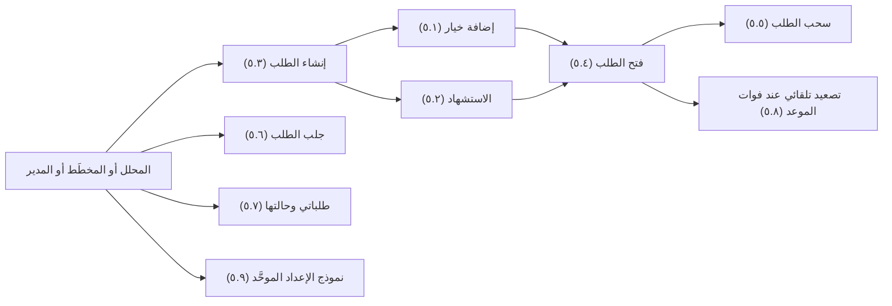
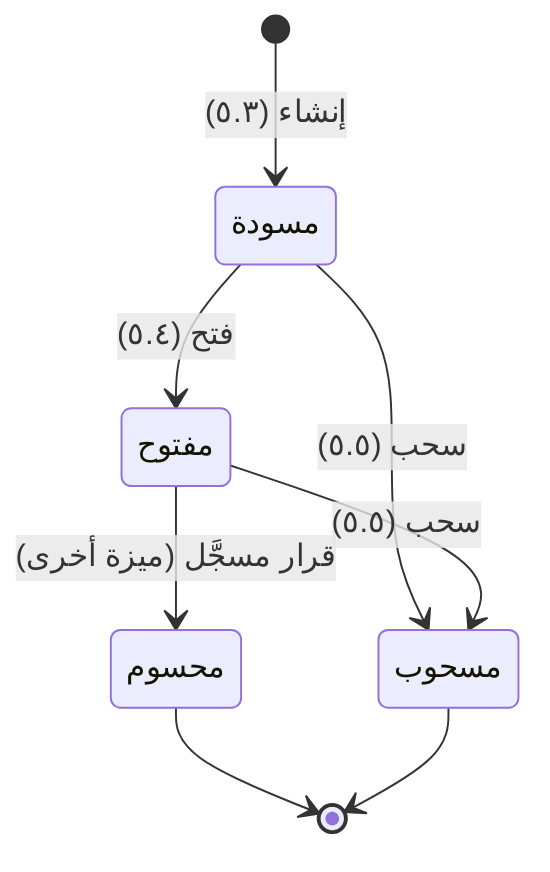

# إعداد طلب القرار

<!-- BEGIN GENERATED: doc -->
| البند | القيمة |
|---|---|
| المعرّف | FEAT-DEC-REQUESTS |
| الإصدار | 0.1 |
| الحالة | مسودة |
| القدرة | CAP-06 إدارة القرار |
| القدرة الفرعية | CAP-06.01 طلبات القرار والخيارات (R1) |
| الأدوار | المحلل؛ المخطِّط؛ المدير؛ النظام |
| الشاشات | SCR-05 طلبات قرار تنتظرني |
| حالات الاستخدام | UC-030، UC-031 |
| القصص | 9: 7 من المواصفة، و2 جديدة |
<!-- END GENERATED: doc -->

## 1. نظرة عامة

### 1.1 القيمة

يعرض المحلل أو المخطط على صاحب السلطة سؤالًا واضحًا بخيارات مدعومة بالتقييمات وموعد نهائي.

### 1.2 النطاق

| البند | القيمة |
|---|---|
| المستخدمون | المحلل؛ المخطِّط؛ المدير؛ النظام |
| الشاشات | SCR-05 طلبات قرار تنتظرني |
| حالات الاستخدام (بالكلمات) | إنشاء طلب قرار بسؤال ونوع قرار مطلوب ونطاق وموعد نهائي وتصنيف؛ إضافة خيار إلى الطلب؛ الاستشهاد بتقييم أو دليل فيه؛ فتحه بعد استيفاء الحد الأدنى من الخيارات والاستشهادات؛ سحبه بسبب؛ جلب الطلب بخياراته واستشهاداته؛ متابعة طلباتي وحالتها؛ التصعيد التلقائي إلى أصحاب السلطة عند فوات الموعد النهائي؛ إعداد الطلب بخياراته واستشهاداته في شاشة واحدة |
| المتطلبات (بالكلمات) | تسجيل كل طلب قرار بسؤاله وخياراته ومراجع تقييمه وموعده ونوع السلطة المطلوبة؛ عدم فتح طلب دون خيارين على الأقل واستشهاد واحد على الأقل |
| خارج النطاق | تسجيل القرار نفسه وفحص السلطة وقته (ميزة قرارات تنتظرني)؛ طلب القرار ضمن حالة التنسيق (ميزة المشاركة في التنسيق)؛ إبطال القرار وأساسه (ميزة سجل القرار وأساسه) |

### 1.3 خريطة الميزة

**الشكل 1: من إعداد الطلب إلى فتحه**



**الشكل 2: دورة حالات طلب القرار**



## 2. القواعد المشتركة

تنطبق على كل قصص الميزة، فلا تتكرر داخل القصص. وكل قصة تذكر ما يخصها فقط.

### 2.1 السياق المشترك

كل قصة تبدأ من ثلاثة شروط: مستأجر نشط، وحزمة السياسات الأساسية مفعّلة، ومستخدم مسجّل الدخول ومخوَّل. وتشير إليها القصص بخطوة واحدة: «بفرض السياق المشترك للميزة».

### 2.2 الصلاحية وعدم الإفصاح

- من لا يحق له رؤية العنصر يتلقى ردًا بشكل «غير متاح» تمامًا، فلا يعرف أنه موجود.
- من يرى العنصر ولا يحق له الإجراء يتلقى «لا تملك صلاحية هذا الإجراء».

### 2.3 أوامر تغيير الحالة

- **منع التكرار:** يُرسل كل أمر بمفتاح فريد، فإعادة الطلب نفسه لا تُنفَّذ مرتين.
- **حماية التعديل المتزامن:** يُرسل كل أمر بإصدار البيانات الذي يراه المستخدم. فإن عدّلها غيره في الأثناء، يُرفض الأمر.
- **السجل:** إن نجح الأمر، يُكتب حدثه وسجل التدقيق في المعاملة نفسها.

### 2.4 الرفض المشترك

```gherkin
# language: ar
خاصية: الرفض المشترك لأوامر الميزة

  سيناريو مخطط: رفض مشترك لكل أمر في الميزة
    بفرض السياق المشترك للميزة
    و <الحالة>
    عندما يُرسل المستخدم أي أمر من أوامر الميزة
    اذاً يُرفض برمز <الرمز> ويرى "<الرسالة>"
    و لا يتغير شيء

    امثلة:
      | الحالة                                  | الرمز                  | الرسالة                                                 |
      | العنصر خارج صلاحياته                    | NOT_FOUND              | غير متاح                                                |
      | العنصر مرئي له ولا يحق له الإجراء       | AUTHZ_DENIED           | لا تملك صلاحية هذا الإجراء                              |
      | غيره عدّل العنصر بعد أن فتحه            | VERSION_CONFLICT       | تغيّرت البيانات منذ فتحتها. راجع التغييرات ثم أعد المحاولة |
      | أعاد مفتاح منع التكرار بمحتوى مختلف     | IDEMPOTENCY_KEY_REUSED | طلب مكرر بمحتوى مختلف                                   |
      | البيانات ناقصة أو غير صحيحة             | VALIDATION_FAILED      | بعض البيانات ناقصة أو غير صحيحة. راجع الحقول المعلَّمة      |

  سيناريو: إعادة الطلب نفسه لا تُنفَّذ مرتين
    بفرض السياق المشترك للميزة
    و أمر نجح بمفتاح منع تكرار
    عندما يُعاد الطلب نفسه بالمفتاح نفسه
    اذاً تُعاد النتيجة الأولى ولا يُكتب حدث ثانٍ
```

## 3. الجودة وتعريف الاكتمال

### 3.1 متطلبات الجودة

<!-- BEGIN GENERATED: quality -->
لا متطلبات جودة مرتبطة بمتطلبات هذه الميزة مباشرة. تنطبق متطلبات المنصة العامة (`FEAT-PLT-*`).
<!-- END GENERATED: quality -->

### 3.2 تعريف الاكتمال

القصة مكتملة حين تتحقق الشروط الخمسة:

1. سيناريوهاتها والقواعد المشتركة تمر في الاختبار الآلي.
2. فحوص البنية المعمارية تمر.
3. نصوص الواجهة والرسائل موجودة بالعربية والإنجليزية.
4. مراجعة الكود مكتملة.
5. ما تضيفه القصة نفسها في قسم «القواعد» تحقق.

## 4. فهرس القصص

<!-- BEGIN GENERATED: story-index -->
| المعرّف | القصة | النوع | الحالة |
|---|---|---|---|
| `US-BC04-DRQ-ADD-OPTION` | إضافة خيار إلى طلب القرار | أمر | مسودة |
| `US-BC04-DRQ-CITE` | الاستشهاد في طلب القرار | أمر | مسودة |
| `US-BC04-DRQ-CREATE` | إنشاء طلب القرار | أمر | مسودة |
| `US-BC04-DRQ-OPEN` | فتح طلب القرار | أمر | مسودة |
| `US-BC04-DRQ-WITHDRAW` | سحب طلب القرار | أمر | مسودة |
| `US-BC04-Q-DRQ-GET` | جلب: Request with options and pinned citations (withheld per policy) | جلب | مسودة |
| `US-DOM-DEC-MY-REQUESTS` | طلبات القرار التي أعددتها وحالتها | جلب | مسودة |
| `US-BC04-S-DECISION-REQUEST-01` | تلقائي: deadline passed (طلب القرار) | نظام | مسودة |
| `US-UI-SCR05-REQUEST-FORM` | إعداد طلب القرار بخياراته واستشهاداته | واجهة | مسودة |
<!-- END GENERATED: story-index -->

## 5. القصص

### 5.1 US-BC04-DRQ-ADD-OPTION — إضافة خيار إلى طلب القرار

| النوع | الإصدار | الأولوية | دون اتصال | الحالة |
|---|---|---|---|---|
| أمر | R1 | Must | لا | مسودة |

> **كـ** المحلل أو المخطِّط أو المدير، **أريد** إضافة خيار إلى طلب القرار، **حتى** يقارن صاحب السلطة بين بدائل واضحة قبل أن يقرر.

**باختصار:** يضيف واضع الطلب خيارًا بنصه وأثره المتوقع إلى طلب قرار لم يُحسم بعد، ما دامت خياراته لا تتجاوز 10.

#### القواعد

- **متى يُسمح:** الطلب «مسودة» أو «مفتوح»، ونص الخيار مذكور، وعدد الخيارات لا يتجاوز 10.
- **من يُسمح له:** المحلل أو المخطِّط أو المدير.
- **البيانات:** نص الخيار (إلزامي)، والأثر المتوقع.
- **الأثر:** يُضاف الخيار إلى الطلب دون تغيير حالته؛ يصل الحدث إلى محرك البحث.

#### معايير القبول

```gherkin
# language: ar
خاصية: إضافة خيار إلى طلب القرار

  سيناريو: إضافة خيار إلى طلب لم يُحسم
    بفرض السياق المشترك للميزة
    و طلب قرار "مسودة" أو "مفتوح" فيه أقل من 10 خيارات
    عندما يضيف المستخدم خيارًا بنصه
    اذاً يُضاف الخيار إلى الطلب
    و يُسجَّل حدث "أُضيف خيار إلى طلب القرار"

  سيناريو مخطط: رفض خاص بإضافة الخيار
    بفرض السياق المشترك للميزة
    و <الحالة>
    عندما يحاول المستخدم إضافة خيار
    اذاً يُرفض برمز <الرمز> ويرى "<الرسالة>"
    و لا يتغير شيء

    امثلة:
      | الحالة                                | الرمز                                       | الرسالة                                            |
      | الطلب "محسوم" أو "مسحوب"              | DECISION_REQUEST_INVALID_STATE_TRANSITION   | الوضع الحالي لطلب القرار لا يسمح بهذا الإجراء    |
      | عدد الخيارات بلغ 10 خيارات             | DECISION_REQUEST_INVALID                    | بيانات طلب القرار غير مكتملة                       |
      | نص الخيار غير مذكور                    | VALIDATION_FAILED                           | نص الخيار مطلوب                                    |
```

<details><summary>المراجع التقنية والتتبع</summary>

<!-- BEGIN GENERATED: refs US-BC04-DRQ-ADD-OPTION -->
| البند | المعرّف | المعنى |
|---|---|---|
| الواجهة البرمجية | `POST /api/v1/operations/decision-requests/{id}/actions/add-option` | — |
| الأمر | `CMD-DRQ-ADD-OPTION` | إضافة خيار إلى طلب القرار |
| السياسة | `POL-DRQ-ADD-OPTION` | Analyst / Planner / Manager (create, add, cite, open, withdraw)؛ tenant match; object visible; org scope |
| الحدث | `EVT-DRQ-OPTION-ADDED` | يصل إلى: Search projection (SLC-05) |
| الكيان | `AGG-DECISION-REQUEST` | طلب القرار |
| الجدول | `operations.decision_requests` | الجدول الرئيسي لطلب القرار |
| وحدة النشر | DU-08 | — |
| المتطلب | REQ-DEC-001 | The system shall record each decision request with its question, options, assessment references, deadline and… |
| حالات الاستخدام | UC-030، UC-031 | Create Decision Request؛ Evaluate Decision Options |
| الاختبار | TST-DECISION-REQUEST-SM، TST-SLC08-INVARIANTS | دورة حالات طلب القرار، وثوابت الشريحة SLC-08 |
<!-- END GENERATED: refs US-BC04-DRQ-ADD-OPTION -->

</details>

### 5.2 US-BC04-DRQ-CITE — الاستشهاد في طلب القرار

| النوع | الإصدار | الأولوية | دون اتصال | الحالة |
|---|---|---|---|---|
| أمر | R1 | Must | لا | مسودة |

> **كـ** المحلل أو المخطِّط أو المدير، **أريد** الاستشهاد بتقييم أو دليل في طلب القرار، **حتى** يبني صاحب السلطة قراره على أساس موثّق.

**باختصار:** يستشهد واضع الطلب بتقييم أو دليل مرئي له بإصدار مثبت، ما دام تصنيفه لا يتجاوز تصنيف الطلب، وما دام الطلب لم يُحسم بعد.

#### القواعد

- **متى يُسمح:** الطلب «مسودة» أو «مفتوح»، والمرجع المستشهد به مرئي للمستخدم ومثبّت الإصدار، وتصنيفه لا يتجاوز تصنيف الطلب.
- **من يُسمح له:** المحلل أو المخطِّط أو المدير.
- **البيانات:** مراجع الاستشهاد (إلزامي).
- **الأثر:** تُضاف الاستشهادات إلى الطلب دون تغيير حالته؛ يصل الحدث إلى محرك البحث.

#### معايير القبول

```gherkin
# language: ar
خاصية: الاستشهاد في طلب القرار

  سيناريو: الاستشهاد بمرجع مرئي بتصنيف مناسب
    بفرض السياق المشترك للميزة
    و طلب قرار "مسودة" أو "مفتوح"، ومرجع مرئي للمستخدم تصنيفه لا يتجاوز تصنيف الطلب
    عندما يستشهد المستخدم بالمرجع
    اذاً يُضاف الاستشهاد إلى الطلب
    و يُسجَّل حدث "استُشهد في طلب القرار"

  سيناريو مخطط: رفض خاص بالاستشهاد
    بفرض السياق المشترك للميزة
    و <الحالة>
    عندما يحاول المستخدم الاستشهاد بمرجع
    اذاً يُرفض برمز <الرمز> ويرى "<الرسالة>"
    و لا يتغير شيء

    امثلة:
      | الحالة                                       | الرمز                                       | الرسالة                                           |
      | الطلب "محسوم" أو "مسحوب"                     | DECISION_REQUEST_INVALID_STATE_TRANSITION   | الوضع الحالي لطلب القرار لا يسمح بهذا الإجراء    |
      | تصنيف المرجع أعلى من تصنيف الطلب             | CITATION_ABOVE_LABEL                        | لا يمكن الاستشهاد بمادة تصنيفها أعلى من تصنيف الطلب |
      | مراجع الاستشهاد غير مذكورة                   | VALIDATION_FAILED                           | مراجع الاستشهاد مطلوبة                             |
```

<details><summary>المراجع التقنية والتتبع</summary>

<!-- BEGIN GENERATED: refs US-BC04-DRQ-CITE -->
| البند | المعرّف | المعنى |
|---|---|---|
| الواجهة البرمجية | `POST /api/v1/operations/decision-requests/{id}/actions/cite` | — |
| الأمر | `CMD-DRQ-CITE` | الاستشهاد في طلب القرار |
| السياسة | `POL-DRQ-CITE` | Analyst / Planner / Manager (create, add, cite, open, withdraw)؛ tenant match; object visible; org scope |
| الحدث | `EVT-DRQ-CITED` | يصل إلى: Search projection (SLC-05) |
| الكيان | `AGG-DECISION-REQUEST` | طلب القرار |
| الجدول | `operations.decision_requests` | الجدول الرئيسي لطلب القرار |
| وحدة النشر | DU-08 | — |
| المتطلب | REQ-DEC-001 | The system shall record each decision request with its question, options, assessment references, deadline and… |
| حالات الاستخدام | UC-030، UC-031 | Create Decision Request؛ Evaluate Decision Options |
| الاختبار | TST-DECISION-REQUEST-SM، TST-SLC08-INVARIANTS | دورة حالات طلب القرار، وثوابت الشريحة SLC-08 |
<!-- END GENERATED: refs US-BC04-DRQ-CITE -->

</details>

### 5.3 US-BC04-DRQ-CREATE — إنشاء طلب القرار

| النوع | الإصدار | الأولوية | دون اتصال | الحالة |
|---|---|---|---|---|
| أمر | R1 | Must | لا | مسودة |

> **كـ** المحلل أو المخطِّط أو المدير، **أريد** إنشاء طلب قرار بسؤال واضح ونوع القرار المطلوب وموعد نهائي، **حتى** يعرف صاحب السلطة بالضبط ما عليه أن يقرره ومتى.

**باختصار:** ينشئ واضع الطلب طلب قرار بسؤاله ونوع القرار المطلوب ونطاقه وموعده النهائي وتصنيفه، فيصير «مسودة» جاهزًا لإضافة الخيارات والاستشهادات.

#### القواعد

- **متى يُسمح:** لا يوجد الطلب من قبل؛ السؤال ونوع القرار المطلوب من الأنواع المعتمدة والنطاق والموعد النهائي والتصنيف مذكورة.
- **من يُسمح له:** المحلل أو المخطِّط أو المدير.
- **البيانات:** السؤال، ونوع القرار المطلوب، والنطاق، والموعد النهائي، ومراجع السياق، والتصنيف الأمني.
- **الأثر:** يُنشأ طلب قرار جديد بحالة «مسودة»؛ يصل الحدث إلى محرك البحث.

#### معايير القبول

```gherkin
# language: ar
خاصية: إنشاء طلب القرار

  سيناريو: إنشاء طلب قرار بسؤال ونوع قرار مطلوب
    بفرض السياق المشترك للميزة
    عندما ينشئ المستخدم طلب قرار بسؤال ونوع قرار مطلوب ونطاق وموعد نهائي وتصنيف
    اذاً يُنشأ طلب قرار جديد بحالة "مسودة"
    و يُسجَّل حدث "أُنشئ طلب القرار"

  سيناريو مخطط: رفض خاص بإنشاء الطلب
    بفرض السياق المشترك للميزة
    و <الحالة>
    عندما يحاول المستخدم إنشاء طلب القرار
    اذاً يُرفض برمز <الرمز> ويرى "<الرسالة>"
    و لا يتغير شيء

    امثلة:
      | الحالة                                                | الرمز                  | الرسالة                           |
      | نوع القرار المطلوب ليس من الأنواع المعتمدة           | DECISION_REQUEST_INVALID | بيانات طلب القرار غير مكتملة    |
      | السؤال غير مذكور                                      | VALIDATION_FAILED       | السؤال مطلوب                      |
```

<details><summary>المراجع التقنية والتتبع</summary>

<!-- BEGIN GENERATED: refs US-BC04-DRQ-CREATE -->
| البند | المعرّف | المعنى |
|---|---|---|
| الواجهة البرمجية | `POST /api/v1/operations/decision-requests` | — |
| الأمر | `CMD-DRQ-CREATE` | إنشاء طلب القرار |
| السياسة | `POL-DRQ-CREATE` | Analyst / Planner / Manager (create, add, cite, open, withdraw)؛ tenant match; object visible; org scope |
| الحدث | `EVT-DRQ-CREATED` | يصل إلى: Search projection (SLC-05) |
| الكيان | `AGG-DECISION-REQUEST` | طلب القرار |
| الجدول | `operations.decision_requests` | الجدول الرئيسي لطلب القرار |
| وحدة النشر | DU-08 | — |
| المتطلب | REQ-DEC-001 | The system shall record each decision request with its question, options, assessment references, deadline and… |
| حالات الاستخدام | UC-030، UC-031 | Create Decision Request؛ Evaluate Decision Options |
| الاختبار | TST-DECISION-REQUEST-SM، TST-SLC08-INVARIANTS | دورة حالات طلب القرار، وثوابت الشريحة SLC-08 |
<!-- END GENERATED: refs US-BC04-DRQ-CREATE -->

</details>

### 5.4 US-BC04-DRQ-OPEN — فتح طلب القرار

| النوع | الإصدار | الأولوية | دون اتصال | الحالة |
|---|---|---|---|---|
| أمر | R1 | Must | لا | مسودة |

> **كـ** المحلل أو المخطِّط أو المدير، **أريد** فتح طلب القرار بعد استيفاء خياراته واستشهاداته، **حتى** يصل إلى صاحب السلطة جاهزًا للقرار.

**باختصار:** يفتح واضع الطلب طلبًا «مسودة» فيه خياران على الأقل (أحدهما قد يكون «عدم اتخاذ إجراء») واستشهاد واحد على الأقل، فيصير «مفتوحًا» ويصل إلى صاحب السلطة.

#### القواعد

- **متى يُسمح:** الطلب «مسودة»، وفيه خياران على الأقل، واستشهاد واحد على الأقل.
- **من يُسمح له:** المحلل أو المخطِّط أو المدير.
- **الأثر:** يصبح الطلب «مفتوحًا»؛ يصل الحدث إلى من يملك السلطة المطلوبة عبر الإشعار ومحرك البحث.

#### معايير القبول

```gherkin
# language: ar
خاصية: فتح طلب القرار

  سيناريو: فتح طلب مسودة استوفى خياراته واستشهاداته
    بفرض السياق المشترك للميزة
    و طلب قرار "مسودة" فيه خياران على الأقل واستشهاد واحد على الأقل
    عندما يفتحه المستخدم
    اذاً يصبح الطلب "مفتوحًا"
    و يُسجَّل حدث "فُتح طلب القرار"

  سيناريو مخطط: رفض خاص بالفتح
    بفرض السياق المشترك للميزة
    و <الحالة>
    عندما يحاول المستخدم فتح الطلب
    اذاً يُرفض برمز <الرمز> ويرى "<الرسالة>"
    و لا يتغير شيء

    امثلة:
      | الحالة                                           | الرمز                                       | الرسالة                                          |
      | الطلب ليس "مسودة"                                | DECISION_REQUEST_INVALID_STATE_TRANSITION   | الوضع الحالي لطلب القرار لا يسمح بهذا الإجراء  |
      | أقل من خيارين أو بلا استشهاد واحد على الأقل      | DECISION_REQUEST_INCOMPLETE                 | طلب القرار يحتاج خيارين على الأقل ومرجعًا واحدًا |
```

<details><summary>المراجع التقنية والتتبع</summary>

<!-- BEGIN GENERATED: refs US-BC04-DRQ-OPEN -->
| البند | المعرّف | المعنى |
|---|---|---|
| الواجهة البرمجية | `POST /api/v1/operations/decision-requests/{id}/actions/open` | — |
| الأمر | `CMD-DRQ-OPEN` | فتح طلب القرار |
| السياسة | `POL-DRQ-OPEN` | Analyst / Planner / Manager (create, add, cite, open, withdraw)؛ tenant match; object visible; org scope |
| الحدث | `EVT-DRQ-OPENED` | يصل إلى: Search projection (SLC-05) |
| الكيان | `AGG-DECISION-REQUEST` | طلب القرار |
| الجدول | `operations.decision_requests` | الجدول الرئيسي لطلب القرار |
| وحدة النشر | DU-08 | — |
| المتطلب | REQ-DEC-001 | The system shall record each decision request with its question, options, assessment references, deadline and… |
| حالات الاستخدام | UC-030، UC-031 | Create Decision Request؛ Evaluate Decision Options |
| الاختبار | TST-DECISION-REQUEST-SM، TST-SLC08-INVARIANTS | دورة حالات طلب القرار، وثوابت الشريحة SLC-08 |
<!-- END GENERATED: refs US-BC04-DRQ-OPEN -->

</details>

### 5.5 US-BC04-DRQ-WITHDRAW — سحب طلب القرار

| النوع | الإصدار | الأولوية | دون اتصال | الحالة |
|---|---|---|---|---|
| أمر | R1 | Must | لا | مسودة |

> **كـ** المحلل أو المخطِّط أو المدير، **أريد** سحب طلب القرار بسبب، **حتى** أوقف طلبًا لم يعد مطلوبًا قبل أن يُحسم.

**باختصار:** يسحب واضع الطلب طلبًا «مسودة» أو «مفتوحًا» بسبب يذكره، فيصير «مسحوبًا» نهائيًا.

#### القواعد

- **متى يُسمح:** الطلب «مسودة» أو «مفتوح»، والسبب مذكور.
- **من يُسمح له:** المحلل أو المخطِّط أو المدير.
- **البيانات:** سبب السحب (إلزامي).
- **الأثر:** يصبح الطلب «مسحوبًا» نهائيًا؛ يصل الحدث إلى محرك البحث.

#### معايير القبول

```gherkin
# language: ar
خاصية: سحب طلب القرار

  سيناريو: سحب طلب لم يُحسم بسبب
    بفرض السياق المشترك للميزة
    و طلب قرار "مسودة" أو "مفتوح"
    عندما يسحبه المستخدم بسبب
    اذاً يصبح الطلب "مسحوبًا"
    و يُسجَّل حدث "سُحب طلب القرار"

  سيناريو مخطط: رفض خاص بالسحب
    بفرض السياق المشترك للميزة
    و <الحالة>
    عندما يحاول المستخدم سحب الطلب
    اذاً يُرفض برمز <الرمز> ويرى "<الرسالة>"
    و لا يتغير شيء

    امثلة:
      | الحالة                                | الرمز                                       | الرسالة                                          |
      | الطلب "محسوم" أو "مسحوب" سلفًا        | DECISION_REQUEST_INVALID_STATE_TRANSITION   | الوضع الحالي لطلب القرار لا يسمح بهذا الإجراء  |
      | السبب غير مذكور                        | REASON_REQUIRED                             | اذكر السبب                                       |
```

<details><summary>المراجع التقنية والتتبع</summary>

<!-- BEGIN GENERATED: refs US-BC04-DRQ-WITHDRAW -->
| البند | المعرّف | المعنى |
|---|---|---|
| الواجهة البرمجية | `POST /api/v1/operations/decision-requests/{id}/actions/withdraw` | — |
| الأمر | `CMD-DRQ-WITHDRAW` | سحب طلب القرار |
| السياسة | `POL-DRQ-WITHDRAW` | Analyst / Planner / Manager (create, add, cite, open, withdraw)؛ tenant match; object visible; org scope |
| الحدث | `EVT-DRQ-WITHDRAWN` | يصل إلى: Search projection (SLC-05) |
| الكيان | `AGG-DECISION-REQUEST` | طلب القرار |
| الجدول | `operations.decision_requests` | الجدول الرئيسي لطلب القرار |
| وحدة النشر | DU-08 | — |
| المتطلب | REQ-DEC-001 | The system shall record each decision request with its question, options, assessment references, deadline and… |
| حالات الاستخدام | UC-030، UC-031 | Create Decision Request؛ Evaluate Decision Options |
| الاختبار | TST-DECISION-REQUEST-SM، TST-SLC08-INVARIANTS | دورة حالات طلب القرار، وثوابت الشريحة SLC-08 |
<!-- END GENERATED: refs US-BC04-DRQ-WITHDRAW -->

</details>

### 5.6 US-BC04-Q-DRQ-GET — جلب طلب القرار بخياراته واستشهاداته

| النوع | الإصدار | الأولوية | دون اتصال | الحالة |
|---|---|---|---|---|
| جلب | R1 | Must | لا | مسودة |

> **كـ** أي مستخدم مخوَّل، **أريد** جلب طلب القرار بخياراته واستشهاداته، **حتى** أراجع ما يُطرح للقرار بالتفصيل.

**باختصار:** يعيد النظام الطلب بخياراته واستشهاداته، ويحجب من الاستشهادات ما يتجاوز تصنيفه تصريح المستخدم.

#### القواعد

- **من يُسمح له:** من يحق له رؤية الطلب بقاعدة التصنيف، ومن يملك السلطة المطلوبة ضمن نطاق الطلب.

#### معايير القبول

```gherkin
# language: ar
خاصية: جلب طلب القرار بخياراته واستشهاداته

  سيناريو: جلب طلب بكل استشهاداته المرئية للمستخدم
    بفرض السياق المشترك للميزة
    و طلب قرار مرئي للمستخدم بخيارات واستشهادات ضمن تصريحه
    عندما يطلب المستخدم الطلب
    اذاً يُعاد الطلب بخياراته وكل استشهاداته

  سيناريو: يُحجب استشهاد يتجاوز تصنيفه تصريح المستخدم
    بفرض السياق المشترك للميزة
    و طلب قرار مرئي للمستخدم، فيه استشهاد تصنيفه أعلى من تصريحه
    عندما يطلب المستخدم الطلب
    اذاً يُعاد الطلب بخياراته
    و لا يظهر الاستشهاد الذي يتجاوز تصنيفه تصريحه
```

<details><summary>المراجع التقنية والتتبع</summary>

<!-- BEGIN GENERATED: refs US-BC04-Q-DRQ-GET -->
| البند | المعرّف | المعنى |
|---|---|---|
| الواجهة البرمجية | `GET /api/v1/operations/decision-requests/{request_id}` | — |
| الاستعلام | `QRY-DRQ-GET` | Request with options and pinned citations (withheld per policy) |
| السياسة | `POL-DRQ-GET` | label rule; required-authority holders in scope |
| الكيان | `AGG-DECISION-REQUEST` | طلب القرار |
| الجدول | `operations.decision_requests` | الجدول الرئيسي لطلب القرار |
| وحدة النشر | DU-08 | — |
| المتطلب | REQ-DEC-001 | The system shall record each decision request with its question, options, assessment references, deadline and… |
| حالات الاستخدام | UC-030، UC-031 | Create Decision Request؛ Evaluate Decision Options |
| الاختبار | TST-DECISION-REQUEST-SM، TST-SLC08-INVARIANTS | دورة حالات طلب القرار، وثوابت الشريحة SLC-08 |
<!-- END GENERATED: refs US-BC04-Q-DRQ-GET -->

</details>

### 5.7 US-DOM-DEC-MY-REQUESTS — طلبات القرار التي أعددتها وحالتها

| النوع | الإصدار | الأولوية | دون اتصال | الحالة |
|---|---|---|---|---|
| جلب | R1 | Must | لا | مسودة |

> **كـ** المحلل أو المخطِّط أو المدير، **أريد** قائمة بطلبات القرار التي أعددتها وحالة كل منها، **حتى** أتابع ما قدمته وأعرف ما يحتاج فتحًا أو سحبًا.

**باختصار:** تُعاد الطلبات التي أنشأها المستخدم مرتبة بالأحدث إنشاءً، بحالتها الحالية («مسودة» أو «مفتوح» أو «محسوم» أو «مسحوب»).

#### القواعد

- **[Derived] من يُسمح له:** من أنشأ الطلب فقط.
- **المرشحات:** الحالة؛ والمؤشر والحد.

#### معايير القبول

```gherkin
# language: ar
خاصية: طلبات القرار التي أعددتها وحالتها

  سيناريو: يرى واضع الطلب طلباته فقط وحالتها
    بفرض السياق المشترك للميزة
    و طلبات قرار أنشأها المستخدم وأخرى أنشأها غيره
    عندما يطلب المستخدم قائمة طلباته
    اذاً تُعاد الطلبات التي أنشأها فقط، الأحدث إنشاءً أولًا، بحالتها الحالية
```

<details><summary>المراجع التقنية والتتبع</summary>

<!-- BEGIN GENERATED: refs US-DOM-DEC-MY-REQUESTS -->
| البند | المعرّف | المعنى |
|---|---|---|
| حالة الاستخدام | UC-030 | Create Decision Request |
| المصدر | `[Derived]` | — |
| المتطلب | REQ-DEC-001 | The system shall record each decision request with its question, options, assessment references, deadline and… |
| حالات الاستخدام | UC-030، UC-031 | Create Decision Request؛ Evaluate Decision Options |
<!-- END GENERATED: refs US-DOM-DEC-MY-REQUESTS -->

</details>

### 5.8 US-BC04-S-DECISION-REQUEST-01 — تصعيد طلب القرار عند فوات موعده النهائي

| النوع | الإصدار | الأولوية | دون اتصال | الحالة |
|---|---|---|---|---|
| نظام | R1 | Must | لا ينطبق | مسودة |

> **كـ** النظام، **أريد** تصعيد طلب القرار إلى من يملك السلطة المطلوبة حين يفوت موعده النهائي، **حتى** لا يبقى معلّقًا دون من يلتفت إليه.

**باختصار:** يفحص النظام الطلبات «المفتوحة» عند موعدها النهائي، ويصعّدها إلى من يملك السلطة المطلوبة في نطاقها، دون تغيير حالتها.

#### القواعد

- **متى يحدث:** فوات الموعد النهائي لطلب «مفتوح».
- **الأثر:** يصل التصعيد إلى من يملك السلطة المطلوبة في نطاق الطلب؛ تبقى الحالة «مفتوحة».

#### معايير القبول

```gherkin
# language: ar
خاصية: تصعيد طلب القرار عند فوات موعده النهائي

  سيناريو: فات الموعد النهائي لطلب مفتوح
    بفرض طلب قرار "مفتوح" تجاوز موعده النهائي
    عندما يحين وقت فحص المجدول
    اذاً تبقى حالته "مفتوحة"
    و يُسجَّل حدث "صُعِّد طلب القرار" وسجل تدقيق بهوية النظام

  سيناريو: طلب محسوم لا يُصعَّد
    بفرض طلب قرار "محسوم" تجاوز موعده النهائي
    عندما يحين وقت فحص المجدول
    اذاً لا يُسجَّل أي تصعيد
```

<details><summary>المراجع التقنية والتتبع</summary>

<!-- BEGIN GENERATED: refs US-BC04-S-DECISION-REQUEST-01 -->
| البند | المعرّف | المعنى |
|---|---|---|
| المحفِّز | `SYS:deadline passed` | escalates to holders of the required authority in scope |
| الانتقال | OPEN ← (بلا تغيير) | — |
| الحدث | `EVT-DRQ-ESCALATED` | يصل إلى: Search projection (SLC-05) |
| الكيان | `AGG-DECISION-REQUEST` | طلب القرار |
| الجدول | `operations.decision_requests` | الجدول الرئيسي لطلب القرار |
| وحدة النشر | DU-08 | — |
| المتطلب | REQ-DEC-001 | The system shall record each decision request with its question, options, assessment references, deadline and… |
| حالات الاستخدام | UC-030، UC-031 | Create Decision Request؛ Evaluate Decision Options |
| الاختبار | TST-DECISION-REQUEST-SM، TST-SLC08-INVARIANTS | دورة حالات طلب القرار، وثوابت الشريحة SLC-08 |
<!-- END GENERATED: refs US-BC04-S-DECISION-REQUEST-01 -->

</details>

### 5.9 US-UI-SCR05-REQUEST-FORM — إعداد طلب القرار بخياراته واستشهاداته

| النوع | الإصدار | الأولوية | دون اتصال | الحالة |
|---|---|---|---|---|
| واجهة | R1 | Must | لا | مسودة |

> **كـ** المحلل أو المخطِّط أو المدير، **أريد** إعداد طلب القرار بسؤاله وخياراته واستشهاداته في شاشة واحدة، **حتى** أنجز الطلب كاملًا قبل فتحه دون التنقل بين شاشات متعددة.

**باختصار:** تجمع الشاشة إنشاء الطلب وإضافة خياراته والاستشهاد فيه في نموذج واحد، وتوضح للمستخدم عدد الخيارات والاستشهادات المتبقية حتى يصبح جاهزًا للفتح.

#### القواعد

- **العرض:** عداد يوضح الحد الأدنى غير المستوفى (خياران، استشهاد واحد) قبل تفعيل زر الفتح (**[Derived]**).

#### معايير القبول

```gherkin
# language: ar
خاصية: إعداد طلب القرار بخياراته واستشهاداته

  سيناريو: المستخدم يرى ما تبقى قبل الفتح
    بفرض السياق المشترك للميزة
    و المستخدم يعد طلب قرار بخيار واحد وبلا استشهاد
    عندما يفتح نموذج إعداد الطلب
    اذاً يرى عداد يوضح أن خيارًا آخر واستشهادًا واحدًا على الأقل مطلوبان قبل الفتح
```

<details><summary>المراجع التقنية والتتبع</summary>

<!-- BEGIN GENERATED: refs US-UI-SCR05-REQUEST-FORM -->
| البند | المعرّف | المعنى |
|---|---|---|
| الشاشة | SCR-05 | شاشة طلبات قرار تنتظرني |
| المصدر | `THR-S08-05` | — |
| المصدر | `[Derived]` | — |
| المتطلب | REQ-DEC-001 | The system shall record each decision request with its question, options, assessment references, deadline and… |
| حالات الاستخدام | UC-030، UC-031 | Create Decision Request؛ Evaluate Decision Options |
<!-- END GENERATED: refs US-UI-SCR05-REQUEST-FORM -->

</details>

## 6. التتبع

<!-- BEGIN GENERATED: trace -->
| المتطلب | المعنى | القصص | الاختبار |
|---|---|---|---|
| REQ-DEC-001 | The system shall record each decision request with its question, options, assessment references, deadline and… | `US-BC04-DRQ-ADD-OPTION`، `US-BC04-DRQ-CITE`، `US-BC04-DRQ-CREATE`، `US-BC04-DRQ-OPEN`، `US-BC04-DRQ-WITHDRAW`، `US-BC04-Q-DRQ-GET`، `US-BC04-S-DECISION-REQUEST-01`، `US-DOM-DEC-MY-REQUESTS`، `US-UI-SCR05-REQUEST-FORM` | TST-DECISION-REQUEST-SM، TST-SLC08-INVARIANTS |
<!-- END GENERATED: trace -->

## 7. سجل التغييرات

| الإصدار | التاريخ | التغيير |
|---|---|---|
| 0.1 | — | هيكل مولَّد من خريطة الميزات |
| 0.2 | 2026-10-13 | كتابة القصص كاملة بمعيار القصص |
